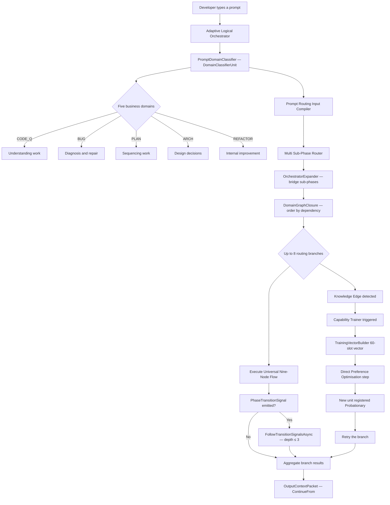
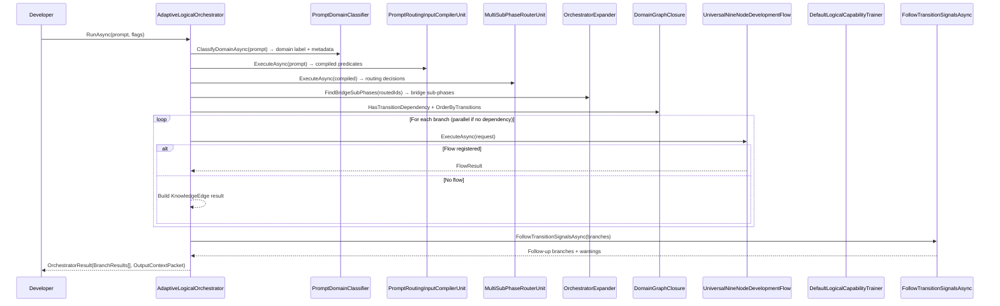
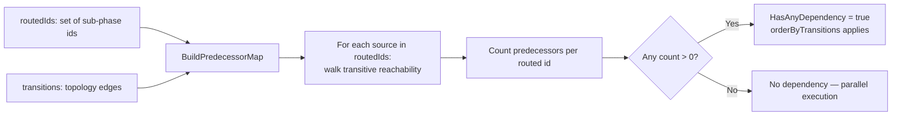

# LlmFromScratch — Implementation Documentation
# Version: 7.0 — 2026-05-07
# Covers: all flows, entities, parameters, algorithms, and code references
# Source: code review of live llm_mvp_core, test suite 1289/1289
# Changes from v6:
#   - Section 1: project 21 now references 12, 17, 22, 23, 29 — structural gap partially closed
#   - Section 3: domain classifier now wired into orchestrator runtime path (PromptDomainClassifier)
#   - Section 3: context carry-forward now wired (BuildContextPacket / OutputContextPacket / ContinueFrom)
#   - Section 3: phase transition signals now wired (FollowTransitionSignalsAsync, depth cap 3, floor 0.40)
#   - Section 3: OrchestratorExpander (E49) now wired (ExpandRoutedDecisions / FindBridgeSubPhases)
#   - Section 3: DomainGraphClosure (E50) now wired (BuildDynamicDomainTransitions / OrderByTransitions)
#   - Section 4: TrainingVectorBuilder (60-slot vector) now wired into capability trainer training text
#   - New Section 18a: project 23 SemanticCompilerAdapter — all five classes documented
#   - New Section 18b: project 17 DynamicDomains — DomainGraphClosure and OrchestratorExpander documented
#   - Section 19 gap inventory: A51-A54 closed and verified against pushed code
#   - Project structure: new projects 07, 08, 12(SearchEngine), 13, 14, 23(OssEquivalents),
#     24, 28, 33, 36, desktop projects, and build-state.json status documented

---

## Contents

1. System Overview — how the parts connect
2. Core Contracts — the three interfaces every component implements
3. The Orchestration Flow — from raw prompt to result
4. The Prompt Compiler — turning text into predicate evidence
5. The Sub-Phase Router — scoring and selecting development areas
6. The Capability Trainer — learning from knowledge edges
7. The Transformer Language Model — the base neural network
8. Low-Rank Adaptation — lightweight expertise specialisation
9. Direct Preference Optimisation — teaching the model from corrections
10. The Tokeniser — converting text to token identifiers
11. The Embedding Model — turning text into searchable vectors
12. Hierarchical Navigable Small World Index — fast nearest-neighbour search
13. The Knowledge Nearest-Neighbour Unit — retrieval-based logical cells
14. The Transformer Embedding Nearest-Neighbour Unit — deep retrieval
15. The Teaching Registry — persisting what has been learned
16. The Topology Registry — the map of all development areas
17. Entity Reference — all key types and their fields
18. The Semantic Compiler Adapter — project 23 bridge classes
19. Dynamic Domains — project 17 graph algorithms
20. RegexPreprocessor and Expression Completion — E10 and E13B
21. Project Structure Reference
22. Implementation Gap Inventory

---

## 1. System Overview



**What changed since v6:**

Project 21 (the execution agent) now references projects 12, 17, 22, 23, and 29 in
addition to the original 00, 01, 03, 05, 06, 10, and 11. This closes the structural
gap that made every proven component invisible to the runtime orchestrator. The
following five capabilities are now wired into the live execution path:

- **Domain classification**: `PromptDomainClassifier` wraps `DomainClassifierUnit`
  from project 23 and is called at the start of every orchestrator request. Domain
  label, confidence, evidence terms, and context flag are added to metadata before
  routing.
- **Context carry-forward**: `BuildContextPacket` assembles completed branch results
  into a `LogicalContextPacket`. The packet is written to `context.packet` in metadata
  and surfaced as `OutputContextPacket` on the result. `ContinueFrom` factory method
  lets callers chain requests across sessions.
- **Phase transition signals**: `FollowTransitionSignalsAsync` reads
  `PhaseTransitionSignal` records emitted by flow nodes, re-classifies the domain,
  and re-routes the transition prompt. Depth cap is 3. Transitions with domain
  confidence below 0.40 are skipped with a warning.
- **OrchestratorExpander**: `ExpandRoutedDecisions` calls
  `OrchestratorExpander.FindBridgeSubPhases` after routing to insert topology bridge
  sub-phases that lie between any two routed endpoints.
- **DomainGraphClosure**: `BuildDynamicDomainTransitions` adapts the topology registry
  into `DynamicDomainTransition` records. `HasTransitionDependency` and
  `OrderByTransitions` use `DomainGraphClosure.BuildPredecessorMap` to order
  dependent branches before execution.

**Structural gap closure since this document was drafted:**

A51 is now closed in pushed code. The production-class copies were removed from
`35.ExperimentsV2/Infrastructure/`. Historical compatibility surfaces that are still
needed by experiment fixtures were moved to `35.ExperimentsV2/Compatibility/`, and
`Tests/ExperimentInfrastructureConsolidationTests.cs` now guards that the
Infrastructure folder stays clean.

**Three execution paths — current status:**

```
Path A — Runtime prompt path
  Now active:   PromptDomainClassifier (DomainClassifierUnit from project 23)
                TrainingVectorBuilder 60-slot vector in capability trainer training text
                OrchestratorExpander bridge insertion (E49)
                DomainGraphClosure dependency ordering (E50)
  Still planned: SemanticCompilerFacade full pipeline (E01/E15/E16/E17/E18/E20/E21)
                 AttributedSegmentRouter per-segment routing (E24)

Path B — Training path
  Now active:   TrainingVectorBuilder.Build() called in BuildCapabilityTrainingText
                teaching_vector_60 field appended to training text
                ReplayBuffer capacity cap in project 16 (A54 closed)
                trainer manifest cache avoids repeated full-root deserialisation (A54 closed)
  Still planned: IdleDetector gate (E41)
                 TrustScorer promotion (E40V2)

Path C — Result translation
  Still planned: ResultTranslatorUnit → TemplateBeautifier (E23) in node 06
```

---

## 2. Core Contracts

```mermaid
classDiagram
    class ILogicalUnit {
        <<interface>>
        +ExecuteAsync(request, cancellation) Task~OperationResult~LogicalUnitResult~~
    }
    class ILogicalFlow {
        <<interface>>
        +ExecuteAsync(request, cancellation) Task~OperationResult~LogicalFlowResult~~
    }
    class ILogicalOrchestrator {
        <<interface>>
        +RunAsync(request, cancellation) Task~OperationResult~LogicalOrchestratorResult~~
    }
    ILogicalUnit <|.. KnnLogicalUnit
    ILogicalUnit <|.. TransformerEmbeddingKnnLogicalUnit
    ILogicalUnit <|.. LogicalDpoTrainingUnit
    ILogicalUnit <|.. PromptRoutingInputCompilerUnit
    ILogicalUnit <|.. MultiSubPhaseRouterUnit
    ILogicalUnit <|.. PromptDomainClassifierUnit
    ILogicalUnit <|.. ExpressionCompletionUnit
    ILogicalUnit <|.. AddDomainTopologyMutationUnit
    ILogicalFlow <|.. UniversalNineNodeDevelopmentFlow
    ILogicalFlow <|.. SecurityVerification34FlowAdapter
    ILogicalFlow <|.. TopologyMutationFlow
    ILogicalOrchestrator <|.. AdaptiveLogicalOrchestrator
```



**New unit types since v6:**

`PromptDomainClassifierUnit` — implements `ILogicalUnit<string, PromptDomainClassification>`.
Wraps `DomainClassifierUnit` from project 23. Called via `ClassifyDomainAsync` at the
start of every orchestrator request. Resolvable from the unit registry — a learned
replacement can be registered at role `"domain_classifier"`.

`ExpressionCompletionUnit` — implements `ILogicalUnit<string, string>`. Thin wrapper
over `ExpressionCompletionCore` from project 23. Binary exact-memory lookup:
confidence 1.0 on match, 0.0 on no-match. Participates in KNN scoring matrix like
any other unit. See Section 20.

`AddDomainTopologyMutationUnit`, `AddPhaseTopologyMutationUnit`,
`AddSubPhaseTopologyMutationUnit`, `AddTransitionTopologyMutationUnit` — implement
`ILogicalUnit` for their respective command/entry type pairs. Used by
`TopologyMutationFlow` to extend the topology registry at runtime.

`ILogicalFlowFactory<TInput>` — new interface. Creates a flow instance at execution
time so learned units can be selected before construction. Carries
`LogicalFlowFactoryRequest` with `MinimumTrustState` (default `Trusted`).

`PhaseTransitionSignal` — new record on `LogicalUnitResult`. Optional advisory from
a flow node requesting a follow-up orchestration pass on a different prompt. Fields:
`SuggestedDomain`, `TransitionPrompt`, `SourceNodeId`, `SourceSubPhaseId`,
`EvidenceIds`.

**Code reference:**

`21.AgentInfrastructure.Logical.LogicalContracts`
- `ILogicalUnit<TInput, TOutput>.ExecuteAsync`
- `ILogicalFlow<TInput>.ExecuteAsync`
- `ILogicalOrchestrator.RunAsync`
- `PhaseTransitionSignal` record — line 114
- `LogicalUnitResult.TransitionSignal` optional property — line 110
- `LogicalOrchestratorResult.OutputContextPacket` — line 220
- `LogicalFlowResult.TransitionSignals[]` — line 166

---

## 3. The Orchestration Flow



**Domain classification wiring (new since v6):**

`ClassifyDomainAsync` runs before compilation and routing on every request. It
resolves the domain classifier through the unit registry first — if a learned
replacement has been registered at `PromptDomainClassifierUnit.Role`, it is used.
Otherwise the deterministic `PromptDomainClassifierUnit` fallback runs. The domain
label, confidence, and evidence terms are added to request metadata under
`domain.label`, `domain.confidence`, and `domain.evidence_terms` keys. These keys
travel through all subsequent flow execution and appear in flow result metrics.

**OrchestratorExpander wiring (E49, new since v6):**

After routing produces a set of decisions, `ExpandRoutedDecisions` calls
`OrchestratorExpander.FindBridgeSubPhases` with the routed sub-phase ids and the
topology transition graph. Any sub-phase that lies on a dependency path between two
routed endpoints is inserted as a bridge branch with confidence 0.71. The total
branch count is then capped at `MaxAdaptiveBranchCount` (8), keeping direct router
choices and dropping the weakest bridge candidates when necessary.

**DomainGraphClosure ordering (E50, new since v6):**

`HasTransitionDependency` uses `DomainGraphClosure.BuildPredecessorMap` to determine
whether any routed sub-phase is reachable from another. If a dependency exists,
`OrderByTransitions` sorts branches by predecessor count before execution, so upstream
sub-phases always execute before downstream ones. Parallel execution is used when no
dependency exists, preserving the prior behaviour.

**Phase transition signal handling (new since v6):**

After all branches complete, `FollowTransitionSignalsAsync` collects all
`PhaseTransitionSignal` records from branch results. For each signal it re-classifies
the suggested domain, skips transitions with confidence below 0.40, and runs a new
`RunAsync` call for the transition prompt. A depth counter prevents infinite chains —
transitions beyond depth 3 are logged as warnings and skipped. Follow-up branches are
merged into the aggregate result.

**Context carry-forward wiring (new since v6):**

When `UseContextCarryForward` is true, `BuildContextPacket` assembles completed
upstream branches into a `LogicalContextPacket`. For dependent sequential branches,
the packet is written to `context.packet` in the downstream branch metadata before
execution, so downstream flow nodes can read prior branch verdicts and evidence. The
final packet is surfaced as `OutputContextPacket` on the orchestrator result. The
static `ContinueFrom` factory method creates a new request with the prior result's
packet pre-loaded into metadata.

**Code reference:**

`21.AgentInfrastructure.Logical.AdaptiveLogicalOrchestrator`
- `ClassifyDomainAsync` — domain classification before routing, line 200
- `ExpandRoutedDecisions` — bridge insertion + branch cap, line 517
- `HasTransitionDependency` / `OrderByTransitions` — dependency ordering, line 570
- `ExecuteBranchesAsync` — parallel or sequential execution, line 267
- `FollowTransitionSignalsAsync` — transition chain, line 340
- `MaxAdaptiveBranchCount = 8` — branch cap constant, line 15
- `MaxTransitionDepth = 3` — transition depth cap, line 19
- Transition confidence floor: `classified.Value.Confidence < 0.40` — line 386
- `BuildContextPacket` — assembles `LogicalContextPacket`, line 763
- `ContinueFrom` — static factory for chained requests, line 623
- `OutputContextPacket` written on result — line 619

---

## 4. The Prompt Compiler

*(Unchanged from v6 — raw keyword scan. SemanticCompilerFacade pipeline not yet
connected to this unit.)*

The compiler receives the raw developer prompt. It normalises to lowercase and checks
against a fixed lexicon of nine development signal categories. If any trigger term
matches, that predicate is included. Output confidence is 0.92 with predicates,
0.70 without.

Nine predicates: Security, Authorization, API contract, Architecture, Implement,
Test, Quality Assurance, User Interface, Document.

**Code reference:**
`21.AgentInfrastructure.Logical.PromptRoutingInputCompilerUnit`

---

## 5. The Sub-Phase Router

*(Scoring algorithm unchanged from v6. OrchestratorExpander and DomainGraphClosure
are now applied to router output — see Section 3.)*

Three-component scoring: predicate overlap 55%, exact sub-phase name mention 25%,
anchor-term token overlap 20%. Relevance floor: `bestScore × 0.80`. Confidence
conversion: `0.70 + (score × 0.27)`, capped at 0.97. Below 0.70 = knowledge edge.

**Code reference:**
`21.AgentInfrastructure.Logical.MultiSubPhaseRouterUnit`

---

## 6. The Capability Trainer

**TrainingVectorBuilder wiring (new since v6):**

`BuildCapabilityTrainingText` now calls `TrainingVectorBuilder.Build(userRequest)` to
produce a 60-slot float vector and appends it to the training text as
`teaching_vector_60: <values>`. The compressed semantic representation and the vector
are both embedded in the training text so the DPO update trains on structured feature
evidence rather than raw string overlap alone.

The 60-slot vector has three components:
- Slots 0–21: predicate presence flags (22 slots)
- Slots 22–26: domain one-hot encoding (5 slots, CODE_Q/BUG/PLAN/ARCH/REFACTOR)
- Slots 27–58: root vocabulary term-frequency counts (32 slots)
- Slot 59: reserved

**Everything else unchanged from v6** — domain-keyed cache, replay mixer,
continued-weight learning from prior checkpoints, Rank=2 Alpha=4 LoRA config,
Probationary trust on registration.

**Code reference:**

`21.AgentInfrastructure.Logical.DefaultLogicalCapabilityTrainer`
- `BuildCapabilityTrainingText` — appends vector, line 514
- `TrainingVectorBuilder.Build(userRequest)` — 60-slot vector, called at line 514

`23.SemanticCompilerAdapter.TrainingVectorBuilder`
- `VectorWidth = 60`
- `PredicateSlotCount = 22` — slots 0–21
- `DomainSlotCount = 5` — slots 22–26
- `RootSlotCount = 32` — slots 27–58
- `Build(prompt)` — builds vocabulary from single prompt and returns vector
- `Build(prompt, rootVocab)` — uses pre-built shared vocabulary

---

## 7–16. Core Components

*(Sections 7 through 16 are unchanged from v6. Transformer model, LoRA, DPO,
tokeniser, embedding model, HNSW index, KNN unit, transformer embedding KNN unit,
teaching registry, and topology registry all have the same algorithms, parameters,
and code references as documented in v6.)*

Key parameter summary for reference:

| Component | Key parameter | Value |
|---|---|---|
| Transformer (teaching) | Hidden dim / layers / heads | 16 / 1 / 4 |
| LoRA | Rank / Alpha / Scaling | 2 / 4 / 2.0 |
| DPO | Learning rate | 1e-5 |
| Tokeniser (teaching) | Vocabulary size | 512 tokens |
| HNSW | M / efConstruction / efSearch | 8 / 64 / 32 |
| Teaching registry | Trust states | Candidate / Probationary / Trusted / Rejected |

---

## 17. Entity Reference

*(Unchanged from v6 except the following additions.)*

### New types since v6

**PhaseTransitionSignal** — advisory record on `LogicalUnitResult`:

| Field | Type | Meaning |
|---|---|---|
| SuggestedDomain | Domain | The domain the emitting node recommends for follow-up |
| TransitionPrompt | string | The prompt text for the follow-up orchestration pass |
| SourceNodeId | string | Which node emitted the signal |
| SourceSubPhaseId | string | Which sub-phase the signal came from |
| EvidenceIds | string[] | Evidence that triggered the transition |

**ContextSignals** — typed context values read from `context.signals` by `ContextPacketReader`:

| Field | Type | Meaning |
|---|---|---|
| PriorDomains | Domain[] | Domains from completed upstream branches |
| CompletedSubPhases | string[] | Sub-phase ids of completed branches |
| ActiveKnowledgeEdges | string[] | Knowledge edge ids from upstream branches |
| PriorConfidenceMap | Dictionary<Domain, double> | Per-domain confidence from prior pass |

**LogicalFlowFactoryRequest** — passed to `ILogicalFlowFactory<TInput>`:

| Field | Type | Meaning |
|---|---|---|
| RunId | string | Correlation id for this execution |
| Flags | LogicalExecutionFlags | Execution configuration |
| Units | InMemoryLogicalUnitRegistry | Registry for unit selection |
| Metadata | IReadOnlyDictionary | Request metadata |
| MinimumTrustState | LogicalUnitTrustState | Floor for unit selection (default Trusted) |

---

## 18. The Semantic Compiler Adapter — Project 23

Project 23 (`23.SemanticCompilerAdapter`) was listed as "does not exist yet" in v6.
It now exists and contains five classes. Project 21 references it. Project 23 in turn
references projects 12 and 29 only — it does not reference project 21, which prevents
a circular dependency.

### DomainClassifierUnit

Plain class (not `ILogicalUnit`). Wraps `SemanticCompiler.RouteClassifier` from
project 12 and `SemanticCompiler29.RouteClassifier` from project 29.

`Classify(DomainClassifierRequest)` returns `DomainClassification`:
- Keyword-based classification via project 29's `RouteClassifier.ClassifyByKeywords`
- Trained predicate-based classification via project 12's `RouteClassifier` when
  predicates are supplied
- Context enrichment via `ContextPacketReader` when metadata contains typed `context.signals`
- Confidence adjustments: +0.10 for context domain match, −0.05 for domain shift,
  improved from prior confidence if `PriorConfidenceMap` contains the classified domain

`PromptDomainClassifierUnit` in project 21 wraps this as `ILogicalUnit<string,
PromptDomainClassification>`.

### TrainingVectorBuilder

Static class. Produces 60-slot float vectors from prompt text for use as structured
training features in `DefaultLogicalCapabilityTrainer`.

Three-part vector:
- Predicate slots (0–21): 1.0 if the predicate is present in the prompt roots
- Domain slot (22–26): 1.0 for predicted domain, 0.0 for others
- Root vocabulary slots (27–58): term-frequency count for each root word

`BuildRootVocabulary(prompts)` — builds a shared vocabulary dictionary from a corpus.
`Build(prompt)` — builds vocabulary from the single prompt and returns vector.
`Build(prompt, rootVocab)` — uses pre-built shared vocabulary.

### ContextPacketReader

Static class. Reads typed `ContextSignals` from metadata dictionaries using the
`context.signals` key. Used by `DomainClassifierUnit` to adjust domain classification
when upstream branch context is available.

A52 is now closed in pushed code: the reader no longer uses reflection, `BindingFlags`,
or `GetProperty`. Project 21 converts `LogicalContextPacket` into typed
`ContextSignals` before placing the value in metadata. The legacy `context.packet`
key is accepted only when it already contains `ContextSignals`.

`Read(metadata)` — extracts typed `ContextSignals` from `context.signals`.

### AttributedSegmentRouter

Class. Routes a list of `AttributedSegmentInput` records through `DomainClassifierUnit`,
one segment per domain classification. Returns `AttributedSegmentDocument[]` with
domain label, confidence, and evidence per segment. Pre-existing domain is preserved
when not `UNKNOWN` — the classifier is not overridden by a prior assignment.

### ExpressionCompletionCore

Contains `ExpressionCorpusBuilder` (static) and `ExpressionCompletionCore` (class).
See Section 20 for full documentation.

**Code reference:**
`23.SemanticCompilerAdapter.*` — all five classes in one project.
`23.SemanticCompilerAdapter.SemanticCompilerAdapter.csproj` — references project 12
and project 29 only.

---

## 19. Dynamic Domains — Project 17

Project 17 (`17.DynamicDomains`) was listed as "does not exist yet" in v6. It now
exists with one file implementing E49 and E50 production code. Project 21 references
it.

### DomainGraphClosure (E50)



`DomainGraphClosure.HasAnyDependency(routedIds, transitions)` — returns true when any
routed sub-phase is reachable from another routed sub-phase via the transition graph.
Used in `HasTransitionDependency` in the orchestrator.

`DomainGraphClosure.BuildPredecessorMap(routedIds, transitions)` — returns a
dictionary mapping each routed id to a count of how many other routed ids can reach
it. Used in `OrderByTransitions` to sort branches before sequential execution.

Algorithm: depth-first transitive closure from each source using a stack-based
traversal with cycle detection. `BuildAdjacency` groups transitions by `FromId` for
O(1) neighbour lookup.

### OrchestratorExpander (E49)

`OrchestratorExpander.FindBridgeSubPhases(routedIds, transitions)` — finds sub-phases
that lie on a shortest path between any two routed endpoints. Returns the set of
bridge ids that are not already in the routed set.

Algorithm: BFS shortest path from each source to each target in the transition graph.
Bridge ids are all intermediate nodes (skip first and last) on any such path. Returns
sorted array of bridge ids.

Used in `ExpandRoutedDecisions`: bridge sub-phases are added as routing decisions
with confidence 0.71 and `TOPOLOGY_BRIDGE` evidence predicate.

**Code reference:**
`17.DynamicDomains.DomainGraphClosure` — graph closure and dependency ordering
`17.DynamicDomains.OrchestratorExpander` — bridge sub-phase finder

---

## 20. RegexPreprocessor and Expression Completion

### RegexPreprocessor (E10)

`12.SemanticCompiler.Compression.RegexPreprocessor.Normalize(source)` strips
C# source text before syntax or semantic processing.

Normalisation order (order matters — XML docs first):
1. Remove XML doc comments: `///...`
2. Replace block comments with space: `/* ... */`
3. Remove line comments: `//...`
4. Replace string literals with `""`: both verbatim and standard
5. Collapse runs of two or more blank lines to one blank line

Result: approximately 21% character reduction, +29.5% parse time improvement (E10).
Apply only to C# source files, not to natural language prompts.

### ExpressionCompletionCore and ExpressionCorpusBuilder (E13B)

`23.SemanticCompilerAdapter.ExpressionCorpusBuilder.ExtractPairs(expressions)` splits
complete expression strings at the rightmost `=` sign. Left side becomes partial
(includes the `=`), right side becomes completion. Rows with no `=`, or where either
side is empty after trim, are skipped.

`ExpressionCompletionCore` provides exact learned-memory lookup. Train once from a
corpus; look up at runtime with binary result.

Normalisation pipeline applied identically at train and query time:
1. Extract lookup partial: trim brackets/parens/stars, find rightmost `=`, keep left
   side including `=`. This strips placeholders like `?`, `[unknown]`, trailing text.
2. Pad operators: add single space on each side of `+`, `-`, `*`, `/`, `=`.
3. Collapse whitespace runs to single space.
4. Lowercase.

Result: `"Revenue-Cost=?"` → `"revenue - cost ="` matches training key
`"Revenue - Cost ="` correctly.

`Train(expressions)` returns `ExpressionCompletionCore?` — null if no valid pairs.
`Lookup(partial)` returns `(bool Matched, string? Completion)`:
- Match: `(true, "Profit")` — confidence 1.0 in matrix
- No match: `(false, null)` — confidence 0.0 in matrix, does not affect scoring

`ExpressionCompletionUnit` in project 21 wraps this as `ILogicalUnit<string, string>`.
Participates in the KNN scoring matrix identically to cosine-based units. Weight is
owned and updated by the matrix through the standard DPO path.

**Code reference:**
`23.SemanticCompilerAdapter.ExpressionCorpusBuilder` — pair extraction
`23.SemanticCompilerAdapter.ExpressionCompletionCore` — normalisation + lookup
`21.AgentInfrastructure.Logical.ExpressionCompletionUnit` — ILogicalUnit wrapper

---

## 21. Project Structure Reference

```text
llm_mvp_core/
  00.TensorCore/          — tensor operations, autograd, optimizers (AdamW)
  01.Tokenizer/           — BpeTokenizer, RegexSplitter
  02.DatasetPipeline/     — dataset loading and batching
  03.TransformerModel/    — LlmModel, TransformerBlock, all layers, ModelConfig
  04.TrainingLoop/        — Trainer, TrainingConfig
  05.Embeddings/          — EmbeddingModel, MeanPooling
  06.VectorSearch/        — HnswIndex, BruteForceIndex, Distances
  07.GraphEngine/         — graph data structures and traversal (complete)
  08.GraphRag/            — graph-augmented retrieval (complete)
  09.Inference/           — KvCache (+54% step speed) — not connected to project 21
  10.LoRA/                — LoraLinear, LoraApplicator, LoraConfig
  11.DPO/                 — DpoTrainer, DpoBatch, DpoMetrics
  12.SearchEngine/        — search engine pipeline (complete, separate from 12.SemanticCompiler)
  12.SemanticCompiler/    — SemanticCompilerFacade, RegexPreprocessor (E10),
                            Translation pipeline (E25/E26/E27), Decomposer (E21),
                            TemplateBeautifier (E23), LogicExtractor, SemanticNormalizer,
                            StackDetector — not connected to project 21 runtime path
  13.CodeOptimizer/       — code optimisation algorithms (complete)
  14.ContinuousLearning/  — continuous learning infrastructure (complete)
  14.MachineLearning/     — consolidated ML sub-projects 14–20
  15.OrchestratorModel/   — EpisodeDecomposer (E32), QualityOrchestrator (E39)
                            — not connected to project 21
  16.AutonomousLearning/  — ReplayBuffer (E43, capacity-capped — A54 closed),
                            TrustScorer (E40V2), IdleDetector (E41)
                            — not connected to project 21
  17.DynamicDomains/      — DomainGraphClosure (E50), OrchestratorExpander (E49)
                            — NOW CONNECTED to project 21
  21.AgentInfrastructure/
    Logical/
      LogicalContracts.cs                    — ILogicalUnit, ILogicalFlow,
                                               ILogicalOrchestrator, PhaseTransitionSignal,
                                               LogicalFlowBinding, LogicalFlowFactoryContracts
      AdaptiveLogicalOrchestrator.cs         — main orchestrator with domain classification,
                                               E49/E50, phase transitions, context carry-forward
      DefaultLogicalCapabilityTrainer.cs     — training with 60-slot vector
      PromptDomainClassifier.cs              — wraps DomainClassifierUnit from project 23
      PromptRoutingInputCompilerUnit.cs      — predicate extraction (raw keyword scan)
      MultiSubPhaseRouterUnit.cs             — branch scoring and relevance floor
      SubPhaseRouterUnit.cs                  — single sub-phase router (Phase A compat)
      KnnLogicalUnit.cs                      — retrieval-based learned unit
      LlmIngredientLogicalUnits.cs           — transformer embedding unit + DPO unit
      ExpressionCompletionUnit.cs            — exact-memory wrapper over Core in project 23
      LogicalExperimentOptimizations.cs      — LogicalTeachingReplayMixer
      DevelopmentLifecycleTopologySeeder.cs  — registers all 31 sub-phases + 36 transitions
      UniversalNineNodeDevelopmentFlow.cs    — scaffold flow for all sub-phases
      TopologyMutationFlow.cs                — runtime topology extension flow
      AddDomainTopologyMutationUnit.cs       — add-domain mutation unit
      AddPhaseTopologyMutationUnit.cs        — add-phase mutation unit
      AddSubPhaseTopologyMutationUnit.cs     — add-sub-phase mutation unit
      AddTransitionTopologyMutationUnit.cs   — add-transition mutation unit
      LogicalTopologyCommands.cs             — command records for topology mutation
      InMemoryLogicalUnitRegistry.cs         — unit trust state and resolution
      InMemoryLogicalFlowRegistry.cs         — flow lookup by scenario
      TeachingRegistrySnapshot.cs            — serialised registry state
      TeachingRegistryPersistence.cs         — save and load snapshot to disk
      LogicalTopologyRegistry.cs             — sub-phase and transition map
      LogicalCapabilityTrainingContracts.cs  — training request and result types
      LogicalFlowFactoryContracts.cs         — ILogicalFlowFactory, LogicalFlowFactoryRequest
    Loop/
      AgentLoop.cs, AgentState.cs, InternalLlmGateway.cs,
      LearningEventScheduler.cs, SessionStateStore.cs,
      PermissionGate.cs, ToolRegistry.cs
  21.AgentInfrastructure.Desktop/ — Windows Forms stage explorer (7 demos)
  22.AgentAlgorithms/     — AstRelevanceRanker BM25 (E04), KnnSkillFilter (E09),
                            ContextWindowManager SkillRetriever (E38V2),
                            RoleBasedTaskDecomposer SyntaxRoles (E08),
                            DependencyGraph (E35), RouteClassifier (E18)
                            — NOW REFERENCED by project 21
  22.AgentAlgorithms.Desktop/ — Windows Forms explorer (8 demos)
  23.OssEquivalents/      — MCP dispatcher, frontmatter parser, schema validator,
                            agent state machine + SQLite checkpoints (complete)
  23.OssEquivalents.Desktop/ — Windows Forms host (4 demos)
  23.SemanticCompilerAdapter/ — DomainClassifierUnit, TrainingVectorBuilder,
                            ContextPacketReader, AttributedSegmentRouter,
                            ExpressionCompletionCore + ExpressionCorpusBuilder
                            — NOW CONNECTED to project 21
  24.Compression/         — consolidated compression sub-projects 24–27 (complete)
  28.SemanticNlp/         — FrameNet (28), SRL (29), WordNet (30), AMR (31),
                            Universal Dependencies (32) with shared dispatcher (complete)
  29.SemanticCompiler/    — canonical pipeline (E01/E15/E16/E17/E18/E20),
                            RouteClassifier (canonical D-04 Domain enum),
                            RoleAssigner — NOW REFERENCED by project 21
  33.MatrixAlgorithms/    — LU/QR/SVD decompositions, sparse formats (COO/CSR/CSC),
                            Int8 quantization, SVD+quantized-residual compressor (complete)
  34.Experiments/         — early experiment series
  35.ExperimentsV2/
    LogicalFlow/
      SecurityVerification34FlowAdapter.cs  — real specialist flow for sub-phase 3.4
    Infrastructure/
      [production-class copies removed — A51 closed]
    Compatibility/
      DomainClassifier.cs                   — historical experiment compatibility, delegates to canonical classifier
      AttributedRouter.cs                   — historical E24 compatibility, uses canonical decomposer
      AttributedRoutingResult.cs            — compatibility result contract
      StopSignalDetector.cs                 — compatibility fixture helpers, delegates runtime detection to canonical detector
    Experiments/
      [55+ experiment files E01–E53 + proof experiments T34, T35, P3]
  36.LibraryComparison/   — library comparison utilities (complete)
```

**Project 21 references (current):**
12.SemanticCompiler, 17.DynamicDomains, 22.AgentAlgorithms, 00.TensorCore,
01.Tokenizer, 03.TransformerModel, 05.Embeddings, 06.VectorSearch, 10.LoRA, 11.DPO,
23.SemanticCompilerAdapter, 29.SemanticCompiler

---

## 22. Implementation Gap Inventory

### Closed since v6

| Gap | What closed it |
|---|---|
| Domain classifier not wired | `PromptDomainClassifier` + `PromptDomainClassifierUnit` wired into `ClassifyDomainAsync` |
| Context carry-forward reads nothing | `BuildContextPacket` / `OutputContextPacket` / `ContinueFrom` wired |
| E49 OrchestratorExpander not built | Built in project 17, wired in `ExpandRoutedDecisions` |
| E50 DomainGraphClosure not built | Built in project 17, wired in `HasTransitionDependency` / `OrderByTransitions` |
| Project 23 does not exist | Created with 5 classes, referenced by project 21 |
| Project 17 does not exist | Created with 2 classes, referenced by project 21 |
| TrainingVectorBuilder not wired | Called in `BuildCapabilityTrainingText`, vector appended to training text |
| E24 AttributedSegmentRouter blocked | Built in project 23, implements per-segment-per-domain contract (A50) |
| Phase transition signals | `PhaseTransitionSignal` record, `FollowTransitionSignalsAsync` wired |
| A51 Infrastructure copies not deleted | Removed from Infrastructure; compatibility shims moved to `35.ExperimentsV2/Compatibility`; consolidation tests added |
| A52 ContextPacketReader reflection | Replaced with typed `ContextSignals` metadata path; no reflection remains |
| A53 E13B held-out gate | Held-out abstain, training recall, no-collision, and realistic-variant tests added |
| A54 ReplayBuffer / manifest growth | Project-16 ReplayBuffer capacity cap added; trainer manifest cache added |

### Still open

A51-A54 are closed in pushed code and guarded by tests. Remaining open work is now
limited to the broader prompt/runtime integration gaps listed below.

### Prompt path gaps still open (Path A)

| Experiment | Production class | Status |
|---|---|---|
| E01 AstTokenizer | `SemanticCompiler.AstTokenizer` | Not wired |
| E03 N-gram | `SemanticCompiler.NGramTransitionModel` | Not wired |
| E04 BM25 | `AgentAlgorithms.AstRelevanceRanker` | Not wired |
| E05 Syntax filter | `SemanticCompiler.SyntaxFilter` | Not wired |
| E08 SyntaxRoles | `AgentAlgorithms.RoleBasedTaskDecomposer` | Not wired |
| E09 KNN structural | `AgentAlgorithms.KnnSkillFilter` | Not wired |
| E15 Semantic tokenizer | `SemanticCompiler.SemanticTokenizerPipeline` | Not wired |
| E16 Synonym collapse | `SemanticCompiler.FamilyCollapser` | Not wired |
| E17 Logic predicates | `SemanticCompiler.LogicExtractor` | Not wired |
| E18 Domain classifier | `SemanticCompiler29.RouteClassifier` | WIRED via DomainClassifierUnit |
| E21 Prompt splitter | `SemanticCompiler.Decomposer` | Not wired |
| E23 TemplateBeautifier | `SemanticCompiler.TemplateBeautifier` | Not wired (Path C) |
| E24 AttributedSegmentRouter | `SemanticCompilerAdapter.AttributedSegmentRouter` | Built, not wired to compiler |
| E25 PatternClassifier | `SemanticCompiler.PatternClassifier` | Not wired |
| E26 ContextualDictionary | `SemanticCompiler.ContextualDictionary` | Not wired |
| E27 PatternReorderer | `SemanticCompiler.PatternReorderer` | Not wired |
| E32 EpisodeDecomposer | `OrchestratorModel.EpisodeDecomposer` | Not wired |
| E35 DependencyDetector | `AgentAlgorithms.DependencyGraph` | Not wired |
| E38V2 SkillRetriever | `AgentAlgorithms.ContextWindowManager` | Not wired |
| E39 QualityOrchestrator | `OrchestratorModel.QualityOrchestrator` | Not wired |
| E49 OrchestratorExpander | `DynamicDomains.OrchestratorExpander` | WIRED |
| E50 DomainGraphClosure | `DynamicDomains.DomainGraphClosure` | WIRED |

### Training path gaps still open (Path B)

| Experiment | Production class | Status |
|---|---|---|
| E40V2 TrustScorer | `AutonomousLearning.TrustScorer` | Not wired |
| E41 IdleDetector | `AutonomousLearning.IdleDetector` | Not wired |
| E43 ReplayBuffer | `AutonomousLearning.ReplayBuffer` | Built, capacity-capped (A54 closed) |

### Source duplication

A51 is closed. Project 29's `Domain` enum remains canonical. The production-class
Infrastructure copies were removed from `35.ExperimentsV2/Infrastructure/`; historical
fixtures that still need compatibility surfaces live under `35.ExperimentsV2/Compatibility/`.

---

# Last updated: 2026-05-07
# Based on: live llm_mvp_core, test suite 1289/1289
# Changes from v6: E49/E50 connected, domain classifier wired, context carry-forward
# wired, phase transitions wired, project 23 created, project 17 created,
# TrainingVectorBuilder wired, ExpressionCompletionUnit built, topology mutation flow
# and commands added, 8 new project folders documented
