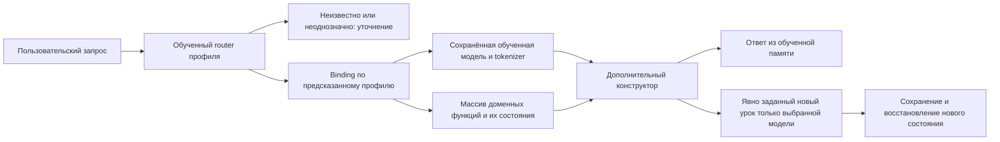

# KNN-DOMAIN-CONSTRUCTOR-ROUTE-01 — домен выбирает обученное состояние и функции конструктора

<!-- EXECUTOR-CONTEXT-120:START -->
## Вход и самопроверка перед новым заданием

Обязателен [договор120](../../fixes-based-on-experiments/120-executor-context-and-test-repair-contract-2026-11-02.md): перед новым аудитом/заданием свежо и целиком прочитать local/canonical AGENTS, CLAUDE, 12 основных навыков и дополнительные experiment-design/test-integrity по роли; восстановить усечения. Модель default без override. Этот вход не разрешает запуск и не меняет данные, budget, команды или очередь.

**Адресная граница ROUTE/STATE:** На названном маршрутизаторе/каталоге проверить writer→обученная память→ordinary route/payload и собственные positive/negative строки; label без выбранного payload не закрывает маршрут. Exact recall, простой baseline и предметная тема раздельно. Дополнительный dynamic same-functions фактор допустим только если назначен паспортом и проверяет скорость native Train. Проверить полный typed learned payload и применимые RNG/tokenizer/index/maps, состояние сразу после вмешательства и отдельный fresh-load только по назначенному API. Положительный старый ответ сохраняется; внешняя мутация/чужая identity должна обнаруживаться. Count/hash сами не доказывают восстановление.

**Исходный адрес из паспорта:** `21.AgentInfrastructure/Logical/AdaptiveLogicalOrchestrator.cs`; роль этого файла и фактически достигнутый native/copy путь сверить по собственному runner карточки. Примеры120 не добавляют чужие fixtures/пороги к её набору.

**Порядок самопроверки:** source SHA + dirty bytes → именованные producer/caller/learner/state/consumer → own positive/negative witnesses → полный outer/nested расход → назначенные ordinary/restore/E2E проверки. При падении сохранить input/expected/actual/stack + source/assembly SHA до restore; fixture/устаревший контракт/регрессия/инфраструктура раздельно, gold/threshold/Skip не лечат ошибку. Назначенный перенос/QA/ремонт включает сборку, discovery, тесты и исправление фильтра, fixture или expected по независимому договору; повторное разрешение на это не нужно. Сверить обязательные имена с discovery и результатами той же сборки, сохранив весь назначенный охват. Автору передать недоступные исходные данные, спорный договор или необходимость нового API/научного опыта; не заменять их удобным аналогом. При текущем задании только на документы запуск не разрешён. Терминал того же handle, русский отчёт, STOP/NEXT немедленны; future checks остаются UNRUN.
<!-- EXECUTOR-CONTEXT-120:END -->


<!-- BEGIN full-catalogue-learning-2026-10-27 -->
> **Полный учебный цикл обязателен (27.10.2026).** Название diagnostic/reader/qualification не освобождает новую программу от назначенного настоящего обучения. Использовать конкретный learner, данные, старт и budget этой карточки; обученный checkpoint — старт, а не замена учебного участка. Ноль у контрольной руки или reader допустим после общего Train; нулевая вся программа не принимается. Before/after и ненулевой приобретаемый/сохраняемый навык обязательны, state/счётчики и самостоятельный ответ не подменяют друг друга. Исторический readback не запускается как новый опыт; его отдельный учебный повтор указан в паспорте. Полный каталог и адресные исключения — [37](../37-full-catalogue-learning-coverage.md), правило — [30](../30-failure-recovery-and-learning-validity.md).

> **Исполнитель:** модель текущей сессии, русский отчёт, точные H/R/entry из карточки и skills/launch-wait из [31](../31-tool-discovery-and-wait.md). После launch ждать terminal того же handle в текущем ходе, без дублей и polling-службы. STOP/NEXT Любы немедленны: не продолжать предыдущий опыт отчётом или cleanup. Это документный контракт; сейчас runtime не разрешён.
<!-- END full-catalogue-learning-2026-10-27 -->

**Усиление учебного договора27октября:** [правило30](../30-failure-recovery-and-learning-validity.md). Назначенные router Train и дообучение выбранной модели в §4–7 обязательны; выбор ID на загруженных весах без этих участков не считается новым учебным опытом. Проверять отдельно learned domain ID, identity/model bytes, array функций, actual output и изменения памяти получателя. Плохие случаи: domain ID верный, но конструктор получил чужую модель; массив правильный, но ответы идут из чужой памяти; T+ записался всем доменам; после restore осталась метка, исчез навык. Каждый должен обнаруживаться на уже назначенной панели без скрытого дополнительного fit. Проверка learned body/recipient state не заменяется правильным route label. RU/HE0/8 нельзя скрыть общим28/46; границы исторического успеха сохраняются. Текущая документная работа не запускает новый run.
<!-- BEGIN result-navigation-2026-10-27 -->
**Учёт исполнения27.10.2026 — RESULT_RECORDED:** [отчёт 1](<C:/Projects/llm_mvp_core/experiments-v2/RP01-MICRO/KDR01/results/attempt-01/report.md>). Commit результата: `f1309ffb2196e2bc1be63cd71cf5451b1101affc`. Общий счёт10/46→24/46→28/46; RU/HE route0/8. Это не готовая универсальная маршрутизация.
Это ссылки на сохранённые результаты, не новый прогон и не общий вердикт успеха всей карточки. Нижний предварительный протокол сохранён; его старое NOT_RUN не отменяет найденный run. Более поздняя новая рецептура не считается выполненной лишь из-за исторического отчёта. Повтор исходного сценария этим обновлением не назначен.

**Продолжение:** [единый индекс и новая очередь Q](00-execution-index.md#next-contract). Наличие открытых исправлений не означает отсутствия новых опытов. Перед любым повтором сверить exact ID/попытку с отчётом; не запускать уже завершённый run и не перезаписывать его output. При STOP/NEXT Любы немедленно прекратить предыдущую работу; не продолжать её отчёты, retries или проверки вместо нового ID.
<!-- END result-navigation-2026-10-27 -->


26.10.2026. **DESIGNED / NOT_RUN.** Прямое уточнение Любы: «домейн запроса определяет с какими функциями и какой обученой моделью будет вызываться конструктор обучающейся модели». Поручено оформить опыт, не запускать его. Зависит от [KNN-DOMAIN-PRINCIPLES-01](KNN-DOMAIN-PRINCIPLES-01.md), но не запускается автоматически после неё.

## 1. Проверяемый путь



Домен/профиль определяет **обучаемый router**, а registry лишь разрешает ссылку на заранее закреплённые артефакты. Внедрение `expectedDomain` из EXAM, выбор по `if prompt.Contains(...)` или скрытая ручная правка router output не являются этим экспериментом. Registry binding сам по себе допустим детерминированный механизм; он не должен классифицировать запрос.

## 2. Где это связано с кодом

* [AdaptiveLogicalOrchestrator:704](C:/Projects/llm_mvp_core/21.AgentInfrastructure/Logical/AdaptiveLogicalOrchestrator.cs:704) уже разрешает learned classifier из registry; [DefaultLogicalCapabilityTrainer:3587](C:/Projects/llm_mvp_core/18.CapabilityTraining/DefaultLogicalCapabilityTrainer.cs:3587) накапливает labelled examples и обучает классификатор. Это реальный путь обучения/использования router, но не готовое решение данного опыта.
* [Domain enum:94](C:/Projects/llm_mvp_core/29.SemanticCompiler/Core/Core.cs:94) содержит CODE_Q, BUG, PLAN, ARCH, REFACTOR, UNKNOWN. В нём нет нужных профилей CS/EN/RU/HE/OR. Для опыта назначен новый экспериментальный typed `ProfileRouter`, использующий ту же обучаемую KNN-память project18 с Output=ProfileId. Product enum не переименовывать.
* [DomainClassifierUnit:118](C:/Projects/llm_mvp_core/23.SemanticCompilerAdapter/DomainClassifierUnit.cs:118) поднимает confidence trained result до .90; это не измеренный margin. Новый router обязан вернуть настоящие candidate scores; прежний keyword fallback не использовать как тайного второго классификатора.
* [TeachingRegistryPersistence:1693](C:/Projects/llm_mvp_core/18.CapabilityTraining/TeachingRegistryPersistence.cs:1693) восстанавливает LlmModel/LoRA/weights, а затем [KNN factory:1709](C:/Projects/llm_mvp_core/18.CapabilityTraining/TeachingRegistryPersistence.cs:1709). Это точка будущего переноса функции-binding при restore. `DynamicGraphMachineCompositionFactory.CreateHonestUntrained` не выдавать за готовую фабрику trained models: её контракт требует необученных единиц.

В опыте обучены router memory и доменные KNN memory. Нейронные encoder weights frozen, их предварительная нейронная обученность не утверждается. Отдельный опыт с pretrained neural students может использовать тот же constructor contract, но не подменяет этот бюджет.

## 3. Binding и дополнительный конструктор

Будущий API, а не существующая реализация:

```csharp
var route = profileRouter.Predict(userRequest); // learned ProfileId + raw scores
if (!route.CanSelect) return ClarifyWithoutConstructingModel(route);
var binding = registry.Resolve(route.ProfileId);
var state = repository.Load(binding.ModelStateRef);
var functions = principleCatalog.Create(binding.PrincipleSpecs);
var learner = new DomainKnnLearningModel(state, functions);
return learner.Predict(route.DomainPayload);
```

Router обучается на всём внешнем запросе; `DomainPayload` извлекается общим форматом envelope, а не разными правилами под gold-профиль. Plain wrapper текста оставлен в router-входе. Payload для доменной модели точно совпадает с первой карточкой, чтобы не получить новый фактор «другой prompt».

| Предсказанный профиль | Назначенное состояние | Назначенный массив |
|---|---|---|
| CS | `KDP01/shared/v1/CS/S1` | cs.ast-path/v1, cs.predecessors/v1 |
| EN | `KDP01/shared/v1/EN/S1` | en.time-frame/v1, en.construction/v1, en.prefix-frequency/v1 |
| RU | `KDP01/shared/v1/RU/S1` | ru.time-frame/v1, ru.prefix-frequency/v1 |
| HE | `KDP01/shared/v1/HE/S1` | he.time-frame/v1, he.prefix-frequency/v1 |
| OR | `KDP01/shared/v1/OR/S1` | or.parent-goal/v1, or.predecessor-stage/v1 |

Пути в таблице относительны `C:/Projects/llm_mvp_core/experiments-v2/RP01-MICRO/`. Это назначенные будущие обученные состояния, не доказательство их наличия. До исполнения нужны действительные KDP01 bundles с ненулевым learned receipt. Нельзя вместо отсутствующего trained state создать новый случайный encoder и назвать это восстановлением.

Binding включает model-kind, profile, memory-schema, tokenizer identity, base weights identity, principle id/version/weights и state references. При несовпадении — явная ошибка до Predict/Learn. Model state и функции выбираются **одним binding**, чтобы не скрестить модель EN с RU-функцией. Cache key включает профиль и версии состояния/функций; кэш не возвращает первый когда-либо созданный learner для всех запросов.

Не сериализовать произвольные delegates. После fresh load catalog должен восстановить те же функции, а loader — тот же learned corpus и состояния. Отсутствующий binding, неизвестная версия или несовместимый tokenizer не разрешают silent fallback к default CS. Это контроль доступности выученного результата, а не отдельный несвязанный инфраструктурный опыт.

## 4. Данные router и измеряемое обучение

Точные оболочки/уроки/46 запросов заданы в [общем наборе](KNN-DOMAIN-PRINCIPLES-01-fixtures.md#входы-обучаемого-маршрутизатора-для-второй-карточки). S0-router:12 уроков, затем T+-router:12, итого24. По профилям учебные классы сбалансированы; CLARIFY — отдельный отрицательный класс. Все эти уроки учат **маршрутизации**, не смешивают доменное обучение переводу/коду.

На EMPTY router нет маршрута. После S0 требуются ненулевые правильные маршруты минимум для двух разных профилей на TRAIN-квалификации; один постоянный профиль не считается обучением различению. После S1 показать все классы, corrected/regressed pairs и приобретённые маршруты T+. Никакого изменения fixed threshold по EXAM.

Выбор профиля: максимум raw native fused score по кандидатам данного ProfileId; при одинаковом max candidate tie-break Ordinal ID. Найти top1 и top2 **разных** ProfileId. `CanSelect=true` только если top1!=CLARIFY, score≥.35 и margin(top1−top2)≥.05; иначе уточнение/отказ. Пороги — выбранные параметры малого опыта, не калиброванная вероятность. Не использовать rounded confidence .90 вместо margin. Для OUT_OF_SCOPE контроли отдельно показывают фактический безопасный отказ/ошибочный выбор: одними порогами он не гарантирован.

Доменное S1 при измерении router S0/S1 одинаково: его не переучивают между этими панелями. Поэтому прирост этой стадии относится к router training/доступу к правильной выученной памяти. Вторая стадия ниже отдельно проверяет последующее доменное Learn.

## 5. Плечи и результат end-to-end

| Плечо | Что получает конструктор | Какой вывод позволяет |
|---|---|---|
| A-fixed | Для каждого выбранного router запроса фиксированный CS/S1 и пустой массив; отказ router соблюдается | Назначенный контроль ошибки «одна заранее привязанная модель». Это искусственный reference, не утверждение о текущем production поведении. Не обучать A чужим урокам. |
| B-domain | Модель из предсказанного binding, массив пустой | Эффект выбора доменной обученной памяти относительно A; не эффект функций |
| C-domain-functions | Та же модель из того же предсказанного binding, назначенный массив | Добавочный эффект функций относительно B при одинаковом route |

Для каждого router-state сохранить его46 решений один раз и переиспользовать во всех плечах. Нельзя дать C gold-route, а B predicted-route. Показывать отдельно: router accuracy/abstention, правильность state/function binding, точность ответа при правильном маршруте и **общую точность46 запросов**, включая ошибочные маршруты/отказы. Conditional accuracy без общей может скрыть поломку маршрутизации.

Сохранить по каждой строке: полный request, predicted profile, top1/top2/margin, loaded model-state ID, фактические principle IDs, был ли вызван constructor, selected learned example, доменный ответ. Trace пишет наблюдённые вызовы, а не желаемый registry mapping. Registry успешно parsed — не доказательство того, что learner получил эти значения.

R41–R44: ожидается отказ без доменного конструктора и без domain Learn. R45/R46: проверить намерение, а не слова «перевод/программа». Если неверный router уверенно выбрал профиль, не подменять результат правильным ради отчёта.

## 6. Продолжение обучения выбранной модели

После основной панели отдельный единственный **CS-урок** с явной авторизацией обучения CS:

* Внешний request: `Помоги дописать оператор .NET в этом месте: Контракт: нужно немедленно завершить ближайший цикл, не весь метод. C# prefix: void Stop(int[] xs) { foreach (var x in xs) {`.
* Доменный payload — текст после двоеточия оболочки, дословно начиная `Контракт:`; lesson output=`break`. Новый класс в этой отдельной проверке разрешён именно этим пунктом.
* Сначала router C/S1 выбирает профиль; ожидается CS. Если выбрал другой или отказал, зафиксировать провал связки, **не направлять урок вручную**. Typed teaching envelope разрешает запись только в CS; несовпадение не даёт обучать ошибочно выбранный чужой домен. Это запрет неверной записи, не oracle-исправление маршрута.
* При совпадении: один Predict до, один `Learn`, один Predict после, сохранить CS/S2 и fresh-load Predict. Новый `break` должен читаться из записанного урока; функция AST не может породить его без памяти. Сохранение одного урока — новый acquired recall, не доказанное обобщение операторов.
* Проверить все четыре прежних CS S0-запроса после обновления; остальные EN/RU/HE/OR и router не получают Train. Сравнить их corpus/statistics/model bytes до/после; выполнить по одному уже назначенному E01 каждого нетронутого профиля до/после из того же snapshot. State identity проверяет границу обучения, readout — сохранение доступа к результатам.

Если выдача `break` после update остаётся0→0, учебная часть не выполнена. Изменённый manifest сам по себе не успех. Никакого автоматического повторного SFT, смены модели или увеличения числа уроков.

## 7. Бюджет, состояние и будущий entry

Host: `C:/Projects/llm_mvp_core/experiments-v2/RP01-MICRO/KDR01/`; будущие файлы `Kdr01.csproj`, `Program.cs`, `ProfileRouter.cs`, `DomainModelFactory.cs`, `Run-Kdr01.ps1`. Переиспользовать экспериментальную библиотеку KDP01, не копировать расходящиеся варианты scorer. Новых product изменений нет.

Router config и frozen encoder — тот же tiny model-kind, что в KDP01; отдельный corpus/tokenizer только из24 router TRAIN-входов, vocab320; веса один раз сохраняются. Router state: `KDR01/shared/v1/router/{EMPTY,S0,S1}`; registry: `KDR01/shared/v1/bindings.json`. Состояние после единственного урока — `KDR01/results/attempt-01/CS-S2`, исходный CS/S1 неизменяем. C++/Java/SQL или другие языки/темы исполнитель сам не добавляет.

Бюджет: 24 distinct router lessons +1 CS lesson. До12 EMPTY-router, 12 S0 recall, **12 S0 readouts на будущие T+** и12 S1 recall тех же T+; 46×2=92 router EXAM decisions; **1 router Predict для нового CS-урока**; до3×46×2=276 доменных Predict (при отказах меньше); 3 CS before/after/reload +4 CS retention +8 нетронутых profile readouts. Максимум432 логических Predict; вызовы конструктора/чтение state отдельно. KDP01 producer повторно не входит в расход — используется сохранённый результат. Ошибка/отказ не разрешает скрытый fallback или новый producer.

Для router и CS-S2 сохранять `index.json` штатным HNSW Save/Load вместе с корпусом/весами/tokenizer, как в KDP01. Fresh load проверяет чтение того же графа. Продолжение точной RNG-последовательности будущих Add после reload не заявляется. Записать реальную видимость64-token encoder input на существующей токенизации; полный router prompt и embedding prefix не выдавать за одно и то же.

Будущий wall cap35мин: сборка/prepare10, router producer10, панели/CS lesson10, отчёт5. Это предел, не обещание. Команда после прямого разрешения и реализации entry:

```powershell
powershell -NoProfile -ExecutionPolicy Bypass -File C:/Projects/llm_mvp_core/experiments-v2/RP01-MICRO/KDR01/Run-Kdr01.ps1 -Experiment KNN-DOMAIN-CONSTRUCTOR-ROUTE-01 -Attempt 01
```

Entry сейчас отсутствует. Existing/partial attempt не перезаписывается и не запускается повторно; используется исходный handle/status. `report.md` по-русски + raw route/readout/learning JSON и terminal status хранятся только в `KDR01/results/attempt-01/`. Сохранять все неудачные маршруты, costs и пропущенные из-за отказов вызовы.

## 8. Успех, дальнейший перенос и проверки

Любое измеренное полезное улучшение — успех по показателю и профилю, рост accuracy не обязателен; остальные изменения и ухудшения рядом. Выбор правильного state без корректного доменного ответа — успех binding, но не успех решения задачи. Общий0→0 и отсутствие приобретённого учебного поведения не выдаются за законченный учебный опыт.

Условие предложения общего default: нет новых ошибок E05–E08 доменов относительно B, нет записи в чужой domain/router, неоднозначные/unknown не создают нежелательную модель, learned CS ответ переживает reload. При частичном выигрыше — ограниченная рекомендация только проверенному профилю; факт выигрыша не отменяется.

При положительном результате будущий план изменений: typed profile-router adapter в capability training, atomically resolved binding в orchestrator, constructor/factory project18, persistence manifest+load. Нельзя просто расширить native Domain enum без разбора остальных потребителей. Старые tests пустого массива не удалять; назначить регрессии `PredictedProfileControlsStateAndPrinciples`, `UnknownDoesNotConstructOrLearn`, `DomainLessonMutatesOnlySelectedState`, `FreshLoadPreservesLearnedAnswer`, `IntentBeatsTopicWord`. Проверять их на тех же реальных уроках/состояниях этой карточки; mock только для отказа внешнего чтения. Tests baseline сейчас не измерен.

## 9. Порядок исполнителя

Точный [промпт](../prompts/KNN-DOMAIN-CONSTRUCTOR-ROUTE-01-executor.md), общие контракты30/31/32/33 из первой карточки обязательны. Исполнитель — модель своей сессии по умолчанию. Русский отчёт, без приватного рассуждения. One entry → настоящий wait/continuation того же handle≤60с → terminal → raw → отчёт. Не завершать ход на ожидании, не делать polling-loop/relaunch и не просить пользователя запустить команду вместо исполнителя. STOP немедленно; NEXT переключает ID без завершения предыдущей карточки. Документ не запускает опыт и не назначает следующую работу после него.

