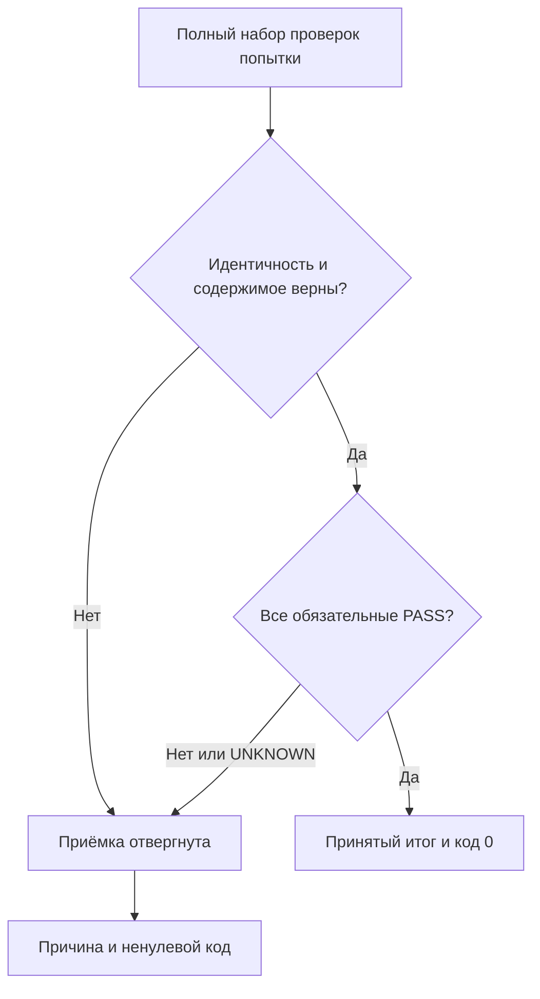

# Договор 45: доказательство доходит до потребителя и окончательной приёмки

## Согласование с обязательной нативной приёмкой на5a885d6c

Прочитана новая редакция инструкций и [основной договор45 о научном утверждении и нативной приёмке](45-learning-claim-and-native-acceptance-contract-2026-11-03.md). Этот codex-документ дополняет его проверкой доказательств, не отменяет его. **Документный аудит может завершиться с NATIVE_UNRUN. Уже разрешённая реализация/приёмка должна завершиться реальными discovery, сборкой и исполнением назначенных тестов на конечном source/DLL; UNRUN её не закрывает.** До запуска назвать затронутые проекты и фильтры. При compile/setup/assert failure сохранить команду, полный log, SHA/DLL, input и expected/actual, передать архитектору точный вопрос; ждать исходного handle. Не исключать тест/источник, не ослаблять assertion, не заменять новую сборку старой DLL. Новый документный этап сам эти команды и Train не назначает; прежняя прямая авторизация пользователя сохраняет силу. Применимые навыки дополнены experiment-design/test-integrity/test-failure-triage/bug-to-tests.

Дата: 3 ноября 2026. Основание — [аудит142](../fixes-based-on-experiments/codex-142-post125-transfer-and-experiment-audit-2026-11-03.md) на core `9d4d79d27f18066ce3a346fac2a5eea156304f62`, [адресный ремонт143](../fixes-based-on-experiments/codex-143-post125-addressed-repair-plan-2026-11-03.md). Дополняет договор44; прежние исходные данные, факторы, gold и оплаченные результаты сохраняются.

## Назначение и граница

Договор применяется к назначенному ремонту приёмки и к следующим уже спланированным опытам. Он не запускает новые PRIMARY, не расширяет их бюджет и не меняет очередь. Для переноса действует [01-registry](../fixes-based-on-experiments/01-registry.md#executor-next), для опытов — [Q-таблица](cards/00-execution-index.md#experiment-next). Снятый владельцем продуктовый отказ по отрицанию не возвращается; отсутствие отрицательных/вопросительных уроков в Q125 не превращается в вывод о способности выучивать такие случаи.

**Основное требование:** проверить тот вход и тот проверяющий, которые действительно управляют обучением, ответом либо окончательным решением. Отдельный полезный helper, заранее правильная строка и непустой файл не заменяют эту связь. Нужны и полный принимаемый пример, и соседняя различающая порча.

## 1. Карта одного проверяемого пути

В карточке назвать конкретные владельцы и методы:

| Участок | Что фиксировать | Что не считается заменой |
|---|---|---|
| Источник | ID/роль входа, raw bytes/структуру, независимое ожидаемое соответствие, source commit | Эталон, вычисленный из проверяемого output |
| Преобразование | Фактический tokenizer/builder/bridge, его параметры и потери | Одноимённый класс другого проекта либо копия без fidelity |
| Обучение или мутация | Кто дал разрешение, какой actual recipient/память получает материал, сколько единиц обработано | Объявленное имя проекта, expected journal, одинаковые ключи |
| Сохранение | Экспорт действительного состояния, byte format, checksum именно записанного файла, owner/version | JSON из ожидаемого журнала, ссылка на победителя вместо кандидата |
| Обычный потребитель | Реальный method и полный ответ, использованная запись/trace, если он открыт интерфейсом | Сам факт наличия данных на диске или в DTO |
| Решение | Как исход checker влияет на execution/validity/hypothesis и exit | Записанный boolean, который никто не читает |

В P123 gold независимо выводится из исходной actual сцены. Для expected feature A намеренно использует canonical bridge, B/C — actual geometry. Проверяющий обязан учитывать назначенное плечо, иначе он отвергнет законный A. В Q130 штатный интерфейс может не выдавать соседа: тогда записывается `NOT_EXPOSED`, без вымышленного trace и дополнительных Predict.

## 2. Полный честный набор перед отрицательным контролем

Для каждого обязательного checker указать заранее:

1. Полный правильный input и ожидаемый ACCEPTED/PASS. Он проходит именно рабочий checker.
2. Одну изменяемую причинную величину. Остальные ID, shape, count и допустимая упаковка сохранены.
3. Ожидаемый именованный отказ и точку, в которой он должен возникнуть.
4. Как отказ меняет общий verdict и process exit.
5. Как доказывается неизменность состояния, если checker должен сработать до публикации/обучения.

Битый checksum полезен для проверки транспортной целостности. Для **содержательной** проверки дополнительно нужен согласованный собственный hash испорченного payload: внешний hash исправен, но независимое соответствие неверно. Так выявляются подмена topic, geometry, владельца, target и provenance. Не следует называть проверкой смысловой связи случай, который остановился раньше на checksum.

Проверка чувствительности агрегатора не может начинаться с уже `REFUSED/missing1`. Сначала принимается полный честный набор, затем тот же агрегатор отвергает одну порчу. Метапроверка агрегатора располагается отдельно от набора, который она сама требует, чтобы не создавать циклическое отсутствие своей квитанции.

## 3. Все обязательные результаты участвуют в одном решении

Ниже схема требований, а не заявление о реализованном общем API:

Одна функция/один владелец итогового решения получает не только CheckId и наличие файла, но и проверенное содержимое. Требуются принадлежность одной попытке/сборке, полнота нужных ID, допустимая кратность, результат каждого обязательного контроля и действительный физический бюджет. Для неизвестного, отсутствующего или ложного обязательного результата положительная приёмка запрещена. Если какой-то контроль не является обязательным, это объявляется в паспорте до опыта с обоснованием; снимать обязательность после падения ради статуса нельзя.

`execution_status`, `learning_validity`, `hypothesis_status`, запись outcome и process exit не должны противоречить друг другу. При техническом отказе полезная наблюдённая дельта остаётся в данных, но не превращается в принятую гипотезу/перенос. Это не означает, что любой технический сбой доказывает ложность гипотезы: честный статус — измерение сохранено, научная/исполнительская приёмка не завершена, названа конкретная причина.

Для каждого mandatory ID — один тест на полном честном наборе и одна его изолированная порча. Это конечная проверка договора, а не повод наращивать число модельных запусков. Ремонт checker сначала запускается над копией сохранённого evidence, без Train/Generate/Predict. Исходные raw файлы остаются неизменными; derived assessment хранит их SHA, проверяемый source SHA и собственную версию checker.

## 4. Идентичность содержимого и право изменять объект — разные величины

Контроль owner должен различать две модели, независимо загруженные из одинаковых bytes. Content hash frozen reference и одинаковый keyset не являются именем живого получателя изменения. Recipient уже содержит actual bindings; проверка owner должна быть связана с ними доверенной стороной выдачи, а не изолированным журналом, которого не видит другая capability.

Положительный случай: владелец A снова использует разрешённый ему объект A; веса обновляются один назначенный раз. Отрицательные: подставлен объект B с тем же checkpoint, второй owner использует A через другую capability, обычный issuer выдаёт разрешение без проверенного владельца. При отказе веса, optimizer/RNG, version и счётчики мутаций неизменны. Законное совместное владение допускается только его явным уже назначенным договором. Это не запрет sharing и не новая задача выбора подписи сборки.

Для persisted checkpoint нужен долговечный идентификатор содержимого; для live mutation — проверяемая привязка фактического объекта/его поколения. Не заменять одно другим из удобства сериализации.

## 5. Полнота фактического состояния

Сравнение exact/phrase/KNN должно сохранять значимые части ключа, значения, owner/topic/direction, версии, форму/байты векторов, **кратность** записей и происхождение. Порядок сравнивается там, где он влияет на договор; если порядок незначим, заранее фиксируется канонизация, не удаляющая дубликаты.

Независимый expected ledger выводится из назначенных уроков и договора преобразования. Actual берётся из живого export либо настоящего checkpoint. Expected→файл→expected restore проверяет только самосогласованность ожидания. Полный hash actual файла доказывает его целостность, но не правильность содержимого; count также не заменяет сравнение полей.

Сохранённые `{}` optimizer/RNG fingerprints — недостаточные данные. Требование непустых именованных полей проверяется до того, как ими объявляется изоляция. Если состояние исторического опыта не сохранено, статус этой части — `UNKNOWN`/`MISSING_ACTUAL_STATE_EVIDENCE`. Не строить его по формуле из weight OID, не выполнять повторный PRIMARY для улучшения истории.

Сохранение кандидата считается подтверждённым, когда hash рассчитан от фактически записанных bytes и возвращён реальный locator. Формат BOM/CRLF — часть bytes. Поле «победившая версия CAS» берётся из observed значения атомарной операции; поздний CurrentVersion означает другой момент времени. Восстановление проверяется штатным consumer без обучения, в отдельном процессе там, где именно это обещает договор.

## 6. Метрика соответствует названной задаче

| Найденный класс | Обязательное уточнение карточки |
|---|---|
| P118: нужные слова с обратным смыслом | Положительный план, запрет, исключение действия и обратный порядок проходят один смысловой checker. Иначе результат называется lexical/template coverage |
| P120: разные vocab и event stream | Для сравнительной PP заранее определить общий материал и нормировку/OOV; собственную PP плеч обозначить описательной |
| P122: 40 неизвестных строк | Отдельный pure map r1→0,…,r33→32 проверяет BuildVector:32root-slot,r33 отброшен; BuildRootVocabulary отдельно ограничивает33 нормализованных roots до32. Учебный sharedVocab из6 корней не менять |
| P123: oracle не получает NaN | Исполнять тот же GoldOf/IntersectionRatio и требовать typed отказ до gold; отдельный AllFinite не достаточен |
| P123: exact features | Отдельно показывать совпадение признаков с Train; инвариантность совместного переноса не переименовывать в независимые семьи |
| P124: обученное A названо default | Назвать исходные два урока и реальный nearest-neighbour output; неизменность после нового feedback не означает отсутствие обучения |
| Q125: нет отрицаний/вопросов в Train | Наблюдённые ошибки остаются, способность их выучивать не измерена; не назначать снятый продуктовый отказ |

Неверный исторический gold не исправляется незаметно. Сохраняется старый буквальный счёт, рядом объясняется дефект и при наличии независимого основания даётся отдельный derived показатель со своим знаменателем. Показатели различения, сохранности символов, точности ответа, адресации и сдвига весов не смешиваются.

## 7. Полная физическая цена

Учёт ведётся на фактической нижней границе операции, с разделением Train/batch/lesson presentations/updates/forward/backward/scoring/ordinary calls и вспомогательных операций. Вложенный `Evaluate→Predict` входит в общий физический Predict, даже когда внешний счётчик его не видит. Cold observations, диагностические чтения и scaffold calls называются отдельно, но не исчезают из расхода.

У нескольких физических попыток есть собственные расходы и общий оплаченный итог. Ошибка финализатора не делает первое обучение бесплатным. Время сборки, run, wrapper и CPU не складывается без определения области; пиковая память разных процессов не суммируется как одновременная. Неизмеренное поле отличается от нуля.

Исправление отчётности — чтение saved data, без нового Train. Если для реальной продуктовой приёмки нужен native host, в назначении заранее назвать существующий entrypoint, нужные saved fixtures, ожидаемое количество вызовов и конечную границу. Текущий документ не придумывает разрешённый бюджет обучения и не открывает новые PRIMARY. Ранее разрешённые конкретные этапы и ограничения пользователя сохраняют силу.

## 8. Передаваемый исполнителю текст

К тексту ниже относятся[QA46](46-qa-execution-test-repair-and-fresh-results-2026-11-03.md) и его таблица навыков: qa-session-type до наряда, test-integrity до правки fixture/assertion, test-failure-triage при отказе, systematic-debugging/debug-session при поиске причины, bug-to-tests для различающего случая, integration-testing для обычного caller, generated-code-review/verification-before-completion перед приёмкой. В назначенном ремонте можно адаптировать неверный тест по уже утверждённому договору; нельзя объявлять каждую такую правку новым требованием или требовать повторного разрешения. Assertion failure и несовпадение строки отказа ещё не устанавливают первопричину.

> Прочитай назначенную карточку целиком, её текущий вход, AGENTS/CLAUDE и применимые архитектурные, планировочные, проверочные, prompt-engineering и коммуникационные навыки; назови фактически прочитанное. Возьми только назначенный ID и этап из существующей очереди. Привяжи исходник, обычного producer, learner/state, сохранение и consumer к одному проверяемому пути. Начни с сохранённых доказательств. Для каждого обязательного checker сначала покажи полный честный PASS, затем одну различающую порчу с теми же count/shape и согласованной собственной упаковкой. Проверяй тот же рабочий путь; отдельная функция не заменяет его. Все обязательные результаты должны менять итог и exit; raw не переписывай. Сохрани измеренную пользу, полный физический расход и точный предел вывода. При отсутствии состояния напиши UNKNOWN; документный аудит вправе отметить NATIVE_UNRUN, но уже разрешённую реализацию этим не закрывай: выполни discovery/build/tests конечного source по основному договору45 либо верни точный failure архитектору. Не выдавай Python за запуск C#. Не повторяй записанный PRIMARY ради отчёта. В конце сообщи простыми словами: что исправлено, чем доказано, что осталось, какой следующий уже назначенный ID. Прямые STOP/NEXT пользователя имеют приоритет.

Собственные контрпримеры каждой карточки находятся в её текущем верхнем блоке; этот общий договор их не заменяет.
