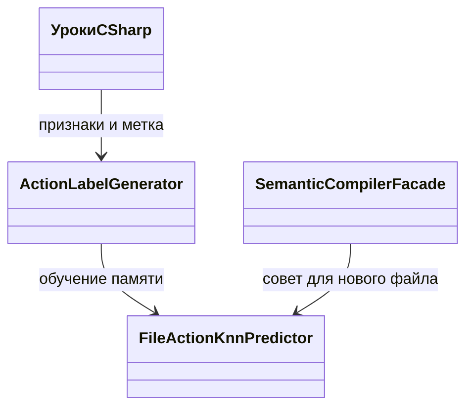

# FIX-NKU — N-KU-01: учитывать do-while при разметке уроков C#

<!-- transfer-entry-reload -->
**Вход исполнителя.** [Q62](01-registry.md#work-fix-nku). Для общего включения действует измеренное ограничение этой строки. Возврат к работе — по записанному условию для её домена. Перед каждым переносом и после восстановления контекста заново прочтите полностью агентские файлы, назначенные навыки, исправленный список Любы, текущий индекс и карточку. [Как применить прочитанное к этой работе](03-test-and-execution-contract.md#read-and-apply) · [Что взять сейчас](01-registry.md#executor-next).

## Уточнение допуска по показателям — 3 ноября 2026

**FIX-NKU: Не допускать общий перенос.** Вошёл по общей точности; выигрыш достигнут потерей единственного положительного контроля цикла.

- Точность: После обучения 1/4 → 3/4 (+50 п.п.).
- Полезный результат: Ложных советов добавить цикл 3 → 0.
- Цена и ограничения: Реально нужный цикл распознан 1/1 → 0/1 (−100 п.п.).
- [Полное сравнение и статус кода](C:/Projects/llm_mvp_core/docs/plans/replanning-possible-diffs/fixes-based-on-experiments/01-registry.md#benefit-fix-nku).

Этот вывод относится к названным ID, а не ко всем механизмам документа. Старый текст плана и опыта сохранён как доказательство, но его общий статус «к переносу / разрешён» не переопределяет это уточнение. Ближайшее действие — разбор уже сохранённых данных и конкретного регресса; новое обучение, повтор PRIMARY и переключение product default этим дополнением не назначаются. Для отдельного логического ремонта назвать нарушенный контракт и сохранить отрицательные контроли, а не переносить весь эксперимент под словом «bugfix».


<!-- EXECUTOR-CONTEXT-120:START -->
## Обязательный вход в выбранный перенос или owner-раздел

Обязателен [договор120](120-executor-context-and-test-repair-contract-2026-11-02.md): перед новым аудитом/заданием свежо и целиком прочитать local/canonical AGENTS, CLAUDE, 12 основных навыков и дополнительные experiment-design/test-integrity по роли; восстановить усечения. Модель default без override. Этот вход не разрешает запуск и не меняет данные, budget, команды или очередь.

**Область:** этот вход относится к каждому выбираемому ниже FIX/TEST/R/RF/C и его собственной приёмке, а не превращает весь файл в одно поручение. Уже принятые части не переоткрывать; сначала сверить current source и сохранённые receipts именно выбранного владельца.

**Применимые риски COMPILER/LEARN:** Сверить назначенный уровень compiler: входные features, target packing и ordinary consumer не взаимозаменяемы. Отрицательный/положительный witness берётся из собственного корпуса этой карточки; copied distances/accuracy не обещать native пути без parity. Если вызывается Compile, учесть его реальные вложенные Grammar/Ngram Train. Сохранить назначенные lesson/RowId и before→factor→after по независимому gold; margin/hash/update не заменяют правильный ответ. Положительный контроль удерживает прежний правильный ответ, отрицательный показывает потерянную/неусвоенную строку; gained/lost TRAIN и EXAM раздельно.

**Ожидания от теста.** Используйте данные этого ID и обычный путь, указанный в его действующей строке. Исходные доказательства сохраняются. Дополнительную диагностику из прежнего плана открывайте при конкретном расхождении. Для учебного результата запишите, что было до урока и что стало после. Техническую проверку формата или маршрута так и назовите.

**Проверка исполнителя.** Соберите затронутый проект и выполните назначенный малый сценарий на своей сборке. Укажите вызванный метод, вход и фактический результат. Для обученного поведения сравните смысл ответа и выбранного получателя. Для ресурса измерьте названную величину за тот же вызов. Если проверка упала, сохраните вход, ожидание и ошибку. Исполнитель может исправить дефект теста по независимому критерию и повторить эту проверку. Отпечаток нужен при разборе происхождения файла или сборки. Дождитесь завершения запущенной проверки. Затем переходите по текущей очереди. Право выполнить перенос определяется действующим назначением.
<!-- EXECUTOR-CONTEXT-120:END -->


<!-- BEGIN audit-91-applicability -->
## Дополнение28.10: фактический выход и происхождение показаний

Проверять чтение именно памяти, изменённой назначенным Train, с реальными ключами и payload до потребителя и после restore. Законный kNN retrieval сохранён; запрещена подстановка gold/архивного oracle вместо текущего поиска в обученной памяти. Отдельный PASS структуры или счётчик-константа не доказывает этот consumer либо новые updates.

Для FIX-NKU исходные данные, дозы, модель, доменная область и oracle владельца сохраняются. Это адресное условие будущей приёмки, не свидетельство уже пройденной проверки и не новый запуск. Источник ошибки и точные ремонты — [91/92](92-positive-transfer-followup-plan-2026-10-28.md).
<!-- END audit-91-applicability -->


<!-- BEGIN audit-84-applicability -->
## Уточнение исполнения по аудиту P02/P08/P09

Сохранять построчные исходы и независимый gold выбранного домена вместе с итоговой долей. Одинаковая общая точность может скрыть потерю прежнего урока и случайный выигрыш другой строки; изменение scorer/support само по себе не доказывает обучение. Для данной карточки подтверждать назначенный Train и чтение его результата реальным потребителем; существующую проверку усиливать сохранённым learned state вместо дублирования искусственного теста.

Применимость: FIX-NKU. Основание и адресные проверки — [план85](85-reporting-sampling-cache-repair-plan-2026-10-27.md), [общий договор03](03-test-and-execution-contract.md). Это усиление постановки, не утверждение о наличии дефекта в каждом данном исходнике и не новый запуск. Исходный эксперимент/бюджет/статус допуска сохраняются; продолжение пропущенного этапа использует тот же обученный state, новая самостоятельная программа обязана содержать назначенное реальное обучение. При STOP/NEXT следовать прямому указанию пользователя, не продолжать прежнюю задачу.
<!-- END audit-84-applicability -->


<!-- BEGIN audit-87-applicability -->
## Приёмка и состояние обучения: аудит 28 октября

Панель должна сохранять точное множество уникальных RowId, Kind и gold. Контрпример P05: [T1,T2]→[T1,T1] имеет тот же размер, но прячет потерянный урок. Контрпример P11: 2/4→2/4 скрывает E1 gain и E2 loss; constant-answer baseline считать отдельно. 1→0 после настоящего обучения остаётся валидной регрессией. Сдвиг весов сам по себе не квалифицирует результат, PARTIAL и нулевой назначенный Train не закрывают учебную цель.

Применимость: FIX-NKU. Контроль отчёта: точная панель, настоящий учебный этап, терминальное завершение и выполненные обязательные проверки — отдельные поля; успех одной оси не равен общему допуску. Требования по [плану88](88-gradient-warmup-transfer-repair-plan-2026-10-28.md) добавляются к исходному рецепту, не меняют исторические результаты и не назначают повтор обучения. Проверки сохранённого receipt используют raw уже выполненного обучения; новая самостоятельная программа обязана содержать назначенный Train. Если нужен новый вызов модели, сначала явно назначить полный бюджет, а не скрывать его в диагностике. Это профилактическая применимость, не установленный дефект каждого данного исходника. STOP/NEXT и ожидание исходного process handle из карточки сохраняются.
<!-- END audit-87-applicability -->

**Проверка сохранённого полезного ответа, 27 октября 2026.** Снижение неправильных советов о цикле3→0 оценивается вместе с потерянным действительно нужным советом о цикле1→0; успех3/4 не разрешает общий default labeler без этого ограничения. Исправление учебной label не попадает автоматически в исключение диагностических ошибок. В назначенной четырёхстрочной панели проверять поштучно do-while и случай, которому цикл нужен: постоянный «цикл не нужен» не проходит oracle, хотя исправляет три строки. Readout идёт из actual PredictedFileAction через Compile; вывод самой ActionLabelGenerator отдельно не считается усвоением. Дополнительный fit или выдуманный Save/Load для этой памяти не назначаются.

21 октября 2026. **План кандидата, без разрешения на реализацию или запуск.** Основание — завершённый N-KU-01; новый вклад этого документа — перенос через действующий потребитель и тесты с учебными примерами. Сам кандидат уже записан в [required-changes](../required-changes.md#n-ku-01). Текущий порядок и решение о запуске — [реестр](01-registry.md); правила проверки — [общий контракт](03-test-and-execution-contract.md).

## Что должно измениться для пользователя

Когда файл уже обходит массив циклом do-while, разметчик не должен учить память совету «добавить цикл». Исправляем распознавание уже существующего цикла в учителе меток. Память продолжит учиться на размеченных файлах и выбирать совет голосованием соседей.

Это ограниченный успех в программировании на C#. После четырёх уроков ложный совет добавить цикл на трёх заданиях исчез: **3/3 → 0/3**; всего верных стало **1/4 → 3/4**. При этом на четвёртом задании, где цикл действительно нужен, правильный совет потерян: **1/1 → 0/1**. Кандидат полезен по первой оси, но результат не доказывает общего распознавания нужных правок. Обе руки после обучения выдавали одну метку на всех четырёх заданиях; влияние большинства меток не скрывается.

Доказательства: [raw A](https://github.com/lubochka/llm_mvp_core/blob/4f35cb71b3db482bfe7ebe611c652c78d89d5db1/docs/plans/replanning-possible-diffs/experimets/results/2026-10-20/N-KU-01/arm-A.json), [raw B](https://github.com/lubochka/llm_mvp_core/blob/4f35cb71b3db482bfe7ebe611c652c78d89d5db1/docs/plans/replanning-possible-diffs/experimets/results/2026-10-20/N-KU-01/arm-B.json), [заданный заранее gold](../experimets/results/2026-10-20/N-KU-01/gold.json), [отчёт](../experimets/results/2026-10-20/N-KU-01/report.md). `comparison.json` на проверенном commit — LFS-указатель; числа здесь сверены по полным arm JSON и gold, не по тексту указателя.

## Точное место переноса и граница механизма

Срез исходников: `4f35cb71b3db482bfe7ebe611c652c78d89d5db1`.

В [ActionLabelGenerator.Label](https://github.com/lubochka/llm_mvp_core/blob/4f35cb71b3db482bfe7ebe611c652c78d89d5db1/12.SemanticCompiler/Prediction/FileActionKnn.cs#L41-L55) проверка `hasLoop` заканчивается условием `node.Kind() == SyntaxKind.WhileStatement`. Добавить в эту же дизъюнкцию `SyntaxKind.DoStatement`. Остальной приоритет меток оставить: отсутствие null-check имеет прежний приоритет, затем отсутствие цикла, затем извлечение метода и общий совет. Контрольный Git blob файла: `ef7a88a3c4c2540569b9ce6f204d8e4750875501`.

Почему это влияет на обучение: [SemanticCompilerFacade.TrainFileActionKnn](https://github.com/lubochka/llm_mvp_core/blob/4f35cb71b3db482bfe7ebe611c652c78d89d5db1/12.SemanticCompiler/SemanticCompilerFacade.cs#L193-L203) действительно вычисляет метку для каждого урока и вызывает `FileActionKnnPredictor.Train`. Его обучаемое состояние — список `(float[] Features, int Label)`; `Train` заменяет список целиком, а [Predict](https://github.com/lubochka/llm_mvp_core/blob/4f35cb71b3db482bfe7ebe611c652c78d89d5db1/12.SemanticCompiler/Prediction/FileActionKnn.cs#L121-L141) голосует по трём соседям. [Compile](https://github.com/lubochka/llm_mvp_core/blob/4f35cb71b3db482bfe7ebe611c652c78d89d5db1/12.SemanticCompiler/SemanticCompilerFacade.cs#L153-L172) помещает этот ответ в `CompilationResult.PredictedFileAction`; [guard](https://github.com/lubochka/llm_mvp_core/blob/4f35cb71b3db482bfe7ebe611c652c78d89d5db1/12.SemanticCompiler/SemanticCompilerFacade.cs#L326-L333) допускает его только при `UseFileActionKnn`, C# и четырёх сохранённых строках.



Разметка и извлечение AST-признаков детерминированы; таблица примеров обучаема. Это не нейронная LoRA, не DPO-оптимизатор и не доказательство обученной маршрутизации доменов. Более того, `SemanticCompilerFacade.ClassifyDomain` сейчас использует keyword fast-path; этот путь нельзя предъявлять как обученный e2e router. Общая маршрутизация покрывается отдельным планом пакета.

**В эту правку не входят** изменение `TargetKinds`, размерности 30, расстояния, k=3, правил пустой памяти, флага включения, persistence и приоритетов остальных меток. Добавление do-while в вектор признаков могло бы исправить потерю KQ4, но такого результата этот опыт не измерял. Его нельзя включать попутно.

## Учебные данные и проверка до/после

Единственный исходный набор — [inputs.json](../experimets/results/2026-10-20/N-KU-01/inputs.json): K1–K4, четыре C#-файла для TRAIN; KQ1–KQ4, четыре другие функции для EXAM. [gold.json](../experimets/results/2026-10-20/N-KU-01/gold.json) содержит независимое правило: у KQ1–KQ3 нужен существующий совет, отличный от `ADD_LOOP`, у KQ4 — `ADD_LOOP`; null никогда не правильный ответ. Gold не вычислять вызовом исправленного `Label`.

В будущей реализации теста скопировать эти два файла без смены примеров в `Tests/Fixtures/ExperimentFixes/v1/NKU01/inputs.json` и `gold.json`, включить их в выход тестового проекта как данные. Сохранить оригинальные ID и контрольные Git blobs `1adacaa762add5943a13458ae9860844aeaf09bf` и `e6ec509c68054df3c6a65cb6302f24f18b5ea136` в комментарии тестового fixture. Копирование и проверка содержимого нужны для причинного сравнения учебного набора, не являются отдельным экспериментом.

Память N-KU-01 не имеет измеренного файлового checkpoint API. Поэтому для этого минимального теста допустима одна подготовка четырьмя уроками в отдельном экземпляре. Не придумывать сохранённую почти обученную модель и не добавлять persistence как часть правки. Для повторного чтения использовать тот же подготовленный экземпляр; общий договор fixtures — [02](02-learning-state-and-fixtures.md).

## План тестов и работа с возможными падениями

На этом этапе тесты **не запускались**. Ниже перечислены существующие проверки и ожидаемый способ адаптации, а не заявленные результаты прогона.

| Проверка | Что делать |
|---|---|
| `Tests/ExperimentsV2Tests.cs`: `ActionLabelGenerator_CollectionParamNoLoop_ReturnsAddLoop`, `ActionLabelGenerator_MemberAccessNoNullCheck_ReturnsAddNullCheck`, `ActionLabelGenerator_FeatureVector_HasCorrectLength` | Сохранить ожидаемые значения: отсутствие цикла по-прежнему даёт `ADD_LOOP`, приоритет null-check не меняется, размерность остаётся 30. Падение здесь — регрессия реализации, не повод менять ожидание. |
| `FileActionKnnPredictor_PredictsMajorityOnHomogeneousTraining` в том же файле | Сохранить как проверку голосования. Она не доказывает различение C#-задач. |
| `Tests/E13E14FeatureFlagTests.cs`: `UseFileActionKnnFalseAlwaysLeavesPredictedFileActionNull`, `UseFileActionKnnTrueWithUntrainedPredictorSkipsSilently` | Сохранить guard. До обучения нельзя засчитать fallback `ADD_METHOD` как приобретённый навык. |
| `UseFileActionKnnTrueWithTrainedPredictorProducesKnownLabel` в том же файле | Сохранить smoke-проверку; дополнить новым экспериментальным тестом ниже. `Assert.Contains(label, Labels)` слишком слаб для проверки исправления. |

Существующие тесты можно прочитать в [ExperimentsV2Tests](https://github.com/lubochka/llm_mvp_core/blob/4f35cb71b3db482bfe7ebe611c652c78d89d5db1/Tests/ExperimentsV2Tests.cs#L776-L897) и [E13E14FeatureFlagTests](https://github.com/lubochka/llm_mvp_core/blob/4f35cb71b3db482bfe7ebe611c652c78d89d5db1/Tests/E13E14FeatureFlagTests.cs#L88-L147).

Новый файл — `Tests/FileActionDoWhileLearningTests.cs`:

1. `Label_ExistingDoWhile_IsNotMissingLoop`: K1/K2 получают `ADD_METHOD`; K4 остаётся `ADD_LOOP`. Это нижний тест писателя уроков, не замена обучению.
2. `Learning_FourLessons_RemoveFalseLoopAdvice_WithRecordedCounterexample`: пустой `SemanticCompilerFacade` с `UseFileActionKnn=true`, `UseRegexPreprocessor=false`; четыре `Compile` до обучения, один `TrainFileActionKnn` на K1–K4, четыре `Compile` после. Проверить реальные `PredictedFileAction`, отсутствие до обучения, четыре записанные метки и уменьшение ложных `ADD_LOOP` на KQ1–KQ3 до нуля. В отчёт теста записать все четыре результата и неизменный gold: KQ4 остаётся ошибкой, её нельзя переименовать в правильный ответ.
3. `Facade_DisabledOrUntrained_DoesNotPretendToLearn`: проверки существующего guard покрывают отрицательный контроль. Дополнительного большого набора здесь не нужно.

Второй тест проверяет перенос экспериментального эффекта в действующий facade, а не вызывает только `Label` для экзамена. Полный `Compile` в исходном опыте не запускался: его результат здесь — будущая проверка, не исторический факт. Если через этот путь эффект не воспроизводится, не обходить его тестовой подстановкой ответа; записать различие caller/preprocessing и оставить перенос неподтверждённым.

Порядок будущих действий: зафиксировать fixture → добавить новый обучающий тест и увидеть его смысловое падение на старом `hasLoop` → внести один `DoStatement` → выполнить тот же тест → проверить названные старые тесты. Изменять ожидаемое значение допустимо только там, где оно прямо утверждало отсутствие do-while; исправление остальных падений должно сохранять прежний контракт. Сначала источник падения, затем минимальная правка, не механический rewrite snapshot.

Назначенная команда из корня `C:/Projects/llm_mvp_core` после отдельного разрешения реализации:

```powershell
dotnet test Tests/LlmFromScratch.Tests.csproj -c Release --filter "FullyQualifiedName~FileActionDoWhileLearningTests|FullyQualifiedName~E13E14FeatureFlagTests|FullyQualifiedName~ActionLabelGenerator|FullyQualifiedName~FileActionKnnPredictor_PredictsMajorityOnHomogeneousTraining" --logger "trx;LogFileName=FIX-NKU.trx" --results-directory artifacts/fbe/FIX-NKU/attempt-0001/tests
```

Ожидание: новая проверка эффекта и существующие guards проходят; отчёт по KQ4 остаётся видимым ограничением. Это не разрешение включить механизм для всех доменов или менять KQ4 gold. Решение о распространении кандидата учитывает потерю KQ4 отдельно от успешной метрики.

## Инструкция исполнителю и отчёт

Исполнитель использует модель текущей сессии по умолчанию и записывает её фактическое имя. Обязательные скилы: `docs/skills/architect-behavior-classifier-SKILL.md`, `phase-planning-SKILL.md`, `plan-review-SKILL.md`, `generated-code-review-SKILL.md`, `prompt-patch-authoring-SKILL.md`, `human-readable-architecture-audit-SKILL.md`, `human-communication-GLOSSARY.md`; точные пути остальных относительно `docs/skills/`. Новые DPO здесь не нужны. При отдельном поручении генерации внешняя открытая китайская модель создаёт DPO; выбор и оценку качества выполняет CODEX с `astra 6 ultracode`, с фактической квитанцией, без выдуманной аттестации.

Отчёт по-русски: что меняли; 4 TRAIN/4 EXAM; реальные строки до/после; false-loop 3→0; KQ4 1→0; число уроков и памяти; что проверено в facade; какие тесты реально запускались. Старые результаты и эксперименты не удалять и не перезаписывать. Любое измеренное улучшение полезного показателя — успех именно этого показателя и домена; рост суммарной точности не обязателен, ухудшения показываются рядом. Проверка без участия обучения не заменяет этот отчёт; 0→0 и неподготовленная память не закрывают учебную цель.

**STOP/NEXT:** прямое «стоп» или назначение следующего ID немедленно прекращает действия предыдущей карточки. Нельзя сначала закончить её отчёт, правку теста, commit или cleanup; допустимо коротко сообщить уже подтверждённое состояние. Запрещено продолжать старый эксперимент вместо перехода, дописывать прежние файлы после NEXT, повторять consumed entry или удалять результаты ради повтора. Следующий ID берётся только из [реестра](01-registry.md), одиночное поручение заканчивается END. Живой процесс ждать штатным wait/resume того же handle по [контракту](03-test-and-execution-contract.md); не завершать ход словами «жду», не заменять ожидание быстрым polling и повторным запуском.
