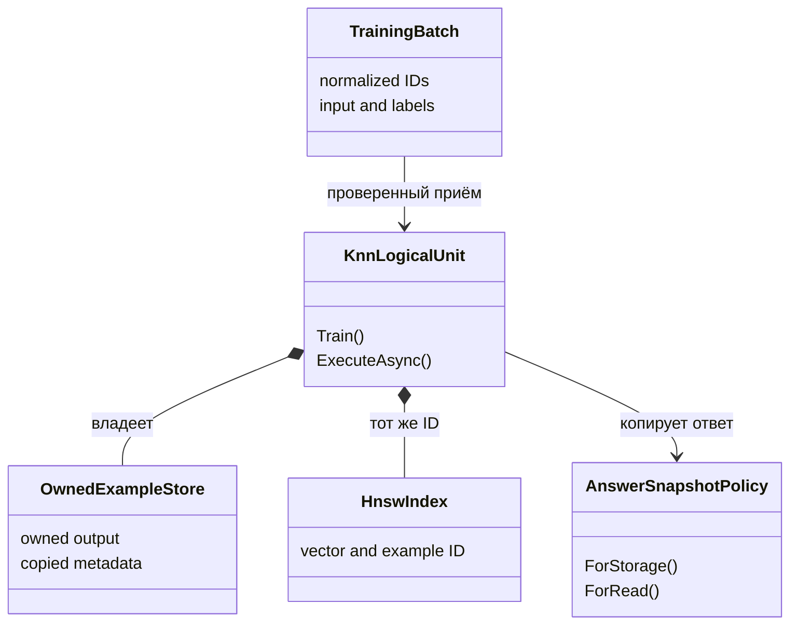

# 102. Адресный план ремонта после позднего аудита 29 октября

**Область датированных статусов.** Сводки и слова «действующий», «следующий» или OPEN ниже относятся к указанным в их разделах датам и source SHA. Они сохраняют историю исполнения и не переопределяют более поздний адресный аудит из [реестра](01-registry.md); новые результаты, назначения и бюджет из объединения текста не возникают.

<!-- EXECUTOR-CONTEXT-120:START -->
## Обязательный вход в выбранный перенос или owner-раздел

Обязателен [договор120](120-executor-context-and-test-repair-contract-2026-11-02.md): перед новым аудитом/заданием свежо и целиком прочитать local/canonical AGENTS, CLAUDE, 12 основных навыков и дополнительные experiment-design/test-integrity по роли; восстановить усечения. Модель default без override. Этот вход не разрешает запуск и не меняет данные, budget, команды или очередь.

**Область:** этот вход относится к каждому выбираемому ниже FIX/TEST/R/RF/C и его собственной приёмке, а не превращает весь файл в одно поручение. Уже принятые части не переоткрывать; сначала сверить current source и сохранённые receipts именно выбранного владельца.

**Применимые риски STATE/RUN/LEARN:** Проверить полный typed learned payload и применимые RNG/tokenizer/index/maps, состояние сразу после вмешательства и отдельный fresh-load только по назначенному API. Положительный старый ответ сохраняется; внешняя мутация/чужая identity должна обнаруживаться. Count/hash сами не доказывают восстановление. Привязать source/config/inputs к фактически потреблённым child bytes и effective MSBuild instances; late mutation против unchanged — разные controls. Parent terminal/exit не заменяется child Passed. Такой структурный guard не требует выдуманного model Train. Сохранить назначенные lesson/RowId и before→factor→after по независимому gold; margin/hash/update не заменяют правильный ответ. Положительный контроль удерживает прежний правильный ответ, отрицательный показывает потерянную/неусвоенную строку; gained/lost TRAIN и EXAM раздельно.

**Ожидания тестов:** собственные данные/positive/negative этой карточки и названный ordinary caller имеют приоритет над примерами120. Пример другого семейства не добавляет fixture, Train или новый API. Полный набор outer/nested Train/BPE/Grammar, readouts, restore и этапов остаётся в существующем бюджете. Структурный guard сTrain0 не объявляется новым обучением.

**Порядок самопроверки:** source SHA + dirty bytes → именованные producer/caller/learner/state/consumer → own positive/negative witnesses → полный outer/nested расход → назначенные ordinary/restore/E2E проверки. При падении сохранить input/expected/actual/stack + source/assembly SHA до restore; fixture/устаревший контракт/регрессия/инфраструктура раздельно, gold/threshold/Skip не лечат ошибку. Назначенный перенос/QA/ремонт включает сборку, discovery, тесты и исправление фильтра, fixture или expected по независимому договору; повторное разрешение на это не нужно. Сверить обязательные имена с discovery и результатами той же сборки, сохранив весь назначенный охват. Автору передать недоступные исходные данные, спорный договор или необходимость нового API/научного опыта; не заменять их удобным аналогом. При текущем задании только на документы запуск не разрешён. Терминал того же handle, русский отчёт, STOP/NEXT немедленны; future checks остаются UNRUN.
<!-- EXECUTOR-CONTEXT-120:END -->

**Сверка30.10.2026:** историческое `done=0` ниже относится к созданию плана. R5 реализован коммитом `703e3c5dd3a`: общий `Tests/RandomStateFieldAssertions.cs` сравнивает поля и записи по AdapterKey, проверяет повторы/лишние/пропущенные записи; его вызывают cache parity и optimizer handoff tests. Сохранённые журналы `experiments-v2/_runners/R102-R5-RANDOM-STATE-FIELDS-attempt-0001/` содержат 5/5 helper acceptance и 29/29 связанных тестов, exit0. Здесь они прочитаны исследователем, заново не запускались. R2 уже имеет действующий IKnnAnswerSnapshot; повторное создание интерфейса не назначается. Это не закрытие всех остальных строк: актуальный остаток требует сверки каждого consumer, а не вычитания двух из старого счётчика. Очереди88/95 отдельно сопоставлены с коммитами в [103](103-transfer-queue-commit-mapping-2026-10-30.md).

<!-- EFFECTIVE-AUDIT-2026-11-01:START -->
## Действующая сверка — 1 ноября 2026

Core `790228c256168a336b01abae4387e28391048c0c`: **6 DONE / 2 PARTIAL / 1 OPEN / 1 CONDITIONAL** в очереди102. R2 принят; R6 не закрывает reference-only imports и legacy terminal без нового claim; R7 сохраняет constant-tie defect. Поэтому ни старый5/3/1/1, ни поздний8/0/1/1 не являются текущей приёмкой.

- [107 — доказательства, принятые переносы и точность P55–P81](107-transfer-and-experiment-audit-2026-11-01.md).
- [108 — конкретные owners, решения и закрывающие проверки](108-addressed-repair-plan-2026-11-01.md).
- [109 — адресные дополнения89 карточек и проверка сохранности](109-card-hardening-and-coverage-2026-11-01.md).

Все более ранние срезы ниже остаются историей на своих датах. Этот блок не назначает новый scientific NEXT, запуск или повтор обучения.
<!-- EFFECTIVE-AUDIT-2026-11-01:END -->

**Актуализация исполнения, 30.10.2026:** таблица ниже дополнительно сверена с `aab5e5143f2516b92b42ce82606759bb6b4ef0b2` перед публикацией. Завершённые работы не назначаются заново. Новые соседние дефекты и точные gates — [104](104-transfer-and-experiment-audit-2026-10-30.md) и [105](105-addressed-repair-plan-2026-10-30.md).

## Цель и граница исполнения

План адресует описанные ниже ошибки сохранения обученной памяти и проверки результатов. Исходная ссылка автора на `101-late-transfer-and-experiment-audit-2026-10-29.md` на30.10 отсутствует в рабочем дереве; её нельзя считать доступным доказательством или молча заменить другим документом101 о bundle. Карта закрывающих коммитов — [103](103-transfer-queue-commit-mapping-2026-10-30.md); проверки и ограничения соответствующих срезов — [104, поздние учебные свидетельства](104-late-learning-evidence-audit-2026-10-30.md) и [104, переносы и эксперименты](104-transfer-and-experiment-audit-2026-10-30.md). План сохраняет уже работающие sampler/warmup/restore/metadata/divisor исправления и не назначает повторное внедрение закрытых механизмов; каждый остаток сверяется с собственным первичным источником.

**Что уже выполнено этой работой:** аудит, независимые малые probes, пересчёт сохранённых ответов, исправления действующих описаний, контрольных примеров и численных ошибок. **Что ещё предстоит:** описанные ниже изменения рабочего кода/приёмочных writers и их адресные проверки. Этот план не является заявлением об уже выполненных исправлениях продукта.

База кода: `4d0c7a759bd0a26adbdc1d36f030040f279cb03f`. База первоначальных гипотез: `xiigen-planning@3b7537c267e45002ebab4f44845fe4ce92f204f9`. Поздняя реализация run-binding дополнительно проверена на `72b283e0145f9b81f04bf6da2a2cd4e033b3d853`; R6 ниже содержит только её оставшийся ремонт. Перед будущим ремонтом сравнить изменившиеся **целевые** файлы с этими bytes; изменение соседнего Markdown само по себе не требует нового обучения.

## Порядок

После уже выполненного документного ремонта сначала сохранить целостность принимаемой памяти, затем закрыть ошибки приёмки и лишь затем назначать новое дорогое эмпирическое сравнение. Старые обученные состояния переиспользуются, если их формат и действительная сохранность это допускают. Missing payload не заменяется новой моделью молча.

| Очередь | Работа | Статус | Зависимость и результат |
|---|---|---|---|
| R1 | Не принимать два урока под одним нормализованным ID | DONE | Current native guard и четыре счётчика; не повторять реализацию |
| R2 | Закрепить владение изменяемым ответом KNN | DONE | e10c305b9b59: default требует policy; saved41/41;107 |
| R3 | Принимать собственные копии features/labels dataset router | DONE | Изменение обоих caller arrays не меняет память |
| R4 | Сохранять прежнюю память при отказе новой партии | DONE | Null/поздняя ошибка сохраняют модель; valid replacement работает |
| R5 | Сравнивать RNG по действительным полям | DONE |703e3c5; поля/entries/cursors вместо имени коллекции |
| R6 | Caller paths/inputs, single-use launch, dependencies | PARTIAL |087ed2b9cea закрывает основную реализацию; reference-only imports и legacy terminal/no claim остаются;108/RF02 |
| R7 | Вычислять статус фактора по observations | PARTIAL | Evaluators реализованы2afbfd7; постоянный tie ошибочно считается различимым;105/C06 |
| R8 | Читать P31 с версионированной поправкой | DONE | aab5e514; hash-bound resolver,5 сохранённых PASS controls; не реализовывать повторно |
| R9 | Обычный вход потребляет learned решение | OPEN |29.Compile подтверждённо не читает_train; existing23 path требует своей сквозной приёмки;105/C07 |
| R10 | Новый EXAM только под оставшийся вопрос | CONDITIONAL | После релевантных ремонтов;105/C10, без повтора всех опытов |

Всего10 работ: done=6, partial=2, open=1, conditional=1 на `790228c256168a336b01abae4387e28391048c0c`. Предыдущий срез aab5e514 имел5/3/1/1 и остаётся историческим. Это статус ремонта, а не число успешных научных гипотез. Остаток переходит в105; данный файл не создаёт новый scientific NEXT. Исторический указательR1 снят как уже закрытый.

**Разделы R1–R10 ниже сохраняют исходный проект решения 29.10.** Фразы «будущий файл», «ещё не реализован» описывают тот старый срез; текущую реализацию и остаток определяет таблица выше и104/105. В частности snapshot interface/tests, R1/R3/R4/R5 иR6f уже существуют. Исходная ссылка на отсутствующий `101-late-transfer-and-experiment-audit-2026-10-29.md` заменена на действительный аудит104; нынешний101 — другой, самостоятельный договор состояния.

## R1. Один урок — одна согласованная запись памяти

<!-- OWNER-CONTEXT-120 --> **Самопроверка выбранного раздела:** STATE по договору120 во входе файла; собственные source/caller/данные/доза и negative+positive этой строки обязательны. Старый завершённый результат не переоткрывать; при падении сохранить input/expected/actual/stack+SHA, не менять oracle ради зелёного. Примеры другого owner не добавляют проверки или Train к этому разделу.

**Проблема:** `KnnLogicalUnit.Train` нормализует ID только при записи; dictionary перезаписывается, индекс продолжает расти. По одному ID разные части памяти обозначают разные уроки.

**Выбранное решение:** приём партии с отказом от неоднозначных normalized ID. Детерминированная проверка входной целостности остаётся внутри существующего `KnnLogicalUnit<TInput,TOutput>`; она не подменяет обучение и не является новой архитектурной единицей.

Будущие изменения: `21.AgentInfrastructure/Logical/KnnLogicalUnit.cs`, preflight до строки 146. Построить список нормализованных ID с тем же Trim и `StringComparer.Ordinal`; повтор любого ID даёт `OperationResult.Fail` с кодом `TRAINING_EXAMPLE_ID_DUPLICATE` до tokenizer/index construction. Не использовать case-insensitive сравнение без смены контракта. Не менять HNSW general-purpose policy как побочный эффект этой работы.

Инвариант после успешного Train:

`accepted rows = unique normalized IDs = HNSW entry count = manifest.TrainingExampleCount`.

**Почему выбран отказ:** политика last-write-wins здесь не объявлена и потребовала бы синхронно удалять/заменять старый вектор, output и evidence. Отказ делает неоднозначную партию видимой, сохраняя понятный смысл существующего API.

**Будущий test owner:** `Tests/ExperimentFixes/KnnExampleIdentityAdmissionTests.cs` — файла ещё нет; имя является назначением реализации. Минимальная матрица:

| Вход | Ожидание |
|---|---|
| Два одинаковых ID, разные input/output | Отказ duplicate до BPE/index |
| ` same-id ` и `same-id` | Тот же отказ после Trim |
| Два уникальных ID, alpha→A/beta→B | Успех, count2, каждый запрос получает собственный ответ |
| Повтор ID с тем же ответом | Отказ по общей политике identity, а не случайное молчаливое слияние |
| Партия без повторов с прежними метаданными | Существующие metadata tests сохраняются |

Gate: адресный новый owner плюс `PlainKnnMetadataOwnershipTests` и существующий `KnnLogicalUnitTests`, 0 failures. Negative sensitivity: временно убрать только unique-ID check — два конфликтных случая обязаны упасть. Бюджет: только малые KNN/BPE fixtures; DPO/SFT=0. Хранить fixture в тесте, не перезаписывать прежние модели.

## R2. Выданный ответ не должен переписывать память

<!-- OWNER-CONTEXT-120 --> **Самопроверка выбранного раздела:** STATE по договору120 во входе файла; собственные source/caller/данные/доза и negative+positive этой строки обязательны. Старый завершённый результат не переоткрывать; при падении сохранить input/expected/actual/stack+SHA, не менять oracle ради зелёного. Примеры другого owner не добавляют проверки или Train к этому разделу.

**Исходная проблема:** record-copy отделял metadata arrays, но сохранял общий `TOutput`. У P39 это `OrderAnswer`, включая изменяемый список Steps. **Сверка30.10:** механизм snapshot уже есть; ниже остаются требования к его применению, а не поручение создать второй интерфейс. Копирующие вызовы нельзя описывать как прежний безусловно общий output; совместимые вызовы с `DeclaredShared` не получают гарантии изоляции.

**Выбранная архитектура:** в существующем KNN owner явно хранить политику snapshot ответа. Новый служебный контракт `IKnnAnswerSnapshot<TOutput>` имеет два действия: `ForStorage(TOutput value)` и `ForRead(TOutput ownedValue)`. Интерфейс должен быть public, если он входит в public Train overload и реализуется внешними domain-проектами; слово «служебный» не означает C# internal. Это механизм владения, а не отдельная learned Unit. Его экземпляр закрепляется в model owner и используется как при admission, так и при каждом выходе.

Для известных immutable типов допускается identity policy. Для mutable output нужна явная типизированная реализация; в P39-подобном примере она создаёт новый `OrderAnswer(Route, Steps)`, то есть копирует и верхний объект, и вложенный список. В production нельзя зависеть от экспериментального namespace P3901: его тип служит только test fixture. До изменения factory составить список действительных generic TOutput call sites и выбрать владельца каждой mutable формы.

Действующий файл контракта: `21.AgentInfrastructure/Logical/IKnnAnswerSnapshot.cs`; существующие изменяемые выходные типы остаются в своих доменных проектах. Factory Train уже получает policy через явную перегрузку; `KnnLogicalUnit` вызывает `ForStorage` при записи и `ForRead` при выдаче. `ResolveDefault` для неизвестного mutable-типа оставляет `DeclaredShared`: это явная граница совместимости, не доказательство неизменяемости. Нельзя использовать universal JSON clone как неявный default. R31-OO [плана97](97-learned-knn-state-integrity-transfer-plan-2026-10-29.md) использует этот же контракт и добавляет учебные контроли; прежнее альтернативное предложение `IOutputSnapshotPolicy/TrainOwned` отменено.

Без кода: сначала проверяются ID и форма партии; затем owner получает собственные значения ответов; по тем же ID строится индекс. Во время чтения найденный ID разрешается в собственный payload, после чего caller получает отдельное mutable значение. Изменение выданного значения не касается памяти.

**Приёмка:** отдельный будущий `KnnAnswerOwnershipTests` проверяет исходный DTO, полученный DTO, вложенный Steps, неизменяемую строку и отсутствие policy для неподдерживаемого mutable типа. После каждой мутации сразу читать память без восстановления/обучения. Требовать прежний answer, nearest ID и fingerprint owned payload. Метаданные сохраняют прежние тесты.

**Lifecycle:** если конкретный consumer имеет export/import, serializable state хранит данные ответа и schema, а не delegate политики; policy выбирается зарегистрированным владельцем типа при load. Fresh-load повторяет контроль alias. Сам `KnnLogicalUnit` не получает выдуманный export API в этом плане. Владелец без checkpoint не должен получать статус «resume проверен» из одного in-memory теста.

## R3. Отделить память dataset router от входных массивов

<!-- OWNER-CONTEXT-120 --> **Самопроверка выбранного раздела:** STATE по договору120 во входе файла; собственные source/caller/данные/доза и negative+positive этой строки обязательны. Старый завершённый результат не переоткрывать; при падении сохранить input/expected/actual/stack+SHA, не менять oracle ради зелёного. Примеры другого owner не добавляют проверки или Train к этому разделу.

**Статус30.10:** реализовано для `22.AgentAlgorithms/Context/PredicateDatasetRouter.cs`, история целевого файла — `a218264d666`. Сохранённые R3 control45/47 и final47/47 прочитаны в [108](108-router-memory-transfer-audit-2026-10-30.md); это не новый запуск. Ниже сохранён исходный рецепт и его инварианты, а не следующая задача повторного создания owner. Не смешивать с отдельным `RouteClassifier` проекта29.

Файл: `22.AgentAlgorithms/Context/PredicateDatasetRouter.cs:25–28`. Выбранное изменение: построить новую приватную таблицу, скопировав `Predicates` и `Datasets` каждой строки. Сохранить действующую политику ширины: Predict дополняет короткую маску значениями false и игнорирует элементы сверх datasetCount. Короткая и длинная маски — допустимые положительные контроли ремонта владения; обязательное равенство длины datasetCount потребовало бы отдельного принятого изменения схемы. Нельзя жёстко вшить шесть меток в тест, поскольку API допускает datasetCount=2.

Будущий owner `Tests/ExperimentFixes/DatasetRouterMemoryOwnershipTests.cs`: после Train изменить отдельно caller feature array и caller label array; следующий Predict обязан совпасть с результатом до мутации. Выходной массив Predict уже независим — сохранить положительный контроль, не менять его без причины. Для чистоты сравнения использовать exact-neighbor и отдельный tie fixture.

Текущее Jaccard/KNN голосование и исправленный делитель не меняются. Эта работа сохраняет состояние механизма, не доказывает его обобщение. Gate: новый owner, existing `DatasetRouterNeighbourVoteDivisorTests`, целевые существующие router/consumer tests; 0 failures. Крупное обучение не нужно.

## R4. Отказ новой партии сохраняет принятую модель

<!-- OWNER-CONTEXT-120 --> **Самопроверка выбранного раздела:** STATE по договору120 во входе файла; собственные source/caller/данные/доза и negative+positive этой строки обязательны. Старый завершённый результат не переоткрывать; при падении сохранить input/expected/actual/stack+SHA, не менять oracle ради зелёного. Примеры другого owner не добавляют проверки или Train к этому разделу.

**Статус30.10:** публикация локально собранной таблицы уже реализована в том же `PredicateDatasetRouter`; сохранённые R4 control52/56 и final56/56 проверяют отказ null/ошибки чтения, сохранность ответа и валидную замену, см. [108](108-router-memory-transfer-audit-2026-10-30.md). Пустая партия у этого owner остаётся допустимой заменой на пустую память; запрет пустой партии из `RouteClassifier` нельзя приписывать R4 или переносить молча. Следующие абзацы — исходный рецепт уже покрытого ремонта. R9 этим не закрыт.

**Проблема:** Clear перед проверкой/копированием удаляет прежнюю память при null или ошибке чтения новой партии.

Выбранная последовательность `PredicateDatasetRouter.Train`: проверить аргумент → полностью прочитать/проверить/скопировать новую партию в локальную переменную → заменить опубликованную таблицу целиком. Ошибка до публикации возвращает/бросает установленный контрактом отказ и оставляет прежний state. Смена общей error-envelope архитектуры не является побочной задачей этого ремонта; минимальный вариант сохраняет signature и отказ исключением, но устраняет mutation-before-reject.

Успешный Train остаётся **заменой полного набора**. P36 не даёт разрешения автоматически превратить его в append, иначе повторный replay начнёт дублировать уроки. Инкрементальное объединение, если оно понадобится, получает отдельный явный контракт и дедупликацию ID.

Будущий owner `DatasetRouterTrainingAtomicityTests`: valid replacement меняет результат; null, null inner array и ошибка чтения партии сохраняют snapshot прежней памяти и Predict. Короткая и длинная ненулевая маски успешно принимаются с прежней политикой ширины из R3. Для ошибки чтения нужна контролируемая IReadOnlyList, которая бросает до завершения чтения; её успешная версия служит положительным контролем. Тест не должен считать ошибку на некорректном материале ошибкой валидной замены.

## R5. Проверять состояние RNG, а не имя его коллекции

<!-- OWNER-CONTEXT-120 --> **Самопроверка выбранного раздела:** STATE по договору120 во входе файла; собственные source/caller/данные/доза и negative+positive этой строки обязательны. Старый завершённый результат не переоткрывать; при падении сохранить input/expected/actual/stack+SHA, не менять oracle ради зелёного. Примеры другого owner не добавляют проверки или Train к этому разделу.

**Статус30.10:** реализовано по `703e3c5dd3a`, см. сверку в начале документа. Следующий абзац описывает исходный дефект и сохранённые требования. Cached/uncached parity здесь использует Dropout=0; её нельзя выдавать за проверку одинакового расхода RNG при ненулевом dropout. Отдельный `DropoutContinuationMatchesUninterruptedNextUpdateForPolicyOptimizerAndRng` проверяет продолжение с dropout, поэтому утверждение «dropout нигде не проверен» также неверно. Не перезапускать R5 только из-за старой формулировки остатка.

В `Tests/DpoReferenceScoreCacheTests.cs:210–212` заменить ToString сравнение helper по полям. Действительный образец уже есть в `DpoTrainerOptimizerStateHandoffTests.AssertRandomStateEqual`; не создавать ещё один несовместимый контракт.

Поля: FormatVersion, Algorithm, TopologySha256, LoraConfigurationSha256, RandomStateStep, cardinality Entries; по AdapterKey — StreamDomain, InitializationSeed, DropoutSeed, ConsumedCursor. Два набора с одинаковыми ключами в допустимом порядке сравниваются по согласованной политике key identity, не по ссылке массива.

Дешёвая приёмка helper: неизменённая копия проходит; изменение cursor, seed, ключа, добавление и удаление записи отклоняются. Train=0. Затем выполняется существующая адресная cache parity проверка. Она сохраняет собственный бюджет двух шагов и не требует новой генерации большого checkpoint.

Чтобы заявить равенство расходуемой stochastic trajectory, нужен отдельно назначенный dropout>0 и измеренный рост cursor; текущая dropout0 проверка этого не доказывает. В этом плане такой новый дорогой сценарий не маскируется под уже исполненный.

## R6. Закрыть реальный consumer и одноразовый запуск после72b

<!-- OWNER-CONTEXT-120 --> **Самопроверка выбранного раздела:** RUN по договору120 во входе файла; собственные source/caller/данные/доза и negative+positive этой строки обязательны. Старый завершённый результат не переоткрывать; при падении сохранить input/expected/actual/stack+SHA, не менять oracle ради зелёного. Примеры другого owner не добавляют проверки или Train к этому разделу.

**Историческая фиксация автора плана:** реализованы commit SHA вместо branch name, create-new reservation/terminal, required missing/LFS/data-drift guards, recursive Compile/ProjectReference, evaluated TargetPath, exact argv и два обновлённых PS1 caller; были прочитаны сохранённые9/9 controls и разделение exit0/1/9. На30.10 пакет `experiments-v2/_audits/2026-10-29-transfer-audit/delta-72b/run-binding-review.md` отсутствует вместе с родительским каталогом, поэтому это не повторно проверенные здесь9/9. Сохранённый адрес приведён как историческая ссылка, не как открываемый файл. [95§9](95-experiment-transfers-repair-plan-2026-10-29.md#9-привязать-следующие-результаты-к-реально-запущенным-bytes) и карта коммитов103 ограничивают ремонт; недоступность старого пакета не разрешает переписывать helper с нуля или повторять обучение.

**R6a — один output root у launcher и C# writer.** Изменяются именно два PS1 и два Program.cs: P2001/reachability-control и P2101/shape-preflight-acceptance. Передать разрешённый каталог новой попытки и актуальные paths/digest привязки явно в аргументах или типизированной configuration boundary; включить их в launch plan. Убрать hardcoded `results/attempt-0001` только из output destination и поля RunBindingManifest. Исходное старое состояние/данные остаются явными read-only input paths. Не заменять все occurrences attempt-0001 глобально: parent checkpoint и новый output имеют разный смысл.

Приёмка без обучения: sentinel и hashes прежних metrics/report/manifest остаются прежними; новый writer создаёт scientific outputs в том же run root, где лежат reservation/logs/terminal; они содержат один run-id и верный binding path. Исполнить выделяемую output/config часть реального C# owner на маленьких значениях, а затем проверить wiring реального entry. Нельзя ограничиться поиском текста в PS1. Full P20/P21 model consumer invocation отдельно квалифицировать только в назначенном бюджете и новом каталоге, не запускать ради этой проверки прежнее обучение.

**R6b — фактически обязательные inputs.** Parent metrics.json P20 участвует в построении vectors/query/gold и должен входить в required_inputs. Приёмка: отсутствие и mutation после build дают отказ до process; неизменённый файл проходит. Использовать actual reader path, а не специально созданный unrelated required fixture. Required data guard в helper уже есть — этот пункт исправляет caller classification.

**R6c — одноразовое право запуска.** В `Invoke-BoundRun` до process атомарно создать отдельный consumed/launch-claim с run-id и digest, или применить эквивалентный механизм с тем же доказанным свойством. Одного Test-Path недостаточно для параллельных вызовов. Повторный/конкурентный Invoke на том же Binding отвергается до изменения прежних logs/state и до нового процесса; fault после claim явно фиксирует незавершённую попытку и не выдаёт автоматический повтор за её первое исполнение. Новый разрешённый retry получает новый run-id.

Приёмка: первый успешный вызов даёт общий launch_count1; второй с тем же объектом и восстановленным эквивалентным Binding оставляет1; две конкурентные заявки допускают одну. Существующий New-RunBinding collision control остаётся отдельным положительным покрытием бронирования.

**R6d — весь записанный runtime набор.** До process повторно сверить не только entry DLL/runtimeconfig, но каждую captured assembly и deps_file с её политикой обязательности/материализации. Отдельные fixtures меняют только вторичную DLL и только deps.json: оба отказа до запуска, unchanged positive проходит. Присутствующий на capture файл не должен незаметно исчезнуть или сменить bytes.

**R6e — честная полнота build inputs.** Чтобы сохранить заявленный полный source/config binding, получать действительное evaluated множество MSBuild imports для entry и referenced проектов; fixed filename walk недостаточен. Минимальный positive/negative fixture использует явный `<Import Project="shared.settings.props" />`, находящийся вне списка стандартных имён, и меняет этот файл после capture. Required inputs/build outputs исполняются из изолированного snapshot, если возможна параллельная сборка. Это адресный ремонт общего helper и двух consumers, не миграция всех исторических runners.

**R6f — ненулевой exit имеет приоритет над discovery.** В `Assert-TestRunDiscovery.ps1/Resolve-TestRunVerdict` сохранить actual nonzero до преобразования green no-match/unknown в guard9. Диагностика пустого/неизвестного отбора сохраняется отдельными полями. Чистый negative fixture EXPLICIT_NO_MATCH+actual1 должен вернуть1; matched actual1 также1; empty actual0 и unknown actual0 дают9; normal green даёт0. Нового model/test-process запуска для функции не требуется.

> Пометка 30.10.2026 (исполнитель): подпункт «приоритет ненулевого кода
> возврата» выполнен. В стороже прогонов проверок
> (`experiments-v2/_runners/run-binding/Assert-TestRunDiscovery.ps1`, функция
> `Resolve-TestRunVerdict`) ветка пустого отбора стояла перед веткой настоящего
> кода возврата и на него не смотрела, поэтому пустой отбор при честном коде
> единица давал процессный код девять. Ветка настоящего ненулевого кода
> переставлена первой: любой ненулевой код площадки теперь побеждает сторожа
> при любом исходе разбора. Факт пустого отбора не потерян — для этого
> сочетания заведено отдельное имя вердикта
> `REAL_FAILURE_PRESERVED_EMPTY_SELECTION`, и причина прямо называет пустой
> отбор. Все четыре названных здесь ожидания проверены и совпали: пустой отбор
> с кодом единица даёт единицу, найденные проверки с кодом единица дают
> единицу, пустой отбор с нулём и неразобранный вывод с нулём дают девять,
> обычный зелёный даёт ноль; дополнительно проверены пустой отбор с кодом два
> и несовпадение числа найденных проверок. Проверка написана до правки и на
> прежней редакции падает (код возврата единица, четыре несовпадения), на
> правленой проходит (ноль, восемь исходов из восьми). Пять ожиданий
> существующей проверки сторожа повторно сверены по её опубликованным
> журналам и соблюдены все пять. Площадка проверок не запускалась: сторож
> написан на PowerShell и решение принимается чистой функцией. Улики:
> `experiments-v2/_runners/T102R6-EXITCODE-PRIORITY-attempt-0001/`.

Gate: новые дешёвые controls R6a–f плюс существующие9 и exit guard fixtures; Train/Forward/Backward/optimizer updates=0 для самого contract gate. Старые scientific outputs и receipts не перезаписываются. Сохранённые результаты72b признаны существующими, но PS1 text-contract sweep не объявляется живой проверкой C# writers. PowerShell в текущем аудите не исполнялся.

## R7. Вердикт должен быть функцией наблюдений

<!-- OWNER-CONTEXT-120 --> **Самопроверка выбранного раздела:** METRIC по договору120 во входе файла; собственные source/caller/данные/доза и negative+positive этой строки обязательны. Старый завершённый результат не переоткрывать; при падении сохранить input/expected/actual/stack+SHA, не менять oracle ради зелёного. Примеры другого owner не добавляют проверки или Train к этому разделу.

Поменять владельцев P3001/P4001 только в новой явно назначенной исправляющей работе; исторические Program/raw receipts не переписывать как будто это прежние выполненные bytes. Допустим новый evaluator файл, читающий сохранённые observations, с отдельным correction/version record.

**P30:** corpus learning и alpha comparison различаются. Если для всех EXAM на alpha=0/1 победитель один и тот же с положительными margins и смесь линейна, фиксировать `comparison_validity=NOT_INFORMATIVE_FACTOR_PANEL`, `hypothesis_status=OPEN`. Если fixture содержит настоящий crossover, проверять измеренную разницу по заранее названной метрике. Parameter changed сам по себе не успех полезного качества.

**P40:** отдельно вычислять полноту исполнения, приобретение памяти, class support каждого split, accuracy spread, ceiling/headroom, unsafe-false-parallel и excess-sequential. Текущие raw дают accuracy spread0, headroom spread50п.п., обнаруженный одноклассовый split. Это поддерживает diagnostic claim, не парный quality gain.

Три evaluator-контроля, Train=0: нынешние raw дают именно эти отдельные выводы; одинаковые полноценные панели не дают константный SUPPORTED о различии split; отсутствие после-fit памяти/ответов не получает VALID при правильных счётчиках операций. Derived metrics и report должны исходить из одного effective record.

## R8. Поправка результата должна читаться однозначно

<!-- OWNER-CONTEXT-120 --> **Самопроверка выбранного раздела:** METRIC по договору120 во входе файла; собственные source/caller/данные/доза и negative+positive этой строки обязательны. Старый завершённый результат не переоткрывать; при падении сохранить input/expected/actual/stack+SHA, не менять oracle ради зелёного. Примеры другого owner не добавляют проверки или Train к этому разделу.

В P3101 правильные числа уже находятся в `metrics-budget-correction.json`: lessons6, queries-in-budget21, extra queries4, total queries25. Ошибочные 27 и `budget_matches_plan=false` — исторические поля writer.

Назначить один effective-results resolver в пределах хозяина P3101 либо общего evidence reader, если такой владелец уже существует. Вход: immutable raw + correction, привязанная к SHA256 raw; выход: отдельные типизированные counters и provenance применённой версии. Resolver не заменяет ответы и не снимает факт четырёх дополнительных запросов.

Приёмка: без correction historical поля видны с пометкой; с правильной correction получаются6/21/4/25; correction на чужой hash отвергается; несовместимые две correction не выбираются по времени файла молча. После проверки обновить производные строку индекса и отчёт через один reader. Model calls=0.

## R9. Проверить один обычный путь вместо двух разных overload

<!-- OWNER-CONTEXT-120 --> **Самопроверка выбранного раздела:** FLOW по договору120 во входе файла; собственные source/caller/данные/доза и negative+positive этой строки обязательны. Старый завершённый результат не переоткрывать; при падении сохранить input/expected/actual/stack+SHA, не менять oracle ради зелёного. Примеры другого owner не добавляют проверки или Train к этому разделу.

На исходном SHA `SemanticCompilerPipeline.Compile` вызывает `RouteClassifier.Classify(string[])` на raw tokens до extractor. Эта перегрузка не читает `_train`; trained `Classify(int[])` — другой путь. P33 это диагностирует, но сам по себе не задаёт готовую архитектуру замены product routing.

До изменения default выбрать **конкретный существующий allowed owner**: проект23 `DomainClassifierUnit`, совместимый wrapper21 или назначенный `TrainableRoutingFlow`, в зависимости от действительного consumer этой карточки. Нельзя объединить их названия в один несуществующий путь. В отдельном bounded архитектурном задании зафиксировать: исходный public request, producer реальных features, mapped schema, конкретный trained state, member вызова, downstream decision и путь сохранения/восстановления. Не создавать global new router до такого source-level binding.

**Назначенная сейчас проверка переноса:** на одном и том же raw text вызвать обычный public facade до/после Train и controlled memory-label intervention; сохранить actual features, member, state fingerprint и downstream answer. Если изменяется только вспомогательный int overload, product consumer goal остаётся OPEN. Если raw text не даёт признаков, expected outcome — явно назначенный no-evidence/fallback, не произвольная первая метка; P37 guard проверяется отдельно от k-vote divisor.

Это конкретная граница допуска к новому default, а не разрешение внедрить произвольную оболочку. Самостоятельный data-only admission repair R1–R4 не зависит от решения о новой маршрутизации.

## R10. Новые измерения только для остающихся вопросов

<!-- OWNER-CONTEXT-120 --> **Самопроверка выбранного раздела:** STATE/RUN/LEARN по договору120 во входе файла; собственные source/caller/данные/доза и negative+positive этой строки обязательны. Старый завершённый результат не переоткрывать; при падении сохранить input/expected/actual/stack+SHA, не менять oracle ради зелёного. Примеры другого owner не добавляют проверки или Train к этому разделу.

| Вопрос | Следующий достаточный рецепт | Что нельзя считать решением |
|---|---|---|
| P28: приобретается ли морфология? | Отдельно обученный только на TRAIN extractor; unseen forms без EXAM-family lookup; feature-only baseline; фиксированное состояние обеих ветвей | Повторить тот же family lookup и назвать его обученным правилом |
| P30: полезно ли обучать alpha? | До fit подобрать фиксированную панель с несогласными компонентами и crossover; предрегистрация metric; прежний trained corpus переиспользовать, если совместим | Больше уроков на панели, где alpha математически не меняет winner |
| P38: помогает ли learned segmentation реальному тексту? | Реальный text→features producer и обычный consumer; TEST features не скопированы из TRAIN; изменения меток и входного текста контролируются отдельно | Ручные [10,11]/[30,31] на EXAM и baseline уже2/2 |
| P40: чувствительность к разрезу | Сохранить текущую диагностику; для нового сравнения заранее назначить panels/метрики/support и раздельную цену ошибок | Объявить 0 п.п. разброса accuracy (1/2 и 1/2) доказательством её улучшения или «доучить», чтобы скрыть одноклассовость |

Эти строки — оставшиеся **эмпирические вопросы**. Они не создают новые executable паспорта без полного ограниченного рецепта. Действующая очередь экспериментов сохраняет своё продолжение, а исправленные P41/P42/P44/P45 содержат конкретные pre-run поправки. Наличие нового аудита не является командой повторить P01–P40.

## Проверка результата каждой работы

Для каждой правки хранить: исходный failure; изменённый owner; конкретный success/negative gate; exact source/build identity; measured state до/после; затронутую карточку и остаточную границу. Закрывать только тот инвариант, который действительно проверен.

Нельзя заменять доказательство отсутствия регрессии большим числом повторов без причины. После достаточной адресной проверки продолжить следующую работу. Старые failing attempts не удалять; повтор допустим только после описанного изменения fixture/кода или конкретного остающегося риска.

Публикация этого плана и карточек не повышает продуктовые статусы до «внедрено» или «обучение улучшено». Финальное закрытие каждой R-строки требует её собственного исполняемого доказательства.
