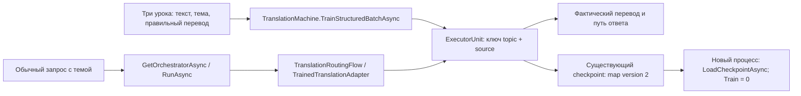
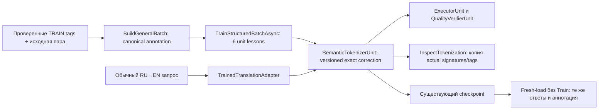

# 105. Адрес памяти перевода и целостность учебных пометок

<!-- EXECUTOR-CONTEXT-120:START -->
## Обязательный вход в выбранный перенос или owner-раздел

Обязателен [договор120](120-executor-context-and-test-repair-contract-2026-11-02.md): перед новым аудитом/заданием свежо и целиком прочитать local/canonical AGENTS, CLAUDE, 12 основных навыков и дополнительные experiment-design/test-integrity по роли; восстановить усечения. Модель default без override. Этот вход не разрешает запуск и не меняет данные, budget, команды или очередь.

**Область:** этот вход относится к каждому выбираемому ниже FIX/TEST/R/RF/C и его собственной приёмке, а не превращает весь файл в одно поручение. Уже принятые части не переоткрывать; сначала сверить current source и сохранённые receipts именно выбранного владельца.

**Применимые риски TRANSLATION/ATOMIC/STATE:** Сверить builder→learned memory→обычный tokenizer/executor/verifier. Истинный negative и marker-only, exact topic/direction и нормализованные RuleTags не смешиваются; отрицательный смысловой контраст и сохранённый правильный перевод оцениваются раздельно, без подмены gold. Для назначенного mutable owner поздний отказ проверяется до restore: старое состояние и правильный ответ целы; законная партия видна как целая новая версия. Конкретные typed/held-out/barrier случаи RF01 применимы TranslationMachine, не добавляются другим owners. Проверить полный typed learned payload и применимые RNG/tokenizer/index/maps, состояние сразу после вмешательства и отдельный fresh-load только по назначенному API. Положительный старый ответ сохраняется; внешняя мутация/чужая identity должна обнаруживаться. Count/hash сами не доказывают восстановление.

**Ожидания тестов:** собственные данные/positive/negative этой карточки и названный ordinary caller имеют приоритет над примерами120. Пример другого семейства не добавляет fixture, Train или новый API. Полный набор outer/nested Train/BPE/Grammar, readouts, restore и этапов остаётся в существующем бюджете. Структурный guard сTrain0 не объявляется новым обучением.

**Порядок самопроверки:** source SHA + dirty bytes → именованные producer/caller/learner/state/consumer → own positive/negative witnesses → полный outer/nested расход → назначенные ordinary/restore/E2E проверки. При падении сохранить input/expected/actual/stack + source/assembly SHA до restore; fixture/устаревший контракт/регрессия/инфраструктура раздельно, gold/threshold/Skip не лечат ошибку. Назначенный перенос/QA/ремонт включает сборку, discovery, тесты и исправление фильтра, fixture или expected по независимому договору; повторное разрешение на это не нужно. Сверить обязательные имена с discovery и результатами той же сборки, сохранив весь назначенный охват. Автору передать недоступные исходные данные, спорный договор или необходимость нового API/научного опыта; не заменять их удобным аналогом. При текущем задании только на документы запуск не разрешён. Терминал того же handle, русский отчёт, STOP/NEXT немедленны; future checks остаются UNRUN.
<!-- EXECUTOR-CONTEXT-120:END -->

## Дополнение01.11: опубликованный P52 не закрывает весь FIX-P52-TAGS

<!-- OWNER-CONTEXT-120 --> **Самопроверка выбранного раздела:** TRANSLATION/ATOMIC/STATE по договору120 во входе файла; собственные source/caller/данные/доза и negative+positive этой строки обязательны. Старый завершённый результат не переоткрывать; при падении сохранить input/expected/actual/stack+SHA, не менять oracle ради зелёного. Примеры другого owner не добавляют проверки или Train к этому разделу.

Перенос `1c6eb412af3ddaf30dc61482c6923fc50739e13a` действительно читает verified annotation правильной стороны. На опубликованном `76c1276584ef7e34412497e5433e8571a0ec61d5` [аудит116, D1/D3](116-post88-deep-transfer-audit-and-repair-plan-2026-11-01.md) установил два оставшихся требования: проверять **окончательно нормализованные** tags и согласовать обученные RuleTags/full/prefix/structure/checkpoint. Статус FIX-P52-TAGS: **SOURCE_PARTIAL; NATIVE_LEARNING_ACCEPTANCE_OPEN**, а не повторное поручение написать уже существующий verified-side helper. Исходные даты/статусы ниже исторические.

Для D1 обязательны различающие входы `['TENSE=PAST','TENSE.PRESENT']`, `['TENSE.FUTURE']`, `['!!!']` и положительный `['CASE=DATIVE']`: нормализация после guard не должна вводить противоречие/неподдержанное время/тихую потерю. Для D3 выбранная Signature действительно сохраняется; недостаёт согласованности остальных представлений. Одна Pattern accuracy не закрывает это требование. Учебный рецепт ниже сохраняется:2 batches/12 unit-lessons/16 Flow/8 inspections/один fresh load; D1 не назначает ещё одно обучение поверх него. Четыре новых чистых входных случая считать отдельно от Train. Checkpoint migration следует101; новая обязательная связь reviewed material с P65-v2 следует111/116-D2. Продукт и тесты этим документным дополнением не изменены.

Дата: 30.10.2026. Статус: **новый адресный план, реализация и приёмка не выполнены**. Текущая фаза — `READ_ONLY_RESEARCH` плюс запрошенный Markdown. Документ не разрешает запуск кода, обучения, тестов, сборки или Git mutations. Будущие действия ниже выполняются только после прямого назначения пользователем соответствующего переноса.

Переводчик должен сохранять оба известных значения слова, когда тема различается, и не учить правильную пометку времени из отвергнутого перевода. Первый ремонт касается адреса точной памяти; второй — происхождения и согласованности аннотации. Ни один из них не объявляет общую способность переводить невиданные предложения. Для порядка графа пока требуется отдельное доказательство основного потребителя.

Основание — [независимый ограниченный разбор P50–P52](reviews/2026-10-30-late-positive-evidence-review.md). Источники ниже сверялись на локальных `cbf3b1d834c` и `d190722004b0bc45e4ef343e3824d84e343c0374`; последний HEAD прочитан при подготовке этого плана. Старые runtime результаты не выдаются за выполненные на новом HEAD.

## 1. Очередь и границы владельцев

| Работа | Что должно измениться у пользователя | Статус / следующее действие |
|---|---|---|
| `FIX-P51-TOPIC` | `bank` в finance возвращает «банк», в river — «берег»; один урок не стирает другой; после нового процесса ответы сохранены | План нового переноса; после назначения — реализация точного ключа и его версии сохранения |
| `FIX-P52-TAGS` | Проверенные пометки правильной стороны действительно читаются обученным разборщиком и не противоречат его возвращаемой signature | План диагностического переноса; после P51 — реализация происхождения и согласованного чтения пометок |
| `COND-P50-GRAPH` | Обученный порядок реально читает назначенный основной потребитель графа | Условная граница; сейчас нет доказанного адреса интеграции, реализация не назначена |

P51 и P52 выполняются последовательно, поскольку оба затрагивают `TranslationTrainedUnits.cs` и checkpoint contracts. P42/P47 принадлежат плану, который готовит родитель отдельно; они сюда не включены. Контракт полноты сохранённого состояния уже принадлежит [101](101-persistent-state-bundle-contract-2026-10-30.md), владение изменяемым ответом KNN — [102/R2](102-late-transfer-repair-plan-2026-10-29.md), доменный конструктор KNN — [74](74-knn-domain-constructor-transfer.md). Эти механизмы заново не создаются.

Применяется [общий контракт исполнения и проверки](03-test-and-execution-contract.md). Статус, отчёт или commit отдельной работы не разрешают произвольно расширить scope. Если Люба указывает STOP либо перейти к другому ID, прежнюю задачу прекращают сразу: запрещено дописывать её отчёт, чинить её тесты, запускать продолжение или публиковать её «перед переходом», если это прямо не разрешено текущим указанием. Отсутствие назначения следующего переноса не заменяется автоматическим запуском.

## 2. Что признаётся полезным результатом

Любое полезное измеренное изменение сохраняется по своему показателю и предметной теме. Приоритетный численный допуск — улучшение **строго более 5%** без ухудшения более 5% остальных применимых метрик. Рост **CPU-time** сам по себе не запрещает перенос; исключение не распространяется на RAM, allocation, disk, неверные ответы, потерю уроков или ложные принятия. Логическая корректность диагностики, сохранения/восстановления и правильных ответов может дать отдельное явно названное основание ремонта.

Для положительного baseline `a` относительная дельта качества — `(b-a)/a`; для затрат — та же формула с направлением «больше хуже». Рядом обязательны counts и процентные пункты. Для `a=0` относительный процент не определён; показываются абсолютные изменения. `UNKNOWN` и `NOT_MEASURED` не означают нулевой расход или отсутствие ухудшения. Результат 0→0 не является приобретением обучения. Чтение уже известного точного перевода называется сохранением/повторным использованием памяти, а не обобщением.

Сохраняются точные RowId/Kind/gold и actual каждой стадии, отдельные gained/lost, число назначенных и выполненных native lessons, native входы и обычные ответы. `LearningBatchResult.AccuracyAfter` без held-out в текущем `TranslationMachine.TrainStructuredBatchAsync`:124–127 является покрытием обученных units; его нельзя подставлять вместо правильности ответов панели.

Новые измерения времени/памяти делаются у одинаковых границ: построение DTO отдельно, Train отдельно, чтения отдельно, сохранение/загрузка отдельно. Измерение общего пика последовательного процесса не даёт peak A/B. Исторические миллисекунды и байты не превращаются в точные CI-пороги. Если сопоставимого контроля затрат нет, численный допуск «без регрессий» не ставится; остаётся указанное основание корректности и неизвестные ресурсы.

## 3. FIX-P51-TOPIC — известные значения слова не перезаписывают друг друга

<!-- OWNER-CONTEXT-120 --> **Самопроверка выбранного раздела:** TRANSLATION/ATOMIC/STATE по договору120 во входе файла; собственные source/caller/данные/доза и negative+positive этой строки обязательны. Старый завершённый результат не переоткрывать; при падении сохранить input/expected/actual/stack+SHA, не менять oracle ради зелёного. Примеры другого owner не добавляют проверки или Train к этому разделу.

### 3.1. Эксперимент и реальный дефект

Основание: `P51-PRIMARY-01`, `P51.1`, коммит результата `06a18498359ea154b50a0d1781978516515448c0`. Первичные [metrics.json](../../../../experiments-v2/RP01-MICRO/P5101/results/attempt-0001/metrics.json), [arms.json](../../../../experiments-v2/RP01-MICRO/P5101/results/attempt-0001/arms.json), [report.md](../../../../experiments-v2/RP01-MICRO/P5101/results/attempt-0001/report.md).

Тема обучения — перевод; профиль — EN→RU, явно заданная тема слова. Получатель — `ExecutorUnit` направления EN_RU, внутренняя точная память. Три урока в порядке: `(bank, finance, банк)`, `(bank, river, берег)`, `(file, general, файл)`. Четыре проверки: эти же три плюс `(bank, unknown)`, где верный исход — отказ. Отложенных известных переводов в опыте нет.

| Показатель | Холодная машина | Историческое A | Историческое B |
|---|---:|---:|---:|
| Верные исходы / 4 | 1 | 2 | 4 |
| Ошибки известного перевода | 0 | 1 | 0 |
| Ложные принятия неизвестной темы | 0 | 1 | 0 |
| Удержанные уроки / 3 | Не измерено | 2 | 3 |
| Разные exact ключи после трёх записей | 0 | 2 | 3 |

В A второй урок перезаписывает первый: E1 выдаёт «берег» вместо «банк»; E4 тоже выдаёт «берег». В B E1 — «банк», E4 — `[EN_RU:BOOTSTRAP] bank`. Эта строка bootstrap является отказом, **не переводом**. Перестановка тематических ярлыков уменьшила B с 4/4 до 2/4. Копия с выключенным фактором совпала с A на четырёх строках. Рост правильности A→B — +50 п.п., +100% относительно A; потерянных строк B на этой панели нет.

В текущем [TranslationTrainedUnits.cs](../../../../27.TranslationDomain/TranslationTrainedUnits.cs), `ExecutorUnit.TrainOnExample`:413–415, ключ строится только из `SourceText`; `Execute`:264–268 читает его без `topicDomain`. [TranslationDirectionAdapters.cs](../../../../27.TranslationDomain/TranslationDirectionAdapters.cs):124–126 передаёт тему в настоящий executor. Это конкретный продуктовый адрес ремонта.

Исторические ресурсы A/B: 60.7491/12.7096 мс Train, 290856/275208 allocated bytes, последовательный retained heap 670472/833168 байт, общий peak 45723648 байт. A проходил всю машину, B — экспериментальную копию и прямой flow; были разогрев и накопление объектов. Поэтому ни ускорение, ни отсутствие/наличие чистой ресурсной регрессии фактора этими числами не доказаны. CPU по плечам не измерен.

### 3.2. Выбранная архитектура и файлы

Меняется только exact memory существующего `ExecutorUnit`. Во внутренней таблице использовать типизированный ключ `(normalizedTopic, normalizedSource)`; направление уже задаёт экземпляр executor. Источник нормализуется существующим `NormalizeMapKey`; тема — Trim/ToLowerInvariant, пустая тема означает `general`, как в P51. Один общий построитель ключа вызывается при записи и чтении. Не конкатенировать пользовательские части через непроверенный разделитель и не добавлять learned router для выбора темы: тема уже приходит в запросе.

Смысл без кода: два урока про `bank` пишутся в разные ячейки finance и river; запрос выбирает свою ячейку. Точная таблица больше не стирает известное значение. При отсутствии такой ячейки действуют прежние дальнейшие пути; **глобальный запрет перевода неизвестной темы не заявляется**. На многословном источнике phrase/word/KNN ещё могут выдать ответ, потому что они не разделены темой. Этот перенос не меняет их семантику под видом исправления exact-map.

| Файл | Конкретная будущая работа |
|---|---|
| Существующий `27.TranslationDomain/TranslationTrainedUnits.cs` | Тип exact-map, единый ключ в `TrainOnExample/Execute`, запись/чтение новой формы в `ExecutorUnit.ExportCheckpoint/ImportCheckpoint` |
| **Новый** `27.TranslationDomain/TranslationExactSourceKey.cs` | Внутренний readonly record struct ключа и общий нормализатор темы; никаких словарей эталонных переводов |
| Существующий `27.TranslationDomain/TranslationCheckpointContracts.cs` | Версионированная форма exact-map, описанная ниже; остальные карты не переопределять |
| Существующий `27.TranslationDomain/TranslationMachine.cs` | Проверка новой exact-map в `ValidateCheckpointStructure` до любых Import mutations |
| **Новый** `Tests/ExperimentFixes/TranslationExactTopicMemoryTests.cs` | Названные учебные, отрицательные и checkpoint-проверки |
| Существующий `Tests/TranslationDomainTests.cs` | Только адресные fixtures/assertions, действительно привязанные к старой exact-map; сохранить золотые ответы |
| Существующий `docs/projects/27-translation-domain.md` | Точная область тематического ключа и правила чтения старых сохранений в том же implementation slice |

**Сохранение: один владелец и явная версия.** Не создавать ещё одну общую систему checkpoint. В существующий `ExecutorUnitCheckpoint` добавить trailing поля `ExactSourceKeyVersion` (default 1 для старого JSON) и nullable `TopicSourceMap`; новый record `ExecutorTopicSourceMapEntryCheckpoint(TopicDomain, Source, Target)` хранится в том же contracts-файле. Текущий exporter пишет version 2, пустой legacy `ExactSourceMap` и отсортированный `TopicSourceMap`; это один авторитетный набор, а не две конкурирующие памяти. Остальные поля и верхняя версия контейнера сохраняются; новая семантика имеет свою проверяемую вложенную версию.

Импорт version 2 требует непустые канонические topic/source, непустой target, уникальность пары ключа, коллекцию не null и пустую legacy-карту. Нормализуется только адрес; текст target сохраняется дословно, включая регистр. Пустая сама коллекция допустима для необученного executor. Неизвестная версия, null, повтор после нормализации или одновременно два авторитетных набора — отказ до изменения live runtime. Назначенные коды: `CHECKPOINT_EXACT_SOURCE_SCHEMA_UNSUPPORTED`, `CHECKPOINT_EXACT_SOURCE_CONTEXT_REQUIRED`, `CHECKPOINT_EXACT_SOURCE_KEY_DUPLICATE`, `CHECKPOINT_EXACT_SOURCE_STATE_INVALID`.

Version 1 с пустой `ExactSourceMap` переносится в пустую contextual карту без обучения. Version 1 с непустой source-only картой **не объявляется contextual state**: importer отказывает с `CHECKPOINT_EXACT_SOURCE_CONTEXT_REQUIRED`, сохраняет текущую принятую модель и исходный файл. Это намеренное ужесточение совместимости: утраченную тему нельзя восстановить из `bank→берег`. Автоматически приписывать `general`, восстанавливать тему по target либо скрыто переобучаться запрещено. Миграция содержимого старого снимка по дополнительным исходным данным — отдельное назначение, не часть этого переноса.

### 3.3. Native путь, точные данные и учебный бюджет

Используется `new TranslationMachine()`, а не constructor с injected flow. Уроки строятся по реальной форме [P5101/Program.cs:1304](../../../../experiments-v2/RP01-MICRO/P5101/Program.cs): `TranslationLearningExample`, UnitId executor-en_ru, `ExecutorInput(source,"en",topic)`, `ExecutorOutput(target,0.95,null,null)`, rejected `[WRONG: missing translation]`, `RejectedType=synthetic_missing_translation`, signature настоящего tokenizer, `SourceId=p51-simulation-v1`, `HeldOut=false`. Уникальные ID `P51-TOPIC-t1/t2/t3`, batch `P51-TOPIC-main-v1`. TRAIN не включает unknown.

| ID | Source | Topic | Независимый gold |
|---|---|---|---|
| E1 | bank | finance | банк |
| E2 | bank | river | берег |
| E3 | file | general | файл |
| E4 | bank | unknown | отказ; конкретный перевод запрещён для этой строки |

Retentions C1/C2/C3 используют первые три входа и те же gold. Это повторные чтения известных уроков, не новые независимые задачи. Обычный путь: `TrainStructuredBatchAsync → ExecutorUnit.TrainOnExample → GetOrchestratorAsync → RunAsync → TranslationRoutingFlow → TrainedTranslationAdapter`. Фактический `adapter_id` сохраняется рядом с текстом. У E1–E3 после обучения требуется именно нужный текст; bootstrap не принимается за перевод.

Первый новый тест `TopicExactMemory_LearnsRetainsAndFreshLoads`: 4 холодных flow чтения; 3 executor lessons одним batch; 4 AFTER и 3 retention; `SaveCheckpointAsync`; новый процесс `LoadCheckpointAsync`; 4+3 чтения восстановленной машины без Train. **Итого 3 lessons, 18 flow чтений, 1 save и 1 fresh-load.** Внешние модели, DPO/SFT, Generate, скрытый warmup и retry — 0. Внутренние tokenizer/verifier действия этих flow вызовов учитываются отдельно как вложенные операции, не выдаются за отсутствие вычислений.

Второй тест `TopicLabels_ControlChangesKnownAnswers`: свежая native машина, 3 урока с переставленными topic labels только у двух bank-уроков; 4 чтения E1–E4. Ожидаются неверные E1/E2, сохранённый file и тот же отказ unknown; полная правильность падает 4/4 → 2/4. **Дополнительно 3 lessons/4 flow. Общая учебная приёмка — 2 batch, 6 executor lessons, 22 flow чтения.** В каждом batch три записи exact памяти и девять имеющихся побочных KNN записей; последние не называются девятью самостоятельными уроками.

Историческое A не запускается повторно и не реализуется production switch ради теста. Его immutable raw ответы остаются baseline доказанного дефекта; новый native запуск доказывает исправленный путь на тех же входах. Честность сравнения ресурсов с A при этом не возникает автоматически.

Дешёвые проверки версии, повторного нормализованного ключа, несовпадения версии и одновременных legacy/new карт используют построенные checkpoint DTO, без Train. Отказ импортировать подменённый DTO в уже обученную основную машину проверяется по неизменному каноническому содержимому exported unit state/identities; временное поле `ExportedAtUtc` из fingerprint исключается явно. Нельзя заменить сохранение прежней модели новым пустым экземпляром.

### 3.4. Какие тесты менять, что считать принятым

Существующий helper `BuildExecutorCheckpoint` в `Tests/TranslationDomainTests.cs`:2550–2574 сейчас заполняет `ExactSourceMap`. Его используемые как **текущий** сохранённый state fixtures перевести на version 2 и явный `general` там, где исходный запрос действительно general; gold оставить прежним. Отдельные legacy fixtures должны остаться version 1 и проверять установленный отказ, а не незаметно имитировать новую схему. Не ослаблять проверки machine/direction mismatch, полноты коллекций, атомарности import, чисел состояний и переводов. Новых фактически падающих тестов эта работа не запускала и не заявляет.

Принято только если: три урока сохранены тремя адресами; E1–E3 правильны до и после fresh-load; E4 соблюдает назначенную однословную границу; C1–C3 не потеряны; отрицательная смена тем обнаруживается; ошибка импорта не стирает принятую память; все назначенные tests обнаружены и завершены. Предел постоянного ответа на основной панели — 1/4. Результат — исправленная правильность известных ответов и сохранения, не обобщение и не распознавание темы из свободного текста.

Математическое основание: source-only функция `Dictionary[source]` не может хранить два разных значения одного source одновременно. Пара `(topic,source)` снимает конкретный конфликт, но ничего не доказывает о выборе среди других fallback путей. До отдельной многословной панели запрещено расширять вывод об unknown-topic отказе.

## 4. FIX-P52-TAGS — правильная пометка берётся из проверенной стороны

<!-- OWNER-CONTEXT-120 --> **Самопроверка выбранного раздела:** TRANSLATION/ATOMIC/STATE по договору120 во входе файла; собственные source/caller/данные/доза и negative+positive этой строки обязательны. Старый завершённый результат не переоткрывать; при падении сохранить input/expected/actual/stack+SHA, не менять oracle ради зелёного. Примеры другого owner не добавляют проверки или Train к этому разделу.

### 4.1. Основание и что именно переносится

Основание: `P52-PRIMARY-01`, `P52.1`, результат в `cbf3b1d834cbf28baa2bb13baeb1bddc17e21019`. Первичные [metrics](../../../../experiments-v2/RP01-MICRO/P5201/results/attempt-0001/metrics.json), [arms](../../../../experiments-v2/RP01-MICRO/P5201/results/attempt-0001/arms.json), [report](../../../../experiments-v2/RP01-MICRO/P5201/results/attempt-0001/report.md), [status](../../../../experiments-v2/RP01-MICRO/P5201/results/attempt-0001/status.json).

Тема — перевод; профиль — RU→EN и время глагола. В исторических A/B шесть native unit lessons на плечо; правильные добавленные пометки 0/2 → 2/2. Но тексты и времена ответов 4/4 → 4/4, включая copy-off и B-MUT, все через exact-source. Достижимая полная signature на панели 0/4 в A и B. Сохраняются **`NO_CONTRAST_ON_ANSWERS_ADDRESS_DIFFERS` и exit 9**. Cold 0/4 → trained 4/4 здесь не является эффектом смены источника пометки.

Нынешний [TranslationStructuredBatchBuilder.BuildGeneralBatch](../../../../27.TranslationDomain/TranslationStructuredBatchBuilder.cs):94–110 вставляет `BuildRuleTags(pair.Rejected)` в правильный `TokenizerOutput`. Нынешний [TranslationSemanticTokenizer.BuildRuleTags](../../../../27.TranslationDomain/TranslationSemanticTokenizer.cs):169–171 добавляет `RU:TENSE:PAST` каждому глаголу. Наконец [SemanticTokenizerUnit.Tokenize](../../../../27.TranslationDomain/TranslationTrainedUnits.cs):94–101 меняет signature из обученной exact correction, но оставляет исходные `RuleTags` и иначе строит prefix/structure. Поэтому замена одного дополнительного RULE-tag ещё не доказывает согласованную аннотацию, которую читает потребитель.

Это адресный **диагностический** перенос: отдельное происхождение проверенной пометки и её согласованная выдача известным обученным разборщиком. Не добавлять общий морфологический classifier и не обещать правильное время для невиданных строк.

### 4.2. Выбранный контракт и минимальные изменения

В `TranslationTrainReadyPair` предлагается добавить новое trailing nullable поле `VerifiedRuleTags` с JSON именем `verified_rule_tags`; в прочитанном текущем контракте такого поля нет. Эти данные поступают из проверенного TRAIN manifest/валидатора вместе с существующими id/source/validation fields; они не выводятся из ответа learner или из rejected. Для старой строки без поля отсутствие является отсутствием проверенной аннотации, а не разрешением снова читать rejected.

Новый служебный `TranslationVerifiedRuleTags` нормализует только формат явных пометок, не угадывает смысл текста. Для семейства времени три входные записи `TENSE_PAST`, `TENSE:PAST`, `TENSE=PAST` имеют один canonical tag `RULE:TENSE=PAST`; аналогично PRESENT. Дубликаты одинакового значения сворачиваются. Одновременно PAST/PRESENT, пустая строка или неизвестное значение времени — отказ до выдачи партии. Для явно проверенных нетемпоральных тегов сохраняется существующая нормализация; этот перенос не доказывает их семантическое качество.

Проверенное время имеет явный приоритет **только в обученной correction данной строки**: при PRESENT из её возвращаемого набора убираются ложное `RU:TENSE:PAST` и зависимые от PAST теги пола глагола/согласования, добавляется `RU:TENSE:PRESENT`; при PAST сохраняется согласованный PAST-набор. Общая `TranslationSemanticTokenizer.ClassifyPos/BuildRuleTags` не переучивается и не получает новые эвристики времени. Для необученного текста прежняя неточность остаётся видимой ограниченной границей.

`TokenizerOutput` получает optional `RuleTags` и `AnnotationVersion` (legacy 0, новая согласованная запись 1). При version 1 builder сохраняет собственный неизменяемый снимок canonical tags, согласованные signature/pattern и пометку версии. `SemanticTokenizerUnit.TrainOnExample` проверяет форму до записи и копирует массив. `Tokenize` на exact correction версии 1 возвращает новую копию RuleTags и согласованные full/prefix/structure signatures по одной общей функции построения из tokens/pattern/tags. Сохранённый `PAIR` suffix остаётся только в full signature согласно существующему режиму; он не добавляется к запросу из gold на экзамене. Версия 0 не получает автоматически статус исправленной.

`SemanticTokenizerSignatureCorrectionCheckpoint` хранит те же RuleTags/version; exporter/importer копируют и проверяют их. Это расширение существующего доменного state, не новый checkpoint framework. При загрузке version 1 с отсутствующими/противоречивыми tags или неизвестной версией — отказ до любых runtime mutations. Данные rejected остаются причиной отказа и источником прежних отдельно назначенных word/agreement mappings; данный перенос запрещает только их использование как **проверенной правильной аннотации**, а не переписывает все независимые механизмы builder.

| Файл | Конкретная будущая работа |
|---|---|
| Существующий `27.TranslationDomain/TranslationStructuredBatchBuilder.cs` | Поле DTO, preflight аннотации, устранение rejected→correct-signature, формирование TokenizerOutput version 1 |
| **Новый** `27.TranslationDomain/TranslationVerifiedRuleTags.cs` | Нормализация/проверка явных tags и согласование обученной correction; без таблицы переводов и угадывания gold |
| Существующий `27.TranslationDomain/TranslationSemanticTokenizer.cs` | Вынести/переиспользовать построение signature/prefix/structure с заданными tags; не менять классификацию слов или базовую эвристику времени |
| Существующий `27.TranslationDomain/TranslationTrainedUnits.cs` | Версионированный TokenizerOutput, defensive copy, выдача согласованной trained correction, export/import |
| Существующие `TranslationCheckpointContracts.cs`, `TranslationMachine.cs` | Поля correction, preflight новой аннотации при Train/import до публикации изменения |
| **Новый** `27.TranslationDomain/TranslationTokenizationReadback.cs` | Immutable DTO для копии фактических signatures/RuleTags; без доступа к изменяемой Unit |
| Существующий `TranslationMachine.cs` | Узкий `InspectTokenization(rawText, sourceLanguage)` читает `_runtime.SemanticTokenizer.Tokenize` и возвращает defensive DTO через OperationResult; injection-only машина получает `RUNTIME_STATE_UNAVAILABLE` |
| **Новый** `Tests/ExperimentFixes/TranslationVerifiedRuleTagTests.cs` | Учебная диагностика, сохранение, отрицательные входы и чувствительность |
| Существующий `Tests/TranslationDomainTests.cs` | Исправить только fixtures, которые ошибочно назначают rejected источником правильных tags |
| Существующий `docs/projects/27-translation-domain.md` | Отдельно описать raw parse, проверенные TRAIN tags, learned correction, legacy version и границы ответа |

Readback необходим для проверки именно той обученной Unit, которую использует default `TranslationMachine`; он не создаёт другого tokenizer, не обучает, не выполняет flow повторно и не отдаёт внутренние mutable ссылки. Это доказательный дополнительный вход, а не замена обычного перевода.

### 4.3. Точные данные и учебная приёмка

Обе строки имеют `Source=simulation`, `Direction=RU_EN`, `PairFamily=tense`, `Prompt=Переведи`, `ValidationOutcome=train_ready`, `ValidationErrors=[]`; builder вызывается с `TranslationSignatureMode.Structural`. Новые ID `P52-TAGS-t1/t2`, batch `P52-TAGS-main-v1` не переписывают исторические P52 IDs/файлы.

| Строка | ASide | Chosen | Rejected | VerifiedRuleTags |
|---|---|---|---|---|
| t1 | Он проверил файл | He checked the file | `He checks the file [WRONG: tense] [RULE: TENSE_PRESENT]` | `[TENSE_PAST]` |
| t2 | Он проверяет файл | He checks the file | `He checked the file [WRONG: tense] [RULE: TENSE_PAST]` | `[TENSE_PRESENT]` |

Панель: e1/e2 — эти исходные строки; e3 `Он проверил файл.` и e4 `Он проверяет файл.`. Gold — соответствующие полные Chosen и PAST/PRESENT. Строки e1/e2 повторяют TRAIN; e3/e4 отличаются пунктуацией и exact-source нормализатором могут стать теми же ключами. Называть их корпусным held-out или обобщением запрещено. Для readback обученной аннотации используются только t1/t2; корректность аннотации пунктуационных вариантов этим переносом не обещается.

Основной тест `VerifiedTags_AreLearnedConsumedAndFreshLoaded`: новая default машина; 4 cold flow вызова и 2 cold readback; 1 batch/6 unit lessons (semantic/executor/verifier на каждую пару); 4 AFTER flow и 2 readback; save; новый процесс load; 4 flow и 2 readback. Итого **6 lessons, 12 flow, 6 InspectTokenization, 1 save/fresh-load**. Сохраняются действительные `RowsTrained`, identities и promoted unit ids; числа отчёта не заменяют проверку изменённого state.

Ожидания: две добавленные правильные пометки из двух; теги и full/prefix/structure каждой обученной строки согласованы; PRESENT correction не несёт PAST/PAST-dependent tags; обе стороны читаются до и после fresh-load. Обязательное удержание переводов — **4/4 AFTER и 4/4 fresh-load**, с прежними полными gold; это retention, не измеренный gain фактора. Сырой cold разборщик может ошибаться; его raw output сохраняется, не переписывается в отчёте.

Тест `VerifiedTags_ControlFollowsSwappedTrainingAnnotations`: в новой машине те же 2 пары/6 lessons, только явно проверенные tags переставлены; 4 flow и 2 readback. Правильность назначенных временных tags должна снизиться с 2/2 до 0/2, показывая влияние реально записанного урока. Структурная проверка формата не должна тайно брать gold из текста и отменять эту мутацию. Тексты перевода могут остаться 4/4; это ожидаемая граница, не повод дописать новый эксперимент.

**Общий лимит этих двух учебных тестов: 2 batch, 12 native unit lessons, 16 flow вызовов, 8 InspectTokenization, 1 save и 1 fresh-load; DPO/SFT/teacher/Generate/retry=0.** В сравнении с историческим опытом здесь не повторяются A/copy-off: это приёмка нового исправления на одном native пути, historical A остаётся сохранённым основанием.

Шесть дополнительных чистых проверок builder без Train: (1) одинаковые verified tags при изменённом rejected сохраняют правильную annotation; (2) поле отсутствует — rejected не становится verified tag; (3) PAST+PRESENT отвергаются; (4) пустой tag отвергается; (5) неподдерживаемый `TENSE_FUTURE` отвергается; (6) два алиаса одного PAST дают один canonical tag. На эти проверки по одному вызову builder; с двумя учебными builder вызовами всего **8**. Дополнительно проверяется неверная checkpoint annotation version на DTO без обучения, с отказом до мутации принятого state. Чистые проверки формы не выдаются за самостоятельный эксперимент обучения.

### 4.4. Изменения тестов, математическая граница и ресурсы

Существующий `TranslationStructuredBatchBuilder_AppendsRejectedRuleTagsToUnitSignatures` (`Tests/TranslationDomainTests.cs`:1204–1227) закрепляет старый неправильный источник. Переименовать в `...AppendsVerifiedRuleTagsToUnitSignatures`, передать явные `[TENSE=PAST, CASE=DATIVE]`, сохранить expected `RULE:TENSE=PAST` и `RULE:CASE=DATIVE`. Добавить adversarial rejected с противоположным временем. Не удалить утверждения и не заменить их `Contains(any tag)`.

`TranslationSemanticTokenizer_AddsLanguageRuleTagsToKnnSignature`:1188–1200 на «Она пошла к морю» сохраняется как контроль прежнего raw past поведения. Existing word-map/KNN priorities, verifier admission, текстовые gold, направление, checkpoint identity и ошибка некорректной структуры не ослабляются. Изменение чисто формы checkpoint отражается в fixtures, а не в удалении проверок. Новых реально падающих тестов в этой исследовательской работе не установлено запуском.

Приёмка диагностического переноса требует native обучения, правильной actual аннотации, её потребления и fresh-load; один правильный appended string недостаточен. Полная согласованность может потребовать исправления выбранного алгоритма, но не разрешает заменить oracle фактическим ответом. Для общей морфологии и unseen-переводов нужен другой вопрос и отдельное назначение.

Математическая граница: `0/2→2/2` правильных annotations — +2 и +100 п.п., относительный рост при нуле не определяется. Текст `4/4→4/4` имеет нулевую дельту, поэтому в gain не попадает. Пока все запросы проходят exact-source и изменённая адресация не влияет на текст, чувствительность текстовой метрики к фактору равна нулю. Перенос допускается только по явно названной логической корректности диагностики/сохранения.

Исторические ресурсы A/B: Train 213/64 мс, ответы 5/2 мс, allocated 581664/502552 байт; copy-off/mutation Train 14/18 мс. Peak 50237440 байт, GC memory 3173944 байт и total 3631 мс относятся ко всему последовательному процессу. Это не доказательство ускорения. Новая версия аннотации увеличивает snapshot payload; её bytes и allocation нужно измерить и отразить. CPU-исключение не скрывает RAM/disk cost.

## 5. COND-P50-GRAPH — отдельная проверка представления и условный продуктовый перенос

`P50-PRIMARY-01` дал 2/4 → 4/4 по порядку, пропущенные/лишние рёбра 2/2 → 0/0, циклы 0→0, native KNN retention 8/8. [Raw arms](../../../../experiments-v2/RP01-MICRO/P5001/results/attempt-0001/arms.json) и [metrics](../../../../experiments-v2/RP01-MICRO/P5001/results/attempt-0001/metrics.json) остаются положительным локальным результатом. Исторический consumer A — `35.ExperimentsV2/Experiments/E50DomainGraphClosure.BuildEdges`, а B graph adapter находится в `P5001/Program.cs`; это не доказанный глобальный основной graph builder.

В проекте 21 существуют `LogicalRegistryDynamicGraphProjector.Project`, `DeterministicDynamicGraphTopologyBuilder.BuildDynamicTopology`, `DynamicGraphEdgeFlow` и `EdgeAuthorityDecision.OrderedTargets`. Их полномочия различаются: projection реестра, validation topology и learned target handoff нельзя слить названием «графовый consumer». Проверенный call chain от пользовательского запроса к одному нужному изменяемому месту пока не предъявлен. Поэтому в 105 **нет разрешённых будущих product edits для P50**, нет нового universal router и нет заявления «все графы исправлены».

**Текущее состояние на 3 ноября 2026:** Q127 уже исполнен в двух сохранённых попытках, **RESULT_RECORDED**. Ниже абзацы «будущий опыт» и его первоначальный бюджет — историческое назначение от30 октября, не разрешение повторить PRIMARY. [Уточнение153](codex-153-p115-p127-transfer-boundaries-2026-11-03.md) сверяет raw: TRAIN9/10→10/10, EXAM5/6→6/6, приобретены p2(TRAIN) и h2(EXAM). Ресурсы в §13 второго отчёта взяты из первой попытки; использовать раздельные таблицы153. В одном reverse-control wall вырос на5,21%, во втором снизился; общей доказанной ресурсной безрегрессионности нет. Перенос остаётся условным: обычные DefaultLogicalCapabilityTrainer/CapabilityServing используют TransformerEmbeddingKnnLogicalUnit, а опыт — иной BPE/predicate KnnLogicalUnit. Следующий шаг этого владельца — точный caller/encoder и границы приёмки по153§2.1; существующий saved-checker ремонт150/152 остаётся отдельным и не требует обучения.

Назначаемый родителем будущий опыт [**`KNN-ORDER-PERMUTATION-01`, Q127**](../experimets/cards/KNN-ORDER-PERMUTATION-01.md) проверяет отдельную границу представления; его исходный рецепт описан в [review P50–P52, раздел 2](reviews/2026-10-30-late-positive-evidence-review.md). Карточку и индекс пишет родитель; эта запись не заявляет, что новый runner существует или запущен.

Причина проверки: [RegexSplitter.cs:16](../../../../01.Tokenizer/RegexSplitter.cs) режет текст на chunks, [BpeTokenizer.Encode:125](../../../../01.Tokenizer/BpeTokenizer.cs) сливает внутри chunks, [KnnLogicalUnit.Vectorize:438](../../../../21.AgentInfrastructure/Logical/KnnLogicalUnit.cs) суммирует token counts. При пустых predicates для пары `please review code then implement change` / `please implement change then review code` совпадают мультимножества chunks и векторы, но gold противоположен. Аналитический потолок детерминированного reader — 1/2; это не выполненный новый probe.

Будущий опыт A/B имеет один native KNN/tokenizer, одинаковый TRAIN, обе перестановки и единственный фактор position predicates. Он сохраняет прежние положительные u1–u8/e1–e4, не обещает B=2/2 заранее, не кодирует gold в score. Полный ограниченный рецепт — 3 fit/30 lessons/36 native queries/12 cold observations/12 graphs/24 node calls, включая sensitivity, в указанном review. Настоящий source/caller binding и доменное E2E с fresh-load потребуются отдельно **после** результата и выбора реального существующего owner; полное выполнение маленького опыта не является автоматической готовностью такого переноса. Сохранённый P50 manifest+witness не считается native KNN checkpoint по договору 101.

## 6. Общая оснастка новой приёмки и хранение результатов

Ни один из следующих файлов сейчас не существует по утверждению этого плана как готовая оснастка; это **предлагаемые новые файлы** для будущего назначенного implementation slice:

- `Tests/ExperimentFixes/TranslationTransferFixtureData.cs` — immutable точные DTO/панели двух работ; gold читается только assertion после получения actual.
- `tools/translation-transfer-readback/TranslationTransferReadback.csproj` и `Program.cs` — малый консольный reader с прямой ProjectReference на существующий `27.TranslationDomain/27.TranslationDomain.csproj`.
- `tools/translation-transfer-readback/Run-TransferAcceptance.ps1` — один bounded launch выбранного профиля P51 или P52, проверка сборки reader и выполнение адресных tests. Это не новый общий экспериментальный dispatcher.

Reader принимает только выбранный профиль, явный checkpoint path и result path; вызывает настоящий `TranslationMachine.LoadCheckpointAsync`, затем заданные чтения. Train/repair/bootstrap/replay входных уроков внутри reader запрещены. Сохраняются PID/время старта родителя и нового процесса, hash checkpoint до/после, схема, actual ответы/путь, а у P52 — actual `InspectTokenization`. Exported payload не подменяется hand-written expected. Reader находится вне дерева `Tests`, чтобы SDK glob тестового проекта не затянул второй project/obj; compiled reader path задаётся явно оснасткой, без поиска «самой свежей DLL».

Два новых учебных test-класса не дублируют обучение отдельным console runner: основной тест создаёт checkpoint своим единственным назначенным fit, запускает reader один раз и учитывает его чтения в приведённых лимитах. Нельзя добавить по fit на каждое assertion. На первом переносе в общих fixture/reader файлах создаётся только профиль P51: он должен собираться и проверяться без будущего `VerifiedRuleTags` или `InspectTokenization`. Профиль P52 добавляется в своём назначенном slice; заглушки будущего контракта не нужны. Отдельные чистые contract tests создают DTO без обучения и так и маркируются.

После реализации одна выбранная адресная приёмка включает новый test-класс, `TranslationDomainTests` в затронутой области и существующие связанные checkpoint/verifier tests по фактическим именам, найденным в исходниках. Перед запуском перечислить discoverable tests; ноль обнаруженных тестов не PASS. Расход существующих regression tests фиксируется отдельно от строгой дозы новых двух учебных tests; не считать его нулевым и не перезапускать для красоты отчёта. Общие gates 03 не обходятся исключением production sources/tests из сборки.

Результаты новых работ — только `artifacts/fbe/FIX-P51-TOPIC/attempt-0001/` и `artifacts/fbe/FIX-P52-TAGS/attempt-0001/`: before/after/fresh-load actual, native-state JSON, counts, cost observations, test/TRX/command receipts и русский `report.md`. При существующем attempt сначала прочитать его состояние/handle; не перезаписывать, не удалять и не выбирать autosuffix для незаметного повторного обучения. Старые `experiments-v2/RP01-MICRO/P5001/P5101/P5201/results` сохраняются неизменными.

## 7. Порядок будущего исполнения и готовый ограниченный наряд

Для каждого выбранного ID: (1) свежие источники/skills и перечень настоящих call sites; (2) минимальная реализация соответствующего раздела; (3) необходимые fixtures без изменения gold; (4) назначенная учебная приёмка и fresh-load; (5) адресный review actual кода/результатов, документация и отчёт. P51 и P52 не смешиваются в один безымянный результат. Критерии отрицательного результата сохраняются, а новые независимые эксперименты не придумываются для закрытия неудачного assertion.

Модель будущего исполнителя — **модель текущей исполнительской сессии по умолчанию, без override**. Это не перевод нынешнего исследователя в операционного исполнителя. Родитель остаётся координатором; уже назначенный worker пишет свою ограниченную реализацию сам и не ищет вложенного агента или альтернативный AI runtime.

Перед implementation исполнитель читает `AGENTS.md`, `CLAUDE.md`, 03, 101 и выбранный раздел 105; навыки из `docs/skills`: `architect-behavior-classifier-SKILL.md`, `planning-session-startup-SKILL.md`, `intent-to-plan-SKILL.md`, `phase-planning-SKILL.md`, `plan-review-SKILL.md`, `generated-code-review-SKILL.md`, `test-integrity-SKILL.md`, `prompt-patch-authoring-SKILL.md`, `human-readable-architecture-audit-SKILL.md`, `output-readability-gate-SKILL.md`, `human-communication-GLOSSARY.md`, `translation-domain-mindset-reset-SKILL.md`, `translation-domain-reality-check-SKILL.md`. Указания skills запустить перевод/тест не расширяют текущую READ_ONLY_RESEARCH фазу автора; они исполняются лишь в отдельно назначенной executable работе. Честно указать полное/целевое чтение и недостающие файлы.

> Реализуй только прямо назначенный FIX-P51-TOPIC либо FIX-P52-TAGS по плану 105. Не запускай этот наряд только потому, что прочитал документ. Цель P51 — сохранить известные переводы разных тем и восстановить их новым процессом; цель P52 — сохранить и реально читать правильную согласованную учебную аннотацию. Используй указанные native методы, данные и бюджеты; готовая таблица ответов, счётчик coverage и bootstrap не подменяют результат. Не меняй gold, не удаляй отрицательные случаи и не ослабляй исходные правильные переводы. Не повторяй исторические опыты. Runtime запускай один раз по назначенной оснастке, дождись terminal того же handle штатным wait; пустой лог и timeout не дают права relaunch или финального «жду». Не создавай polling-loop и новый runner ради зависшего ожидания. При STOP остановись; при NEXT сразу перейди к названному ID без продолжения старой задачи. Отчёт по-русски: что модель действительно записала/прочитала, counts before/after/fresh-load, gains/losses, реальные затраты и неизвестные поля, ошибки и точная граница вывода. Общая готовность перевода, графа или всего проекта этим переносом не объявляется.

## 8. Что сделано автором этого плана

Записан только этот Markdown. Уточнены текущие `TranslationMachine`, unit/tokenizer/builder/checkpoint определения, фактические старые tests и source shape P51/P52. Базовый evidence review и его границы чтения сохраняются; в этом продолжении дополнительно прочитаны целевые API/test фрагменты, общие правила допуска 03 и открывающие части двух translation skills. Полная повторная загрузка больших governance/skills и полный аудит project27 не заявляются.

Обучение, inference, сборки, tests, создание перечисленных будущих source/test/tool файлов, миграция checkpoint и Git mutations не выполнялись. Дозы, future expected и предложенные методы — план, не результаты. Пакет требует интеграции родителем и не закрывает всю продолжающуюся исследовательскую задачу.
