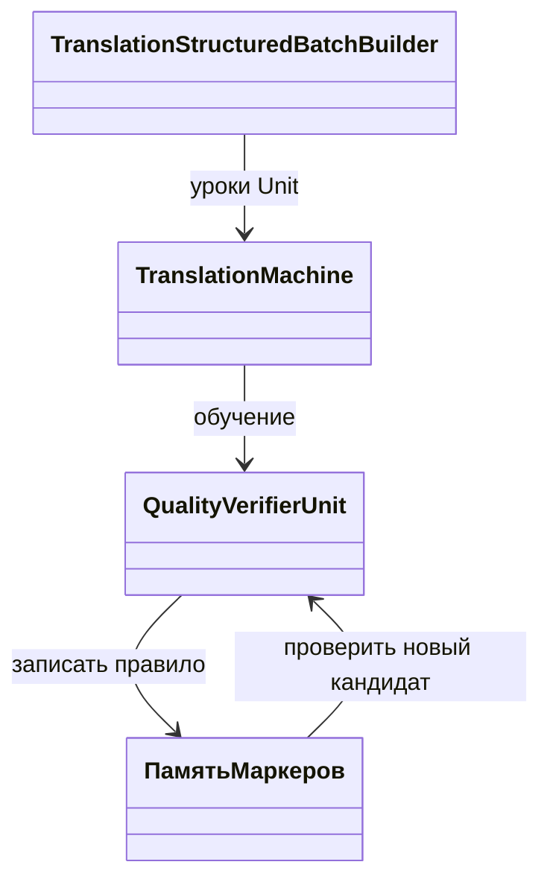

# FIX-N60 — N60-E1: не учить проверяющего отвергать правильный ответ

<!-- transfer-entry-reload -->
**Вход исполнителя.** [Q60](01-registry.md#work-fix-n60). Для общего включения действует измеренное ограничение этой строки. Возврат к работе — по записанному условию для её домена. Перед каждым переносом и после восстановления контекста заново прочтите полностью агентские файлы, назначенные навыки, исправленный список Любы, текущий индекс и карточку. [Как применить прочитанное к этой работе](03-test-and-execution-contract.md#read-and-apply) · [Что взять сейчас](01-registry.md#executor-next).

<!-- ADDRESSED-TRANSFER-QA-20261112 -->
**12 ноября: похожий риск раннего успеха.** Для уже назначенной приёмки законный положительный полный ответ и различающий отказ должны пройти один и тот же обычный адаптер до буквального ответа, а затем внешний итог процесса. Успех проверяющего до позднего assertion не является успехом процесса. Сопоставить обязательные случаи, фактический адаптер и ответ с той же сборкой; отсутствие TRX остаётся неполнотой. При ошибке подготовки исправить её по договору, не превращать законный ответ в отрицательный gold. Сборки и тесты назначенному исполнителю разрешены; занятые выходы означают [ожидание владельца](audits/2026-11-12/executor-context-and-index-repair.md#resource-wait-20261112). Общая приостановка FIX-N60 и его ранее измеренные регрессии этой технической инструкцией не снимаются.

<!-- EXECUTOR-CONTEXT-20261112-BB1 -->
**Исполнителю, 12 ноября — [CTX12-METRIC/ADMISSION](audits/2026-11-12/executor-context-and-index-repair.md).** Положительный допустимый полный ответ и отрицательный контрпример должны достигать конечного ordinary adapter, а не останавливаться на verifier verdict. Сохранённая приёмка FIX-P56 подтверждает свою signature/whole-word область и не закрывает N60, phrase-map или отдельный процесс. В отчёте связать RowId/input/state, verdict, actual adapter и literal output; усвоение исправленного e1 отделять от остальных строк. Нулевой отрицательный контроль не подменяет учебное доказательство0→0.

<!-- CODEX-POST128-NAV:START -->
## Уточнение после P128: допуск обязан читать проверяемое свойство

См. [145](codex-145-post128-transfer-and-experiment-audit-2026-11-03.md) и [146](codex-146-post128-addressed-repair-plan-2026-11-03.md). Восстановленное ordinary поведение проверяется полным набором row IDs/ответов и влияет на mandatory verdict; наличие ExactCorrect в JSON само по себе этого не делает. Сохранённые Q12519/24 и P12829/29+2/2 не превращаются в приёмку нового HEAD.

Для происхождения материала сохранить trusted SourceRowId при одинаковом содержании одной семьи; роль берётся у верифицированной строки, не у первой строки hash bucket. Запреты Train/Dev и Train/Test применяются отдельно, включая normalized content; строгая гарантия отсутствия held-out в реально потребляемом материале имеет собственный договор и не ослабляется автоматически. Проверить разрешённый положительный случай до отрицательного. Confidence 0,99 не заменяет семантический допуск; отсутствие обучения отрицанию ограничивает вывод о способности, но не стирает наблюдённый неверный ответ.

Дельта b4: подтверждение candidate bytes без BOM уже исправлено; опубликовано36/36целевыхRelease. ОсталисьCASwinner, lateEvaluate, ordinary-storecomposition и предусмотренный childrestore. Само число36 не подтверждает эти другие границы; исходныйсрезf878 и новаядельтаразделены.
<!-- CODEX-POST128-NAV:END -->

## Адресное уточнение Translation после P125

Это уточнение N01/N02, сохранения и проверки оценки; оно **не снимает** нижеописанное ограничение FIX-N60. На `9d4d79d27f18` structured training имеет staging/CAS и позднюю отмену; candidate artifact/store написан. Остатки [F125-01/03](codex-142-post125-transfer-and-experiment-audit-2026-11-03.md): hash UTF-8 без BOM против записи с BOM; default machine/Tatoeba path не назначают store; версия победителя читается позднее CAS; `EvaluateAtVersionAsync` не проверяет отмену после publish barrier. В [Q01/план143](codex-143-post125-addressed-repair-plan-2026-11-03.md#r125-01) принимать настоящий конфликт с locator/hash/restore, actual observed CAS version и отменённую оценку с неизменными state/version/accuracy/history. Переиспользовать существующие candidate tests; новое обучение для оценки и чтения checkpoint не требуется. Для памяти поQ125 использовать полный независимый comparer exact/phrase/KNN и кратность; реальное19/24→19/24 сохранено, приёмка текущей сборки остаётся UNRUN. Нижние исторические остатки не назначают повтор уже написанного store.

## Уточнение допуска по показателям — 3 ноября 2026

**FIX-N60: Не допускать общий перенос этой постановки.** Вошёл из-за одного полезного показателя; это был кандидат, а не разрешение. Нужен отдельный ремонт/ограничение, сохраняющее отрицательный контроль.

- Точность: Общая точность 3/4 → 3/4 (75% без изменения).
- Полезный результат: Ложных отказов 1 → 0; учебных строк 6 → 5.
- Цена и ограничения: Ложных принятий 0 → 1. Относительный процент от нуля не определён; это новая ошибка, её нельзя записать как 0% ухудшения.
- [Полное сравнение и статус кода](C:/Projects/llm_mvp_core/docs/plans/replanning-possible-diffs/fixes-based-on-experiments/01-registry.md#benefit-fix-n60).

Этот вывод относится к названным ID, а не ко всем механизмам документа. Старый текст плана и опыта сохранён как доказательство, но его общий статус «к переносу / разрешён» не переопределяет это уточнение. Ближайшее действие — разбор уже сохранённых данных и конкретного регресса; новое обучение, повтор PRIMARY и переключение product default этим дополнением не назначаются. Для отдельного логического ремонта назвать нарушенный контракт и сохранить отрицательные контроли, а не переносить весь эксперимент под словом «bugfix».


<!-- POSTMERGE-HARDENING-2026-11-02:START -->
## После merge: миграция ключа не теряет обязательные слова

PAIR снимается только согласованно у writers/readers/verifier/checkpoint поS04. Контроль убирает required term после миграции и fresh import: обычный verifier обязан отказать. Positive genuine known semantics сохраняет разрешённый floor0; ordinary EN_RU без неё не получает обход0,60 из PairId. Проверить реальные KNN/verification ветви, исключив early phrase/exact замену.

Основание и выбранный ремонт: [127](codex-127-postmerge-addressed-repair-plan-2026-11-02.md). Исходные результаты и учебные дозы сохраняются. Контроли реализации не добавляют скрытые Train/Read к научному паспорту; их стоимость и scope указываются отдельно.
<!-- POSTMERGE-HARDENING-2026-11-02:END -->

<!-- EXECUTOR-CONTEXT-120:START -->
## Обязательный вход в выбранный перенос или owner-раздел

Обязателен [договор120](120-executor-context-and-test-repair-contract-2026-11-02.md): перед новым аудитом/заданием свежо и целиком прочитать local/canonical AGENTS, CLAUDE, 12 основных навыков и дополнительные experiment-design/test-integrity по роли; восстановить усечения. Модель default без override. Этот вход не разрешает запуск и не меняет данные, budget, команды или очередь.

**Область:** этот вход относится к каждому выбираемому ниже FIX/TEST/R/RF/C и его собственной приёмке, а не превращает весь файл в одно поручение. Уже принятые части не переоткрывать; сначала сверить current source и сохранённые receipts именно выбранного владельца.

**Применимые риски TRANSLATION:** Сверить builder→learned memory→обычный tokenizer/executor/verifier. Истинный negative и marker-only, exact topic/direction и нормализованные RuleTags не смешиваются; отрицательный смысловой контраст и сохранённый правильный перевод оцениваются раздельно, без подмены gold.

**Ожидания от теста.** Используйте данные этого ID и обычный путь, указанный в его действующей строке. Исходные доказательства сохраняются. Дополнительную диагностику из прежнего плана открывайте при конкретном расхождении. Для учебного результата запишите, что было до урока и что стало после. Техническую проверку формата или маршрута так и назовите.

**Проверка исполнителя.** Соберите затронутый проект и выполните назначенный малый сценарий на своей сборке. Укажите вызванный метод, вход и фактический результат. Для обученного поведения сравните смысл ответа и выбранного получателя. Для ресурса измерьте названную величину за тот же вызов. Если проверка упала, сохраните вход, ожидание и ошибку. Исполнитель может исправить дефект теста по независимому критерию и повторить эту проверку. Отпечаток нужен при разборе происхождения файла или сборки. Дождитесь завершения запущенной проверки. Затем переходите по текущей очереди. Право выполнить перенос определяется действующим назначением.
<!-- EXECUTOR-CONTEXT-120:END -->


**Адресное усиление30.10 по P42/P52:** приёмка допуска verifier не закрывает происхождение правильных tense tags. [105/FIX-P52-TAGS](105-late-learning-transfer-plan-2026-10-30.md) отделяет проверенную правильную пометку от причины отказа rejected; противоречащие друг другу базовая и добавленная signature не принимаются как исправление. Проверять обе учебные пары через настоящие unit lessons и обычный ответ, сохраняя4/4 текстового retention; улучшение диагностических пометок записывать отдельно. [106/R34-FB](106-feedback-and-transition-memory-plan-2026-10-30.md) требует фактический ответ проверяющему и подтверждённую коррекцию до Train. Этот FIX не становится владельцем нового автоматического teacher. Старый N60 результат сохраняется, новые проверки — отдельная приёмка переноса.

<!-- POST107-ROOT-AUDIT-2026-11-02:START -->
## Уточнение после P107 — 2 ноября 2026

**Рабочий проверяющий обязан читать тот же смысловой ключ, который записало обучение.** У `VerifierUnit` таблица требуемых терминов записывается по lesson signature, а читается по runtime signature. Одностороннее удаление PAIR у tokenizer может обнулить требования verifier, хотя исправленный pattern выглядит верно. Сначала проследить writer→checkpoint→runtime reader вместе с S04; PairId вынести в provenance, RULE после него сохранить.

**Опровержение:** на одной сохранённой паре заменить только PairId; обязательный термин и verdict должны сохраниться. Затем реально удалить термин из candidate translation: тот же ordinary verifier отвергает ответ. Проверяющий не получает флаг «порча термина» и не возвращает false по его имени. Отдельно проверить raw-source/token роли: наличие ACTION/OBJECT в строке не подтверждает правильное назначение слов.

**Приёмка:** полные expected/observed terms, semantic key version и verdict до/после fresh import, с достижением обычного TranslationMachine/verifier. Существующие exact positives и законные отказы удержаны. Переписанный host scorer или один bool калибровки не считается исполнением продукта; неизвестный формат ключа не становится пустым списком требований.

Основание: [аудит 123](codex-123-post107-transfer-and-experiment-audit-2026-11-02.md), [план 124](codex-124-post107-addressed-repair-plan-2026-11-02.md), [контекст 41](../experimets/codex-41-post107-executor-checks-2026-11-02.md). Это уточнение приёмки будущего переноса; прежние результаты и назначенная доза сохраняются.
<!-- POST107-ROOT-AUDIT-2026-11-02:END -->


<!-- POST102-AUDIT-2026-11-02:START -->
## Действующее уточнение после P102 — Рабочий проверяющий, а не калибровка его замены

**Проверка `POST102-FIX-N60`. WRONG.** Верный gold prefix или success cached bool означает законность полного перевода.

**CORRECT.** Калибровка и ordinary verifier вызывают один callable на полном actual answer; отдельно сохраняются смысл, направление, полнота и противоречие. Достоверность обучения проверяющего и правильность его рубрики не взаимозаменяемы.

**Адресная приёмка.** Положительные перевод/пересказ и отрицательные противоположный хвост/пропущенный смысл/неправильное направление проходят настоящий admission до обучения. Mutation испорченного output должна менять verdict. Legacy raw и дозы сохраняются; R01/R07 описывают смежные границы.

Применять [единый контекст40](../experimets/40-effective-executor-context-2026-11-02.md) и [адресный план121](121-post102-addressed-repair-plan-2026-11-02.md): актуальные роли навыков, один рабочий оценщик, ordinary consumer и реакция на test/report failure. Это ограничивает вывод и усиливает приёмку; исходные factor, доза, fixed panel и порядок сохраняются. Исправление saved evidence не является новой PRIMARY, а наличие этого блока не разрешает запуск. Исторические указания ниже действуют только в своей исходной области; при противоречии бюджета/фактора требуется адресное решение до исполнения.
<!-- POST102-AUDIT-2026-11-02:END -->


<!-- BEGIN audit-91-applicability -->
## Дополнение28.10: фактический выход и происхождение показаний

Проверять чтение именно памяти, изменённой назначенным Train, с реальными ключами и payload до потребителя и после restore. Законный kNN retrieval сохранён; запрещена подстановка gold/архивного oracle вместо текущего поиска в обученной памяти. Отдельный PASS структуры или счётчик-константа не доказывает этот consumer либо новые updates.

Для FIX-N60 исходные данные, дозы, модель, доменная область и oracle владельца сохраняются. Это адресное условие будущей приёмки, не свидетельство уже пройденной проверки и не новый запуск. Источник ошибки и точные ремонты — [91/92](92-positive-transfer-followup-plan-2026-10-28.md).
<!-- END audit-91-applicability -->


<!-- BEGIN audit-84-applicability -->
## Уточнение исполнения по аудиту P02/P08/P09

Сохранять построчные исходы и независимый gold выбранного домена вместе с итоговой долей. Одинаковая общая точность может скрыть потерю прежнего урока и случайный выигрыш другой строки; изменение scorer/support само по себе не доказывает обучение. Для данной карточки подтверждать назначенный Train и чтение его результата реальным потребителем; существующую проверку усиливать сохранённым learned state вместо дублирования искусственного теста.

Применимость: FIX-N60. Основание и адресные проверки — [план85](85-reporting-sampling-cache-repair-plan-2026-10-27.md), [общий договор03](03-test-and-execution-contract.md). Это усиление постановки, не утверждение о наличии дефекта в каждом данном исходнике и не новый запуск. Исходный эксперимент/бюджет/статус допуска сохраняются; продолжение пропущенного этапа использует тот же обученный state, новая самостоятельная программа обязана содержать назначенное реальное обучение. При STOP/NEXT следовать прямому указанию пользователя, не продолжать прежнюю задачу.
<!-- END audit-84-applicability -->


<!-- BEGIN audit-87-applicability -->
## Приёмка и состояние обучения: аудит 28 октября

Панель должна сохранять точное множество уникальных RowId, Kind и gold. Контрпример P05: [T1,T2]→[T1,T1] имеет тот же размер, но прячет потерянный урок. Контрпример P11: 2/4→2/4 скрывает E1 gain и E2 loss; constant-answer baseline считать отдельно. 1→0 после настоящего обучения остаётся валидной регрессией. Сдвиг весов сам по себе не квалифицирует результат, PARTIAL и нулевой назначенный Train не закрывают учебную цель.

Применимость: FIX-N60. Контроль отчёта: точная панель, настоящий учебный этап, терминальное завершение и выполненные обязательные проверки — отдельные поля; успех одной оси не равен общему допуску. Требования по [плану88](88-gradient-warmup-transfer-repair-plan-2026-10-28.md) добавляются к исходному рецепту, не меняют исторические результаты и не назначают повтор обучения. Проверки сохранённого receipt используют raw уже выполненного обучения; новая самостоятельная программа обязана содержать назначенный Train. Если нужен новый вызов модели, сначала явно назначить полный бюджет, а не скрывать его в диагностике. Это профилактическая применимость, не установленный дефект каждого данного исходника. STOP/NEXT и ожидание исходного process handle из карточки сохраняются.
<!-- END audit-87-applicability -->

**Уточнение допуска и restore oracle, 27 октября 2026.** False-reject1→0 нельзя принять отдельно от false-accept0→1 и прежнего total3/4. При нулевой исходной ошибке процент ухудшения не вычисляется; обязательно сохраняется абсолютный новый false accept. Фильтрация ложного учебного отрицательного примера — изменение supervision, не автоматическое исключение P1-L. Без устранения/ограничения этой регрессии общий verifier остаётся условным.

Назначенный fresh restore читает реальные admitted lessons и required terms, а не восстанавливает их по TRAIN ID. В имеющемся scorer проверить отрицательные копии verdict: правильная метка при неверном принятом тексте и прежнее3/4 при замене того, какой именно ответ ошибочен, не дают parity. Literal expected выбран независимо от builder; тест настоящего отличающегося отрицательного примера `fearless_quality_missed` с удалением `intrepidly` сохраняется. Дополнительные Train для restore/assertions не назначаются; optimizer/RNG для этой памяти неприменимы.

21 октября 2026. **План кандидата с измеренным выигрышем и регрессией; реализация и новые запуски не выполняются этим документом.** Основание — N60-E1-VERIFIER-ADMISSION. Кандидат уже есть в [required-changes](../required-changes.md#n60-e1-verifier-admission); здесь добавлены путь переноса, конкретные тесты и условие проверки перед распространением. Приоритет — [реестр](01-registry.md).

## Проблема и измеренный результат

Из одной пары переводческого обучения builder делает уроки для токенизатора, исполнителя и проверяющего. Если отрицательная сторона содержит только `[WRONG:tense]`, текущий builder подставляет вместо отсутствующего неправильного текста сам правильный ответ. Следующий шаг всё равно помечает его как ошибочный. Проверяющий учится требовать буквальное `calmly` и отвергает допустимое `in a composed manner`.

В эксперименте пропущен только этот ложный урок проверяющего. **Ложных отказов стало 1→0.** Одновременно **ложных приёмов стало 0→1**, итоговая точность осталась 3/4, уроков Unit стало 6→5. Это успех по ложным отказам в направлении RU→EN с явно показанной ценой; универсальное улучшение проверяющего не доказано. Состояние действительно обучалось: до обоих плеч было 1 751 байт, после A — 6 695, после B — 6 544; состояние чтением не менялось.

Первоисточники: [A/arm-result.json](https://github.com/lubochka/llm_mvp_core/blob/4f35cb71b3db482bfe7ebe611c652c78d89d5db1/experiments-v2/RP01-MICRO/N60-E1-VERIFIER-ADMISSION/results/A/arm-result.json), [B/arm-result.json](https://github.com/lubochka/llm_mvp_core/blob/4f35cb71b3db482bfe7ebe611c652c78d89d5db1/experiments-v2/RP01-MICRO/N60-E1-VERIFIER-ADMISSION/results/B/arm-result.json), [отчёт](../../../../experiments-v2/RP01-MICRO/N60-E1-VERIFIER-ADMISSION/results/report.md). Поздний сбой сборки сводки не отменяет завершённое обучение обеих рук; новых запусков для отчётности не требуется. `heldOut=false` в raw относится к обучающим строкам; четыре отдельных входа проверяющему не были независимой внешней оценкой качества перевода.

## Что именно переносить

Срез исходников `4f35cb71b3db482bfe7ebe611c652c78d89d5db1`. Единственная продуктовая правка — [TranslationStructuredBatchBuilder.BuildGeneralBatch](https://github.com/lubochka/llm_mvp_core/blob/4f35cb71b3db482bfe7ebe611c652c78d89d5db1/27.TranslationDomain/TranslationStructuredBatchBuilder.cs#L128-L141), Git blob `7ceed82476edae9173acc44e2298885c561ca4d5`.

Обёрнуть существующий `examples.Add(BuildExample(...:verifier...))` условием:

```csharp
!string.Equals(rejectedCandidate, pair.Chosen, StringComparison.Ordinal)
```

Сам вызов `BuildExample`, две предыдущие строки пары, нормализация, `BuildRejectedCandidate`, правила сигнатуры и `DecideOrDefer` остаются прежними. Нельзя сравнивать без учёта регистра или приводить строки к общей форме: опыт проверял точное совпадение, а не семантическое сходство. Пропуск verifier не означает отклонение двух других уроков или удаление исходного DPO.

Источник ложного совпадения виден в [BuildRejectedCandidate](https://github.com/lubochka/llm_mvp_core/blob/4f35cb71b3db482bfe7ebe611c652c78d89d5db1/27.TranslationDomain/TranslationStructuredBatchBuilder.cs#L269-L288): для не-omission типа и отсутствующего явного текста возвращается chosen. Учебный consumer — [TranslationMachine.TrainStructuredBatchAsync](https://github.com/lubochka/llm_mvp_core/blob/4f35cb71b3db482bfe7ebe611c652c78d89d5db1/27.TranslationDomain/TranslationMachine.cs#L89-L142), который вызывает настоящий `TrainOnExample`. [QualityVerifierUnit.TrainOnExample](https://github.com/lubochka/llm_mvp_core/blob/4f35cb71b3db482bfe7ebe611c652c78d89d5db1/27.TranslationDomain/TranslationTrainedUnits.cs#L1094-L1145) записывает требуемые слова в `_requiredTermsBySourceMarker`; [Verify](https://github.com/lubochka/llm_mvp_core/blob/4f35cb71b3db482bfe7ebe611c652c78d89d5db1/27.TranslationDomain/TranslationTrainedUnits.cs#L1051-L1091) использует эту обученную память.



Здесь обучается дискретная память проверяющего. Парсер метаданных и проверка наличия слов детерминированы. Не изменяются LoRA, нейронные веса или глобальный router. Полный перевод в историческом опыте не выполнялся; его нельзя объявить проверенным по этим четырём verdict.

## Фиксированный набор и будущие тесты

Оригиналы лежат в `35.ExperimentsV2/Experiments/Rp01Micro/N60E1VerifierAdmission/fixtures/`: [N60-E1-TRAIN.jsonl](https://github.com/lubochka/llm_mvp_core/blob/4f35cb71b3db482bfe7ebe611c652c78d89d5db1/35.ExperimentsV2/Experiments/Rp01Micro/N60E1VerifierAdmission/fixtures/N60-E1-TRAIN.jsonl), [N60-E1-EXAM.json](https://github.com/lubochka/llm_mvp_core/blob/4f35cb71b3db482bfe7ebe611c652c78d89d5db1/35.ExperimentsV2/Experiments/Rp01Micro/N60E1VerifierAdmission/fixtures/N60-E1-EXAM.json). В будущем скопировать их в `Tests/Fixtures/ExperimentFixes/v1/N60E1/` без смены данных, ID и gold. Git blobs: TRAIN `85575be48b93b36e2b5e4f836e006c94260a7296`, EXAM `1131bbb892c1491c78f228a34051104895ea898d`.

TRAIN содержит ровно две пары одной темы — перевод способа действия: V1 «спокойно/calmly» с marker-only rejected; V2 «громко/loudly» с явным `She closed the window.`. Порядок V1→V2; `signatureMode=Structural`, `heldOut=false` задаются явно. EXAM: Q1 допустимая парафраза спокойствия, Q2 пропуск спокойствия, Q3 сохранённая громкость, Q4 её пропуск. Gold: Pass, Fail, Pass, Fail; только код оценки читает gold.

| Состояние | Q1 | Q2 | Q3 | Q4 | Верных |
|---|---|---|---|---|---|
| Пустая память A0/B0 | Pass | Pass, ошибка | Pass | Pass, ошибка | 2/4 |
| A после двух пар | Fail, ошибка | Fail | Pass | Fail | 3/4 |
| B после двух пар | Pass | Pass, ошибка | Pass | Fail | 3/4 |

Для этой проверки холодный старт — часть причинного дизайна: обучение по-настоящему меняет Q4 Pass→Fail. Не применять почти обученный checkpoint из другого домена. Исторический опыт не проверял save/load. Будущий тест сохранения использует существующий `TranslationMachine.ExportCheckpoint/ImportCheckpoint` и отдельный экземпляр без повторного обучения, как описано в [02](02-learning-state-and-fixtures.md).

### Какие текущие тесты сохранить

`Tests/TranslationDomainTests.cs:342` — `TranslationStructuredBatchBuilder_BuildsThreeUnitExamplesPerTrainReadyPair` — не надо автоматически менять с 3 на 2. Его fixture содержит `fearless_quality_missed`, для которого builder получает отличающийся отрицательный текст удалением `intrepidly`; эта ветка по-прежнему должна давать три урока. При необходимости переименовать в `BuildsThreeUnitExamplesWhenDistinctNegativeExists`, сохранив вход и ожидание. [Тест](https://github.com/lubochka/llm_mvp_core/blob/4f35cb71b3db482bfe7ebe611c652c78d89d5db1/Tests/TranslationDomainTests.cs#L342-L365), [fixture](https://github.com/lubochka/llm_mvp_core/blob/4f35cb71b3db482bfe7ebe611c652c78d89d5db1/Tests/TranslationDomainTests.cs#L2771-L2786).

`FrequencyQuoteMapBatchBuilder_BuildsThreeUnitExamplesPerEntry` относится к другому builder и не меняется. `QualityVerifier_DoesNotBindQualityMarkerToBroadRuleSignature` и `TranslationMachine_CheckpointRoundTrip_QualityVerifierConceptRule` сохраняют существующие контракты. Если упадут иные тесты, сначала выяснить, содержали ли они marker-only pair и ложную фиксированную кратность `3×pairs`; корректировать только эту предпосылку, а не пороги качества или отрицательные эталоны. Фактических падений в этой документной работе не измеряли.

### Новое покрытие

Назначенный файл `Tests/TranslationVerifierAdmissionLearningTests.cs`:

1. `MarkerOnlyPair_ProducesTwoLessonsWithoutContradictoryVerifier`: V1 даёт только semantic/executor; их JSON, signature и SourceId совпадают со старым вариантом. Ни один false-verifier урок не появляется.
2. `ExplicitNegative_StillProducesThreeLessons`: V2 сохраняет verifier и правильную связь SourceId. Две исходные пары дают 5 строк, а не 6. Это тест границы DPO→Unit, связанной с обучением.
3. `NativeTraining_ChangesVerifierState_AndReportsBothErrorTypes`: реальный `TranslationMachine`, одна партия из двух пар, Q1–Q4 до/после, пять внутренних уроков. Для чтения именно обученного объекта использовать только test-side accessor к частному `_runtime` и его `Verifier` (reflection helper в этом тестовом файле), без подстановки ответов и без нового публичного API продукта. `Verify` вызывается на настоящем объекте; `ExportCheckpoint` до/после доказывает отсутствие мутации чтением. Успех по false reject показывать рядом с оставшимся false accept; Q2 gold не менять и не засчитывать как правильный.
4. `CheckpointRoundTrip_PreservesAdmittedLessonsAndVerifierDecisions`: один и тот же обученный checkpoint восстановить в свежую `TranslationMachine` и прочитать четыре verdict тем же accessor. Ни одного нового `Train` на восстановленном плече. Это дополнительная интеграционная проверка, которой в истории не было.

Нижние tests1/2 проверяют причину, test3 — действительное обучение через продуктовый writer и reader, test4 — использование результата после восстановления. Равенство `LearningBatchResult.AccuracyAfter=1` не считать качеством: без held-out эта метрика означает покрытие Unit.

## Отдельная проверка отрицательного обучения до распространения

Измеренная польза не отменяется, но предлагать blanket rollout без отрицательного контроля нельзя. Будущий явно назначенный тест `ExplicitNegativeSameMarker_DoesNotHideParaphraseRegression` получает отдельный fixture `Tests/Fixtures/ExperimentFixes/v1/N60E1/negative-control-train.jsonl`: к V1/V2 добавить V3 с тем же SourceText V1 и chosen `He calmly opened the door.`, но явным rejected `He opened the door.`; новый ID `V3`, source `simulation:n60-e1:negative-control:V3`. Ровно 3 пары, в исправленном builder 8 уроков Unit, включая два verifier; тот же EXAM 4 строки. Это новый контроль, не замена исторического TRAIN и не уже полученный результат.

Gold остаётся Pass/Fail/Pass/Fail. Он должен выявить, не вернулась ли ложная привязка к одному слову вместе с полезным отрицательным уроком. По текущему коду такое возвращение возможно: `Verify` требует присутствия одного из выученных термов. **Нельзя обещать 4/4 от одной admission-правки.** Если Q1 снова отвергается или Q2 всё ещё принимается, сохранить все оси и остановить расширение кандидата; не менять verifier/порог/синонимы без отдельного измеренного основания. Успешный результат N60-E1 сохраняется как кандидат, отрицательный контроль уточняет границу переноса.

Полный путь prompt→выбранный переводческий домен→перевод→verifier проверяется общим e2e-планом пакета. Неправильный маршрут оценивается отдельно от решения verifier, чтобы хороший внутренний verdict не скрывал отправку запроса чужому домену. Исторические четыре CandidateText нельзя выдавать за сгенерированные переводы.

## Порядок и исполнение после отдельного поручения

Сначала добавить fixtures и нижние tests1/2; на старом коде V1 должен показать ошибку кратности/противоречивый урок. Затем перенести единственный ordinal guard и проверить test3. Потом test4 и существующие адресные тесты. Отдельный negative-control test остаётся условием решения о распространении; его данные не подмешивать к историческому A/B. Назначенная команда из корня `C:/Projects/llm_mvp_core`:

```powershell
dotnet test Tests/LlmFromScratch.Tests.csproj -c Release --filter "FullyQualifiedName~TranslationVerifierAdmissionLearningTests|FullyQualifiedName~TranslationStructuredBatchBuilder_BuildsThreeUnitExamples|FullyQualifiedName~QualityVerifier_DoesNotBindQualityMarkerToBroadRuleSignature|FullyQualifiedName~TranslationMachine_CheckpointRoundTrip_QualityVerifierConceptRule" --logger "trx;LogFileName=FIX-N60.trx" --results-directory artifacts/fbe/FIX-N60/attempt-0001/tests
```

Команда — будущая, здесь не запускалась. Общий [контракт проверки](03-test-and-execution-contract.md) запрещает объявлять временное наблюдение ускорением, расширять бюджет до желаемого PASS, менять gold по предсказанию и исправлять unrelated tests. Учебный gain считается успехом своей оси при любом изменении accuracy; регрессии обязаны оставаться рядом.

Исполнитель — текущая default-модель без override, фактическое имя в отчёте. Перед новым заданием заново целиком прочитать local/canonical AGENTS, CLAUDE и полный основной стек [120§1](120-executor-context-and-test-repair-contract-2026-11-02.md#1-свежее-полное-чтение-перед-новым-аудитом-или-заданием), дополнительно `phase-planning-SKILL.md`, `experiment-design-SKILL.md` и `test-integrity-SKILL.md`; усечения восстановить. При падении сохранить input/expected/actual/stack+SHA и применить120§6: marker-only2 и настоящий negative3 являются разными ожиданиями, Q1–Q4/gold/negative-control не ослаблять. Исходные V1/V2 simulation не переименовывать в DPO, созданные китайской моделью. Для будущих новых DPO внешняя открытая китайская модель генерирует материал, CODEX с `astra 6 ultracode` выбирает и оценивает качество; историческая независимая оценка отсутствует.

Отчёт по-русски: входные пары и фактические Unit calls; Q1–Q4 до/после; falseReject и falseAccept отдельно; native coverage отдельно от качества; checkpoint/полный перевод только если реально проверены; результат отрицательного контроля как новый результат. Сохранить старые raw, позднюю ошибку сводки и происхождение её исправленного отчёта.

**STOP/NEXT:** прямое «стоп» означает немедленное прекращение действий; NEXT запрещает продолжать прежний эксперимент или дописывать его файлы вместо перехода. Следующий ID — только [реестр](01-registry.md), одиночное поручение — END. Не удалять старые эксперименты, не повторять consumed entry и не выбирать results-NN после ошибки. Живой процесс ждать штатным bounded wait/resume того же handle; не заканчивать ход вместо ожидания, не заменять его быстрым polling и не придумывать повторный запуск. Эти обязанности входят в каждый исполнительский запуск этого плана.


## Граница обычного допуска и отрицательного контроля — 12 ноября 2026

[Проверка позднего FIX-P56](audits/2026-11-12/codex-product-review.md) подтверждает согласованность сохранённой приёмки целого слова через обычный оркестратор: signature requirements, exact-source candidate, две положительные и две отрицательные строки, та же выдача после загрузки свежего объекта с диска. Это **другой узкий перенос**; он не снимает регрессию N60 «false accept 0→1» и не делает общее распространение N60 допустимым.

Перед приёмкой следующей правки verifier для каждой строки фиксировать: source language/topic, native signature, происхождение requirement, candidate adapter ID, verification result и final adapter/output. Отдельные маршруты — signature requirement, source-marker requirement, KNN candidate и phrase-map exception. Если fixture проходит только один из них, закрывается только этот маршрут. В текущем TrainedTranslationAdapter phrase-map при confidence ≥0.85 имеет отдельный обход verification.Pass; его исключение из панели FIX-P56 прямо ограничивает вывод.

Для N60 сохраняются literal Q1–Q4 и confusion matrix: valid accepted/rejected, invalid accepted/rejected. Правильный отказ S2 чужого теста не компенсирует неверное принятие Q2. Средняя точность 3/4 не разрешает поменять ошибочную строку без отчёта. Панель только rejected не подтверждает приём правильных переводов.

Мутация должна отвечать точно заявлению: удаление всего цикла сравнения слов доказывает зависимость от цикла, но не равенство старому Contains. В FIX-P56 S2 различает старый дефект, S4 — нет; это уже исправленное ограничение сохранённых доказательств. Для нового N60 ремонта выбрать собственный mutant admission-условия и заранее назвать конкретный positive/negative, который обязан измениться. Нельзя заменять его грубым «всё принимать» и объявлять весь механизм проверенным.

При сохранении и загрузке различать same-process fresh object и настоящий новый процесс. Если назначен только первый, так и писать. Расписка каждой новой invocation получает отдельного владельца до Train; timestamp+PID и static Lazy не дают исключительного владения. Это требование общей оснастки F03/B05, а не повод повторить старый N60 опыт или редактировать frozen raw.
