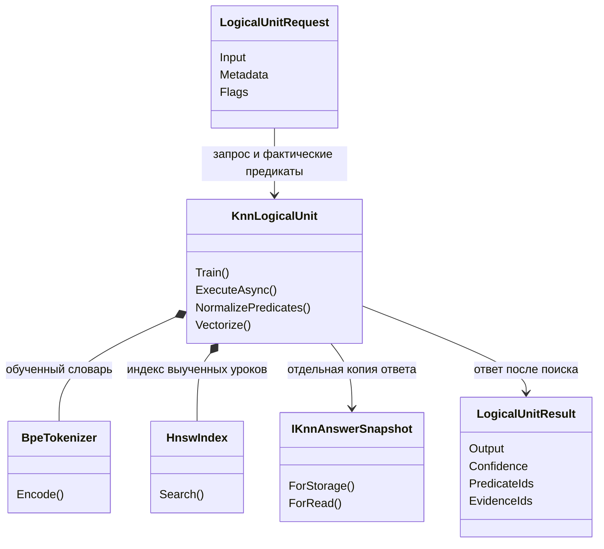

# 126. Не терять признаки при чтении обученной KNN-памяти

<!-- POST113-CURRENT-2026-11-02:START -->
## После P113 — ограниченный сигнал и действующий остаток приёмки

На 21007e25 M06 required registry/finalizer/двухпроцессный ledger уже реализованы. Новая saved-only receipt честно оставляет полный carrier trace и consumed input IDs NOT_OBSERVED; null-refusal принят. Старые 4/12→12/12 и 12/12→12/12 — ограниченные raw наблюдения, не полная measurement/budget приёмка. Calibration не восполняет отсутствующий historical trace.

Этот узкий кандидат FIX-P108-CARRIER сохраняется по явной ошибке string[]-only ingress и диагностике; native ExecuteAsync ещё прежний. При реализации собственные 35 Execute на руку и реальное обучение fixture считаются отдельной продуктовой приёмкой по данному плану, не скрытым повтором PRIMARY. Нового обучения этим документным аудитом нет.

[135/R02](codex-135-post113-addressed-repair-plan-2026-11-02.md) закрывает новые ошибки launcher: build→run без callback при exit0 и нечувствительность grandchild selftest к surviving/missing child. Эти dummy controls не доказывают carrier transfer; после изменения native entrypoint positive lawful коллекции и negative null/unsupported содержимое проверяются обычным Unit, а consumer/full state/restore — ровно в назначенной области. Дозы, gold, normalizer и k/floor не расширяются.
<!-- POST113-CURRENT-2026-11-02:END -->

Статус: проект адресного переноса `FIX-P108-CARRIER`; продуктовая реализация и её приёмка **не выполнены**. Основание — завершённый `P108-PRIMARY-01`, а не новая гипотеза. Эта документная работа не разрешает запуск, обучение или изменение кода. Срез источников: `066725d8f3e92d692a95f5566f353ce9053f4095`, 2 ноября 2026. Последующие изменения общего дерева проверяются отдельно.

## 1. Результат и границы допуска

Обученная единица принимала предикаты только в `string[]`. Те же значения в `List<string>` и `ReadOnlyCollection<string>` молча исчезали из вектора запроса. Исправленный экспериментальный читатель довёз их во всех 12 наблюдениях вместо четырёх. Обучение общее для плеч: восемь уроков одной темы — оркестрация работы с кодом. Это ремонт чтения приобретённого знания, а не новый алгоритм обучения.

Первичные материалы:

- [Отчёт P108](../../../../experiments-v2/RP01-MICRO/P10801/results/attempt-0001/report.md), [фактические ответы](../../../../experiments-v2/RP01-MICRO/P10801/results/attempt-0001/arms.json), [показатели](../../../../experiments-v2/RP01-MICRO/P10801/results/attempt-0001/metrics.json), [завершение процесса](../../../../experiments-v2/RP01-MICRO/P10801/results/attempt-0001/exit.json).
- [Сопоставление продуктового плеча A](../../../../experiments-v2/RP01-MICRO/P10801/results/attempt-0001/raw/product-path-equality-proof.json), [порча фактического ответа](../../../../experiments-v2/RP01-MICRO/P10801/results/attempt-0001/raw/evaluator-corruption-control.json), [нечувствительность вектора к порядку предикатов](../../../../experiments-v2/RP01-MICRO/P10801/results/attempt-0001/raw/predicate-order-insensitivity.json).
- [Исходник опыта](../../../../experiments-v2/RP01-MICRO/P10801/Program.cs): Train 393–402, исправленный читатель 998–1041, приём коллекции 1047–1086. Плечо B работает через экспериментальный доступ к состоянию и продуктовым приватным методам; это ещё не изменённый `ExecuteAsync` продукта.

| Показатель | A | B | Что допускается заключить |
|---|---:|---:|---|
| Доставка предикатов в признаки | 4/12 | 12/12 | +66,67 процентного пункта; +200% относительно A |
| Правильные маршрут **и все шаги** | 12/12 | 12/12 | Сохранены; роста точности не измерено |
| Учебные контроли | 8/8 | то же общее состояние | Приобретённое поведение ненулевое |
| Именованный отказ на null-элементе | 0/2 | 2/2 | Исправлена диагностика непригодного входа |
| Средняя уверенность | 0,6029833 | 0,87725 | Восстановлена шкала массива; это не калиброванная вероятность правильности |
| Новый объект / холодное восстановление | не проверено | не проверено | Читался один живой объект |
| Обычный продуктовый Flow | не проверено | не проверено | Показан уровень Unit, не полный маршрут приложения |

Числа повторно вычислены по сохранённым строкам `arms.json` без вызовов модели. Это анализ старых данных, не новый эксперимент. Холодные четыре строки означают отсутствие обученной единицы (`NO_TRAINED_UNIT`), а не измеренные ответы пустой модели.

**Допуск:** приоритетный узкий кандидат по сохранности признаков и явной ошибке диагностики. Рост точности не требуется. Увеличение CPU само по себе не исключает перенос. Ресурсы A/B отдельно не измерены: единый Train не является двумя измерениями производительности. Не писать «все остальные показатели не ухудшились». До общей приёмки нового кода остаются измерения ресурсов и штатного вызова; никакой смены порогов уверенности данным результатом не разрешено.

**Нарушение бюджета сохраняется:** завершённый физический процесс содержит 40 наблюдений вместо назначенных38; четыре из них — `NO_TRAINED_UNIT`, а не Execute/Search. Вместе с24 наблюдениями прерванного процесса это64 наблюдения, включая8 холодных, два Train и16 предъявлений уроков. Первая попытка сохранена в `raw/aborted-run-1`. По источниковому пересчёту M06:22 Execute в завершённом процессе и42 за оба;21/41 достигнутых Search — выведенная из исходника оценка, не инструментированный счёт. Exit0 не превращает этот прогон в соблюдённый бюджет. Локальный измеренный выигрыш сохраняется отдельно от технической приёмки. Не повторять PRIMARY ради зелёного статуса и не переписывать исторические квитанции.

## 2. Новизна и порядок

В плане [97](97-learned-knn-state-integrity-transfer-plan-2026-10-29.md) уже назначены размерность запроса, владение ответом и полное перекодирование. В [99](99-new-learning-consumer-transfer-addenda-2026-10-29.md) есть отдельный будущий профиль признаков; [101](101-persistent-state-bundle-contract-2026-10-30.md) владеет полным состоянием. Ни один из них не назначает исправление ограничения `predicateObject is string[]`. Упоминания P108 в 109/115/119/122/125 — требования к опыту и охват карточек, а не второй владелец данного переноса.

Сначала закрываются реально открытые блокировки обучения и целостности состояния по существующим владельцам. Затем `FIX-P108-CARRIER` как узкая корректность публичного обученного Unit; общий ввод нового Flow остаётся у [20](20-prompt-domain-e2e.md). Числа старых очередей не являются поручением повторить уже исправленное. План не добавляет новый номер Q и не сдвигает очередь исследований.

**Предпосылка приёмки — [M06-P108, план127 §8.2](codex-127-postmerge-addressed-repair-plan-2026-11-02.md).** Required-set/finalizer и общий бюджет уже исправлены; полный состав/содержание исторических consumed IDs остаются NOT_OBSERVED, а новые runner gaps открыты в135/R02. До measurement PASS требуется собственная полная квитанция соответствующей приёмки, а не ссылка на исторический exit0. Работы M06 выполняются только при отдельном назначении; для сохранённых данных Train/новые native query равны0. Если фактический consumed input не сохранён, его статус NOT_OBSERVED/HOLD, а не значение, восстановленное из gold. Исторические положительные числа допустимы как локальное основание этого проекта, но его готовность не наследуется от exit0 P108. Будущие35 Execute на руку ниже — отдельная продуктовая приёмка после реализации, а не способ скрыто повторить PRIMARY для ремонта его отчёта.

## 3. Где менять код

Сейчас в `KnnLogicalUnit.cs:366–368`:

```csharp
var queryPredicates = request.Metadata.TryGetValue("predicate_ids", out var predicateObject) && predicateObject is string[] predicateArray
    ? NormalizePredicates(predicateArray)
    : new HashSet<string>(StringComparer.Ordinal);
```

Здесь отсутствие данных и неподдержанный тип молча становятся одним состоянием. Выбранное исправление: внутри того же `ExecuteAsync` сначала отличить отсутствие ключа от непригодного значения, затем один раз снять собственную копию последовательности, проверить каждый элемент и передать её существующей нормализации. Только после успешного приёма строить вектор, искать соседей и выдавать ответ через прежнюю snapshot policy. Неподдержанный тип/элемент прекращает этот вызов до поиска; нормальный массив сохраняет прежнее поведение. Альтернатива «пусть каждый caller делает ToArray» отклонена: она оставляет неодинаковый публичный договор и не исправляет диагностику самой единицы.

| Точное место | Будущее изменение | Инвариант |
|---|---|---|
| [KnnLogicalUnit.cs](../../../../21.AgentInfrastructure/Logical/KnnLogicalUnit.cs), `ExecuteAsync`, 365–372 | Заменить проверку только `string[]` на однократное чтение `IEnumerable<string>` в принадлежащий вызову массив; проверить null-элементы до нормализации и поиска | Массив, список, ReadOnlyCollection с одинаковыми значениями дают одинаковый запрос |
| Тот же метод, до `Vectorize` | Для несоответствующего типа вернуть `PREDICATE_IDS_CARRIER_UNSUPPORTED`; для null-элемента — `PREDICATE_IDS_NULL_ELEMENT` с фактическим типом и индексом | Не маскировать ошибку пустым множеством и не возвращать успешный ответ |
| Тот же класс, `NormalizePredicates` 491–497 | Повторно использовать существующую нормализацию после проверки входа | Trim, uppercase, удаление пустых строк, множество и StableHash остаются прежними |
| Новый `Tests/ExperimentFixes/KnnPredicateCarrierLearningTests.cs` | Настоящий Train один раз на класс, штатный `ExecuteAsync`, точные ответы и равенство результатов для разных типов коллекций | Не переносить экспериментальный reader B как тестируемый «продукт» |
| [Документ проекта 21](../../../projects/21-agent-infrastructure.md) | Описать поддерживаемые типы, ошибки и предел Unit/Flow | Не заявлять холодный Load и подключение к приложению |

Подпись проверенного `KnnLogicalUnit.cs`: SHA-256 `3dfc1e9f40f0800e6cb8b431efc1609dbce1d08a9fc35d1e8a5ea298b2b5d70a`, совпала с источником опыта. При изменении файла до реализации исполнитель читает дельту, а не применяет номера строк вслепую.

Отсутствующий ключ и значение null означают законное отсутствие предикатов, как прежде. Пустая коллекция допустима. Строка как целое, `object[]` и массив чисел не становятся списком строк посредством `OfType` или преобразования к тексту. Перечисление выполняется ровно один раз; возникшее при перечислении исключение остаётся отказом существующего operation-envelope, не превращается в частичный успешный запрос. Синхронные бесконечные генераторы не квалифицированы этим опытом; расширение их контракта не входит в перенос.

Не менять Train, размерность 64, k=1, веса ярусов, HNSW, snapshot policy ответа, порог урока или модель на TransformerEmbeddingKnnLogicalUnit. Это другой тип единицы. Не создавать новый обучаемый parser для технического чтения типов: здесь детерминированная проверка целостности, а выбор ответа делает обученная память.



Это проекция существующих типов, не новые классы реализации. Состояние остаётся прежним: BPE-словарь, индекс, карта `LogicalKnnTrainingExample<TInput,TOutput>`, manifest/параметры и policy владения ответом. Детерминированная новая часть не хранит модель и не принимает решений о правильном классе. DPO/LoRA, chosen/rejected и оптимизатор здесь неприменимы: обучение — построение BPE/KNN-памяти по8размеченным урокам; его закон не меняется. Лицензия/происхождение набора прежние, исходные литералы U-OR из карточки P108, новый внешний корпус не вводится.

## 4. Почему это влияет на чтение знания

В Train каждый урок получает нормализованный вектор `[t,p]`: первая половина — BPE-частоты, вторая — предикаты с существующим весом 2. Запрос должен использовать тот же способ построения. На списке старый вход строит `[q,0]`, хотя пользователь передал `p`.

При одинаковом ненулевом ярусе предикатов сходство после исправления вычисляется как

`(q·t + ||p||²) / sqrt((||q||² + ||p||²)(||t||² + ||p||²))`,

а без яруса запроса — `q·t / sqrt(||q||² (||t||² + ||p||²))`.

Главный проверяемый закон здесь — равенство вектора и результата для **одинаковых значений в разных коллекциях**. Это не доказательство, что увеличение cosine всегда улучшает полезный ответ. В U-OR оба класса имеют одно множество `{review, implement}`; поэтому оно не кодирует порядок. Рост cosine не разрешает понижать порог допуска, выдавать confidence за вероятность или переносить успех на новый домен.

Случай `review,implement` против `implement,review` остаётся у существующей [гипотезы порядка Q127](../experimets/cards/KNN-ORDER-PERMUTATION-01.md). Новую дублирующую гипотезу или позиционный алгоритм в этот перенос не добавлять. Тема обучения маршрутизатора — «оркестрация», профиль D07, даже если вход упоминает другую предметную задачу.

## 5. Приёмка на принципах опыта

Будущий класс `LlmFromScratch.Tests.ExperimentFixes.KnnPredicateCarrierLearningTests` использует одну class fixture с настоящим `KnnLogicalUnit<string, OrchestrationAnswer>`. Тип ответа принадлежит тесту, snapshot policy копирует Route и массив Steps. Восемь уроков u1–u8 и четыре экзамена e1–e4 берутся дословно из P108 `Program.cs:169–203`; их значения закрепляются в тесте вместе с source SHA. Предикаты запросов задаются отдельными литералами: e1/e2 — `[review,implement]`, e3/e4 — `[implement,review]`; builder не читает GoldSteps. Эталон служит только проверке, не ответу читателя. Доза одного запуска класса: ровно 1 Train /8уроков, один вложенный BPE fit и одно построение индекса. SFT/DPO=0. Контрольные вызовы не повторяют обучение.

| Check ID | Точная проверка через штатный API | Число ExecuteAsync |
|---|---|---:|
| PC-LEARNED | Все u1–u8 дают полный правильный ответ; постоянная метка не проходит | 8 |
| PC-CARRIERS | e1–e4 × реальные string[], List<string>, ReadOnlyCollection<string>; Route, Steps, EvidenceIds, confidence и warnings совпадают с массивом того же объекта; 12/12 правильных | 12 |
| PC-NULL-ITEM | Один null внутри каждого из трёх типов; точный код и индекс, отказ до поиска | 3 |
| PC-ABSENT | e1: ключ отсутствует, значение null, пустой массив, массив из пробельной строки; сохранена совместимость отсутствующих признаков | 4 |
| PC-UNSUPPORTED | e1 с одной строкой вместо коллекции и с int[]; именованный отказ | 2 |
| PC-OWNERSHIP | Прочитать запрос со списком, затем изменить список и повторить исходный запрос свежим массивом; прежняя обученная память и ответ массива сохранены | 2 |
| PC-EARLY-REFUSAL | Уже отменённый token; отсутствующий Input — прежние CANCELLED и INPUT_REQUIRED | 2 |
| PC-ENUMERATION | Одноразовый конечный IEnumerable прочитан один раз; второй IEnumerable бросает исключение при перечислении — существующий KNN_LOGICAL_UNIT_INFERENCE_FAILED, не частичный ответ | 2 |
| **Всего** | Одна общая обученная память; до 27 поисков, восемь ранних отказов | **35** |

`PC-NULL-ITEM` включает третий тип как новую продуктовую проверку, а не приписанный старому опыту результат. В `PC-CARRIERS` использовать отдельные реальные runtime-типы: интерфейс поверх массива всё ещё массив. Не требовать побитового совпадения с историческими confidence другого индекса; сравнивать с массивом **того же** обученного объекта. Внутренний reader/helper сам по себе не заменяет вызов `ExecuteAsync`.

Назначить восемь `[Fact]`, по одному на строку PC в таблице, с одной class fixture. Калибровку на сохранённых внутри проверки ответах выполнять в том же PC-CARRIERS, без дополнительного обращения к Unit. Ни одна проверка не зависит от порядка исполнения других `[Fact]`.

До будущего запуска записать required IDs выше. Проверки обычного результата сравнивают actual с независимым expected; правильный отказ может иметь raw false и check_passed true. Отсутствующая проверка, пропущенный тест или неожиданная exception не дают зелёный итог. Калибровка оценщика на копиях уже полученных ответов: переставить два Steps, заменить один EvidenceId и удалить один обязательный outcome. Оценщик получает отдельно замороженный expected и actual; мутация actual не изменяет expected. Имя порчи не передаётся оценщику как подсказка вердикта, а gold не передаётся learner/consumer. Это ноль Train/Execute; метапроверка итогового статуса не требует собственного PASS во входном списке.

Раздельно записать: полезные показатели, расходы, работоспособность измерителя, соблюдение бюджета, готовность переноса. При 12/12→12/12 и исправлении сохранности признаков результат полезен по последнему показателю. При ухудшении другого полезного показателя показать конкретные строки; ухудшение более 5% вне CPU не скрывать средним. Не добавлять новые прогревы или повторения для красивой скорости.

## 6. Как обращаться с падающими тестами

На этом этапе тесты не запускались; текущие падения не заявляются. Сначала в будущей реализации показать красный PC-CARRIERS и PC-NULL-ITEM на старом native коде, затем зелёный на исправленном. Красный тест должен падать по потере признаков/неверной причине отказа, а не по компиляции или отсутствующему набору. Два исполнения одного класса учитываются раздельно: baseline до правки —1Train/8уроков/до35Execute; candidate после правки —1Train/8уроков/35Execute. Общий предел этой red/green-пары:2Train/16предъявлений/до70Execute,2BPE fit,2index build. Это не один физический Train и не повтор PRIMARY. Дальнейший rerun требует отдельного учёта причины и полного добавочного расхода; третья попытка не назначена автоматически.

- Существующий [KnnLogicalUnitTests](../../../../Tests/KnnLogicalUnitTests.cs): массив и security factory остаются совместимыми. Не удалять confidence/evidence assertions и копирующую политику mutable-ответа.
- [PlainKnnMetadataOwnershipTests](../../../../Tests/ExperimentFixes/PlainKnnMetadataOwnershipTests.cs), [KnnAnswerOwnershipTests](../../../../Tests/ExperimentFixes/KnnAnswerOwnershipTests.cs), [KnnExampleIdentityAdmissionTests](../../../../Tests/ExperimentFixes/KnnExampleIdentityAdmissionTests.cs): сохраняют свои независимые договоры. Падение в них — регрессия до доказательства иной причины.
- Если старая проверка ожидает молчаливый успех для неподдерживаемого типа, заменить именно это ожидание на именованный отказ и сохранить отдельный положительный массив. Если она ожидает generic exception для null-элемента, заменить причину отказа, не само требование отказа.
- Сначала сохранить input, expected, actual, stack, сборку и SHA. Отдельно классифицировать fixture/устаревший контракт/регрессию/инфраструктуру. Не менять gold, порог, k, дозу, Skip и timeout для обхода ошибки.
- Ошибка сборки нового теста не даёт права запускать всю цепочку опытов. Исправляется точный импорт/проектная зависимость; исходный эксперимент и его данные остаются нетронутыми.

### Назначенная смежная регрессия

После зелёного candidate выполнить **один** запуск восьми существующих методов ниже. Это заранее ограниченная регрессия, не весь test project. Подсчёт сделан по телам методов и их TrainRouteUnit/TrainTwoLessons/Ask; это ожидаемые вызовы, не измеренный прогон.

| Метод | Успешный Train / принятые уроки | Отказанные Train / переданные строки | Execute |
|---|---:|---:|---:|
| KnnLogicalUnit_TrainsWithBpeAndHnswThenPredictsNearestOutput | 1/2 | 0/0 | 1 |
| TrainedRowKeepsItsOwnMetadata_AfterIngressAndEgressMutation | 1/1 | 0/0 | 3 |
| IncompleteRow_IsRejectedBeforeTokenizerAndIndexPreparation | 0/0 | 2/2 | 0 |
| SourceAnswerMutatedAfterTraining_DoesNotChangeMemory | 1/2 | 0/0 | 2 |
| ReturnedAnswerTopLevelMutation_DoesNotChangeMemory | 1/2 | 0/0 | 2 |
| ReturnedAnswerNestedStepListMutation_DoesNotChangeMemory | 1/2 | 0/0 | 2 |
| DuplicateIdAfterTrim_IsRefusedBeforeTokenizer_AndEarlierMemoryKeepsAnswering | 1/2 | 1/2 | 4 |
| UniqueIds_AreAccepted_AndEachQueryGetsItsOwnAnswer | 1/2 | 0/0 | 2 |
| **Всего** | **7/13** | **3/4** | **16** |

Здесь7BPE fit/7index build; SFT/DPO=0. Полная назначенная red/green+regression программа:12входов Train, из них9успешных и3ранних отказа;29принятых предъявлений и4отказанные строки; до86Execute;9BPE fit/9index build. При раннем падении actual может быть меньше cap. Состав методов проверяется на выбранном SHA до запуска; изменение этих методов требует пересчёта плана, не автоматического увеличения дозы. SecurityFactory integration и прочие методы не входят в эту сумму: они остаются связанной границей§7, не скрытым продолжением фильтра.

## 7. Сохранение и полный путь промпта

Существующие [S0.config.json](../../../../experiments-v2/RP01-MICRO/P10801/results/attempt-0001/state/S0.config.json), [S0.examples.json](../../../../experiments-v2/RP01-MICRO/P10801/results/attempt-0001/state/S0.examples.json), [S0.tokenizer.json](../../../../experiments-v2/RP01-MICRO/P10801/results/attempt-0001/state/S0.tokenizer.json), [S0.index.json](../../../../experiments-v2/RP01-MICRO/P10801/results/attempt-0001/state/S0.index.json) сохраняются как исходные свидетельства. У plain KnnLogicalUnit нет native Load; четыре файла не становятся готовым checkpoint Unit из-за одинакового имени S0. Поэтому выше явно назначен один будущий Train для регрессионного теста, а не притворное «восстановление». Создание и проверка native bundle/load остаётся у 101; никаких весов или новых наборов сейчас не создаётся.

В tracked C# поиске найден другой `TransformerEmbeddingKnnLogicalUnit` в DefaultLogicalCapabilityTrainer; прямой plain generic Unit также использует диагностический `tools/Rp01MechanismProbe/Program.cs:162`. Этот probe не является обычным продуктовым Flow и здесь не запускается. Production caller plain generic Unit не установлен. Это ограничение проверенного поиска, не утверждение о любых внешних приложениях. Ближайший существующий положительный integration пример — `SecurityFactory_CanUseRealKnnLearnedArbiterUnit` в KnnLogicalUnitTests; он не является обученным выбором домена по пользовательскому промпту.


Диаграмма показывает **будущий** стык, не существующий production маршрут. Владелец подключения — 20, не новый конкурирующий маршрутизатор. Для каждого уже назначенного там запроса записывать фактические domain/model/unit/profile, producer предикатов, выбранный consumer и полный ответ. Нельзя подавать `GoldSteps` из P108 как признаки рабочего запроса. У `PromptDomainClassifier` ключ `prompt.compiled.predicate_ids`, у plain Unit — `predicate_ids`: adapter обязан явно передать фактические значения при подключении; одно сходство имён ключей не доказывает связь.

До появления такого caller `FIX-P108-CARRIER` может закрыть только Unit-совместимость. E2E остаётся открытым у 20; синтетическая регистрация в тесте или созданный constructor его не закрывают. Не вводить plain Unit в обычный продукт ради того, чтобы получить красивую E2E цифру. После отдельной квалификации bundle101 повторить назначенные E2E-чтения новым объектом без Train; пока такого Load нет, эта часть NOT_RUN. Дополнительные запросы и обучение к бюджету20 данным планом не добавляются.

## 8. Конкретный вход будущему исполнителю

Рабочий каталог: `C:/Projects/llm_mvp_core`. Модель исполнителя — default его текущей сессии, без поиска/переключения модели. Обучаемый объект — указанный KNN Unit, не модель исполнителя. Язык отчёта — русский; исходные enum/методы/пути сохраняются точно.

Свежо полностью прочитать local/canonical AGENTS, CLAUDE и полный стек [120](120-executor-context-and-test-repair-contract-2026-11-02.md), затем [40](../experimets/40-effective-executor-context-2026-11-02.md), [41](../experimets/codex-41-post107-executor-checks-2026-11-02.md), эту карточку и первичные данные §1. Для роли нужны архитектура, планирование, plan-review, generated-code-review/code-examination, code-execution, experiment-design, test-integrity, prompt-patch-authoring, human-readable-architecture-audit, output-readability и human-communication glossary. Перечень не сокращает обязательный основной стек120. Усечённое чтение восстановить; не выдавать индекс заголовков за полное чтение.

После отдельного разрешения реализации создать названный тестовый класс и выполнить из root:

Перед этим проверить предпосылку M06 из§2 и применимые правила [42](../experimets/codex-42-postmerge-executor-checks-2026-11-02.md). Отсутствующий обязательный outcome либо HOLD не заменять локальным заверением «все контролы истинны». Нижняя команда сама не разрешает ни реализацию, ни её запуск.

```powershell
dotnet test Tests/LlmFromScratch.Tests.csproj --filter FullyQualifiedName~KnnPredicateCarrierLearningTests --logger "trx;LogFileName=p108-carrier.trx" --results-directory artifacts/verification/FIX-P108-CARRIER/attempt-0001
```

Это будущая команда после написания теста; сейчас её фильтр отсутствует. До запуска наличие ожидаемых check IDs проверяется по созданному исходнику. Ноль обнаруженных тестов — ошибка подготовки, не PASS. Для baseline и candidate нужны разные каталоги: первые два свободных `attempt-NNNN` по порядку с явным полем role; ничего не удалять и не перезаписывать. Старые сохранённые опыт и результаты не перезаписывать.

Единственный следующий regression-запуск, уже учтённый в§6:

```powershell
$pcRegressionMethods = @(
  'KnnLogicalUnit_TrainsWithBpeAndHnswThenPredictsNearestOutput',
  'TrainedRowKeepsItsOwnMetadata_AfterIngressAndEgressMutation',
  'IncompleteRow_IsRejectedBeforeTokenizerAndIndexPreparation',
  'SourceAnswerMutatedAfterTraining_DoesNotChangeMemory',
  'ReturnedAnswerTopLevelMutation_DoesNotChangeMemory',
  'ReturnedAnswerNestedStepListMutation_DoesNotChangeMemory',
  'DuplicateIdAfterTrim_IsRefusedBeforeTokenizer_AndEarlierMemoryKeepsAnswering',
  'UniqueIds_AreAccepted_AndEachQueryGetsItsOwnAnswer'
)
$pcRegressionFilter = ($pcRegressionMethods | ForEach-Object { 'FullyQualifiedName~' + $_ }) -join '|'
dotnet test Tests/LlmFromScratch.Tests.csproj --filter $pcRegressionFilter --logger "trx;LogFileName=p108-regression.trx" --results-directory artifacts/verification/FIX-P108-CARRIER/regression-0001
```

Для regression также выбрать первый свободный номер до запуска. Ожидается ровно8обнаруженных тестов; иное число — несовпадение назначения/исходника, не разрешение запустить больше. Падение не лечить повтором всего проекта или прежнего опыта. Полный репозиторный publication gate остаётся отдельной процедурой будущего продуктового слайса, без приписывания его затрат этому малому опыту.

Отчёт нового переноса: `artifacts/verification/FIX-P108-CARRIER/attempt-NNNN/report.md`: source/assembly SHA, exact command/exit/test count, scope Unit/Flow, actual TRAIN/EXAM, IDs исходного результата, A/B и отрицательные контроли, все затраты, известные потери, restore статус, точные изменения тестовых ожиданий. Процесс ждать по его исходному handle до terminal; таймаут ожидания инструмента не означает завершения процесса. Не запускать копию из-за отсутствия мгновенного файла. Прямое STOP/NEXT пользователя исполняется сразу: нельзя продолжать прошлую карточку, чинить за неё файлы или скрыто запускать новые попытки.

## 9. Состояние подготовки

M06 required-set/finalizer и общий ledger уже реализованы. Остаются NOT_OBSERVED полного исторического trace/consumed input/state и новый135/R02 runner; будущая native приёмка FIX-P108-CARRIER ещё не исполнена. Старые ограничения и расход сохранены.
