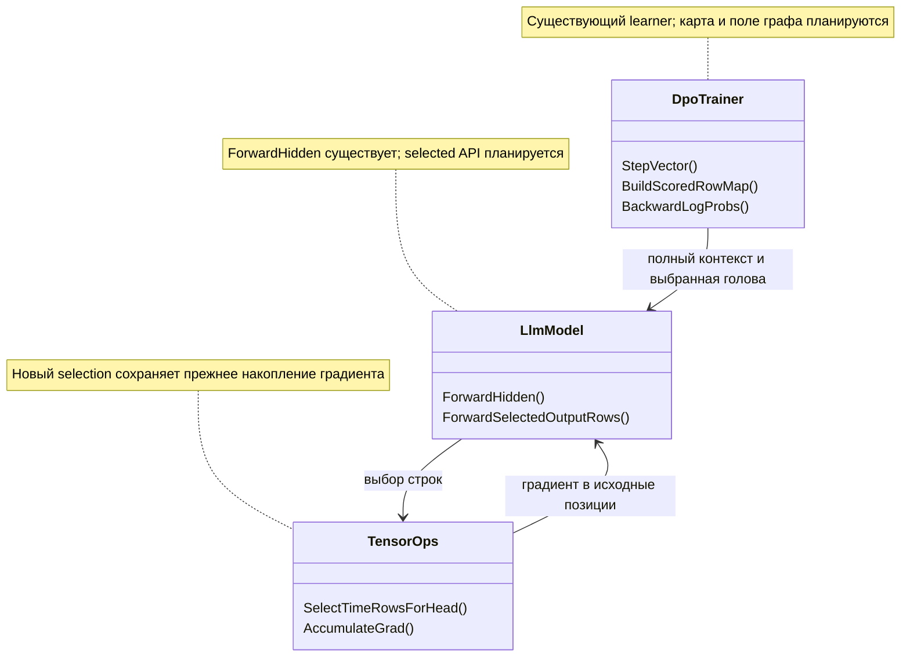

# 36. Считать языковую голову только для строк, участвующих в DPO-цели

<!-- transfer-entry-reload -->
**Вход исполнителя.** [Q37](01-registry.md#work-fix-nh). Для общего включения действует измеренное ограничение этой строки. Возврат к работе — по записанному условию для её домена. Перед каждым переносом и после восстановления контекста заново прочтите полностью агентские файлы, назначенные навыки, исправленный список Любы, текущий индекс и карточку. [Как применить прочитанное к этой работе](03-test-and-execution-contract.md#read-and-apply) · [Что взять сейчас](01-registry.md#executor-next).

## Уточнение допуска по показателям — 3 ноября 2026

**FIX-NH: Приостановить общий перенос.** Вошёл по малой экономии. Потеря времени обучения >5%; это не рост CPU, разрешённый пользователем.

- Точность: Обе учебные строки 33/33 → 33/33; конечные веса одинаковы.
- Полезный результат: Выделения 3 768 492 880 → 3 763 341 608 Б (−0,1367%); пик −14,54%.
- Цена и ограничения: Время 34 925,9 → 39 406,1 мс (+12,83%); CPU +0,30%.
- [Полное сравнение и статус кода](C:/Projects/llm_mvp_core/docs/plans/replanning-possible-diffs/fixes-based-on-experiments/01-registry.md#benefit-fix-nh).

Этот вывод относится к названным ID, а не ко всем механизмам документа. Старый текст плана и опыта сохранён как доказательство, но его общий статус «к переносу / разрешён» не переопределяет это уточнение. Ближайшее действие — разбор уже сохранённых данных и конкретного регресса; новое обучение, повтор PRIMARY и переключение product default этим дополнением не назначаются. Для отдельного логического ремонта назвать нарушенный контракт и сохранить отрицательные контроли, а не переносить весь эксперимент под словом «bugfix».

<!-- EXECUTOR-CONTEXT-120:START -->
## Обязательный вход в выбранный перенос или owner-раздел

Обязателен [договор120](120-executor-context-and-test-repair-contract-2026-11-02.md): перед новым аудитом/заданием свежо и целиком прочитать local/canonical AGENTS, CLAUDE, 12 основных навыков и дополнительные experiment-design/test-integrity по роли; восстановить усечения. Модель default без override. Этот вход не разрешает запуск и не меняет данные, budget, команды или очередь.

**Область:** этот вход относится к каждому выбираемому ниже FIX/TEST/R/RF/C и его собственной приёмке, а не превращает весь файл в одно поручение. Уже принятые части не переоткрывать; сначала сверить current source и сохранённые receipts именно выбранного владельца.

**Применимые риски LEARN/CORE:** Сохранить назначенные lesson/RowId и before→factor→after по независимому gold; margin/hash/update не заменяют правильный ответ. Положительный контроль удерживает прежний правильный ответ, отрицательный показывает потерянную/неусвоенную строку; gained/lost TRAIN и EXAM раздельно. Kernel parity проверить на назначенном реальном learning пути: независимые tensors/gradients/updates и ненулевой правильный readout. Отрицательный контроль обнаруживает возврат ошибки, положительный сохраняет lawful путь; isolated0→0 не качество обучения.

**Ожидания от теста.** Используйте данные этого ID и обычный путь, указанный в его действующей строке. Исходные доказательства сохраняются. Дополнительную диагностику из прежнего плана открывайте при конкретном расхождении. Для учебного результата запишите, что было до урока и что стало после. Техническую проверку формата или маршрута так и назовите.

**Проверка исполнителя.** Соберите затронутый проект и выполните назначенный малый сценарий на своей сборке. Укажите вызванный метод, вход и фактический результат. Для обученного поведения сравните смысл ответа и выбранного получателя. Для ресурса измерьте названную величину за тот же вызов. Если проверка упала, сохраните вход, ожидание и ошибку. Исполнитель может исправить дефект теста по независимому критерию и повторить эту проверку. Отпечаток нужен при разборе происхождения файла или сборки. Дождитесь завершения запущенной проверки. Затем переходите по текущей очереди. Право выполнить перенос определяется действующим назначением.
<!-- EXECUTOR-CONTEXT-120:END -->
<!-- POST102-AUDIT-2026-11-02:START -->
## Действующее уточнение после P102 — Сэкономленные строки не меняют смысл производной

**Проверка `POST102-FIX-NH`. WRONG.** В objective входят только chosen/rejected, поэтому non-target vocabulary logits не требуют градиента.

**CORRECT.** Сокращение касается неоцениваемых sequence rows, но внутри оцениваемой строки softmax нормализует весь vocabulary. OneHot−softmax и передача gradients в shared parameters сохраняются.

**Адресная приёмка.** Проверить objective/gradient/update parity раздельно на назначенных exact positions/mask с independent oracle, затем обычный consumer. ChangedCoordinateCount не подменяет gradient equality, epsilon/decay не исключаются из optimizer проверки. Сэкономленный resource window включает actual required head rows.

Применять [единый контекст40](../experimets/40-effective-executor-context-2026-11-02.md) и [адресный план121](121-post102-addressed-repair-plan-2026-11-02.md): актуальные роли навыков, один рабочий оценщик, ordinary consumer и реакция на test/report failure. Это ограничивает вывод и усиливает приёмку; исходные factor, доза, fixed panel и порядок сохраняются. Исправление saved evidence не является новой PRIMARY, а наличие этого блока не разрешает запуск. Исторические указания ниже действуют только в своей исходной области; при противоречии бюджета/фактора требуется адресное решение до исполнения.
<!-- POST102-AUDIT-2026-11-02:END -->

<!-- BEGIN audit-91-applicability -->
## Дополнение28.10: фактический выход и происхождение показаний

В учебной проверке actual logits/vector/mask от восстановленного состояния должны попадать в назначенный trainer/reader; canned tensor допускается только в отдельно названном component test. Нулевой optimizer step delta и неизменные веса не доказывают отсутствие Backward. Квитанция различает measured/structural/unknown; эту границу P08 consumer уже пришлось исправлять. Предусмотренное контрактом чтение reference cache или выученной памяти разрешено: проверяется фактический hit/miss и привязка к правильному state/key. Запрет касается подмены проверяемого производителя заранее подготовленным oracle, а не самого механизма FIX-LC.

Для FIX-NH исходные данные, дозы, модель, доменная область и oracle владельца сохраняются. Это адресное условие будущей приёмки, не свидетельство уже пройденной проверки и не новый запуск. Источник ошибки и точные ремонты — [91/92](92-positive-transfer-followup-plan-2026-10-28.md).
<!-- END audit-91-applicability -->

<!-- BEGIN audit-84-applicability -->
## Уточнение исполнения по аудиту P02/P08/P09

Для метрики DPO указывать единицу pair/step/panel, веса и фазу. Контрпример одного шага с margins [+1,-3]: доля положительных пар 0,5, признак положительного среднего 0; совпадение этих счётов на исходном опыте не делает их одной метрикой. Проверка вызывает полный writer с metric_definitions, а не только внутренний builder. Неизмеренное время SFT — null, не0; исторические receipts не переписывать.

Применимость: FIX-NH. Основание и адресные проверки — [план85](85-reporting-sampling-cache-repair-plan-2026-10-27.md), [общий договор03](03-test-and-execution-contract.md). Это усиление постановки, не утверждение о наличии дефекта в каждом данном исходнике и не новый запуск. Исходный эксперимент/бюджет/статус допуска сохраняются; продолжение пропущенного этапа использует тот же обученный state, новая самостоятельная программа обязана содержать назначенное реальное обучение. При STOP/NEXT следовать прямому указанию пользователя, не продолжать прежнюю задачу.
<!-- END audit-84-applicability -->

<!-- BEGIN audit-87-applicability -->
## Приёмка и состояние обучения: аудит 28 октября

Проверять по отдельности optimizer step, scheduler step и число реально применённых обновлений. Контрпример P12: импортированные моменты AdamW400 совместимы с новой эпохой scheduler0; P10, напротив, использует fresh DPO0. Не переносить правило fresh/import из соседнего опыта. После отказа сверять веса, моменты, RNG и исполненные Forward/Backward; отчёт о правильных ответах без назначенного обучения не закрывает учебную цель.

Применимость: FIX-NH. Контроль отчёта: точная панель, настоящий учебный этап, терминальное завершение и выполненные обязательные проверки — отдельные поля; успех одной оси не равен общему допуску. Требования по [плану88](88-gradient-warmup-transfer-repair-plan-2026-10-28.md) добавляются к исходному рецепту, не меняют исторические результаты и не назначают повтор обучения. Проверки сохранённого receipt используют raw уже выполненного обучения; новая самостоятельная программа обязана содержать назначенный Train. Если нужен новый вызов модели, сначала явно назначить полный бюджет, а не скрывать его в диагностике. Это профилактическая применимость, не установленный дефект каждого данного исходника. STOP/NEXT и ожидание исходного process handle из карточки сохраняются.
<!-- END audit-87-applicability -->

<!-- BEGIN audit-76-specific-controls -->
## Уточнение по новому аудиту 27 октября: FIX-NH

<!-- OWNER-CONTEXT-120 --> **Самопроверка выбранного раздела:** LEARN/CORE по договору120 во входе файла; собственные source/caller/данные/доза и negative+positive этой строки обязательны. Старый завершённый результат не переоткрывать; при падении сохранить input/expected/actual/stack+SHA, не менять oracle ради зелёного. Примеры другого owner не добавляют проверки или Train к этому разделу.

Основание — [76](76-new-transfers-and-experiment-evidence-audit-2026-10-27.md), ремонт — [77](77-new-transfer-repair-plan-2026-10-27.md). Это защита от повторения проверенной ошибки другого переноса, **не утверждение о найденном дефекте реализации каждого ID**. Сохраняются собственные данные, алгоритм, критерии и лимиты этой карточки; дополнительные Train/Forward этой вставкой не назначены.

**M — метрика привязана к фактической стадии обучения.** Для обучающего loss/reward записать состояние, на котором он вычислен, отдельно от номера опубликованных после update весов. У DpoTrainer последняя StepMetrics — pre-update; не называть её оценкой конечного checkpoint. Пример P02: B уже стартовал с margin 0,002773 после SFT; отношение последних значений ×3,22 не равно отношению приростов DPO. Любое сравнение приобретения/ремонта использует собственное before каждого этапа и одинаковый reader. DPO Accuracy=(reward_margin>0) означает улучшение относительно reference, а не правильный ответ: T2 имеет policy chosen−rejected=−0,1827326 при положительном reward. TRAIN/EXAM correctness и сохранённые logP остаются отдельными полями. Если эта карточка сравнивает математически равные оптимизации, сохранить её A/B equality; не требовать искусственного роста точности и не добавлять post-update Forward, когда нужное чтение уже предусмотрено.

**W — отчёт должен воспроизводиться своим источником.** Не закрывать исправление только ручной заменой JSON/Markdown: проверить действующий writer, который создаст следующий отчёт. Attempted, completed updates, diagnostic/model calls и native memory fits различаются. Неизмеренный ресурс — null/NOT_MEASURED, измеренный ноль — отдельный исход. Контроль отказа проходит через реальный producer/обработчик результата; готовый hand-written JSON доказывает только формат. Состоявшееся обучение после ошибки отчёта не повторять. Unit-проверка producer без Train не является новым экспериментом; новая экспериментальная программа содержит назначенный учебный участок.
<!-- END audit-76-specific-controls -->

ID: **FIX-NH**. Статус: **документный кандидат переноса; native реализация и тесты ещё не выполнены**. Основание: `N-HEAD-01 / NH01`, завершённые A/B из [commit 885745ba](https://github.com/lubochka/llm_mvp_core/commit/885745ba5c9ba22397e87a293951a12665d5a864); актуальные получатели проверены на `3acae42f7ef474e449737a57f0cf064921c4bbc7`. Порядок — только [01](01-registry.md): после FIX-GB, следующий FIX-RMS.

**Смысл изменения.** Во время обучения модель обрабатывает весь контекст. Однако DPO оценивает только токены ответа. Сейчас последний линейный слой переводит в словарь все временные позиции, включая неоцениваемые. План переносит выбор нужных строк **после** полного transformer/finalNorm, сохраняя градиент обратно в полный hidden state. Контекст и внимание не сокращаются. Это внутренняя математическая операция существующего learner, а не новый домен, Unit или механизм выбора маршрута.

Измеренная экономия — **5 151 272 выделенных байта за два настоящих DPO-обновления, −0,136693%**. Это успех по выделениям памяти по правилу пользователя. Небольшой размер эффекта не основание выбрасывать кандидата. CPU и wall ухудшились; готовность к переносу во все профили этим не доказана. Тема обучения — **документация**; профиль — английское описание порядка аргументов C#-метода; получатель — policy q/v-LoRA модели `rp01-csharp-small/v1`.

## 1. Что измерено и что именно прочитано

Первичные источники: [A/metrics.json](https://github.com/lubochka/llm_mvp_core/blob/3acae42f7ef474e449737a57f0cf064921c4bbc7/experiments-v2/RP01-MICRO/NH01/results/attempt-0001/A/metrics.json), [B/metrics.json](https://github.com/lubochka/llm_mvp_core/blob/3acae42f7ef474e449737a57f0cf064921c4bbc7/experiments-v2/RP01-MICRO/NH01/results/attempt-0001/B/metrics.json), [study](https://github.com/lubochka/llm_mvp_core/blob/3acae42f7ef474e449737a57f0cf064921c4bbc7/experiments-v2/RP01-MICRO/NH01/study.json), [one-factor.diff](https://github.com/lubochka/llm_mvp_core/blob/3acae42f7ef474e449737a57f0cf064921c4bbc7/experiments-v2/RP01-MICRO/NH01/one-factor.diff), [source manifest](https://github.com/lubochka/llm_mvp_core/blob/3acae42f7ef474e449737a57f0cf064921c4bbc7/experiments-v2/RP01-MICRO/NH01/source-manifest.json). Их данные проверены чтением, нового исполнения не было.

| Показатель | A: полная голова | B: выбранные строки | Вывод |
|---|---:|---:|---|
| Allocated bytes, весь измеренный учебный цикл | 3 768 492 880 | 3 763 341 608 | −5 151 272, −0,136693% |
| Allocated bytes внутри StepVector №1 / №2 | 1 882 852 120 / 1 882 987 984 | 1 880 280 568 / 1 880 408 264 | −2 571 552 / −2 579 720 |
| CPU, ms | 31 296,875 | 31 390,625 | +93,75, +0,300% |
| Wall, ms | 34 925,9295 | 39 406,1281 | +4 480,1986, +12,828% |
| Process peak, bytes | 1 190 719 488 | 1 017 573 376 | −173 146 112; наблюдение всего процесса, не доказанная причинная экономия головы |
| GC0 / GC1 / GC2 | 223 / 16 / 10 | 224 / 16 / 10 | GC0 +1 |
| D-T1 и D-T2, каждая TRAIN-строка | 33/33 до → 33/33 после | 33/33 до → 33/33 после | Удержан ранее приобретённый результат; EXAM не было |
| Loss по двум обновлениям | 0,3575644 / 0,3298104 | те же | Это разные уроки, не самостоятельное доказательство улучшения качества B |
| Reward margin | 1,1646881 / 1,2564831 | те же | A/B совпадают |
| Final optimizer step; adapter delta L2 | 2; 0,0035133162132961774 | те же | Обновления состоялись, результат не получен простым чтением |
| Final weights SHA256 в raw | `554ac64bb4ce644d7c6d7102123081a17b967e2d8a6574703332710da3870546` | тот же | Совпадение записанных digest, не заново выполненный binary restore |

TRAIN NLL D-T1 `0,00016606865 → 0,00016609755`, D-T2 `0,00016750232 → 0,00016793211` слегка выросли в обеих руках. Не писать, что B повысил accuracy, снизил NLL или ускорил обучение. Один последовательный A/B не доказывает устойчивый временной эффект.

В [историческом report](https://github.com/lubochka/llm_mvp_core/blob/3acae42f7ef474e449737a57f0cf064921c4bbc7/experiments-v2/RP01-MICRO/NH01/results/attempt-0001/report.md) признаётся выигрыш allocations, но кандидат отвергнут как слишком малый. Здесь меняется **интерпретация допуска в план**, старый report сохраняется. `comparison.json` при чтении возвращает Git LFS pointer (`oid sha256:03c99db4c050798f7c466d2b95b134fae8fad438ff8165db06ac78dd2d9c3d8f`, size 10850). Его payload и большие arrays/binaries этой сессией не материализованы. Утверждения report о восьми побитовых сравнениях logits и 32 gradient records помечаются `reported`, не `independently_recomputed`; проверенные raw loss/margin/readouts/digest — отдельный уровень свидетельства.

Две исправленные неточности описания:

- 124 — **полная длина стороны**, prompt 91, оцениваемых response targets 33. Это не ответ из 124 токенов.
- `budgetActual.backwards=8` на руку — ошибочная агрегация. [Bridge:340–347](https://github.com/lubochka/llm_mvp_core/blob/3acae42f7ef474e449737a57f0cf064921c4bbc7/experiments-v2/RP01-MICRO/NH01/Common/ContinuousLearning/NHeadExperimentBridge.cs#L340-L347) пишет `batches.Count * 4`. Сумма `timing.Backward.CompletedCalls` — 2+2=**4**, B `rowSelect.backwardCalls=4`; [native StepVector:900–905](https://github.com/lubochka/llm_mvp_core/blob/3acae42f7ef474e449737a57f0cf064921c4bbc7/11.DPO/DpoTrainer.cs#L900-L905) делает chosen/rejected backward. Raw не переписывается; новый receipt считает фактически завершённые вызовы.

## 2. Проверенные получатели и выбранное изменение

| Существующий участок | Сейчас | Что планируется |
|---|---|---|
| [LlmModel.Forward:218–242](https://github.com/lubochka/llm_mvp_core/blob/3acae42f7ef474e449737a57f0cf064921c4bbc7/03.TransformerModel/LlmModel.cs#L218-L242) | После всех blocks/finalNorm: `x = _lmHead.Forward(x, cancellationToken);` для всех T строк | Новый `ForwardSelectedOutputRows(Tensor tokenIds, IReadOnlyList<int> rows, bool training, CancellationToken cancellationToken)` вызывает существующий полный `ForwardHidden`, затем selection, затем тот же `_lmHead`. Обычный Forward сохраняется |
| [TensorOps.AccumulateGrad](https://github.com/lubochka/llm_mvp_core/blob/3acae42f7ef474e449737a57f0cf064921c4bbc7/00.TensorCore/Core/TensorOps.cs#L981) | Уже есть накопление градиента; отдельного selection для head нет | Новый `SelectTimeRowsForHead(Tensor x, IReadOnlyList<int> sourceRows, CancellationToken cancellationToken)` возвращает `[1,R,H]`, хранит защитную копию индексов; backward scatter-add в `[1,T,H]` через AccumulateGrad |
| [DpoTrainer:992–1031](https://github.com/lubochka/llm_mvp_core/blob/3acae42f7ef474e449737a57f0cf064921c4bbc7/11.DPO/DpoTrainer.cs#L992-L1031) | После CaptureBatch exact carrier валидируется; BatchLogProbs и ForwardPolicyBatchLogProbs вызывают полную голову | Только для уже проверенного exact carrier построить отдельные chosen/rejected карты, reference вызвать с training=false, policy с training=true; legacy остаётся полным |
| [Score/backward:1036–1134](https://github.com/lubochka/llm_mvp_core/blob/3acae42f7ef474e449737a57f0cf064921c4bbc7/11.DPO/DpoTrainer.cs#L1036-L1134) | Строка logits i оценивает `ids[i+1]`, mask[i+1]; exact sum, legacy mean | Compact row j читает original row i=map[j], target ids[i+1]. Добавить private selected-score helper; старую четырёхаргументную ComputeTargetLogProbs сохранить. Backward учитывает map без потери последней выбранной строки |

`PolicyLogProbGraph` получает шестое поле `int[]? OutputRowIndices`. **Выбран совместимый маршрут:** сохранить настоящий пятиаргументный constructor, делегирующий шестипараметрическому с null. Для full graph старые callers/reflection продолжают работать; selected graph передаёт карту явно. Просто optional sixth parameter недостаточен для `Activator.CreateInstance`.

Алгоритмический product diff ограничен тремя файлами: `00.TensorCore/Core/TensorOps.cs`, `03.TransformerModel/LlmModel.cs`, `11.DPO/DpoTrainer.cs`. Native `[1,T,H]`, непустая strictly increasing map, bounds и cancellation проверяются до вычислений selection. Дубликаты/перестановка/пустая карта/batch>1 — явный ArgumentException/ArgumentOutOfRangeException primitive. Некорректный exact carrier отвергается существующим CaptureBatch **до** permit/модели; fallback не должен скрывать ошибку exact. Empty response невозможен для валидного exact по [Validate/Match](https://github.com/lubochka/llm_mvp_core/blob/3acae42f7ef474e449737a57f0cf064921c4bbc7/11.DPO/Models/DpoExactPairMaterial.cs#L122-L181).

Путь участия: existing logical DPO materialization → captured exact carrier → `DpoTrainer.StepVector` → полный transformer с q/v adapters → selected head → DPO gradient → adapter AdamW update. Материализация, authority, objective version, tokenizer, reference state и publication остаются предметом прежних контрактов. Это не новый admission и не обход server gate. `BatchLogProbs` также обслуживает EvaluateMany: численный ответ этого caller обязан сохраниться. Измеренная экономия NH относится к обучению, экономия EvaluateMany отдельно не заявлена.

Не переносить `NHeadRowSelectDiagnostics`, experiment observers/authority issuer или source-copy host в product. FIX-PD сокращает padding до модели, FIX-GB меняет MatMul backward, FIX-TS — подготовку tokenizer; это другие факторы. Уже отдельно принятые изменения этих планов одинаковы в A/B; для FIX-NH их не внедрять и не откатывать.

Легенда: классы существующие; новые методы явно помечены в таблице. Стрелки показывают вызов и обратную передачу градиента, не новые semantic edges. Сценарий exact: T124, prompt91 → rows90..122 → 33 строки logits → два policy backward на pair. Legacy: прежний Forward/mean без selection. Invalid exact: отказ до первого model call.

## 3. Математическое основание и доменные границы

В [native Linear](https://github.com/lubochka/llm_mvp_core/blob/3acae42f7ef474e449737a57f0cf064921c4bbc7/00.TensorCore/Layers/Linear.cs#L11-L50) W хранится как `[V,H]`, а head модели — `useBias:false`. Обозначим полный hidden state X[T,H] и матрицу выбора S[R,T]. Тогда

`Z = X Wᵀ`, `Z_selected = (S X) Wᵀ = S (X Wᵀ)`.

Для одинакового выходного градиента G[R,V]: `dX = Sᵀ G W`, `dW = Gᵀ S X`. Frozen head не отменяет dX: через него обучаются upstream LoRA adapters. При одинаковых сохранённых logits/масках DPO log-softmax, sumTargets, preference derivative и signal weight сохраняют ту же функцию потерь. Карта определяется как `i ∈ [0,T−2]`, если `responseMask[i+1] > 0`, target — `ids[i+1]`. Нельзя выбирать строку i по mask[i] или выбрасывать последний selected j как будто он full-sequence tail.

Это собственный вывод из ассоциативности линейного отображения и chain rule; он подкрепляет опыт, но не заменяет его. Побитовое совпадение в floating point не следует из алгебры для любого нового kernel: native A/B ниже проверяет одинаковый порядок операций и результат на конкретной сборке.

**Ключевое ограничение:** S применяется после полного attention/finalNorm. Нулевой dX невыбранных строк относится к выходу transformer; градиенты prompt-позиций внутри attention могут быть ненулевыми. Выбрать response tokens до attention — другой, неверный для этого переноса алгоритм. Prompt контекст и q/v-LoRA dropout/RNG не сокращать. Установленный профиль имеет LoRA dropout0; модель с head adapter, row-mixing head, иной batch shape или другим runtime не получает утверждение измеренного успеха автоматически.

Алгебра не специфична для C#, но полезный ресурсный результат проверен только в данной теме/профиле. AST KNN, порядок POS, перевод и outer routing не получили измерения NH. Поэтому кандидат стоит среди непосредственно участвующих в обучении ресурсных факторов, а не выдаётся за универсальное качество или новую маршрутизацию.

## 4. Точный набор и восстановление без нового обучения старта

Источник — существующий `experiments-v2/RP01-MICRO/NH01/train.jsonl`, SHA256 `91f9409b03dce081e9cd8f431f52fa4157715c44c9d8d22d561fe87fd79a8a95`, 848 bytes; две строки D-T1/D-T2. Полная фиксация этих строк также дана в [29§3](29-matmul-right-gradient-locality.md). Тема одна: документация порядка аргументов. Пары меняют порядок `first-second` / `second-first`, правильный и неправильный английские ответы меняются местами; перевода/оркестрации в TRAIN нет. Состав, порядок, raw text и метаданные `dataset_version=n62-csharp-subtraction-v1` не редактируются исполнителем.

Готовый donor — `experiments-v2/RP01-MICRO/_shared-learned-starts/h512-dt-segmented/v1/`; passport и все hashes в [02§11](02-learning-state-and-fixtures.md#new-resource-fixtures) и [28§3](28-dpo-tokenizer-snapshot.md). В частности:

| Объект | SHA256 и назначение |
|---|---|
| bundle.json | `a3da8b0c506d0b75b8454bbe1fa23aa951589f3835a1c6a6f0ee49c06c270bb3`; COMPLETE/learning_qualified |
| S0.weights.bin | `a3cad45680c0953ffd03ca52a32d80f0afa5547015e493907af6811cf85cd9c5`, 47 899 519 bytes; policy |
| S0.rng.json | `f819248e615f50e41c22db16d5fac5116809857d195d3b9d149c9b6ec580ba9b`; policy RNG |
| Сохранённый digest adapter float values | `9cf24bf8b5e13144c20c28ed91215683cd58c7a94c116be1b2a75056c3568439`; **не** hash weights-файла |
| B0 weights / manifest | `a65887cc9d97c793d00e77632013adeba5e2d36efd7e6cebe7e49ba8a9b37911` / `c5f4f7da80f427b8e9aac1dabded5849f0cbc6cb444b99d2bf7daac44ec0246d`; независимый frozen reference |

Model profile: V629/C2048/H512/L4/heads8/KV2/FFN1408, seed20261014, q/v rank8/alpha16/dropout0, 16 adapter tensors и 53 248 trainable elements. Начальные policy/reference строятся раздельно штатным `CodeDocumentationRepositoryOwnedModelCheckpointStartService.PrepareStart`, проверяется B0 identity; только policy получает S0 weights/RNG. [Bridge:118–128,625–656](https://github.com/lubochka/llm_mvp_core/blob/3acae42f7ef474e449737a57f0cf064921c4bbc7/experiments-v2/RP01-MICRO/NH01/Common/ContinuousLearning/NHeadExperimentBridge.cs#L118-L128). DPO optimizer новый, step0. S0.optimizer содержит исторический SFT1000 и **не импортируется** как DPO continuation. Producer1000 не повторяется.

LearningRate1e-5, AdamW beta1/beta2/epsilon и weightDecay0.01 — действующие native ProductionOptimizerSettings; beta DPO0.1. Сохранить полный record и проверить равенство A/B, не менять settings ради совпадения historical числа. Carriers: prompt91, sides124, padded124,33targets; digests D-T1 `7b96136c03f8d04797f3c9b6e93775468fb09b1d4065657eb535aac4d19199a3`, D-T2 `c82e8b8eccdaf4081efff76c502710475ebf05644ee45a34e58e2705469929d6`.

Будущие малые fixtures: `Tests/Fixtures/ExperimentFixes/v1/NHeadSelectedRows01/{manifest.json,train.jsonl,historical-A.json,historical-B.json}`. Manifest указывает pinned source/evidence и read-only donor, не дублирует 48MB в каждую попытку. Перед model call проверить bytes/hash/length, tokenizer/topology/RNG и native DLL identity. LFS pointer вместо bytes, отсутствующий bundle или несовместимость — конкретный `blocked-input`, 0 обучения, без поиска альтернативы. Проверка реального restore этим документом не заявлена.

## 5. Один native A/B receipt, пригодный для всех assertions

Будущие файлы: `Tests/ExperimentFixes/NHeadSelectedRowsLearningTests.cs`, `NHeadSelectionContractTests.cs`; общий fixture loader и двухэтапный runner из [03§13](03-test-and-execution-contract.md#nhead-native-transfer). Для NH действует собственная матрица03§13; её filters/budget не заменяются матрицей GB/RMS/BW из03§9. Namespace `LlmFromScratch.Tests.ExperimentFixes`.

Основной Fact — `NHeadSelectedRowsLearningTests.RestoredDpoPair_PreservesResponseLearning`. В обеих сборках один test source вызывает существующий native DpoTrainer API; B отличается только тремя product файлами §2. Не копировать experiment DpoTrainer в B. Native test-only admission — существующий TestLease/`DpoProjectLoraRecipient.Capture`/`DpoExecutionProfile.Capture`/`CreateForProjectLora` из [DpoStepVectorTimingTests:212–220](https://github.com/lubochka/llm_mvp_core/blob/3acae42f7ef474e449737a57f0cf064921c4bbc7/Tests/DpoStepVectorTimingTests.cs#L212-L220). Нового публичного обхода authority нет; это core-learning proof, не production publication/admission proof.

На каждое плечо:

1. Восстановить policy=S0, reference=B0, fresh DPO0. Прочитать D-T1/D-T2 teacher-forcing полной головой, как [Score в bridge](https://github.com/lubochka/llm_mvp_core/blob/3acae42f7ef474e449737a57f0cf064921c4bbc7/experiments-v2/RP01-MICRO/NH01/Common/ContinuousLearning/NHeadExperimentBridge.cs#L499-L520): input содержит `ids[0..Length−2]`, targets остаются из полного carrier. Обязательны 33/33 и exact=true на каждой строке. 0→0 или иной старт не принимаются.
2. Ровно два `StepVector`, по одному batch D-T1 затем D-T2, steps1/2. Сохранить actual timing, loss/margin, шаг AdamW, ненулевой adapter delta. Reference/base не изменяются.
3. Два полных диагностических TRAIN readout после. Сохранить их NLL/ranks/exact; ненулевой TRAIN и полнота ответа обязательны. Сохранить keyed adapter values, optimizer state, RNG и final checkpoint. Не генерировать свободные ответы ради нового показателя.
4. Сравнить A/B carriers/readouts/loss/margin/adapter floats/optimizer/RNG на одном runtime; ожидается parity. Path/timestamps/arm не сравнивать как состояние. До/после значения записываются даже при assertion failure; невыполненное поле — `not_reached`, не выдуманный ноль.

`StepVector` уже делает publication. Native checkpoint filenames берутся из `BuildPolicyCheckpointFileName`/`BuildMetricsFileName`, canonical writers не вызываются с произвольным именем `after.rng.json`. Test-state snapshots пишутся отдельным test serializer после измерения и не выдаются за продуктовый canonical checkpoint. Предыдущие snapshots/results сохраняются.

Измерение allocated/CPU/wall — сумма двух интервалов вокруг реального StepVector; before/after readouts, restore, дополнительный hash/export вынесены наружу. Native publication внутри StepVector остаётся внутри. Historical whole-loop включал дополнительное наблюдение; сравнивать native A/B между собой и отдельно показывать historical значения. −0,136693% не превращается в обязательный порог CI, а исчезновение выигрыша в native receipt не скрывается. Нельзя ослаблять parity ради resource gain.

**Основной бюджет A+B:** 4 DPO updates,16 training forwards (8 reference+8 policy),8 backward,8 diagnostic TRAIN forwards,4 optimizer applications. На руку:2/8/4/4/2. 0 SFT/producer/EXAM/Generate/teacher calls. Все проверки результата читают один receipt; отдельного fit для отчёта, E2E, веса или графика нет.

## 6. Точный ремонт существующих тестов и новые независимые oracle

Свежие падения не запускались. Ниже — проверенный контракт и ожидаемый риск при переносе, не выдуманный текущий fail.

| Существующий method, namespace LlmFromScratch.Tests | Риск / действие |
|---|---|
| `DpoExactPairMaterialTests.ResponseSumAndBackward_MatchIndependentFiniteDifferencesWithPromptAndPaddingExcluded` (responseCount1/2) | Helper [строки457–462](https://github.com/lubochka/llm_mvp_core/blob/3acae42f7ef474e449737a57f0cf064921c4bbc7/Tests/DpoExactPairMaterialTests.cs#L457-L462) вызывает graph constructor5 через reflection. Прямой record6 сломает setup до градиента. Сохранить настоящий ctor5 в product, старые independent finite differences и tolerance0.0002 остаются |
| `DpoExactPairMaterialTests.EvaluateMany_ConsumesResponseSumWhilePublicAverageRemainsLegacyMean` | Проверяет реального дополнительного caller. Exact EvaluateMany сохраняет sum; public average остаётся mean/full; independent expected не менять |
| `DpoObjectiveConsistencyTests.LegacyJsonAndPublicAverage_AreUnchanged` | Сохраняются старый JSON и legacy/full scoring. Selection не разрешает менять objective identity или serializer |

Это четыре существующих cases/arm, **0 optimizer updates**. Их маленькие inference calls отдельно от главного бюджета: EvaluateMany-test10 model forwards/arm, legacy-average-test2/arm; finite differences работают с готовыми logits,0model forwards. Итого24 вспомогательных tiny forwards A+B, не дополнительные H512 readouts и не новые успехи. Тестовый BPE setup этих существующих methods сохраняется; его собственные операции не входят в метрику StepVector.

Новый `NHeadSelectionContractTests` исполняется **только B**: методы отсутствуют в A. Common test source получает новые методы через однозначные reflection signatures/typed delegates, чтобы baseline A компилировался без новых API. Разрешать эти signatures и создавать delegates лениво внутри соответствующего B-only Fact, без static/module initializer: discovery A не должен искать отсутствующий API. Отсутствие метода при исполнении B — fail, не Skip. Ровно шесть Facts:

| Новый method | Заданные данные и независимый expected |
|---|---|
| `SelectRows_ScattersNonuniformGradient` | X[1,4,2]=[[1,2],[3,4],[5,6],[7,8]], rows=[1,3], Y=[[3,4],[7,8]], upstream=[[2,3],[5,7]]; dX=[[0,0],[2,3],[0,0],[5,7]]. Второй fresh selection/backward без ZeroGrad удваивает накопленный dX |
| `SelectedLinear_MatchesFullValuesAndBothGradients` | Тот же X, W[3,2]=[[1,0],[0,1],[1,-1]], rows=[1,3]. Y=[[3,4,-1],[7,8,-1]], G=[[1,2,3],[-1,4,2]]. dX выбранных строк=[[4,-1],[1,2]], остальных0; dW=[[-4,-4],[34,40],[23,28]]. Сравнить с full Linear и нулевым upstream невыбранных строк; expected задан независимо |
| `ScoredMaps_KeepShiftUnequalSidesAndLastTarget` | T6,prompt2; chosenMask=[0,0,1,1,0,0]→[1,2], rejectedMask=[0,0,1,1,1,0]→[1,2,3]. Последний selected j участвует; исходная строка T−1 никогда не target predictor |
| `SelectedScoreBackward_MatchesIndependentFiniteDifference` | fullLogits[1,6,3] с RequiresGrad=true, строка i=[i,−i,i/10], ids=[0,0,1,2,1,0], mask=[0,0,1,1,1,0], rows[1,2,3], upstream−0.37. Сначала SelectTimeRowsForHead(fullLogits, rows) → compactLogits[1,3,3], затем selected score и PolicyLogProbGraph с этой картой → BackwardLogProbs. Independent log-softmax loss по исходным full logits и только target pairs(1,1),(2,2),(3,1); finite difference eps0.001/tolerance0.0002. Oracle считать в double до деления на 2×eps; tolerance не увеличивать. Проверить compact grad и scatter в fullLogits.Grad, не считать ожидание новым helper |
| `Selection_CapturesMapAndPreservesFrozenInput` | rows=[1,3] после forward caller меняет на[0,2]; backward всё ещё попадает в1/3. Отдельный X RequiresGrad=false даёт Y.RequiresGrad=false и не создаёт путь к X |
| `Selection_RejectsUnsupportedShapeIndicesAndCancellation` | shape[2,4,2]; empty; rows[1,1],[3,1],[-1],[4]; заранее отменённый token. Проверить указанные ArgumentException/ArgumentOutOfRangeException/OperationCanceledException без частичного gradient mutation |

Контрактные случаи — 0 обучения/optimizer, не заменяют learning receipt. Primitive/mask дельта проверяется непосредственно, а весь LoRA gradient path — настоящими main updates с сохранением конечного native состояния. Если ранее проходивший независимый oracle падает только в B, чинить selection/indexing/scatter или caller contract, не gold, target counts, test tolerance или dropout settings. Если A тоже падает, сохранить baseline diagnostic и применить ограниченный [03§2](03-test-and-execution-contract.md); не чинить весь solution. Общая сборочная предпосылка — [02§10](02-learning-state-and-fixtures.md#native-build-prerequisite).

## 7. Исполнимость будущего переноса и E2E

Расширение common runner назначено в [03§13](03-test-and-execution-contract.md#nhead-native-transfer). **Один canonical root `C:/Projects/llm_mvp_core`, одна ветка `codex/dpo-implementation`; без worktrees/checkout/branch switch.** Сначала common harness commit A и его baseline/learning; только после terminal A — три product-правки и commit B в том же root, затем candidate stage. Tests/fixtures/donor/runtime одинаковы; B связывается с неизменяемым A intent отдельным CreateNew candidate-binding. Output `C:/Projects/llm_mvp_core/artifacts/fbe/FIX-NH/attempt-0001/`. SHA берутся из этих конкретных commits; runner не исправляет несоответствие reset/копией/сменой ветки.

~~~powershell
# Этап A: до изменения трёх product-файлов
powershell -NoProfile -ExecutionPolicy Bypass -File C:/Projects/llm_mvp_core/Tests.Support/ExperimentTransfer/Run-NativeAB.ps1 -PlanId FIX-NH -Stage Baseline -SourceRoot C:/Projects/llm_mvp_core -BaselineCommit $baselineCommit

# Этап B: после terminal A и отдельного product commit в том же root/branch
powershell -NoProfile -ExecutionPolicy Bypass -File C:/Projects/llm_mvp_core/Tests.Support/ExperimentTransfer/Run-NativeAB.ps1 -PlanId FIX-NH -Stage Candidate -SourceRoot C:/Projects/llm_mvp_core -BaselineCommit $baselineCommit -CandidateCommit $candidateCommit
~~~

Это **планируемые команды двух этапов**, runner/тесты ещё не созданы. Discovery: A5cases (4existing+1learning), B11 (4existing+6contract+1learning). Пять test processes, сгруппированных по этапам: existingA → learningA; затем после product commit/Rebuild/discovery B — existingB → contractsB → learningB. Всего два Rebuild выбранного Tests-проекта и два discovery; A после перехода к B не повторяется. Команды используют exact FQN, как03; весь Tests/solution не запускается. Learning watchdog15мин/process, build15мин, остальные5мин; это верхняя граница ожидания, не число дополнительных шагов. Один handle ожидается штатным wait≤60сек за вызов в том же ходе до terminal, без фонового sleep/polling скрипта и без duplicate run. Completed attempt возвращает готовые receipts; formatter читает их без повторного обучения.

[20§12](20-prompt-domain-e2e.md#ks-nh-sk-e2e) связывает этот фактор с прежним learned prompt→domain→receiver путем: row map создаётся только внутри уже выбранного и допущенного DPO learner, prompt/metadata не выбирают чужой checkpoint/optimizer. На прежних Q1–Q6 наблюдать отсутствие чужих DPO sessions; 0 новых запросов/обучений/H512 restores. Положительный learner проверяется один раз здесь. N-Head не обучал outer router и не даёт нового FlowRef или права обхода Wiki gate.

## 8. Промпт исполнителю и проверяемое завершение

~~~text
Действующий вход этого передаваемого задания (02.11.2026): прочитай целиком карточку C:/Projects/llm_mvp_core/docs/plans/replanning-possible-diffs/fixes-based-on-experiments/36-dpo-scored-row-head.md. Свежее полное чтение AGENTS/CLAUDE и основного стека навыков: C:/Projects/llm_mvp_core/docs/plans/replanning-possible-diffs/fixes-based-on-experiments/120-executor-context-and-test-repair-contract-2026-11-02.md, §1; дополнительные роли и результат их применения: C:/Projects/llm_mvp_core/docs/plans/replanning-possible-diffs/experimets/40-effective-executor-context-2026-11-02.md, §2; проверка применимости и разбор падений: C:/Projects/llm_mvp_core/docs/plans/replanning-possible-diffs/experimets/codex-42-postmerge-executor-checks-2026-11-02.md. Короткие списки навыков ниже только дополняют этот вход. Выполняется лишь прямо назначенный пользователем ID/этап; старый императив «реализуй/запусти» не разрешает исполнение при документальном поручении. Данные, один фактор, модель, команды, бюджет и хорошие/плохие примеры берутся из этой полной карточки; нерешённое противоречие не разрешается подбором gold, нового обучения или чужого механизма.

Выполни только отдельно назначенный FIX-NH. Этот документ сейчас является планом.
Модель исполнителя: фактическая default текущей сессии, без override; отчёт по-русски.
Прочитай AGENTS.md/CLAUDE.md; docs/skills/architect-behavior-classifier-SKILL.md,
planning-session-startup-SKILL.md, phase-planning-SKILL.md, plan-review-SKILL.md,
code-examination-SKILL.md, test-integrity-SKILL.md, prompt-patch-authoring-SKILL.md,
human-readable-architecture-audit-SKILL.md, human-communication-GLOSSARY.md; общие01–04 и36.
NAMED_CHECK NH-LEARNING-BOUNDARY:
WRONG: обрезать prompt до attention, считать0→0 успехом, заменить trainedS0 на B0,
импортировать SFT1000 moments в DPO, скопировать telemetry/authority из experiment,
считать response124, требовать8backward/arm, сломать graph ctor5 или ослабить finite differences.
CORRECT: полный ForwardHidden, selection перед head; policyS0/referenceB0/freshDPO0;
две фиксированные пары,33/33before/after,2updates/4backward/arm; совместимый ctor5;
три заданных product files, nativeB, сохранённые все положительные и отрицательные оси.
Любое измеренное полезное улучшение — успех по метрике и профилю; роста accuracy не требуется.
Исторический успех не означает, что новый native результат уже измерен.
Не искать место/модель/набор/формат: пути, runner, budgets и отчёт заданы этой карточкой и03.
Существующий attempt сначала прочитать; terminal receipts использовать без нового fit.
Один launch — один handle; штатный wait в том же ходе до terminal, не tight polling и не ранний final.
STOP/NEXT немедленно: не продолжать прежний отчёт, тест, commit или исправление.
Следующий ID берётся только из01; старые эксперименты/результаты не удалять и не переписывать.
~~~

Будущие `report.md` и `report-for-user.md` — в указанной attempt-папке по03§8. Критерий завершения: проверен exact product diff, существующие independent tests сохранены, six contracts прошли, main native A/B завершён с положительным TRAIN и фактическим бюджетом, все resource/quality дельты видны, реальный native recipient подтверждён. Измеренный исторический кандидат сохраняется независимо от будущего решения пользователя о внедрении; не выдавать документную публикацию за выполненный перенос или общий production PASS.
