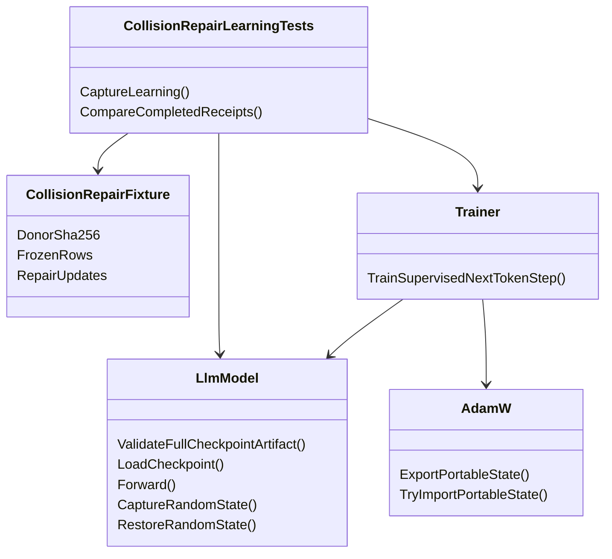

# TEST-COLLISION-REPAIR — проверить восстановление уже повреждённой памяти native learner

<!-- transfer-entry-reload -->
**Вход исполнителя.** [Q44](01-registry.md#work-test-collision-repair). Это отдельное задание на проверку обучения. Продуктовый исполнитель берёт его только по назначению на эту строку. Используйте указанные в карточке исходное состояние, учебный пример и независимый ответ. Перед каждым переносом и после восстановления контекста заново прочтите полностью агентские файлы, назначенные навыки, исправленный список Любы, текущий индекс и карточку. [Как применить прочитанное к этой работе](03-test-and-execution-contract.md#read-and-apply) · [Что взять сейчас](01-registry.md#executor-next).

<a id="q44-inputs"></a>
## Q44. Входы отдельной проверки восстановления

Эта строка относится к проверкам обучения после повреждения снимка. Её очередь отдельна от переноса алгоритмов. У CDG18 уже есть и урок, и исходный повреждённый донор. Для локального прогона допустимо прочитать объявленный файл `correction-collision.json` по пути `FixturePath` [в исходном потребителе](../../../../experiments-v2/RP01-MICRO/CDG18/host/CollisionPostBatchRecoveryProbe.cs). Его размер 1 135 байт, SHA-256 `fcf2e07aa283ad40622b7c05eee738d0c490c5c2448f686fde935775ecff1992`. Если рабочий `after-sft.bin` отличается от объявленного, для попытки использовать байты локального объекта `.git/lfs/objects/30/82/3082a9c8c9ecad597986205e78e26ff91fd6c5f93c1d8068ba08e262058ac889` (47 899 519 байт). Это подготовка точных входов проверки. Публикация внешнего урока как пользовательского набора — отдельная работа. Поместить проверку в существующий проект `Tests/LlmFromScratch.Tests.csproj`. Сначала убедиться, что восстановленное «до» читает назначенный ответ. Архитектору передавать конкретный отсутствующий вход или ошибку чтения. [Файлы, происхождение и доступные состояния](../../../../artifacts/fbe/Q44-DISCOVERY/attempt-0001/discovery-facts.md).

<!-- EXECUTOR-CONTEXT-120:START -->
## Обязательный вход в выбранный перенос или owner-раздел

Обязателен [договор120](120-executor-context-and-test-repair-contract-2026-11-02.md): перед новым аудитом/заданием свежо и целиком прочитать local/canonical AGENTS, CLAUDE, 12 основных навыков и дополнительные experiment-design/test-integrity по роли; восстановить усечения. Модель default без override. Этот вход не разрешает запуск и не меняет данные, budget, команды или очередь.

**Область:** этот вход относится к каждому выбираемому ниже FIX/TEST/R/RF/C и его собственной приёмке, а не превращает весь файл в одно поручение. Уже принятые части не переоткрывать; сначала сверить current source и сохранённые receipts именно выбранного владельца.

**Применимые риски LEARN/METRIC:** Сохранить назначенные lesson/RowId и before→factor→after по независимому gold; margin/hash/update не заменяют правильный ответ. Положительный контроль удерживает прежний правильный ответ, отрицательный показывает потерянную/неусвоенную строку; gained/lost TRAIN и EXAM раздельно. Различать шкалу, знаменатель, trajectory mean, last-pre-update и final checkpoint; unknown не0. Отрицательный свидетель — одинаковый итог при gained/lost либо подмена final средним; положительный — те же raw дают правильный построчный вывод. Пересчёт сохранённых raw — отдельная проверка измерителя сTrain0; он НЕ заменяет обязательные updates/учебный цикл данной карточки. Новое неназначенное вспомогательное обучение не добавлять; source proof, научный запуск и formatter-проверка имеют разные статусы.

**Ожидания от теста.** Используйте данные этого ID и обычный путь, указанный в его действующей строке. Исходные доказательства сохраняются. Дополнительную диагностику из прежнего плана открывайте при конкретном расхождении. Для учебного результата запишите, что было до урока и что стало после. Техническую проверку формата или маршрута так и назовите.

**Проверка исполнителя.** Соберите затронутый проект и выполните назначенный малый сценарий на своей сборке. Укажите вызванный метод, вход и фактический результат. Для обученного поведения сравните смысл ответа и выбранного получателя. Для ресурса измерьте названную величину за тот же вызов. Если проверка упала, сохраните вход, ожидание и ошибку. Исполнитель может исправить дефект теста по независимому критерию и повторить эту проверку. Отпечаток нужен при разборе происхождения файла или сборки. Дождитесь завершения запущенной проверки. Затем переходите по текущей очереди. Право выполнить перенос определяется действующим назначением.
<!-- EXECUTOR-CONTEXT-120:END -->


<!-- BEGIN audit-91-applicability -->
## Дополнение28.10: фактический выход и происхождение показаний

В учебной проверке actual logits/vector/mask от восстановленного состояния должны попадать в назначенный trainer/reader; canned tensor допускается только в отдельно названном component test. Нулевой optimizer step delta и неизменные веса не доказывают отсутствие Backward. Квитанция различает measured/structural/unknown; эту границу P08 consumer уже пришлось исправлять. Предусмотренное контрактом чтение reference cache или выученной памяти разрешено: проверяется фактический hit/miss и привязка к правильному state/key. Запрет касается подмены проверяемого производителя заранее подготовленным oracle, а не самого механизма FIX-LC.

Для TEST-COLLISION-REPAIR исходные данные, дозы, модель, доменная область и oracle владельца сохраняются. Это адресное условие будущей приёмки, не свидетельство уже пройденной проверки и не новый запуск. Источник ошибки и точные ремонты — [91/92](92-positive-transfer-followup-plan-2026-10-28.md).
<!-- END audit-91-applicability -->


<!-- BEGIN audit-84-applicability -->
## Уточнение исполнения по аудиту P02/P08/P09

Для метрики DPO указывать единицу pair/step/panel, веса и фазу. Контрпример одного шага с margins [+1,-3]: доля положительных пар 0,5, признак положительного среднего 0; совпадение этих счётов на исходном опыте не делает их одной метрикой. Проверка вызывает полный writer с metric_definitions, а не только внутренний builder. Неизмеренное время SFT — null, не0; исторические receipts не переписывать.

Применимость: TEST-COLLISION-REPAIR. Основание и адресные проверки — [план85](85-reporting-sampling-cache-repair-plan-2026-10-27.md), [общий договор03](03-test-and-execution-contract.md). Это усиление постановки, не утверждение о наличии дефекта в каждом данном исходнике и не новый запуск. Исходный эксперимент/бюджет/статус допуска сохраняются; продолжение пропущенного этапа использует тот же обученный state, новая самостоятельная программа обязана содержать назначенное реальное обучение. При STOP/NEXT следовать прямому указанию пользователя, не продолжать прежнюю задачу.
<!-- END audit-84-applicability -->


<!-- BEGIN audit-87-applicability -->
## Приёмка и состояние обучения: аудит 28 октября

Проверять по отдельности optimizer step, scheduler step и число реально применённых обновлений. Контрпример P12: импортированные моменты AdamW400 совместимы с новой эпохой scheduler0; P10, напротив, использует fresh DPO0. Не переносить правило fresh/import из соседнего опыта. После отказа сверять веса, моменты, RNG и исполненные Forward/Backward; отчёт о правильных ответах без назначенного обучения не закрывает учебную цель.

Применимость: TEST-COLLISION-REPAIR. Контроль отчёта: точная панель, настоящий учебный этап, терминальное завершение и выполненные обязательные проверки — отдельные поля; успех одной оси не равен общему допуску. Требования по [плану88](88-gradient-warmup-transfer-repair-plan-2026-10-28.md) добавляются к исходному рецепту, не меняют исторические результаты и не назначают повтор обучения. Проверки сохранённого receipt используют raw уже выполненного обучения; новая самостоятельная программа обязана содержать назначенный Train. Если нужен новый вызов модели, сначала явно назначить полный бюджет, а не скрывать его в диагностике. Это профилактическая применимость, не установленный дефект каждого данного исходника. STOP/NEXT и ожидание исходного process handle из карточки сохраняются.
<!-- END audit-87-applicability -->

<!-- BEGIN audit-76-specific-controls -->
## Уточнение по новому аудиту 27 октября: TEST-COLLISION-REPAIR

<!-- OWNER-CONTEXT-120 --> **Самопроверка выбранного раздела:** LEARN/METRIC по договору120 во входе файла; собственные source/caller/данные/доза и negative+positive этой строки обязательны. Старый завершённый результат не переоткрывать; при падении сохранить input/expected/actual/stack+SHA, не менять oracle ради зелёного. Примеры другого owner не добавляют проверки или Train к этому разделу.

Основание — [76](76-new-transfers-and-experiment-evidence-audit-2026-10-27.md), ремонт — [77](77-new-transfer-repair-plan-2026-10-27.md). Это защита от повторения проверенной ошибки другого переноса, **не утверждение о найденном дефекте реализации каждого ID**. Сохраняются собственные данные, алгоритм, критерии и лимиты этой карточки; дополнительные Train/Forward этой вставкой не назначены.

**M — метрика привязана к фактической стадии обучения.** Для обучающего loss/reward записать состояние, на котором он вычислен, отдельно от номера опубликованных после update весов. У DpoTrainer последняя StepMetrics — pre-update; не называть её оценкой конечного checkpoint. Пример P02: B уже стартовал с margin 0,002773 после SFT; отношение последних значений ×3,22 не равно отношению приростов DPO. Любое сравнение приобретения/ремонта использует собственное before каждого этапа и одинаковый reader. DPO Accuracy=(reward_margin>0) означает улучшение относительно reference, а не правильный ответ: T2 имеет policy chosen−rejected=−0,1827326 при положительном reward. TRAIN/EXAM correctness и сохранённые logP остаются отдельными полями. Если эта карточка сравнивает математически равные оптимизации, сохранить её A/B equality; не требовать искусственного роста точности и не добавлять post-update Forward, когда нужное чтение уже предусмотрено.

**W — отчёт должен воспроизводиться своим источником.** Не закрывать исправление только ручной заменой JSON/Markdown: проверить действующий writer, который создаст следующий отчёт. Attempted, completed updates, diagnostic/model calls и native memory fits различаются. Неизмеренный ресурс — null/NOT_MEASURED, измеренный ноль — отдельный исход. Контроль отказа проходит через реальный producer/обработчик результата; готовый hand-written JSON доказывает только формат. Состоявшееся обучение после ошибки отчёта не повторять. Unit-проверка producer без Train не является новым экспериментом; новая экспериментальная программа содержит назначенный учебный участок.
<!-- END audit-76-specific-controls -->

**Контроль фактических десяти исправляющих updates, 27 октября 2026.** CaptureLearning различает попытку и завершённый native SFT шаг; отказ до первого даёт completed0, после первого успешного —completed1 и partial, не label «после10». Для уже назначенного PartialOrMissingReceiptCannotBeMarkedComplete недостаточно четырёх вручную изготовленных JSON: тот же controller/helper, которым CaptureLearning считает завершения, вызывается с callback, отказывающим до/после одного успеха. Unit control не создаёт модель и не обучает; основной58F/10B/10updates не расширяется. Сравнитель читает только существующий actual послеэтапный readout; missing after не заменяет teacher-forced0correct. Acquired gold и damaged donor остаются независимыми от последнего repair input.

**Уточнение исполнения, 27 октября 2026.** Ремонт измеряется из одного уже повреждённого checkpoint. Перед оценкой нельзя незаметно восстановить хороший donor или повторить acquisition: тогда успешен подменённый старт. Для каждого назначенного repair milestone сохранять immutable gold/readout profile, actual updates и full state; reports читают готовые данные без дополнительного repair. Частичное улучшение токенов не превращать в full-answer recovery, а тренировочный ответ не подставлять вместо исходного правильного gold.

Общие примеры правильной и ошибочной проверки — [контракт03§24](03-test-and-execution-contract.md#transfer-audit-20261027). Это дополнение плана; новые проверки сейчас не запускались.

<a id="delta-after-132"></a>
## После129–132: контексты оценки и ограничения расписаний

[57](57-native-transfer-contract-gaps.md#response-context-parity) сохраняет рецепт: один damaged donor92, A0SFT, B10SFT. Полный owner расход после двух контекстов — **58F/10B/10updates**,13discovery cases/5test processes/25executions. [Квалификация измерителя57](57-native-transfer-contract-gaps.md#separator-133-calibration) теперь имеет единственного владельца FIX-SEP62:59 переиспользует его завершённый совместимый receipt, **0 дополнительных Forward/updates/test processes**. Прежние0/4/8F и отдельный calibration Fact сняты как дублирующее назначение. Собственные6F Quality у62 учитываются один раз в FIX-SEP, не в каждом A/B59. Ни acquisition, ни DQ01/SEP01 обучение заново не запускаются.

129–131 не обосновали универсальный scheduler, гладкую кривую по длине промежутка, независимое сложение length/LR или прогноз по одной норме LoRA. Их полезные оси и регрессии сохранены в [доказательствах](04-evidence-and-novelty.md#delta-after-132). Повторяемость конкретного рецепта не заменяет независимые seeds/сценарии. 132 подтверждает приобретение последнего target у двух отдельных моделей;133 даёт23/23 и21/21 при SFT-aligned teacher forcing на этих же weights. Они не заменяют damaged donor92. Aligned эффект ремонта именно CDG18 остаётся неизмеренным; готовый expected20/23→22/23 сохраняется только для legacy, без автоматического пересчёта по133.

25.10.2026. **READ_ONLY_RESEARCH + Markdown; реализация и запуск не назначены.** Тип результата: план учебного покрытия существующего механизма. Положительное основание —92/93; ограничения теперь учитывают129–132 и поправку132 на6f9ccc3712a49b45252ff026c03fb8f1618364d2. Здесь нет новой политики выбора уроков, автоматического ремонта или выпуска модели.

У модели уже был частично правильный ответ, затем ошибочные уроки повредили его. Новая проверка должна загрузить именно это повреждённое состояние и выяснить, восстанавливает ли настоящий `Trainer` ответ после короткого исправляющего обучения. Это отличается от [FIX-N63C /17](17-dpo-sft-correction-collision.md): там исправляют **входящий устаревший текст до следующего обучения**. Прежний [54-correction-collision-measured-followup](../fixes-based-on-experimentsperiments/54-correction-collision-measured-followup.md) уточняет donor и бюджет того же FIX-N63C и нового ID здесь не получает.

**Выбрано одно дополнение, `TEST-COLLISION-REPAIR`.** Положительное основание есть для ограниченного native теста восстановления. Основания включать автоматические «3 исправления», «10 правильных на 10 плохих», «последний урок должен быть своим», «хвост менее 30/40», «переключить SFT→DPO на шаге20» или подбирать расписание по одной текущей margin нет. Числа ниже принадлежат конкретным сохранённым опытам и фиксированному бюджету будущего теста.

<a id="endpoint-comparison-limit"></a>
### Уточнение 25 октября: фиксированный endpoint не выбирает расписание

**Действующее уточнение 26 октября по 140–143:** размах уровня сам по себе не определяет устойчивость разницы. [План 63](63-paired-learning-effect-and-factor-contrasts.md) назначает парное сравнение сохранённых траекторий и независимые поля fraction/margin;141 имеет 117/121 согласованных знаков fraction против 68/121 у margin, а 142 даёт 121/121 у обеих. Поэтому 139 ниже — историческое ограничение тех сравнений, не запрет margin как класса. У самого 59 есть только before/after: устойчивость по времени остаётся `not_measured`, пока нет уже записанной совместимой траектории; новых intermediate Forward этот план не добавляет.

Поздний [CDG63 / опыт139, report строки51–80 и124–157](../../../../experiments-v2/RP01-MICRO/CDG63/results-01/report.md) прочитан как **ограничение переноса**, не как новый кандидат за пределами заказанных1–133. В отчёте разница сравниваемых плеч0.021612 меньше наблюдённого размаха даже среднего по40урокам:0.067594/0.254377; ранжирование усреднённых значений меняется между точками остановки. Автор отозвал сравнительные выводы134–138. Это не статистический доверительный интервал и не численный порог для всех других опытов.

Для настоящего плана сохраняются donor92, A0SFT/B10SFT и все прежние расходы. Наблюдение восстановления22→20→22 в92 и точный framing-контроль133 не отменяются автоматически:139 не является их повтором. Но одна конечная margin, её знак, сумма по строкам либо среднее по произвольно выбранному окну не дают права объявить расписание лучшим, безопасным или пригодным для всех доменов. Побитовый replay доказывает повторимость заданного расчёта, а не устойчивость ранжирования к фазе расписания.

**Изменение будущего тестового контракта без нового запуска:** существующие `MetricAxesRemainIndependentAndWholeExactRequiresAllTokens` (§6) и сравнитель completed receipts сохраняют все значения correct/total, NLL/margin и регрессии, но выводят отдельно: восстановление в назначенном endpoint; полноту ответа; основание ранжировать расписания. Для последнего здесь записать «не установлено», независимо от положительной margin. Если старый assertion требовал общего `success=true` лишь из `margin_B > margin_A`, заменить только это смешение смыслов; не ослаблять assertions сохранности входа/весов/optimizer/RNG, actual token counts и per-row regressions. В этой документной работе наличие такого падающего теста не установлено. Это дополнение к уже назначенным assertions, **0 дополнительных Forward/Train/Generate, 0 новых test processes**.

В тот же существующий metric Fact включить два малых случая на заранее заданных receipt-значениях: (1) margin выросла при неизменных correct — сохраняется успех preference-оси, но не приобретение новых правильных токенов; (2) порядок A/B противоположен в двух переданных endpoints — обе строки сохраняются, `schedule_superior` не выводится. Это проверка интерпретации отчёта, не новый учебный опыт, Fact или доказательство численного поведения модели.

Дополнение26октября: тот же Fact и `CompletedReceiptComparisonDoesNotInvokeModel` получают saved-data assertions141–143 из [63](63-paired-learning-effect-and-factor-contrasts.md#6-сохранённые-источники-и-будущие-проверки). Новый чистый helper размещается в `Tests/ExperimentFixes/PairedLearningEffectSummary.cs`. Число Facts/processes и58F/10updates59 остаются прежними. При наличии траектории показываются отдельные counts знаков, scope и цена; это не универсальный boolean допуска. У143 исправляется подпись A−B по координатам клетки, не численные historical raw.

В [E2E20](20-prompt-domain-e2e.md) receipt такого endpoint может описывать качество конкретного downstream состояния, но не открывает product gate и не назначает автоматический scheduler. Полезный измеренный сдвиг остаётся успехом своей метрики с указанной ценой; область вывода не расширяется.

## 1. Что измерено и что из этого действительно переносится

Тема обучения — документация/код на C#; проверяемый пример — `Abs`, получатель — Transformer H512 с LoRA q/v, механизм восстановления — существующий supervised next-token шаг. `Abs`, `Magnitude`, `Sign`, `Negate` — строки/задачи внутри проверки, не четыре домена. Свободная генерация и пользовательский prompt→domain путь здесь не измерены; их владельцем остаётся [20](20-prompt-domain-e2e.md).

Основные источники: [92 raw](../../../../experiments-v2/RP01-MICRO/CDG18/results-01/n63c-probe.json), [92 curve исправляющего плеча](../../../../experiments-v2/RP01-MICRO/CDG18/results-01/B_batch_then_ten_fixes/dose-curve.json), [92 report](../../../../experiments-v2/RP01-MICRO/CDG18/results-01/report.md), [93 raw](../../../../experiments-v2/RP01-MICRO/CDG19/results-01/n63c-probe.json), [93 report](../../../../experiments-v2/RP01-MICRO/CDG19/results-01/report.md). Числа ниже прочитаны из raw; исторические слова отчётов «надо», «по умолчанию», «бессмысленно» не являются разрешением/доказательством продуктовой политики.

| Сохранённый конец | `Abs` correct | `Abs` mean-log-prob margin | `Magnitude` correct/margin | `Sign` correct/margin | `Negate` correct/margin |
|---|---:|---:|---:|---:|---:|
| 92 A, десять ошибочных в самом конце | 20/23 | −0.476766 | 1/29; −0.087118 | 1/21; +0.311422 | 2/17; −0.335041 |
| 92 B = 93 A, после порчи десять исправлений `Abs` | 22/23 | +0.508705 | 2/29; +0.017071 | 2/21; +0.043962 | 1/17; −0.336653 |
| 93 B, десять исправлений распределены 3/3/2/2 | 22/23 | +0.225118 | 10/29; +0.228315 | 7/21; +0.342501 | 5/17; −0.086932 |

Внутри **одного** плеча 92 B: урок80 — 22/23, margin +0.95577866; после порчи на уроке90 — 20/23, −0.4758656; после десяти исправлений на уроке100 — 22/23, +0.50870526. Это прямое положительное свидетельство частичного восстановления ответа, а не только красивого изменения float. При этом полный ответ остаётся неверен: 22/23 ≠ whole exact. Плечо92 A заканчивается после иной предыдущей истории — 90 правильных+10ошибочных, тогда как92 B имеет80+10+10. Его конечный checkpoint ниже — **доступный повреждённый donor новой эпохи**, не точный снимок урока90 плечаB. Это ограничение нельзя скрыть близостью margins.

Широкое восстановление93 увеличило сумму четырёх margins с +0.2331 до +0.7090 относительно узкого, но ослабило восстановление `Abs`; более того, три бывших heldout прямо вошли в TRAIN широкого плеча. Их улучшение поэтому не является обобщением на независимый EXAM. Новая проверка оставляет их только для наблюдения регрессий и не переносит round-robin в production.

### Ограничения, изменяющие решение

- **Срок/ширина ремонта:**83 `results-02` опровергло категорическое «поздно — только откат» из82. Широкий ремонт при том же позднем начале помог сумме набора; это не доказательство достаточности узкого ремонта и не доказательство безопасной эксплуатации.
- **SFT и DPO не равны по цене и цели.**94 сравнивало десять SFT с одним DPO и разные LR;95 уравняло число применений, но не число Forward/Backward и не эффективный сдвиг.95: `Abs` +0.508705/22токена у SFT против −0.403096/20 у DPO.96 после50DPO всё ещё −0.113842/20. Эти результаты не дают общего ранжирования алгоритмов.
- **LR определяет постановку.**97–99 меняют скорость;98 при1e−5 даёт22/23 в обоих концах, небольшое изменение margin не означает восстановление потерянных токенов. Нельзя перенести эффект LR0.003 на1e−5 или считать неизменный ответ новым приобретением.
- **Preference не заменяет ответ.**100: обучение соседям оставило `Abs`17/23 и margin−0.282789, прямой ремонт —22/23 и+0.636547.101–102 не обосновали дешёвый порог качества по NLL. Ни NLL, ни margin отдельно не открывают выпуск.
- **Связка существует как измеренный рецепт, не auto-selector.**104:60SFT +0.383663,60DPO +0.302077, оба22/23.105:20SFT+40DPO +0.491539, но выбранные уроки имели15 промежуточных неполных ответов;106 ранняя передача10SFT+50DPO хуже по margin (+0.422689),107150DPO довели её до+0.935786 при всё ещё22/23.108 повторяет часть поведения на `Magnitude`28/29, но числа меняются. Это основания будущего отдельного вопроса о mixed repair, не второй ID/скрытые дополнительные150шагов здесь.
- **История влияет, но её носитель не установлен.**118–122 показывают влияние практики/очередности;123 добавка10чужих уроков *улучшила* конечный `Sign` +0.100326→+0.171740, опровергнув простое «чужое последним всегда вредно».124–127 зависят от длины/положения и измеряемой фазы; их числа не универсальные пороги.
- **128 переворачивает направление ожидания.**Одинаковые30шагов промежутка на3e−3/3e−5: `Sign` конечный+0.078592/−0.082473 при одинаковых19/21; `Abs`21/23→22/23, но `Magnitude`10/29→8/29 и `Negate`14/17→4/17. Движение/геометрия LoRA — корреляционный кандидат; оптимизатор, margins и геометрия меняются вместе. Ни «сохранить практику», ни «уменьшить LR» не становятся правилом ремонта.

## 2. Выбранная native проверка, без новой бизнеслогики

**NAMED_CHECK: CR-RESTORE-01.** WRONG: успешным названо восстановление только потому, что вырос margin, либо вместо повреждённого donor снова выполнены60приобретений+100уроков порчи. CORRECT: один сохранённый повреждённый donor, одинаковые исходные weights/tokenizer/RNG, ограниченные10native SFT, token-level ответ до/после и все три соседние строки рядом; неудача остаётся неудачей.

Сейчас [Trainer.cs:67](../../../../04.TrainingLoop/Trainer.cs) уже имеет `TrainSupervisedNextTokenStep(model, optimizer, tokenIds, weight)`. В строке117 он вызывает `model.Forward(..., training: true)`, затем `BackwardLoss`, clip, `optimizer.Step`; frozen параметры исключены из trainable set. Проблема здесь в отсутствии назначенного теста восстановления **из уже повреждённого сохранённого состояния**, а не в доказанном дефекте этого метода. Решение — новый тест и фиксация его результатов. `Trainer`, `IncrementalTrainer`, admission, DPO и порядок product pipeline не изменяются этим ID.

Будущие файлы (сейчас не созданы):

| Путь от `C:/Projects/llm_mvp_core/` | Ответственность |
|---|---|
| `Tests/ExperimentFixes/CollisionRepairLearningTests.cs` | `CaptureLearning`, `CompareCompletedReceipts`; единственный класс этого ID |
| `Tests.Support/ExperimentTransfer/CollisionRepairFixture.cs` | Immutable описатель donor, exact rows, конфигурация и назначение стадий; без копии learner/выбора расписания |
| `Tests/Fixtures/ExperimentFixes/v1/N63C/correction-collision.json` | Общий frozen fixture FIX-N63C; использовать те же bytes, не вторую несовместимую копию |
| `Tests.Support/ExperimentTransfer/Run-NativeAB.ps1` | Уже назначенный общий launcher из02/03; добавить этот TEST-ID, не второй runner |

В fixture descriptor добавить только четвёртую **измерительную** пару из92 runner: ID `far-no-branch-added-by-executor`, prompt `// file: Negate.cs`, chosen `static int Negate(int n)=>-n;`, rejected `static int Negate(int n)=>n;`. Она помечена как authored simulation и не получает происхождение из внешнего legal teacher. TRAIN — только exact `Abs` chosen; Q1/Q2/Negate никогда не участвуют в будущих10updates.

Движение данных: общий launcher фиксирует stage и inputs; fixture descriptor проверяет donor/формат; native start устанавливает совместимые adapters; native model загружает повреждённые weights; независимый readout читает все четыре пары; только stageB передаёт десять раз один фиксированный текст в настоящий `Trainer`; сохранённые raw сравниваются без запуска модели. Gold — исходные строки fixture, не ответ helper. Выбор текста здесь детерминированная **постановка теста**, обучаются только веса LoRA; learned selector или новая Unit/Flow не вводятся.



## 3. Один donor, точная новая эпоха и восстановление

Назначен [CDG18/results-01/A_batch_at_very_end/after-sft.bin](../../../../experiments-v2/RP01-MICRO/CDG18/results-01/A_batch_at_very_end/after-sft.bin), **47 899 519 bytes**, SHA256 **`3082a9c8c9ecad597986205e78e26ff91fd6c5f93c1d8068ba08e262058ac889`**. В этой документной работе прочитан Git LFS pointer и отдельно вычислен SHA256 working binary: совпали. Native codec/load/Forward здесь не запускались. У донора20/23 correct, margin−0.476766, NLL1.1180 по сохранённой панели. Это ненулевое приобретённое знание с повреждённым предпочтением; не0→0.

Основной fixture SHA256 `fcf2e07aa283ad40622b7c05eee738d0c490c5c2448f686fde935775ecff1992`; источник — уже назначенный в17 файл `C:/Users/lubao/Documents/xiigen/llm mvp/design to code session/replanning/possibleDifs/2026-10-20-learning-ingress-and-retention-review/ingress/fixtures/correction-collision.json`. Новый producer не назначен. Config `config/code-documentation/generation-v1.json`, declared SHA256 `e1f960b8c7d883f84c9b4e55d24c7284794cee2fecfd71beac5835d199746f40`; H512/V629/C2048/L4/Q8/KV2/FF1408, LoRA rank8/alpha16/dropout0/q_proj+v_proj, seed20261014. B0 manifest `c5f4f7da80f427b8e9aac1dabded5849f0cbc6cb444b99d2bf7daac44ec0246d`, B0weights `a65887cc9d97c793d00e77632013adeba5e2d36efd7e6cebe7e49ba8a9b37911`. Config/fixture digests здесь взяты из прочитанного runner/raw; их свежая проверка — preflight будущего исполнителя.

1. Через [CodeDocumentationGenerationConfiguration.ReadVerified:35](../../../../25.ModelServer/ContinuousLearning/CodeDocumentationGenerationConfiguration.cs) и [CodeDocumentationRepositoryOwnedModelCheckpointStartService.PrepareStart:100](../../../../26.TrainableRouter/Training/CodeDocumentationRepositoryOwnedModelCheckpointStartService.cs) получить совместимый native policy/tokenizer. Проверить B0 binding как в `CDG18/host/CollisionPostBatchRecoveryProbe.cs:635–668`; не менять config, чтобы пройти gate. Никаких external calls и публикации этого simulation donor как принятого product parent.
2. До load вызвать [LlmModel.ValidateFullCheckpointArtifact:911](../../../../03.TransformerModel/LlmModel.cs) с `FullCheckpointLoraTopology(8, ["q_proj","v_proj"])`, cfg и maximumArtifactBytes47899519. Требуются `IsSuccess && Value`; затем новым stream загрузить через `LoadCheckpoint`. Старый base-only overload для этого artifact не подходит. Native schema admission не создаёт teaching authority.
3. После установки adapters/load не выполнять initialization. Проверить exact weights в A/B, base frozen, trainable только установленные LoRA; ошибки custody/shape — отказ, не повод сделать acquisition заново.
4. Это **новая weights-only эпоха**, не историческое continuation. Donor не содержит SFT AdamW moments и не предоставляет соответствующий SFT RNG receipt. Обе стадии начинают свежий optimizer step0; незаполненные moments не выдаются за восстановленные. Использовать `AdamW(.9,.95,.01,1e−8)`, новый `Trainer`: batch1, seq2048, accumulation1, warmup0, totalSteps10, MaxLr=MinLr=.003, clip1, weight1. Исторические3e−3 сохраняют заданный режим теста, не становятся production default.
5. Идентичный новый RNGstep0 получить из same seed authority/stream после native start и donor load; topology/lora hashes — через `LoraRandomStateIdentity`. Сохранить `CaptureRandomState` и применить `RestoreRandomState` A/B. Это снимок новой эпохиstep0. При dropout0 он не подменяет историю SFT moments.
6. До воздействия снять четыре пары **в двух контекстах** по [контракту57](57-native-transfer-contract-gaps.md#response-context-parity). A/B должны совпасть по IDs/masks/readouts внутри каждого контекста. Legacy Abs20/23 и отрицательная margin — контроль воспроизведения старого измерения, не предел знания. SFT-aligned имеет собственный denominator и ненулевое приобретённое before; точное число заранее не выдумывается. Несовместимые bytes/граница/пустой before дают диагноз до обучения, без acquisition «до нужного состояния». Readout не заменяет weights/RNG identity.

SFT материал остаётся `Encode(prompt + "\n" + chosen)`, как в92 runner:427–460. Измеритель сохраняет прежнюю оценку native `LogicalDpoPreparedBatchMaterializer.Prepare` как `legacy_exact_dpo` и добавляет `sft_sequence_lf` по [57](57-native-transfer-contract-gaps.md#response-context-parity), не меняя product exact-DPO. Один native `Forward(training:false)` на сторону/контекст даёт correct/ranks/NLL/margin из тех же logits. `EvaluateAverageNextTokenLogProbability` поверх них не вызывается: это отдельный Forward. Исторический20→22 остаётся результатом legacy; соответствующее изменение SFT-aligned ещё неизвестно.

После B сохранить full checkpoint через `LlmModel.SaveCheckpoint`, actual AdamW portable state через [ExportPortableState:188](../../../../04.TrainingLoop/Optimizers/AdamW.cs), RNG record со всеми полями из `03.TransformerModel/Randomness/LlmModelRandomState.cs`, step10, exact learning losses, before/after scores и manifest. `AdamWPortableState.ToBytes/FromBytes` + `TryImportPortableState` сохраняют именованные bindings/shapes; при несовпадении отказ, не fresh fallback. RNG загружается через `LlmModel.RestoreRandomState` с matching identities/step; full model через native load. Повторное чтение/сравнение этих bytes и fields не выполняет новый step/Forward. `Trainer` имеет private supervised counter: настоящий resume из середины этой эпохи **не назначен**; частичный/неизвестный run не relaunch и не «доигрывается» новым Trainer. Сохранённый terminal state нужен для отчёта/аттестации, не для второго обучения.

## 4. A/B совместимость, расход и критерий результата

**Это TEST-ID: A/B различаются назначением тестового воздействия, не production-кодом.** В обеих стадиях те же native assemblies и те же test sources; helper компилируется только через уже существующие API. Нет candidate scheduler API, reflection bypass или внесённой заранее product правки. StageA — untreated control из donor; stageB — fresh donor и десять native corrected SFT. Отчёт обязан писать «обучение/восстановление существующего механизма», а не «B исправил исходник». Не запускать ещё одну такую пару под видом baseline новой реализации.

| Назначенная работа | A | B | Всего |
|---|---:|---:|---:|
| Acquisition / damage / DPO / Generate / external calls | 0 | 0 | 0 |
| Native SFT updates | 0 | 10 | **10** |
| Before:4пары×2стороны×2контекста | 16Forward | 16Forward | 32Forward |
| After, оба контекста | A.before — immutable no-op endpoint, **0Forward** | 16Forward | 16Forward |
| Training | 0 | 10Forward+10Backward | 10Forward+10Backward |
| **Бюджет модели самого repair** | **16F/0B** | **42F/10B** | **58Forward/10Backward/10updates**; завершённый receipt FIX-SEP переиспользуется без дополнительных model calls |

Нет dose curve, дополнительного intermediate scoring, «дополнительных десяти до сходимости», сравнения LR, ширины ремонта и DPO в этом ID. BeforeA/BeforeB уже выполняют qualification; дополнительных warmups нет. Один existing codec test ниже и новые manifest/receipt checks добавляют0модельныхF/B/updates. CPU/file IO/время сборки и проверок учитываются отдельно; таблица не называет их бесплатными по времени.

Каждая полезная ось оценивается отдельно **в каждом контексте**, с неизменным внутри A/B target map. Token repair — B.correct>A.correct при одном denominator; успех NLL/margin фиксируется также, с регрессиями рядом. Полный teacher-forced ответ — correct=denominator данного контекста, не свободная генерация. При неизменном correct и улучшении margin — только preference gain; цель восстановления ответа открыта. При0→0 — невалидное учебное основание. Исторические20/23→22/23 и+.508705 не назначаются expected для SFT-aligned. Разные знаки Δ между контекстами показываются явно; выбирать только лучший запрещено. Дополнительных шагов ради нужного числа не делать.

Все Q1/Q2/Negate correct/NLL/margin публикуются, включая ухудшения. Они не фильтруются по тому, стала ли лучше суммарная metric. Исторические92/93 уже показывают, почему test может подтвердить частичный ремонт `Abs` и одновременно оставить продукт невыпускаемым. Положительный итог по одной оси не превращает этот TEST в разрешённый default repair.

## 5. Математика и границы вывода

Для response mask `M` с `d=ΣM>0` используем `ℓ(y|x)=Σ M_t log pθ(y_t|x,y_<t)/d`, `NLL=−ℓ`, `m=ℓ(chosen)−ℓ(rejected)`. Correct — число response targets, где argmax совпадает с gold; exact — correct=d. Mean margin здесь не `DpoMetrics.RewardMargin`: последний в92 равен1.3741179 при objective `response-sum-softplus-signal-weighted-v3`, а panel afterDPO margin около0.8356108. Смешивать их масштабы нельзя.

Supervised шаг минимизирует full-sequence CE на `prompt+LF+chosen`; последовательность фиксирована и не содержит rejected target. Для малого шага `ΔL_i ≈ ∇L_i(θ)ᵀΔθ`; при AdamW `Δθ` зависит от накопленных первого/второго moments, bias correction, clip и decay. Поэтому уменьшение loss обучаемой строки не задаёт знак `ΔL_j` соседней строки и не гарантирует рост её correct. Формула — локальное приближение при гладкости и достаточно малом сдвиге, не теорема о десяти шагах LR.003.

Для описания старого повреждения можно считать `R=(m_after−m_damaged)/(m_healthy−m_damaged)`, только если numerator/denominator относятся к одной паре, одной mask/шкале и denominator>0. Значения>1 и<0 сохраняются. В новом тесте healthy исторический ориентир не совпадает со стартом новой эпохи: основная мерка — `Δcorrect`, `Δm`, `ΔNLL`, а не выдуманная доля полного восстановления. Сумма margins по разным строкам — условная equal-weight сводка, не точность и не вероятность правильного ответа.

В DPO `−log σ(β[(logπθ(y+)−logπθ(y−))−(logπref(y+)−logπref(y−))])` действует другая цель; шаги, LR, reference и количество Forward отличаются от SFT. Отсюда ни сравнение94, ни равное число применений95 не доказывают равную стоимость или общую победу механизма. В будущий bounded тест DPO не входит.

## 6. Адресные тесты и один общий launcher

Сейчас ни один существующий тест не объявлен упавшим: запусков не было. Для baseline и после добавления coverage оставить exact существующий Fact `LlmFromScratch.Tests.LlmCheckpointIdentityV2Tests.StaticFullLoraValidation_RequiresExactDeclaredGqaTopologyAndPreservesLegacyBaseOnly` ([источник:21](../../../../Tests/LlmCheckpointIdentityV2Tests.cs)): он проверяет exact full-LoRA topology, base-only compatibility и отказ на неверные shape/keys, выполняя0Forward/Train. Проверка не ослабляется ради donor.

Связанные текущие API/tests прочитаны адресно, **не назначены дополнительным бесплатным fit**:

- `Tests/AdamWOptimizerStateRecoveryTests.cs::PortableState_WrittenToDiskAndReopened_RestoresMomentsAndStepExactly`, `PortableState_MissingFile_LeavesRestartedOptimizerWithoutHiddenFreshStart`, `PortableState_ShapeMismatchOnRestart_RefusesImportAndKeepsOptimizerUntouched`;
- `Tests/DpoTrainerOptimizerStateHandoffTests.cs::FreshTrainer_BeforeAnyStep_ExportsEmptyOptimizerMemoryWithZeroStep`, `ContinuationRestore_RejectingOptimizerRollsBackModelOptimizerAndRng`, `DropoutContinuationMatchesUninterruptedNextUpdateForPolicyOptimizerAndRng` — правила DPO continuation не дают права импортировать отсутствующие SFT moments;
- `Tests/RepositoryOwnedFullLoraCheckpointDescriptorTests.cs::DeclaredInitialFullLora_UsesStrictRootAndLoadsAllTensorsIntoIndependentFrozenBaseClones` — существующий exact-topology path, не новый продуктовый teacher admission;
- `DPO_CHECKPOINT_COLLISION` из94 сохраняется; корректный native отказ не чинить отключением collision guard.

Новые contract Facts находятся в `LlmFromScratch.Tests.ExperimentFixes.CollisionRepairLearningTests`. Ровно шесть случаев, без model Forward/Backward/optimizer update:

| Точное имя метода | Независимая проверка |
|---|---|
| `FrozenFixtureAndOrderedRowsMatchDeclaredIdentity` | SHA и ordered rows совпадают с frozen descriptor, не с actual scheduler |
| `IncompatibleDonorIsRejectedBeforeLearning` | Неправильные full-LoRA topology/shape отвергаются до обращения к learner |
| `StageBudgetIsExactlyZeroOrTenUpdates` | Receipt stage A принимает только 0, stage B только 10 завершённых updates; отрицательные cases 1/9/11 отвергаются |
| `MetricAxesRemainIndependentAndWholeExactRequiresAllTokens` | Рост correct при ухудшении NLL сохраняет token gain; рост margin при неизменных correct не становится token gain; 22/23 не whole exact |
| `PartialOrMissingReceiptCannotBeMarkedComplete` | Отсутствующая terminal state/receipt, незавершённая стадия и несовпавшие identities не превращаются в COMPLETE |
| `CompletedReceiptComparisonDoesNotInvokeModel` | Сравнение готовых synthetic receipts работает без model factory; запрещённая factory фиксирует ошибку при любом вызове |

Точный OR-filter contract process обеих стадий:

```text
FullyQualifiedName=LlmFromScratch.Tests.LlmCheckpointIdentityV2Tests.StaticFullLoraValidation_RequiresExactDeclaredGqaTopologyAndPreservesLegacyBaseOnly|FullyQualifiedName=LlmFromScratch.Tests.ExperimentFixes.CollisionRepairLearningTests.FrozenFixtureAndOrderedRowsMatchDeclaredIdentity|FullyQualifiedName=LlmFromScratch.Tests.ExperimentFixes.CollisionRepairLearningTests.IncompatibleDonorIsRejectedBeforeLearning|FullyQualifiedName=LlmFromScratch.Tests.ExperimentFixes.CollisionRepairLearningTests.StageBudgetIsExactlyZeroOrTenUpdates|FullyQualifiedName=LlmFromScratch.Tests.ExperimentFixes.CollisionRepairLearningTests.MetricAxesRemainIndependentAndWholeExactRequiresAllTokens|FullyQualifiedName=LlmFromScratch.Tests.ExperimentFixes.CollisionRepairLearningTests.PartialOrMissingReceiptCannotBeMarkedComplete|FullyQualifiedName=LlmFromScratch.Tests.ExperimentFixes.CollisionRepairLearningTests.CompletedReceiptComparisonDoesNotInvokeModel|FullyQualifiedName=LlmFromScratch.Tests.ExperimentFixes.ExperimentResponseContextTests.LegacyExactDpoPreservesCallerTextWithoutInjectedSeparator|FullyQualifiedName=LlmFromScratch.Tests.ExperimentFixes.ExperimentResponseContextTests.SftResponseMaskUsesWholeSequenceTokenizationAndExactBoundary|FullyQualifiedName=LlmFromScratch.Tests.ExperimentFixes.ExperimentResponseContextTests.ContextReceiptsCannotOverwriteOrCompareDifferentTargetMaps|FullyQualifiedName=LlmFromScratch.Tests.ExperimentFixes.ExperimentResponseContextTests.EqualFramingProcedureDoesNotAssumeEqualStateDependentBias
```

После отдельного назначения реализации применять общий `Tests.Support/ExperimentTransfer/Run-NativeAB.ps1`, source root `C:/Projects/llm_mvp_core`, PlanId **TEST-COLLISION-REPAIR**, один `attempt-0001`. Artifacts: `artifacts/fbe/TEST-COLLISION-REPAIR/attempt-0001/learning/A`, `learning/B`, `contracts/A`, `contracts/B`, `report.ru.md`. Предпосылки сборки — 02§10; новый checkout/worktree не нужен. Stage Baseline фиксирует native assembly identity, Candidate требует ту же identity: кандидат здесь — test coverage, не native patch. Модель исполнителя будущего этапа — текущая по умолчанию, без override.

Для этого TEST-ID добавляется явное узкое исключение общего runner: `$candidateCommit = $baselineCommit`, допустимый product diff пуст; оба этапа выполняются после подготовки всех общих test sources/fixtures. Между этапами нет нового commit или изменения исходника. Два Rebuild должны воспроизводить одинаковые native bytes; MVID не обязан измениться. Несовпадение сборочных identities разбирается как узкая проблема воспроизводимости сборки **до обучения**, не как разрешение добавить native diff. `XIIGEN_FBE_ARM=A/B` выбирает только заранее объявленное **тестовое воздействие** (0/10 updates), не продуктовый алгоритм; `XIIGEN_FBE_SOURCE_ROOT` и `XIIGEN_FBE_OUTPUT` задаются runner по этим точным путям. Baseline выполняет 11 contract cases (7 прежних +4 безмодельных из57) и untreated `CaptureLearning`; Candidate — те же 11 cases, corrected `CaptureLearning`, затем один `CompareCompletedReceipts`. Других switches/расхода/запросов нет.

Сам repair на каждом этапе: один Rebuild, одно discovery по объединению contract-filter и двух точных методов `CaptureLearning`/`CompareCompletedReceipts`, один contract process, один capture process. Его discovery обязано найти **13 cases на стадию** (11 contracts + capture + compare). Compare запускается только один раз после B. Полный расход59: **2 Rebuild, 2 discovery, 5 test processes, 25 test-case executions** —22contract +2capture +1compare; **58Forward/10Backward/10updates**. Compare/contract дают0модельных F/B/updates. Квалификация принадлежит отдельному FIX-SEP62, её завершённый совместимый receipt переиспользуется по57: **0 дополнительных discovery/processes/model calls** в59. Ни включать её в owner filter, ни запускать отдельно для каждого плеча нельзя.

Готовые команды после реализации общей ветви runner и фиксации `$baselineCommit`:

```powershell
Set-Location C:/Projects/llm_mvp_core
powershell -NoProfile -ExecutionPolicy Bypass -File Tests.Support/ExperimentTransfer/Run-NativeAB.ps1 -PlanId TEST-COLLISION-REPAIR -Stage Baseline -SourceRoot C:/Projects/llm_mvp_core -BaselineCommit $baselineCommit
# Native/test inputs остаются теми же; готовое A повторно не запускается.
$candidateCommit = $baselineCommit
powershell -NoProfile -ExecutionPolicy Bypass -File Tests.Support/ExperimentTransfer/Run-NativeAB.ps1 -PlanId TEST-COLLISION-REPAIR -Stage Candidate -SourceRoot C:/Projects/llm_mvp_core -BaselineCommit $baselineCommit -CandidateCommit $candidateCommit
```

Будущие exact selections после создания класса (сейчас не запускать):

```powershell
dotnet test Tests/LlmFromScratch.Tests.csproj -c Release --no-build --filter "FullyQualifiedName=LlmFromScratch.Tests.LlmCheckpointIdentityV2Tests.StaticFullLoraValidation_RequiresExactDeclaredGqaTopologyAndPreservesLegacyBaseOnly"
dotnet test Tests/LlmFromScratch.Tests.csproj -c Release --no-build --list-tests --filter "FullyQualifiedName=LlmFromScratch.Tests.ExperimentFixes.CollisionRepairLearningTests.CaptureLearning"
dotnet test Tests/LlmFromScratch.Tests.csproj -c Release --no-build --filter "FullyQualifiedName=LlmFromScratch.Tests.ExperimentFixes.CollisionRepairLearningTests.CaptureLearning"
# Только после завершённых A и B; 0 Forward/Train/Generate:
dotnet test Tests/LlmFromScratch.Tests.csproj -c Release --no-build --filter "FullyQualifiedName=LlmFromScratch.Tests.ExperimentFixes.CollisionRepairLearningTests.CompareCompletedReceipts"
```

До stage A test source полностью подготовлен; среди 13 cases discovery находит ровно один CaptureLearning. Capture ровно один раз на стадию; stage определяется описанной ветвью общего launcher. Terminal raw/state пишутся до format/report, COMPLETE — последним. Ошибка formatter исправляется из сохранённого результата без нового обучения. Completed A переиспользуется; новая попытка и новый producer автоматически не создаются. Живой handle ждут штатным bounded wait; неизвестный/частичный итог не разрешает повтор. Прямой STOP/NEXT немедленно прекращает предыдущий ID, включая дописывание его отчёта.

## 7. Покрытие новых collision-свидетельств и отозванные выводы

Эта карта — адресная read-only сверка источников, **не62независимых review/циклов/прогонов**. Просмотрены raw итоговые панели/бюджеты всех перечисленных завершённых попыток, адресные report summaries/ограничения и recipe declarations runner. Подробно разобраны алгоритмы92/93, donor/load/state и поздние ограничения118–128; полный исходный код каждого runner и все его intermediate panels не аттестованы. Столбец решения отделяет положительное измерение от запрета расширять его до production policy.

Все raw links ниже точные, относительно этого файла; соседний `report.md` содержит авторский отчёт, кроме отдельно названных DEFECT. №64–66 относятся к resource-серии и покрываются другими карточками.57–59/12 — контекст17/54, новых ID здесь не создают. CDG55/№129 в срез≤128 не включён и не объявляется завершённым.

| № / узел | Verdict для переноса | Raw |
|---|---|---|
| 67 CDF01 | Вторую порчу переносит мягче; конец всё ещё 20/23, не полный ремонт | [raw](../../../../experiments-v2/RP01-MICRO/CDF01/results-01/n63c-probe.json) |
| 68 CDC01 | Три цикла сохраняют 22/23, margin ослабевает; закона по 3 точкам нет | [raw](../../../../experiments-v2/RP01-MICRO/CDC01/results-01/n63c-probe.json) |
| 69 CDL01 | Пять циклов:22/23,+.063970; затухание не порог auto-rollback | [raw](../../../../experiments-v2/RP01-MICRO/CDL01/results-01/n63c-probe.json) |
| 70 CDR02 |10 DPO слабый сдвиг; «только откат» не общий вывод, см.83 | [raw](../../../../experiments-v2/RP01-MICRO/CDR02/results-01/n63c-probe.json) |
| 71 CDN01 | Диагностика принятия обоих текстов; объяснение не новый selector | [raw](../../../../experiments-v2/RP01-MICRO/CDN01/results-01/n63c-probe.json) |
| 72 CDP01 | Ранние DPO поднимают конец+.063970→+.112667; не устраняют затухание | [raw](../../../../experiments-v2/RP01-MICRO/CDP01/results-01/n63c-probe.json) |
| 73 CDB02 | Нужны соседние строки в readout; attribution уточнена 74 | [raw](../../../../experiments-v2/RP01-MICRO/CDB02/results-01/n63c-probe.json) |
| 74 CDF02 | Обычное забывание объясняет часть ущерба; весь ущерб collision не приписывать | [raw](../../../../experiments-v2/RP01-MICRO/CDF02/results-01/n63c-probe.json) |
| 75 CDG01 | Ширина помогает набору, целевая строка 22→21; непригоден universal default | [raw](../../../../experiments-v2/RP01-MICRO/CDG01/results-01/n63c-probe.json) |
| 76 CDG02 | Рост бюджета меняет компромисс; не автоматическое увеличение updates | [raw](../../../../experiments-v2/RP01-MICRO/CDG02/results-01/n63c-probe.json) |
| 77 CDG03 | Связь расстояния немонотонна; объяснение совпадением текста уточнено 78 | [raw](../../../../experiments-v2/RP01-MICRO/CDG03/results-01/n63c-probe.json) |
| 78 CDG04 | Tradeoff строк, механизм интерференции не доказан универсально | [raw](../../../../experiments-v2/RP01-MICRO/CDG04/results-01/n63c-probe.json) |
| 79 CDG05 | Удаление плохого источника полезно; фактор включает добавку ремонта, разложен 80 | [raw](../../../../experiments-v2/RP01-MICRO/CDG05/results-01/n63c-probe.json) |
| 80 CDG06 | Большая часть выигрыша от прекращения порчи; уже направление 17, не второй fix | [raw](../../../../experiments-v2/RP01-MICRO/CDG06/results-01/n63c-probe.json) |
| 81 CDG07 | Позднее хуже при выбранном ремонте;40/80 не продуктовый дедлайн | [raw](../../../../experiments-v2/RP01-MICRO/CDG07/results-01/n63c-probe.json) |
| 82 CDG08 | Узкий поздний бюджет слаб; категорическое «надо откатить» отозвано 83 | [raw](../../../../experiments-v2/RP01-MICRO/CDG08/results-01/n63c-probe.json) |
| 83 CDG09 results-01 | **INVALID для вопроса:**651 расхождение общего prefix; сохранить дефект | [raw](../../../../experiments-v2/RP01-MICRO/CDG09/results-01/n63c-probe.json), [DEFECT](../../../../experiments-v2/RP01-MICRO/CDG09/results-01/DEFECT.md) |
| 83 CDG09 results-02 | Исправленная ширина улучшает набор; опровергает обязательность отката 82 | [raw](../../../../experiments-v2/RP01-MICRO/CDG09/results-02/n63c-probe.json) |
| 84 CDG10 | Раннее/широкое дают разные выигрыши; цели явно разделять | [raw](../../../../experiments-v2/RP01-MICRO/CDG10/results-01/n63c-probe.json) |
| 85 CDG11 | Weighted allocation нелинеен; не доказана невозможность всех лучших расписаний | [raw](../../../../experiments-v2/RP01-MICRO/CDG11/results-01/n63c-probe.json) |
| 86 CDG12 | Другая строка Sign20/21 vs19/21; механизм частично переносим, числа нет | [raw](../../../../experiments-v2/RP01-MICRO/CDG12/results-01/n63c-probe.json) |
| 87 CDG13 | Magnitude28/29 vs27/29; контрпример прежнему обобщению о положительном отсчёте | [raw](../../../../experiments-v2/RP01-MICRO/CDG13/results-01/n63c-probe.json) |
| 88 CDG14 | Разбавление не устраняет ущерб;10%не безопасный threshold | [raw](../../../../experiments-v2/RP01-MICRO/CDG14/results-01/n63c-probe.json) |
| 89 CDG15 | Один плохой урок при данной позиции; эффект зависит от последующего ремонта 90 | [raw](../../../../experiments-v2/RP01-MICRO/CDG15/results-01/n63c-probe.json) |
| 90 CDG16 | Позиция урока существенна;22/23 обоих концов не отсутствие повреждения preference | [raw](../../../../experiments-v2/RP01-MICRO/CDG16/results-01/n63c-probe.json) |
| 91 CDG17 |10 плохих в конце:20/23,−.476766; положительное основание damaged donor | [raw](../../../../experiments-v2/RP01-MICRO/CDG17/results-01/n63c-probe.json) |
| 92 CDG18 | **Основание TEST:**внутри B20→22/23 после 10 corrected; частично и с регрессиями | [raw](../../../../experiments-v2/RP01-MICRO/CDG18/results-01/n63c-probe.json) |
| 93 CDG19 | **Ограничение TEST:**narrow/broad разные цели; бывшие heldout обучались в B | [raw](../../../../experiments-v2/RP01-MICRO/CDG19/results-01/n63c-probe.json) |
| 94 CDG20 results-01 | **INCOMPLETE:**повтор step1 отвергнут native checkpoint guard; не продуктовый баг | [failure](../../../../experiments-v2/RP01-MICRO/CDG20/results-01/probe-failure.txt), [DEFECT](../../../../experiments-v2/RP01-MICRO/CDG20/results-01/DEFECT.md) |
| 94 CDG20 results-02 |10 SFTvs1 DPO сравнивают разные дозы; цена/цель не уравнены | [raw](../../../../experiments-v2/RP01-MICRO/CDG20/results-02/n63c-probe.json) |
| 95 CDG21 |10 vs10:22/23 SFTvs20/23 DPO; равные updates≠равные Forward/эффект | [raw](../../../../experiments-v2/RP01-MICRO/CDG21/results-01/n63c-probe.json) |
| 96 CDG22 |50 DPO всё ещё 20/23; расчёт будущих 145 не измерение | [raw](../../../../experiments-v2/RP01-MICRO/CDG22/results-01/n63c-probe.json) |
| 97 CDG23 | LR3 e−3 vs3 e−4:разный ущерб/ремонт; numbers не универсализировать | [raw](../../../../experiments-v2/RP01-MICRO/CDG23/results-01/n63c-probe.json) |
| 98 CDG24 | LR1 e−5:22/23 не меняется, малый сдвиг не token repair | [raw](../../../../experiments-v2/RP01-MICRO/CDG24/results-01/n63c-probe.json) |
| 99 CDG25 | На 1 e−5 preference меняется скрыто от correct; не proof безопасности | [raw](../../../../experiments-v2/RP01-MICRO/CDG25/results-01/n63c-probe.json) |
| 100 CDG26 | Обучение соседям ломает Abs до 17/23; обязательна token metric | [raw](../../../../experiments-v2/RP01-MICRO/CDG26/results-01/n63c-probe.json) |
| 101 CDG27 | NLL threshold не стал надёжным quality oracle | [raw](../../../../experiments-v2/RP01-MICRO/CDG27/results-01/n63c-probe.json) |
| 102 CDG28 | Плотность/monitor меняют картину; threshold не переносится | [raw](../../../../experiments-v2/RP01-MICRO/CDG28/results-01/n63c-probe.json) |
| 103 CDG29 | Полка SFT для смеси; не доказан предел модели | [raw](../../../../experiments-v2/RP01-MICRO/CDG29/results-01/n63c-probe.json) |
| 104 CDG30 | DPO продолжает изменение preference;22/23 не full answer | [raw](../../../../experiments-v2/RP01-MICRO/CDG30/results-01/n63c-probe.json) |
| 105 CDG31 |20 SFT+40 DPO лучше terminalmargin, есть промежуточные потери; recipe не policy | [raw](../../../../experiments-v2/RP01-MICRO/CDG31/results-01/n63c-probe.json) |
| 106 CDG32 | Переключение 10 хуже 20 в этом опыте; не automaticthreshold | [raw](../../../../experiments-v2/RP01-MICRO/CDG32/results-01/n63c-probe.json) |
| 107 CDG33 |150 DPOmargin+.935786,22/23; прежний прогноз потолка уточнён | [raw](../../../../experiments-v2/RP01-MICRO/CDG33/results-01/n63c-probe.json) |
| 108 CDG34 | Magnitude28/29, параметры ремонта строкозависимы | [raw](../../../../experiments-v2/RP01-MICRO/CDG34/results-01/n63c-probe.json) |
| 109 CDG35 | Две повреждённые строки:расход распределён, ни одна суммарнаяметрика не достаточна | [raw](../../../../experiments-v2/RP01-MICRO/CDG35/results-01/n63c-probe.json) |
| 110 CDG36 | Cross-repair не сводится к близости текста; не similarityselector | [raw](../../../../experiments-v2/RP01-MICRO/CDG36/results-01/n63c-probe.json) |
| 111 CDG37 | **Не отвечает вопросу:**другая форма не создала требуемой порчи; raw сохранить | [raw](../../../../experiments-v2/RP01-MICRO/CDG37/results-01/n63c-probe.json) |
| 112 CDG38 | Изменённая ошибка действительно повреждает; ответ иной формы,не всех ошибок теорема | [raw](../../../../experiments-v2/RP01-MICRO/CDG38/results-01/n63c-probe.json) |
| 113 CDG39 | **Не отвечает вопросу:**уменьшение bad добавило repair; невалидное сравнение доз | [raw](../../../../experiments-v2/RP01-MICRO/CDG39/results-01/n63c-probe.json) |
| 114 CDG40 | **Не отвечает вопросу:**count не изменил глубину как задумано; причина ratio не изолирована | [raw](../../../../experiments-v2/RP01-MICRO/CDG40/results-01/n63c-probe.json) |
| 115 CDG41 | Исправленная проба не даёт монотонной dose→pit формулы | [raw](../../../../experiments-v2/RP01-MICRO/CDG41/results-01/n63c-probe.json) |
| 116 CDG42 | Длинное чередование стабилизирует повреждение; не бесконечная цикл ремонта | [raw](../../../../experiments-v2/RP01-MICRO/CDG42/results-01/n63c-probe.json) |
| 117 CDG43 | Возраст/предыдущееобучение связаны; обобщение«возрастлечит»уточнено 118 | [raw](../../../../experiments-v2/RP01-MICRO/CDG43/results-01/n63c-probe.json) |
| 118 CDG44 | Практика своей/чужой строки влияет; общего правила о возрасте модели нет | [raw](../../../../experiments-v2/RP01-MICRO/CDG44/results-01/n63c-probe.json) |
| 119 CDG45 | Дешёвые чужие уроки не спасают выбранный рецепт; проверены не все LR | [raw](../../../../experiments-v2/RP01-MICRO/CDG45/results-01/n63c-probe.json) |
| 120 CDG46 | Перестановка улучшает Sign с 16 до 19/21; «только своё последним» опровергается в 123 | [raw](../../../../experiments-v2/RP01-MICRO/CDG46/results-01/n63c-probe.json) |
| 121 CDG47 | 10/40 уроков практики дают Sign 19/21 и 20/21; 10 не универсальная достаточная доза | [raw](../../../../experiments-v2/RP01-MICRO/CDG47/results-01/n63c-probe.json) |
| 122 CDG48 | Своя/близкая практика дают 19/21; выбор соседней строки не стал product механизмом | [raw](../../../../experiments-v2/RP01-MICRO/CDG48/results-01/n63c-probe.json) |
| 123 CDG49 | Чужой хвост из 10 уроков улучшил Sign с 19 до 20/21; прежнее правило очередности отозвано | [raw](../../../../experiments-v2/RP01-MICRO/CDG49/results-01/n63c-probe.json) |
| 124 CDG50 | Хвост 40 хуже 10; число 40 не задаёт границу для продукта | [raw](../../../../experiments-v2/RP01-MICRO/CDG50/results-01/n63c-probe.json) |
| 125 CDG51 | Прирост ремонта и конечный уровень различаются: Sign +.128518/+.078592 при 18/21 и 19/21 | [raw](../../../../experiments-v2/RP01-MICRO/CDG51/results-01/n63c-probe.json) |
| 126 CDG52 | Sign 19/21 в обоих плечах, Abs 22/23 и 21/23; общего выигрыша по качеству нет | [raw](../../../../experiments-v2/RP01-MICRO/CDG52/results-01/n63c-probe.json) |
| 127 CDG53 | Свой/чужой промежуток: близкие margins, correct Sign 19→20; содержание не объявляется неважным вообще | [raw](../../../../experiments-v2/RP01-MICRO/CDG53/results-01/n63c-probe.json) |
| 128 CDG54 | Дешёвый промежуток ухудшил margin Sign и correct соседей; причинная роль геометрии не доказана | [raw](../../../../experiments-v2/RP01-MICRO/CDG54/results-01/n63c-probe.json) |

## 8. Что осталось открытым и что сделано сейчас

Открыты: результат **новой** weights-only repair эпохи; typed native admission данного donor; свободная генерация полного ответа; раздельный независимый EXAM для broad repair; причинный носитель истории из118–128; перенос чисел/направлений на другие seeds/models/tasks; допустимая product authority для реального incident repair. Эти вопросы не спрятаны в утверждение «готово к включению». Они не требуют добавлять сюда auto-scheduler,150DPOили новую экспериментальную программу.

В этой работе изменён только этот Markdown. Прочитаны targeted sections AGENTS/CLAUDE и architecture/planning/plan-review/generated-code-review/prompt/readability skills, полностью небольшой human-communication glossary; полной загрузки всех больших skills не заявляется. Raw JSON разобраны read-only, selected reports/runner/native APIs прочитаны, donor SHA256 вычислен. DLL происхождение всех исторических запусков отдельно не аттестовано; чужие «побайтные воспроизведения» не переименованы в наши независимые проверки. Никаких builds/tests/Forward/обучения/Git writes, product edits и вложенных workers не выполнялось.

Worker: `/root/collision_transfer_delta`; packet — этот59. Родитель связывает TEST-ID с актуальным реестром/общим контрактом. Написание этого плана — документный результат текущей фазы; native coverage и продуктовый эффект ещё не реализованы и не проверены.
