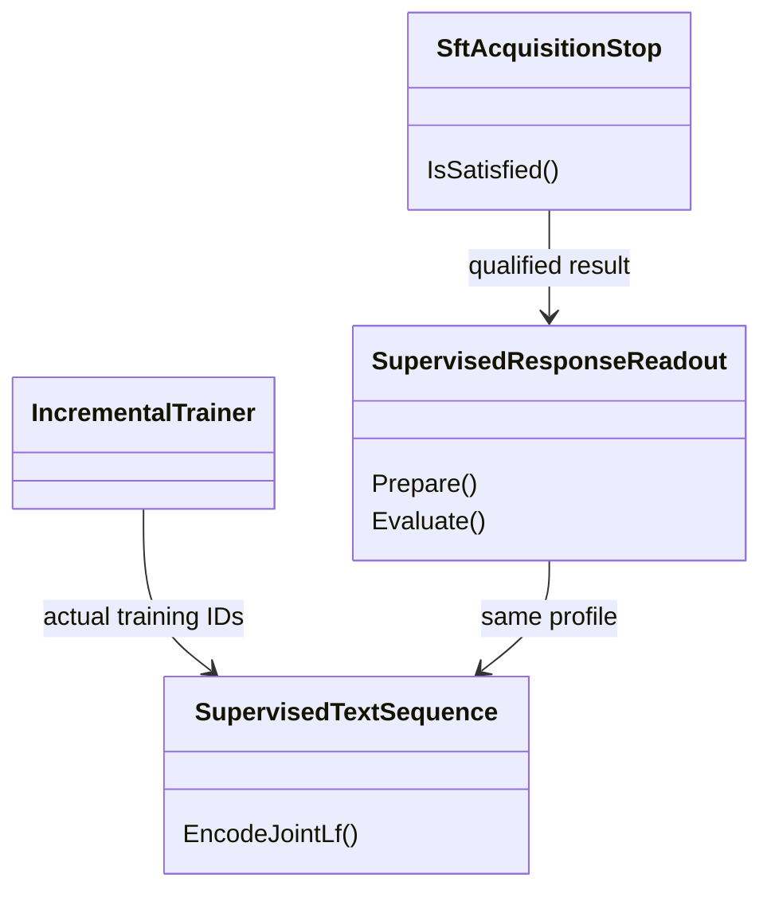

# 62. Проверять усвоенный ответ в том формате, в котором модель обучалась

<a id="q06-min"></a>
## 124 → Q06. Прочитать два уже выученных ответа

Формат SFT в продукте принят. Для открытого остатка нужны два файла из [SEP01/results-01](../../../../experiments-v2/RP01-MICRO/SEP01/results-01). Восстановить `producer-abs.bin` и `producer-sign.bin` из локального LFS по адресам ниже, если они ещё повреждены. Оба оригинала по 47 899 519 байт. SHA здесь отвечает на один вопрос — восстановили ли тот самый сохранённый файл. [Два исходных объекта и полные SHA](audits/2026-11-12/transfer-unblocking-by-work.md#decision-124).

В штатном читателе загрузить каждый снимок и прочитать его строку с тем же LF и со сдвигом границы ответа, что при SFT. Для Abs это `static int Abs(int n)=>n<0?-n:n;`, для Sign — `static int Sign(int x)=>x<0?-1:1;`. Посчитать правильные токены именно ответа. На этих фиксированных весах и строках эталоны составляют 23/23 и 21/21 при подаче правильного префикса. Записать оба результата и способ чтения. При расхождении проверить соответствие снимка и границу первого токена. Новых уроков для этой проверки — ноль. После штатного чтения обоих ответов перейти к Q35. [Исходные строки и наблюдения](../../../../experiments-v2/RP01-MICRO/SEP01/results-01/separator-format.json).

Разделы ниже сохраняют историю переноса и расширенный план испытаний. Дополнительные испытания и полное восстановление архива в поручение на эти два файла не входят.

<!-- SNAPSHOT-AUDIT-2026-11-09-F37A:START -->
## Уточнение аудита — 9 ноября 2026

**Не расширять узкую приёмку Q06 до полного продукта.** Общий формат и тестовый readout не означают наличие продуктового reader или нового stop-policy. [Аудит F06](audits/2026-11-09/2026-11-09-experiment-transfer-audit.md), [A06](audits/2026-11-09/repair-plan.md). Исторический успех чтения на одних весах сохраняется.

В карточке следующего остатка явно записать реальные writer→framing→tokenizer→saved state→reader→ordinary consumer, пути и символы. Принимать собственные source bytes donor, их digest, schema/tokenizer identity и режим чтения; совпадение имени donor или metadata не подтверждает payload. Если назначенные байты отсутствуют либо manifest им противоречит, остановить зависимое readout и сохранить причину, не заменять donor похожей моделью.

Чтение уже готового состояния использует ранее назначенные Forward и0 новых updates; отсутствующий этап не маскируется новым обучением. Teacher-forced чтение учебных токенов не объявляется свободной генерацией, generalization или экономией шагов. Решение об остановке SFT — отдельная продуктовая политика. Второй ручной builder формата проверяется на точные bytes тем же независимым контрактом.

Каждый новый технический receipt получает новый output root по A01; повтор не пишет в опубликованную попытку. Проверки этого уточнения UNRUN; конкретный принятый format scope остаётся принят.
<!-- SNAPSHOT-AUDIT-2026-11-09-F37A:END -->


**Будущее расширение, 4 ноября:** [158](codex-158-learning-sets-transfer-coverage-2026-11-04.md) назначает DOC-CS-NULL/M002 для отдельной панели после review и реально приобретённого старта. Текущие 6Forward/0Train на двух исторических состояниях остаются неизменными. Новые китайские строки не подставляются в старый donor с прежней квалификацией. Проверять первую/последнюю response-позицию, пробелы и actual framing; SFT joint-LF не меняет exact-DPO no-separator. Исправленный reader не доказывает улучшения свободной генерации.

<!-- EXECUTOR-CONTEXT-120:START -->
## Обязательный вход в выбранный перенос или owner-раздел

Обязателен [договор120](120-executor-context-and-test-repair-contract-2026-11-02.md): перед новым аудитом/заданием свежо и целиком прочитать local/canonical AGENTS, CLAUDE, 12 основных навыков и дополнительные experiment-design/test-integrity по роли; восстановить усечения. Модель default без override. Этот вход не разрешает запуск и не меняет данные, budget, команды или очередь.

**Область:** этот вход относится к каждому выбираемому ниже FIX/TEST/R/RF/C и его собственной приёмке, а не превращает весь файл в одно поручение. Уже принятые части не переоткрывать; сначала сверить current source и сохранённые receipts именно выбранного владельца.

**Применимые риски TOK/LEARN:** Разделить unknown ID, EOS и допустимость UTF-8 bytes. Lawful многобайтовый поток сохраняется, неизвестный ID/незавершённый terminal не исчезает молча; проверить ordinary caller и обе назначенные greedy/stochastic ветви, а не только новый overload. Сохранить назначенные lesson/RowId и before→factor→after по независимому gold; margin/hash/update не заменяют правильный ответ. Положительный контроль удерживает прежний правильный ответ, отрицательный показывает потерянную/неусвоенную строку; gained/lost TRAIN и EXAM раздельно.

**Ожидания тестов:** собственные данные/positive/negative этой карточки и названный ordinary caller имеют приоритет над примерами120. Пример другого семейства не добавляет fixture, Train или новый API. Полный набор outer/nested Train/BPE/Grammar, readouts, restore и этапов остаётся в существующем бюджете. Структурный guard сTrain0 не объявляется новым обучением.

**Порядок самопроверки:** source SHA + dirty bytes → именованные producer/caller/learner/state/consumer → own positive/negative witnesses → полный outer/nested расход → назначенные ordinary/restore/E2E проверки. При падении сохранить input/expected/actual/stack + source/assembly SHA до restore; fixture/устаревший контракт/регрессия/инфраструктура раздельно, gold/threshold/Skip не лечат ошибку. Назначенный перенос/QA/ремонт включает сборку, discovery, тесты и исправление фильтра, fixture или expected по независимому договору; повторное разрешение на это не нужно. Сверить обязательные имена с discovery и результатами той же сборки, сохранив весь назначенный охват. Автору передать недоступные исходные данные, спорный договор или необходимость нового API/научного опыта; не заменять их удобным аналогом. При текущем задании только на документы запуск не разрешён. Терминал того же handle, русский отчёт, STOP/NEXT немедленны; future checks остаются UNRUN.
<!-- EXECUTOR-CONTEXT-120:END -->


<!-- BEGIN audit-91-applicability -->
## Дополнение28.10: фактический выход и происхождение показаний

От замороженного tokenizer/framing до model/trainer передаются фактически полученные IDs, masks и границы; сохранённый tensor служит oracle, а не заменой выхода проверяемого звена. Partial-path/component PASS не закрывает learned consumer. Evidence-kind и реальные calls фиксируются отдельно от структурных нулей; без расширения назначенного учебного бюджета.

Для FIX-SEP исходные данные, дозы, модель, доменная область и oracle владельца сохраняются. Это адресное условие будущей приёмки, не свидетельство уже пройденной проверки и не новый запуск. Источник ошибки и точные ремонты — [91/92](92-positive-transfer-followup-plan-2026-10-28.md).
<!-- END audit-91-applicability -->


<!-- BEGIN audit-84-applicability -->
## Уточнение исполнения по аудиту P02/P08/P09

Разделить точные bytes prompt/response, позиции readout и фактическую функцию loss. Сохранённый навык может диагностироваться тем же reader, но response-position scoring не означает response-only SFT. Контрпример P08/P09: native full-sequence TrainSupervisedNextTokenStep выполнялся при ошибочной фразе exact response masks. Не менять исходную учебную цель ради согласования подписи; сохранять обучение, состояние и отдельный исправляющий receipt.

Применимость: FIX-SEP. Основание и адресные проверки — [план85](85-reporting-sampling-cache-repair-plan-2026-10-27.md), [общий договор03](03-test-and-execution-contract.md). Это усиление постановки, не утверждение о наличии дефекта в каждом данном исходнике и не новый запуск. Исходный эксперимент/бюджет/статус допуска сохраняются; продолжение пропущенного этапа использует тот же обученный state, новая самостоятельная программа обязана содержать назначенное реальное обучение. При STOP/NEXT следовать прямому указанию пользователя, не продолжать прежнюю задачу.
<!-- END audit-84-applicability -->


<!-- BEGIN audit-87-applicability -->
## Приёмка и состояние обучения: аудит 28 октября

Зафиксировать именно функцию учебной потери и назначенного trainable recipient; response-position reader не означает response-only loss. Контрпример P11: full-sequence SFT и единственный embedding recipient; строка «те же q/v keys» была несовместима с PRIMARY. До/после требовать тот же набор уникальных RowId, Kind и gold; равный Count не защищает от потерянной строки.

Применимость: FIX-SEP. Контроль отчёта: точная панель, настоящий учебный этап, терминальное завершение и выполненные обязательные проверки — отдельные поля; успех одной оси не равен общему допуску. Требования по [плану88](88-gradient-warmup-transfer-repair-plan-2026-10-28.md) добавляются к исходному рецепту, не меняют исторические результаты и не назначают повтор обучения. Проверки сохранённого receipt используют raw уже выполненного обучения; новая самостоятельная программа обязана содержать назначенный Train. Если нужен новый вызов модели, сначала явно назначить полный бюджет, а не скрывать его в диагностике. Это профилактическая применимость, не установленный дефект каждого данного исходника. STOP/NEXT и ожидание исходного process handle из карточки сохраняются.
<!-- END audit-87-applicability -->

**Дополнение P07, 27 октября:** [83](83-learned-bpe-boundary-transfer-addendum.md) связывает learned BPE, independent source bytes и actual response target indices; один receipt принадлежит FIX-PD. Helper этого плана использует байты canonical Vocab, не длину отдельно декодированного токена. P07 не разрешает заменить joint-LF SFT на segmented DPO: каждый reader сохраняет свой framing и получает фактические training IDs. Если граница не подтверждена, stop/readout не допускается; native full-sequence SFT не отменяется. Новые RU/HE проверки пока NOT_RUN; [82](82-positive-transfer-delta-audit-2026-10-27.md) ограничивает измеренный вывод ASCII fixture.

<!-- BEGIN audit-79-followup -->
## Уточнение после последующих исправлений и P03–P05

Расширить совпадение framing до termination contract. P05 сохранил donor prompt, но заменил1-token consumer на8-token EOSnull и объявил '+' утраченным из-за '+x…'. Before/after должны сохранять одинаковую остановку; новый variable-length ответ требует собственного обученного завершения. Gold не управляет длиной generation; первые правильные символы не равны целому ответу. Проверка formatter на сохранённых данных не называется новым учебным опытом.

Основания — [79](79-followup-transfers-and-learning-audit-2026-10-27.md), адресный план — [80](80-followup-repair-plan-2026-10-27.md). Это изменение требований и статуса по прочитанным источникам; неприменённые проверки не объявляются пройденными. Собственные бюджеты и исторические результаты карточки сохраняются.
<!-- END audit-79-followup -->

<!-- BEGIN audit-76-specific-controls -->
## Уточнение по новому аудиту 27 октября: FIX-SEP

<!-- OWNER-CONTEXT-120 --> **Самопроверка выбранного раздела:** TOK/LEARN по договору120 во входе файла; собственные source/caller/данные/доза и negative+positive этой строки обязательны. Старый завершённый результат не переоткрывать; при падении сохранить input/expected/actual/stack+SHA, не менять oracle ради зелёного. Примеры другого owner не добавляют проверки или Train к этому разделу.

Основание — [76](76-new-transfers-and-experiment-evidence-audit-2026-10-27.md), ремонт — [77](77-new-transfer-repair-plan-2026-10-27.md). Это защита от повторения проверенной ошибки другого переноса, **не утверждение о найденном дефекте реализации каждого ID**. Сохраняются собственные данные, алгоритм, критерии и лимиты этой карточки; дополнительные Train/Forward этой вставкой не назначены.

**M — метрика привязана к фактической стадии обучения.** Для обучающего loss/reward записать состояние, на котором он вычислен, отдельно от номера опубликованных после update весов. У DpoTrainer последняя StepMetrics — pre-update; не называть её оценкой конечного checkpoint. Пример P02: B уже стартовал с margin 0,002773 после SFT; отношение последних значений ×3,22 не равно отношению приростов DPO. Любое сравнение приобретения/ремонта использует собственное before каждого этапа и одинаковый reader. DPO Accuracy=(reward_margin>0) означает улучшение относительно reference, а не правильный ответ: T2 имеет policy chosen−rejected=−0,1827326 при положительном reward. TRAIN/EXAM correctness и сохранённые logP остаются отдельными полями. Если эта карточка сравнивает математически равные оптимизации, сохранить её A/B equality; не требовать искусственного роста точности и не добавлять post-update Forward, когда нужное чтение уже предусмотрено.

**W — отчёт должен воспроизводиться своим источником.** Не закрывать исправление только ручной заменой JSON/Markdown: проверить действующий writer, который создаст следующий отчёт. Attempted, completed updates, diagnostic/model calls и native memory fits различаются. Неизмеренный ресурс — null/NOT_MEASURED, измеренный ноль — отдельный исход. Контроль отказа проходит через реальный producer/обработчик результата; готовый hand-written JSON доказывает только формат. Состоявшееся обучение после ошибки отчёта не повторять. Unit-проверка producer без Train не является новым экспериментом; новая экспериментальная программа содержит назначенный учебный участок.
<!-- END audit-76-specific-controls -->

**Граница reader regression и новой программы, 27 октября 2026.** Назначенные ниже6Forward/0Train проверяют production readout уже реально обученного donor и являются regression fixture, а не новым экспериментом обучения. Исторические120 SFT updates §1 подтверждают происхождение этого donor; их нельзя записать как новые выполненные updates. Если отдельно назначается новая экспериментальная программа SEP, она должна включать собственный реальный учебный участок по оригиналу с отдельным бюджетом; запуск одного Quality reader не удовлетворяет этому требованию.

Для самого ремонта A(no-LF)/B(LF) получают те же weights и независимые expected IDs из SFT framing. После Save/Load сравнение читает actual payload; восстановитель не достраивает ответ из Abs/Sign fixture. Comparator учитывает sequence profile, target count и measured/not_reached отдельно от correctness. Эти уточнения не меняют бюджет диагностического unit/regression и не дают ему права запускать повторное обучение.

**Уточнение исполнения, 27 октября 2026.** Здесь исправляется reader, поэтому веса A/B обязаны быть одни и те же, без Train между no-LF и LF чтением. Expected response IDs выводятся из закреплённого SFT input и независимого framing-контракта, не из logits исправленного reader. Полный правильный teacher-forced ответ не объявлять свободной генерацией. Квалификация donor остаётся однократной и передаёт готовый receipt потребителям N63C/repair, а не запускается заново в каждой карточке.

Общие примеры правильной и ошибочной проверки — [контракт03§24](03-test-and-execution-contract.md#transfer-audit-20261027). Это дополнение плана; новые проверки сейчас не запускались.

ID: **FIX-SEP**. Дата: **25 октября 2026**. Статус: **кандидат исправления измерения результата обучения; внедрение не выполнено**. Единственное положительное основание — завершённый **SEPARATOR-FORMAT-MISMATCH-01 / SEP01 / опыт 133**. Код и результаты проверены на `ce76f597a81221abe0224d4d09d5a77d99e0b47e`. Это план; он не запускает обучение, не принимает модель в продукт и не меняет старые опыты.

## 1. Что исправляем и почему это относится к обучению

При SFT запрос и правильный ответ соединяли переводом строки. Панель проверяла ответ без этого перевода строки. Модель в первой позиции предсказывала именно пропущенный разделитель, а прибор объявлял, что ответ не выучен. На тех же обученных весах правильное оформление входа убрало обе ложные ошибки.

Это не новая способность модели: **исправлен способ чтения уже приобретённого результата**. Проверка непосредственно участвует в обучении: `RunProducer` использует её `AllCorrect` для решения, продолжать ли SFT. Поэтому кандидат допустим по правилу пользователя о загрузке/измерении, от которых зависит учебный процесс. Исправлять произвольный отчёт, не связанный с обучением, под этим ID нельзя.

Тема обучения — **язык программирования**; задача — воспроизведение двух коротких функций C# по имени файла. Получатель — две независимо обученные модели одной конфигурации `rp01-csharp-small/v1`. Имя конфигурации `code-documentation` не превращает этот конкретный учебный набор в проверку качества документации. Механизм — настоящий native SFT с LoRA; область исправления — оформление последовательности и чтение ответных позиций. Перенос на перевод, kNN, другие токенизаторы и свободную генерацию не измерен.

### Измеренное основание

Первичные источники: [отчёт SEP01](../../../../experiments-v2/RP01-MICRO/SEP01/results-01/report.md), [полный raw](../../../../experiments-v2/RP01-MICRO/SEP01/results-01/separator-format.json), [код прибора](../../../../experiments-v2/RP01-MICRO/SEP01/host/SeparatorFormatProbe.cs), [карточка исходного опыта](../experimets/cards/SEPARATOR-FORMAT-MISMATCH-01.md). Для устойчивой ссылки на исходный срез: [raw на ce76f597](https://github.com/lubochka/llm_mvp_core/blob/ce76f597a81221abe0224d4d09d5a77d99e0b47e/experiments-v2/RP01-MICRO/SEP01/results-01/separator-format.json).

| Показатель | A: панель без разделителя | B: формат SFT с LF | Допустимый вывод |
|---|---:|---:|---|
| Abs, правильные ответные токены | 22/23 | 23/23 | Убрана одна ложная ошибка чтения |
| Sign, правильные ответные токены | 20/21 | 21/21 | Убрана одна ложная ошибка чтения |
| Суммарно, только эти два чтения | 42/44 | 44/44 | +2 токена, +4,545 процентного пункта; веса одни и те же |
| Ранг первого правильного токена Abs / Sign | 5 / 100 | 1 / 1 | Ошибка первой позиции зависит от левого контекста |
| Совпадение целевых ID ответа | одинаковые | одинаковые | Знаменатели сопоставимы в этом опыте |
| Дополнительные обновления для сравнения A/B | 0 | 0 | Это два чтения одного состояния, а не два новых обучения |

До этих чтений опыт действительно выполнил **120 SFT updates: по 60 на каждую строку**, LR `0.003`; также учтены 26 диагностических Forward, 0 DPO steps, 0 Generate, 0 external teacher calls. Последняя full-sequence loss: Abs `0.00084102585`, Sign `0.0007748399`. Время всего опыта `189.7799817 s`, peak working set `637665280 B`; отдельных A/B time/allocation сравнений нет. Необученная база прочитана только в A-формате: **B-before не измерен**. Нельзя писать `0/44 → 44/44` как наблюдённое приобретение в одном B-формате.

Полезный показатель — корректность измерения приобретённого ответа и пригодность его для условия остановки. Рост task accuracy для признания этой оси успехом не требуется. Все остальные показатели и ухудшения показываются рядом. **Экономия числа шагов, CPU/RAM, свободные ответы и качество вне TRAIN не измерены.** Слово «успех» здесь не даёт разрешения перенести новый формат DPO или включить новый stop policy в продукт.

## 2. Новизна и единственный владелец

Сверены 55 документов текущего каталога и 11 документов `fixes-based-on-experimentsperiments`. Внешний [54§2](../fixes-based-on-experimentsperiments/54-correction-collision-measured-followup.md) уже отмечал различие `Prompt + LF + Response` и exact DPO без LF, но прямо называл его **неизмеренной причиной**. SEP01 теперь измеряет достаточность этой причины. Новый вклад 62 — точный профиль чтения, связь с остановкой, повторное использование двух обученных состояний и native test contract.

Это не FIX-N63C: исправление устаревшего Response остаётся в [17](17-dpo-sft-correction-collision.md). Это не FIX-SC: сдвиг input/target и вместимость exact DPO остаются у [57§3](57-native-transfer-contract-gaps.md#3-fix-sc-согласованный-сдвиг-версия-исполнения-и-cache-identity). Это не FIX-TS: snapshot токенизатора остаётся в [28](28-dpo-tokenizer-snapshot.md). Нового общего router или importer здесь нет.

Во вложении `Pasted text (2)(1).txt`, строки 642–664, уже перечислены локальные незакоммиченные `59-collision-repair-transfer.md`, `60-backward-softmax-scratch.md`, `61-initial-gradient-owned-copy.md`. Их содержимое удалённый срез не предоставляет. Номера 59–61 не занимаются повторно; эти темы не объявляются новыми. При встрече с локальными изменениями исполнитель сохраняет их и добавляет только delta62, без reset/checkout/удаления.

## 3. Конкретный код и выбранное изменение

Все номера строк ниже относятся к ce76f597. Новые классы и тесты обозначены как **планируемые**, а не существующие API.

### 3.1. Native SFT уже использует LF; менять его учебные данные не нужно

[IncrementalTrainer.cs:402–403](https://github.com/lubochka/llm_mvp_core/blob/ce76f597a81221abe0224d4d09d5a77d99e0b47e/14.ContinuousLearning/Training/IncrementalTrainer.cs#L402) вызывает:

```csharp
session.Tokenizer.Encode(string.Concat(example.Prompt, "\n", example.Response))
```

Эти IDs через `tokenSequences[index]` доходят до `_supervisedTrainingStepExecutor.Execute` в строках 657–662. [Trainer.cs:102–108](https://github.com/lubochka/llm_mvp_core/blob/ce76f597a81221abe0224d4d09d5a77d99e0b47e/04.TrainingLoop/Trainer.cs#L102) строит inputs из `ids[0..N-2]`, targets из `ids[1..N-1]`.

**Решение:** выделить эту точную сборку в планируемый внутренний `14.ContinuousLearning/Training/SupervisedTextSequence.cs`, метод `EncodeJointLf(BpeTokenizer tokenizer, string prompt, string response) : IReadOnlyList<int>`. Версия профиля — `sft-joint-lf-v1`. Результат должен совпадать с прежним единственным `Encode` по всем IDs. Сохранить проверки длины, веса, admission, отмены и порядок mutations. В обычный training path не добавлять повторное кодирование префикса, подсчёт метрик или hash больших состояний: эти операции относятся к диагностике.

Этот helper — детерминированное представление данных, а не обучаемый selector. Обучение по-прежнему выполняет native `Trainer`. Новая фабрика/DI-служба, новая матрица или новая LoRA не нужны.

Namespace — `ContinuousLearning`. В `14.ContinuousLearning/ContinuousLearning.csproj` уже есть `InternalsVisibleTo("LlmFromScratch.Tests")`; helper остаётся internal, публичный API ради теста не расширяется.

### 3.2. Проверка SFT должна читать именно его inputs и targets

[SeparatorFormatProbe.cs:394–422](https://github.com/lubochka/llm_mvp_core/blob/ce76f597a81221abe0224d4d09d5a77d99e0b47e/experiments-v2/RP01-MICRO/SEP01/host/SeparatorFormatProbe.cs#L394) обучает LF-последовательность, затем вызывает `Read(... batches[rowIndex] ...)` и проверяет `if (own.AllCorrect) break;`. `batches` построены exact DPO materializer без LF. Измеренное исправление реализовано отдельно в `ReadTrainingFormat`, строки 450–497.

**Решение:** создать планируемый test helper `Tests/ExperimentFixes/SupervisedResponseReadout.cs` и использовать его в новом native fixture и в будущем acquisition harness 62. Он получает **фактически переданные SFT token IDs**, prompt/response, tokenizer identity и явный профиль. Из этих IDs строит shift точно как native Trainer; target позиции ответа выбирает после подтверждённой границы префикса. A-reader остаётся именованным диагностическим контролем `dpo-segmented-no-separator`; его результат не управляет остановкой SFT.

Проверка границы обязательна: `Encode(prompt + "\n")` должен быть точным префиксом полного SFT encoding. Если это не так, вернуть `response_boundary_unresolved`, не убирать первый токен и не назначать `ResponseStart` по длине отдельно закодированного prompt. Это отказ **response-readout/stop eligibility**, не новый запрет существующего full-sequence SFT. Helper не должен отбрасывать учебную строку из native обучения из-за отсутствия диагностической границы.

Индексы задаются без неоднозначности. Пусть `N = fullIds.Count`, `P = Encode(prompt + LF).Count`. Для `0 <= i <= N - 2`: `inputs[i] = fullIds[i]`, `targets[i] = fullIds[i + 1]`; ответная маска на **shifted targets/logits** равна `P - 1 <= i <= N - 2`, знаменатель `N - P`. У Abs это позиции **11…33**, 23 токена; у Sign — **8…28**, 21 токен. Условие `i >= P` здесь неверно: оно снова потеряет первый ответный токен. Prefix и равенство actual IDs результату joint Encode проверяются до Forward.

A-reader получает `Concat(Encode(prompt), Encode(response))`, границу `Encode(prompt).Count` и тот же next-token shift. Новая rejected-строка или admitted DPO-пара ему не нужна: это именованный контроль представления, не вызов DPO обучения. В историческом приборе Forward получал полную последовательность и последний logit не оценивался; новый reader передаёт только shifted inputs, как native Trainer. Каузальная маска должна сохранять предыдущие ответные позиции; это проверяется ожидаемыми token/rank результатами, а не объявляется уже выполненным native переносом.

Если диагностически сравниваются A и B, проверять равенство последовательностей **целевых ID ответа**, а не только их количества. Несовпадение — `different_target_sequences`, без численного A/B вердикта. Случай возможен у другого BPE; два успешных примера SEP не доказывают универсальную сохранность границы.

Планируемые типы:

| Тип / метод | Контракт |
|---|---|
| `SupervisedTextSequence.EncodeJointLf` | Один native Encode; тот же LF и тот же список IDs, что сейчас у IncrementalTrainer |
| `SupervisedResponseReadout.Prepare` | `OperationResult<ResponseReadoutMaterial>`; вход: фактические IDs, tokenizer, исходные тексты, профиль; результат: shifted inputs/targets, индексы ответных targets, tokenizer identity, digest последовательности |
| `SupervisedResponseReadout.Evaluate` | Native `LlmModel.Forward(training:false)`; correct/total, per-position target/argmax/rank, full teacher-forced match; также response mean logP и mean NLL по той же target-mask из уже полученных logits, aggregation=`mean_response_log_probability`; 0 дополнительных Forward/updates |
| `SftAcquisitionStop.IsSatisfied` | Планируемый test/harness predicate: истинно только при совместимом профиле, ненулевом знаменателе и полном совпадении всех ответных targets |

Уточнение результата `Evaluate` для повторного использования в N63C: планируемый readout возвращает `ResponseTargetCount`, `ResponseMeanLogProbability`, `ResponseMeanNll`, `ScoreAggregation` вместе с уже описанными позиционными результатами. Для каждого выбранного target вычислить `logit_gold − logsumexp(logits_row)` устойчиво через вычитание max, затем усреднить только по response target-mask; NLL равна минусу mean. Prompt/padding не входят, знаменатель ненулевой и совпадает с correct/total. Использовать тот же единственный Forward: второй reader, повтор Generate или дополнительный pass ради NLL не нужен. Это диагностическая NLL правильного ответа, не full-sequence weighted loss последнего SFT-step и не native DPO reward. Неподтверждённое численное LF-NLL записывается как результат будущего чтения, а не приравнивается к historical producer loss. Учет §6 остаётся прежним: один Quality fixture, 6 Forward, 0 updates.

`SftAcquisitionStop` не внедряется как новый production stop policy: сейчас в показанном цикле `IncrementalTrainer` такого решения нет. Сначала переносится корректный measurement contract; эффективность более раннего завершения — отдельный, ещё не измеренный вопрос. Исторический SEP01 runner/result остаётся неизменным.

### 3.3. Exact DPO имеет другой действующий контракт

[DpoExactPairMaterial.cs:19–22,64–78](https://github.com/lubochka/llm_mvp_core/blob/ce76f597a81221abe0224d4d09d5a77d99e0b47e/11.DPO/Models/DpoExactPairMaterial.cs#L19) задаёт `segmented-byte-BPE-v2`, `prompt-response-segments-no-separator-v2` и отдельное кодирование prompt/chosen/rejected. `ComputeDigest` связывает framing, objective, тексты, tokenizer и masks.

**Решение:** этот формат, digest и objective сохранить. Новый helper не вставляет LF в exact DPO, не переписывает assessed prompt и не меняет reference/cache identity. DPO-score остаётся оценкой предпочтения в собственном профиле; SFT-readout — проверкой усвоения другого явно названного профиля. Для смены DPO framing нужен отдельный измеренный фактор и новая согласованная версия, которых SEP01 не предоставляет.

## 4. Почему это математически правильно

Для фиксированных весов ответные вероятности зависят от всего доступного левого контекста. В обычной autoregressive записи:

\[
\log p_\theta(y\mid x,s)
=\sum_t \log p_\theta(y_t\mid \operatorname{encode}(x,s),y_{<t}).
\]

Здесь `s` — фактический разделитель/профиль encoding. Отсутствующий LF меняет условие, а совместное и раздельное BPE-кодирование могут дополнительно менять token IDs. Проверка `p(y|x)` не обязана совпасть с проверкой `p(y|x,LF)`, даже при одинаковых весах и буквальном ответе. Исправление не «подсказывает» ответ: gold используется только для teacher-forced диагностики, как и в A; в learner не добавляется новая строка.

В книге Giansalvo, [Theorem 9.5, печатная стр. 282 / PDF 318](https://github.com/lubochka/xiigen-planning/blob/8ee6745378e9b8213ad9c58a302bd11a6b268277/llm%20mvp/math-theory/giansalvo-transformer-vol1/source/0318-0324-ch09-mlm-graph-feedforward-and-softmax.md#L22), для softmax-cross-entropy показаны `δ = z − t` и `∂L/∂W_D = Aᵀδ`. Теорема описывает MLM-head BERT; она **не является теоремой о нашем SEP-опыте или autoregressive E2E**. Применяемая здесь общая часть — зависимость сигнала от представления контекста `A` и предсказания `z`. Подмена контекста меняет проверяемое условное распределение. Наблюдаемый размер эффекта берётся из SEP01, не выводится из книги.

Особенно важно для [FIX-N63C](17-dpo-sft-correction-collision.md):

\[
m_\theta(x,s)=\log p_\theta(y^+\mid x,s)-\log p_\theta(y^-\mid x,s).
\]

Из одинакового `s` в двух плечах **не следует**
`m_B(x,LF) − m_A(x,LF) = m_B(x,∅) − m_A(x,∅)`.
Изменение контекста не обязано быть одной и той же аддитивной константой для chosen/rejected или разных состояний. Поэтому фраза исторического отчёта133 «разрыв форматов сокращается при сравнении» не принимается как доказательство переносимости всех collision margins. Сохранённые сравнения остаются фактами своего no-separator профиля; их значения и знаки в LF-профиле не измерены. Повтор всей нити этим уточнением не назначается.

### Уточнение 25 октября: корректный формат не гарантирует устойчивость другой метрики

Поздний [отчёт CDG63/139, строки150–157](../../../../experiments-v2/RP01-MICRO/CDG63/results-01/report.md) сохраняет вывод SEP01/133: сравнение форматов выполнено на одних весах, с точными23/23 и21/21. Исправление этого reader по-прежнему приоритетно и не зависит от будущего подбора коллизионного расписания. Не переобучать готовые SEP payload для проверки отозванных сравнений134–138.

При этом согласованный framing и `training:false` не превращают score в независимую от фазы расписания оценку. Если обозначить наблюдение `m_s(t)=μ_s+b_s(t)`, то разность endpoints содержит также `b_B(t_B)−b_A(t_A)`; без отдельного обоснования нельзя отождествлять её с постоянным преимуществом `μ_B−μ_A`. Это алгебраическое описание возможного смешения эффектов, не доказательство существования стационарного μ и не оценка дисперсии. [Ограничение и изменение будущего comparator59](59-collision-repair-transfer.md#endpoint-comparison-limit) сохраняют измеренные оси раздельными. Ни новый helper, ни существующий native learning Fact не получают дополнительного обучения, Generate или усредняющих прогонов. Результат133 остаётся успехом измерителя, не доказательством сравнительного качества scheduler или свободной генерации.

### Дополнение 26 октября: fraction из тех же logits и корректное сравнение

[141/CDG65](../../../../experiments-v2/RP01-MICRO/CDG65/results-01/report.md) подтверждает полезность записи доли правильных токенов без нового Forward: использовать уже предусмотренные correct/total из `Evaluate`. Добавить именованное вычисляемое `ResponseCorrectFraction` при total>0; сохранить сами целые числа. Пустой denominator не превращается в 0. Это расширение того же readout, не второй scorer; Quality62 остаётся 6F/0updates.

[63](63-paired-learning-effect-and-factor-contrasts.md) отделяет устойчивость paired difference от колебаний уровня и macro fraction от pooled counts. Оба historical141/142 readout используют свой no-separator материал; их численные 117/121 и 121/121 не становятся expected для LF-reader.142 обнаруживает большой эффект и через margin, поэтому blanket-замена margin на fraction не назначена. Правильный формат 133, ненулевой gold и сравнение matched результатов — разные условия; ни одно не заменяет остальные. Два helper имеют разных владельцев: этот файл читает настоящие logits,63 обрабатывает только уже записанные значения.

## 5. Сохранённые данные и восстановление без нового обучения

Будущий fixture root: `Tests/Fixtures/ExperimentFixes/v1/SupervisedFraming01/`. В нём создать `manifest.json`, `rows.json`, `historical-readout.json`; большие веса не размножать. Manifest ссылается на два **существующих** LFS payload и задаёт два отдельных model instances.

| Артефакт | Точный источник / ожидаемая identity |
|---|---|
| Abs weights | `experiments-v2/RP01-MICRO/SEP01/results-01/producer-abs.bin`; SHA256 `59810def905c4ead2f22985c5e1d525f59feb45590256eca8b492a293206d44f`; 47,899,519 bytes |
| Sign weights | `experiments-v2/RP01-MICRO/SEP01/results-01/producer-sign.bin`; SHA256 `af714d961cc8d2cdc22a245afe3202e71564e9c5ac5f50dd09a8f7af4db426e4`; 47,899,519 bytes |
| Config | `config/code-documentation/generation-v1.json`; SHA256 `e1f960b8c7d883f84c9b4e55d24c7284794cee2fecfd71beac5835d199746f40` |
| Tokenizer identity | `e51c91d85ec486863f1862e49b378fa9f34873ee31a993114ba41995f38e5066`, из действительного verified config loader; не обучать другой tokenizer |
| Initial root manifest / weights | `c5f4f7da80f427b8e9aac1dabded5849f0cbc6cb444b99d2bf7daac44ec0246d` / `a65887cc9d97c793d00e77632013adeba5e2d36efd7e6cebe7e49ba8a9b37911`; используются existing loader только для создания совместимой topology |
| Corpus source | [correction-collision.json](https://github.com/lubochka/xiigen-planning/blob/8ee6745378e9b8213ad9c58a302bd11a6b268277/llm%20mvp/design%20to%20code%20session/replanning/possibleDifs/2026-10-20-learning-ingress-and-retention-review/ingress/fixtures/correction-collision.json), SHA256 `fcf2e07aa283ad40622b7c05eee738d0c490c5c2448f686fde935775ecff1992` |
| Historical raw | SEP01 `separator-format.json`, Git blob `9b162d69ec2eb1592bb95d6359645b5d63d5263f`, SHA256 `ebad204f2f0e9f78a49994980a3ed6beb97ebe18c674ec4ee3cc635a4dab3ba5` |

Тексты fixture заданы полностью:

| Model instance | Prompt | Response | Full SFT length / prefix / response targets |
|---|---|---|---:|
| Abs | `// file: Abs.cs` | `static int Abs(int n)=>n<0?-n:n;` | 35 / 12 / 23 |
| Sign | `// file: Sign.cs` | `static int Sign(int x)=>x<0?-1:1;` | 30 / 9 / 21 |

Дополнительная связь, проверенная 25 октября на `7e79eb156f418dc76d699966ca948d4616b36cdd`: CDB01 `authority-acquired.bin` имеет тот же pointer blob `bdac5a6faced90cb8dc35618f737a3e69db955af`, payload SHA-256 и размер, что Abs-state выше. [17§11](17-dpo-sft-correction-collision.md#n63c-fixed-gold-readout) использует это для проверки удержания без повторного acquisition. Payload в этой сессии не восстанавливался; общий OID не разрешает делить изменяемый model instance или переносить отсутствующие moments. Сам FIX-SEP сохраняет прежние 6 Forward / 0 updates.

Не смешивать строки при восстановлении: Abs-state обучен Abs, Sign-state обучен Sign. Их нельзя объявлять одной моделью, знающей обе функции. Magnitude и Negate не добавляются в TRAIN; новые «полезные» примеры исполнитель не изобретает.

Точный restore: использовать существующие `CodeDocumentationGenerationConfiguration.ReadVerified` и `CodeDocumentationRepositoryOwnedModelCheckpointStartService.PrepareStart` так же, как `SEP01/host/SeparatorFormatProbe.cs:612–638`; проверить config/tokenizer/55 named parameter entries/39 base parameters. **После** создания q/v LoRA topology загрузить назначенный `producer-*.bin` через native `LlmModel.LoadCheckpoint`. После загрузки не переинициализировать adapters. Native API и проверка full-checkpoint находятся в [LlmModel.cs:1095–1192](https://github.com/lubochka/llm_mvp_core/blob/ce76f597a81221abe0224d4d09d5a77d99e0b47e/03.TransformerModel/LlmModel.cs#L1095).

H512/V629/C2048/L4/Q8/KV2/FF1408, q/v LoRA rank8/alpha16/dropout0. Optimizer moments, scheduler cursor и RNG после 60 updates **не сохранены этими weights-only файлами**; не объявлять полное продолжение SFT, не создавать под видом restore новый AdamW и не повторять acquisition. Для read-only Forward(training:false) нужны совместимые веса/topology/tokenizer; это отдельное право использования fixture, не production mutation authority.

В документной сессии проверены Git LFS pointers, их OID/размеры, exact bytes JSON/config и показания raw. Сами 47,9 MB payload не загружались в модель; native restore не выполнялся. Перед будущим запуском нужны именно LFS payload, не 133-байтовый pointer. Missing/hash mismatch → конкретный `missing_or_incompatible_fixture`; без bootstrap, удаления предыдущих результатов или ложного PASS.

## 6. Тестирование по принципу опыта

Главный regression использует существующее обученное состояние; **новых обучающих updates — 0**. Учебная причинная связь обеспечена исходными 120 updates, сохранёнными learned states и реальным вызовом их native Forward. Это не эксперимент с ответами `0→0` и не замена learner константой.

Создать `Tests/ExperimentFixes/SupervisedFramingTests.cs`, `SupervisedFramingFixture.cs`, `SupervisedResponseReadout.cs`. Использовать настоящий `ProjectReference` из существующего `Tests/LlmFromScratch.Tests.csproj`; B-reader вызывает production `SupervisedTextSequence`, не копию исправленного алгоритма. Для A сохраняется прежний явно названный диагностический no-separator reader.

Все новые tests имеют namespace `LlmFromScratch.Tests.ExperimentFixes`. **Quality — ровно один `[Fact]`** `SupervisedFramingTests.SavedStates_ReadBothProfilesColdRestoreAndStop`: он последовательно выполняет первые три проверки таблицы, держит readouts локально и один раз пишет receipt. Эти проверки не превращать в независимые facts с повторной загрузкой/Forward. Contracts не запускает этот Fact и не читает ещё не созданный Quality receipt.

| Тест | Проверяемое поведение | Бюджет |
|---|---|---|
| A/B assertion внутри Quality Fact | Abs A 22/23, B 23/23; Sign A 20/21, B 21/21; targets равны, первая позиция меняется, остальные не ухудшаются | 4 Forward, 0 updates |
| ColdRestore assertion в том же Fact | Новые native instances из тех же файлов; B23/23 и 21/21, те же IDs/позиции | Ещё 2 Forward, 0 updates |
| AcquisitionStop assertion в том же Fact | На уже вычисленных B-результатах true; A-профиль, пустые targets, несогласованный tokenizer/граница не дают true | 0 Forward, 0 updates |
| `JointLfEncoding_EqualsIncrementalTrainerInput` | Spy на существующем `_supervisedTrainingStepExecutor` видит точные IDs, LF и unchanged weight; helper не меняет old full-sequence contract | Малый wiring test, 0 реальных updates; не отдельный learning PASS |
| `BoundaryMergedByBpe_IsNotScoredAsResponse` | Существующий BPE с merge через границу; diagnostic returns `response_boundary_unresolved`, native training IDs остаются доступны | 0 model Forward/updates |
| `ExactDpoFraming_RemainsNoSeparator` | Действующие segmented IDs, masks, framing/objective/digest; нет добавленного LF | Существующие focused DPO contracts, не новое обучение |

Всего quality fixture: **6 native Forward, 0 Backward, 0 optimizer, 0 Generate**, две строки и две независимые модели, один раз на выполнение fixture. Остальные assertions читают сохранённые результаты. Native tensor hash до/после подтверждает отсутствие mutation; не выдавать отсутствие изменения optimizer за проверку несуществующих moments. Это bounded test repair, не новый 120-шаговый опыт.

Contracts-фильтр фиксируется заранее: два новых Fact `JointLfEncoding_EqualsIncrementalTrainerInput`, `BoundaryMergedByBpe_IsNotScoredAsResponse` и ровно четыре существующих метода `LlmFromScratch.Tests.DpoExactPairMaterialTests`: `Segmentation_DoesNotMergeAcrossAssessedBoundaryOrAddSeparator`, `Masks_IncludeFirstAndLastResponseExcludePromptAndRightPadding`, `Commitment_IsStableAndBindsRawSegmentsAdmissionAndTokenizer`, `Capacity_ExactBoundaryAcceptedAndBothModelLimitsEnforced`. Masks имеет три InlineData, поэтому это **6 existing cases + 2 new cases = 8 Contracts cases**. Фильтр строить из полных `FullyQualifiedName=` этих шести методов с `|`, не из имени всего класса. Quality-фильтр — только полный FQN одного Fact выше. Упомянутые ниже Trainer/EmptyPairs tests — сохранённые контракты, а не дополнительные назначенные training runs.

Wiring-case использует существующий `TinyTrainingFixtureCL` из `Tests/ContinuousLearningTests.cs:7036–7121`, строку `Example("BUG", "prompt", "response", 0.75d)` и внутренний constructor `IncrementalTrainer` с новым recording `ISupervisedTrainingStepExecutor`. Его `Execute` сохраняет IDs/weight и возвращает конечную loss без вызова native Trainer; DPO pairs пусты. Сверить captured IDs с прежним одним `Encode("prompt\nresponse")` и weight `0.75f`. Использовать схему подключения из `CreateTrainerWithStepExecutorCL:5704–5716`; private/file helpers не импортировать как доступный API, новый минимальный spy разместить в своём test-файле. Это один Tiny fixture и 0 реальных neural updates, не доказательство обучения.

Точный отрицательный BPE-case: один `BpeTokenizer.Train("\n\n\n\n", 257)`; prompt `"p"`, response `"\n\nb"` — два LF в ответе, три в полном тексте. Единственное слияние `(10,10) → 256` достижимо внутри whitespace chunk: `Encode("p\n") = [112,10]`, `Encode("p\n\n\nb") = [112,256,10,98]`. Regex `\s+(?!\S)` перед `b` отступает на один LF, поэтому full chunks равны `p`, два LF, один LF, `b`; два LF в полном тексте для этой цели были бы недостаточны. Prefix check возвращает `response_boundary_unresolved`, 0 Forward, но полные joint IDs остаются доступны для SFT. Не пытаться получить LF→letter merge через RegexSplitter и не менять два учебных примера SEP ради этого engineering guard.

Учёт Contracts: существующие DPO guards вызывают **7 маленьких BPE Train**; Tiny wiring fixture — ещё 1 (`"tiny tokenizer corpus",256`, без merges); whitespace-case — ещё 1. Итого **9 BPE Train в 8 cases**, 0 neural Forward/Backward/SFT/DPO updates. Quality не вызывает BPE Train: загружает исходный tokenizer. Это два test processes — один Contracts и один Quality; Report не запускает test process. Нельзя назвать всю последовательность «без обучения токенизатора» или считать эти synthetic guards новым полезным учебным результатом.

При повторном использовании `SupervisedResponseReadout` в [N63C](17-dpo-sft-correction-collision.md#n63c-fixed-gold-readout) источник IDs именуется `acquired_gold`, роль — `retention_gold`: reader получает проверенные IDs исходного правильного ответа, а не текущую stale-строку A. Это измерение удержания, поэтому его gold фиксируется до воздействия; actual IDs очередного training step проверяются отдельно через wiring. Не менять назначение `SftAcquisitionStop` и не включать новую stop policy в 20-шаговый collision test. Дополнительный digest assertion использует сохранённые данные, не создаёт новых Forward внутри SEP.

В будущем harness `SftAcquisitionStop` применяется на этапе, который действительно выполняет SFT, с теми же actual IDs. Под этим планом проверяется правильность predicate на квалифицированном состоянии, **не число сэкономленных уроков**. Чтобы заявить более ранний stop, нужен отдельный явно выбранный учебный опыт с замерами на промежуточных состояниях; текущий бюджет его не включает.

### Какие падающие тесты чинить, а какие сохранять

Свежего лога падений в этой документной сессии нет. Следующие правила — заранее назначенная классификация, а не утверждение, что тесты сейчас красные.

1. Если тест усвоения SFT использует DPO material без LF — исправить его подготовку inputs/target mask и явно указать профиль. Не заменить ожидаемые `23/23` на `22/23` и не игнорировать первую позицию.
2. В [DpoExactPairMaterialTests.cs:49–60](https://github.com/lubochka/llm_mvp_core/blob/ce76f597a81221abe0224d4d09d5a77d99e0b47e/Tests/DpoExactPairMaterialTests.cs#L49) `Segmentation_DoesNotMergeAcrossAssessedBoundaryOrAddSeparator` **остаётся прежним**. Его падение после LF-вставки в DPO означает неправильное внедрение 62, а не устаревший expected.
3. `Masks_IncludeFirstAndLastResponseExcludePromptAndRightPadding`, `Commitment_IsStableAndBindsRawSegmentsAdmissionAndTokenizer`, `Capacity_ExactBoundaryAcceptedAndBothModelLimitsEnforced` остаются защитными контрактами exact DPO. Не отключать ради нового SFT reader.
4. [IncrementalTrainerDpoWiringTests.EmptyPairs_PreserveSupervisedPathWithoutDpoExecution](https://github.com/lubochka/llm_mvp_core/blob/ce76f597a81221abe0224d4d09d5a77d99e0b47e/Tests/IncrementalTrainerDpoWiringTests.cs#L440) сохраняет своё назначение; отдельный новый spy-тест проверяет IDs. Не выдавать fake executor за доказательство обучения.
5. `TrainerTests.SupervisedSteps_DoNotAdvancePretrainingCounterOrScheduler` сохраняется. Новый reader не должен продвигать ни SFT, ни pretraining counters. Не чинить чужие широкие suites до проверки этого фактора.
6. Missing LFS/несовместимый loader/ошибка сборки — ошибка входа или среды, не отсутствие обучения модели. Сохранять конкретный stderr и чинить только разрешённую предпосылку из03; не менять numerical expectations.

## 7. Связь с маршрутом «промпт → домен → результат»

Владельцем всей цепочки остаётся [20 / FIX-E2E](20-prompt-domain-e2e.md). SEP не меняет selector и не добавляет классы тем. Уточняется только наблюдение уже вызванного neural handler:

- `routing_correct` подтверждает выбор темы;
- `domain_invoked` подтверждает реальный receiver;
- `teacher_forced_response_correct` относится к явным checkpoint/tokenizer/sequence profile;
- `answer_correct` относится к действительной Generate/доменной функции и не заполняется из teacher-forced массива.

Для получателя с `sft-joint-lf-v1` диагностика использует этот профиль; exact-DPO получатель сохраняет `prompt-response-segments-no-separator-v2`. Выбор профиля идёт из server-owned fixture/handler binding, не из текста пользователя. В том же существующем E2E receipt добавить `sequence_profile`, `sequence_digest`, `readout_mode`, `response_target_count`; после cold restore сверить их прежде сравнения качества. Если у существующего Q1–Q6 нет такого neural получателя, `FIX-SEP=not_applicable`; не вставлять Abs/Sign вместо предметной задачи и не запускать новое обучение ради заполнения колонки.



Последние два класса принадлежат тесту/учебному harness, не скрытой runtime маршрутизации. Для исходного опыта два model states раздельны; эта схема не изображает одну универсально обученную модель.

## 8. Выполнение, ожидание и отчёт

Текущая фаза — только планирование. Следующие команды — **будущий интерфейс после отдельного назначения FIX-SEP**, не существующий готовый runner и не команда запустить опыт сейчас.

Working directory: `C:/Projects/llm_mvp_core`; branch `codex/dpo-implementation`. Предусмотреть `Tests/ExperimentFixes/Run-SepReadout.ps1` с параметрами `-Phase Contracts|Quality|Report -RunId <id>`. Выход: `experiments-v2/RP01-MICRO/SEP-NATIVE/<RunId>/`. ID **строго переданный**, без автоматической подмены; первый запуск ниже использует `results-01`. Contracts создаёт новый root/launch receipt с CreateNew; при занятом root останавливается с `run_already_exists`, сохранив старые результаты. Для отдельно назначенного повтора во всех трёх командах используется один следующий ID, записанный до запуска; ничего не удалять. Contracts выполняет только перечисленные tests; Quality — один fixture с 6 Forward; Report повторно читает receipt без Forward. Скрипт записывает каталог и handle до ожидания. Новые source files остаются в Tests/14.ContinuousLearning, не под глубокими экспериментальными scaffold-копиями.

Команда после реализации:

```powershell
Set-Location C:/Projects/llm_mvp_core
powershell -NoProfile -ExecutionPolicy Bypass -File Tests/ExperimentFixes/Run-SepReadout.ps1 -Phase Contracts -RunId results-01
powershell -NoProfile -ExecutionPolicy Bypass -File Tests/ExperimentFixes/Run-SepReadout.ps1 -Phase Quality -RunId results-01
powershell -NoProfile -ExecutionPolicy Bypass -File Tests/ExperimentFixes/Run-SepReadout.ps1 -Phase Report -RunId results-01
```

Quality требует успешный Contracts receipt и создаёт свой phase-subdirectory один раз; Report требует терминальный Quality receipt и пишет отдельные artifacts того же run. Повтор Quality на занятом run запрещён. Для команды задаётся конечный runtime deadline 10 минут, build отдельно; timeout — повод проверить тот же process handle, не разрешение на второй запуск. Не копировать текст чужого инструмента как будто API существует: сначала обнаружить доступные launch/wait/status и прочитать их схему. При `functions.exec → Script running with cell ID` ждать через `functions.wait` того же cell; при `exec_command.session_id` — `write_stdin` того же session. В другой среде использовать документированный эквивалент. Живой процесс ждать в том же ходе bounded waits до 60 секунд, с короткими обновлениями. Пустой лог и timeout отдельного ожидания не доказывают отказ. Busy polling, вторые запуски и финал «жду» при активном worker запрещены. Источник общего правила: [31-tool-discovery-and-wait](../experimets/31-tool-discovery-and-wait.md).

**STOP/NEXT — немедленный.** При прямом STOP прекращать действия и новые вызовы; при NEXT перейти к названному ID без завершения прежнего отчёта, фикса, commit или cleanup «на всякий случай». Не повторять инцидент из п.13 пользовательского задания. Канонический Next 62 — **FIX-KHE** в [реестре](01-registry.md); при поручении только одного ID завершение — END. Не выбирать следующий эксперимент по номеру старого рассказа.

Модель исполнителя — текущая модель и усилие сессии по умолчанию; он не выбирает себе другую модель. Роли данных отдельны: **выбор учебной задачи и независимую оценку качества выполняет CODEX с `astra 6 ultracode`; внешняя открытая китайская модель создаёт DPO-пары.** В 62 новых генераторных/оценочных вызовов не требуется; synthetic historical fixture не переименовывается в принятую teacher DPO-пару.

Обязательные скилы перед реализацией: `docs/skills/trainable-architecture-decision-SKILL.md`, `phase-planning-SKILL.md`, `plan-review-SKILL.md`, `code-examination-SKILL.md`, `prompt-patch-authoring-SKILL.md`, `human-readable-architecture-audit-SKILL.md`, `human-communication-GLOSSARY.md`, `test-failure-triage-SKILL.md`. Общие инструкции экспериментов не разрешают менять source evidence, продолжать после STOP или расширять бюджет.

Отчёт **на русском**, `report.md` + `receipt.json`: понятный вывод; профиль/домен/две модели; таблица A/B correct/total и first-token ranks; prefix/target equality; сохранённые IDs и source/assembly identities; фактические 0 updates / 6 Forward; cold restore; все ограничения; отдельно статус native implementation и generator provenance. Для test repair указать точное старое ошибочное предположение, новый oracle и сохранённые DPO-инварианты. Не выдавать teacher forcing за Generate и не приписывать62 эффект памяти/скорости.

### Прежний промпт полного переноса. Действующий остаток — [124 → Q06](#q06-min)

> Действующий вход этого передаваемого задания (02.11.2026): прочитай целиком карточку C:/Projects/llm_mvp_core/docs/plans/replanning-possible-diffs/fixes-based-on-experiments/62-supervised-framing-and-learning-readout.md. Свежее полное чтение AGENTS/CLAUDE и основного стека навыков: C:/Projects/llm_mvp_core/docs/plans/replanning-possible-diffs/fixes-based-on-experiments/120-executor-context-and-test-repair-contract-2026-11-02.md, §1; дополнительные роли и результат их применения: C:/Projects/llm_mvp_core/docs/plans/replanning-possible-diffs/experimets/40-effective-executor-context-2026-11-02.md, §2; проверка применимости и разбор падений: C:/Projects/llm_mvp_core/docs/plans/replanning-possible-diffs/experimets/codex-42-postmerge-executor-checks-2026-11-02.md. Короткие списки навыков ниже только дополняют этот вход. Выполняется лишь прямо назначенный пользователем ID/этап; старый императив «реализуй/запусти» не разрешает исполнение при документальном поручении. Данные, один фактор, модель, команды, бюджет и хорошие/плохие примеры берутся из этой полной карточки; нерешённое противоречие не разрешается подбором gold, нового обучения или чужого механизма.
>
> Выполни только явно назначенный FIX-SEP по 62 и общим 02/03. До назначения внедрения — только документы. После назначения: canonical root C:/Projects/llm_mvp_core, та же ветка, модель сессии по умолчанию, русские report.md/receipt.json. Прочитай перечисленные скилы, IncrementalTrainer:402–418/657–662, native Trainer:67–147, exact DPO:19–22/64–78, SEP source и два сохранённых состояния. Создай только указанный SFT helper, native tests и bounded runner; старые experiments/results и локальные 59–61 сохраняй. Тексты двух строк, LFS OID, профиль, restore и budget фиксированы в 62. Production SFT token IDs должны остаться прежними; DPO newline/masks/digest не меняй. Quality: один fixture, 6 Forward, 0 updates/Generate; missing payload не заменяй переобучением. Любое измеренное улучшение полезной оси признавай в её области, остальные ухудшения показывай рядом. Ошибку source format не лечи снижением expected и пропуском первого токена. Активную команду жди поддерживаемым wait в этом же ходе; не busy-poll и не relaunch. STOP/NEXT пользователя немедленны, предыдущую задачу не доделывай после перехода. При завершении одного назначенного ID — END; при назначенной программе следующий stable ID бери только из реестра. При conflict с локальными файлами сохраняй обе дельты, не удаляй и не перезаписывай чужую работу. Выбор/оценка DPO — CODEX astra6ultracode, создание DPO — внешняя открытая китайская модель; никаких таких вызовов для этого fixture не требуется. Верни конкретные результаты и ограничения; не заявляй раннее ускорение обучения или product E2E, которых не измерял.

## 9. Исторический критерий полного переноса

Готовность переноса 62 проверяется точным исправлением reader/stop predicate, byte-equivalent native SFT input, сохранностью exact DPO contracts и восстановлением двух learned states. Ненулевой усвоенный результат обязателен; отсутствие подходящего state не маскируется `0→0`. Полный E2E, новая DPO-разметка, более ранний stop и общая политика исправления collision остаются самостоятельными областями. Решение о внедрении конкретного кандидата принимает пользователь.
