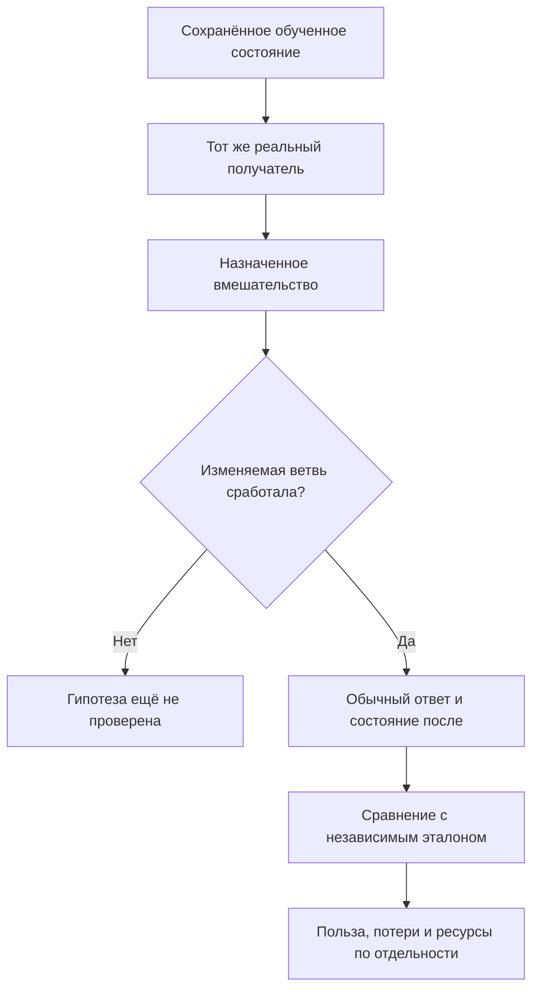

# 94. Аудит исполнения переносов и экспериментов — 29 октября 2026

## Решение

**Последние результаты нельзя объединить в утверждение «перенос экспериментов завершён».** В основном коде подтверждены три конкретных остаточных дефекта/нарушения контракта: выбор исключённого токена в верхнем хвосте распределения; пропущенная очистка кэша при успешном восстановлении того же DPO-тренера; выдача изменяемых массивов обученного KNN-примера наружу. Кроме того, рецепт защиты HNSW от отсечения назначил данные, на которых нужная ветвь недостижима.

При этом свежие отчёты существенно аккуратнее ранних. Они обычно уже отделяют факт исполнения, обучение, сохранность и допуск переноса. Пересчёт доступных ответов P16–P22 подтвердил записанные числа. Поэтому ремонт состоит из адресных изменений кода, недостающих проверок и обновления карточек; повторное обучение всех опытов не требуется.

Подробный порядок ремонта — [95](repair-plan-experiment-transfers-2026-10-29.md). Применимость новых требований ко всем 62 действующим ID / 56 владельцам — [96](card-hardening-coverage-2026-10-29.md). Эта матрица является проверкой применимости, а не заявлением о 62 независимых прогонах.

## Проверенные версии и способ проверки

| Источник | Закреплённая версия | Глубина этой проверки |
|---|---|---|
| llm_mvp_core, codex/dpo-implementation | `0c0228cdf5b1d0348b173c87f9e999b0af13253c` | Основной sampler, DPO cache/restore, TransformerEmbedding KNN ownership, соответствующие тесты; нынешние consumer-пробелы и warmup; карточки и последние результаты P01–P22 |
| xiigen-planning, llm_plan3 | `3b7537c267e45002ebab4f44845fe4ce92f204f9` | Каталог possibleDifs, README и пять актуальных мостов 27–28 октября; связь с канонической программой core |
| Результаты P14–P22 | Тот же core SHA | Runner, применимые экспериментальные копии/адаптеры, raw metrics и отчёты |
| Результаты P01–P13 | Тот же core SHA | Отчёты, latest recovery P01/P02, отдельная квалификация P05; это не полный новый обзор каждого раннего runner |

**Свежо выполнено здесь:** чтение закреплённых исходников; сопоставление требований, product-кода и проверок; пересчёт 254 строк actual/gold и 45 сводных полей P16–P22; независимый числовой FP32-контрпример sampler; проверка актуальности планов. Все 299 сравнений записанных полей сошлись. Они не являются 299 тестами продукта.

**Предел:** .NET и PowerShell в этой среде отсутствуют. Новый build, native тесты, генерация модели и обучение здесь не выполнялись. Бинарные обученные состояния не материализованы; часть GitHub-файлов отдаётся указателем Git LFS. Поэтому «native regression прошла», «все snapshots восстанавливаются» и «все 558 документов possibleDifs перепроверены» не заявляются. Для P22 сравнение stream/graph пересчитано из доступного metrics.json; LFS-указатель comparison.json не принят за его содержимое.

Применены проектные навыки архитектуры, планирования, проверки плана и кода, experiment-design, test-integrity, claim-verification, prompt-patch-authoring, human-readable-architecture-audit и output-readability-gate. У очень больших навыков прочитаны применимые разделы. Старые требования отдельных чужих задач не превращались в новые задания этому аудиту. Основной код, исторические результаты и remote-ветки этой работой не изменены; подготовлены новые и уточнённые документы для применения.

## 1. Выборщик токена может вернуть исключённый токен

**Новая находка, приоритет высокий по нарушенному контракту; вероятность попадания в численный хвост мала.** Исправление нижней границы `r=0` уже сделано правильно. Но после цикла суммирования вероятностей запасной путь по-прежнему возвращает последний номер словаря. Если FP32-вероятности дают сумму немного меньше единицы, допустимое `r<1` может оказаться выше суммы. Последний номер может иметь нулевую вероятность после top-k/top-p.

Числовой контрпример на сохранённых logits строки T1 восьмого опыта при temperature=1, topK=2, topP=1:

| Величина | Независимый FP32-пересчёт |
|---|---:|
| Разрешённые номера токенов | 43 и 45 |
| Сумма вероятностей после FP32-округления | 0,9999999552965164 |
| Допустимая случайная величина | 0,9999999999999999 |
| Возвращённый запасным путём номер | 255 |
| Его вероятность | 0 |

Простой отдельный пример logits `[2,0,-5]`, topK=2 даёт сумму 0,9999999478459358 и тот же класс ошибки: выбирается исключённый третий токен. На сохранённой строке E1 также воспроизведён выход за допустимое множество. Это независимое повторение арифметики по source, а не запуск C#; различия MathF между платформами остаются для native regression.

Почему тесты пропустили: они защищают нижний ноль, внутренние границы и сетку середин интервалов. Верхний остаток после последней положительной массы не проверяется. Для 4096 точек последняя середина далеко от хвоста порядка 10⁻⁸; отсутствие запрещённого токена на сетке не доказывает невозможность такого токена.

Ремонт: выбирать по фактической положительной конечной сумме вероятностей, сохранив строгое сравнение полуоткрытых интервалов; страховочный возврат — только последний положительный кандидат. Нулевая, отрицательная или нечисловая масса должна давать определённый отказ. Обязательные проверки: near-one draw, masked last vocabulary ID, суммы чуть меньше/больше единицы, прежний r=0 и точные внутренние границы. Политика изменения RNG draws и ресурсов фиксируется отдельно. Нового обучения для воспроизведения не нужно.

Источники: [выбор токена](https://github.com/lubochka/llm_mvp_core/blob/0c0228cdf5b1d0348b173c87f9e999b0af13253c/09.Inference/Sampler.cs#L113); [FP32 softmax](https://github.com/lubochka/llm_mvp_core/blob/0c0228cdf5b1d0348b173c87f9e999b0af13253c/00.TensorCore/Core/TensorOps.cs#L941); [границы CDF в тестах](https://github.com/lubochka/llm_mvp_core/blob/0c0228cdf5b1d0348b173c87f9e999b0af13253c/Tests/SamplerTests.cs#L141); [проверка состава](https://github.com/lubochka/llm_mvp_core/blob/0c0228cdf5b1d0348b173c87f9e999b0af13253c/Tests/ExperimentFixes/P08SamplerCompositionTests.cs#L239). Локальное свидетельство в пакете: `evidence/sampler-tail-result.json` и независимый проверочный скрипт.

## 2. Успешный restore обходит очистку прогретого DPO cache

**Новая находка, средний приоритет, нарушение назначенного lifecycle.** Карточка повторного использования оценок frozen reference требует очищать cache при восстановлении continuation и затем снова обращаться к reference. В `TryRestoreContinuationState` успешный импорт RNG/AdamW сразу возвращает true. Очистка есть в rollback helper и при ошибке публикации, но отсутствует на успешной ветви.

Это не доказательство испорченных reference scores: при том же frozen reference закэшированные числа могут оставаться правильными. Доказано другое: обещанный холодный старт производного cache после restore не соблюдён, и счётчики/ресурсное сравнение могут зависеть от истории того же объекта.

Правильная проверка использует один trainer: первый шаг заполняет cache; второй подтверждает hit; тот же объект принимает разрешённый proof-bearing snapshot; третий шаг тех же пар обязан вновь сделать reference Forward. Создать новый trainer после restore недостаточно: у него и так пустой cache. Нужно сохранить обычный admission и proof, а не отключить их для теста.

Адресный ремонт — successful restore branch и регрессия существующего owner. Отказ proof до любой мутации сохраняет прежнее состояние; rollback после начатой мутации рассматривается отдельно. Нельзя слепо распространять «clear всегда» на все immutable cache проекта.

Источники: [контракт восстановления cache](https://github.com/lubochka/llm_mvp_core/blob/0c0228cdf5b1d0348b173c87f9e999b0af13253c/docs/plans/replanning-possible-diffs/fixes-based-on-experiments/13-dpo-reference-cache.md#L85); [успешный restore и rollback](https://github.com/lubochka/llm_mvp_core/blob/0c0228cdf5b1d0348b173c87f9e999b0af13253c/11.DPO/DpoTrainer.cs#L605); [нынешние проверки cache](https://github.com/lubochka/llm_mvp_core/blob/0c0228cdf5b1d0348b173c87f9e999b0af13253c/Tests/DpoReferenceScoreCacheTests.cs).

## 3. Защита одного KNN не защищает массивы соседнего KNN-получателя

**Новая находка, высокий приоритет для in-process границы владения.** `TransformerEmbeddingKnnLogicalUnit<TOutput>` сохраняет исходный training example, а при ответе возвращает те же `PredicateIds` и `DomainTags`. `LogicalUnitResult` — record с массивами, конструктор их не копирует. Caller может изменить массив первого ответа, после чего следующий ответ того же выученного примера изменится без Train. На входе возможна такая же мутация исходного массива после обучения.

`WithCandidatePrinciples` совместно использует эту память для обычного и ранжирующего представлений. Поэтому заморозка catalogue/descriptor не закрывает границу результата. В проверенных реальных consumers Output имеет тип string: его изменение здесь не заявляется. Для generic mutable Output требуется отдельная политика конкретных реально поддерживаемых типов, а не обещание универсального JSON deep clone.

Это другой класс, чем участник опыта снимков Output (P19). Его PRIMARY честно проверил только входной DTO/List; другие подпункты P19 уже существуют. Ошибка переноса — неполная карта получателей, не отсутствие вообще какой-либо карточки про egress.

Ремонт для текущего string path: owned копии metadata arrays при приёме и независимые копии при выдаче; явная обработка malformed/null полей до публикации памяти. Проверить input mutation и returned-result mutation на том же объекте, затем native и ranked view без repair-Train. Expected tags/predicates и выбранный example ID берутся из независимого сохранённого эталона.

Источники: [приём и выдача KNN-примера](https://github.com/lubochka/llm_mvp_core/blob/0c0228cdf5b1d0348b173c87f9e999b0af13253c/18.CapabilityTraining/LlmIngredientLogicalUnits.cs#L139); [тип возвращаемого результата](https://github.com/lubochka/llm_mvp_core/blob/0c0228cdf5b1d0348b173c87f9e999b0af13253c/00.Core/LogicalContracts.cs#L80); [владелец доменного KNN переноса](https://github.com/lubochka/llm_mvp_core/blob/0c0228cdf5b1d0348b173c87f9e999b0af13253c/docs/plans/replanning-possible-diffs/fixes-based-on-experiments/74-knn-domain-constructor-transfer.md).

## 4. Опыт защиты рёбер не мог активировать свой фактор

**Новая доказанная ошибка рецепта; отчёт уже честно оставляет гипотезу открытой.** Восемь разных узлов имеют максимум семь соседей. При m=8 pruning уровня 0 вызывается только при числе соседей больше 16. Таким образом, сочетание N=8/m=8 исключает исследуемое отсечение. Формулировка «выигрыш не гарантирован» в старом паспорте слишком слаба: ветвь недостижима.

Необходимое условие:

`N − 1 > 2m`, то есть `N ≥ 2m + 2`.

Оно не достаточно: геометрия и порядок добавления должны реально привести к удалению нужного ребра. В raw зафиксировано: degree7, reverse-prune0, prevented-removal0. Регистрация семи protected edges не равна семи предотвращённым удалениям. Результат 12/12 в обеих руках подтверждает обучение на этом наборе, но не проверяет пользу или бесполезность защиты.

Правильная следующая работа — дешёвая проверка достижимости на прежних обученных векторах, отдельно от нового обучения. Назначенный контраст m=2/N=8/seed42/тот же порядок делает отсечение возможным; нужны реальные счётчики pruning и prevented removal. Если они нулевые, вопрос остаётся непроверенным; нельзя перебирать seed до красивого ответа. Такой нулевой Train контроль — подготовка/регрессия, не самостоятельный новый опыт обучения.

Исходный результат и его interpretation сохраняются. Raw `NOT_SUPPORTED` не должен снова стать активным выводом при наличии поправки `OPEN_TRIGGER_ABSENT`; reader связывает оба файла.

Источники: [паспорт защиты графа](https://github.com/lubochka/llm_mvp_core/blob/0c0228cdf5b1d0348b173c87f9e999b0af13253c/docs/plans/replanning-possible-diffs/experimets/cards/P20-hnsw-reachability.md); [условие reverse pruning](https://github.com/lubochka/llm_mvp_core/blob/0c0228cdf5b1d0348b173c87f9e999b0af13253c/06.VectorSearch/HnswIndex.cs#L77); [сырые наблюдения P20](https://github.com/lubochka/llm_mvp_core/blob/0c0228cdf5b1d0348b173c87f9e999b0af13253c/experiments-v2/RP01-MICRO/P2001/results/attempt-0001/metrics.json); [действующая интерпретация P20](https://github.com/lubochka/llm_mvp_core/blob/0c0228cdf5b1d0348b173c87f9e999b0af13253c/experiments-v2/RP01-MICRO/P2001/results/attempt-0001/interpretation.json).

## 5. Допуск правильных данных должен пройти через включённую защиту

В опыте shape preflight (P21) восьмёрка правильных Add выполнена до включения нового guard. Guard B включён перед malformed63d Add; после отказа старая память сохранила 12/12. Это полезный результат, но те же наблюдения даст reject-all: запрещать любые новые Add тоже сохраняет старую память.

Отчёт сам признаёт отсутствие valid Add при guard ON. Перед переносом нужен положительный контроль через ту же включённую ветвь: valid 64d Add с уникальным заранее закреплённым ID и соответствующим output mapping, затем обычный ответ Unit и независимая проверка нового mapping. Invalid и valid control используют независимые копии одного S0. Число узлов, IDs, graph/RNG delta и actual output сравниваются раздельно. Для index-only теста valid Add должен присутствовать в Search result set; для Unit одновременно соблюдается контракт output mapping. При duplicate vector правильный ответ от старого ID не доказывает чтение нового ID; точная граница и Search(topK:9) назначены в плане 95.

A в исходном опыте успешно добавил повреждённую девятую запись, и только дальнейшие запросы дали 12 API failures. Значит mid-Add exception/rollback не был испытан. Finite-проверка в B source также не превращается в доказанную NaN/Inf-защиту без соответствующего сценария.

Источник: [положительный результат и ограничения P21](https://github.com/lubochka/llm_mvp_core/blob/0c0228cdf5b1d0348b173c87f9e999b0af13253c/experiments-v2/RP01-MICRO/P2101/results/attempt-0001/report.md); [экспериментальный preflight](https://github.com/lubochka/llm_mvp_core/blob/0c0228cdf5b1d0348b173c87f9e999b0af13253c/experiments-v2/RP01-MICRO/P2101/src/HnswIndex.cs). Это известное отчёту ограничение, превращённое в конкретную приёмку, а не обвинение в неверных числах.

## 6. RNG-адаптер, текущий product и исполнявшийся build — разные идентичности

Паспорт опыта продолжения RNG (P22) называет C нативным legacy Save/Load. Фактический эксперимент использует общий SplitMix64 seed42: A непрерывный, B восстанавливает cursor, C сбрасывает его. Отчёт это раскрывает. A/B действительно воспроизвели stream и graph; A/C различаются. Векторы у всех одинаковы, а правильные ответы после добавления новых уроков — 12/12 у всех.

Следовательно, подтверждён локальный механизм воспроизводимости общего адаптера. Поведение shared System.Random исходного product, взаимодействие двух индексов и миграция сохранённого native RNG этим не доказаны. Карточка исправляется так, чтобы «native» не возвращалось в следующее поручение через старый паспорт.

Есть отдельный пробел воспроизводимости evidence. Entry сохраняет родительский HEAD до появления нового runner, время/PID/exit и имя DLL, но не до-запусковые hashes новых Program/src/csproj и фактически запущенной DLL. Это не доказывает ложность результатов. Это означает более слабую связь source→build→run. Для будущих карточек применяется уже встречающийся в проекте source-snapshot/build-binding подход; для старого опыта нельзя задним числом создать доказательство того, какие bytes исполнялись. Повторное обучение ради подписи не требуется.

Источники: [старый паспорт RNG](https://github.com/lubochka/llm_mvp_core/blob/0c0228cdf5b1d0348b173c87f9e999b0af13253c/docs/plans/replanning-possible-diffs/experimets/cards/P22-hnsw-rng-continuation.md); [фактический RNG-контраст](https://github.com/lubochka/llm_mvp_core/blob/0c0228cdf5b1d0348b173c87f9e999b0af13253c/experiments-v2/RP01-MICRO/P2201/results/attempt-0001/report.md); [entry и build/run receipts](https://github.com/lubochka/llm_mvp_core/blob/0c0228cdf5b1d0348b173c87f9e999b0af13253c/experiments-v2/RP01-MICRO/P2201/Run-Experiment.ps1). Положительная техническая польза RNG-сохранения не отменяется отсутствием accuracy gain.

## 7. Что уже исправлено, а что остаётся открытым

| Тема | Текущий вывод по закреплённому source |
|---|---|
| Нулевая случайная величина выбирала нулевую массу | Нижняя CDF-граница исправлена; не переоткрывать её вместо нового верхнего хвоста |
| TopK раньше исключал TopP | Последовательная композиция уже в native Sampler. Общий перенос P08 всё ещё ограничен allocations; проверка нынешнего native sampler с actual logits восстановленного S1 остаётся отдельной |
| P08 test использует carrier logits | Тест передаёт в sampler сохранённые logits вместо полученных от carrier. Это уже описанный остаток R30-S1, не новое открытие; нынешняя единая learned-model→native-sampler цепь ещё не закрыта |
| P09 empty-cache | Learned empty-prefill проверен опубликованными материалами; learned nonempty/chunked путь остаётся назначенной проверкой R30-C1 |
| P05 qualification writer | В current builder есть duplicate-ID, Kind/gold/set checks, terminal и required-update checks. Старые R29-Q1/Q2 не назначать снова как отсутствующий код. Учебная цель полного ответа по P05Q01 остаётся открытой: 400 SFT, 0/6 |
| KDP descriptor mutation | Защита принятого catalogue/descriptor уже внесена. Новая находка касается массивов example/result другого слоя |
| KDP configured restore | Явный отказ capture при неподдержанном catalogue — полезная защита; полный configured restore, historical exact-answer oracle и ProductHost цепь остаются открытыми |
| DPO cache RNG equality | Сравнение snapshots через ToString остаётся прежним известным пробелом. Новая находка successful restore его не заменяет |
| Первый SFT-шаг warmup | В нынешнем Trainer LR(0) всё ещё вычисляется после Forward/Backward и отвергается как 0. Ремонт из 88 остаётся актуальным; нельзя смещать все scheduler шаги или менять AdamW400 наfresh0 |

Источники: [предыдущий уточнённый аудит](https://github.com/lubochka/llm_mvp_core/blob/0c0228cdf5b1d0348b173c87f9e999b0af13253c/docs/plans/replanning-possible-diffs/fixes-based-on-experiments/91-positive-transfer-followup-audit-2026-10-28.md); [уже назначенные consumer-проверки](https://github.com/lubochka/llm_mvp_core/blob/0c0228cdf5b1d0348b173c87f9e999b0af13253c/docs/plans/replanning-possible-diffs/fixes-based-on-experiments/92-positive-transfer-followup-plan-2026-10-28.md); [текущий квалификатор](https://github.com/lubochka/llm_mvp_core/blob/0c0228cdf5b1d0348b173c87f9e999b0af13253c/experiments-v2/RP01-MICRO/P0501/src/P0501LearningQualificationReport.cs#L306); [его отрицательные контроли](https://github.com/lubochka/llm_mvp_core/blob/0c0228cdf5b1d0348b173c87f9e999b0af13253c/Tests/P0501LearningQualificationReportTests.cs); [неперенесённый первый шаг warmup](https://github.com/lubochka/llm_mvp_core/blob/0c0228cdf5b1d0348b173c87f9e999b0af13253c/04.TrainingLoop/Trainer.cs#L118). Здесь «есть в source» не переименовано в свежий native PASS.

## 8. Точные выводы о свежих результатах

Польза сохранения ответов и воспроизводимости признаётся отдельно от нового улучшения алгоритма обучения. Удержание выученного после ошибки caller — самостоятельный полезный результат. Ресурсные ухудшения и непроверенные границы остаются рядом.

| Опыт | Подтверждённое наблюдение | Что из него следует |
|---|---|---|
| Replay старого урока (P15) | T1 logP лучше на 0,0077442 nat; T2/E2 хуже; обе руки 2/4; учебные allocations+10,714% | Локальный tradeoff; B получает меньше новых T2, поэтому дозы по новому материалу не равны |
| Порядок/роли (P16) | Обе руки 12/12, противоположные строки уже различались в A | На этом наборе дополнительная польза нового признака не показана; обучение обеих рук настоящее |
| Полное перекодирование (P17) | Старые TRAIN6/8→8/8; EXAM4/4 и новый урок 1/1 у обеих | Защищён инвариант, который нынешний native Train уже реализует; A — намеренно stale контрфакт |
| Несовместимый query (P18) | B явно отвергает 63d; валидная панель 12/12 у обеих | Правильный отказ; прироста accuracy и полной schema identity не доказано |
| Входной snapshot Output (P19) | После caller mutation A9/12, B12/12 | Положительная защита входного DTO/List. Outgoing mutation и соседние KNN ещё отдельны |
| Защита графа (P20) |12/12 обеих; pruning0/prevented0| Учебный результат есть, фактор защиты не испытан |
| Shape preflight Add (P21) |A12 API ошибок, B12/12| Защита памяти от malformed ingress; valid-acceptance/rollback ещё не закрыты |
| RNG continuation (P22) |Stream/graph A=B, A≠C; все 12/12| Воспроизводимость адаптера положительна; качество B против C не выросло |

В P17 «+145%» — **выделенные байты этапа rebuild**, 26 944→66 128 (+145,427553%). Время rebuild выросло 0,9291→1,114 мс (+19,900979%). Полное TrainingResources окно показывает allocations651 392→572 504 (−12,110680%) и wall89,9546→57,5792 мс. Это разные измерения; fixed A→B/JIT не позволяет объявить причинное ускорение ни по одному красивому проценту. Источник: [ресурсные окна P17](https://github.com/lubochka/llm_mvp_core/blob/0c0228cdf5b1d0348b173c87f9e999b0af13253c/experiments-v2/RP01-MICRO/P1701/results/attempt-0001/metrics.json).

## 9. Почему ошибки повторяются и что изменено в карточках

Общее слабое место — **широкое обещание закрывается узким наблюдением**. Защита одной границы называется сохранностью всего объекта; положительный результат обучения обеих рук приписывается фактору; размеры/счётчики подменяют actual response; совпадение двух раздельных половин пути подменяет одну end-to-end цепь.

Пример защиты графа: узлы обучены, но условие pruning ложно — переход в «гипотеза ещё не проверена», даже если 12/12 верно. Пример metadata: меняется выданный caller массив, обычный повторный ответ того же owner обязан остаться прежним; повторный Train между вмешательством и чтением запрещён.

Усиления находятся в живых common-контрактах 02/03/04/90, адресных owner-карточках, актуализированных P01–P22 и будущих P23–P25. Они содержат конкретные хорошие/плохие примеры, источники состояния, true/false контроли и предел результата. Полная карта применимости —96. Очередь новых экспериментов остаётся Q024/P23 на проверенном срезе; очередь ремонта в 95 не превращает старые recorded attempts в повторные задания.

Отдельно исправляется расхождение документов: в 18 из 22 основных PRIMARY-паспортов сохранялся старый статус DESIGNED/SHALL_IMPLEMENT, несмотря на записанный результат. У части этих карточек уже были актуальные result notes: обнаружен конфликт статусов, а не полное отсутствие результатов в 18 карточках. Для ранних P01/P02 учтены поздние continuation repairs, для P05 — неуспешная квалификация P05Q01. possibleDifs сохраняет происхождение гипотез и ведёт к одному действующему core-индексу, а не порождает вторую очередь.

## 10. Проверенные подозрения, которые не стали находками

Необычный путь `fixes-based-on-experimentsperiments` действительно существует и содержит соответствующие 41/51/53/55 файлы. Девять ссылок реестра туда не являются опечатками. Переименование по внешнему виду было бы ошибкой. Также отсутствие binary payload при Git LFS pointer не доказывает потерю файла; оно ограничивает способ проверки в этой среде.

## Приложение. Охват P01–P22

Столбец «предел» относится к доказательству, а не к запрету признавать локальную пользу.

| ID | Что удалось подтвердить / записано последним результатом | Предел и допуск |
|---|---|---|
| P01 | Первоначальное SFT: rank8 удержал обе TRAIN против одной у rank4; после recovery выполнено 8 native DPO, оба 2/4 | Потребовалось 800 повторных SFT из-за отсутствующих moments; теперь state сохранён. Rank8 лучше T2, хуже E2; широкого превосходства нет. Проверены отчёты/recovery metrics, не весь runner |
| P02 | Полный keyed AdamW/RNG handoff исправлен; A400→404, B400→404 SFT→408 DPO; readback4 состояний без новых updates | Ответы 2/4 неизменны; identity-only recovery не новое обучение/не новая accuracy. Проверены latest report/identity status |
| P03 | Абляция Backward0/896 изменённых значений против 896/896 native, loss path настоящий | Механистическая проверка обязательности backward, не speedup. Проверен отчёт |
| P04 | Близкий rejected против постороннего: valid negative comparison | Прирост полезного навыка не доказан; не интегрировать только потому что DPO выполнился. Проверен отчёт |
| P05 | Старый sum/mean эффект ниже разрешения; P05Q01 действительно 400 SFT, полный output0/6 на всех 20 контрольных точках | S1 не квалифицирован, A/B NOT_RUN/NOT_TESTED, цель OPEN. Нельзя называть гипотезу отрицательной или LR/masking причиной без проверки |
| P06 | Перестановка[-1,+1]/[+1,−1] не меняет weights/moments/ответы при одинаковой density | Доказана нечувствительность signed teaching signal, не качество исправления signed mechanism. Проверен отчёт |
| P07 | Одно реальное BPE merge уничтожает scored answer position при joint encoding; native separate encoding сохраняет | Правильность существующего representation, не новое ускорение/новый neural skill. Проверен отчёт |
| P08 | Composed topK→topP меняет candidates; поздний audit repair перевёл чтение на GenerateDetailed и измерил cost | Выданный знак не изменился, sequential cost дороже. Не повторять старый helper-only finding после repair; root проверяет перенос |
| P09 | На learned state empty-cache prefill совпал с полным Forward | Не chunked/nonempty continuation proof; стоимость кэша не константа RAM. Последний repair отдельно рассматривается root |
| P10 | Native DPO gradient по двум координатам совпал с central finite differences | Две координаты и восстановление из fresh optimizer moments; не полная математическая корректность всех слоёв. Проверен отчёт |
| P11 | Embedding backward reaches named rows; repeated-token scatter accumulation совпало с oracle | Scope одного learned H64/набора строк; не глобальный speedup. Проверен отчёт |
| P12 | LR(0)=0 не применяет первый урок; исправленный первый learning rate проводит updates | Конкретный scheduler/Trainer contract; не менять все scheduler formulas без consumer map. Проверен отчёт |
| P13 | NaN/Inf внешний materializer не пропускает к mutation; valid control учится | Внутренний VectorSignal seam не получил полный отдельный boundary proof; outer guard не доказывает inner defense. Проверен отчёт |
| P14 | Store/Prepare сохраняют 2/2 side authors vs intentionally lossy A1/2; 2 native DPO updates | Native product уже хранит отдельные authors; accuracy2/4 без gain, это подтверждение текущего контракта |
| P15 | Replay удержал T1 logP, 8 DPO updates всего | T2/E2 и allocations хуже; дозы новых примеров различны, общий перенос HOLD |
| P16 | BPE/memory обучились, обе 12/12; geometry изменилась | Opposite pairs уже различимы в A(cosine≈.676), bag collision не была воспроизведена; B benefit не установлен |
| P17 | Reencode сохранил 8/8 старых TRAIN против 6/8 | Native Train уже делает это; A counterfactual. Ресурсные окна раздельны |
| P18 | Explicit dimension rejection, обычные 12/12 сохранены | Контракт отказа, а не accuracy gain; не весь identity/schema contract |
| P19 | Admission output snapshot12/12 против 9/12 после caller mutation | Только P19.1; другие mutation channels уже отдельно описаны |
| P20 | Два настоящих fit, 12/12 обеих | Trigger невозможен при назначенном N8/m8; broad hypothesis OPEN, no product transfer |
| P21 | Shape preflight сохранил 12 ответов вместо 12 API failures | Нет valid Add guard-ON контроля и mid-Add rollback; technical candidate узкий |
| P22 | RNG cursor сохраняет stream+graph A/B; после новых уроков 12/12 | Common SplitMix adapter; B/C quality delta0; exact executed binary binding не записан |

Канонические receipts и ссылки по каждой строке: [действующая очередь на проверенном срезе](https://github.com/lubochka/llm_mvp_core/blob/0c0228cdf5b1d0348b173c87f9e999b0af13253c/docs/plans/replanning-possible-diffs/experimets/cards/00-execution-index.md). Подробные глубина чтения и source URLs сохранены в приложенном `reviews/experiment-findings.md`.

Статус этого пакета: аудит и документный ремонт подготовлены; изменения product-кода и будущие native-проверки ещё должны быть исполнены по 95. Пакет не повышает исторические HOLD и не выдаёт подтверждение одной оси за готовность всего продукта.
