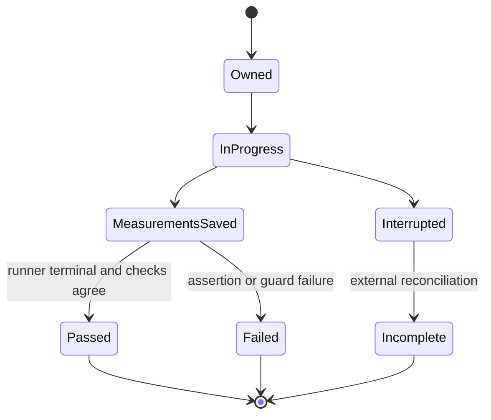

# XIIGEN: адресный план ремонта переносов и экспериментальной приёмки

<!-- XIIGEN-AUDIT-FOLLOWUP-20261111-PLAN:START -->
## Уточнения после независимой проверки исполнения плана — уточнение 11 ноября 2026

Следующие конкретизации имеют приоритет в указанных пунктах; исходный план сохранён как опубликованная история. Продуктовые шаги ими не закрыты.

1. **§2.2, P49:** пример «Input1→5 при warm1→0» не взят из закреплённой панели; он не был помечен синтетическим. Использовать фактический e-t1=(input 0,gold 1), тогда как new-only содержит 0→3. Это знакомый input с новой target. e-t2=(2,3) — единственный unseen input; e-t3/e-t4 exact pairs. New-only: 2+1+1, warm+new: 4+0+0. Снятая формулировка не является ещё одним результатом опыта.
2. **§3.2, PairId/import:** до weights/pairs/revision mutation проверять immutable PairId→canonical payload; exact duplicate идемпотентен, changed duplicate отклоняется. Import candidate проверяет не только наличие MemberPairIds, но согласованность target/FlowRef/mode и уникальность IDs; публикация атомарна, failed import сохраняет всё прежнее состояние. Контроли повторного ID A для B и conflicting duplicate checkpoint добавлены в карточки15/48.
3. **§3.3, authority:** конкретный источник подлинности — предлагаемый server-owned immutable issued/verification registry существующего owner. Caller предъявляет opaque IDs; canonical records читаются сервером. Новый DTO с произвольными caller полями не заменяет прежнюю строку provenance.
4. **§3.3, concurrency:** между authenticity/canonical-payload проверкой и Train нужен атомарный in-flight claim ключа ReceiptId+LessonId. Идентичный конкурент не обучает второй раз; conflicting payload отказывает. Committed lookup остаётся до stale admission. CAS сам по себе защищает публикацию, но не число физических Train. Проверить два одновременных запроса по Train counter. Crash-before-durable-save остаётся UNKNOWN_COMMIT_STATE; exactly-once сверх этой границы не заявлено.
5. **§1.2, finalizer:** существующий summarizer при missing TRX берёт journal counts и может сохранить COMPLETED. Для окончательной приёмки это только incomplete diagnostic summary; обязательны наличие/разбор raw, согласованный terminal и required cases. Bounded exit 0 не закрывает полноту запуска.

[Свежая evidence-проверка](followup/evidence-review.md), [пересчёт](followup/product-recomputation.json), [review](followup/final-review.md). Эти уточнения углубляют выбранную конструкцию; не вводят новый learner, не меняют gold/threshold и не назначают повтор всех опытов.

**Дополнение §3.3 о неуспешной доставке:** in-flight claim завершается не только COMMITTED, но и REJECTED_BEFORE_TRAIN / FAILED_AFTER_TRAIN / UNKNOWN_COMMIT_STATE. Ошибка или CAS conflict после потраченного Train не очищает ключ для автоматического retry. Повтор возвращает сохранённый статус без второй дозы; failure-after-Train входит в concurrency приёмку. Crash до durable save сохраняет прежнюю оговорку о недоказанном восстановлении.


**Уточнение бюджета и restore §3.3:** failure-after-Train сначала проверяется counting trainer (calls=1, real learner=0); отдельный native failure path требует своей раскрытой дозы. Canonical issued/verification records для committed keys сохраняются и импортируются атомарно с state/outcome/fingerprint из доверенного сохранения владельца, иначе authenticity-first lookup послеLoad не сможет вернуть прежний outcome. Missing/unconfirmed canonical receipt даёт UNKNOWN_RECEIPT без Train; caller JSON не создаёт полномочие provenance.


### Сверка ветки перед публикацией: B01 уже частично реализован

На core 05caa77dc629d4801783f839f2011db06b1a92ac учтён параллельный DRAFT 6a6628c4cd349805386552595374f0a2f51b658c. Он добавляет PlanAdmissible с лучшим suffix **для каждого точного числа spans**. Обычный TranslationTrainedUnits всё ещё вызывает прежний Plan. Поэтому шаг §3.1 имеет статус IN_PROGRESS: алгоритмический helper существует, product wiring и приёмка не закрыты. Старый счёт in-progress=0 в опубликованном теле ниже относится к состоянию до этого DRAFT; текущая очередь — done=0, in-progress=1, remaining=13 в тех же 14 шагах.

Трёхкатегорийный DP из §3.1 остаётся аналитически проверенным вариантом оптимизации для действующего predicate, не обязательным требованием переписать уже добавленный exact-count helper. Сначала завершить проводку через существующего владельца admission и проверить его обычный путь. Ограничение helper на монотонный по coverage predicate при фиксированном числе spans сохранить; произвольные условия по конкретным keys/targets требуют другого доказательства полноты.

Новый resource receipt измеряет прямые planner calls, включая 9-token строку вне product scope. Вывод 3,3→4,4% использует прежние 239 488 process bytes и не является matched whole-product A/B. Бюджеты 10 400/14 300 охраняют новый helper от роста примерно на 5,43%/5,52% относительно него самого, не доказывают <=5% относительно прежнего продукта. Датированная поправка добавлена в карточку109; логическое основание ремонта сохраняется отдельно. [Delta review](followup/05-late-b01-delta.md).

<!-- XIIGEN-AUDIT-FOLLOWUP-20261111-PLAN:END -->


План опирается на аудит core `009bf226174441fa0fbf0336e74ad2f2b7174d92` и planning `04ae31e9232d7c8763bd393a36fc163ac2fd0149`. Последующая сверка до core `55cfd9d00bbebdeae04da7c505b84d0b1cb9b747` включительно подтвердила отсутствие изменений проверяемых кода, тестов и карточек; добавлены промежуточные материалы и доска. Связь её B01–B12 с итоговыми F01–F13 приведена в §9 аудита. Текущий документ проектирует ремонты; product code и native tests им не исполнены. Усиление описаний и сохранение аудита — отдельный выполненный документный результат.

## 1. Порядок работы и критерий окончания

Сначала устранить возможность потерять доказательство/объявить ложное завершение. Затем чинить конкретные продуктовые и измерительные ошибки, сохраняя полезные принятые части. Последними измерять цену новых алгоритмов и отдельную гипотезу early-stop. Численные поправки по сохранённым данным не требуют повторять обучение.

| Фаза | Смысл | Шаги | Текущий статус продуктового исполнения |
|---|---|---|---|
|1|Сделать доказательства неизменными и окончание наблюдаемым|1.1владение;1.2terminal;1.3P50validity|remaining|
|2|Исправить названия/формулы измерений|2.1P52ceiling;2.2P49overlap;2.3P58cost;2.4P54resource claim|remaining; независимые расчёты уже сохранены|
|3|Исправить интеграционные границы продукта|3.1P54admission;3.2active revision;3.3correction provenance;3.4loss|remaining|
|4|Закрыть адресные остатки приёмки|4.1batch mapping;4.2Wiki resource guard;4.3отдельный epoch experiment|remaining|

Всего4фазы,14шагов. Продуктовых шагов done=0,in-progress=0,remaining=14,review-block=0,blocked=0. Отсутствие среды native в текущем аудите отдельно означает **UNRUN**, а не доказанный отказ продукта. Исполнитель начинает с1.1; каждый следующий кандидат получает свои source/build/test identity. Эта очередь — предложенный порядок ремонта, а не заявление о полном фазовом допуске всего проекта.

Условие завершения каждого шага: реализован названный owner, достигнут обычный caller, сохранены положительный и отрицательный/retention случаи, различающая мутация обнаружена, результаты и расход принадлежат той же сборке, terminal завершён. Шаг не закрывается одним документом или зелёным serializer test. Общий full-suite green не заявляется до фактического полного выполнения требуемого состава.

## 2. Фаза1: владение уликами и честный результат

### 1.1. Исключительное владение попыткой — F03

**Текущие владельцы:** `Tests/ExperimentFixes/ExperimentEvidenceSink.cs`; его tests; все `WriteEvidence` callers; standalone experiment hosts и runner, создающий TRX. Включить `Tests/Learn07RollbackRunnerTests.cs`, где есть фиксированные пути опубликованных отчётов. Проверка tracked publication уже работает и сохраняется.

**Выбранная конструкция.** Новый run получает owner до подготовки данных/Train. Выделение использует атомарный marker с CreateNew; проверка Exists и последующая обычная запись не заменяют исключительность. Marker связывает run/source/dirty/build-intent/project/filter. Непустой untracked root, чужой owner и прерванная попытка не перезаписываются. Повтор выбирает новый ID/каталог; resume — отдельный режим с доказанной identity и завершёнными стадиями.

Применить одного owner ко всем output paths, включая stdout/stderr/TRX. Однократные файлы создаются без overwrite; owner-only промежуточный статус и append-журнал имеют отдельные операции. Финальный артефакт становится видимым целиком после записи temporary и атомарного rename. Cleanup не удаляет первичные улики. Гарантию стойкости к power loss этим ремонтом не обещать.

**Приёмка:** два процесса запрашивают один адрес; существующий tracked root; существующий untracked root; прерванный root; повтор после отказа; traversal в ResolvePath. Старые bytes/hashes неизменны. Проигравший owner не сделал Train и не записал файл. Структурные сценарии требуют0учебных вызовов. Убрать CreateNew/проверку untracked — соответствующие контроли красные.

### 1.2. Измерения отдельно от terminal — F04

**Файлы:** P48/P49/P52/P58 tests, `ExperimentEvidenceSink`, связанный внешний runner; в P58 конкретно main Fact и `DecideReceipt`/`ComposeStatusPayload`.

**Решение:** test body сохраняет `measurement_outcome`, counters, partial raw, finite/identity/budget problems. Общий run остаётся IN_PROGRESS. Внешний процессный владелец после terminal формирует `runner_outcome` из фактических exit, полного stdout/stderr, TRX и списка обязательных cases. `verdict.ExitCode` переименовать/пометить внутренним кодом; literal N/N/process exit в test template удалить.

В P58 убрать ранний throw по измеренным условиям, уже входящим в receipt: no-gain, unequal-start, instrument failure сначала превращаются в данные отказа и записываются. Если продолжать небезопасно, завершить стадию, пометить последующие поля NOT_MEASURED, не0. Если wrongRow отсутствует — сохранить NO_CONTRAST с0corrective calls. Только затем внешний failure/штатный научный исход. P49 late asserts и соседние Facts должны влиять на внешний terminal даже после сохранённого measurement report.



**Различающие сценарии:** healthy negative scientific outcome; no-gain; unequal-start; broken instrument; no-error panel; late assertion; failed neighbouring Fact; absent/corrupt TRX; aborted testhost. Проверять существование status-файла, stage/counters/reason и внешний exit через тот же executor→sink path. Уже сохранённые measurement fixtures можно вводить на границе измерения: это тест lifecycle с Train0, не claim обучения. Отдельный назначенный native scientific run после ремонта сохраняет свою дозу.

### 1.3. Guard управляет всем решением P50 — F05

**Owner:** `experiments-v2/RP01-MICRO/P5001/attempt-0002/Program.cs`:759–786,953–967. Историческую attempt2 и её raw сохранять; изменённый host исполнять под новым run ID.

Ввести одно решение: сначала `measurementValid = stagesComplete && requiredGuardsClear`; только затем считать hypothesis на валидных observations. Invalid даёт INVALID/OPEN и ненулевой процессный exit. Пригодный опыт без эффекта остаётся normal completion с отрицательным научным результатом. Список problems не может быть только предупреждением рядом с SUPPORTED.

Выделить decision→status serialization→exit в общую вызываемую стадию и добавить предлагаемый режим `validate-measurements` **того же host** для сохранённых measurement fixtures. Это новый режим, не существующая команда. Он проверяет identity/schema входов, не вызывает learner и использует тот же outcome builder и writer, что training route. В подпроцессной приёмке healthy, invalid budget, unknown step и missing stage получают отдельные output roots; фиксируются реальный exit и learner_calls=0. Так проверка без нового обучения действительно достигает процессной границы. Полный научный Train остаётся отдельным этапом.

**Контроли без нового learner:** при сохранённых before2/4,after4/4,ceiling2/4 изменить только счётчик main lessons8→9; отдельно unknown step ID; отдельно missing stage. Проверить generated status **и фактический exit того же host**. Отменить зависимость validity от guard — тест красный. Сохранённый healthy2/4→4/4 не переименовывать invalid.

Поле `sweepIsMonotoneRising` сейчас сравнивает endpoints. Выбрать точный договор: для текущего claim достаточно endpoint gain, значит переименовать поле и выражение. Если понадобится monotonicity, проверять все соседние значения и использовать отрицательный ряд2,4,1,4. Это новый критерий, а не описание уже проверенного свойства по одному last>first.

## 3. Фаза2: метрики и исторические поправки без переобучения

### 2.1. P52 constant ceiling — F06

**Owner:** `Tests/ExperimentFixes/P5201RejectedAnnotationAddressArmsTests.cs`:511–515; новый report template; датированная поправка к attempt2 и recheck10.11.

Вычислять отдельно cold observed score, constant-answer maximum и constant-tense maximum. Для текущего P52 использовать ровно `StringComparison.OrdinalIgnoreCase`, которым сравниваются actual и gold, без добавочной нормализации. Constant maximum выводится из частот gold с тем же сравнением либо перебором фиксированных gold-кандидатов и пустого ответа. Для другого назначенного scorer считать максимум тем же scorer и отдельно назвать область; нынешний baseline ему не приписывать. Записать count,total,best candidate,comparison rule. На текущих четырёх строках answer ceiling2/4, cold0/4. Тест cold0/ceiling>0 обязателен; сверка с другим cold-файлом не oracle. Raw не менять; correction связывает исходный hash+JSON pointer. Train0.

### 2.2. P49 input novelty — F07

**Owner:** `P4901/src/FinitenessGovernedVerdict.cs::ComputeOverlap`, `P4901FinitenessGovernedWarmStartTests` и generated report.

Три disjoint группы: exact-pair seen; input seen/target new; input unseen. Сумма равна размеру панели; пустая панель имеет явный NOT_MEASURED, а не vacuous «всё replay». На saved cold2+1+1,warm4+0+0. Input1→5 при warm1→0 остаётся отрицательным контролем новой target, не unseen input. Изменение только gold не меняет input-unseen. Уточнить all-carriers и сохранить прежние scores/dose. Train0.

### 2.3. P58 полный расход измеряемого main Fact — F13

**Owner:** writer metrics/report и счётчики на реальных `TrainOnExample`/`Tokenize`/`Execute` точках. Сохранить24setup/3corrective на плечо и добавить **24+3×24+3×3=105 Unit lesson calls**. Отдельно **7×8=56 прямых Unit Tokenizer→Executor chains**. Source rows, Unit calls, main Fact, другие Facts, whole selected runner и lifetime — разные уровни. Другие обучающие Facts существуют: не объявлять105стоимостью всего класса. Восстановить selected-case ledger перед общей суммой. Текущий derived correction делается по saved raw с Train0.

### 2.4. P54 ресурсный вывод — F02

Карточка109 получает датированную отмену вывода «общий допуск ниже5%,запас1,7п.п.», сохраняя полезный session-result и все числа. Для будущего общего A/B выбрать **одинаковое** окно: один и тот же loaded state, ordinary request path, panel, harness, configuration, число повторов и порядок чередования A/B; отличаться должен только planner. Включить только реально допускаемые продуктом ветви. Отдельно публиковать component и whole-path расходы, абсолютные значения, delta/A, median и каждый повтор. Время/память/качество не склеиваются в одну долю.

Существующий2×median guard остаётся catastrophe guard своей области. Для5%-claim требуется сопоставимый A/B и заранее названная погрешность; новый порог этим планом не подбирается под наблюдения. Если измерение не различает5%, честный outcome — «не измерено с нужной точностью», при сохранении полезного локального эффекта.

## 4. Фаза3: ремонт продуктовых границ

### 3.1. P54: сохранить coverage/span-допустимую альтернативу — F01

**Текущие файлы:** `TranslationPhraseCompositionPlanner.cs`, `TranslationTrainedUnits.cs::TryComposeFromPhraseMappings` (объявление:1013, вызов:402) и текущие P54 tests. Область сохраняется: EN_RU, ≤8 нормализованных слов, нет accepted single-word mappings. Подключение exact-source и word fallback не должно скрыть тестируемую ветку.

**Выбранный алгоритм:** вместо одного suffix хранить в каждой позиции лучшие варианты по категориям фактического числа spans **0,1,≥2**. Для каждой категории сохранять максимальное coverage; при равенстве — минимальное фактическое spans и прежний canonical key order. Skip и phrase transitions объединяют все достижимые категории; количество spans в `TranslationPhrasePlan` остаётся точным, не заменяется bucket2. В начале caller применяет свой **тот же coverage/span predicate** ко всем полученным категориям и выбирает лучший прошедший вариант прежним comparator. Если нет прошедшего — прежний отказ. Новые internal API, например `PlanCandidates`, являются предложением, не существующим методом.

Это ограниченная DP с≤3состояниями на позицию, а не хранение всех законченных вариантов. Обоснование достаточности: predicate различает0/1/≥2spans, внутри каждой категории большее coverage не ухудшает его. Последующая target compatibility остаётся отдельной проверкой caller; не объявлять доказанным поиск по всем семантически пригодным targets. На native fixtures targets должны быть lawful и проходить эту отдельную проверку, чтобы опыт изолировал именно найденный конфликт.

Для двух suffix одной категории общий предшествующий путь добавляет одинаковые coverage и spans. При добавлении фразы категории переходят 0→1, 1→≥2, ≥2→≥2. Большее coverage сохраняет преимущество; при равенстве меньший точный span count и затем canonical key order сохраняют порядок при общем префиксе. Поэтому отброшенный suffix не станет предпочтительнее сохранённого. При слиянии категорий сравнить все переходы. Лемма относится только к coverage/span predicate.

Bound≤3 описывает сохраняемые DP-состояния; временные candidates, копирование keys/parts и размер learned phrase map учитываются отдельно. Из этого bound не следует процент памяти. При реализации сменить `AlgorithmIdentity`: текущее значение `phrase-coverage-canonical-v1`, предлагаемое новое — `phrase-coverage-admissible-v2`; receipts и expectations должны различать обе семантики. Время и память новой реализации измеряются сопоставимым A/B фазы2.4.

**Приёмочный материал:** два контрпримера8/6tokens из аудита; исходный lawful`close user session`; отсутствие допустимого плана; foreign direction;9tokens; accepted word mapping. Gold задаётся в test fixture, target runtime читает только learned memory. Нужны pre/post route trace, coverage/spans/selectedkeys, target compatibility, final output, fresh-load без Train. Обратная мутация к единственному winner должна покраснить обе адресные строки. Счётчик количества записей не заменяет ответы.

**Предлагаемая отдельная малая доза:** использовать форму существующих `BuildPhraseLesson/BuildLessonBatch` (`TranslationPhraseCoverageLearningTests`:692–752): три независимые fixture, по3строки Executor на fixture. Это **3batches,9исходных строк и9Executor.TrainOnExample calls** по фактическому циклу `TranslationMachine`:542–561; BPE/Grammar/teacher Train=0. Подготовить и сохранить каждое состояние один раз на исходном варианте, затем не переобучать его при смене алгоритма.

Пять именованных чтений каждой fixture: исходный алгоритм на подготовленном состоянии; candidate после load; отдельный fresh-load candidate; reverse mutant после load; восстановленный candidate после load. По одному composite query на состояние — **15 ordinary readouts,3save,12load**, плюс3однократных подготовительных batch. Сохранять source/assembly identity каждого из пяти вариантов. Состояния импортируются через настоящий checkpoint API, без скрытого Train. Так обратная мутация проверяет тот же learned payload. Native tokenization буквальных a1…a8 заранее не предполагается: записать actual normalized tokens и при несовпадении не менять gold, а подготовить эквивалентную именованную fixture из обычных слов с тем же интервальным рисунком до первого Train.

Существующие retention и scope-negative тесты (foreign direction,9tokens,word mapping,no-plan) остаются отдельным регрессионным набором со своим явно сохранённым фактическим расходом;9вызовов выше не объявляются стоимостью всего класса. Если требуется новый самостоятельный boundary fixture, его batch/readout manifest — отдельный обязательный документ до исполнения, а не скрытая прибавка к15. Новое исследование качества русского языка не назначается.

### 3.2. Active revision вместо вечного вето истории — F08

**Owners:** `PromptFlowGroundingModel`, `OrchestrationKnnStore` и существующие checkpoint contracts/`OrchestrationPlanMachine`; tests `ExperimentBasedPromptFlowRetentionTests` и тело маршрута из карточки48.

Предлагаемый typed `ActiveFlowTargetRevision`:FlowRef,RevisionId,ChosenFlowRef,ExpectedRouteMode,NormalizedPlanText,MemberPairIds. Совместимость сравнивается с текущей принятой редакцией. B1послеA начинает новый state; B2при той жеB объединяет max-input-features толькоB. История остаётся, но не выбирает исполняемое тело и не накладывает вечное veto. `FindLearnedPair` ограничивается FlowRef+MemberPairIds active revision. Фильтр не превращается в входной признак модели.

Checkpoint переносит revision/weights/pairs атомарно и проверяет ссылки. Старый однозначный snapshot можно мигрировать по одной группе целей. Неоднозначный A+B без достоверного порядка даёт явную ambiguity; не угадывать latest поPairId/JSON/filemtime. Если caller уходит в Mode2, причина сохраняется; семантическая безопасность существующего fallback не доказана. Empty/empty Jaccard1.0 и zero-overlap сосед — отдельный контракт store/caller, его нельзя маскировать снижением grounding threshold.

**Точная доза одного порядка:**5одноэлементных batches=A+Cконкурент+B1+B2+B3. Пять состояний:послеA/C,послеB1,послеB2,послеSave/Load,послеB3. По5фиксированных запросовB1/B2/B3/C/negative =25чтений,1save,1load. Обратный порядокB1/B2 — второй отдельный такой же run: вместе10batches/50readouts/2save/2load. Проверка настоящего merge не может иметь Train0. Структурные ID/legacy checks и мутации имеют отдельно раскрытые calls.

**Отрицательные контроли:** текущий all-history guard и безусловный unionA+B; oldPairId раньшеnew; переименование ID; missing active body; wrongrevision afterrestore. Удержание B1/B2/B3, правильное телоB и конкурентC проверяются обычным consumer. Прежние9тестов узкогоFIX-RET сохраняются отдельно.

### 3.3. Подтверждённый actual answer и условная коррекция — F09

**Owners:** `TranslationMachine.InlineTranslationOrchestrator.RunAsync`, `TranslationCorrectionLearningAdapter`, `TrainStructuredBatchAsync`, typed checkpoint/publication state, `TranslationCorrectiveLearningTests`.

Новая `TranslationIssuedAnswerReceipt` связывает ReceiptId/RequestId/source/direction/topic/receiver/state/actual. Создавать после `flowResult.IsSuccess`, включая LOW_CONFIDENCE/echo, из захваченного request/result/version. Не ждать Passed/TRANSLATED: low-confidence может быть именно исправляемым ответом. Новая `TranslationVerificationReceipt` ссылается на issued receipt и фактическую проверку. Caller не может удостоверить arbitrary actual своей строкой provenance. Журнал происхождения не является новой переводческой памятью.

**Порядок:**validate authenticity+immutablepayload→lookup committed outcome→для новой доставки validate captured StateId/version→existing conditional Train→atomic publish outcome+state. Повтор ReceiptId+LessonId возвращает прежний исход без Train, даже если current version уже выросла. Изменённый payload при том же ключе отвергается. Новая stale доставка требует новой проверки.

Передавать существующий `expectedStateVersion` в `TrainStructuredBatchAsync`:415–424. StateId проверяется внутри того же read-once admission:446–458 до staging, а CAS`TryPublishVersion`:219–239 остаётся последней защитой; никаких автоматических повторных доз. Committed key/outcome/fingerprint экспортируются и загружаются с обученным checkpoint. Гарантия replay без второго Train относится к живому процессу и load **уже совместно сохранённого** state/outcome. In-memory CAS не закрывает аварию до отдельного SaveCheckpointAsync: для этого окна итог UNKNOWN_COMMIT_STATE и автоматический retrain запрещён до восстановления по принятому checkpoint/журналу. Полная exactly-once гарантия через crash-before-save требует отдельного durable commit/recovery протокола и этим шагом не заявляется.

**Контроли:**true source-echo с подлинной receipt принят; source вместо другого actual отвергнут; arbitrary третий текст отвергнут; чужие request/topic/direction/receiver/state отвергнуты до Train; rejected=verified отвергнут; duplicate послеpublish/load не даёт вторую дозу; конфликт CAS сохраняет предыдущий state. Существующие10уроков(8+2),60flowcalls,8вызовов проверяющего,2save/3load сохраняют свою научную область. Новые структурные rejects Train0; crash/restart publication checks имеют отдельный точный counter ledger. Это не DPO learning effect текущего Executor.

### 3.4. Согласовать loss с градиентом — F10

**Owner:** `35.ExperimentsV2/Core/ProbeNeuralNetwork.TrainStep`; `Tests/ExperimentFixes/ProbeNeuralNetworkGradientTests` и writers, потребляющие loss.

Сейчас `-log(max(p_target,1e-7))` перестаёт меняться, тогда как backward использует правильный CE gradient p−y. Дляlogits[0,−20] scalar probe даётclipped16.11809565,CE20.00000000,производные0 и≈−1. Не чинить это обнулением градиента нижеclip.

Вернуть устойчивую cross-entropy в logit domain:`(maxLogit−targetLogit)+log(sum(exp(logits−maxLogit)))`. Если нужен clipped diagnostic, сохранить отдельным полем с clip/underflow counters и другим именем. Проверить finite logits, большие margins, обычный ненасыщенный случай и независимый central-difference oracle вдали отReLU/argmaxграниц. Отдельно проверить все gradients вычислены до применения updates — прежний ремонт этого порядка сохраняется. Новый reporting objective не переписывает старые loss-улики; добавить датированную формулу и version.

## 5. Фаза4: точные остатки QA и ресурсной пользы

### 4.1.119классов без strong batch route — F12

**Owners:** `tools/test-batches/batches.tsv`, `Tests/TestSuiteBatchManifest.cs`, guard tests. По каждому119классу назначить смысловое семейство и ресурсный режим, затем проверить положительный filter и first-match ownership по реальному discovery. Не добавлять все в weak baseline и не заменять явную классификацию одним чрезмерно широким prefix.

Сохранить фиксацию состава по root solution. Отличать отсутствующий `.sln` в синтетической fixture от существующего, но непригодного `.sln`: fallback по `declaredProjects.Count==0` сейчас смешивает их. Непригодное реальное решение даёт диагностический отказ, не рекурсивный сбор copies. Тест включает invalidpaths/неразобранныйформат и законную syntheticfixture.

После ремонта — focused guard и сравнение точных cases. Затем full suite в назначенной владельцем области с независимым discovery, immutable outputs и terminal.342ошибки publication-coordinator из исторического списка разбирать отдельным owner; class count не rootcause. Старую501−21арифметику не публиковать как новый baseline.

### 4.2. Wiki resource guard

Сохранить 4/4 внутреннего поведения, 4/4 после восстановления и публичный gate. Добавить контроль фактических вызовов извлечения признаков/выделений памяти для настоящего Train при одинаковых входах и окнах: возврат Featurize внутрь эпох должен различаться ресурсной проверкой при сохранении параметрической эквивалентности. Последовательные fits не переиспользуют чужие rows. Не вводить нестабильное условие по точному времени и не называть голый count18×8 доказательством навыка. Это отдельный остаток принятых тестов, не повтор всей истории FIX-WC.

### 4.3. Отдельный опыт остановки эпох — F11

Документная поправка уже обоснована replay: 4 активные и 14 пустых эпох. Если исполнять новый опыт, фактор — остановка после **полной эпохи без обновлений** при одинаковом корпусе, порядке и признаках. Не зашивать число 4 или 7. Для текущей fixture должна быть пройдена пятая, первая пустая эпоха. Нативный журнал различает предъявления, ошибки, изменения параметров, пропуски из-за нечисловых значений и эпохи. Сравнить параметры/ответы отдельно от metadata EpochCount. Измерить время и выделения памяти в совпадающем окне. Проценты прежнего feature reuse не переносятся на экономию scoring. Новый общий бюджет назначается до первого Train как самостоятельный кандидат; текущий аудит его выполнением не называется.

## 6. Как запускать приёмку и что возвращать

Для текущего C# test-проекта начальные команды **планируемые, не выполненные здесь**:

```bash
dotnet build Tests/LlmFromScratch.Tests.csproj -c Release
dotnet test Tests/LlmFromScratch.Tests.csproj -c Release --no-build --list-tests
```

Фильтр конкретного ремонта строится после discovery по реально существующим именам, а results directory приходит от owner шага1.1. Новые имена тестов в наряде обозначать как предлагаемые. Нельзя использовать --no-build со старой DLL после изменения source и нельзя объявить отсутствие выбранных cases успехом. Powershell runner/standaloneP50 имеют собственные команды/identity; они не становятся тестамиTestsproject автоматически.

Возвращаемый пакет одного шага: исходный SHA и dirty diff; команда/exit сборки; hash DLL; discovery и выбранные cases; handle и terminal процесса; полные логи/TRX; наблюдения до/после; независимый expected; положительные, отрицательные и retention случаи; мутация и результат после восстановления; все физические вызовы; оставшаяся граница вывода. Публиковать промежуточные checkpoints и commits, как отдельно указал владелец. Долгий процесс дождаться по тому же handle; новый параллельный запуск не заменяет его результат.

Тексты адресных карточек и общий acceptance-contract входят в пакет. План не требует повторять все 131 опыт и не назначает внешнего teacher. Он сохраняет уже принятые механизмы и превращает каждую актуальную ошибку в проверяемое изменение конкретного владельца.
