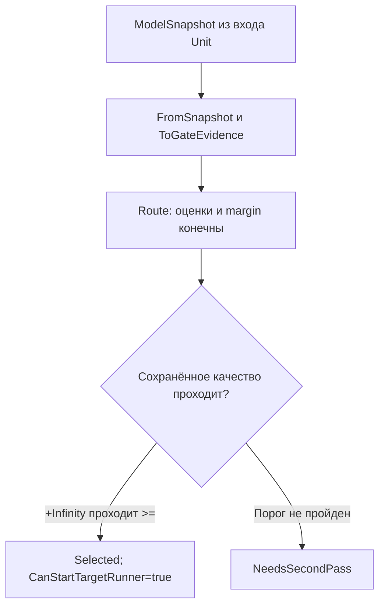

# 123. Аудит после P107: что перенесено, что доказано и что ещё ломает приёмку

Дата: 2 ноября 2026. Проверенный core: `e235f0971d6172f020822d42c61fe34a2819f9f8`, ветка `codex/dpo-implementation`; planning: `ee34c1a3cefac92c0b4b7b4c8001586dfa5da208`, ветка `llm_plan3`. Это новый адресный аудит опубликованного кода и сохранённых результатов P103–P107. Он уточняет [120](120-post102-transfer-and-executor-audit-2026-11-02.md) и [121](121-post102-addressed-repair-plan-2026-11-02.md), сохраняя их исторические выводы в соответствующих границах.

## Главный вывод

За последние изменения несколько ремонтов действительно дошли до рабочего кода: конечные метрики больше не подменяются средними по обучению; четырнадцать дверей публикации отвергают неизмеренные числа; выбор маршрутов проверяет конечность оценок. Это подтверждено чтением владельцев и сохранёнными нативными журналами, включая падающие проверки на намеренно испорченном коде. Эти части не нужно назначать заново.

Но приёмка всё ещё допускает ложный успех. В P104 четыре контроля подставляют `false` вместо реальной порчи данных. В маршрутизаторе сохранился отдельный проход через `+Infinity` в загруженном подтверждении качества. P107 завершает процесс с кодом 0 независимо от вычисленных контрольных флагов. Учебный `PAIR:` по-прежнему влияет на рабочий допуск KNN. Поэтому запись результата, правильные отдельные числа и зелёный набор тестов не означают завершённый перенос всего поведения.

Исправления назначены в [плане124](codex-124-post107-addressed-repair-plan-2026-11-02.md). [Покрытие125](codex-125-post107-card-coverage-2026-11-02.md) показывает адресно усиленные карточки, [контекст41](../experimets/codex-41-post107-executor-checks-2026-11-02.md) — действующий порядок будущей проверки. Продуктовые файлы, hosts опытов и исторические raw этим пакетом не изменены.

## 1. Область проверки и сила доказательств

Разобраны четырнадцать последних коммитов из запроса, владельцы новых исправлений, связанные обычные потребители и сохранённые опыты P103–P107; дополнительно сверено уже внесённое правило ничьей P85. Отдельная проверка агента пересчитала результаты пяти опытов. Архитектурные решения и итоговую границу переноса проверил основной исполнитель. Это не повторная сплошная сертификация всех 275 карточек или всех 62 stable ID каталога.

Использованы релевантные разделы навыков архитектуры, планирования, проверки плана и кода, целостности тестов, дизайна экспериментов, написания инструкции и человеческого объяснения из `docs/skills`. Их применение видно в цепочках ниже: для каждого существенного вывода названы владелец, наблюдение, контрпример и обычный потребитель. Чтение отдельных разделов большого навыка не названо полным чтением всех его страниц.

| Уровень | Что исполнено в этом аудите | Что он позволяет утверждать |
|---|---|---|
| Исходники | Чтение точных Git blobs, сравнение commit diff и call paths | Наличие/отсутствие конкретной проверки в названном методе |
| Сохранённые данные | Python-пересчёт ответов, голосов, fingerprints, бюджетов и итогов журналов | Согласованность опубликованных чисел с опубликованными данными |
| Контрпример по исходнику | Числовой пример gate и замена содержимого ответа при неизменной длине | Ошибка видимого предиката; это не новый запуск .NET |
| Сохранённые нативные журналы | Проверены команды, фильтры, итоговые числа и испорченные варианты | Авторские исполнения именно этих тестов, а не новый прогон аудитора |
| Не исполнялось | .NET/PowerShell, model inference, Train, десериализация LFS-весов | Новая нативная и сквозная приёмка остаётся будущей работой |

Повторяемые материалы: [пересчёт опытов](../../../../experiments-v2/_audits/2026-11-02-post107-audit/codex-experiment-recheck.py), [его результат](../../../../experiments-v2/_audits/2026-11-02-post107-audit/codex-experiment-recheck.json), [проверка переносов](../../../../experiments-v2/_audits/2026-11-02-post107-audit/codex-transfer-recheck.py), [её результат](../../../../experiments-v2/_audits/2026-11-02-post107-audit/codex-transfer-recheck.json). Первая содержит 67 проверок согласованности, вторая — 58; расхождений с ожидаемыми наблюдениями нет. Часть ожидаемых наблюдений — именно существующие дефекты. Эти числа нельзя называть количеством успешно пройденных условий научной или продуктовой приёмки.

## 2. Какие переносы уже состоялись

| Изменение | Проверенная реализация | Доказательство и граница |
|---|---|---|
| Конечная метрика вместо среднего, `d79c0d34` | `ProjectWikiDpoMetricRunner`: после update выполняется отдельное измерение конечного состояния; `BuildPublishedTrainingMetrics` сохраняет trajectory отдельно. Pipeline и publisher CrossStack используют общий `ProjectWikiDpoPublicationMetricGate`. | R09 прежнего плана реализован в этой цепочке. Сохранённый обычный test project: 173/173; порча runner даёт 2 падения, порча gate — 4. Это не доказательство качества всех выученных единиц. |
| Четырнадцать дверей публикации, `35df0ac0` | Проверка конечности стоит перед сравнением показателя с существующим порогом в проверенных pipelines/publishers; общий числовой договор выделен в `ProjectWikiMeasuredNumberRule`. | 26/26; ослабление проверки — 12 падений; восстановление — 26/26. Проверка всех сохранённых gate DTO этим набором не покрыта: см. F01. |
| Выбор по измеренным оценкам, `e9e2ef06` | Изменены выбор максимума, margin, confidence, grounding score и конечность импортированной accuracy. | 27/27; ослабление NaN — 6 падений, Infinity — 9; восстановление — 27/27. Порог импортированной конечной accuracy остался другим: F05. |
| Сборка тестов, `0d87089c` | Исправлен недостающий namespace в тесте; последующие журналы действительно собирают `Tests/LlmFromScratch.Tests.csproj`. | Прежнее утверждение «native project не собирается» устарело. Исполнение отдельных MethodKnn tests и facade этим не подтверждено. |
| P85: ничья разрешается расстоянием, `e7b131f1` | `MethodKnn` учитывает минимальную дистанцию после числа голосов; затем сохраняет ordinal fallback. | Компонентный oracle 35/35 остаётся полезным. Фильтр 173 тестов содержит ProjectWiki/CrossStack, не MethodKnn. R05 остаётся открытым в части native targeted/facade execution. |
| `PAIR:` в semantic signature, `e235f097` | Последний коммит добавил находку и журналы; путь `hasExactPairSignature` остаётся в продукте. | Это обнаруженный дефект, не выполненная починка. Конкретный архитектурный маршрут теперь выбран в S04 плана124. |

Источники: [runner конечных метрик](../../../../42.ProjectWikiDomain/ProjectWikiDpoMetricRunner.cs), [publication gate](../../../../42.ProjectWikiDomain/ProjectWikiDpoPublicationMetricGate.cs), [числовое правило](../../../../42.ProjectWikiDomain/ProjectWikiMeasuredNumberRule.cs), [проверки выбора](../../../../Tests/ExperimentFixes/ChoiceDoorsMeasuredRuleRejectsNonFiniteScoresTests.cs), [сохранённые173](../../../../Tests/ExperimentFixes/run-final-metrics-gate-output-reverted-clean.txt), [порча runner](../../../../Tests/ExperimentFixes/run-final-metrics-gate-output-corrupted-runner.txt), [порча gate](../../../../Tests/ExperimentFixes/run-final-metrics-gate-output-corrupted-gate.txt). Наборы пересекаются, их totals не складываются в число уникальных тестов.

## 3. Ошибки и незакрытые границы

### F01. Сохранённое подтверждение качества принимает бесконечность — высокая, новая находка

В [ProjectWikiRequestRoutingTrainableModel](../../../../42.ProjectWikiDomain/ProjectWikiRequestRoutingTrainableModel.cs), строки 334–339 проверенного SHA:

```csharp
gateEvidence.HeldOutGatePassed &&
gateEvidence.RouteAccuracy >= gateEvidence.MinimumRouteAccuracy &&
gateEvidence.WrongAnnotationRate >= gateEvidence.MinimumWrongAnnotationRate &&
gateEvidence.AverageConfidence >= gateEvidence.MinimumAverageConfidence;
```

У этого предиката нет проверки конечности трёх показателей и трёх сравниваемых порогов. `+Infinity >= 0.95` истинно. Если последовательно заменить только один из показателей хорошего gate на `+Infinity`, каждый из трёх случаев проходит. `NaN` здесь, напротив, отвергается самим `>=`; неправильно описывать дефект как одинаковый для всех нечисловых значений. `-Infinity` в сохранённом пороге также пропускает конечное значение ниже нормального порога.

Контрпример не требует бесконечной оценки кандидата: biases `[0.1, 0.5, 0.05, 0, …]` и пустые token weights дают конечный margin 0.4 и confidence около 0.922425. Проверки нового коммита пропускают такой нормальный кандидат, после чего испорченный gate разрешает его выбор. Это вывод из исходника и независимой арифметики; нового нативного исполнения этого snapshot не было.



Обычный потребитель — **`ProjectWikiRequestRoutingUnit.ExecuteAsync` в том же файле**, строки 517–566; не другой класс `ProjectWikiRequestRouterUnit`. `FromSnapshot` принимает входной snapshot, `Route` проверяет gate, результат наружу имеет `CanStartTargetRunner`. Текущие тесты выбора используют постоянно хороший `PassedGateEvidence()` и меняют оценки кандидатов, поэтому этого случая не видят. Ремонт S03 проверяет отдельно сохранённые показатели/пороги и обычный Unit, сохраняя действующие числовые границы.

### F02. Четыре проверки P104 подменяют свой вердикт — критично для достоверности приёмки

В [P10401/Program.cs](../../../../experiments-v2/RP01-MICRO/P10401/Program.cs) четыре «порчи» не меняют проверяемый receipt, данные или алгоритм. Они узнают enum и заранее отвечают `false`:

| Условие | Место | Подмена | Нужная реальная порча |
|---|---|---|---|
| 2.4 | 694–709 | `MergedAssertions → return false` | Повредить удержанные ответы/смешать наблюдения; неизменный оценщик сравнивает полное содержимое |
| 3.5 | 745–756 | `MergedPoolCounts → return false` | Заменить раздельные native/synthetic счётчики смешанным receipt |
| 4.1 | 760–775 | `DropEligibleSubset → return false` | Действительно удалить пригодное подмножество или обязательные схемы |
| 4.4 | 799–806 | `AbstainCountedAsSuccess ? false : …` | Подать ложный успешный счётчик при одних отказах |

`AddCheck` считает чувствительность как `honest && !corrupted`. Число 21/21 арифметически соответствует записанным bool, но четыре из них не доказывают обнаружение названной ошибки. Остальные 17 нельзя автоматически сертифицировать вычитанием. Отдельно 1.4 переключает локальный `learned`, а не сериализованный `gateDescriptor`.

Более сильный контрпример: честная ветка удержания проверяет количество строк и длину двух шагов. Замена **всех** ответов на `[WRONG_A, WRONG_B]` сохраняет её успех. Длина результата не доказывает сохранность знаний.

Основное наблюдение не отменяется: законно принятые ответы 2/5 → 4/5; правильные исходы с учётом законного отказа 3/5 → 5/5; ложные отказы 2 → 0. В B для E2/E4 содержимое выбрано из `trained_corpus_row`, тогда как E1/E3 идут из `native_rank1`. Поэтому это результат экспериментального переходника. Для переноса обычный API обязан вернуть payload непервого соседа и потребитель обязан исполнить именно его. S01 ремонтирует измеритель на сохранённых rows/pools, без повторного обучения.

### F03. Успех процесса P107 не удостоверяет контроли — высокая

В [P10701/Program.cs](../../../../experiments-v2/RP01-MICRO/P10701/Program.cs), строки 652–811, вычислены `permutationStable`, `controlledOk`, `duplicateOk`; далее 852–854 пишут выход 0 без проверки этих флагов. Это не утверждение, что сохранённые контроли реально провалились: их пересчёт успешен. Это отсутствие исполняемого отказа, если контроль провалится в следующем случае.

Нужны раздельные статусы завершения процесса, валидности измерителя, соблюдения бюджета и научного результата. Законное «B не лучше A» остаётся валидным отрицательным результатом. Нарушенный контроль не должен маскироваться кодом 0. Для ремонта сначала достаточно воспроизвести вычисления на сохранённых данных и испортить receipt; новый Train не требуется.

Сохранённый budget — 51/50: 12 cold + 13 S0 + 12 A + 12 B + 2 controlled. Дополнительный запрос вне панели уже указан автором; его нельзя вычесть из стоимости. Строки S0 409–441 используют тот же живой Unit после Save. Сохранение файлов подтверждено, свежий Load ими не доказан.

### F04. Учебная идентичность становится разрешением на выбор — высокая, ранее обнаружена

В [TranslationTrainedUnits.cs](../../../../27.TranslationDomain/TranslationTrainedUnits.cs), строки 94–104 и 135–142, исправленная signature записывается и возвращается на точном исходном тексте. Затем 288–296:

```csharp
var hasExactPairSignature = tokens.Signature.Contains("|PAIR:", StringComparison.Ordinal);
if (hasSemanticConcept || hasExactPairSignature)
    TrySelectKnnCandidate(tokens, minimumSourceSimilarity: 0.0, ...);
```

Если семантического понятия нет, `PAIR:` всё равно включает допуск с нулевой похожестью. Без него обычная EN_RU ветка использует 0.60. Важно достичь этой ветки: exact/topic, phrase и word lookup могут вернуть ответ раньше. P106 не доказывает, что каждый его исправленный запрос прошёл через этот KNN.

Обрезать строку только у читателя недостаточно: writer/reader коррекций, executor memory и verifier используют связанные ключи. Резать всё после `PAIR:` также нельзя: после него могут идти полезные `RULE:`. Архитектура S04 отделяет учебное происхождение от смыслового ключа, переносит все ключи одной миграцией и сохраняет проверенные rule tags. Номер пары перестаёт быть основанием обхода; прежние пороги 0 и 0.60 сохраняются для своих законных оснований.

В последнем коммите опубликованы журналы 5 failed/2 passed и более ранние 6 failed/1 passed с ошибочными ожиданиями. Исходники локальной диагностической проверки и её runner в коммит не вошли, что прямо указано в required-changes. Поэтому их повторение по одним журналам невозможно. План требует опубликовать воспроизводимый диагностический материал с причиной ожидаемого падения, сохранив обе версии журналов; не ослаблять assertion ради зелёного build.

### F05. Импортированная accuracy 0.1 получает пройденный gate — расхождение договора

В [OrchestrationPlanMachine.cs](../../../../42.ProjectWikiDomain/OrchestrationPlanMachine.cs) обычная оценка сравнивает accuracy с `EvaluationAccuracyGateThreshold = 0.75` (17, 275). `CreateImportedEvaluationGate` (523–560) после нового finite guard отвергает только `<= 0`, проверяет eval-ссылки и создаёт `PassesGate=true`.

При допустимых eval-ссылках 0.1 не проходит местный порог, но проходит импорт. Это достижимое расхождение исходного договора, а не обнаруженный в истории плохой checkpoint. Исправление конечности корректно, однако порог оно намеренно не меняло. Выбранный S06 маршрут: применять существующий общий порог 0.75 и при импорте, сохраняя происхождение измерения. Ссылка `#eval/...` — адрес доказательства, не замена самого сравнения; отсутствующее число испытаний не выдумывается из сохранённого нуля.

**Второй вход найден при независимой проверке плана.** `ImportCheckpoint` (359–380) копирует `checkpoint.LastEvaluationGate` напрямую, меняя только `SemanticQualityClaimed=false`. Вызова `CreateImportedEvaluationGate` здесь нет. `LoadCheckpointAsync` создаёт новую машину и вызывает этот import (439); `GetExportAccuracyFromGate` (486–489) и `GetLastPassedEvaluationGate` (518–521) затем доверяют одному `PassesGate=true`. Поэтому конечная accuracy 0.1 с этим флагом может снова уйти через обычный `ExportAsync` с eval-ссылками даже после исправления только первого входа. S06 охватывает **оба** import-пути и проверяет повторный export. Нативный инцидент не заявляется.

### F06. Исправленная signature не исправляет роли слов — подтверждённая граница P106

В [26-arm-B-reads-and-verdicts.json](../../../../experiments-v2/RP01-MICRO/P10601/results/attempt-0001/26-arm-B-reads-and-verdicts.json) «проверь» остаётся `NOUN`, «файл» — `VERB/IMPERATIVE` с леммой «фай», хотя pattern и signature уже совпали с исправлением. Вторая строка «файл проверен» имеет ту же проблему распределения ролей. Строки с точкой всё ещё 0/2.

[TranslationSemanticTokenizer](../../../../27.TranslationDomain/TranslationSemanticTokenizer.cs) позволяет окончанию `л` у слова длиной больше трёх определить глагол; «файл» удовлетворяет этому условию. «проверь» не распознаётся этими окончаниями. `DetermineRole` и `BuildRuleTags` получают ошибочный POS. Замена двух полей аннотации оставляет токены прежними. S05 проверяет целостный разбор по словам и родственным формам; два исправленных поля не становятся доказательством исправленной грамматики.

### F07. Поправки в прозе не достигают машинных итогов

P103 уже честно отозвал утверждение о забывании в report. Но `metrics.json#/контрольная_точка_и_продолжение/продолжение_обучения/вывод` продолжает говорить, что прежние уроки теряются. Исходник создаёт два независимых объекта `Train`, не продолжает один. Сырые записи сохраняются; создана [адресная квитанция уточнений](../../../../experiments-v2/_audits/2026-11-02-post107-audit/codex-claim-corrections.json). Она также ограничивает P10421/21 и подписи P105/P107. Автоматическое чтение этой квитанции существующим reporter ещё не реализовано; это отдельная часть S07.

## 4. Точность и исполнение P103–P107

| Опыт | Пересчитанные результаты | Что можно заключить | Что заключать нельзя |
|---|---|---|---|
| P103 | A0/3 → B3/3 известных ответов; со строкой отказа 1/4 → 4/4; после lowercase сохранён 1 маркер из6 | Порядок нормализации меняет получателей трёх конкретных уроков | Три известных входа совпадают с TRAIN; обобщение и забывание не измерены. Вне основной панели выполнены дополнительные действия |
| P104 attempt2 | Законные2/5 →4/5; правильные исходы3/5 →5/5; ложные отказы2→0 | Допуск до cap помогает на сохранённой панели | Не доказаны21 реальные отрицательные контроли; payload двух ответов взят из корпуса; продуктовый перенос не закрыт |
| P105 | Reference0/16 изменённых ключей; policy4/16, шаг400→401 в обоих плечах; одинаковые конечные value digests | Записанные fingerprints согласованы с неизменной reference при обновлении policy | Шесть `.bin` доступны здесь как LFS pointers, backing bytes не прочитаны; accuracy2/4, приобретённая способность не показана |
| P106 | Точные pattern/signature0/2→2/2; с точкой0/2→0/2; новый ImportCheckpoint2/2 | Исправленная аннотация попала в память и восстановилась | Морфология/роли, пунктуационное обобщение, обычный перевод/verifier не исправлены этим опытом |
| P107 | A иB8/8 TRAIN-контролей и4/4 EXAM; разногласий first/majority0/12;15 перестановок,0 нестабильных | Память приобрела различающее поведение на этих новых формулировках; выбранные ответы устойчивы в проверенных перестановках | Нет различающего случая пользы majority; свежий restore не исполнен; стоимость отдельных reader A/B не изолирована |

**P105: разные вероятности.** Для отрицательных gold T2/E2 абсолютный `logP(gold)` уменьшился на 0.0001368/0.0004916, хотя `log-odds(gold/rejected)` вырос на 0.0012517/0.0011521. E1 ухудшился по обеим осям. Поэтому «сдвиг в сторону эталона» должен называть конкретную метрику; «ухудшений нет» допустимо лишь про неизменную точность данной панели. Сдвиг весов не отделяет data gradient от восстановленных moments и decay.

**P104: бюджет зависит от отказов.** Фактические12 native node calls соответствуют `(2 принятых A +4 принятых B) ×2 шага`. Требовать16 как обязательный факт при исследовании ложных отказов неверно. Десять synthetic node calls считаются отдельно. Исправление паспорта не требует добавить четыре исполнения.

**P107: дубликаты.** Контроль содержит две записи u1 и одну u5, а не три записи одного урока плюс другой. При честном dedup выигрывает build-first, при независимом пересчёте без dedup — review-first. Фикстура полезна; авторский host не сохранял рядом испорченный reader. Синтетический контроль функции не превращается в естественное расхождение поиска.

Подробные строки и ограничения: [независимый разбор](../../../../experiments-v2/_audits/2026-11-02-post107-audit/codex-experiment-review.md). Исторические результаты и их ограничения сохраняются вместе, не заменяются желательными числами.

## 5. Что изменено этим пакетом

Созданы аудит, адресный план, общий контекст будущего исполнителя, квитанция исправления утверждений и воспроизводимые проверки сохранённых данных. Усилены30 экспериментальных карточек, включая все23 ещё не исполненные позиции Q108–Q130; отдельно усилены14 карточек/договоров переноса и9 исходных planning-карточек. Общие контракты и входные индексы обновлены отдельно от этих чисел. Точная матрица и проверка сохранности — в125.

Текущая таблица: **130 Q =107 RESULT_RECORDED +23 DESIGNED_NOT_RUN; следующий Q108/P108-PRIMARY-01**. Recorded означает наличие результата, не успешную гипотезу. Этот аудит не выполняет Q108 и не увеличивает бюджеты завершённых опытов. Не выполненные продуктовые работы остаются явно названным планом, а не скрытым продолжением аудита.

## 6. Технические границы публикации

Срез core содержит актуальный main как предка; перед изменением проверен compare. Для planning GitHub сообщает отсутствие общего предка `main` и `llm_plan3`, поэтому чужая история не объединяется: изменения адресуются указанной пользователем ветке. Во время работы появился planning `266f15da44cc0ace772a3e72e39b5cb132b1da56` (`local audit`): его изменения сохранены, README согласован поверх нового содержимого. Две ссылки этого дополнения на локальные `C:/Projects/.../120-executor-context-*.md` не разрешаются в опубликованном каталоге core проверенного SHA; они не названы прочитанными или опубликованными договорами. Публикация/переносимость этих источников — отдельный явный остаток S16. Перед публикацией обе ветки перепроверяются, изменения записываются поверх их полного дерева с проверкой ожидаемого SHA. Точность нового документа не выдаётся за повторный native прогон текущего HEAD.
