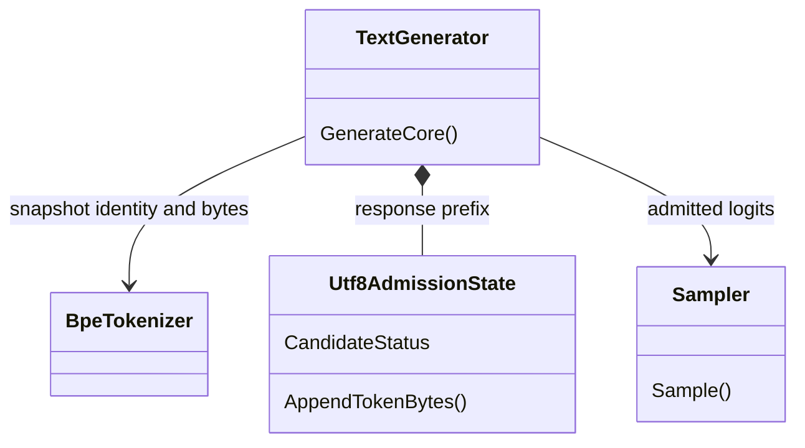

# Адресный план после local merge: сначала пригодная приёмка, затем перенос

<!-- transfer-entry-reload -->
**Вход исполнителя.** [Q10](01-registry.md#work-127-m02b), [Q54](01-registry.md#work-127-m05a), [Q55](01-registry.md#work-127-m05b). В документе несколько работ. У каждой строки собственное назначение и условие окончания. Перед каждым переносом и после восстановления контекста заново прочтите полностью агентские файлы, назначенные навыки, исправленный список Любы, текущий индекс и карточку. [Как применить прочитанное к этой работе](03-test-and-execution-contract.md#read-and-apply) · [Что взять сейчас](01-registry.md#executor-next).

<!-- POST113-CURRENT-2026-11-02:START -->
## Действующее продолжение:21007e25 и дельта b8c76da

[Аудит 134](codex-134-post113-transfer-and-experiment-audit-2026-11-02.md) перепроверил исполнение этого плана. M02a и M03c исправлены коммитом 5883e55e; staged whole-graph M04 реализован a28bc355; S02 выполнен; S01 закрывает девять различающих пар и прежние три false admissions; M06 имеет действующий required finalizer и честный NOT_OBSERVED по старому raw. Ниже эти статусы согласованы с фактом, чтобы не назначать выполненное повторно.

Открыты M02b, M03a/b,16 старых условий S01, ordinary selected-payload consumer, S03/S06 и прочие собственные остатки. Новые N01–N09 и точные решения — [135](codex-135-post113-addressed-repair-plan-2026-11-02.md): согласование писателей/версии оценки, lifecycle runners и реальные поля оценщиков P110–P113. Старые SHA/числа во вводных абзацах — история исходного назначения, не текущий вердикт. После b8c76da в Q-таблице 114 записанных результатов, включаячастичный Q002,16 незапущенных; первая Q115. Новый M03 договор подготовлен, но native gate и полная миграция не завершены; остатки N15–N17/R09 указаны в 135. Новое обучение этим документным аудитом не назначено.

**Уточнение перед публикацией, 1aaa3bc:** канонический основной builder, PairId, ряд readers/imports, collision preflight и удаление PAIR-обхода floor уже реализованы в исходнике; native gate UNRUN. Открыты version/default, достижение кандидата N16, RULE/restore и новая N18 (non-object JSON в collision preflight). Действующий остаток — [135/R09](codex-135-post113-addressed-repair-plan-2026-11-02.md), подробная сверка — [отдельный документ](../../../../experiments-v2/_audits/2026-11-02-post113-audit/publication-reconciliation.md). Повторять реализованные части M03 не требуется. **Последующая source-сверка 5bb764277d9:** N18 ValueKind guard уже реализован; не назначать его добавление повторно. Нынешний non-object отказ имеет код BATCH_ROW_CHOSEN_OUTPUT_NOT_OBJECT, null сохраняет typed skip. Три TranslationBatchChosenOutputValueKindTests помечены UNRUN; ordinary-object случай проверяет collision refusal, не новый выученный ответ. Native acceptance и learned-positive остаются отдельными незакрытыми границами R09, без нового запуска этим документом.
<!-- POST113-CURRENT-2026-11-02:END -->

**2 ноября2026. Основание:** [аудит126](codex-126-postmerge-transfer-and-experiment-audit-2026-11-02.md), первоначальный core `3cd2f26ced57da3acc4cd8a860c716a6bdac8a1e`, отдельно проверенная дельта S01 на `735fa919d953e3eae636ac3c40ac5ff7c0c8d9da` и ограниченный аудит нового P108 на `066725d8f3e92d692a95f5566f353ce9053f4095`. Это дополнение к [124](codex-124-post107-addressed-repair-plan-2026-11-02.md) и существующему118/A101-R2 с учётом реально выполненной части S01 и записанного P108. Они не назначаются повторно как отсутствующая работа; более поздние срезы этот проход содержательно не аттестует.

Числа179 файлов и795 строк маркеров относятся к первоначальному срезу `3cd2f26c` и проверенному scope. К `735fa919` значительная часть текстового ремонта уже опубликована другим коммитом. Этот пакет согласовывает подготовленные решения с новым состоянием, а не присваивает авторство всего удаления маркеров; исходный и окончательный состав изменений различаются в квитанциях.

## 1. Что требуется получить

Обученный урок должен пройти через совместимые writer, память, загрузчик и обычного потребителя; отказ после поздней ошибки не оставляет частично принятую партию. Приёмка обнаруживает отсутствие этого поведения и одновременно сохраняет законные русские ответы. Записанный результат опыта остаётся воспроизводимым, а выводы, стоимость и посещённые ветви различаются явно.

**Документный результат:** M01 — согласование первоначального набора179 конфликтных файлов с уже опубликованным ремонтом `735fa919`, уникальная Q-таблица, актуальные источники120 и адресные требования. **Внешним коммитом реально исполнена часть S01:** пять pure условий, шесть пар и два красных контроля; статус PARTIAL и конкретный остаток приведены в §8.1. На срезе21007e25 M02a/M03c/основной M04/S02 уже исполнены в описанных ниже пределах; M02b/M03a/b/M05 и собственные открытые части S01–S15 остаются будущей работой. Пересчёт сохранённых данных не создаёт новый научный запуск и не разрешает повторный Train.

## 2. Порядок и зависимости

| Порядок | Работа | Почему здесь | Условие завершения |
|---|---|---|---|
|0|M01: согласованные инструкции и источники|Из конфликтного договора нельзя получить единую приёмку|Текстовые проверки, единственная Q-строка, сохранные исторические результаты; результат согласован с уже опубликованным ремонтом735fa919|
|1|M03a: исправить оставшийся PAIR договор; M02a уже исправлен|PAIR key всё ещё противоречит verifier/плануS04|Согласованные positive/negative для canonical key; multilingual договорM02a сохранён|
|2|M04 реализован; остаток135/R01 и поздняя оценкаS09|Atomic holder не сериализует writers и не связывает accuracy с measured state|Сохраняются6 atomic cases; отдельные interleaving/cancellation/held-out проверки закрывают остаток|
|3|124/S03 иS06: допуск сохранённых метрик и оба import пути|Сохранённый флаг не должен разрешать плохое состояние|Finite/range/threshold проверки до публикации; обычный export не восстанавливает ложный PASS|
|4|M03b/c +124/S04: единый ключ и настоящий restored consumer|Нужна согласованность всех читателей, включая verifier|Миграция, collision refusal, negative candidate и чтение loaded target без Train|
|5|M02b +118/A101-R2 +124/S14: чтение Unicode|Подготовленный тест должен сохранять допустимые последовательности|Обычный generator, multilingual controls, EOS/cutoff и ресурсная приёмка; широкий default до неё остаётся HOLD|
|6|Остаток124/S01 по§8.1, S02/S07, M05 иM06-P108 по§8.2: оценщики, наблюдаемость, расход/сроки|Успешное оформление не заменяет корректность измерения|Saved-data replay с привязкой личностей, required outcomes и winner, implementation hash, общий учёт расхода; реальные испорченные данные, truthful trace, исполняемый deadline|
|7|Остатки S05,S08,S10–S13,S15|Не потерять ранее найденные неперенесённые границы|Адресные проверки прежнего плана; не повторять уже принятую реализацию|

Независимые работы могут выполняться в порядке назначенного исполнителю slice, но не обходят свои зависимости. Для каждого владельца один писатель. Очередь научных Q108–Q130 сохраняется отдельно: устранение известной ошибки приёмки не разрешает повторять завершённый опыт или менять его учебную дозу.

На срезе21007e25 Q108–Q113 записаны; следующая незаписанная научная позиция Q114. Исправность измерителя S01/S02/M06 — предварительное условие новых утверждений его PASS: работа с required controls не откладывается до завершения очереди продуктовых ремонтов. Это не разрешает повторять научный опыт; назначенные ниже проверки выполняются по сохранённым квитанциям и управляемым dummy/spy без Train.

## 3. M01 — завершённый ремонт публикации и последующий защитный шаг

**Результат согласования.** Подготовленные по `3cd2f26c` решения сверяются с уже опубликованным текстовым ремонтом `735fa919`. Карточки сохраняют обе полезные серии добавлений120/POST107. Содержательные конфликты103/109/101/40 разрешены по фактам и текущему договору; исторические статусы названы историческими. Отчёт P103 имеет точные байты прежнего исправленного отчёта. Порядок Q, бюджеты и исторические JSON не изменены; дубли строк Q102–Q107 устранены. Авторство уже сделанной другим коммитом части удаления маркеров этому пакету не приписывается.

**Следующий исполнитель:** перед сборкой конкретного нового merge проверяет фактические текстовые файлы изменяемого scope на конфликтные строки и повторы Q ID. Проверяется не только `git ls-files -u`: Git уже считал текущие конфликтные bytes обычным коммитом. Положительный контроль — разрешённый pack; отрицательные — вставка маркера в копию инструкции и второй строки Q104. Проверка обязана остановиться до запуска модели.

Граница ремонта — публикационный механизм, Train0, models0. Чистота документов не означает зелёный полный C# проект. В квитанции указываются commit tree, изменённые пути, baseline/resolved hashes, source/runtime version проверяемой задачи и фактический test selection.

## 4. M02 — состояние UTF-8 у генератора, совместимый числовой sampler

### M02a. Договор приёмки исправлен; продуктовая часть M02b открыта

**Исполнено5883e55e:** требование целой последовательности и multilingual positives уже в тесте. Сохранённый журнал17pass/5fail из22, соседние generation4/4. Это исправленный тестовый договор и открытый продуктовый остаток, не свежий запуск этого аудита.

**Существующие владельцы:** `Tests/ExperimentFixes/AnswerReadingRejectsIncompleteCharacterIdentifiersTests.cs`; `01.Tokenizer/BpeTokenizer.cs::Encode/Decode`; `09.Inference/TextGenerator.cs::GenerateCore`; `09.Inference/Sampler.cs::Sample`. Существующий sampler имеет скалярные temperature/topK/topP и delegate `Func<Tensor,Random,float,int,float,int>`; отдельного `SamplingConfig` в прочитанном модуле нет.

Однотокенный результат P101 остаётся проверкой `maxNewTokens=1`: он должен быть законченным текстом. Общая генерация проверяет целую последовательность. Обязательные положительные случаи: `ж=[208,182]`, `é=[195,169]`, трёхбайтный символ, `🙂=[240,159,153,130]`, кириллица с BPE merges и ASCII. Обязательные отрицательные: continuation182 в начале; неизвестный token ID; неверная continuation после начального байта; EOS или последний шаг после неполного символа; все кандидаты запрещены. Отдельная negative мутация запрещает все byte-token≥128 — она обязана сломать multilingual positive, а не стать принятой починкой.

### M02b. Выбранное устройство

`TextGenerator.GenerateCore` владеет состоянием UTF-8 **байтов ответа**. Для конкретного принятого tokenizer нужен один неизменный снимок token→bytes или ограниченный API получения bytes; это будущий API, а не притворно существующий метод. Полноценный immutable snapshot содержит tokenizer identity, диапазон допустимых ID и bytes каждого ID. Он не является обучаемым состоянием и не подменяет токенизатор.

Для каждого кандидата проверяется результат добавления всех его bytes к текущему состоянию: `VALID_COMPLETE`, `VALID_PREFIX`, `INVALID`. Валидный неполный префикс допустим только пока остаётся возможность завершения ответа. EOS и последний шаг требуют `VALID_COMPLETE`. Состояние EOS/префикса ответа определяется отдельно от текста prompt; неполный prompt или неизвестный prompt ID отклоняется согласно118/A101-R1.

До вызова прежнего `_sampler` генератор строит принадлежащую ему копию logits и маскирует непригодные кандидаты. Порядок выбран однозначно: admission → существующие temperature/topK/topP. Когда допустимых кандидатов нет, выдаётся явный типизированный отказ до Draw и следующего Forward; argmax от всех−Infinity запрещён. Выбранный ID повторно проверяется перед добавлением, чтобы ошибочный injected sampler не обошёл условие. Если маска ничего не исключает, старое поведение сохраняется.

`FirstTokenDecision` сохраняет исходные finite logits до masking; маска и допущенный выбор записываются отдельно. Проверка конечности raw остаётся до добавления−Infinity. `GenerateWithFirstDecision` должен показать прежние исходные числа и новый admitted winner без дополнительного Forward; masked logits не подставляются вместо измеренного распределения.

`Utf8AdmissionState` здесь обозначает **будущий** компонент выбранного проекта; sampler остаётся обычным числовым алгоритмом. Приёмка должна доказать наличие вызова из действующего GenerateCore, а не из нового неиспользуемого overload.

**Сохранение поведения и стоимости:** без лишних Forward; обход словаря не расходует RNG. При stochastic число Draw соответствует прежнему выбранному договору, но token при удалении кандидатов не обязан совпасть при том же seed. Все lawful greedy winners и14 допустимых one-token readouts сохраняются. Реальные model/tokenizer dimension, неизвестный ID, отсутствие допустимых кандидатов и завершение проверяются через обычные и detailed входы. Сам по себе Python codec witness не снимает DESIGN_BOUNDARY/HOLD общего default. Нового обучения для исправления договора или чтения имеющихся logits не требуется; утверждать рост качества обучения после этого ремонта нельзя.

## 5. M03 — ключи и восстановленный потребитель должны согласованно использовать урок

### M03a. Согласовать новый контракт и миграцию по135/R09

На 21007e25 тест ещё требовал PAIR; на b8c76da договор был переписан, но миграция отсутствовала. На 1aaa3bc основной builder и ряд readers/imports уже канонизируют ключ, PairId хранится отдельно, коллизии проверяются до публикации и PAIR больше не отменяет source floor. Это SOURCE_IMPLEMENTED / NATIVE_UNRUN, а не отсутствующий ремонт и не завершённая приёмка. Текущий остаток 135/R09: default/schema для legacy/manual строк, реальный candidate в source-floor тесте, RULE, отдельный restored behavior и N18 non-object preflight. Полезные RULE сохраняются, новые GOLD/дозы не назначаются.

### M03b. Миграция и совместимость

Уже реализованные canonical writer/readers и collision preflight сохранить. Проверить оставшуюся version-aware совместимость и действительные пути по 135/R09; не переписывать выполненное заново. Для ещё незакрытого пути использовать список владельцев S04 и actual reference search. До публикации подготовить новую закрытую таблицу и все связанные verifier требования, затем проверить допустимость ключей/ссылок и коллизии. Две разные строки с одинаковым новым ключом и несовместимым payload дают явный отказ до изменения живого состояния. Сохранить старый checkpoint для воспроизводимости; новая версия публикуется только целиком. Снятие хвоста у одного читателя и удаление всех полей после PAIR отвергнуты.

Положительный пример: прежний полезный урок и его обязательное слово по-прежнему дают правильный перевод. Отрицательные: в обычном EN_RU без настоящих известных semantic concepts другой PairId не разрешает источник ниже0,60; отсутствующий required term отклоняется после миграции; RULE за PAIR не пропадает; конфликт новых ключей не затирается последним уроком. Положительный контроль настоящей известной семантики сохраняет уже разрешённый floor0:0,60 не объявляется глобальным порогом всех направлений и semantic ветвей. Для source floor действительно достичь KNN; обычный EN_RU без known concepts с overlap 1,0 — обязательный положительный случай. Exact/phrase/word ранний ответ и пустой candidate set не закрывают условие.

### M03c. Доказательство восстановленного consumer исправлено

**Исполнено5883e55e:** тест читает импортированный target. Сохранённая группа4pass/4fail из8, broken-reader3pass/5fail; соседняя группа на том историческом этапе369pass/5fail из374. Оставшиеся падения не стираются и не считаются свежим полным gate послеa28bc355. M03a всё ещё требует отдельного ремонта.

Исправленная приёмка создаёт `source`, обучает назначенным данным и сохраняет; создаёт **новый target**, вызывает `ImportCheckpoint`, затем `GetOrchestratorAsync` именно target. Запрос идёт через `RunAsync(new LogicalOrchestratorRequest(...))`, `ScenarioId=TranslationRoutingFlow.ScenarioId`, `UserRequest="Он проверил файл"` либо заранее закреплённое различающее свидетельство, `Flags=new LogicalExecutionFlags()`, metadata `source_language=ru`, `target_language=en`, `topic_domain=general`.

Сам текст примера не объявляется достаточным: перед его фиксацией показать, что ответ зависит от нужной restored map. Exact/phrase ранний путь и phrase confidence≥0,85 могут скрыть отказ verifier. Если публичных метрик недостаточно, добавить минимальную настоящую trace-точку в действующий adapter/tokenizer; не создавать обучаемый третий объект вместо target.

Наблюдаемые поля существующего API: `IsSuccess`, `FinalHumanResult`, `OverallVerdict`, `FlowResult.Metrics["adapter_id"]` и `["confidence"]`. Отдельного runtime `Signature` здесь нет. После Import в этом плече число Train/update равно0; state identity и счётчики до/после чтения сохраняются. Контрольная поломка отключает применение выбранной загруженной карты, сохраняя её re-export: положительное сравнение ответа должно перестать проходить. Хеш экспорта и поведенческая приёмка записываются отдельно.

## 6. M04 — staged whole-graph publication реализована, остаток выделен

**Выполнено a28bc355:** `TranslationMachine.TrainStructuredBatchAsync` готовит закрытую копию согласованного runtime, учит её, оценивает held-out на ней и публикует `TranslationPublishedVersion`. Holder включает Runtime/Flow/UnitTrainers, versions, metrics, history и lesson identities. ImportCheckpoint также готовит целый граф. Старый и новый InlineOrchestrator используют provider; каждый RunAsync захватывает одну версию и записывает state_version. Код `BATCH_ROW_TRAINING_FAILED` теперь существует; это больше не будущий контракт.

Ошибка второй/третьей строки оставляет прежнее состояние без внешнего restore, следующая законная партия применяется. Сохранённая native группа до ремонта1pass/5fail, после6pass/0fail; naive runtime-only swap4pass/2fail, neighbours114/114. Эти журналы относятся к указанному ремонту, не к новому запуску аудитора и не ко всему solution.

**Остаток:** R01 плана135 закрывает захват одной базы двумя writers и запись оценки measuredVersion в более новую latest. Общий gate всех mutation entrypoints берётся до чтения основы; обычные readers остаются snapshot. Метрика записывается только для измеренного состояния, иначе явно stale. Поздняя отмена и внутренняя ошибка held-out до publication имеют отдельную приёмку; основной atomic suite их автоматически не доказывает. Родной gate и все реальные callers проверяются управляемым interleaving, не только отдельным swap-helper.

Состав mutable owners проверяется по продукту: memory/maps, tokenizer/verifier corrections, identity/schema/history/quality; отсутствующие optimizer/moments не придумываются. M03 canonical migration использует эту атомарную публикацию и не отнимает уже доказанные old/new orchestrator positives. Q129 остаётся отдельным незапущенным научным паспортом со своей дозой.

## 7. M05 — наблюдаемая работа P66, полный счёт и исполняемый deadline

### M05a. Посещение поиска

В `P6601.Program.OrdinaryFlow` имя `KnnReached` нельзя выводить из конечного adapter ID. Из исторических raw корректно вывести только selected/not-selected; attempted остаётся NOT_MEASURED. Будущий производитель событий находится в реальном `ExecutorUnit`/`TrySelectKnnCandidate`/cascade, а не в host-предположении.

Минимальный receipt: `search_attempted`, `candidate_count`, `eligible_count`, `selected_lesson_id`, `final_source`, `abstention_reason`. Unknown не превращается в false. Три раздельных примера: exact ранний ответ (attempted=false), достигнутый поиск с нулём допустимых соседей (true/0/не выбран), выбранный законный сосед (true/>0/выбран). Прежняя запись bootstrap сама по себе не позволяет восстановить эту трассу.

### M05b. Счёт вызовов

`pairSimilarityEvaluations=12` сохранить как admission count. Для будущего измерения считать реальные вызовы `ComputeTokenOverlap` в едином принадлежащем хозяину wrapper с категориями admission/grid/oracle/edge. Каждый consumer вызывает wrapper, не прибавляет ожидаемое число заранее. Если удаляется второй одинаковый вызов при записи решётки, новый расход измеряется честно; старый source-derived39 не ретушируется. Уникальные пары, решения policy, model updates и вызовы callable — разные поля.

Контроль добавляет один физический вызов, оставляя число уникальных пар прежним: ledger возрастает на1. Вложенные обучения/Flow считаются по своим владельцам, их unknown не означает0. Исторические12+1 и дополнительная оценка26 остаются рядом с источниками, без изменения raw. Исправление описания и пересчёт не требуют нового Train.

### M05c. Сроки и продолжение

`Run-Experiment.ps1` должен исполнять назначенные600/1200/1800 секунд через один monotonic deadline попытки. Build и child run получают остаток общего бюджета и свой stage cap; ожидания короткие, status доступен. При timeout сохранить exit/phase/elapsed/attempt ID, остановить принадлежащее запускателю дерево процессов, подтвердить terminal state, сохранить частичные stdout/stderr. Пока состояние child неизвестно, новую попытку или повторный Train не начинать.

Дешёвая проверка использует dummy child, не модель: нормальное завершение; зависшая сборка; зависший runtime; общий лимит меньше суммы этапов; дочерний процесс, продолжающий жить после parent; поздний report failure после счётчика оплаченного callback. Callback при продолжении вызывается ровно1раз. Такая проверка подтверждает только lifecycle launcher и не заменяет учебную часть будущего нового опыта.

## 8. Старые работы, которые нельзя потерять или объявить сделанными

| Задача124 | Действующий остаток |
|---|---|
|S01 — PARTIAL наb0a01344|Девять различающих пар, три дополнительных false admissions и CLI guard исправлены;16 старых условий и ordinary payload consumer остаются по§8.1|
|S02 — выполнен в scoped gate|Обязательные контроли P107 участвуют в technical verdict; научный ноль отдельно. Старый расход51/50 остаётся NOT_ACCEPTED/code7|
|S03|Finite/range проверки сохранённых router metrics и thresholds через ordinary Unit snapshot|
|S04|Единая миграция ключей; уточнена M03|
|S05|Полный смысловой разбор P106: роли/леммы/пометки, не только исправленный Pattern|
|S06|`ImportAsync` и `ImportCheckpoint` до изменения памяти применяют общий0,75 gate; normal export не доверяет ложному persisted PASS|
|S07|Summary reader применяет correction по source hash/JSON pointer, не выдаёт raw forgetting за факт|
|S08|Нативная ordinary приёмка P85; прежний фильтр ProjectWiki не доказывает MethodKnn|
|S09 — основная M04 выполнена|Остаток: late evaluation/cancellation и135/R01 writer/metric identity; не назначать holder заново|
|S10|Допуск кандидата до cap/остановки tier, источник и payload выбранного соседа|
|S11|Resume без повторного update и реальный timeout; M05c уточняет отдельного хозяина P66|
|S12|Действительные входы сборки и consumed bytes; прежний manifest rehash не закрывает TOCTOU|
|S13|Один P102 evaluator, отличимые generated/reencoded IDs, правильный gold и длина|
|S14|Strict decode с законной многотокенной кириллицей; уточнена M02|
|S15|Q130 target expression scope без поглощения вложенных lambda/local functions; прогноз не равен измерению|
|S16|Закрыт как остаток доступности: оба120 опубликованы, planning ссылки заменены. Это не доказательство выполнения full-read|

Конечные Wiki metrics,14 finite publication checks, конечные route scores и distance tie policy не назначаются повторно только из-за старого заголовка. Их уже установленная реализация и ещё нужная ordinary acceptance различаются.

### 8.1. S01 — три обхода исправлены; остался поимённый разбор16 условий

**Исполненоb0a01344:** NegativeControls/NegativeControlReplay фиксируют ожидания E1–E5 до мутации и проверяют distinct RowId→lesson, identity каждой строки, schema/ordered steps, принадлежность и ранг winner. Пять копийE1, строкаE3 с payloadE1, NOT-IN-POOL/неверный rank больше не принимаются. Method-body hash отличается от contract hash. Saved receipt содержит9 различающих пар,0harness errors и7 red harness checks. Неизвестный ключ, включая --nologo, даёт exit2 до каталога обычной попытки/Train.

**Точный незакрытый scope:**16 прежних условий старой подписи; обычный consumer выбранного payload; применение companion correction читателем общей стоимости. Для каждого из16 назначить фактическое проверяемое поле, positive и реальную порчу; один неизменный evaluator с expectation до вмешательства должен различить их по значениям, не по mutation ID. NoOp=NOT_DISCRIMINATING; harness error=ошибка проверки. Проверенное условие перечисляется поимённо; остальные не получают PASS по вычитанию.

Родное удержание E1–E5 сохраняет исходные rank1 ответы, а не подменяетE2/E4/B-gold илиE5 отказом. Отдельный ordinary payload gate должен достичь выбранного не первого кандидата и прочитать его полное содержание. Replay local trained_corpus_row сам по себе такого product пути не доказывает.

Сохранить бюджетную поправку случайной прежней попытки: чистый replayTrain0 не обнуляет объявленный ранее1Train и связанные чтения. Полнота прежнего утраченного raw не выдумывается. Новые model updates/native queries для этого saved-only остатка0; historical JSON/report не переписываются. CLI parser уже защищён — повторный полный научный запуск не является способом проверить его.

### 8.2. M06-P108 — измеритель исправлен, историческое наблюдение ограничено

**Исполненоfbeba86c/16ebc2e6:** OutcomeContract, MandatoryControls и SavedOnlyVerification используют неизменный required-set. Missing/duplicate/false/error/unknown обязательного outcome не получают measurement PASS; finalizer не требует сам себя. Корректный научный ноль отличается от технической ошибки. Финальный ремонт убрал необработанное исключение при отсутствующем источнике. Эти части не назначать снова как отсутствующие.

На старом raw P108-CARRIER-TRACE-COMPLETE и P108-ID-CONTENT имеют NOT_OBSERVED; P108-NULL-REFUSAL принят. Нельзя получить consumed inputs из output PredicateIds/gold или новой calibration fixture. Старые delivery4/12→12/12 и answers12/12 у обоих сохранены. Полный state hash не наблюдался: tokenizer hash и counts не закрывают vectors/graph/output mapping.

Ledger обеих физических попыток даёт2Train/16предъявлений/64наблюдения, в том числе8cold. Назначенные8уроков/38наблюдений не становятся новым лимитом на каждую попытку.42записанных «search» — это42Execute calls;41реальный Search является source-derived оценкой, инструментальное число неизвестно. Ремонт измерителя новых Train не добавил, неизвестное не превращено в0.

**Новый открытый остаток135/R02:** один terminal.json смешивает успешную build-стадию с завершённым опытом; build→run выходит0 без runtime, build способен скрыть старый failure. Grandchild selftest считает matched только по timeout, игнорируя surviving child/missing PID. Выделить BUILT_ONLY receipt и настоящий run terminal; positive/negative cases исполнить на dummy, не модели. Deadline/claim и runtime.stdout anti-repeat guard сохранить; гипотеза о повторном Train по одной ранней race не подтверждена.

Новый companion сохраняет source hashes и указанные ограничения. Полная научная приёмка старого опыта не восстанавливается ни чистым replay, ни успешным selftest launcher. Очередь и Q108 RESULT_RECORDED остаются прежними.

## 9. Готовое задание исполнителю одного ремонта

> Действующий вход этого передаваемого задания (02.11.2026): прочитай целиком карточку C:/Projects/llm_mvp_core/docs/plans/replanning-possible-diffs/fixes-based-on-experiments/codex-127-postmerge-addressed-repair-plan-2026-11-02.md. Свежее полное чтение AGENTS/CLAUDE и основного стека навыков: C:/Projects/llm_mvp_core/docs/plans/replanning-possible-diffs/fixes-based-on-experiments/120-executor-context-and-test-repair-contract-2026-11-02.md, §1; дополнительные роли и результат их применения: C:/Projects/llm_mvp_core/docs/plans/replanning-possible-diffs/experimets/40-effective-executor-context-2026-11-02.md, §2; проверка применимости и разбор падений: C:/Projects/llm_mvp_core/docs/plans/replanning-possible-diffs/experimets/codex-42-postmerge-executor-checks-2026-11-02.md. Короткие списки навыков ниже только дополняют этот вход. Актуальные статусы и новые остатки сверить с131. Выполняется лишь прямо назначенный пользователем ID/этап; старый императив «реализуй/запусти» не разрешает исполнение при документальном поручении. Данные, один фактор, модель, команды, бюджет и хорошие/плохие примеры берутся из этой полной карточки; нерешённое противоречие не разрешается подбором gold, нового обучения или чужого механизма.
>
> Прочитай действующий договор120 и одну назначенную работу127 вместе с её владельцами124/118. Закрепи текущий commit и изменённые рабочие bytes, перечисли точный producer, обучаемое состояние, loader и обычного потребителя. Убедись, что нужный ремонт ещё отсутствует. Возьми совместимое сохранённое состояние; не повторяй обучение ради оформления. Сначала проверь, что тест допускает корректное поведение и обнаруживает нужный отказ: в зависимости от назначенного владельца русский многотокенный ответ проходит, imported target отвечает сам или поздний отказ не меняет память. Чужие fixtures и дополнительные учебные дозы к этому slice автоматически не добавляются. Измени владельцев выбранного контракта и все его обязательные читатели. Запусти точный набор обычных, отрицательных и restore проверок, запиши source/assembly hashes, native command, exit, фактический расход и ограничения. После reconciliation проверь итоговый merge, опубликуй связанные code/tests/docs и прочитай обратно удалённые bytes. Прямое указание пользователя о scope/STOP/NEXT имеет приоритет; отсутствие evidence не превращается в success.

**Неверно:** сделать каждый byte-token законченным символом; обучить третий объект после Import; сравнить только размер памяти; приписать bootstrap отсутствие посещения KNN; закончить при `exit0`, игнорируя провал обязательного контроля. **Верно:** проверить последовательность и terminal state, loaded reader и реальную изменяемую память, события посещения, независимый technical verdict и измеренную стоимость.

Это план реализации с выбранными инженерными решениями. Слово «готово» у документа не используется как утверждение о нативной приёмке продукта. Итоговый ремонт принимается только по собственным наблюдаемым условиям этой строки.
