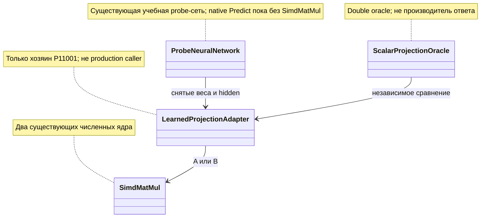

# P110: сохранить численный выигрыш, не назначать общую замену ядра

<!-- transfer-entry-reload -->
**Вход исполнителя.** [Q65](01-registry.md#work-t110). Это отдельное чтение результатов. Для него достаточно сохранённых входов и указанного ниже проверяющего. Перед каждым переносом и после восстановления контекста заново прочтите полностью агентские файлы, назначенные навыки, исправленный список Любы, текущий индекс и карточку. [Как применить прочитанное к этой работе](03-test-and-execution-contract.md#read-and-apply) · [Что взять сейчас](01-registry.md#executor-next).

<a id="current-transfer-task"></a>
## Текущий вход переноса после разбора аудита — 3 ноября 2026

**Владелец: T110 / P110, условный численный перенос.** Сохранить численный выигрыш P110 и существующий запрет общей замены ядра без своего допуска. Проверять именно назначенный numeric consumer и его математическую функцию. Эта поправка уточняет существующее задание в [реестре](01-registry.md), не добавляет очередь и не отменяет его допуска по пользе и регрессиям. Нынешнее поручение — исправление документации; исполнение продуктового ремонта требует своего прямого назначения.

**Хороший пример:** Конечные значения проходят независимый расчёт в исходном допуске; NaN/Infinity и неверный тип отвергаются до сравнения.

**Плохой пример и ожидаемое исправление:** Tolerance или expected взяты из проверяемой receipt; общий scalar совпал при неверном output. Нужны единицы, формула, точность и цена; чистый расчёт не называется измерением скорости всего обучения.

**Обязательная часть передаваемого задания:**

> Полностью прочитай этот план `C:/Projects/llm_mvp_core/docs/plans/replanning-possible-diffs/fixes-based-on-experiments/codex-130-p110-numeric-projection-disposition-2026-11-02.md`, выбранный owner-раздел и [договор120](120-executor-context-and-test-repair-contract-2026-11-02.md): AGENTS/CLAUDE, архитектура, планирование, plan-review, code-execution/code-examination/generated-code-review, prompt-patch-authoring и человеческая коммуникация; основной полный список — §1. Для тестов добавь test-integrity, test-failure-triage, bug-to-tests. Прочитай [44, §10–12](../experimets/codex-44-post117-saved-evidence-and-finalizer-contract-2026-11-03.md#10-один-текущий-вход-вместо-нескольких-противоречащих-заданий). Укажи, что уже реализовано и какой один остаток назначен; не переписывай работающий guard. Привяжи собственные хорошие/плохие примеры к рабочему caller и итоговому решению. При падении сначала сохрани input/expected/actual, версию и стадию; правильный тест регрессии не ослабляй, устаревшее ожидание меняй только по независимому контракту. Сохрани raw и фиксированный gold. Ожидаемый red/green по исходнику не выдавай за исполненный тест. Не повторяй эксперимент ради отчёта или отсутствующей приёмки. Новая проверка с моделью допустима только в назначенном runtime-срезе с конечным бюджетом; текущая правка документов её не разрешает. Назначенные пути/команды/fixtures берутся из owner-раздела, отсутствующее поле назови автору. Пиши результат по-русски: эффект до/после, точность, ухудшения, проверенный код, невыполненная приёмка. Дождись исходного handle при разрешённом исполнении; прямой STOP/NEXT немедленен.

Основание: [адресный разбор оставшихся пробелов](evidence/2026-11-03-post117-executor-context-review.md). Старые результаты и ограничения ниже сохраняются; при расхождении старого описания с живым кодом эту дельту применять по названной области, не считать весь перенос закрытым.


<!-- POST113-CURRENT-2026-11-02:START -->
## Независимое усиление — P110: отсутствующий полный допуск и NaN

R03 плана 135 воспроизвёл ложный допуск NaN. Конечность исторических выходов проверена отдельно и не опровергнута. В `scalar-equivalence.json` сохранены полные выходы A/B/oracle, но только `declared_abs_tolerance_min/max`: покоординатного вектора допусков и полной W2 нет. Будущий fixture не должен читать несуществующее поле, подставлять максимум вместо всех `t_i` или восстанавливать веса из хеша.

Этап на сохранённых данных пересчитывает ошибки, argmax и конечность чисел. Повторная проверка исторического покоординатного допуска получает статус `NOT_OBSERVED_FROM_SAVED_TOLERANCE`. Для проверки самого компаратора назначен отдельный синтетический fixture: `expected=[2,1]`, `actual=[2,1]`, `tolerance=[0.000001,0.000001]`. Честная пара принимается; в единственной конечной порче `actual[1]=1.01`, поэтому argmax и длина прежние, а численный допуск нарушен. Ещё 10 порч перечислены в §4: по три нечисловых/бесконечных значения actual и expected, четыре недопустимых tolerance. В каждой порче меняется ровно одно поле; транспортная подпись, если применяется, пересчитывается, frozen expected — нет.

Бюджет — 44 чистых сравнения: 32 сохранённых выхода A/B, одна конечная порча, один честный синтетический случай и 10 недопустимых численных входов. Train, Predict, MatVec и Encode — 0. Такой gate проверяет защиту компаратора, но не восстанавливает отсутствующий точный допуск для 16 исторических строк. HOLD общей замены ядра сохранён.

Основание: [аудит 134](codex-134-post113-transfer-and-experiment-audit-2026-11-02.md), [план 135](codex-135-post113-addressed-repair-plan-2026-11-02.md). Это уточнение уже опубликованного владельца; новый владелец реализации не создаётся. Нативный код текущим аудитом не исполнялся.
<!-- POST113-CURRENT-2026-11-02:END -->

02.11.2026. Срез исследования: `21007e25ec3f6f6634dd8733fc8631ae267e518c`. Автор: `/root/post107_card_context`. **Планирование и чтение сохранённых данных; новых запусков и продуктовых правок нет.**

SIMD уменьшил худшую абсолютную ошибку на измеренной обученной матрице на 58,04%. Одновременно худшая относительная ошибка выросла примерно на 59,98%, а некоторые входы стали хуже и по абсолютной ошибке. Поэтому локальный выигрыш сохраняется, но условие «выигрыш более 5% без иных ухудшений более 5%, кроме CPU» для общей замены не закрыто. **Статус: HOLD общей замены; измеренное равенство в объявленном допуске принято как локальный результат.** Это не новое разрешение повторить P110.

## 1. Что действительно измерено

Идентификатор — **P110-PRIMARY-01**, каталог **P11001**, строка Q110. Каталог `P1101` относится к одиннадцатому опыту и его ремонту R29; его данные сюда не подмешиваются.

Первичные источники: [паспорт](../experimets/cards/P110-numeric-matrix-cost.md), [отчёт](../../../../experiments-v2/RP01-MICRO/P11001/results/attempt-0001/report.md), [построчный численный выход](../../../../experiments-v2/RP01-MICRO/P11001/results/attempt-0001/raw/scalar-equivalence.json), [порча координаты](../../../../experiments-v2/RP01-MICRO/P11001/results/attempt-0001/raw/corruption-control.json), [расход](../../../../experiments-v2/RP01-MICRO/P11001/results/attempt-0001/raw/budget-audit.json), [терминальная квитанция](../../../../experiments-v2/RP01-MICRO/P11001/results/attempt-0001/run-1.receipt.json). Прочитанный terminal: exit 0, `timed_out=false`, `child_terminal_confirmed=true`; это исторический запуск другого исполнителя.

| Ось | A — MatVecPlain | B — MatVec | Допуск вывода |
|---|---:|---:|---|
| Максимальная абсолютная ошибка относительно одного double oracle | 1,3435864723e−6 | 5,6376216051e−7 | Локальное улучшение 58,04% |
| Максимальная относительная ошибка | 2,0233471079e−5 | 3,2370326193e−5 | Ухудшение 59,98%; нельзя скрыть за абсолютным максимумом |
| Абсолютная ошибка для token 0, в том числе panel-01 | 1,4852156571e−7 | 4,2888152052e−7 | Ухудшение 188,77%; повторяющиеся строки не независимые опыты |
| Абсолютная ошибка для token 1 | 3,7434353040e−7 | 4,5848879893e−7 | Ухудшение около 22,48% |
| Принятые полные выходы / совпавший argmax | 16/16 | 16/16 | Обе реализации внутри заранее объявленного допуска |
| Окно 16 ответов | 3,8354 мс | 1,3959 мс | Наблюдение −63,60%, причинность не установлена |
| Время непосредственно ядра | 0,5039 мс | 0,7418 мс | Наблюдение +47,21%, знак противоположный |
| Выделения плеча | 11 744 байта | 11 032 байта | −712 байт; равные массивы, возможное влияние счётчика не проверено |

Одна сеть 22→32→22, seed 42, LR 0,05, 200 × 12 = 2400 обновлений. Loss 3,067961→0,412131; панель 0/16→12/16 при доказанном потолке 12/16 и постоянном ответе 6/16. Это приобретение отображений общей сетью до A/B, а не преимущество SIMD в обучении. Все четыре экзаменационных входа уже встречаются в TRAIN после кодирования: вывод об обобщении закрыт.

Стоимость целиком: 1 fit, 2400 updates, 32 native Predict (16 before + 16 after), 32 adapter Predict (16 A + 16 B), всего 64; отдельно 43 физических вызова ядра (32 плеча + 1 повторный контроль + 10 component controls), 11 различных входов. Подготовка 3,3077 мс / 33 664 байта; обучение 156,5562 мс / 156,25 CPU-мс / 3 863 504 байта. Прогревов и дополнительных градиентов 0. Пик процесса 45 883 392 байта; пик по плечам и аппаратные операции внутри Vector.Dot не измерены. Число уникальных входов не является расходом.

## 2. Реальный механизм и границы его владельца

На закреплённом срезе [ProbeNeuralNetwork.cs:71](../../../../35.ExperimentsV2/Core/ProbeNeuralNetwork.cs:71) обучает embedding, W1/b1 и W2/b2. [Predict:184](../../../../35.ExperimentsV2/Core/ProbeNeuralNetwork.cs:184) вычисляет ответ собственным циклом `sum += _w2[i, j] * h[j]` (:197–203). [SimdMatMul.cs:17](../../../../35.ExperimentsV2/Core/SimdMatMul.cs:17) использует Vector.Dot и скалярный хвост; :44 — последовательный float цикл. Разный порядок суммирования объясняет возможность разных ошибок, но не доказывает универсальное превосходство одного порядка.



| Связь | Конкретное значение и ожидаемый смысл |
|---|---|
| Сеть→adapter | Одна обученная W2 22×32 и один hidden 32; после плеч веса прежние |
| adapter→ядро | panel-01/token 0: оба logits 22, один argmax; числа всё равно сравниваются полностью |
| oracle→сравнение | Координата 7 сдвинута на 0,0019770386 при допуске 1,9770386e−6: отказ именно по координате |

Вне Tests/experiments-v2 поиск `git grep` по tracked source SHA нашёл SimdMatMul у E12MatrixOpt, а ProbeNeuralNetwork у E11/E28/E29/E31/E44/E45/E48. Это инфраструктура измерений проекта 35, **не установленный основной LLM learner и не prompt→domain маршрут продукта**. `Compile Include` в [Experiment.csproj](../../../../experiments-v2/RP01-MICRO/P11001/Experiment.csproj) собирает те же байты в P11001Experiment, не вызывает штатный ExperimentsV2.dll. Недостающий caller — ограничение переноса, а не сам по себе доказанный баг продукта.

У [плана 105](105-addressed-repair-plan-2026-10-30.md) уже есть ремонт обратного прохода Probe; у [45](45-attention-transpose-strides.md) — другой tensor/transpose путь. Эти владельцы не заменяются и повторно не открываются. В fixes на срезе нет отдельного плана переноса измеренного P11001; ссылки P1101/R29 — другой результат. Поиск точных PRIMARY/механизмов также выполнен по локальным DPOLegalLearning, DpoImplementation, orchestrator-extensions, external_domains, language_translate; fetch не выполнялся, полнота удалённой истории не заявляется.

## 3. Математический договор будущей квалификации

Для строки длины n=32, u=2^−24: γn=nu/(1−nu). Исходный oracle объявляет до ответа `tol_i=γn Σ|W_ij h_j| + u(|b_i|+Σ|W_ij h_j|)`. Допуск зависит от входа и весов, не от полученного A/B. Сравнивать все 22 числа, абсолютную ошибку, относительную ошибку с явно указанным знаменателем, argmax и near-tie отдельно. Возле нулевого эталона относительная ошибка плохо обусловлена; это требует заранее выбранного критерия, а не удаления неудобной метрики после результата.

Политика «B всегда точнее» отвергается уже сохранёнными token 0 / token 1. Правка хранения W2 на flat row-major не назначена: она затронет TrainStep и существующую гарантию «все производные на весах до шага». Если позже будет выбран узкий probe-перенос, единый projection method должен обслуживать train-forward и Predict при сохранении deferred updates; flatten-cache обязан обновляться после каждого изменения W2. Нельзя менять только reader, оставив устаревшую копию матрицы.

## 4. Конкретная следующая проверка и тестовый ремонт

Ближайший допустимый результат после отдельного назначения — **квалификация сохранённых чисел**, без повторного PRIMARY: будущий `Tests/ExperimentFixes/P110NumericQualificationTests.cs`, общий fixture читает сохранённые full_output A/B и oracle из scalar-equivalence. Полных per-coordinate tolerance там нет:32saved comparisons пересчитывают errors/finite, а не дают новый pointwise admission PASS. Явный synthetic comparator fixture с заранее заданным tolerance обслуживает negative cases, как уточнено сверху. Тесты:

- `SavedLearnedProjection_ReportsAbsoluteAndRelativeTradeoff`: все 16 строк, один oracle на строку, обе ошибки рядом; не превращать только abs gain в global PASS.
- `FullOutputComparison_RejectsChangedCoordinateWithSameArgmax`: deep copy явного synthetic comparator fixture, изменить одну координату с сохранением argmax, длины и согласованного transport digest; тот же evaluator должен дойти до численной границы, original/gold неизменны; честный синтетический counterpart с заранее заданным допуском принят.
- `NumericQualification_RejectsNonFiniteAndInvalidTolerance`: Ровно 10 отдельных входов: actual = NaN, +Infinity, −Infinity (3); expected = NaN, +Infinity, −Infinity (3); tolerance = NaN, +Infinity, −Infinity, −1 (4). В каждом меняется одно поле честного finite fixture, остальные сохранены; каждый вход даёт технический отказ. В текущем экспериментальном NumericOutputVerifier обычное `abs > tolerance` само по себе не отвергает NaN; его нельзя копировать как универсальный готовый приёмщик.

Планируемый бюджет этого этапа: **Train 0, Predict 0, MatVec 0, Encode 0**; 32 saved error/finite сравнения, 1 finite synthetic mutant, 1 lawful synthetic counterpart, 10 numeric-invalid cases = 44 чистых сравнения. Файл тестов пока не существует; команда только после его реализации и отдельного назначения:

```powershell
dotnet test C:/Projects/llm_mvp_core/Tests/LlmFromScratch.Tests.csproj --filter "FullyQualifiedName~P110NumericQualificationTests"
```

Это не перенос скорости/обучения. Если позднее разрешена смена W2/layout, обязательны существующие `ProbeNeuralNetworkGradientTests.WholeOneStepVector_MatchesTheGradientTakenBeforeTheStep` и `LossUsedForFiniteDifferences_AgreesWithTheProductionForwardPass`; fixture private-field shape можно адаптировать к новому layout, математические expected derivatives нельзя заменять полученными числами. Не все Tests/SimdMatMulTests проверяют этот класс: там есть TensorOps/SimdOps, поэтому общий зелёный фильтр не является native Probe proof. Исторические красные журналы и P110 raw не переписывать.

Для общей замены ещё отсутствуют: согласованный multi-axis допуск, подтверждённый обычный потребитель, полный план его сохранения/Load, точный дозовый бюджет native regression/E2E. Это конкретный HOLD dependent этапа; новые размеры 64×64/512×64 и новые обучающие запуски этим документом не назначаются. Prompt→domain→learner→restore нельзя выдать за пройденный путь, добавив экспериментальный adapter.

## 5. Передаваемый промпт

> **Эта часть передаётся вместе с заданием:** применить [текущий вход этого плана](#current-transfer-task), его собственную пару хорошего/плохого примера и [44, §10–12](../experimets/codex-44-post117-saved-evidence-and-finalizer-contract-2026-11-03.md#10-один-текущий-вход-вместо-нескольких-противоречащих-заданий). Основной стек навыков —120§1; для падений дополнительно test-integrity, test-failure-triage и bug-to-tests. Уже написанные части сохраняются. Проверить путь до конечного принятия, независимый expected и полный назначенный состав; исходник теста не выдавать за его прогон. При документном поручении — только документы и сохранённые свидетельства, без runtime. Старый PRIMARY не является командой ремонта. Прямой STOP/NEXT немедленен.

> Открой полностью собственный план C:/Projects/llm_mvp_core/docs/plans/replanning-possible-diffs/fixes-based-on-experiments/codex-130-p110-numeric-projection-disposition-2026-11-02.md и его первичные источники. Перед новым назначением выполни свежее полное чтение AGENTS/CLAUDE и основного+ролевого стека по C:/Projects/llm_mvp_core/docs/plans/replanning-possible-diffs/fixes-based-on-experiments/120-executor-context-and-test-repair-contract-2026-11-02.md §1, роли по C:/Projects/llm_mvp_core/docs/plans/replanning-possible-diffs/experimets/40-effective-executor-context-2026-11-02.md §2, применимые проверки по C:/Projects/llm_mvp_core/docs/plans/replanning-possible-diffs/experimets/codex-42-postmerge-executor-checks-2026-11-02.md. Только прямо назначенный этап; сейчас READ_ONLY_RESEARCH+Markdown, запуск запрещён. Default model текущей сессии, без самовольной замены. P11001 не путать с P1101. Сохрани abs gain и все rel/per-row regressions; не копируй старый NEXT как разрешение. Если назначен saved-only этап §4, бюджет Train/Predict/MatVec 0, без переобучения для восстановления. Required IDs задаются до исполнения, check_passed сравнивает raw_actual с frozen_expected; правильный raw false отказа не ошибка. Missing/duplicate/NOT_RUN/exception или nonzero/timeout/unknown terminal не дают принятую попытку. Сохрани input/expected/actual/stack/SHA до исправления; fixture/stale expectation/product regression/infrastructure раздельно. STOP/NEXT пользователя немедленны; не relaunch и не переходи автоматически к следующему ID.

## 6. Граница чтения и готовности

Свежий полный reload этой сессии: local AGENTS, RTK, canonical AGENTS/CLAUDE, 12 основных навыков договора 120 и 5 применимых ролей (intent-to-plan, phase-planning, improvement-measurement, experiment-design, test-integrity); усечения восстановлены. Контекстный инструмент отказал в доступе к canonical root, применён разрешённый host read-only fallback. Первичные reports/raw и указанные исходники читались адресно; полного чтения всех карточек/ветвей не заявляется. Авторская сверка не независимый review; родитель проверяет этот документ отдельно. Ни одна будущая команда здесь не запускалась.
