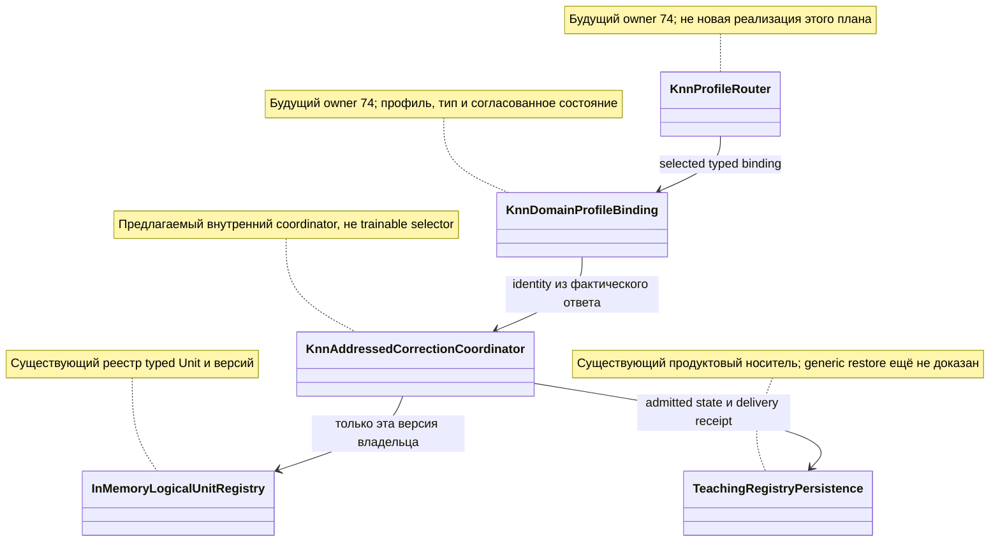

# P111: исправление учит выбранного владельца, чужая память остаётся прежней

<a id="current-transfer-task"></a>
## Текущий вход переноса после разбора аудита — 3 ноября 2026

**Владелец: T111 / P111 — дочерний срез FIX-KDP.** Награда должна изменить выбранный обучаемый Unit/Flow, сохранив чужое состояние. Дочерние проверки не становятся новыми работами. Эта поправка уточняет существующее задание в [реестре](01-registry.md), не добавляет очередь и не отменяет его допуска по пользе и регрессиям. Нынешнее поручение — исправление документации; исполнение продуктового ремонта требует своего прямого назначения.

**Хороший пример:** Состав владельцев до/после совпадает с доверенным назначением; выбранный payload изменён ожидаемым образом, остальные сохранны.

**Плохой пример и ожидаемое исправление:** В After добавлен лишний owner либо правильный ID связан с чужим payload. Принятие обязано измениться даже при прежнем count; restore проверяет фактическое состояние нового экземпляра.

**Обязательная часть передаваемого задания:**

> Полностью прочитай этот план `C:/Projects/llm_mvp_core/docs/plans/replanning-possible-diffs/fixes-based-on-experiments/codex-131-p111-addressed-feedback-transfer-2026-11-02.md`, выбранный owner-раздел и [договор120](120-executor-context-and-test-repair-contract-2026-11-02.md): AGENTS/CLAUDE, архитектура, планирование, plan-review, code-execution/code-examination/generated-code-review, prompt-patch-authoring и человеческая коммуникация; основной полный список — §1. Для тестов добавь test-integrity, test-failure-triage, bug-to-tests. Прочитай [44, §10–12](../experimets/codex-44-post117-saved-evidence-and-finalizer-contract-2026-11-03.md#10-один-текущий-вход-вместо-нескольких-противоречащих-заданий). Укажи, что уже реализовано и какой один остаток назначен; не переписывай работающий guard. Привяжи собственные хорошие/плохие примеры к рабочему caller и итоговому решению. При падении сначала сохрани input/expected/actual, версию и стадию; правильный тест регрессии не ослабляй, устаревшее ожидание меняй только по независимому контракту. Сохрани raw и фиксированный gold. Ожидаемый red/green по исходнику не выдавай за исполненный тест. Не повторяй эксперимент ради отчёта или отсутствующей приёмки. Новая проверка с моделью допустима только в назначенном runtime-срезе с конечным бюджетом; текущая правка документов её не разрешает. Назначенные пути/команды/fixtures берутся из owner-раздела, отсутствующее поле назови автору. Пиши результат по-русски: эффект до/после, точность, ухудшения, проверенный код, невыполненная приёмка. Дождись исходного handle при разрешённом исполнении; прямой STOP/NEXT немедленен.

Основание: [адресный разбор оставшихся пробелов](evidence/2026-11-03-post117-executor-context-review.md). Старые результаты и ограничения ниже сохраняются; при расхождении старого описания с живым кодом эту дельту применять по названной области, не считать весь перенос закрытым.


<!-- POST113-CURRENT-2026-11-02:START -->
## Независимое усиление — P111: точные множества и разрешённый отказ

R05 плана 135 обнаружил, что старый проверяющий принимает дополнительного `After[U3]` при объявленных counts 2/2. Перед оценкой изменённого владельца нужно сверить множества `RegisteredOwners`, `Before.Keys`, `After.Keys`, поле `value.owner_id` и вычисленные количества. Для состоявшейся коррекции selected/updated должны принадлежать этому набору. Для `UNKNOWN_SELECTED_OWNER` отсутствие selected в реестре и пустой updated законны, если fit и publish равны нулю, а состояние и версия сохранены.

Для R05 expected registry U={U1,U2} замораживается независимым fixture до порчи, не вычисляется из RegisteredOwners или Before.Keys проверяемой receipt. Требовать exact U=RegisteredOwners=Before.Keys=After.Keys и согласованное value.owner_id; counts выводятся из sets. CREDIT-OWNER-SET сохраняет прежний After[U3] mutant. Дополнительные pure входы: CREDIT-DROP-BOTH удаляет нетронутого U1 из Before/After при прежних counts; CREDIT-EMPTY-REFUSAL очищает обе карты unknown-owner отказа; CREDIT-NO-EXPECTED не предоставляет внешний expected set — preflight gap, не пустой PASS. CREDIT-HONEST-REFUSAL сохраняет полные U1/U2, отсутствующий selected, updated empty, fit/publish 0 и unchanged state — законный отказ должен пройти. Эти 4 новых сравнения доводят прежние 5 до 9, Train/Execute 0 для pure ветви. Локальная native программа остаётся 4 Train/10 Execute и не назначается этим уточнением. Ненаблюдаемые payload/RNG/tokenizer не подтверждаются совпавшим ответом.

Основание: [аудит 134](codex-134-post113-transfer-and-experiment-audit-2026-11-02.md), [план 135](codex-135-post113-addressed-repair-plan-2026-11-02.md). Это уточнение уже опубликованного владельца; новый владелец реализации не создаётся. Нативный код текущим аудитом не исполнялся.
<!-- POST113-CURRENT-2026-11-02:END -->

02.11.2026. Источник: `21007e25ec3f6f6634dd8733fc8631ae267e518c`. Исследователь `/root/post107_card_context`; фаза **READ_ONLY_RESEARCH + заказанные Markdown**. Ни код, ни данные, ни обучение этой работой не менялись.

P111 дал полезный прямой учебный результат: при одинаковом тексте запроса двух владельцев адресация по следу выполнения исправила нужную память в 2/2 случаях вместо 1/2 и убрала изменение чужой памяти 1→0. Переносимый принцип — сохранять выбранную идентичность от ответа до публикации урока. **Это адресное дополнение существующего E2E-KDR владельца 74, не второй маршрутизатор.** Компонентный эффект квалифицирован в указанной теме; полноценный product transfer остаётся CONDITIONAL до actual caller и lifecycle доказательства.

## 1. Источники, положительный эффект и ограничения

[Карточка](../experimets/cards/P111-reward-credit.md), [report](../../../../experiments-v2/RP01-MICRO/P11101/results/attempt-0001/report.md), [arms](../../../../experiments-v2/RP01-MICRO/P11101/results/attempt-0001/arms.json), [state sensitivity](../../../../experiments-v2/RP01-MICRO/P11101/results/attempt-0001/raw/state-family-sensitivity.json), [полный budget](../../../../experiments-v2/RP01-MICRO/P11101/results/attempt-0001/raw/budget-audit.json), [terminal](../../../../experiments-v2/RP01-MICRO/P11101/results/attempt-0001/run-1.receipt.json). 13 required IDs в metrics имеют 13 фактических PASS; exit 0/1,6802446 секунды. Это сохранённый чужой запуск; независимая проверка raw здесь не означает новый runtime.

| Независимый случай от S0 | A: первый зарегистрированный | B: selectedId | Результат |
|---|---|---|---|
| Выбран U1; `approve report` исправляется на `review then notify` | U1 изменён, U2 прежний | То же | Законное равенство, положительный контроль |
| Выбран U2; тот же запрос исправляется на `archive then notify` | Меняется U1, U2 остаётся `archive` | Меняется U2, U1 остаётся `review` | Адресность 1/2→2/2, +50 п.п.; miscredit 1→0 |
| Выбран U-MISSING | Отказ до fit | Отказ до fit | Обе памяти и версия реестра прежние |

Неизменность соседней памяти читалась **после публикации и до возврата ссылок S0**. Ссылка на старый объект при восстановлении не является native Load. Структурный manifest одинаковых по форме моделей нечувствителен к замене ответа; это VACUOUS свидетель, а не «состояние неизменно». Содержимое ответа и object identity чувствительны. Corpus digest — происхождение входа обучения. Tokenizer/index bytes в опыте UNMEASURED; общий процент полноты состояния не увеличивать.

Цена: 6 Train/6 lessons (2 setup + 4 corrections), 14 native queries + 2 холодных не-model observations. Вне научного счётчика ещё 5 native queries и 1 отменённый запрос, Train 0; один из 5 — намеренный повтор для счётчика. Итого 19 успешных model queries + 1 отменённый, не 14 общего расхода. Каждый correction 33 752 байта; сумма времени A 0,4320 мс/B 0,4313 мс, разница ниже разрешения; setup 85,202 мс/284 344 байта; исходные 2 queries 40,1876 мс/17 464 байта. CPU процесса 406,25 мс, peak 41 996 288 байт; по плечам CPU/peak/retained heap не измерены. Наблюдённых регрессий ответов B в этой панели нет; все неизвестные ресурсные оси остаются неизвестными. Ответ при одном уроке на owner постоянен по тексту, поэтому это проверка адресности, не понимания разных запросов.

## 2. Что уже существует и что не надо дублировать

Обучающий writer — [KnnLogicalUnit.Train:160](../../../../21.AgentInfrastructure/Logical/KnnLogicalUnit.cs:160): BPE 320 на actual corpus, HNSW Add каждого урока, owned mapping ответа. Consumer — [ExecuteAsync:351](../../../../21.AgentInfrastructure/Logical/KnnLogicalUnit.cs:351), выдаёт `LogicalUnitResult` с UnitId, UnitRole, DomainTag и полным Output (:404–418). В [Program P111:391–422](../../../../experiments-v2/RP01-MICRO/P11101/Program.cs:391) экспериментальный dispatcher выбирает первый owner либо selectedId; registry/dispatcher не являются опубликованным сервисом продукта.

`LearningEventScheduler.QueueIfReady/DrainIfIdle` ([файл:33–53](../../../../21.AgentInfrastructure/Loop/LearningEventScheduler.cs:33)) только ставит доменные события в очередь. Он не выбирает Unit, поэтому экспериментальный A не доказывает его дефект. У [InMemoryLogicalUnitRegistry.Register:80](../../../../21.AgentInfrastructure/Logical/InMemoryLogicalUnitRegistry.cs:80) есть version/trust/registration identity; новые версии регистрируются, а не заменяют произвольный первый объект. Этот контракт нельзя обходить экспериментальным Dictionary.

Существующие владельцы:

- [74 E2E-KDR](74-knn-domain-constructor-transfer.md): learned profile→разрешённая state/functions binding→native recipient→изолированный следующий урок→restore. Здесь уточняется адрес коррекции и idempotency внутри этого пути.
- [97 R31-RF и owned output](97-learned-knn-state-integrity-transfer-plan-2026-10-29.md): полный refit с согласованным новым tokenizer и deep ownership уже назначены; повторная реализация не нужна.
- [101](101-persistent-state-bundle-contract-2026-10-30.md): полное состояние и fresh Load. Новый публичный `ComputeTrainedStateSha256()` **не следует** из успеха P111 и здесь не назначен.
- [20](20-prompt-domain-e2e.md): обычный prompt→domain маршрут. Его Wiki/translation corpus не заменять строкой `approve report`; здесь другой локальный контроль адресности.

В fixes на срезе найдено покрытие рисков P111, но отдельного адресного переноса этого результата нет. Поиск точных PRIMARY/названий механизма по доступным локальным ветвям выполнен без fetch; это ограниченный поиск дубликатов, не ревизия всей истории. Generic Unit и продуктовый TransformerEmbeddingKnnLogicalUnit — разные типы; перенос experimental dispatcher не даёт права заменить learner продукта.

## 3. Решение для владельца 74



| Связь и пример | Требуемое действие |
|---|---|
| router→binding, выбран U2 | Берётся допущенная binding, а не первая запись и не текст `approve report` |
| binding→correction | Ответ фактически содержит U2; исправление привязано к этому response/run и версии |
| correction→registry | Новый U2 публикуется только если исходная версия U2 всё ещё актуальна; U1 не перезаписывается |
| correction→persistence | Сохраняются полный новый state и завершённая delivery identity; fresh consumer читает их без повторной correction |

Предлагаемые файлы при разрешённой реализации: существующие targets 74 `18.CapabilityTraining/KnnDomainProfileBinding.cs` и `KnnDomainModelFactory.cs` (пока будущие), новый внутренний `18.CapabilityTraining/KnnAddressedCorrectionCoordinator.cs`; интеграция только у admitted writer владельца 74. Внешний input не получает права выбирать произвольный owner через metadata.

**Предлагаемый контракт:** `ApplyAsync(AddressedCorrection request, CancellationToken)` возвращает OperationResult с receipt. Request содержит RunId, FeedbackId, selected binding identity (domain/profile/unitId/version/registrationOrder/state identity), response evidence identity и correction material, прошедший обычный admission. Expected answer для проверки хранится отдельно; runtime coordinator не получает gold экзамена. Строка prompt не является identity owner. Composite dedup key сериализуется length-prefixed полями, а не неоднозначной конкатенацией через `|`.

Алгоритм:

1. Проверить typed trace от фактического consumer, разрешённую binding, domain/type/schema, наличие выбранной версии и допуск материала. Unknown, чужой domain, stale version или response другого run — отказ до fit, обе памяти прежние.
2. Найти delivery по `(run, feedback, selected binding)`; Completed возвращает прежнюю квитанцию без Train. Pending после сбоя не означает Completed и не разрешает автоматический retry.
3. Захватить owned полный corpus **выбранного** owner; заменить назначенную строку урока. Через уже выбранный native learner получить отдельный candidate. Для generic механизма это полный Train; для Transformer не переносить параметры 64/k 1/BPE 320 и не объявлять результат P111 его измерением.
4. До публикации проверить выход candidate по назначенной панели и неизменность live соседей. Затем сравнить исходную registry identity ещё раз и атомарно опубликовать только выбранную новую версию через контракт владельца. Если другой writer сменил owner, отказ от публикации со сохранением обученного candidate и actual cost; повторный Train автоматически запрещён.
5. Записать completion receipt после успешной публикации. Если запись/публикация упала после paid Train, сохранять S1 и stage. Для окна «publication успешна, completion receipt не записан» recovery сопоставляет фактически опубликованную version и delivery identity с сохранённым candidate: при точном совпадении восстанавливает только completion receipt, без повторного Train и повторной публикации. Несовпадение или ненаблюдаемая identity дают HOLD, а не автоматический retry. Атомарность publication+receipt и способ доказать их связь остаются зависимостью владельцев 74/101; этот документ не объявляет такую гарантию существующей. В P111 HashSet delivery заполняется ещё в Decide, до обучения: это не доказанная гарантия recovery после failure.
6. Немедленно прочитать оба owner ordinary consumer. У выбранного полный corrected output; у остальных прежние outputs и совместимые state identities. Только после этого допускается restore/следующий независимый случай.

Это deterministic plumbing внутри allowed Unit/Flow/Orchestrator пути; обучение по-прежнему выполняет native learner. Математический инвариант: для набора владельцев U и selected s, `S'_u=S_u` при u≠s, а `S'_s=Train(Correct(C_s))`. Равенство текстов запросов не влечёт равенства s. Сравнение полного внешнего состояния требует наблюдаемых семей; один hash/counter/object address не доказывает инвариант целиком.

## 4. Тесты, собственные примеры и точный локальный бюджет

Будущий файл `Tests/ExperimentFixes/KnnAddressedCorrectionTests.cs`. Один shared immutable fixture выполняет конечную программу; отдельные assertions не повторяют fit. Начальный материал — точно U1 `approve report`→`review`, U2 тот же input→`archive`; dimensions 64/k 1/floor 0/BPE 320, string output. Это лабораторная оркестрация, не универсальный доменный набор.

| Required ID / тест | Good / bad / expected |
|---|---|
| CREDIT-SELECTED / `CorrectionChangesSelectedOwnerOnly` | selected U2→`archive then notify`; U1 остаётся `review`. Перестановка регистрации не меняет адрес |
| CREDIT-PARITY / `FirstSelectedOwnerRemainsValid` | selected U1→`review then notify`, U2 прежний; A=B законно |
| CREDIT-MISSING / `UnknownOrForeignBindingRefusesBeforeFit` | U-MISSING либо U2 с чужим domain; Train 0 и обе памяти прежние |
| CREDIT-IDEMPOTENT / `CompletedDeliveryDoesNotTrainAgain` | Тот же tuple повторён дважды после completion: receipt same, Train 0; другой feedback ID не считается дублем автоматически |
| CREDIT-CONTENT / `ReceiptVerifierRejectsWrongChangedOwner` | Deep copy честного receipt: заменить updatedId при прежнем changed state; либо изменить соседний full answer той же длины; semantic отказ с независимым expectation |
| CREDIT-FAILURE / `FailedPublicationDoesNotBecomeCompletedDelivery` | До publication: live state прежний, paid candidate сохранён, не Completed. После publication до completion receipt: опубликованные version/delivery identity распознаны, восстанавливается только receipt. Оба случая без нового Train; lifecycle назначение отдельно |
| CREDIT-RESTORE / `FreshLoadKeepsOwnerAndDeliveryIdentity` | После реального loader владельца 101: новая registry/Unit, прежние полные ответы, повтор completed feedback не учит снова |

Для **локальной B-программы** назначается 4 принятых Train / 4 lessons: 2 setup + 1 correction выбранного U1 + 1 correction выбранного U2, каждый случай от тех же immutable S0 ссылок. Readouts: 2 исходных + 2 после U1 + 2 после U2 + 2 после missing + 2 после completed duplicate = 10 Execute. Без прогрева/нового seed; missing/foreign/dedup дают Train 0, cold 2 наблюдения не модель. Pure программа: прежние 5 comparisons (3 mutants, честный и повтор честного) + DROP-BOTH + EMPTY-REFUSAL + NO-EXPECTED + HONEST-REFUSAL = 9, Train 0/Execute 0. Общий научный PRIMARY не повторяется. Входной чужой domain можно проверить на том же S0 без нового чтения: сохранённый before связывается с unchanged registry token, затем общая missing readout пара подтверждает ответы. Failure-after-fit и native restore **не входят скрыто** в этот cap: исполняются только после отдельного lifecycle назначения с переиспользованием полученного candidate и точным budget его owner. Этот локальный набор не доказывает crash recovery или product E2E.

Плохой диагностический A из P111 сохраняется как frozen evidence и как saved receipt mutant; искусственно внедрять ошибку первого owner в продукт, чтобы получить красный тест, нельзя. Если нужен native mutation control, его дополнительный fit/queries отдельно назначаются до запуска.

Будущая команда после появления тестового класса, не запускалась:

```powershell
dotnet test C:/Projects/llm_mvp_core/Tests/LlmFromScratch.Tests.csproj --filter "FullyQualifiedName~KnnAddressedCorrectionTests"
```

Существующие `KnnLogicalUnitTests.KnnLogicalUnit_TrainsWithBpeAndHnswThenPredictsNearestOutput`, owned-output tests проекта Tests и `TeachingRegistryPersistenceTests` — регрессионные owners. Их точный subset и nested Train/Load расход утверждаются перед lifecycle этапом, не выдаются за уже запущенные. Верифицированного текущего падения этих tests здесь нет. Падающий expected «первый owner» ремонтируется только если противоречит новому назначенному contract; правильный ответ, neighbour retention и typed ownership не ослабляются. Сохранить input/expected/actual/stack/source SHA до ремонта.

## 5. Обычный E2E и восстановление: точная граница

Владелец 74 должен провести один и тот же prompt через learned route, authorized binding, actual selected Unit и полный Output; затем correction несёт identity **этого** ответа в admitted writer и возвращается к нему же после Save→fresh Load. Другой owner проверяется до restore. Тестовый прямой selectedId подтверждает компонентную адресность, но не заменяет эту цепочку. У producer 20 свои данные и дозы; не прибавлять его Train к 4 локальным незаметно.

Текущие `GeneratedCapabilityKnnCorpusProjector` и `TeachingRegistryPersistence` уже хранят ordered corpus/sha для Transformer; эти identities использовать там, где они соответствуют реальному носителю. Generic tokenizer/index/export остаются открытой частью 101. Если нет native loader, результат `NO_NATIVE_RESTORE`, а не новое обучение под названием Load. Если generic caller отсутствует, полезный P111 остаётся обоснованием invariant74, но не готовой миграцией сервиса. Не строить новый public state SHA API исключительно ради красивого receipt.

HOLD dependent lifecycle/E2E снимается после закрытия actual owner 74 bindings/factory, selected trace contract, atomic publication и конкретного state carrier 101, с точным per-stage бюджетом. Неограниченный запуск для поиска этих решений не разрешён. Ресурсная квалификация product path пока неполная; CPU увеличение само по себе не отклоняет кандидат.

## 6. Промпт для будущего назначения

> **Эта часть передаётся вместе с заданием:** применить [текущий вход этого плана](#current-transfer-task), его собственную пару хорошего/плохого примера и [44, §10–12](../experimets/codex-44-post117-saved-evidence-and-finalizer-contract-2026-11-03.md#10-один-текущий-вход-вместо-нескольких-противоречащих-заданий). Основной стек навыков —120§1; для падений дополнительно test-integrity, test-failure-triage и bug-to-tests. Уже написанные части сохраняются. Проверить путь до конечного принятия, независимый expected и полный назначенный состав; исходник теста не выдавать за его прогон. При документном поручении — только документы и сохранённые свидетельства, без runtime. Старый PRIMARY не является командой ремонта. Прямой STOP/NEXT немедленен.

> Полностью прочти собственный план C:/Projects/llm_mvp_core/docs/plans/replanning-possible-diffs/fixes-based-on-experiments/codex-131-p111-addressed-feedback-transfer-2026-11-02.md, владельцев 74/97/101/20 и первичные P11101. Свежий полный AGENTS/CLAUDE+стек: C:/Projects/llm_mvp_core/docs/plans/replanning-possible-diffs/fixes-based-on-experiments/120-executor-context-and-test-repair-contract-2026-11-02.md §1; роли C:/Projects/llm_mvp_core/docs/plans/replanning-possible-diffs/experimets/40-effective-executor-context-2026-11-02.md §2; применимость C:/Projects/llm_mvp_core/docs/plans/replanning-possible-diffs/experimets/codex-42-postmerge-executor-checks-2026-11-02.md. Выполняется только прямо назначенный этап; сейчас документация, runtime не разрешён. Модель текущей сессии по умолчанию. Не называй scheduler виновником и новый SHA API измеренным улучшением. Exact owner из actual trace, own good/bad examples, полный расход и сохранённый S1 обязательны. Required IDs фиксируются заранее; check_passed=false/missing/duplicate/NOT_RUN/exception запрещают PASS, raw false правильного отказа допустим. Positive/negative один evaluator, frozen expectation отдельно от learner, same finalizer; nonzero/timeout/unknown terminal не принят. Падение классифицировать и ремонтировать по контракту, без Skip/смены gold/добавки дозы. STOP/NEXT пользователя немедленны; старый NEXT/файл плана не разрешают запуск или повтор paid Train. Сохрани historical bytes; после одного назначенного этапа передай факты и остаток родителю. Любое измеренное улучшение полезного показателя — успех именно показателя/домена; рост accuracy не обязателен, ухудшения рядом. Pure repair PASS не новое улучшение обучения. Отчёт на русском по назначенному пути. При отдельно разрешённом запуске обнаружь средства по C:/Projects/llm_mvp_core/docs/plans/replanning-possible-diffs/experimets/31-tool-discovery-and-wait.md и жди terminal исходного handle без relaunch; неизвестная команда или бюджет — HOLD автора, не PRIMARY повтор.

Полный fresh reload 17 навыков подтверждён в [130 §6](codex-130-p110-numeric-projection-disposition-2026-11-02.md#6-граница-чтения-и-готовности). Код/планы читались адресно; это не полный аудит всех reward consumers. Самопроверка автора не независимая приёмка родителя. Новых tests/build/train/inference/replay и Git mutations нет.
