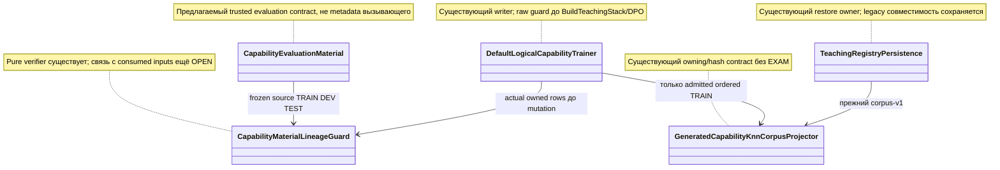

# P112: проверять независимость материала до обучения и отдельно от качества модели

**Адресное дополнение в prompt переноса:** [146/R128-03](codex-146-post128-addressed-repair-plan-2026-11-03.md#r128-03) и [48](../experimets/codex-48-post128-executor-verification-2026-11-03.md) включены в назначенный остаток T112. Положительный контроль: две Train-строки одной семьи с одинаковыми bytes и разными SourceRowId, независимый Test, перестановка trusted списка. Отрицательный overlap должен достигнуть собственного guard; менять expected на ранний LINEAGE_CONTRADICTS_CONTENT без исправления rows[0] нельзя. Раздельно проверить четыре Dev/Test комбинации для family/exact/normalized; обязательный consumed-heldout запрет сохранить. Обоснованная правка неверного теста разрешена по независимому договору, с реальными Release build/discovery/tests и исходным failure. Записанный опыт P112 не повторять.

<a id="current-transfer-task"></a>
## Текущий вход переноса после разбора аудита — 3 ноября 2026

**Владелец: T112 / P112 и R04 lineage.** Actual text binding c257523 уже написан: его не дублировать. Остаток касается назначенного фактического материала, полного TRAIN покрытия, квитанции и отдельных владельцев. Эта поправка уточняет существующее задание в [реестре](01-registry.md), не добавляет очередь и не отменяет его допуска по пользе и регрессиям. Нынешнее поручение — исправление документации; исполнение продуктового ремонта требует своего прямого назначения.

**Хороший пример:** Разрешённые данные каждой адаптивной стадии, включая tokenizer fit, связаны с фактически потреблёнными bytes и независимым ожидаемым составом.

**Плохой пример и ожидаемое исправление:** Финальная KNN таблица чистая, но EXAM участвовал в подготовке; claimed hash взят из той же receipt; поля склеены неоднозначно. Это ограничивает научный вывод и требует адресного ремонта происхождения.

**Обязательная часть передаваемого задания:**

> Полностью прочитай этот план `C:/Projects/llm_mvp_core/docs/plans/replanning-possible-diffs/fixes-based-on-experiments/codex-132-p112-material-lineage-transfer-2026-11-02.md`, выбранный owner-раздел и [договор120](120-executor-context-and-test-repair-contract-2026-11-02.md): AGENTS/CLAUDE, архитектура, планирование, plan-review, code-execution/code-examination/generated-code-review, prompt-patch-authoring и человеческая коммуникация; основной полный список — §1. Для тестов добавь test-integrity, test-failure-triage, bug-to-tests. Прочитай [44, §10–12](../experimets/codex-44-post117-saved-evidence-and-finalizer-contract-2026-11-03.md#10-один-текущий-вход-вместо-нескольких-противоречащих-заданий). Укажи, что уже реализовано и какой один остаток назначен; не переписывай работающий guard. Привяжи собственные хорошие/плохие примеры к рабочему caller и итоговому решению. При падении сначала сохрани input/expected/actual, версию и стадию; правильный тест регрессии не ослабляй, устаревшее ожидание меняй только по независимому контракту. Сохрани raw и фиксированный gold. Ожидаемый red/green по исходнику не выдавай за исполненный тест. Не повторяй эксперимент ради отчёта или отсутствующей приёмки. Новая проверка с моделью допустима только в назначенном runtime-срезе с конечным бюджетом; текущая правка документов её не разрешает. Назначенные пути/команды/fixtures берутся из owner-раздела, отсутствующее поле назови автору. Пиши результат по-русски: эффект до/после, точность, ухудшения, проверенный код, невыполненная приёмка. Дождись исходного handle при разрешённом исполнении; прямой STOP/NEXT немедленен.

Основание: [адресный разбор оставшихся пробелов](evidence/2026-11-03-post117-executor-context-review.md). Старые результаты и ограничения ниже сохраняются; при расхождении старого описания с живым кодом эту дельту применять по названной области, не считать весь перенос закрытым.


**Текущий статус 3 ноября после `c25752314f4`: частично реализовано.** В `DefaultLogicalCapabilityTrainer.cs:681–694` создаётся один допущенный `AdmittedTrainingMaterial`; его получают `BuildTeachingStack` и `ExecuteDpoTeachingAsync`, а текст и пары извлекаются из него. Старое описание отдельных сырых аргументов ниже — диагноз до этого коммита, повторная реализация этой связки не нужна. Остаток: сквозная идентичность KNN-корпуса, использованных байтов и квитанции, восстановление и отдельный экспериментальный checker R04. Прочитанный код не заменяет собственную приёмку и не разрешает повтор PRIMARY. Единственная текущая строка назначения — [T112 в реестре](01-registry.md#work-t112).

<!-- POST113-CURRENT-2026-11-02:START -->
## Независимое усиление — P112: один проверенный payload у materializer

R04 плана 135 воспроизвёл обход экспериментального проверяющего: содержимое TEST с прежними hash/family принимается, а `SplitMaterializer.LessonsFor` передаёт изменённый Content в Train. Исторические таблицы материалов проверены отдельно: их хеши верны. Утечка в записанном прогоне не заявляется.

Продуктовые типы и guard уже присутствуют после e16987c; вызов расположен до DPO, но связь проверенного материала с фактическими входами learner ещё не доказана. Current trainer проверяет provider.Material/ActualOwnedRows, затем отдельно потребляет finalPreferences, combinedTrainingText и корпус из replayManifests/registrationPlans. R04 экспериментального checker остаётся отдельным OPEN. Нельзя проверить одну копию, а обучать по другой; 12 назначенных будущих pure guards и обещанный legacy NOT_EVALUATED не являются доказательством этой интеграции.

Основание: [аудит 134](codex-134-post113-transfer-and-experiment-audit-2026-11-02.md), [план 135](codex-135-post113-addressed-repair-plan-2026-11-02.md). Это уточнение уже опубликованного владельца; новый владелец реализации не создаётся. Нативный код текущим аудитом не исполнялся.
<!-- POST113-CURRENT-2026-11-02:END -->

02.11.2026. Исследование на `21007e25ec3f6f6634dd8733fc8631ae267e518c`; автор `/root/post107_card_context`. **READ_ONLY_RESEARCH + Markdown. Нового исполнения и продуктовых изменений нет.**

Разбиение по семьям убрало пересечение TRAIN/DEV с 2 до 0. Это полезный результат достоверности оценки. На внешнем экзамене оба плеча дали 2/4 — ровно постоянный ответ; B потерял две R-строки и приобрёл две B-строки. **Переносится условие честной оценки и проверка фактического материала. Замена продуктового корпуса ради якобы выросшей accuracy не назначается.** Детерминированная проверка материала проектируется без новых model calls; product learning/E2E qualification остаётся отдельным HOLD.

## 1. Что подтверждают первичные данные

[Паспорт P112-PRIMARY-01](../experimets/cards/P112-family-disjoint-evaluation.md), [report](../../../../experiments-v2/RP01-MICRO/P11201/results/attempt-0001/report.md), [material-ledgers](../../../../experiments-v2/RP01-MICRO/P11201/results/attempt-0001/raw/material-ledgers.json), [метрики и четыре фактических ответа](../../../../experiments-v2/RP01-MICRO/P11201/results/attempt-0001/metrics.json), [контроли](../../../../experiments-v2/RP01-MICRO/P11201/results/attempt-0001/raw/component-controls.json), [budget](../../../../experiments-v2/RP01-MICRO/P11201/results/attempt-0001/raw/budget-audit.json), [terminal](../../../../experiments-v2/RP01-MICRO/P11201/results/attempt-0001/run-1.receipt.json). Exit 0/1,3962272 секунды — сохранённый запуск другого исполнителя.

| Ось | A: первые 6 строк | B: семьи g1–g3 | Граница |
|---|---|---|---|
| TRAIN/DEV overlap | g3, g4: 2 семьи | 0 | Пересчитано по actual entries; не только report |
| DEV confidence | 0,7143–0,8845 | 0,3333 | Высшая A confidence на неверном ответе; это не probability |
| DEV exact | 1/2 | 1/2 | Нет роста accuracy |
| EXAM route/full steps | 2/4 | 2/4 | Равны constant baseline |
| Выбранные соседи EXAM | Все 4: g4R | Все 4: g2B | Оба плеча постоянны, routing не доказан |
| R-строки EXAM | 2/2 | 0/2 | Существенная регрессия класса |
| B-строки EXAM | 0/2 | 2/2 | Локальный выигрыш класса; gained 2 / lost 2 |
| TRAIN class balance | 4R/2B | 3R/3B | Меняется вместе с split policy |
| Словарь входных слов | 18 | 15 | Равное число строк не равная информация |

Нативный механизм — generic KnnLogicalUnit 64d/k 1/floor 0,70/BPE 320. Два Train × 6 = 12 предъявлений, 12 Execute (2 DEV+4 TEST на arm), 3 ранних cold refusals без созданной модели, 4 verifier calls, warmups 0/recoveryTrain 0. Время Train A 88,6858 мс/B 2,3183 мс, allocations 528 744/294 504; порядок A→B не контролирует причину. CPU процесса 500 мс, peak 39 002 112 байт; по плечам null. Материал g5/его gold не подан learner, source bytes A/B одинаковы. Вне этой панели отсутствие ресурсных/предметных регрессий не доказано.

**Допуск:** логическая защита split/claim имеет основание; улучшение общей модели не квалифицировано. Правило пользователя о >5% без иных >5% регрессий нельзя закрыть, показывая только уменьшение overlap и скрывая R 2/2→0/2. CPU сам по себе не причина отклонять кандидат.

## 2. Два пробела, которые нельзя перенести вместе с экспериментальным verifier

[MaterialLedgerVerifier.Verify:26](../../../../experiments-v2/RP01-MICRO/P11201/src/MaterialLedgerVerifier.cs:26) получает ledger и frozen pool, разрешает family по exact/normalized content digest. Честный A принят с overlap 2: [:137–146](../../../../experiments-v2/RP01-MICRO/P11201/src/MaterialLedgerVerifier.cs:137) считает overlap метрикой, а не blocking finding. Это верно для сравнения A/B, но ещё не production acceptance policy.

В :60–64 поиск использует **предъявленные** `ContentHash/NormalizedContentHash`, не пересчитывая их из `entry.Content`. Положительный опыт с корректными ledgers этого не проверял. В :39–42 `GroupBy(...).First()` выбирает первую запись normalized digest. В frozen 12-row наборе конфликт семей этим исследованием не установлен; для произвольного корпуса нельзя молча выбирать одну семью при неоднозначности.

WRONG: скопировать Verify и объявить любой accepted ledger независимым TRAIN/EXAM. CORRECT: сверить owned фактический материал с trusted source lineage, заново вычислить digests, потребовать отсутствие запрещённых пересечений по явно заданной политике; неоднозначную family вернуть typed refusal. Удаление пунктуации/нижний регистр — нормализация этого тестового корпуса, не доказательство семантической эквивалентности произвольного C#/SQL/перевода.

## 3. Реальные точки интеграции и выбранная граница

Историческая цепь на 21007e25: TrainAndRegisterCoreAsync → BuildTeachingStack → ExecuteDpoTeachingAsync → поздний BuildKnnTrainingCorpus/TransformerEmbeddingKnnLogicalUnit.Train. Текущий source-разрыв проверен адресно после e16987c: [ValidateEvaluationMaterialBeforeLearning:268](../../../../18.CapabilityTraining/DefaultLogicalCapabilityTrainer.cs:268) передаёт guard только provider Material/ActualOwnedRows; [finalPreferences:588](../../../../18.CapabilityTraining/DefaultLogicalCapabilityTrainer.cs:588) и [combinedTrainingText:680](../../../../18.CapabilityTraining/DefaultLogicalCapabilityTrainer.cs:680) собираются независимо. В :699–705 проверяется IsSuccess, receipt.Value не связывается с этими входами; :710 получает mutation permit, :717 потребляет combinedTrainingText, :739 — finalPreferences, :1029 строит отдельный KNN corpus. Позиция проверки до обучения необходима, но сама по себе недостаточна.

[BuildKnnTrainingCorpus:3481–3521](../../../../18.CapabilityTraining/DefaultLogicalCapabilityTrainer.cs:3481) принимает только replayManifests+branchPlans. [GeneratedCapabilityKnnCorpusProjector.Project:321–407](../../../../18.CapabilityTraining/GeneratedCapabilityExecutableManifestProjector.cs:321) принимает только examples: ExampleId, TrainingText, OutputText, PredicateIds, DomainTags; он owning/hash contract ordered corpus-v1. Ни EXAM, ни FamilyId там нет. Уникальность ExampleId не доказывает независимость семей. Добавить скрытую family в DomainTags недопустимо.

[TeachingRegistryPersistence.ProjectBoundKnnCorpus:1911–1928](../../../../18.CapabilityTraining/TeachingRegistryPersistence.cs:1911) и :2045/:2094 используют тот же projector и digest. Они не должны внезапно требовать неизвестный им экзамен при legacy Load. Продуктовый learner — TransformerEmbeddingKnnLogicalUnit, не generic Unit P112; embedding [:152](../../../../18.CapabilityTraining/LlmIngredientLogicalUnits.cs:152) и ограничение maxLen=min(64,ContextLen) (:130) требуют своей проверки model-visible collisions.



| Связь | Пример и ожидаемая реакция |
|---|---|
| evaluation→guard | Frozen g5 содержит `Before implementing code, review it`; его alias в TRAIN запрещён независимо от нового ExampleId |
| trainer→guard | Actual owned text изменён, receipt сохранил старый hash: digest mismatch до paid update |
| trainer→projector | Шесть допущенных TRAIN строк; DEV/TEST и их gold никогда не идут в runtimeExamples |
| persistence→projector | Старый corpus-v1 восстанавливается по прежнему договору; оценка независимости остаётся NOT_EVALUATED без собственного evidence |

## 4. Конкретный контракт будущей правки

**Текущая реализация PRESENT, интеграционная приёмка OPEN:** [CapabilityEvaluationMaterial.cs](../../../../18.CapabilityTraining/CapabilityEvaluationMaterial.cs), [CapabilityMaterialLineageGuard.cs](../../../../18.CapabilityTraining/CapabilityMaterialLineageGuard.cs), вызов в DefaultLogicalCapabilityTrainer и [шесть pure tests](../../../../Tests/ExperimentFixes/CapabilityMaterialLineageTests.cs) существуют после e16987c. Не создавать их заново и не считать только наличие файлов переносом. Ниже требования будущего завершения контракта, а не описание всех уже реализованных полей. DynamicGraphHeldOutSplitGuard имеет другой owned input и не заменяет actual-material binding.

**Остаток договора поверх существующих типов:** существующий CapabilityEvaluationMaterial задаёт ProfileId, SourceManifestSha256, SourceRows, normalization/intersection policy; ActualRow — ExampleId, ClaimedSourceRowId, Role, Content и предъявленные digests. Не переименовывать этот API по старому проекту. Добавляемая связь должна охватывать owned bytes и их проекцию в каждый фактический consumer: prompt/chosen/rejected у finalPreferences, combinedTrainingText и ordered retrieval examples. ExpectedOutput DEV/TEST остаётся только у evaluator; metadata и уникальный ExampleId не доказывают lineage.

Источник material — trusted подготовитель оценки в композиции trainer. Интерфейс ICapabilityEvaluationMaterialProvider и параметр конструктора уже существуют; конкретный trusted owner TRAIN/DEV/TEST и его фактическая композиция этим не доказаны. В ограниченном git grep по 18.CapabilityTraining/50.AppCore/Tests найдены только интерфейс, field/constructor и pure tests; это не полный аудит динамического подключения. Legacy Train без material сохраняет прежний допуск, но NOT_EVALUATED_NO_LINEAGE должен дойти до наружного результата/evidence. Сейчас одноимённая константа объявлена, её вывод не обнаружен в этих путях. Не называть null receipt опубликованной честной оценкой.

Алгоритм guard:

1. До первого mutation permit заморозить actual consumed inputs этого TrainAndRegisterCoreAsync: finalPreferences, combinedTrainingText и исходные inputs будущего ordered KNN corpus. Trusted material связывается именно с ними через проверяемую проекцию/identity. Provider-список сам по себе не считается захватом learner input. После проверки consumer получает тот же owned snapshot; замена после проверки даёт отказ до mutation.
2. По каждой actual строке вычислить SHA256 точных UTF8 bytes; нормализацию выбирать явно по ProfileId и считать из **того же actual text**. Сверить заявленные hashes, SourceRowId и разрешённую связь с immutable source manifest. Только receipt без underlying actual rows не принимается.
3. Для normalized digest хранить множество разрешённых source families. Если оно неоднозначно и нет независимо удостоверенного однозначного source linkage — `AMBIGUOUS_CONTENT_LINEAGE`. Не брать First и не выводить семантическую семью из текста.
4. Посчитать TRAIN/DEV/TEST family sets и exact/normalized content intersections. Для режима независимой оценки любые запрещённые пересечения дают именованный отказ; это **дополнительная production policy**, не исторический verdict P112 A. Отдельно считать класс/слова/дозы; равные counts не приравнивать к равным данным.
5. Передать learner только разрешённый TRAIN из проверенного snapshot. Для DPO сверить prompt/chosen/rejected, для tokenizer/stack — combinedTrainingText, для retrieval — полный ordered corpus. Разрешённые повторения TRAIN задаются явной проекцией и dose ledger, а не ошибочно запрещаются как любой duplicate. DEV/TEST и их gold остаются evaluator. Receipt должен связывать фактически потреблённые bytes и policy, а не только внешнюю provider receipt.
6. После штатной materialization взять идентичность фактически model-visible inputs (token IDs, masks, truncation, tokenizer/model identity), сгруппировать cross-split collisions. Source-disjoint не означает encoding-disjoint. Для Transformer extraction выполняется внутри уже назначенного пути; если её нет, поле NOT_MEASURED и claim не поднимается. Это не разрешение дополнительных Encode/Forward.
7. Evidence качества публикуется отдельно от corpus-v1. Оно связывает model/state/corpus hash с evaluation contract и полными outputs. Legacy manifest не интерпретируется как прошедший новую проверку. Новая persisted evidence версия вводится только у владельца 101 с совместимым reader; сам projector-v1 не получает другую семантику.

## 5. Собственные контроли, ремонт тестов и бюджет

Будущий pure-contract fixture берёт те же frozen 8 pool+4 g5 из [FrozenFamilyPool.cs:43–63](../../../../experiments-v2/RP01-MICRO/P11201/src/FrozenFamilyPool.cs:43). Это тестовые строки автора корпуса, не новые внешние данные. Runtime experiment source не подключается как готовый production evaluator; independent expected sets заданы тестом, actual learner projection захвачена отдельно.

| Required ID / будущий метод | Вход и frozen expectation |
|---|---|
| MATERIAL-HONEST / `WholeFamiliesPassWithActualOwnedRows` | B TRAIN g1–g3, DEV g4, TEST g5; 6/2/4, overlap 0; PASS |
| MATERIAL-OVERLAP / `RowSplitCannotClaimIndependentFamilies` | A 6/2, g3/g4 по обе стороны; валидная форма, FAIL именно overlap, не hash |
| MATERIAL-FAMILY / `RenamedFamilyDoesNotChangeSourceLineage` | g3R объявлен g9; прежний actual content; FAIL lineage |
| MATERIAL-ALIAS / `ExamAliasInTrainIsRejected` | g5R lower-case/без запятой, новый ID; policy normalized match; FAIL test-content-in-train |
| MATERIAL-ACTUAL / `ChangedActualTextWithOldReceiptHashesIsRejected` | owned actual Content изменён, старые receipt hashes сохранены; FAIL actual digest mismatch |
| MATERIAL-RECEIPT / `ConsistentForgedReceiptCannotReplaceActualRows` | Content и hashes receipt согласованно переписаны, actual owned rows прежние; FAIL binding, не принять самосогласованный рассказ |
| MATERIAL-AMBIGUITY / `AmbiguousNormalizedFamiliesHaveNoFirstFallback` | Тестовый trusted pool содержит две семьи с одним normalized digest без однозначной attestation; typed ambiguity |
| MATERIAL-ROLE / `UnknownRoleAndDuplicateRowAreRefused` | По одному unknown split и duplicate SourceRowId; 2 отдельных отрицательных входа |
| MATERIAL-LEGACY / `LegacyTrainingWithoutEvaluationStaysUnevaluated` | Material отсутствует, legacy admitted Train путь не запрещён; независимая оценка не выдаётся |

Одна честная baseline и перечисленные 8 отрицательных входов (ROLE даёт 2), плюс один legacy input и повтор честного после mutants: **11 guard calls, Train 0, Encode 0, Forward 0, Execute 0**. Все mutants deep-copy исходника; gold/source originals неизменны. Положительный/отрицательный вызывают один callable/options без mutationName/готового verdict. Semantic overlap control имеет правильные content hashes и доходит до family check; invalid digest — отдельный integrity control. Сравнение `raw_actual`/`frozen_expected` формирует `check_passed`, отказ raw false ожидаемого bad-input может быть PASS контроля.

Для прежнего проекта pure ordering остаётся один дополнительный guard/stub call, всего 12, Train/Encode/Forward/Execute 0. Этот stub доказывает только branch ordering. **Отдельная будущая интеграционная приёмка:** вызвать настоящий TrainAndRegisterCoreAsync через обычный публичный вход и наблюдать захваченные inputs до AcquireMutationPermit, без модели за отказанной границей. Положительный MATERIAL-CONSUMED-HONEST: provider и actual finalPreferences/combined text/retrieval projection соответствуют одним frozen TRAIN rows. Отрицательный MATERIAL-CONSUMED-FOREIGN: provider ledger честный, но actual finalPreferences содержит TEST family g5; отказ до permit, BuildTeachingStack и DPO. MATERIAL-AFTER-CHECK: подмена consumed bytes при прежней receipt тоже отказ. Подмена только provider rows при прежних learner inputs не является этой проверкой. Для положительного случая проверка останавливается наблюдаемым тестовым seam до mutation; она не доказывает обучение или конечный ответ. Точный seam/test filter/число вызовов назначает автор 74 после source-проектирования: до этого HOLD, эти вызовы не спрятаны в 12 pure guards.

Существующий фильтр ниже охватывает 6 pure tests; они сохраняются, здесь не запускались и не приравниваются к 12 вызовам проектируемой расширенной программы. OnlyTrainRows_AreHandedToTheLearner:212–225 вызывает SelectTrainingRows и проверяет возвращённый список — настоящий learner/caller отсутствует. Название теста не закрывает MATERIAL-CONSUMED. Команда ниже — только будущая проверка имеющегося pure класса после прямого разрешения; нового интеграционного фильтра пока нет:

```powershell
dotnet test C:/Projects/llm_mvp_core/Tests/LlmFromScratch.Tests.csproj --filter "FullyQualifiedName~CapabilityMaterialLineageTests"
```

Существующие `Tests/TeachingRegistryPersistenceTests.cs` и `Tests/ProductHostCapabilityServingTests.cs` содержат corpus/restore consumers; их v1 hashes, типы и legacy expectations сохраняются. Увиденный source contract не даёт основания объявить эти tests сейчас падающими. Если новый qualified-evaluation тест раньше считал unique IDs достаточными, заменить expected на проверенный source/content invariant; не снимать тестовый gold, не добавлять TEST в TRAIN, не менять split после результата, не ставить Skip. Падение сохранить с input/expected/actual/stack/SHA и классифицировать fixture/stale assertion/product regression/infrastructure до исправления.

## 6. Замыкание ordinary consumer и честный HOLD

У владельца [74](74-knn-domain-constructor-transfer.md) и [20](20-prompt-domain-e2e.md) следующий отдельный этап должен связать один обычный prompt с learned domain, выбранной capability, её actual native Train, state и ответом пользователя; после fresh Load через TeachingRegistryPersistence повторить тот же consumer без DPO. У нового corpus guard сравниваются именно bytes, поданные выбранному learner. Полные route/steps/Output сверяются с frozen gold и constant baseline, а не с самим receipt. Предыдущие state/corpus identities пригодны для reuse только при настоящем native restore по [101](101-persistent-state-bundle-contract-2026-10-30.md).

**Почему product qualification сейчас HOLD:** типы, interface/constructor и pure guard реализованы, но trusted provider composition, immutable binding к actual finalPreferences/combinedTrainingText/KNN corpus и наружная receipt/NOT_EVALUATED ещё не доказаны. Model-visible capture для Transformer не наблюдён; P112 измерял иной generic механизм и не показал полезного ответа выше constant baseline. Полный native DPO/BPE/Embed/Load/consumer бюджет не определён. До назначения автор 74 закрепляет fixture, owned projection, интеграционный seam/filter и полный ledger. 12 pure guards — отдельный проект проверки, не готовый product E2E и не рост accuracy.

## 7. Передаваемый промпт

> **Эта часть передаётся вместе с заданием:** применить [текущий вход этого плана](#current-transfer-task), его собственную пару хорошего/плохого примера и [44, §10–12](../experimets/codex-44-post117-saved-evidence-and-finalizer-contract-2026-11-03.md#10-один-текущий-вход-вместо-нескольких-противоречащих-заданий). Основной стек навыков —120§1; для падений дополнительно test-integrity, test-failure-triage и bug-to-tests. Уже написанные части сохраняются. Проверить путь до конечного принятия, независимый expected и полный назначенный состав; исходник теста не выдавать за его прогон. При документном поручении — только документы и сохранённые свидетельства, без runtime. Старый PRIMARY не является командой ремонта. Прямой STOP/NEXT немедленен.

> Полностью прочти собственный план C:/Projects/llm_mvp_core/docs/plans/replanning-possible-diffs/fixes-based-on-experiments/codex-132-p112-material-lineage-transfer-2026-11-02.md и первичные P11201. Свежий полный AGENTS/CLAUDE+основной/ролевой стек по C:/Projects/llm_mvp_core/docs/plans/replanning-possible-diffs/fixes-based-on-experiments/120-executor-context-and-test-repair-contract-2026-11-02.md §1, роли C:/Projects/llm_mvp_core/docs/plans/replanning-possible-diffs/experimets/40-effective-executor-context-2026-11-02.md §2, применимость C:/Projects/llm_mvp_core/docs/plans/replanning-possible-diffs/experimets/codex-42-postmerge-executor-checks-2026-11-02.md. Только прямо назначенный этап; текущая фаза документация, запуск запрещён. Модель текущей сессии по умолчанию. Не выдавай split 2→0 за accuracy gain и frozen family dictionary за семантический детектор. Actual consumed inputs обязательны: чистый provider ledger при TEST family в finalPreferences должен быть отклонён до mutation permit; IsSuccess от отдельного списка недостаточно. Существующие 6 pure tests не доказывают настоящий learner; интеграционный seam/filter/budget пока HOLD. Legacy не переоткрывать, receipt/NOT_EVALUATED вывести наружу. Бюджет проекта §5: 12 pure guard calls, Train/Encode/Forward/Execute 0, никаких дополнительных fits для контрпримеров. Required IDs заданы заранее, missing/duplicate/NOT_RUN/check_passed=false/exception не PASS; правильный raw false отказа сравнивается с expected. Nonzero/timeout/unknown terminal запрещают принятие; lawful A=B остаётся научным отсутствием выигрыша. Исторические runner/data/report bytes не менять, STOP/NEXT пользователя немедленны, старый NEXT не разрешение нового ID; не retry оплаченного update и не подставлять gold в learner. Любое измеренное улучшение полезного показателя — успех именно показателя/домена; рост accuracy не обязателен, ухудшения рядом. Pure repair PASS не новое улучшение обучения. Отчёт на русском по назначенному пути. При отдельно разрешённом запуске обнаружь средства по C:/Projects/llm_mvp_core/docs/plans/replanning-possible-diffs/experimets/31-tool-discovery-and-wait.md и жди terminal исходного handle без relaunch; неизвестная команда или бюджет — HOLD автора, не PRIMARY повтор.

Fresh load покрытие 17 навыков — [130 §6](codex-130-p110-numeric-projection-disposition-2026-11-02.md#6-граница-чтения-и-готовности). Источники продукта/опыта прочитаны адресно; все большие карточки целиком и все ветви полностью не читались. Авторская проверка отдельно от parent review. Build/tests/runtime/train/inference/replay/Git writes не выполнялись.
