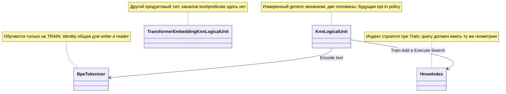

# P113: раздельная нормировка каналов — измеренная геометрия и условный перенос

<!-- transfer-entry-reload -->
**Вход исполнителя.** [Q66](01-registry.md#work-t113). Это отдельное чтение результатов. Для него достаточно сохранённых входов и указанного ниже проверяющего. Перед каждым переносом и после восстановления контекста заново прочтите полностью агентские файлы, назначенные навыки, исправленный список Любы, текущий индекс и карточку. [Как применить прочитанное к этой работе](03-test-and-execution-contract.md#read-and-apply) · [Что взять сейчас](01-registry.md#executor-next).

<a id="current-transfer-task"></a>
## Текущий вход переноса после разбора аудита — 3 ноября 2026

**Владелец: T113 / P113, условный баланс каналов.** Сохранить измеренный эффект геометрии P113 и его отдельный допуск переноса. Обязательные каналы и их формулы задаются назначением. Эта поправка уточняет существующее задание в [реестре](01-registry.md), не добавляет очередь и не отменяет его допуска по пользе и регрессиям. Нынешнее поручение — исправление документации; исполнение продуктового ремонта требует своего прямого назначения.

**Хороший пример:** Каждый собственный канал имеет правильные значения/энергию; ordinary consumer получает эти признаки и оценивается по неизменному gold.

**Плохой пример и ожидаемое исправление:** Scalar прежний при изменённой энергии одного канала или добавлен посторонний channel. Проверить exact keyset и содержимое; математическое равенство не заменяет измерение качества.

**Обязательная часть передаваемого задания:**

> Полностью прочитай этот план `C:/Projects/llm_mvp_core/docs/plans/replanning-possible-diffs/fixes-based-on-experiments/codex-133-p113-channel-balance-disposition-2026-11-02.md`, выбранный owner-раздел и [договор120](120-executor-context-and-test-repair-contract-2026-11-02.md): AGENTS/CLAUDE, архитектура, планирование, plan-review, code-execution/code-examination/generated-code-review, prompt-patch-authoring и человеческая коммуникация; основной полный список — §1. Для тестов добавь test-integrity, test-failure-triage, bug-to-tests. Прочитай [44, §10–12](../experimets/codex-44-post117-saved-evidence-and-finalizer-contract-2026-11-03.md#10-один-текущий-вход-вместо-нескольких-противоречащих-заданий). Укажи, что уже реализовано и какой один остаток назначен; не переписывай работающий guard. Привяжи собственные хорошие/плохие примеры к рабочему caller и итоговому решению. При падении сначала сохрани input/expected/actual, версию и стадию; правильный тест регрессии не ослабляй, устаревшее ожидание меняй только по независимому контракту. Сохрани raw и фиксированный gold. Ожидаемый red/green по исходнику не выдавай за исполненный тест. Не повторяй эксперимент ради отчёта или отсутствующей приёмки. Новая проверка с моделью допустима только в назначенном runtime-срезе с конечным бюджетом; текущая правка документов её не разрешает. Назначенные пути/команды/fixtures берутся из owner-раздела, отсутствующее поле назови автору. Пиши результат по-русски: эффект до/после, точность, ухудшения, проверенный код, невыполненная приёмка. Дождись исходного handle при разрешённом исполнении; прямой STOP/NEXT немедленен.

Основание: [адресный разбор оставшихся пробелов](evidence/2026-11-03-post117-executor-context-review.md). Старые результаты и ограничения ниже сохраняются; при расхождении старого описания с живым кодом эту дельту применять по названной области, не считать весь перенос закрытым.


<!-- POST113-CURRENT-2026-11-02:START -->
## Независимое усиление — P113: конечная порча тоже должна отвергаться

R06 плана 135 показал: старый `ChannelReceiptVerifier` проверяет конечность массива и диапазон доли, но принимает подмену fraction 0,5→0,9 или перестановку конечных координат. Поэтому `CHANNEL-FINITE` не заменяет полное сравнение компонентов. Добавить `CHANNEL-COMPONENTS`: независимо ожидаемые координаты, энергии и доли; отдельные порчи fraction, finite permutation и compensated energy. Форма массива, конечность чисел и согласованность содержимого проверяются раздельно.

Проверка имеет отдельный бюджет: 32 сохранённые квитанции + 3 конечные порчи + 3 неконечные порчи (NaN/±Infinity) + 1 честный синтетический случай = 39 чистых сравнений. Train, Execute и Encode — 0. Для 32 исторических квитанций проверяются доступные shape/finite, хеш текста, энергии и внутренняя согласованность. Покоординатный expected исходного Build остаётся `NOT_OBSERVED`: исходные половины и обученный tokenizer не сохранены. Из норм или заявленного hash он не восстанавливается.

Оставшиеся семь сравнений проверяют ту же чистую численную границу, которую будущий нативный verifier вызывает после получения expected. Источник expected здесь задан независимо: `s=1/sqrt(2)`, текстовая половина `[s,0]`, предикатная `[0,s]`, обе нормы `s`, итоговая норма `1`, доля предикатной энергии `0.5`, покоординатный допуск `0.000001`. Это синтетическая проверка компаратора, а не исторического tokenizer. Honest actual совпадает с этим expected. Три конечные порчи: только доля `0.5→0.9`; только перестановка текста `[0,s]`; замена половин на `[sqrt(0.75),0]` и `[0,0.5]` с согласованно пересчитанными declared norms/fraction — общая энергия прежняя, frozen expected прежний. Ещё три порчи меняют одну координату на NaN, +Infinity или −Infinity. Каждая порча начинается с отдельной копии честного fixture; транспортные подписи при необходимости согласованы с actual, expected не меняется.

Эти 39 сравнений не расширяют автоматически бюджет нативного этапа ниже: это отдельный назначаемый этап. Opt-in, HOLD общей замены, снижение короткой доли на 9,48% и граница generic/Transformer сохранены.

Основание: [аудит 134](codex-134-post113-transfer-and-experiment-audit-2026-11-02.md), [план 135](codex-135-post113-addressed-repair-plan-2026-11-02.md). Это уточнение уже опубликованного владельца; новый владелец реализации не создаётся. Нативный код текущим аудитом не исполнялся.
<!-- POST113-CURRENT-2026-11-02:END -->

02.11.2026, source SHA `21007e25ec3f6f6634dd8733fc8631ae267e518c`, автор `/root/post107_card_context`. **READ_ONLY_RESEARCH + Markdown. Ни runtime, ни продуктовый код этим исследованием не менялись.**

На длинном тексте раздельная нормировка вернула признакам задачи половину энергии вектора; на арифметическом контрпримере исправила порядок соседей. Но ответ на экзамене остался 4/4 в обоих плечах, а на коротких строках доля признаков уменьшилась на 9,48%. **Локальный результат представления сохранён; глобальное включение в продукт — HOLD.** Равные веса каналов допустимы только как явно выбранная политика конкретного домена, не универсальное правило качества.

## 1. Первичные результаты и цена

[Паспорт P113-PRIMARY-01](../experimets/cards/P113-feature-energy.md), [report](../../../../experiments-v2/RP01-MICRO/P11301/results/attempt-0001/report.md), [channel-receipts](../../../../experiments-v2/RP01-MICRO/P11301/results/attempt-0001/raw/channel-receipts.json), [arithmetic-fixture](../../../../experiments-v2/RP01-MICRO/P11301/results/attempt-0001/raw/arithmetic-fixture.json), [material-and-predicates](../../../../experiments-v2/RP01-MICRO/P11301/results/attempt-0001/raw/material-and-predicates.json), [budget](../../../../experiments-v2/RP01-MICRO/P11301/results/attempt-0001/raw/budget-audit.json), [terminal](../../../../experiments-v2/RP01-MICRO/P11301/results/attempt-0001/run-1.receipt.json). Это исторический опыт другого исполнителя, exit 0/7,455 секунды, не наш запуск.

| Показатель | Общая нормировка A | Раздельная B | Что разрешено утверждать |
|---|---:|---:|---|
| Средняя доля энергии предикатов на 12 длинных строках | 0,001237 | 0,5 | Примерно ×404,2 на stress U-OR с 80 словами `module` |
| Та же доля на 4 коротких строках | 0,552381 | 0,5 | −9,48%; цена геометрии, вред предметному ответу здесь не наблюдался |
| Retention по полной последовательности | 8/8 | 8/8 | Обе памяти обучены |
| EXAM route / полные steps | 4/4 / 4/4 | 4/4 / 4/4 | Улучшения ответа 0, gained 0 / lost 0 |
| Короткие ответы | 4/4 | 4/4 | Не доказательство OOD или всех случаев отсутствующего канала |
| Арифметический margin correct−wrong | −0,00093487 | +0,49937616 | Чистая арифметика; не новый приобретённый навык |
| Обучение, мс / байты | 458,5533 / 1 237 464 | 235,9816 / 1 051 624 | Причина разницы не установлена; порядок A→B не уравновешен |

Обе модели: generic `KnnLogicalUnit<string,OrderAnswer>`, dimensions 64, k 1, confidenceFloor 0, BPE 320, HNSW m 8 / efConstruction 64 / efSearch 32. Два независимых Train × 8 уроков = 16 предъявлений; 12 холодных записей «единицы нет» без retrieval; по 16 Execute на плечо (8 retention + 4 exam + 4 short), всего 32. Дополнительно 112 Encode по уже обученному BPE для расписок, 5 verifier calls, **5 arithmetic ledger entries**. В report написано 6 арифметических проверок; raw содержит 5, а Program.cs:388/477/518 регистрирует 1 preflight + 2 политики × 2 вида = 5. Расхождение отчёта сохранено явно, не исправлено новым запуском или подменой raw. Прогревов/retrain для recovery 0. CPU процесса 828,125 мс, peak 46 460 928 байт; по плечам CPU/peak неизвестны. Время 32 запросов включает пересчёт расписок.

Энергии пересчитаны по обученному BPE, а не прочитаны из внутреннего массива HNSW. Независимый reducer совпал с ordinary unit по соседу и confidence на 32/32; это сильное наблюдаемое согласование, но не экспорт индекса. Обе честные расписки приняты, три мутанта отвергнуты: nonfinite координата, предикат не из входа, normalized энергия вместо raw. Слоты первоначальных имён совпали 43; до Train выбраны различные 45/51. Нормировка не исправляет hash collision.

## 2. Где действует механизм

[KnnLogicalUnit.Vectorize:454–487](../../../../21.AgentInfrastructure/Logical/KnnLogicalUnit.cs:454) считает BPE tokens в первой половине и разрешённые predicate IDs с весом 2 во второй. `Train:281` и `ExecuteAsync:371` используют один Vectorize. [Экспериментальная копия](../../../../experiments-v2/RP01-MICRO/P11301/src/ChannelBalancedKnnLogicalUnit.cs) меняет только нормировку; compiled A — исходные байты generic класса через [Experiment.csproj](../../../../experiments-v2/RP01-MICRO/P11301/Experiment.csproj), а не обычная сборка 21.



Для связи Unit→BPE пример — длинная e1 с теми же 80 `module`; output tokens берётся из того же обученного словаря. Для Unit→index пример — writer B добавил balanced vector, reader B ищет balanced query. Reader B против старого A-index — запрещённая смешанная геометрия, даже если размеры 64 совпали.

На fixed SHA поиск tracked references generic `KnnLogicalUnit` вне его файла ведёт в Tests и `tools/Rp01MechanismProbe/Program.cs`; deployed product caller именно этого типа не установлен. Продуктовый `DefaultLogicalCapabilityTrainer:966–983` обучает **TransformerEmbeddingKnnLogicalUnit<string>**, [LlmIngredientLogicalUnits.cs:152](../../../../18.CapabilityTraining/LlmIngredientLogicalUnits.cs:152) строит вектор через EmbeddingModel.Embed. Перенос двух половин туда без отдельной гипотезы неэквивалентен и не назначен.

## 3. Решение, математика и совместимость

Пусть t и p — две ненулевые половины. A: `[t,p]/sqrt(||t||²+||p||²)`, поэтому энергия p равна `||p||²/(||t||²+||p||²)`. B: сначала `[t/(sqrt(2)||t||),p/(sqrt(2)||p||)]`, затем прежняя общая L2. Для двух каналов итоговая энергия каждого 1/2; cosine становится полусуммой cosine каналов. Если непустой один канал, общая последняя нормировка делает его длину 1; если оба пусты, остаётся ноль. Ни эта формула, ни высокая confidence не доказывают, что task predicate правильный.

Выбран **условный opt-in профиль**, не новый default. Future `KnnVectorizationPolicy` в проекте 21 имеет две именованные версии `joint-l2-v1` (legacy) и `balanced-halves-v1`; policy хранится в экземпляре и передаётся одному Vectorize из обоих мест. Это будущий внутренний параметр allowed уровня ILogicalUnit, не самостоятельный semantic router. Existing callers сохраняют legacy. Не сериализовать delegate и не выбирать политику по gold/EXAM. Default balance 1/2 не настраивать автоматически по этому четырёхстрочному экзамену.

Связанные владельцы уже есть: [97, R31-RF](97-learned-knn-state-integrity-transfer-plan-2026-10-29.md) требует полного refit при изменении BPE; [101](101-persistent-state-bundle-contract-2026-10-30.md) — настоящего bundle/fresh Load; [74](74-knn-domain-constructor-transfer.md) — profile binding и обычного потребителя. Здесь добавляется точная normalization-policy identity, а не второй loader/router. В persistent identity должны совпасть model type, schema, dimensions, tokenizer, policy ID/version, index vectors/graph и output snapshot policy. Legacy index читается только как joint-l2-v1. Смена policy требует нового индекса из исходного разрешённого TRAIN, явного Train-бюджета и новой версии, а не query-only migration. Нативного generic Save/Load на срезе нет: состояние опыта и возврат ссылок не объявлять восстановлением.

## 4. Адресная будущая приёмка

Future targets: `21.AgentInfrastructure/Logical/KnnLogicalUnit.cs` (одна политика для Train и Execute), новый внутренний `KnnVectorizationPolicy.cs`, `Tests/ExperimentFixes/KnnChannelBalanceTests.cs`. Изменение default, TransformerEmbeddingKnn, исторических runners и U-OR запрещено этим дизайном. Нативный этап условен: сначала владелец 74 должен назвать реальный потребитель generic типа либо закрыть продуктовый перенос как неприменимый; построить новый продуктовый caller только ради оправдания опыта нельзя.

| Required ID / будущий тест | Хороший / плохой пример и ожидаемая граница |
|---|---|
| CHANNEL-SAME-POLICY / `WriterAndReaderUseSamePolicy` | Хорошо: один trained B индекс и B query. Плохо: загруженный A индекс объявить B; отказ compatibility до Search, не случайное совпадение route |
| CHANNEL-FULL-OUTPUT / `StressAndShortPanelKeepFrozenAnswers` | Исходные 8+4 U-OR и 4 short; route+все ordered steps; lost/gained по ID. Подмена `implement` другим словом той же длины ловится content comparator |
| CHANNEL-MATH / `BothOneAndZeroChannelsFollowDeclaredPolicy` | Оба непусты→1/2+1/2; text-only/predicate-only→1+0; zero→0. Это арифметический контракт, отдельно от native zero-input response |
| CHANNEL-PROVENANCE / `ForeignPredicateIsRejectedBeforeInference` | e1 review-before-edit с ложным edit-before-review predicate: domain extractor/adapter отвергает; generic Unit не получает oracle и не объявляется способным сам восстановить семантику |
| CHANNEL-FINITE / `NonFiniteChannelDoesNotProduceAcceptedReceipt` | NaN/±Infinity координаты отвергаются; finite честный receipt проходит тем же evaluator |
| CHANNEL-RESTORE / `FreshLoadPreservesPolicyAndFullPayload` | Только после native bundle владельца 101: Save→новый owner→Load→тот же actual consumer без Train; чужая policy/version не подставляется default |

Положительный/отрицательный saved receipt вызывают один evaluator с одинаковыми options, без mutation name/готового ожидаемого вердикта. Semantic mutant имеет правильную форму и согласованный transport digest; independent gold прежний, original deep copy неизменен. Integrity rejection считается отдельно и не заменяет достижение content comparison. Evaluator сравнивает `raw_actual` с `frozen_expected` и сохраняет `check_passed`; финализатор проверяет полноту required set и статусы контролей. Правильный raw false отрицательного примера не ошибка.

Предлагаемый минимальный **native component** бюджет при отдельном назначении: 2 Train × 8 = 16 уроков, 32 Execute (по 8+4+4), 12 cold observations; 0 warmups/добавочных seeds. BPE fits 2, HNSW Add 16, query Vectorize 32, training Vectorize 16. Если сохраняется reducer, отдельный cap 112 Encode, 5 verifications, 5 arithmetic entries; не прятать их под «диагностику». Эта будущая программа не исполнена и не заменяет исторический P113. Для saved-only qualification — Train 0/Execute 0, работа только с уже записанными 32 receipts; дополнительные comparisons описываются до назначения. Полный product E2E/restore бюджет **не выдан**: нет generic loader/caller, значит dependent этап HOLD, а не неограниченное поручение.

Будущий фильтр после появления класса и отдельной авторизации (проект Tests существует, класс пока нет):

```powershell
dotnet test C:/Projects/llm_mvp_core/Tests/LlmFromScratch.Tests.csproj --filter "FullyQualifiedName~KnnChannelBalanceTests"
```

Существующий `Tests/KnnLogicalUnitTests.cs::KnnLogicalUnit_TrainsWithBpeAndHnswThenPredictsNearestOutput` оставить legacy-контролем. Тесты, которые явно выбрали balanced policy, могут менять expected norms по формуле; expected labels/steps не менять под output. Если старый тест падает, записать до исправления input/expected/actual/stack и source SHA, классифицировать stale contract против regression. Skip, ослабление oracle и увеличение обучения не являются ремонтом.

## 5. Условия снятия HOLD

Для продуктового переноса должны быть одновременно: названный actual generic caller/owner; доказанная разрешённая predicate provenance; заранее признанный профиль равных весов с явной ценой short −9,48%; отсутствие неприемлемых регрессий по всем назначенным предметным/ресурсным осям; native state policy compatibility и ordinary restore; замкнутый prompt→learned domain→этот Unit→полный answer→следующий урок только в selected owner путь по 74/20. Сейчас отсутствующие части не маскируются seam-тестом. ConfidenceFloor 0 делает отсутствие warnings ожидаемым по построению, а не OOD non-regression.

## 6. Копируемый промпт и граница проверки

> **Эта часть передаётся вместе с заданием:** применить [текущий вход этого плана](#current-transfer-task), его собственную пару хорошего/плохого примера и [44, §10–12](../experimets/codex-44-post117-saved-evidence-and-finalizer-contract-2026-11-03.md#10-один-текущий-вход-вместо-нескольких-противоречащих-заданий). Основной стек навыков —120§1; для падений дополнительно test-integrity, test-failure-triage и bug-to-tests. Уже написанные части сохраняются. Проверить путь до конечного принятия, независимый expected и полный назначенный состав; исходник теста не выдавать за его прогон. При документном поручении — только документы и сохранённые свидетельства, без runtime. Старый PRIMARY не является командой ремонта. Прямой STOP/NEXT немедленен.

> Полностью прочти собственный план C:/Projects/llm_mvp_core/docs/plans/replanning-possible-diffs/fixes-based-on-experiments/codex-133-p113-channel-balance-disposition-2026-11-02.md и первичные P11301. Свежий полный AGENTS/CLAUDE+12 основных+применимые роли: C:/Projects/llm_mvp_core/docs/plans/replanning-possible-diffs/fixes-based-on-experiments/120-executor-context-and-test-repair-contract-2026-11-02.md §1; роли C:/Projects/llm_mvp_core/docs/plans/replanning-possible-diffs/experimets/40-effective-executor-context-2026-11-02.md §2; применимость C:/Projects/llm_mvp_core/docs/plans/replanning-possible-diffs/experimets/codex-42-postmerge-executor-checks-2026-11-02.md. Выполни только прямо назначенный этап; текущая фаза документная и не разрешает runtime. Модель текущей сессии по умолчанию. Сохрани собственные данные/политику/бюджет, геометрический gain и short regression, math отдельно от native response. Не путай generic с TransformerEmbeddingKnn, не подменяй restore refit. До запуска полный required set и полный outer/nested budget, semantic negative должен дойти до своей границы. Missing/duplicate/NOT_RUN/check_passed=false/exception либо nonzero/timeout/unknown terminal запрещают PASS; все PASS+budgetoverrun — отдельный budget fail; lawful A=B — scientific no-gain при technical pass. STOP/NEXT пользователя немедленны, никакого старого NEXT/авторестарта/P114. Исторические raw/runner/card bytes не менять.

Покрытие fresh skills то же полное 17, что перечислено в [130 §6](codex-130-p110-numeric-projection-disposition-2026-11-02.md#6-граница-чтения-и-готовности). Предметные источники прочитаны адресно; полный аудит всех consumers/семейств не заявляется. Это авторская проверка документа; независимый parent readback отдельно. Новых tests/build/train/inference/replay/Git writes нет.
