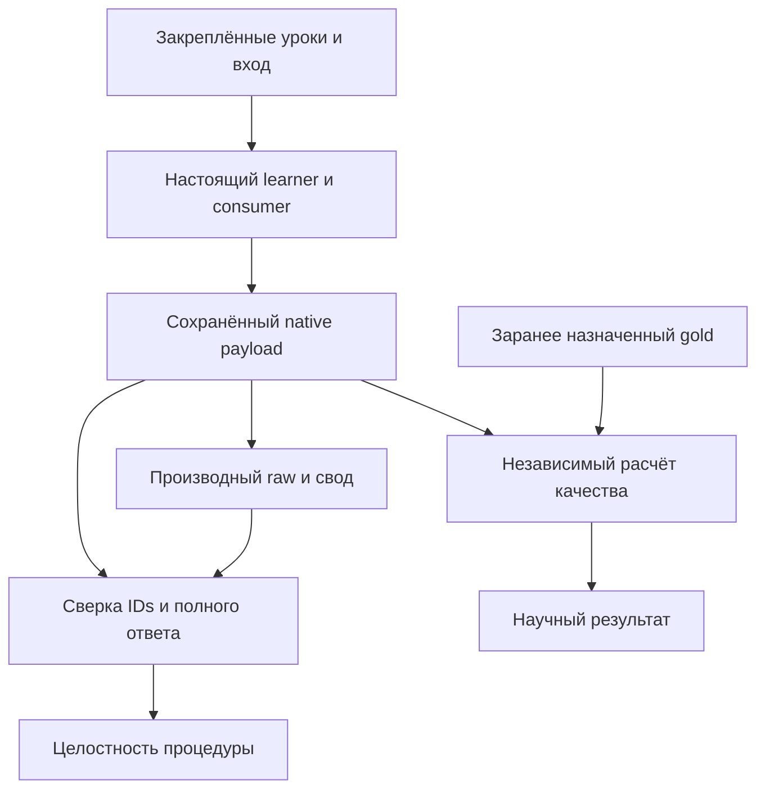

# Аудит после P131: что дошло до продукта, что доказано опытом и где приёмка теряет ошибки

Дата: 3 ноября 2026. Проверены core [`b27783593745ffac8e74e81f917539717cd33615`](https://github.com/lubochka/llm_mvp_core/tree/b27783593745ffac8e74e81f917539717cd33615) и planning [`9aef94e0aa02f462141ffb82331eccb96da282a5`](https://github.com/lubochka/xiigen-planning/tree/9aef94e0aa02f462141ffb82331eccb96da282a5). Это новый срез поверх [145](codex-145-post128-transfer-and-experiment-audit-2026-11-03.md)–[148](codex-148-post128-live-card-reconciliation-2026-11-03.md); исторические выводы сохраняют свои ревизии.

**Главный вывод.** Локальная польза P126–P131 подтверждается сохранёнными данными, но её нельзя считать завершённым переносом в штатный код. Найдены три новых пробела проверяющего контура: тестовый фильтр пропускает три известных падения; P131 не связывает сводный ответ с уже сохранённым native output; P127 допускает несогласованные название маршрута и шаги. Дополнительно локализованы две причины прежних тестовых падений и исправляется устаревшее действующее задание Q130. Опубликованные результаты опытов не опровергнуты: в частности, все 128 строк P131 совпадают с native payload.

Следующие действия определены в [адресном плане150](codex-150-post131-addressed-repair-plan-2026-11-03.md), [покрытии карточек151](codex-151-post131-card-coverage-2026-11-03.md) и [договоре49](../experimets/codex-49-post131-output-binding-and-test-coverage-2026-11-03.md). Изменение документов выполнено этим пакетом; исправление production/C# verifier и его нативная приёмка остаются назначенными работами, а не объявляются сделанными.

## 1. Область и способ проверки

Проверены результаты P126–P131, связанный учебный и проверяющий код, адресные остатки Q01/DPO/lineage, четыре именованных тестовых падения, действующие задания и переходы между двумя репозиториями. **Все 131 опыта заново не аттестованы**, все потребители проекта не перечислены, полный набор RF01–RF11 не переаудирован. Ранее найденные открытые границы сохраняются, пока нет нового доказательства закрытия.

Три независимых пакета доступны в [evidence аудита](../../../../experiments-v2/_audits/post131-2026-11-03/README.md): transfers/test triage, P126–P128/planning и P129–P131. Родитель прочитал ключевые исходники и повторил три Python-проверки на закреплённых данных. Проверены точные Git blob bytes: 31/31 в transfer-выборке, 90/90 в P126–P128/card-выборке и 303/303 в P129–P131. Выборки пересекаются; их числа не суммируются в число уникальных файлов. SHA-256, размеры и фактические пути находятся в manifests.

Среда имеет Python, но не `dotnet` и `pwsh`: реальные попытки команд завершились отсутствием executable, receipt сохранён. Поэтому свежие C#/xUnit/PowerShell, полный build, внешний exit исправленного verifier и текущий полный TRX — **UNRUN**. Python-проекция исходных предикатов не названа нативным прогоном. Новых Train/Predict/Flow/Load в аудите нет; первичные ответы, checkpoint, gold, бюджеты и исходники опытов не переписаны.

Применены проектные навыки архитектурного аудита, планирования и самопроверки плана, code examination, prompt patch, experiment design, QA/integration/test integrity, test failure triage, bug-to-tests, systematic debugging и человеческой коммуникации. Конкретные прочитанные файлы и границы чтения отмечены в evidence; получение большого файла или его хэш не объявлены чтением всего содержимого. Число искусственных «проходов» не заявляется.

## 2. Что уже исправлено и что осталось в реальном коде

| Область | Установлено на проверенной ревизии | Практический вывод |
|---|---|---|
| BOM и hash проигравшего кандидата | `TranslationLostCandidateArtifact` использует общую UTF-8 последовательность без BOM для hash и sync/async writer, сохраняя readback hash | Не назначать эту починку второй раз |
| Целевые 36/36 | Опубликованная сверка TRX содержит 29/26/3 → 36/36/0, сохранение 29 прежних имён и 7 добавленных | Это свидетельство прежнего целевого Release-прогона; исходные TRX этому аудиту не предоставлены |
| Q01 | CAS возвращает лишь bool; observed version может быть прочитана позднее. После Evaluate barrier отсутствует финальная проверка отмены | Оставить адресную приёмку observed CAS и late Evaluate; не смешивать с уже исправленной отменой Train |
| Candidate lifecycle | Store API существует; достаточного доказательства обычного подключения и свежего процесса для оставшегося Q01 нет | Проверить назначенный штатный путь; не утверждать отсутствие всех подключений во всём репозитории |
| DPO owner/binding | Capability ledger, необязательный declared owner и публичный admitted-конструктор оставляют ранее описанные границы | R128-02 открыт; новый опыт не является ремонтом этих consumer |
| Material lineage | Resolver по-прежнему выбирает первую строку совпавшей семьи, затем сравнивает SourceRowId | R128-03 открыт: честные дубли могут получить неверный ранний отказ |

Источники: [candidate bytes](https://github.com/lubochka/llm_mvp_core/blob/b27783593745ffac8e74e81f917539717cd33615/27.TranslationDomain/TranslationLostCandidateArtifact.cs), [TranslationMachine](https://github.com/lubochka/llm_mvp_core/blob/b27783593745ffac8e74e81f917539717cd33615/27.TranslationDomain/TranslationMachine.cs), [lineage guard](https://github.com/lubochka/llm_mvp_core/blob/b27783593745ffac8e74e81f917539717cd33615/18.CapabilityTraining/CapabilityMaterialLineageGuard.cs), [сверка TRX](evidence/2026-11-03-handover-test-reconciliation.md). Подробная трасса и DPO-ссылки находятся в [независимом transfer-пакете](../../../../experiments-v2/_audits/post131-2026-11-03/review-transfers.md).

Полные tree SHA поддеревьев `27.TranslationDomain`, `11.DPO`, `18.CapabilityTraining`, `Tests` одинаковы между BOM-коммитом `b4af9eef70f52020e3b10558fe86287dfb054023` и проверенным b277. Это подтверждает отсутствие последующих изменений именно этих поддеревьев. Усечённый GitHub compare не использован как доказательство отсутствия изменений; весь runtime и все зависимости этим сравнением не охвачены.

Исторический полный Debug receipt сообщает **16338 = 15615 passed + 628 failed + 95 skipped**. Семь падений относились к 24 файлам сессии; 14 обозначало число добавленных классов. Три candidate-падения закрыты отдельной опубликованной Release-сверкой; четыре ниже в неё не входили. **628 − 3 не является числом нынешних падений:** различаются конфигурация, сборки и состав прогона. [Источник полного прогона](evidence/2026-11-03-full-test-run-01-receipt.md).

## 3. Адресные новые замечания

### T131-01. Непустой зелёный тестовый набор может пропустить известные падения

В [146, прежняя команда приёмки](https://github.com/lubochka/llm_mvp_core/blob/b27783593745ffac8e74e81f917539717cd33615/docs/plans/replanning-possible-diffs/fixes-based-on-experiments/codex-146-post128-addressed-repair-plan-2026-11-03.md#L111) указан `FullyQualifiedName~ExperimentFixes`. Но два класса внутри папки `Tests/ExperimentFixes` имеют namespace `LlmFromScratch.Tests`: [tail-signature](https://github.com/lubochka/llm_mvp_core/blob/b27783593745ffac8e74e81f917539717cd33615/Tests/ExperimentFixes/TranslationPairTailSignatureLearningTests.cs#L6) и [verified-tag](https://github.com/lubochka/llm_mvp_core/blob/b27783593745ffac8e74e81f917539717cd33615/Tests/ExperimentFixes/TranslationVerifiedRuleTagTests.cs#L6).

Source-derived сопоставление шести точных FQN показывает: прежний фильтр включает 1/4 известных остаточных падений и 0/2 независимых положительных tag-контролей. Discovery «найдено больше нуля» не обнаруживает этот пробел. Это новый дефект достаточности приёмки, не новое исполненное падение.

Решение: сохранить всё семейство ExperimentFixes, добавить оба класса через OR и сопоставить обязательные FQN с discovery **и исполненными TRX IDs**. Полный фильтр, шесть имён и правила для skipped/aborted/Theory находятся в [49, §3](../experimets/codex-49-post131-output-binding-and-test-coverage-2026-11-03.md#3-фильтр-непустая-выборка-ещё-не-покрывает-известные-падения). Шесть случаев — диагностический минимум, не вся приёмка Q01.

### T131-02. Два прежних падения вызваны устаревшими expected

В tail-файле строки 158 и 593 требуют `RULE:TENSE_PAST`. Независимое основание — [план105, §4.4](105-late-learning-transfer-plan-2026-10-30.md) — требует `RULE:TENSE=PAST`. `TranslationVerifiedRuleTags` нормализует алиасы `_`, `:` и `=` к `TENSE=PAST`; builder сохраняет эту форму; отдельные PAST/PRESENT-тесты проверяют chosen-side и отвергают rejected-side.

Следовательно, ремонт назначается двум обучающим/import assertions и их описаниям. Нельзя возвращать продукт к underscore, ослаблять проверку до `Contains("RULE:")` или менять все underscore-строки поисковой заменой: чистый `TranslationSemanticKey.Canonicalize` отвечает за provenance и сохраняет остальные сегменты. Запрет PAIR, противоположного тега и проверка restore остаются. Это уточнённая причина двух известных падений, **не уже полученный runtime PASS**.

### T131-03. Положительный fixture для source floor не достигает проверяемого порога

Урок записан под `SVO|UNKNOWN`, а запрос использует `SVO|UNKNOWN|PAIR:P-FOREIGN`; prefix и structure также отсутствуют в памяти. `FindExactWithSourceGuard` завершает поиск раньше сравнения source. Ответ `alpha beta` объясняется fallback при отсутствии кандидата, поэтому этот положительный контроль ничего не доказывает о floor 0,60.

Ремонт: совпадающий ключ хранения/запроса, явное доказательство достигнутого кандидата и два различающих source: `alpha beta` даёт overlap 2/2 = 1,0; `alpha beta gamma delta epsilon` — 2/5 = 0,40, выше cascade 0,35, но ниже ordinary 0,60. Проверка прямого legacy PAIR seam отделяется от обычного parser; отрицательный контроль ошибочного floor 0 должен вернуть learnedAnswer. Product threshold менять не требуется. [Тест и helper](https://github.com/lubochka/llm_mvp_core/blob/b27783593745ffac8e74e81f917539717cd33615/Tests/ExperimentFixes/TranslationPairTailSignatureLearningTests.cs), [точный lookup](https://github.com/lubochka/llm_mvp_core/blob/b27783593745ffac8e74e81f917539717cd33615/27.TranslationDomain/TranslationUnitContracts.cs#L364).

Четвёртое известное падение требует **продуктового** ремонта R128-03: выбрать заявленный ID среди независимо совпавших trusted content/family rows, затем применять роли и запреты. Замена `CAPABILITY_MATERIAL_FORBIDDEN_CONTENT_OVERLAP` на любой отказ скрыла бы дефект. Селективные Dev/Test flags также сохраняют прежнюю отдельную матрицу; один тест её не закрывает.

### E131-01. P131 считает точность по своду, который не связан с native output

[Program.cs](https://github.com/lubochka/llm_mvp_core/blob/b27783593745ffac8e74e81f917539717cd33615/experiments-v2/RP01-MICRO/P13101/Program.cs#L333) сохраняет настоящий Flow в `evidence/native-flow/{arm}-{id}.json`, затем производит raw-строку. [SavedEvidence.cs](https://github.com/lubochka/llm_mvp_core/blob/b27783593745ffac8e74e81f917539717cd33615/experiments-v2/RP01-MICRO/P13101/SavedEvidence.cs) читает raw writer/reader, но не native-flow. Проверка actual опирается в том числе на столь же производную `translated_length`; одинаково изменённые writer/reader сохраняют restore parity.

В памяти создан контрпример: у 16 строк H/X в B.after/B.restored заменены только actual и его reported length. Проекция затронутых C# predicates сохраняет schema/restore-условия и меняет H/X с 0/4 на мнимые 4/4; неизменные native файлы отвергают все 16 подмен при прямой сверке. **Это Python-проекция, не native exit C# verifier.** Полный проверяющий и его внешний entrypoint надо принять отдельно.

Положительная часть столь же существенна: в исходном пакете **128/128 raw/native совпали** по actual, verdict, flow, полным metrics и warnings; все native results успешны. Обнаружен пробел защиты, а не подлог или противоречие опубликованного результата.

Ремонт связывает raw/native по полному множеству `(arm,id)`, пересчитывает ответ из исходного payload и сохраняет provenance/hash manifest. Согласованный настоящий неверный ответ остаётся допустимым научным наблюдением. Сверка нескольких файлов не является криптографической гарантией против одновременной подмены всего пакета.

**Существенная зависимость ремонта.** Независимые reviewers дополнительно обнаружили, что текущий `Provenance.Verify` связывает loaded checker DLL с историческим producer DLL/HEAD, а DATA_BINDING сравнивает старые10 required gates с текущим списком. После пересборки для нового gate честный пакет будет отвергнут раньше него. [Provenance.cs](https://github.com/lubochka/llm_mvp_core/blob/b27783593745ffac8e74e81f917539717cd33615/experiments-v2/RP01-MICRO/P13101/Provenance.cs#L77), [Contract.cs](https://github.com/lubochka/llm_mvp_core/blob/b27783593745ffac8e74e81f917539717cd33615/experiments-v2/RP01-MICRO/P13101/Contract.cs#L13). Поэтому150/49 назначают версионированную повторную проверку: неизменные producer proof/source/DLL/schema отдельно от нового verifier identity/required gates. Уже существующий VerifyOnly и его input/output isolation сохраняются. Недоступные старые bytes дают явный NOT_PROVEN происхождения; их нельзя заменить новой сборкой или переписанным proof ради PASS. Это проблема исполнимости будущего ремонта, а не опровержение исходных128 ответов.

### E131-02. P127 смешивает изменённую метку с изменённым содержимым ответа

[LabelSensitivityHolds](https://github.com/lubochka/llm_mvp_core/blob/b27783593745ffac8e74e81f917539717cd33615/experiments-v2/RP01-MICRO/P12701/Program.cs#L1107) требует лишь различия `AnswerRoute`; `payloadComplete` требует два известных имени шагов. Произвольная другая метка C вместе со шагами B проходит проекцию обоих предикатов. `ComparePermutation` также сравнивает метку без полного ordered payload.

Здесь нужны **две разные проверки**. Целостность связывает route с ordered steps и только реально имеющимся A/B graph trace. Научный контроль отдельно считает точное следование C назначенным переставленным targets: p1 → `[implement,review]`, p2 → `[review,implement]`. Согласованный настоящий C, не усвоивший эти цели, даёт отрицательный/NOT_PROVEN научный результат, а не обязательно INVALID процедуру. Несогласованная метка и шаги — повреждённое доказательство. Новые C-графы и fit не требуются.

При проверке исполнимости плана обнаружено, что старый finalizer требует научную чувствительность прямо через `label_sensitive_c_holds` и косвенно через `c_substituted_by_b_control_passed`; `corrupted_receipt_control_passed` зависит от научной правильности B/e1. Поэтому150/49 назначают переклассификацию и переработку всей этой цепочки, а не одного поля. Положительный integrity-control допускает согласованный неправильный ответ, контролируемая порча evidence отвергается; отдельные тесты scorer не выдаются за ответы learner. Это source-derived зависимость будущего ремонта; текущий честный C действительно усвоил targets.

В опубликованных данных настоящие C-steps следуют обеим назначенным целям; исходный полезный результат A1/2 → B2/2 сохраняется. Контрпример и его ограничения опубликованы в [P126–P128 evidence](../../../../experiments-v2/_audits/post131-2026-11-03/review-planning.md).

### D131-01. Текущее задание Q130 противоречит записанному ST01

В [карточке Q130 до ремонта](https://github.com/lubochka/llm_mvp_core/blob/b27783593745ffac8e74e81f917539717cd33615/docs/plans/replanning-possible-diffs/experimets/cards/METHOD-KNN-SCOPED-EXPRESSION-TARGET-01.md) верхний current block называет опыт будущим; вся карточка не содержит RESULT_RECORDED/ST01, хотя индекс уже записал результат. Исправляются именно действующий вход и копируемый prompt; первоначальный паспорт сохраняется как история. Новый PRIMARY это не назначает.

## 4. Что на самом деле показали P126–P131

| Опыт | Подтверждённое измерение | Предел вывода и исполнение |
|---|---|---|
| P126 | 16 arm-result, 28 updates; конечные weights и RNG совпали в восьми A/B-парах; teacher-forced accuracy 66/66 либо 46/46 сохранена | Обучение увеличивает margin; оптимизации численно нейтральны в этой панели. `generate_calls=0`, свободная генерация не измерена; старый HintPath DLL не равен сборке нынешнего HEAD |
| P127 | Primary p1/p2 и heldout h1/h2: A1/2, B2/2, C0/2 по исходному gold; реальные C targets усвоены2/2 | Позиционный признак помогает в проверенных случаях; две попытки вместе уже стоили10fit/100уроков/136чтений. Label-only gap требует ремонта verifier |
| P128 | Copied composer cap256:1/2 и coverage6/8; cap2048:2/2 и8/8; ordinary retention29/29, exam2/2 | Штатный planner уже2/2. Нельзя переносить изменение cap в другую реализацию без проверки. Полные сохранённые parent/child views равны, но прежний неполный comparator/outer exit остаётся открытым |
| P129 | Cold0/2; S0/pre/failure1/2; corrected и reader2/2; immediate pre/failure full-state равны | Staging продукта уже обеспечивает атомарность. Ранний syntax preflight избегает одного native вызова и одной отброшенной итерации; typed/finite admission целиком не доказан. Новый learned input повторяет экзамен |
| P130 / ST01 | Cold1/4; A2/4, B4/4 при k1/k5; E2/E4 сохранены2/2; 4 Train/32 пары/32 Predict; 32native pairs совпали с material | Исправлена target projection экспериментальной копии extractor для arrow body. Exam Current повторяет train Current; k5 содержит три копии каждой семьи. Отдельные persistence/ordinary product acceptance отсутствуют |
| P131 | P8/8 сохранены; N0/4→4/4 и после reader; H0/4 и X0/4 без улучшения; C назначенные targets4/4 | Усвоены четыре предъявленные отрицательные фразы; H проверяет знакомые из положительного S0 глаголы без отрицательных уроков, X — новые сочетания знакомых глаголов и объектов. Перенос на H/X не появился. Все восемь H/X дают положительный приказ с confidence0,99; это наблюдаемая ошибка, а не отказ |

Полные ссылки и пересчёт по каждой строке находятся в [P126–P128](../../../../experiments-v2/_audits/post131-2026-11-03/review-planning.md) и [P129–P131](../../../../experiments-v2/_audits/post131-2026-11-03/review-experiments.md). P131 использует единственное продолжение `attempt-0001/continuation-0001` после pre-model setup failure; оно не считается вторым успешным PRIMARY.

Ресурсы не округляются до «лучше». P129 corrected allocations выросли734432→775064 (+5,53%); выгода malformed-path измерена один раз. P130 Train allocations выросли на14,21%/16,87%, extraction wall на34,28%/14,20% дляk1/k5. P131 checkpoint вырос9642→13651байт (+41,58%), учтены17 явных Export. Один фиксированный порядок без повторов не доказывает устойчивую скорость. Общий metric-based transfer HOLD сохраняется; это не стирает частную логическую пользу и не запрещает отдельное обоснованное исправление продуктового дефекта.

## 5. Архитектурное правило приёмки

Проблема повторяется, когда проверяется краткое описание результата, а не путь, который его породил. Для сохранённых данных применяется следующая связь; она не требует новых вызовов модели:

Третий вывод — **приёмка переноса** — требует своего штатного продуктового пути, сборки и исполненных тестов. VALID процедуры совместим с отрицательной гипотезой. Одинаковая ошибка writer и reader не доказывает точность, а уверенность самого ученика не заменяет независимый gold. Непустая тестовая выборка аналогично не доказывает исполнение нужных FQN.

## 6. Продолжение и критерий завершения

В основной [Q-таблице](../experimets/cards/00-execution-index.md#experiment-next) **131 уникальная строка,131 RESULT_RECORDED,0 без результата**. Записанный результат не означает научного успеха. Q132 и повтор старого PRIMARY не назначены. В [очереди переносов](01-registry.md#executor-next) порядок остаётся Q01/135-R01-CONCURRENCY → Q02 → Q03 → Q06; Q04 приостановлен, Q05 зависит от него. Прямое поручение пользователя имеет приоритет.

Этот пакет закрывает документную часть аудита: конкретные причины, проверяемый план, действующие задания и профилактика повторения на соседних карточках. Он **не закрывает нативную приёмку** четырёх падений, оставшийся Q01/DPO/lineage или исправленный C# verifier. Для каждого из них план150 указывает файлы, потребителя, положительный и различающий отрицательный пример, ожидаемое доказательство и границу готовности.
