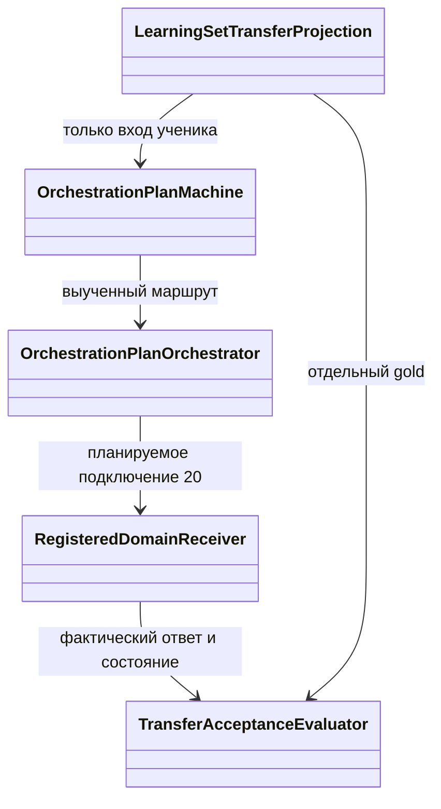

# 158. На каких наборах проверять пользу переноса

## Наборы для открытых переносов, 12 ноября 2026

R28, два снимка 124, Q06, Q35, Q34 и Q32 приняты. Таблица ниже сохраняет их данные для воспроизведения. Для обычной доставки Q12/Q22 используйте соответствующие разделы. [Фактические результаты](audits/2026-11-13/transfer-execution.md) · [Очередь](01-registry.md#executor-next).

| Работа и тема | Что подать при исполнении | Что прочитать и когда перейти дальше |
|---|---|---|
| **R28. Документация проекта Cedar. Принято в `91794035290`** | Исходные данные владельца — `DOC-02`, `Cedar status`, ответ `null` или `""`. Обычная DPO-пара содержит две текстовые стороны и такого случая не задаёт. [Исходная запись](../../../../Tests/ExperimentFixes/LexicalCorpusStatisticsTests.cs) | Завершено. [Наблюдавшийся результат и его границы](audits/2026-11-13/transfer-execution.md). |
| **124 → Q06. Написание методов на C#** | 124 восстанавливает именно `producer-abs.bin` и `producer-sign.bin` из каталога опыта SEP01. Q06 использует строки `abs` и `sign` из [separator-format.json](../../../../experiments-v2/RP01-MICRO/SEP01/results-01/separator-format.json). Каждый ответ уже учили на соответствующем состоянии, новых уроков здесь ноль. | Завершено. [Наблюдавшийся результат и его границы](audits/2026-11-13/transfer-execution.md). |
| **Q35. Написание кода на C#** | В SEXP01 последовательность четырёх уроков — `train-one`, `train-two`, `train-one`, `train-two`. В `panelBefore.rows` и `panelAfter.rows` отдельно заданы `heldout-three`, `heldout-four` и `control-branch`. Взять состояние `start` и эти же строки в [данных плеча A](../../../../experiments-v2/RP01-MICRO/SEXP01/results/attempt-0001/A/arm-result.json). | Завершено. [Наблюдавшийся результат и его границы](audits/2026-11-13/transfer-execution.md). |
| **Q34. Знак арифметического выражения C#** | Исходные `T+`, `T-` — знак `9−4` и `4−9`; отложенные `E+`, `E-` — знак `8−3` и `3−8`. Взять [две учебные строки](../../../../experiments-v2/RP01-MICRO/_shared-learned-starts/h64-silu/v1/data.source.jsonl) и [таблицу ответов SILU01-R1](../../../../experiments-v2/RP01-MICRO/SILU01/results/SILU01-R1/per-row.csv). | Завершено. [Наблюдавшийся результат и его границы](audits/2026-11-13/transfer-execution.md). |
| **Q32. Знак арифметического выражения C#** | В AC01 свой донор `h64-rms-row/v1`. Четыре строки подписаны `T1/T2` (учебные) и `E1/E2` (отложенные) в [A/code-sign.json](../../../../experiments-v2/RP01-MICRO/AC01/a001/results/A/code-sign.json). Похожие формулировки у Q34 не делают состояния взаимозаменяемыми. | Завершено. [Наблюдавшийся результат и его границы](audits/2026-11-13/transfer-execution.md). |

### Q12. Исправление должен получить выбранный владелец

Домен исходной проверки — оркестрация. Для обычного пути взять различающий случай `case-U2` из [P11101, arms.json](../../../../experiments-v2/RP01-MICRO/P11101/results/attempt-0001/arms.json). До исправления U1 отвечает `review`, U2 отвечает `archive`. После обратной связи по выдаче U2 у него читается `archive then notify`, U1 по-прежнему отвечает `review`. В ошибочном варианте чужой ответ меняется у U1, а U2 продолжает выдавать `archive`. Это проверка адреса на двух известных получателях. Наблюдать выбор экземпляра, фактический ответ обоих и публикацию исправления из обычного входа. Для отработки отказа использовать предусмотренный карточкой отказ обучения/публикации. После подтверждения доставки закончить этот остаток. [Поручение Q12](audits/2026-11-12/transfer-unblocking-by-work.md#decision-q12)

Если отдельно выбран предложенный в [карточке 74](74-knn-domain-constructor-transfer.md) профиль перевода RU→EN, минимальный кандидат на **учебное исправление** — [TR07-OMISSION/ru-en/M001/accepted.jsonl, строка 1](../../../../learning-sets/TR07-OMISSION/ru-en/M001/accepted.jsonl), `TR07-OMISSION.ru-en.M001.F0000001.P01`. Вход содержит контекст кухни и видимое «Молко стоит в холодильнике». Ожидаемый смысл — молоко в холодильнике. Предложенный автором ошибочный смысл — сок. Исполнителю нужны фактически вызванный объект и его ответ. Строка не содержит их идентификаторов. Сохранить контекст и видимую опечатку при передаче получателю. Исправленный исходник `canonical_source` и `rejected` остаются у проверяющего. Спросить тот же вопрос после урока — проверка усвоения. Строка 2 с собакой также помечена `train` и не даёт независимой оценки. Отдельный экзамен для адресности не требуется.

### Q22. В урок переводчика попадает фактически выданный ответ

Тема — перевод EN→RU. Сохранить восемь исходных уроков `t1–t8` и два случая `e5/e7` из [P4201/Program.cs](../../../../experiments-v2/RP01-MICRO/P4201/Program.cs). На «Anna did not open the window» подтверждённое исправление — «Анна не открыла окно». На «Boris did not open the door» — «Борис не открыл дверь». Записать, что обычный поток действительно выдал на исходный запрос, кому доставил исправление и какой перевод эта единица вернула при повторе. Две исправленные строки после доставки уже учебные. Соседнее направление служит контролем сохранности. После наблюдения обычной доставки перейти к следующей работе. Доза и данные уже принятого адаптера сохраняются. [Граница Q22](audits/2026-11-12/transfer-unblocking-by-work.md#decision-q22)

Для отдельно выбранной проверки перевода у модели Kimi есть [TR01-NEGATION-SCOPE/en-ru/T302/draft.jsonl, строка 1](../../../../learning-sets/TR01-NEGATION-SCOPE/en-ru/T302/draft.jsonl), `TR01-NEGATION-SCOPE.en-ru.F0000000.P01`, `split=train`. На «He did not say that the tickets had been bought» удачный ответ сохраняет **отрицание высказывания** («Он не сказал, что билеты куплены»). В отвергнутом варианте отрицается **покупка** («Он сказал, что билеты не куплены»). Поэтому проверять надо, к какому действию относится отрицание. Строка не удостоверяет, что именно такой плохой перевод когда-либо выдал продукт; для обратной связи взять выданный в данном запросе текст. Не добавлять эту пару к `e5/e7` в приёмке остатка Q22. Первая и вторая строки T302 обе учебные. Готовый независимый экзамен для этой пары в указанном файле отсутствует.

### Поручение автору следующего учебного набора

Начать с перевода EN→RU, назначенного ниже. Для следующего тематического набора выбрать один из этих двух профилей. Строки уже есть как TRAIN, поэтому самостоятельный экзамен автор составляет отдельно.

| Тема | Исходная строка Kimi | Что различает новый вопрос |
|---|---|---|
| Документация C# | [DOC-CS-NULL.base.F0000001.P01, строка 1](../../../../learning-sets/DOC-CS-NULL/base/M002/draft.jsonl). Оператор `??` подставляет значение только при null. Пробелы в ненулевой строке сохраняются. | В новом методе и другом семействе входов проверить смысл подстановки. Засчитывать равносильное объяснение. Ошибкой будет приписать коду отсутствующий Trim. |
| Оркестрация | [OR-ROUTE-INTENT.base.F0000000.P01, строка 1](../../../../learning-sets/OR-ROUTE-INTENT/base/M004/draft.jsonl). «Переведи на английский: Счёт отправлен вчера вечером» ведёт к `tr.en`. | В новом запросе изменить конструкцию и нужного специалиста. Читать фактически выбранный домен. Положительный пример и близкий запрос с другим адресатом принадлежат одной теме маршрутизации. |

> Подготовь материал для одного профиля — перевод с английского на русский, область действия отрицания. В качестве учебного примера используй T302, строку 1, по адресу выше. Подготовь один отдельный проверочный вопрос, в котором отрицание также может относиться к одному из двух действий. Возьми другую ситуацию и другую конструкцию. Замена имён, билетов на другой предмет или перестановка готового перевода даёт повтор исходного урока. Пометь учебную строку TRAIN. Проверочный вопрос и его допустимый смысл держи вне урока. Укажи ID, семейство, источник и фактическое происхождение каждого примера. Автор исходной строки указан в ней как Kimi K3 (Kiro), идентичность модели независимо не подтверждена. Для новой строки запиши её собственного автора. Кратко объясни, что меняется при ошибочном переносе отрицания и какие другие переводы допустимы. Если адаптация понадобится, размести производные материалы в отдельной simulation-подпапке профиля, например `learning-sets/simulations/transfer-coverage-2026-11-04/tr01-en-ru-negation/v1/`, с отсылкой к исходной строке. На одном уроке и одном различающем вопросе остановись. Если второй случай оказался перефразом первого, отметь, что независимый вопрос ещё нужен. Обучение в поручение автору не входит.

В этой правке новые пары и файлы наборов не создавались. В [каталоге прежнего плана симуляций](../../../../learning-sets/simulations/transfer-coverage-2026-11-04/README.md) при чтении обнаружено только описание. Строки JSONL и сохранённые выходы опытов прочитаны как источники. Исполнения описанных проверок в этой работе не было.

## Исторический план расширения от 4 ноября 2026

Следующие разделы сохраняют тогдашние решения по дополнительным профилям. Их объёмы партий, собственный producer и требования к полному эксперименту относятся к тому проекту расширения. Текущие адресные задания приведены выше.

4 ноября после Q01 в очереди стоял Q02. Отдельный разбор старых результатов дошёл тогда до Q011/P10. [Уточнение 161](codex-161-postq011-executor-context-repair-2026-11-04.md) сохраняет границу проекции TR07 для Q02: prompt-контекст должен сохраниться при записи ASide, а canonical_source содержит исправленный вход.

Срез чтения: core `45bd4e371f5`, planning `9cd5351731`, 4 ноября 2026. Сборки, тесты, импорт в модель и обучение в этой документной работе не выполнялись. Статусы ниже — прочитанные источники и план будущих проверок, не новые измерения.

## 1. Что добавлено к существующим планам

В планах 13/17/20/48/49/62/74 уже определены механизмы, их исходные fixtures и ограничения. Не хватало связи с конкретными китайскими наборами, различения TRAIN и экзамена, места для улучшенных симуляций и правил преобразования данных. Поэтому добавляется эта связь; архитектура тех карточек не проектируется заново.

| Требование пользователя | Решение здесь | Проверяемый выход будущего этапа |
|---|---|---|
| Куда внедрять код | §4: существующие владельцы и методы; отдельная тестовая проекция данных | Действительный вызов проверяемого механизма, а не его копии |
| Как чинить падающие тесты | §6: независимый oracle, классификация причины, обязательная сборка назначенного ремонта | Свежий результат конкретного теста той же сборки |
| Покрытие по принципам опыта | §2, §5: один фактор, обученное начало, собственные before/after | Парные показатели и положительный/отрицательный контроль |
| Промпт → домен → ответ | §7: продолжение владельца 20; атомарный router отдельно от порядка действий | Реальный получатель, его ответ и восстановление |
| Математика и предметная применимость | §2, §4 | Условия эквивалентности, не обещание универсального выигрыша |
| Использовать и улучшать learning-sets | §3, §8; [карта источников](evidence/2026-11-04-learning-sets-transfer-map.md) | Закреплённые партии и отдельные simulation-версии |

## 2. Измеренная польза: что переносим и чего не обещаем

Числа относятся к историческим опытам. **Ни одно из них ещё не получено на выбранных ниже новых наборах.** Любое измеренное улучшение полезного показателя является успехом по этой оси и теме; рядом сохраняются ухудшения. Для общего допуска действует пользовательская граница ухудшений более 5%, с исключением процессорного времени. Процессорное время, полное время обучения и вложенные интервалы нельзя молча считать одним показателем.

| Существующий владелец и опыт | Было → стало | Что осталось и что ухудшилось | Допустимая область |
|---|---|---|---|
| [FIX-LC /13](13-dpo-reference-cache.md), [N61-REF-CACHE](../../../../experiments-v2/RP01-MICRO/N61-REF-CACHE/results/report.md) | Выделения 7 331 104 632 →6 010 567 464 Б, −18,01%; полный учебный переход 23 096,6 →19 375,9 мс | Ответы 46/46 и 44/44 токенов одинаковы; пик 1 808 465 920 →1 807 183 872 Б. Вложенные policy 6918,1 →8222,7 мс и optimizer 417,8 →446,5 мс хуже; один замер не устанавливает причину или устойчивое ускорение | Первая очередь по выделениям; повторная оценка **замороженного** reference при повторении той же точной пары. Нового роста точности не заявлять |
| [FIX-SEP /62](62-supervised-framing-and-learning-readout.md), [SEP01](../../../../experiments-v2/RP01-MICRO/SEP01/results-01/report.md) | Чтение Abs 22/23 →23/23; Sign 20/21 →21/21 при тех же весах | Исправлена первая позиция ответа. Свободная генерация, более ранний stop и экономия уроков не измерены; до обучения в исправленном формате панель не снята | Логическое исправление диагностики обучения. Не выдавать за новый навык модели |
| [FIX-IM /48](48-learned-route-body-identity.md), [IDENTITY-M1](../experimets/results/2026-10-20/IDENTITY-M1-01/report.md) | Верный выданный план 2/3 →3/3; положительные 1/2 →2/2 | Отрицательный контроль сохранён, состояние 3801 →3801 Б. Первый учебный урок 19,6354 →27,8554 мс, причинная связь с изменённым reader не установлена | Исправление выдачи чужого тела под правильным маршрутом; самостоятельное выполнение специалиста этим опытом не доказано |
| [FIX-KR /49](49-router-learned-key-normalization.md), [KR01](../../../../experiments-v2/RP01-MICRO/KR01/results/report.md) | После двух уроков 2/4 →4/4, пропуски выученного 2 →0 | Состояние 426 →426 Б; после обучения allocations 8200 →8200 Б. Холодное чтение 16400 →24344 Б (+48,44%) | Узкий логический ремонт несовпадающих ключей записи/чтения. Холодную цену не скрывать |
| [FIX-N63C /17](17-dpo-sft-correction-collision.md), [CDB01](../../../../experiments-v2/RP01-MICRO/CDB01/results-01/report.md) | Начало 22/23; после 20 устаревших SFT-уроков 20/23, после 10 устаревших и 10 исправленных 22/23 | Восстановлены 2 токена; на экзамене один запрос+1 токен, другой−1. Это блок исправления после порчи, не 20 исправленных уроков с начала. Полного ответа эта панель не показывает; отдельно учитывать исправление прибора SEP | Исправление противоречащего урока, не универсальный scheduler и не доказанное обобщение |
| [FIX-KDP /74, только T111](74-knn-domain-constructor-transfer.md) | P111: правильный получатель исправления 1/2 →2/2; чужие изменения 1 →0; allocations 33752 →33752 Б | Общий KDP/KDR имеет непокрытые ресурсные границы и RU/HE routes 0/8; его общий допуск не следует из T111 | Адресная доставка исправления выбранной обученной единице и сохранение её состояния |

У T111 [первичный отчёт P111](../../../../experiments-v2/RP01-MICRO/P11101/results/attempt-0001/report.md) подтверждает выбранного и невыбранного владельца, а также равные 33752 Б. Пик/CPU/retained memory по отдельным плечам не измерены. Указанный успех допускает адресный логический ремонт, не заменяет проверки обычного продуктового получателя и не доказывает полный ресурсный допуск общего KDP.

**Не расширять допуск ради новых данных.** TS01: allocations−11,88%, но пик+131 МБ и время подготовки 255,883 →630,713 мс. FIX-PD: пик+27,13%. HNQ01: арифметики нормы−75%, но полное обучение 3,1809 →3,9071 мс; это не доказанное ускорение. Общий KDP и новый позиционный P127 остаются в своих текущих границах 153/105. Новые наборы не снимают эти ограничения автоматически. Принятый FIX-AST также не переоткрывается только потому, что появились данные SQL или Angular.

## 3. Какие реальные наборы использовать

Корень всех путей таблицы: `C:/Projects/llm_mvp_core/learning-sets/`. Выбран весь указанный файл, **не все одноимённые партии**. Точные hashes, объёмы и примеры RowID — в [карте источников](evidence/2026-11-04-learning-sets-transfer-map.md). Статус draft не равен плохому содержанию: он означает отсутствие завершённой независимой приёмки.

| Пакет и точный путь | Что проверять и у какого владельца | Предел применимости |
|---|---|---|
| `DOC-CS-NULL/base/M002/draft.jsonl` | Основной кандидат для LC, SEP и согласования SFT/DPO: объяснение `s ?? "—"`, сохранность пробелов, отсутствие выдуманного Trim | C#-документация; это не урок написания кода. Oracle ещё NOT_RUN; нужен независимый review |
| `CODE-CS-NULL/base/M003/draft.jsonl` | Контраст «написать метод» против «объяснить метод» для маршрутизации 20/IM/KR. Отдельная будущая предметная панель кода | Не смешивать с DOC-CS в одном обучении специалиста. Не подставлять code.csharp в существующий csharp-code-documentation recipient |
| `OR-ROUTE-INTENT/base/M004/draft.jsonl` | Атомарный выбор получателя: route/clarify. Для 20 и проверки сохранности выбранного адреса в 74/T111 | TRAIN router имеет одну тему — оркестрация. Перевод/SQL/код здесь классы маршрута, не обучение этих специалистов. Много действий означает clarify по исходному контракту |
| `TR07-OMISSION/ru-en/M001/accepted.jsonl` | Предметный перевод с восстановлением опечатки; ответ milk вместо juice. Кандидат для выбранного translation receiver и адресного исправления 74 |10 принятых TRAIN-пар; native admission NOT_CHECKED, export INTERCHANGE_FORMAT_ONLY. Нет готового экзамена. Это не checkpoint |
| `TR01-NEGATION-SCOPE/ru-he/T446/draft.jsonl` | Отдельный профиль перевода на иврит: область отрицания; для проверок 20/74, без смешивания с ru-en | Независимая bilingual-проверка обязательна; английское равенство строк не заменяет проверку смысла иврита |
| `CODE-NG-LATEST/base/D310/draft.jsonl` | Angular/RxJS: новый запрос отписывает старый inner. Контрастный запрос для router20; отдельный предметный oracle TestScheduler | Исходник прямо требует switchMap: показывает следование инструкции, не самостоятельный выбор оператора. C# AST-признаки сюда не переносить |
| `CODE-SQL-LEFT/base/D306/draft.jsonl` | SQL: фильтр правой таблицы в ON сохраняет клиента без заказа. Контрастный запрос для 20; отдельный предметный oracle T-SQL | SQL Server2019, ANSI_NULLS ON; не заменять SQLite. JSON-валидность не доказывает правильность SQL |

Для выбранного ru-he/T446 точный pin особенно важен: все 10 ID также есть в T351; строки 1/8/10 имеют другие тройки. Это не автоматически неверный перевод, но другое содержимое. Использовать именно байты T446 из карты; допустимые варианты проверяет bilingual reviewer. T351 нельзя добавить как независимый экзамен.

**Проверенная проблема всего дерева:**569 файлов draft,5729 строк, все split=train;5599 уникальных pair_id,120 ID повторяются,67 из них связаны с разными тройками. Это подсчёт файлов и записей, не 5729 принятых уроков. Пример конфликта — `TR02-ROLE-ORDER.ru-he.F0000012.P01` в T452/T357-retry/T357. Источник идентифицировать комбинацией repository commit + относительный путь + SHA256 файла + номер строки + pair_id; нельзя выбирать «самый свежий» или терять строку через Dictionary по одному ID. Конфликтующие варианты сохраняются с разными derived ID и явным решением review.

## 4. Где должен проходить настоящий код

**Вход данных.** `xiigen.dpo.v1` — обменная схема; не готовый native DPO. Уже существующий [10-NATIVE-CONTRACT-BOUNDARY](C:/Users/lubao/Documents/xiigen/llm%20mvp/learning-sets/preparation/10-NATIVE-CONTRACT-BOUNDARY.md) остаётся владельцем границы импорта. `11.DPO/Models/DpoPair.cs` содержит только Prompt/Chosen/Rejected; этого недостаточно для продуктовой provenance/admission. `RepositoryOwnedDpoDatasetManifest.cs:1015–1056,1121–1144` отдельно проверяет происхождение и домен. Не приписывать китайскому генератору DeterministicGenerator и не придумывать недостающую авторскую идентичность ради успешного импорта.

Для будущего тестового набора выбрать **новый**, ещё не реализованный helper `Tests/ExperimentFixes/LearningSetTransferProjection.cs`, метод `ReadPinnedRows(selectionManifest)`. Он проверяет hash и точную строку, возвращает learner input и отдельные evaluator/provenance данные. Он не обучает и не выдаёт admission. `prompt` → Prompt без Trim/нормализации; `chosen/rejected` → полные стороны DPO; SFT Response берётся только из утверждённой chosen, в отдельном режиме. `rationale`, правильный route, error_tag, путь файла и split не попадают в признаки ученика. Метаданные автора остаются честными. Без законной native authority — отказ до мутации, не ослабление product gate.

**LC.** В `11.DPO/DpoTrainer.cs:682–696` ключ связывает digest пары, tokenizer, framing/objective и ReferenceIdentity. `StepVectorCore:1041–1066` использует обе cached оценки; `RestoreContinuationState:705` очищает cache. Поэтому в переносе не писать новый кэш. Довести назначенную приёмку 13: совпадающая пара попадает в cache; изменённая пара или reference не используют прежнюю оценку; policy и gradient не кэшируются. Математика: при неизменных θref, входе и функции оценки значение logPθref(y|x) повторяется, поэтому замена повторного вычисления сохранённым числом не меняет DPO-цель. Это условное равенство, не разрешение кэшировать изменяемый reference или dropout-выход.

**SEP и collision.** `IncrementalTrainer.cs:402–403` действительно кодирует `string.Concat(example.Prompt, "\n", example.Response)`. `DpoExactPairMaterial.cs:20–22,72–75` отдельно кодирует сегменты **без** разделителя. Сохранить оба профиля. В 62 уже назначен единый SFT formatter/reader; новый набор подключается к нему, а не получает локальную третью склейку. В 17 проверять проекцию исправленного SFT-текста до вычисления provenance и IDs. Формат не выбирается по gold, длине нужного ответа или имени метода.

**Выбранный маршрут.** `PromptFlowGroundingModel.cs:129` уже ограничивает поиск тела выбранным FlowRef — сохранить. `OrchestrationPlanOrchestrator.cs:32–83` возвращает PlanText и predicted_flow_ref; в прочитанном методе нет исполнения специалиста. Подключение настоящего receiver остаётся работой 20, а не успехом по наличию метки. Нормализация ключа 49 — детерминированная инфраструктура, не новый обученный классификатор. T111 исправляет выбранного получателя через существующую 74; строка provenance не может заново выбрать другой unit.

## 5. Как проверять без потери обученного начала

Сначала закрывается исходная приёмка выбранного владельца по его неизменным данным и дозе. Эта таблица не добавляет ни одного Train/Forward к старому рецепту. Затем, **при отдельном назначении расширенного покрытия**, подключается подходящий предметный пакет §3. Старые двухстрочные результаты не переименовываются в результаты нового набора.

1. **Подготовка данных без модели.** Закрепить выбранный файл/RowID/hash; проверить содержание и различающий rejected; сохранить независимый review. Проверить длину actual tokens без обрезки цели. Если вход не помещается, остановить именно этот профиль и передать автору точное переполнение; не укорачивать задачу после просмотра ответа.
2. **Учебный набор и экзамен.** Для каждого специалиста отдельная тема и профиль. Все существующие выбранные строки остаются TRAIN. Новые DEV/EXAM создаются в simulation-копии:4 DEV и 4 EXAM на профиль специалиста, каждый из нового семейства и с независимым предметным gold. Для router назначены 24 DEV и 24 EXAM:20 маршрутов и 4 разные причины clarify по точной матрице §7 карты источников. Публичные reference задают классы и критерии, но не копируются и не перефразируются в закрытый экзамен. Перефраз того же урока — retention/perturbation, не независимый EXAM. Связанные source/origin/leakage/lexical families целиком принадлежат одному split; common RAG-инструкция сама по себе не объединяет все сюжеты, но производный один сюжет объединяет.
3. **Приобретение начала один раз.** Для нейронной C#-документации модель остаётся назначенной владельцем `rp01-csharp-small/v1`; профиль, tokenizer, LoRA targets, loss и optimizer брать из его рецепта. Новый набор не получает прежний qualified статус автоматически. Минимальная панель LC — строго строки 1 и 2 DOC-CS-NULL/M002; весь файл закрепляется для происхождения, остальные 8 строк не становятся экзаменом. Будущий отдельный producer учит эти две строки по очереди: не более 1000 SFT-обновлений суммарно, оценка обеих TRAIN-строк каждые 50, **оба полностью правильных ответа** до A/B; остановка по TRAIN, EXAM не читает trainer. До начала сохранить в recipe точные параметры исходного владельца 13 и сведения о native admission; незаполненный параметр не подбирать. Если бюджет не даёт этой квалификации — фактор не запускать, это непригодная постановка для этого режима, а не полезный результат 0→0. Такой producer пока не реализован и не запущен; его назначение отдельно от readback13/62. Этот потолок не доказывает достаточность обучения на ещё не допущенных данных.
4. **Повторное использование.** Сохранять qualified состояние в `experiments-v2/RP01-MICRO/_shared/learning-sets/DOC-CS-NULL/v1/` только после успешного producer; другие профили получают свой каталог. Manifest связывает исходные/derived строки, split, profile, tokenizer, model/LoRA, optimizer/RNG при continuation, code/assembly и actual acquired ответы. Сейчас такого квалифицированного состояния для выбранного набора здесь не подтверждено. Missing/incompatible → точный dependency failure; запрещено скрыто переобучать в Load.
5. **Один фактор.** LC: два вызова `StepVector` в каждом плече из одинакового состояния; **каждый вызов получает те же две exact-пары в том же порядке**, cache capacity: A = 0, B = 2. Для DOC-CS-M002 заранее выбрать строки 1 и 2 после их review; если они не допускаются, не подбирать замену по ответу модели. Один вызов на каждую из двух разных пар не создаёт повтор и не проверяет cache hit. Считать реальные reference calls, allocations и весь переход. SEP: чтение того же SFT-state правильным/неправильным профилем, без изменения весов; это диагностика сохранённого обучения. Collision: отдельная доза строго из карточки 17, различается только исправленный/устаревший SFT-урок. Для новых предметных профилей дозу карточки 17 не распространять молча.
6. **Результат.** TRAIN, DEV, EXAM и холодное восстановление — отдельные колонки. Exact answer, допустимые смысловые варианты, token-correct, preference margin и route accuracy различаются. Для кода primary — независимые поведенческие случаи; exact text дополнителен. Для переводов — утверждённые варианты и предметные инварианты; rejected не является единственным возможным неправильным ответом. Проценты показывать и относительные, и п.п. при сравнении долей; нулевой знаменатель не превращать в процент.

Для KNN-профиля использовать его собственный Train и сохраняемый тип состояния, не AdamW фиктивно. Если у типа нет native Save/Load, как у памяти в P127, export списка результатов не считать checkpoint; restoration остаётся непокрытым до собственной реализации/приёмки. Новое обучение нельзя выдавать за восстановление.

## 6. Тесты и их ремонт

В нынешней работе свежих падений не получено. Ниже — конкретный план тестов, а не утверждение, что они уже зелёные. После назначения переноса/QA исполнитель **собирает затронутые проекты, запускает тесты и исправляет неверные fixtures/assertions по независимому контракту**; повторное разрешение на рутинную адаптацию не требуется. [QA46](../experimets/46-qa-execution-test-repair-and-fresh-results-2026-11-03.md) задаёт журнал и идентичность сборки.

| Проверка | Где | Хороший и различающий плохой случай |
|---|---|---|
| Не потерять строки и границы split | Новый `Tests/ExperimentFixes/LearningSetTransferProjectionTests.cs` | Одинаковый ID с разными bytes сохраняет конфликт; плохая версия выбирает последний. Подмена hash/засекреченного EXAM в TRAIN обязана отказать до Train |
| Эквивалентность cache | Существующие `Tests/DpoReferenceScoreCacheTests.cs`, `Tests/ExperimentFixes/DpoReferenceCacheConstructorLifecycleTests.cs` | Полное состояние после двух шагов одинаково; изменение пары даёт miss. Старый cache после restore не допускается; сохранить typed RNG sensitivity |
| Правильная граница SFT | Тесты по 62 и существующие `Tests/DpoExactPairMaterialTests.cs` | Первая и последняя цели участвуют; DPO сохраняет no-separator. Добавление LF в exact DPO должно ломать тест, не менять expected |
| Исправленный урок | Тесты по 17 с действительным `IncrementalTrainer` | SFT получает chosen по договору исправления; плохая версия повторяет rejected. Не подменять native trainer fake ответом |
| Настоящий E2E | Предусмотренный 20 `Tests/ExperimentBasedPromptDomainE2ETests.cs` | Правильный route + чужой/пустой payload — FAIL; clarify —0 вызовов получателя; полный ответ приходит от правильного unit |

Пути новых тестов — **планируемые**. До их создания команда с фильтром не доказывает наличие тестов. После реализации: `dotnet build Tests/LlmFromScratch.Tests.csproj -c Release`; затем discovery обязательных FQN и `dotnet test` того же проекта/Release с точным фильтром и новым result root `artifacts/fbe/LS158/<owner>/<attempt>/`. TRX связывается с командой, source/assembly SHA, началом/окончанием и exit; старый TRX не подходит. Полный suite по общему договору нужен для закрытия продуктового переноса, адресный набор не выдаётся за него.

При падении сохранить input/gold/actual/stack до изменений. Если независимый договор подтверждает expected — чинить продукт. Если fixture или expected противоречит договору — исправить тест и сохранить различающий отрицательный контроль. Например, `Title(" x ")` обязан вернуть пробелы: заменить expected на `"x"` ради текущего вывода запрещено. Отсутствующий урок означает отдельную проблему учебной постановки, а не право прописать ответ в продукте. Compiler/discovery/setup failures не объявляются провалом обучения. Эскалировать архитектору конкретную спорную семантику, недостающий receiver или необходимость нового научного опыта; продолжать независимую разрешённую работу.

## 7. Маршрутизация и разнообразие предметов

Первый E2E сохраняет существующие Q1–Q6 и бюджет карточки 20. Набор OR-ROUTE-INTENT назначается только будущему расширению покрытия после подготовки проекции и экзамена, не подменяет прежнюю панель. Нужны отдельные близкие запросы «объясни C#»/«напиши C#», «объясни SQL»/«напиши SQL», направление перевода, Angular, неподдержанный запрос и недостаточные данные. Все они учат **выбор маршрута**; специалисты обучаются отдельно.

Пользовательский текст поступает ученику без ожидаемого domain_id. Он выбирает route/clarify; сервер проверяет существующее binding и допуск; вызывается ровно выбранный receiver. Из его фактического ответа формируется ответ пользователю. После нового процесса загружается то же состояние без Train и повторяется та же панель. Нет зарегистрированного/обученного SQL или Angular receiver — соответствующая ячейка честно deferred/NOT_COVERED; нельзя вернуть gold из таблицы и засчитать E2E.

`RegisteredDomainReceiver` и evaluator на схеме — роли из будущего интеграционного теста, не заявление о новых готовых product classes. Детальное владение dispatcher остаётся 20. Пример: «Объясни Display» должен достичь docs.csharp; тот же код с «Напиши» должен достичь code.csharp. Правильная надпись docs.csharp при вызове code.csharp — FAIL. «Переведи, затем исправь код» у исходного атомарного M004 даёт clarify: менять gold на первый шаг запрещено. Обучение порядка P127 принадлежит отдельному decomposer, не этому atomic router.

## 8. Где улучшать наборы и инструкции

Все производные версии размещать только в `C:/Projects/llm_mvp_core/learning-sets/simulations/transfer-coverage-2026-11-04/<profile>/v1/`. Здесь сейчас создаётся только описание границы, не учебные пары. Будущие `train.jsonl`, `dev.jsonl`, `exam.jsonl`, `selection.json`, `review.json`, `projection.json` получают `SIMULATION_NOT_PRODUCTION`, исходные hashes и parent IDs. Следующая версия — v2, без перезаписи v1. Generated происхождение не становится реальными пользовательскими данными. Исходные draft/accepted/export и исторические эксперименты не удалять.

В библиотеке действует [31 — подготовка симуляций для проверки переноса](C:/Users/lubao/Documents/xiigen/llm%20mvp/learning-sets/preparation/31-TRANSFER-VALIDATION-SIMULATIONS.md). Она подключена к MASTER и трём стартовым промптам; при обычном CREATE_ONLY не запускает review/training и не меняет квоты кампании. Для отдельно назначенной подготовки улучшенных данных задаёт хорошие/плохие примеры, независимые семейства и честные oracle labels.

## 9. Историческая передача от 4 ноября

**Ближайшее действие автора данных:** закрепить §3 и подготовить отдельные simulation-версии/EXAM по инструкции 31. **Ближайшее действие исполнителя переноса:** продолжать назначенный stable ID из реестра 01; эта подготовка не задерживает независимый ремонт Q01 и не переоткрывает принятые части. **Расширенное обучение:** ещё не назначено и не выполнено. Дополнительное решение пользователя требуется для изменения предметной границы, модели или принятия регрессии; не требуется для уже порученной сборки/ремонта теста.

Готовый текст поручения для будущего выбранного переноса:

> Прочитай выбранную карточку владельца, [план подбора наборов](codex-158-learning-sets-transfer-coverage-2026-11-04.md), [договор исполнителя](120-executor-context-and-test-repair-contract-2026-11-02.md) и [уточнение контекста](codex-161-postq011-executor-context-repair-2026-11-04.md). Не путай этот план наборов с отдельным аудитом POSTQ011, тоже имеющим номер 158. Перед задачей заново прочитай AGENTS/CLAUDE, architect-behavior-classifier, planning-session-startup, plan-review, generated-code-review, code-execution/code-examination, prompt-patch-authoring, output-readability-gate, human-readable-architecture-audit, human-communication-GLOSSARY; для QA — test-integrity, test-failure-triage, qa-session-type, bug-to-tests и QA46. Планирование не разрешает runtime; назначенный перенос/QA включает свои сборки, тесты и обоснованную адаптацию. Модель исполнителя — модель сессии по умолчанию; модель ученика — точный профиль владельца, не свободный выбор. Сначала сохрани принятую часть и проверь исходный fixture; затем только явно назначенный профиль расширения 158. Не подменяй данные/дозу, не считай 0→0 опытом, не смешивай темы специалистов. Научные числа и неопределённость покажи на русском в report.md: до, после, дельта, ухудшения, источник. Сохрани полный журнал и same-handle ожидание; timeout ожидания не означает смерть процесса. STOP/NEXT пользователя исполни немедленно, предыдущую задачу не доделывай. После назначенного среза выполни `git add --all`, сохрани чужие изменения и явно укажи их принадлежность; переходи только по реестру. Ни отчёт, ни коммит не назначают новый PRIMARY.

**Граница проверки этой поставки:** содержательно проверены названные методы, исторические reports и выбранные строки; весь продукт и все 569 партий независимо по смыслу не проверены. Большие AGENTS/CLAUDE/навыки обработаны целиком инструментом с извлечением применимых требований; это не заявление о полном дословном перечитывании всех файлов моделью. Отдельный полный load перед исполнением остаётся требованием 120. Эта граница не объявляется выполненной посредством списка или hash.
