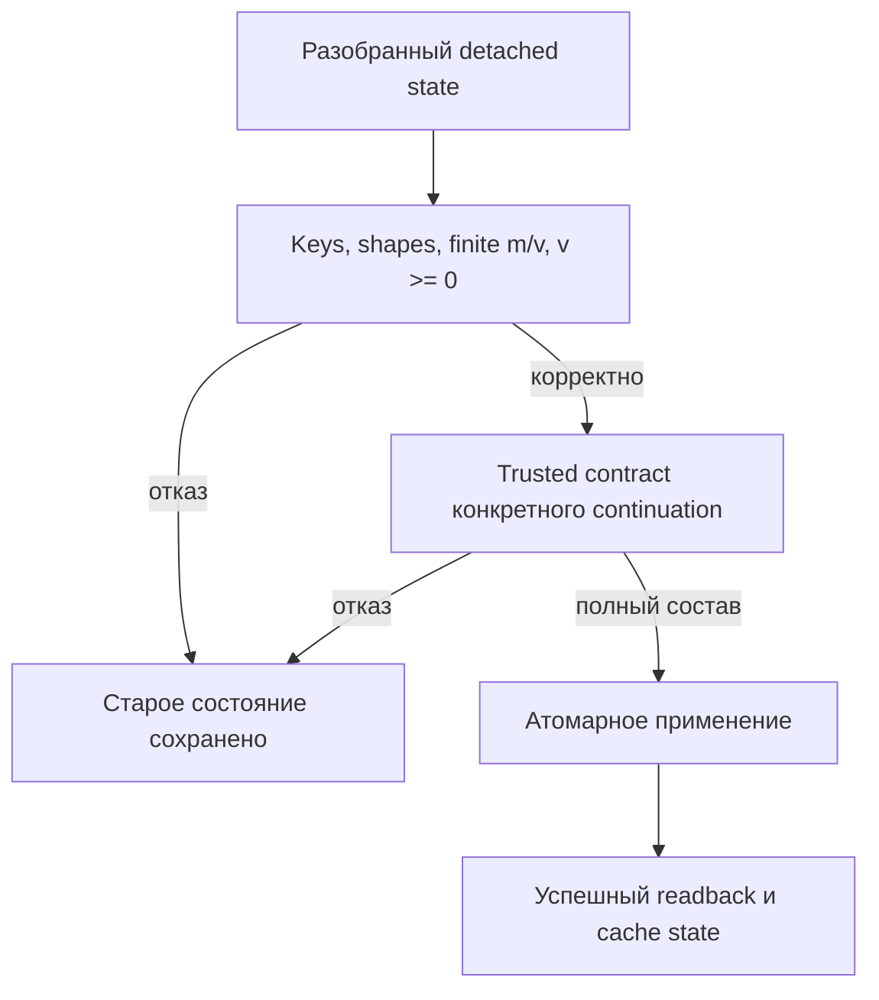

# 159. Адресный план после Q011: исправление причин и приёмки

Основание — [аудит 158](codex-158-postq011-transfer-and-experiment-audit-2026-11-04.md), core `45bd4e371f511e29c053f8117d61f43365abb460`, planning `9cd53517311be504a89f0e04cdcea0afb011bf8c`. Дата 4 ноября 2026. План усиливает существующие работы; ID ниже обозначают разделы этой дельты, а не новую очередь. Production и native tests этим документным пакетом не исправлены и не приняты.

## 1. Порядок и проверяемое завершение

На исходном срезе этого аудита первым был Q01/135-R01-CONCURRENCY. **После приёмки Q01 в `85aa3c847b6` текущий порядок — Q02(PAIR)→Q03(execution)→Q06(SEP)** по [реестру](01-registry.md#executor-next). Уточнение поручений и соседних карточек — [161](codex-161-postq011-executor-context-repair-2026-11-04.md). Q04/FIX-MC остаётся приостановленным из-за установленной ресурсной регрессии; Q05 ждёт его. Новое доказательство Q007 не снимает паузу общего SFT continuation. Отдельный ремонт обещанного численного отказа допускается только в назначенной узкой области существующего owner, без молчаливого включения всей MC-цепи. Прямое назначение пользователя имеет приоритет.

У каждой реализованной правки должны быть: точный source и изменённый consumer, честный положительный пример, различающий отрицательный пример через реальный guard/finalizer, доказательство сохранности старого state после отказа, свежая сборка и соответствующий ей результат исполнения. Слово PASS у стороннего reader, наличие тестового метода или опубликованный pointer не заменяют эти части. Нативная приёмка назначается в реализации; отсутствие runtime в этом аудите записано как UNRUN.

## 2. Q007: безопасный импорт и полнота конкретного continuation

**Владельцы:** существующие contracts [02](02-learning-state-and-fixtures.md), [101](101-persistent-state-bundle-contract-2026-10-30.md), [P12](../experimets/cards/P12-optimizer-boundaries.md), Q04/FIX-MC в его допустимой назначенной области. Исходное доказательство — [native-result-002](../../../../experiments-v2/RP01-MICRO/P0601/results/codex-review-2026-11-04/native-result-002.json), current `AdamW.TryImportPortableState`, `DpoTrainer.TryRestoreOptimizerState` и `TryRestoreContinuationState`.

### 2.1. Что изменить и почему

1. В `04.TrainingLoop/Optimizers/AdamW.cs`, внутри `TryImportPortableState`, сохранить уже работающие format/key/shape/duplicate проверки. Для каждой подготовленной к записи копии m/v проверить `float.IsFinite`; для v дополнительно `v >= 0`. Проверять именно detached values, которые попадут в restored dictionary; затем единственный swap `_state/_step`. Не допускать частичной записи на ранних entries при позднем отказе. Вспомогательный метод допустим локально; новый общий optimizer framework не нужен.
2. Numeric rejection возвращает установленный для этой функции отказ до swap. Если подробный reason нужен верхнему consumer, сохранить совместимость существующего bool API и его callers; не превращать неправильные bytes в fresh state или successful fallback. Синтаксически корректный trusted файл тоже обязан пройти numerical validity.
3. Полноту проверять у continuation consumer относительно **внешнего trusted contract**: optimizer family/version, expected step, точный набор уже инициализированных parameter keys/shapes и принадлежность recipient/bundle. Не выводить expected keyset из самого предъявленного Entries. Не заменять его всеми bindings модели: экспорт законно пропускает ещё не накопленные moments.
4. В `11.DPO/DpoTrainer.cs` пройти реальные ветви `TryRestoreOptimizerState`/`TryRestoreContinuationState`; project `RequireAllowedState` отвечает за разрешённые bindings, а новый contract check — за необходимый состав конкретного bundle. Существующий byte proof не удалять и не объявлять обходным: он решает другую задачу. Восстановление RNG и cache invalidation выполнять только в согласованной успешной транзакции; при отказе сохранить прежние weights/moments/step/RNG/cache/version.

Предлагаемый порядок; его ветви ещё не реализованы этой правкой:



Для общего primitive import проверка C применяется лишь когда caller действительно требует конкретное continuation. Intrinsic numerical check B обязателен независимо от caller.

### 2.2. Матрица приёмки, различающая старый и исправленный код

Расширить существующий `Tests/AdamWOptimizerStateRecoveryTests.cs` и добавить адресные случаи actual DpoTrainer restore в подходящий существующий test project. Названия ниже — **предлагаемые новые cases**, discovery их наличия ещё не выполнен.

| Случай | Ожидаемый результат | Что измерить до/после |
|---|---|---|
| Original Q007 A/B, Step401,4 entries | Primitive принимает; trusted Q007 consumer принимает | Exact keys/shapes/values/step; корректный RNG из собственного bundle |
| Fresh Step0, Entries=[] | Общий importer принимает; существующий positive сохраняется | Step0 и пустое накопленное состояние |
| Законный sparse state с одним обученным parameter при двух bindings | Принимается при соответствующем trusted expected set | Точное имеющееся состояние, отсутствие выдуманных moments |
| NaN,+Infinity,−Infinity в m и отдельно v | Primitive отвергает каждую из 6 подмен | Полное прежнее optimizer state и step неизменны |
| Один v<0 | Primitive отвергает | Ни одна предыдущая запись пакета не применена |
| Из четырёх обязательных Q007 entries удалена одна / удалены все при Step401 | Q007 continuation consumer отвергает обе копии | Старый live bundle неизменен; supplied keyset не становится authority |
| Поздняя плохая entry после нескольких хороших | Отказ всего импорта | Побайтовое/поэлементное сравнение всех прежних моментов и счётчика |
| Чужие key/shape/recipient или иной step | Сохраняются существующие точные отказы соответствующего слоя | Не подменять expected reason любым исключением |
| Корректный повтор импорта того же allowed bundle | Принимается по действующему договору | Нет скрытого extra optimizer update или изменения RNG |

Для этих admission/readback-контролей новое обучение не нужно. Взять имеющиеся original saved states или детерминированные portable DTO; не запускать обучающую fixture ради «подготовки» reader. Проверка дальнейшей траектории обучения — отдельная уже назначенная regression с её бюджетом. Полный required set, actualFQN, framework data rows и consumer branches фиксируются перед запуском, а не выводятся из успешного процента.

**Приёмочный receipt:** отдельно `native_import_accepted`, `continuation_contract_accepted`, `external_reader_guard_accepted`, `before_state`, `after_state`, refusal stage, actual caller и источники expectations. Для Q007-подмен после исправления ожидается отказ соответствующего продукта; прежнее диагностическое ожидание `native==true` нельзя перенести в regression test. Historical native-result-002 не переписывать.

## 3. Сохранённая наука: закрыть пропущенные связи без новых updates

### 3.1. P10/P11/P86/P87 — один objective и одна точка состояния

**Владелец:** существующий R29-D1 и derivative/weighted-objective owners в [88](88-gradient-warmup-transfer-repair-plan-2026-10-28.md), P10/P11/P86/P87. Исполняемый scope-probe158 показал ограничение Q011 saved checker, а не неверный исторический градиент.

В назначенном saved verifier связывать: exact pair/mask/tokenizer/reference → policy chosen/rejected logP → beta-adjusted margin → ExactObjective loss/derivative → FD numerator at the same S0±epsilon. Вычисления должны учитывать producer float32 operations. При несовпадении immutable historical payload verifier сообщает отказ; не исправляет исходные поля под свои ожидания. Version/checker identity отдельно от producer identity.

Уже воспроизводимая часть Q011 — сохранённая цепь logP/reference/beta→margin→loss/derivative и FD из этих loss. Более широкая per-evaluation provenance pair/mask/tokenizer/S0±epsilon требует действительно сохранённых независимых bytes и recipe. В FD rows есть coordinate/epsilon/sign/base_value, но нет полного state/mask receipt каждого вызова. Если основания для отдельного gate отсутствуют, записать NOT_RECORDED/NOT_PROVEN; не изготовлять primary trace новым Forward/Train. Следующие контроли применять только в достигаемой области с такими основаниями или в явно отдельном полном synthetic fixture.

Различающие copies: изменить только chosen logP, только reference score, только beta, только response mask/normalization, либо одну точку S0 на post-update; каждый контроль должен достигать соответствующего gate и давать nonzero внешний итог. Honest original12 evaluations→6 comparisons проходит. Нынешний derivative sign mutant продолжает отвергаться. Для synthetic полной схемы предусмотреть честную численную неудачу гипотезы: procedure VALID, scientific FAIL, без требования притворного исторического происхождения.

Для восстановления derivative из AdamW записать условия: fresh moments,Step0→1,beta1/beta2,vector scalar,weight decay и место применения clipping. Если moments восстановлены или уже накоплены, формулу fresh first-step применять нельзя. У Q011 scalar1,0833334 удаляется из applied derivative; second moment проверяет согласованность модуля, но не является независимым finite-difference доказательством. У P86 weighted objective включает ту же дробную mask в loss и backward; у P87 early mixed-objective refusal и late rollback — разные случаи.

Сначала выполнить saved-only ремонт. Текущие native derivative tests и модельный backward запускаются лишь в назначенной реализации; положительные learning/reachability результаты P11 не повторять ради нового отчёта. Повреждённый shared S1 исправляет 29-D3 по 157, без Train.

### 3.2. P03/P04/P05/P101 — точность, вероятность и оплаченная стадия

В отчёте/checker привязать каждую строку к `attempt/arm/phase/RowId/actual/gold/metric definition`. Независимая строгая/смысловая рубрика оценивает whole answer, а не готовый Correct или первый символ. Сохранить приобретённые, потерянные и удержанные ответы отдельно.

| Предметный контроль | Почему нужен | Ожидаемая реакция |
|---|---|---|
| P03: заменить lostE2 на retained в своде при том же actual | Вероятностный выигрыш T1 скрывал падение 2/4→1/4 | Summary binding отказывает; честное ухудшение проходит как научный результат |
| P03: выдать 21-target pre-update loss за response-only after NLL | Одна цифра относится к другой стадии и знаменателю | Несовпадение metric kind/phase — отказ; обе честные величины сохраняются отдельно |
| P04: сравнить A/B chosen>rejected при разных rejected как общую accuracy | Меняется определение победы между плечами | Не объявлять победителя; общая панель использует одинаковый gold/decoder |
| P04: заменить final margin последним step-margin | Последний update ещё не применён к step log | Отказать по phase binding; не повторять DPO для заполнения несохранённого |
| P05: подменить response-mask sum на mean без target count | Длина/маска меняют objective | Recompute по настоящим target positions; ловить единичный off-by-one/denominator mutation |
| P05Q01: назвать 400SFT квалификацией при 21 панелях 0/6 | Число updates не доказывает умение | Сохранить UNQUALIFIED и не выдавать неисполненные A/B/EXAM за 0-score run |

Полный final state не изготавливать из counts/hashes. Архив нужен подлинный; иначе конкретные поля NOT_RECORDED, reuse NOT_PROVEN. Отдельно учитывать donor подготовку, первоначальную попытку, recovery, qualification, diagnostic/rejected попытки, build, Load и inference. Уплаченный расход не исчезает после красивого финального receipt.

## 4. P07/P08/P09/P100: boundary, поведение и ресурсы

**Действующие владельцы:** BPE [82/83](83-learned-bpe-boundary-transfer-addendum.md), sampling/cache [85](85-reporting-sampling-cache-repair-plan-2026-10-27.md), собственные карточки. Q009 в своём отчёте называет R30-test; это имя его native regression, **не** строка R30/R31-OO реестра. Принятые strict-CDF, cache и P09-CONSUMER/R46 части сохранить; fresh UNRUN этого аудита не переоткрывает их.

Для P07 до вывода о response loss предъявить actual learned tokenizer identity и `InputIds/TargetIds/ResponseMask/scored positions`. Пара(a,b) после merge даёт 0 pure targets при joint и 1 при segmented; контроль(a,c) и(x,y) сохраняется. Мутация одной scored позиции должна отвергаться пересчётом, как уже делает saved checker. Имеющуюся Validate не писать заново. Новая широкая языковая приёмка не следует из ASCII-control и требует собственного назначенного набора; текущий PRIMARY не повторять.

Для P08/P100 хранить полный support/probabilities, параметры topK/topP/temperature и фактический sampled token/seed отдельно от greedy answer. Правильный символ вне support не приобретается от перенормировки. Не выдавать расчётную вероятность за измеренную частоту. При назначенной consumer regression настоящий Generate использует те же recorded model logits и параметры; отдельная имитация callbacks не заменяет обычного маршрута. Существующий strict-CDF positive и no-tie controls сохраняются.

Для P09 различать три контракта: full vs empty-cache prefill, повторное/chunked чтение и incremental next-token decode. Результат 21 504/84 закрывает только первый. Новый контрпример должен затрагивать нужную фазу cache length/position, а сравнение включает все logits и argmax; один изменённый неведущий logit должен нарушить numeric parity. Native обученный 7/7/7 из текущего test source и принятый R46 не заменять новым PRIMARY и не объявлять непройденными из-за отсутствия runtime у аудитора.

**Ресурсная приёмка только при назначенном performance claim:** определить call/arm/process window; сохранить warmup отдельно; чередовать AB/BA и держать одинаковую обвязку либо измерить её baseline; записать отдельные CPU/wall/allocated/retained/peak показатели с их единицами и разбросом. Порог и число повторов берутся из действующей карточки/политики шума до запуска. Не назначать произвольный новый sweep и не вычитать пики процесса как независимую плату плеч.

Уже сохранённые данные достаточно пересчитать: Q009 ratios block medians1,949–2,672 относятся к sampler; Q0107,0148→7,2893 мс — описательные медианы 4 вызовов одного прогона. Значение 22 928 байт не фиксировать как invariant nativeForward. Вывод о скорости остаётся NOT_ESTABLISHED, даже если численная parityVALID.

## 5. Runner: реальный deadline без повторного научного опыта

**Владелец:** [03-test-and-execution-contract](03-test-and-execution-contract.md), соответствующие `P0701/Run-Experiment.ps1` и `P1001/Run-Experiment.ps1`. Это адресная реализация уже заявленных ограничений 600 с build/1200 с run, не новый научный фактор и не разрешение запускать старый COMPLETED attempt.

Заменить синхронное ожидание без границы на bounded process invocation с явным deadline, захватом stdout/stderr, завершением дерева дочерних процессов и ожиданием их завершения. Сохранить exclusion claim/ownership, прежний terminal и отсутствие записи внутрь original input. При timeout записывать FAILED/TIMED_OUT с применённым limit и фактическим elapsed, partial logs, PID/exit/termination result; успех дочернего сообщения не превращает timeout внешнего runner в 0. Не освобождать claim до остановки своего child tree. Не уничтожать чужие процессы или чужую claim.

Проверки на искусственном child, который **не** создаёт модель: (1) normalexit0 до срока; (2) child nonzero возвращён наружу; (3) child превышает короткий test deadline и создаёт grandchild — оба остановлены, outer nonzero, logs сохранены; (4) повторный отказ по занятому claim не запускает child; (5) сохранённый COMPLETED result не запускает PRIMARY. Условие времени — измеренное ограничение с допустимой технической погрешностью, заранее указанной для termination; простого наличия слова `deadline` в JSON недостаточно.

Existing helper `Invoke-Bounded` из других runners можно использовать после проверки его реального kill/reap и exit semantics; само наличие имени не доказывает эти свойства. Финальные команды, исходный test target и небольшой runtime budget назначить до технического запуска. Для такой проверки нет повода платить BPETrain или DPO update.

<a id="existing-owners"></a>
## 6. Существующие продуктовые остатки: точная приёмка сохраняется

| Работа и файлы | Что доделать | Положительный / отрицательный контроль | Когда считать закрытой |
|---|---|---|---|
| Q01, `TranslationMachine.cs`, `TranslationStateVersionLostUpdateTests`, `TranslationLostCandidateArtifactTests` | **Закрыто последующей адресной приёмкой 29/29; сохранить**, не назначать повтор observed CAS/late cancel/store | B wins,A loses,C publishes: receipt A называет B. Cancel в Evaluate barrier сохраняет state/version/accuracy. Обычный Tatoeba и отдельный процесс подтверждены | [Сохранённый отчёт Q01](../../../../qa-results/q01-concurrency-2026-11-04-20261104091631764/codex-report.md); это не полный suite, не запуск CLI и не новое измерение обучения |
| R128-02, `DpoTrainer`, `DpoMutationAdmissionCapability`, owner ledger, real issuer в 14.ContinuousLearning | Trusted owner→реальный mutable recipient с согласованным lifetime/ledger, проверка constructor branches | Два объекта из одинакового checkpoint, reissued capability, ownerless issuer/null recipient; lawful same-owner repeats/sharing/legacy по своему договору | Отказ до mutation на реальном caller, независимые строковые helper tests недостаточны |
| R128-03, `CapabilityMaterialLineageGuard` | Выбрать claimedID среди independently matched trusted content/family rows; раздельные Dev/Test flags | Два lawfulTrainID одного content в обоих порядках; foreignID/content,ambiguousfamily,точный forbiddenoverlap | Сохраняется semantic typed refusal; fixture не ослаблена до «любое исключение» |
| R28/R117-04, `CorpusStatisticsSnapshot.DescribeOutput`, `LlmIngredientLogicalUnits` | Сохранить null/emptyOutput до hash в Train и reuse | Законный producer,одинаковые Id/Text,null/emptyOutput; свой/чужой snapshot; прежний approved→cancelled | Фактические corpus identities различны; назначенные 153 fixture2Train/2reuse/4Execute и прочие guards пройдены, PRIMARY не повторён |
| P117 /R117-06 | Подключить checker к actual KNN export и ordinary restored reader | Сохранённый expected journal может совпадать при испорченном actual export; такая копия должна отказать. Честное частичное 3/5 остаётся valid scientific observation | Actual serialized memory→restore→answer связаны; helper existence не закрывает цепь |
| P127 /R154-D, `Program.cs` и actual checker | External manifest из 155; route↔ordered steps↔edges↔trace; exact chosen-attempt sets; finalizer/outerexit | Honest68read/12graph keys, negative с изменёнными label/steps+локальными hashes; отдельный честный synthetic scientific FAIL | Native0→nonzero→0 на полном honest архиве; missing historical native-flow остаётся NOT_RECORDED |
| P131 /R154-C, `SavedEvidence`, `Provenance`, `Scoring`, `Run-Experiment.ps1` | Разделить producer/verifieridentity/schema, потом nativebinding128keys, абсолютные childargs | Honesthistorical; changedactual+length;missing/duplicate/extra key; неверный parentroot;relativeinvoke | Полный producerarchive проходит новую сборку; native output определяет отказ; реальные outerexit/status/report согласованы |

Все бюджетные/командные подробности ранее назначенных 146/150/153/155/157 сохраняются. Нельзя автоматически расширить 152/49 test filter и объявить всю приёмку по одному непустому TRX. Required FQN должны включать известные три прежние failure-группы; два устаревших tail expected и недостижимая floor fixture ремонтируются по 150/46, а не удаляются ради зелёного отчёта.

### 6.1. Producer и verifier: не переподписывать историю

P127 получает trusted historical manifest из внешнего commit `f3b64f87159193c2897092d6e571b2b65e3b75c4`, как уже задано 155; suppliedmanifest не authority. Для P131 подлинный producer archive должен реально существовать; missing DLL/source mapping означает NOT_PROVEN. Новая DLL проверяющего имеет свою identity и checks-version, а archived requiredGates трактуются по producer schema. Честный старый пакет сначала должен пройти provenance/layout, иначе отрицательная мутация не достигает проверяемого gate.

Для P131 input: `experiments-v2/RP01-MICRO/P13101/results/attempt-0001/continuation-0001/evidence`. Resolve оба InputRoot/VerificationOutputRoot до абсолютных значений и передать именно их в child; выход отдельный от input и producer archive. Не создавать заглушки в ошибочно переданном parent. Каждый honest/mutant/honest output root новый. Ни один из этих saved repairs не запускает Train/Flow для изготовления отсутствовавшего historical output.

## 7. Артефакты: адресный reuse после 92 восстановленных identities

Использовать [обновлённую projection158](../../../../experiments-v2/_audits/postq011-2026-11-04/codex-current-tree-projection.json) вместе с original inventory154.92 paths уже равны original; не восстанавливать их повторно по старым верхним текстам карточек.3358 — прежняя Gitidentity, а не доказанный статус каждого materialized payload.

Перед конкретным reuse: exactpath→originalpointer/OID/size→actualpayload→format/fullbundle→nativeLoad→ordinaryreadout, отдельные статусы каждого уровня. При отсутствии original bytes остановить только зависящий reuse с exact reason; не объявлять общий запрет независимым работам.19 conflict identities и shared P11/P12 требуют своих originals; «починить CR» угадыванием нельзя. Правила [155§2](codex-155-postq003-addressed-repair-plan-2026-11-03.md) и [157](codex-157-postq003-executor-context-repair-2026-11-04.md) действуют, включая отдельный reader без обучающих fixtures.

## 8. Команды и предел выполненного сейчас

Для воспроизведения **сохранённого анализа**, из корня core с Python/Node, с отдельной папкой вывода:

```bash
python experiments-v2/_audits/postq011-2026-11-04/codex-audit-saved.py --output /absolute/separate/postq011/saved-checks.json
python experiments-v2/_audits/postq011-2026-11-04/transfer-saved-recount.py --output /absolute/separate/postq011/transfer-recount.json
```

Это уже выполненный тип чтения; он не вызывает C# libraries/model. Первый пакет включает 5 Node checks, независимые arithmetic/Float32/objective/resource пересчёты и Git inventory. Второй описательно пересчитывает сохранённые P127/P131 outputs: его exit0 означает завершение подсчёта, а не автоматический verdict целостности. Проверить поля raw_count, unique_keys, native_matching, binding_mismatches и panel; в опубликованном результате 128/128 связей совпали, mismatches пуст. В отдельном клоне должны быть доступны перечисленные JSON и pinned projection; LFS materialization этими командами не проверяется.

Для будущего **назначенного native repair**: сначала собрать фактический test project/isolated checker в Release; проверить build exit и source/DLL inputs; выполнить discovery; сверить точный required FQN/data rows; затем запустить один согласованный фильтр с новым results-directory и явным TRX. Команды брать из существующих 146/150/153/157 для выбранного owner после создания новых cases. Если build не удался, stale DLL не запускать как новую; если fixture неверна, исправить её по независимому договору; если недоступен runtime, указать UNRUN без фиктивного PASS.

Финальный отчёт исполнителя сначала отвечает человеку: что исправлено, что стало проверяться, как это защищает следующий перенос и что осталось у какого владельца. Затем exactcommit,commands/exits/FQN/rows,положительный и отрицательный результат,all paid stages и ограничения. До доказательства не повышать transfer status. Документная публикация этого плана не запускает ни одну из описанных implementations.
