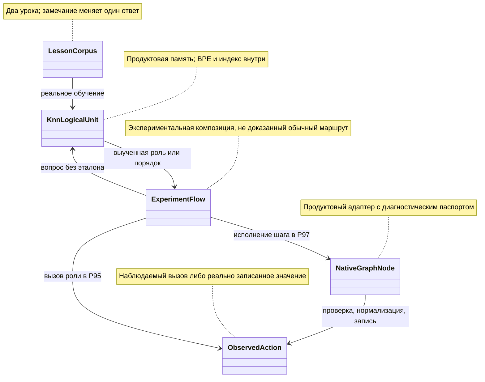

# Что действительно добавили опыты с наборами ответов и обучаемыми переходами — P94–P97

Дата: 02.11.2026. Это ограниченный исследовательский обзор четырёх первичных результатов, не исполнение переносов и не аудит всего каталога. Автор — исследователь `/root/late_positive_evidence_review`; вложенных агентов нет. Разрешённая фаза — `READ_ONLY_RESEARCH` и этот Markdown. Обучение, inference, сборки, тесты, изменения продукта и Git mutations здесь не выполнялись.

**Практический вывод.** Исправление учебной метки действительно изменило действие экспериментального потока: временная ошибка стала приводить к повторной попытке, а нормализация стала выполняться до сохранения. Это положительные результаты доставки выученного ответа до действия, однако запросы памяти оставались точными учебными ключами. Отдельный положительный результат — уменьшение выделений при переносе постоянных подписей мотивов из текста в признаки. Полный набор ответов и ожидание обеих альтернатив уже поддерживаются прочитанным нативным кодом: их нельзя предъявлять как новые исправления продукта.

Ни один из четырёх опытов не доказал новое обобщающее умение относительно приведённого тривиального правила. Это не обесценивает полезную целостность ответа и ресурсную метрику, но ограничивает название приобретения. Нового безусловного продуктового переноса по этим четырём результатам не назначено. Ниже есть адресные проверки существующих владельцев и один условный компонентный кандидат, без нового конкурирующего API.

## Источники и точность текущего среза

Все четыре каталога существуют локально. Сведения об опубликованных коммитах получены от родителя, который проверял GitHub: выбранный опубликованный HEAD `3194310941c428ef9a5e643c4dc9d7ad7d15447e`; я эту публикацию повторно не проверял. Локальный `2004e81030c` не используется как доказательство актуальной публикации. Первичные описи прямо говорят, что измерялось рабочее дерево.

| Опыт / переданный родителем коммит | Первичный отчёт | Сырые основания |
|---|---|---|
| P94-PRIMARY-01 / `c7fd99f12c5ad1f545fc4a2aded89bd7547c481b` | [Полнота набора ответов](C:/Projects/llm_mvp_core/experiments-v2/RP01-MICRO/P9401/results/attempt-0001/report.md) | [metrics](C:/Projects/llm_mvp_core/experiments-v2/RP01-MICRO/P9401/results/attempt-0001/metrics.json), [arms](C:/Projects/llm_mvp_core/experiments-v2/RP01-MICRO/P9401/results/attempt-0001/arms.json), [after](C:/Projects/llm_mvp_core/experiments-v2/RP01-MICRO/P9401/results/attempt-0001/after.json) |
| P95-PRIMARY-01 / `6b921f129993184fb263b5aab3dd8c637cf05201` | [Обучаемое отношение потока](C:/Projects/llm_mvp_core/experiments-v2/RP01-MICRO/P9501/results/attempt-0001/report.md) | [metrics](C:/Projects/llm_mvp_core/experiments-v2/RP01-MICRO/P9501/results/attempt-0001/metrics.json), [arms](C:/Projects/llm_mvp_core/experiments-v2/RP01-MICRO/P9501/results/attempt-0001/arms.json), [before](C:/Projects/llm_mvp_core/experiments-v2/RP01-MICRO/P9501/results/attempt-0001/before.json) |
| P96-PRIMARY-01 / `5b62b67930ad39632725e9b4d3d8a0b369f90a4b` | [Две альтернативы](C:/Projects/llm_mvp_core/experiments-v2/RP01-MICRO/P9601/results/attempt-0001/report.md) | [metrics](C:/Projects/llm_mvp_core/experiments-v2/RP01-MICRO/P9601/results/attempt-0001/metrics.json), [arms](C:/Projects/llm_mvp_core/experiments-v2/RP01-MICRO/P9601/results/attempt-0001/arms.json), [before](C:/Projects/llm_mvp_core/experiments-v2/RP01-MICRO/P9601/results/attempt-0001/before.json) |
| P97-PRIMARY-01 / `26d85a50da56e0bbcb1b2e66d9f5246bfb5a2ae5` | [Порядок мотивов](C:/Projects/llm_mvp_core/experiments-v2/RP01-MICRO/P9701/results/attempt-0001/report.md) | [metrics](C:/Projects/llm_mvp_core/experiments-v2/RP01-MICRO/P9701/results/attempt-0001/metrics.json), [arms](C:/Projects/llm_mvp_core/experiments-v2/RP01-MICRO/P9701/results/attempt-0001/arms.json), [before](C:/Projects/llm_mvp_core/experiments-v2/RP01-MICRO/P9701/results/attempt-0001/before.json) |

В каждом из этих же каталогов прочитаны `source-manifest.json` и `source-manifest-after.json`. Для перечисленных в них C# и csproj сверены SHA-256: исходные и конечные отпечатки совпадают; текущие четыре `Program.cs`, четыре `src/*.cs` и четыре `Experiment.csproj` также совпадают с измеренными. Это проверка перечисленных файлов, не полноты всех транзитивных Compile items MSBuild.

Текущие продуктовые байты уже отличаются: `KnnLogicalUnit.cs` — измерено `f8a2e578…`, сейчас `3dfc1e9f…`; `BpeTokenizer.cs` — `1d5dd808…` против `24c20bca…`; `LogicalContracts.cs` — `6c8b7ffa…` против `ddd63b7d…`. CR=0 у всех трёх, поэтому отличие не объясняется только CRLF. Текущий HNSW совпадает с P95–97 (`695f6065…`), но отличается от P94 (`2b63a4b9…`). Политика ответа и графовый адаптер совпадают с указанными измеренными версиями. Числа старого запуска не являются новым измерением текущего продукта; полный diff нового токенизатора здесь не исследован.

Нативный KNN подключён обычным ProjectReference: [P94 csproj:39](C:/Projects/llm_mvp_core/experiments-v2/RP01-MICRO/P9401/Experiment.csproj:39), [P95:42](C:/Projects/llm_mvp_core/experiments-v2/RP01-MICRO/P9501/Experiment.csproj:42), [P96:39](C:/Projects/llm_mvp_core/experiments-v2/RP01-MICRO/P9601/Experiment.csproj:39), [P97:40](C:/Projects/llm_mvp_core/experiments-v2/RP01-MICRO/P9701/Experiment.csproj:40). Копируются определения экспериментальных DTO и последовательность обращений, не алгоритм поиска соседа. Потоки, реестр функций и хранилища замечаний находятся в экспериментальных `src`, а не автоматически в ordinary production route.

## Четыре результата и все существенные ограничения

| ID / полезная ось | До → после | Приобретено / потеряно | Граница |
|---|---|---|---|
| P94: мощность типизированного ответа | exact set 3/5→5/5; recall ссылок 4/6→6/6; precision 1→1 | x1,x5 приобретены; потерь 0 | +40 п.п., +66,67% относительного exact. A искусственно обрезает ответ. Тривиальное правило 5/5; четыре вопроса точные учебные, пятый — перестановка слов |
| P95: замечание доходит до действия | правильный Retry/Stop 2/4→4/4 | temporary-alpha/beta приобретены; permanent-alpha/beta сохранены 2/2 | +50 п.п., +100% относительно A. Два уникальных точных ключа, тривиальное правило 4/4. Новые payload/node IDs не входят в кодирование |
| P96: ресурсный ремонт экспериментального B | B allocations 230512→215384 байт у B-fixed, −6,5628% | качество 12/12 во всех трёх схемах, новых правильных ответов 0 | A sequential уже 215480 байт: B-fixed лучше A лишь на96 байт/0,0446%. Устранён расход созданного опытом Task.Run, а не доказанный product regression |
| P97: замечание меняет порядок и сохранённое значение | EXAM 4/8→8/8; CONTROL 1/2→2/2 | e1–e4,c1 приобретены; e5–e8,c2 сохранены | +50 п.п., +100% относительно A. Два точных учебных ключа; тривиальное правило 10/10. Новые значения Cedar/PINE проверяют исполнение |
| P97: отдельное представление входа B→B-fixed | inference alloc 537336→459560, −14,4744%; Train alloc 111200→49776, −55,2374% | качество остаётся8/8+2/2; потерь0 | Train duration 0,9884→1,6985мс, **+71,8434%**; причинность не выделена. Это отдельный фактор, не продолжение единственного label-фактора A→B |

Все числа относятся к предметной теме **оркестрации**. «Набор», «поток», «граф» и два профиля D07/D08 не считаются дополнительными доменами. Нейронных слоёв, LoRA и шагов оптимизатора у этой памяти нет; обучение BPE и дискретной памяти реально есть.

Ресурсы нельзя свести к одной зелёной строке:

- P94: выделения пяти запросов 32568→34008 байт (+4,4215%); wall обучения169,415→0,556мс, manifest training48,637→0,521мс, внешние training allocations70640→69712. Первое плечо несёт прогрев; ускорение причинно не доказано. Пик процесса37879808байт, не отдельные пики A/B. 13 вызовов узлов включают повтор x5; основная панель доставила4 и6 ссылок, это другой denominator.
- P95: manifest training34,4089→0,909мс, wall36,9599→0,944мс, allocations89856→88944. Пики39710720байт и total allocations1688096 — целый процесс. Отдельных сопоставимых inference allocations A/B здесь нет; их нельзя выдать за отсутствие регрессии.
- P96: A/B/B-fixed median latency0,1478/0,1887/0,17905мс. B-fixed против B −5,1139%, но против A **+21,1434%**; B против A +27,6725%. Arm wall13,0411/2,5595/2,3861мс загрязнён первым запросом A10,0925мс. CPU15,625/0/15,625мс слишком груб для полезного сравнения. Пик41197568байт общий. Из этих чисел не следует ускорение обучения — обе памяти обучены до схем запуска.
- P97: median latency B0,5338→B-fixed0,4484мс (−15,9985%); inference wall5,8238→4,9596мс. Training wall1,0387→1,7157мс также вырос; manifest время и wall показывать отдельно. Пик44904448байт общий; per-arm RSS/peak и пригодная CPU-оценка отсутствуют.

Порог значительности — строго >5% по полезной метрике с явным показом остальных регрессий. CPU-исключение не распространяется на allocations/RAM/wall и не разрешает замедление native обучения в ветке «динамическая композиция/cleanup без доказанного выигрыша». Явная сохранность/правильность ответов может рассматриваться по отдельному пользовательскому исключению; оно не превращает искусственный экспериментальный A в найденный дефект продукта.

## Где обучение связано с потребителем

Общий настоящий путь — [KnnLogicalUnit.Train:160](C:/Projects/llm_mvp_core/21.AgentInfrastructure/Logical/KnnLogicalUnit.cs:160): сначала принимает собственные ответы через `ForStorage`, затем обучает BPE на выбранном тексте (249–252), строит HNSW и карту уроков (255–281). [ExecuteAsync:351](C:/Projects/llm_mvp_core/21.AgentInfrastructure/Logical/KnnLogicalUnit.cs:351) кодирует запрос, ищет соседа, выдаёт его `TOutput` через `ForRead` (370–409). Это полноценное обновление дискретного состояния, но выбор nearest example не следует называть семантическим обобщением автоматически.

Симуляция связей: урок `temporary-input|ValidateTemporary→Retry` даёт памяти новый ответ, поток спрашивает прежний ключ и вызывает замороженный Retry. Для `normalize-before-store`, payload `Cedar`, память выдаёт `[M1,M2]`; поток выполняет Validate→Transform→Validate→Persist, и sink получает `cedar`. Для сохранённого контроля `raw-before-normalize` порядок `[M2,M1]` оставляет в sink `Cedar`, хотя конечный payload после поздней нормализации уже `cedar`. Поэтому проверять нужно sink, не только последнюю переменную потока.

### Полный набор — регрессионная приёмка существующего владельца, не новый алгоритм (P94)

Сейчас намеренная потеря находится в [TypedResultSetStorage.ForArm:63](C:/Projects/llm_mvp_core/experiments-v2/RP01-MICRO/P9401/src/TypedResultSetAdapter.cs:63): `new[] { fullSet[0] }`. Нативный KNN возвращает весь `TOutput` и эту потерю не создаёт. Доставка каждой ссылки — экспериментальный [NodeRegistry.Deliver:144](C:/Projects/llm_mvp_core/experiments-v2/RP01-MICRO/P9401/src/TypedResultSetAdapter.cs:144), а не доказанное исполнение полезных product skills: функции лишь пишут журнал.

Владение mutable-ответом уже принадлежит [плану97:60](C:/Projects/llm_mvp_core/docs/plans/replanning-possible-diffs/fixes-based-on-experiments/97-learned-knn-state-integrity-transfer-plan-2026-10-29.md:60) и ремонту102/R2 через единственный `IKnnAnswerSnapshot<TOutput>`. Не создавать второй snapshot API. [KnnLogicalUnitTests:14](C:/Projects/llm_mvp_core/Tests/KnnLogicalUnitTests.cs:14) проверяет native string prediction, а тест с SecurityArbiter относится к экспериментальному Flow. [LogicalUnitDynamicGraphNodeTests:18](C:/Projects/llm_mvp_core/Tests/LogicalUnitDynamicGraphNodeTests.cs:18) уже проверяет ordered candidates; это не измерение обученного полного набора.

**Предлагаемое дополнение к существующему тестовому владельцу**, новый метод в `Tests/KnnLogicalUnitTests.cs`: `TypedAnswerSet_PreservesAllReferencesAndOwnedReadout`. Один native Train,4 урока из [P94 Program:97](C:/Projects/llm_mvp_core/experiments-v2/RP01-MICRO/P9401/Program.cs:97): `review and test→[review,test]`, `review only→[review]`, `test only→[test]`, `nothing→[]`. Explicit copy policy копирует record и Refs. Панель — эти4 и `test and review`. Сначала5 Execute, затем изменить выданный x1 массив вне модели и повторить5 Execute: всего1 KNN fit,1 внутренний BPE fit,4 Add,10 Execute/Search,12 доставленных ссылок. Обе панели5/5, пустой ответ не null; oracle сравнивает набор и тип каждой ссылки, не только count. Никакого искусственного дефекта в продукт ради красного теста. Fresh-load отдельным «успехом» не считать: публичного codec всей этой generic единицы в прочитанном классе нет.

### Исправление отношения — доказанный учебный переход в экспериментальном потоке (P95)

Начальные два урока заданы [Program:103](C:/Projects/llm_mvp_core/experiments-v2/RP01-MICRO/P9501/Program.cs:103): `temporary-input|ValidateTemporary→Stop`, `permanent-input|ValidatePermanent→Stop`. Одно событие заменяет первую метку на Retry, затем [Train:262](C:/Projects/llm_mvp_core/experiments-v2/RP01-MICRO/P9501/Program.cs:262) заново обучает полный корпус2. Это refit, не update in place. [RelationFeedbackStore:110](C:/Projects/llm_mvp_core/experiments-v2/RP01-MICRO/P9501/src/RelationFlowExperimentLogic.cs:110) хранит заявку; runtime решает настоящая память на343, выбранную роль исполняет вызов382. Hard guard286 отказывает Persist после предварительного Validate; поэтому hard attempts дают ещё2 frozen calls, хотя KNN не спрашивается.

Положительная ось — замечание→новая память→исполненная роль. В readback B временная строка имеет старый `gold=Stop`, `correct=false`: это ожидаемая замена урока, не потеря сохраняемого permanent-закона. Новая приёмка обязана иметь раздельные `matchesCurrentLesson` и `retainsUntouchedLesson`, а не скрывать эту строку или требовать прежний ошибочный ответ.

**Условный будущий slice**, не готовое назначение общего production writer: новый `Tests/KnnLearnedRelationDeliveryTests.cs`, метод `CorrectedLesson_ReachesExecutedRole_AndRetainsPermanentStop`. Native owner обучения/чтения тот же `KnnLogicalUnit`; экспериментальный `RelationLearningFlow` переносится только как тестовый fixture, без называния его продуктовым маршрутом. Два Train×2строки=4предъявления,2 внутренних BPE fit,4Add. По каждому состоянию2 readback+4 exam =6 Flow/KNN;2 hard attempts всего. Итого14 Flow attempts,12 KNN,26 frozen calls; один empty Train refusal отдельно,0 принятых уроков. Все тексты/метки/instance IDs берутся из Program103–131; новый default seed не подбирается до PASS. У A exam2/4, у B4/4, permanent2/2, запрещённых Persist0, не более одного Retry на запрос.

Обычный [DynamicGraphEdgeFlow:29](C:/Projects/llm_mvp_core/21.AgentInfrastructure/Logical/DynamicGraphEdgeFlow.cs:29) имеет другой typed ingress и `IDynamicGraphEdgeAuthorityExecutionPipeline`; [AdaptiveLogicalOrchestrator:2206](C:/Projects/llm_mvp_core/21.AgentInfrastructure/Logical/AdaptiveLogicalOrchestrator.cs:2206) исполняет validated target handoff. P95 не проходит этот путь. В найденном ordinary trainer используется **другой** `TransformerEmbeddingKnnLogicalUnit<string>` ([DefaultLogicalCapabilityTrainer:977](C:/Projects/llm_mvp_core/18.CapabilityTraining/DefaultLogicalCapabilityTrainer.cs:977)), а не показанный P95 generic KNN. Прямую подмену этих моделей не назначать. Нужны отдельное решение владельца edge authority и конкретный DTO bridge; в этом пакете ordinary E2E и его новый учебный бюджет остаются блокером, не поручением исполнителю придумать дизайн.

### Снятие лишней отправки в пул — полезное сравнение, но без нового адресного дефекта продукта (P96)

[Experimental flow:162](C:/Projects/llm_mvp_core/experiments-v2/RP01-MICRO/P9601/src/AsyncAlternativesFlowLogic.cs:162) добавляет Task.Run; B-fixed176–193 вызывает обе ветви напрямую, использует completed-task fast path и иначе WhenAll. Native [KnnLogicalUnit:420](C:/Projects/llm_mvp_core/21.AgentInfrastructure/Logical/KnnLogicalUnit.cs:420) завершает вычисление синхронно. Поэтому B-fixed concurrency=1 не является улучшенной параллельностью; это снятие лишних обёрток.

В ordinary [AdaptiveLogicalOrchestrator:1716](C:/Projects/llm_mvp_core/21.AgentInfrastructure/Logical/AdaptiveLogicalOrchestrator.cs:1716), [его target path:2209](C:/Projects/llm_mvp_core/21.AgentInfrastructure/Logical/AdaptiveLogicalOrchestrator.cs:2209) и [AgentOrchestrator:60](C:/Projects/llm_mvp_core/22.AgentAlgorithms/MultiAgent/AgentOrchestrator.cs:60) уже прямые вызовы+WhenAll. Следовательно не назначать «убрать Task.Run» этим файлам и не обобщать результат на глобальный ValueTask API, отмену, квоты, late results или настоящее I/O. Их этот опыт не измеряет.

Новая конкретная поправка приёмки: `lostBranches = branches.Length - (valid.Length + branches.Count(branch => !branch.Valid))` ([src:207](C:/Projects/llm_mvp_core/experiments-v2/RP01-MICRO/P9601/src/AsyncAlternativesFlowLogic.cs:207)) тождественно0, поскольку valid и !valid разбивают уже собранный массив. Это не независимый датчик потерь. `BranchExecutionCount++`281 и `NativeQueryCount++`308 не атомарны при параллельном B. Сами36 построчных outcomes содержат по2ветви, и явный await обеих виден в коде; этот узкий положительный факт сохраняется. Будущий detector: identity-наборы `scheduled`, `entered`, `completed`, `consumed`, каждое событие фиксируется независимо и атомарно; assert множества равны ожидаемым2 ID. Отдельный отрицательный контроль удаляет одно событие consumed в тестовом журнале и обязан покраснеть. Нового обучения для такого контроля не нужно; это ремонт измерителя, а не успех обучения.

### Подписи мотивов вне текста — новый компонентный кандидат с ресурсной границей (P97)

Два класса и две подписи заданы [Program:51](C:/Projects/llm_mvp_core/experiments-v2/RP01-MICRO/P9701/Program.cs:51), панель [491–502](C:/Projects/llm_mvp_core/experiments-v2/RP01-MICRO/P9701/Program.cs:491). Основной label-фактор меняет только normalize-class на `[M1,M2]`; raw-class остаётся `[M2,M1]`. Отдельное B-fixed меняет [textSelector:513–517](C:/Projects/llm_mvp_core/experiments-v2/RP01-MICRO/P9701/Program.cs:513) и зеркально передаёт одинаковые подписи в учебные PredicateIds ([BuildCorpus:229](C:/Projects/llm_mvp_core/experiments-v2/RP01-MICRO/P9701/src/MotifGraphOrderLogic.cs:229)) и metadata запроса412–423. Подписи не содержат gold и одинаковы для двух классов.

Выбранный порядок реально читается на444 и исполняется циклом457; каждый шаг проходит продуктовый адаптер на492. Однако projected payload переносится экспериментальным `_lastStepOutput`528/590, sink/receipt store тоже экспериментальные. Паспорт node574–579 явно `IsTrained=false`, `diagnostics_only`, без checkpoint. Это честная композиция native частей, не опубликованная обученная DynamicGraph route.

**Математика.** Для x=(t,p), y=(u,p) общий признак даёт `cos=(t·u+||p||²)/(sqrt(||t||²+||p||²)*sqrt(||u||²+||p||²))`. Он не добавляет различающего сигнала. В исходном тексте общие подписи также влияют на BPE и token counts; после переноса меняется и словарь, и распределение координат, поэтому нет теоремы монотонного улучшения. Измерено только0,979611→0,947758; `1−cos`0,020389→0,052242, примерно×2,5623. Это увеличение геометрического зазора, **не** прирост точности при потолке10/10 и не доказательство общей способности.

**Адресный будущий компонентный slice:** новый `Tests/KnnMotifRepresentationLearningTests.cs`, метод `ExplicitPredicateSignature_KeepsLearnedOrdersAndStoredValues`. Меняется только представление входа через уже имеющиеся аргументы `textSelector` и `PredicateIds/metadata["predicate_ids"]`, без изменения `Vectorize`, k/vote, dimensions64, floor0,70 или `IKnnAnswerSnapshot`. Копирующая политика `OrderedMotifIds` копирует массив. Fixture использует2 exact урока corrected-state B, две подписи `M1:Validate>Transform` и `M2:Validate>Persist`,10 строк панели с Cedar/PINE/ABC и реальными renamed registry IDs. Ветвь C-text — обе подписи в тексте, C-predicate — только TaskClass в тексте и подписи в metadata обеих сторон. Обе обучаются через текущий native Train, затем10 Flow/KNN/40 native-node calls каждая. Нельзя заменить Train заранее выбранным ответом или скопированным matcher.

Полный ограниченный **будущий** ресурсный профиль: одна пара прогрева C-text/C-predicate и затем две измеренные пары в обратном порядке исполнения (C-text,C-predicate; C-predicate,C-text). Итого6 native Train,12 предъявлений/12Add,6 внутренних BPE fit,60 Flow/KNN/Search,240 native-node executions. Никакого дополнительного tokenizer twin fit; все работы прогрева входят в бюджет. Каждая из6панелей требует8/8 EXAM+2/2 CONTROL, сохранение порядка и sink отдельно,0потерь. Warmup, Train whole-call, manifest training, inference allocations/latencies и peak/RSS снимаются отдельно. Одного такого малого профиля может не хватить для статистической причинности: при несогласованных направлениях двух measured pairs статус остаётся неопределённым, без hidden retry.

Кандидат допускается только если полезная ресурсная ось воспроизводится >5% без скрытой >5%регрессии остальных измеренных осей; native training speed не подменяется inference latency. Зафиксированный исторический рост Train wall не отменять словом «шум» без измерения. Этот профиль не доказал production gain заранее.

Владельцы lifecycle и доменной сборки уже есть: [план74:216](C:/Projects/llm_mvp_core/docs/plans/replanning-possible-diffs/fixes-based-on-experiments/74-knn-domain-constructor-transfer.md:216), [договор101:29](C:/Projects/llm_mvp_core/docs/plans/replanning-possible-diffs/fixes-based-on-experiments/101-persistent-state-bundle-contract-2026-10-30.md:29). P97 не назначает второй extractor, общий trait-ranker или serializer делегатов. Native generic KNN не предоставляет в прочитанном полном классе публичный Export/Load для tokenizer+index+examples+selector policy. **Fresh-load пока блокирует допуск переноса:** необходим существующим владельцем назначенный typed bundle с representation version, точными bytes BPE/graph/examples и resolver известных selector/snapshot IDs. Metadata manifest/hash из after.json не является таким bundle.

После появления именно этого loader — отдельная, заранее выделенная приёмка: сохранить два состояния последней measured pair, открыть каждое в новом процессе без fixture в loader и без Train;10 readouts на state, то есть20 дополнительных Flow/KNN и80node calls,0новых уроков. Wrong representation version и повреждённый Output должны дать явный отказ/несовпадение; нельзя восстанавливать правильный ответ из fixture. Этот дополнительный restore-профиль **не входит скрыто** в6Train/60Flow и пока не допущен к выполнению. Ordinary E2E должен пройти существующий edge-authority ingress→validated handoff→AdaptiveLogicalOrchestrator target execution; заменять его экспериментальным MotifFlow нельзя. Обученный bridge этого ingress к двум motif-классам здесь не найден, поэтому будущая карточка общего продуктового переноса пока условная.

## Полный исторический учёт и ошибки объяснений

| ID | Успешные main KNN fits / уроки / Add | Все BPE fits, включая диагностический двойник | Readouts и отдельные контроли |
|---|---|---|---|
| P94 | 2 / 8 / 8 | **3**, дополнительный [Program:124](C:/Projects/llm_mvp_core/experiments-v2/RP01-MICRO/P9401/Program.cs:124) | 12 Execute вместо10: панель10+повторы2;13node calls;5инфраструктурных cold observations;1policy refusal до обучения;9encode twin |
| P95 | 2 / 4 / 4 | **3**, дополнительный [Program:179](C:/Projects/llm_mvp_core/experiments-v2/RP01-MICRO/P9501/Program.cs:179) | 12KNN/12legal Flow,2hard Flow =14attempts,26frozen calls;1empty Train refusal;12encode twin |
| P96 | 2 / 16 / 16 | **3**, дополнительный [Program:214](C:/Projects/llm_mvp_core/experiments-v2/RP01-MICRO/P9601/Program.cs:214) | 36trained Flow/72KNN +4cold Flow/8cold branches =40Flow;1policy refusal;12encode twin |
| P97 | 3 / 6 / 6 | **4**, дополнительный [Program:185](C:/Projects/llm_mvp_core/experiments-v2/RP01-MICRO/P9701/Program.cs:185) | 30legal Flow/30KNN/120nodes +2illegal =32attempts;1policy refusal;10encode twin;cold не выполнялся |

Дополнительный fit двойника — настоящее обучение BPE, даже если он только диагностический. `Encode` после него не обучает; это другое утверждение. Таблица не суммирует nested BPE calls и outer KNN calls как независимые обучения модели. Отказы до приёма уроков не являются successful fits. P95 `actual_train_calls=2` записан константой ([Program:399](C:/Projects/llm_mvp_core/experiments-v2/RP01-MICRO/P9501/Program.cs:399)); два вызова подтверждаются source221/262 и отдельными manifest, но поле не является инструментированным счётчиком.

**Новая статически доказанная ошибка математического объяснения P97.** [Отчёт:507–509](C:/Projects/llm_mvp_core/experiments-v2/RP01-MICRO/P9701/results/attempt-0001/report.md:507) утверждает, что при двух записях у случайности нет степени свободы. [HnswIndex.Add:125–133](C:/Projects/llm_mvp_core/06.VectorSearch/HnswIndex.cs:125) случайно определяет число уровней, а165–168 могут менять entry point; [RandomLevel:449](C:/Projects/llm_mvp_core/06.VectorSearch/HnswIndex.cs:449) допускает разные уровни. Даже при двух вершинах уровни(0,0) и(1,0) дают разные сериализованные Graph/MaxLevel; [Save:204](C:/Projects/llm_mvp_core/06.VectorSearch/HnswIndex.cs:204) сохраняет их. Единственное возможное соседство на нулевом слое не фиксирует высоту графа. Равный observed hash S0/S1 остаётся фактом этой попытки, но не теоремой. Обратная фраза P94 metrics, что уровни «заведомо разные» из-за общего RNG, тоже слишком сильна: разные выборки могут совпасть. Ни одного нового runtime-контрпримера здесь нет.

**Причинность времени P96.** [Отчёт:140–147](C:/Projects/llm_mvp_core/experiments-v2/RP01-MICRO/P9601/results/attempt-0001/report.md:140) правильно замечает дрейф, но отсюда не следует доказанный предел разрешения прибора или утверждение, что промах точно принадлежит прибору. Возможны порядок/JIT/планировщик/живущие объекты; без нового контролируемого сравнения причина неизвестна. Честное сохранение raw выше важнее выбора удобного объяснения.

## Что уже назначено другими документами

Поиск точных P94–P97 и соответствующих механизмов в `fixes-based-on-experiments` нашёл предшествующее усиление карточек: [109:86–89](C:/Projects/llm_mvp_core/docs/plans/replanning-possible-diffs/fixes-based-on-experiments/109-card-hardening-and-coverage-2026-11-01.md:86), [115:53–56](C:/Projects/llm_mvp_core/docs/plans/replanning-possible-diffs/fixes-based-on-experiments/115-post88-card-hardening-and-coverage-2026-11-01.md:53). Полнота набора/ownership, исправление edge через новую memory, ожидание обеих ветвей, доставка learned order до graph уже были задачами этих владельцев. Новый материал здесь — измеренные ограничения и конкретные поправки к приёмке, а не повтор четырёх прежних планов. Registry `01-full-source-registry.md` связывает исторические источники с карточками; такой ряд не является новой попыткой. Текущий локальный [execution index:136–139](C:/Projects/llm_mvp_core/docs/plans/replanning-possible-diffs/experimets/cards/00-execution-index.md:136) ещё говорит `DESIGNED_NOT_RUN` для этих четырёх; реальные results уже существуют. Индекс обновляет родитель, не этот worker.

Границы восстановления не дублируют101; mutable output не дублирует97/102; общая доменная фабрика не дублирует74. Существующий74 использует TransformerEmbeddingKnnLogicalUnit и свои KDP/KDR данные: P97 BPE+hash-vector показатели не переносятся на него численно.

## Условия будущей работы и предел этого обзора

Все предложенные методы/новые тестовые файлы — будущие, здесь не созданы и не запускались. После отдельного разрешения выполнения исполнитель использует модель по умолчанию; дорогой исследователь не становится runtime-исполнителем. Перед заданием заново полностью читает актуальные agent/skill-файлы по прямому правилу Любы. Отчёт — по-русски, с before/after по ID, приобретёнными и потерянными ответами, полным деревом Train/Encode/Search/Flow, всеми ресурсами и границей экспериментального/обычного пути. При команде перейти к следующей задаче старую не расширять.

Назначаемый узкий будущий фильтр для native регрессионного этапа после появления тестов: `dotnet test Tests/LlmFromScratch.Tests.csproj --filter "FullyQualifiedName~TypedAnswerSet_PreservesAllReferencesAndOwnedReadout|FullyQualifiedName~KnnLearnedRelationDeliveryTests|FullyQualifiedName~KnnMotifRepresentationLearningTests"`. Это не текущая команда и не разрешение исполнить все conditional ветви. Один build≤600с; P94 test stage≤120с, P95≤180с, P97 resource stage≤300с; fresh-load дополнение≤120с только после снятия named loader blocker. Не повторять до зелёного, не менять seed, не расширять panel, не ослаблять oracle. Timeout сохраняет partial и прекращает именно этот запуск; штатный handle/wait без дубля. Исторические runner/card/attempt-0001 не перезаписывать.

**Реальное покрытие чтения.** После последнего прямого указания полностью и заново прочитаны15 точных файлов: local AGENTS, canonical AGENTS/CLAUDE; architect-behavior-classifier, planning-session-startup, plan-review, generated-code-review, code-execution, code-examination, prompt-patch-authoring, output-readability-gate, human-readable-architecture-audit, human-communication-GLOSSARY, task-slice-golden-rule, conversation-intent-and-self-reflection. Большие файлы читались последовательными сырыми блоками; обрезанные выдачи перечитаны. Это не утверждение о полном чтении всех skill dependencies/каталога. По предмету: четыре report прочитаны, metrics/before/after/arms разобраны с построчными сверками, четыре adapter src и KnnLogicalUnit прочитаны целиком; Program/runner/native consumers/tests/existing plans — адресные участки. Полный аудит ordinary graph training/lifecycle, транзитивной сборки и всех тестов не выполнялся. Возможные соседние пробелы — новый tokenizer, реальный edge training bridge и fresh process codec; они не закрыты этим обзором.

Этот файл сохраняет один ограниченный исследовательский пакет по четырём источникам. Он не означает четыре независимых review, завершённое обучение, выполненные переносы или общий PASS проекта.
