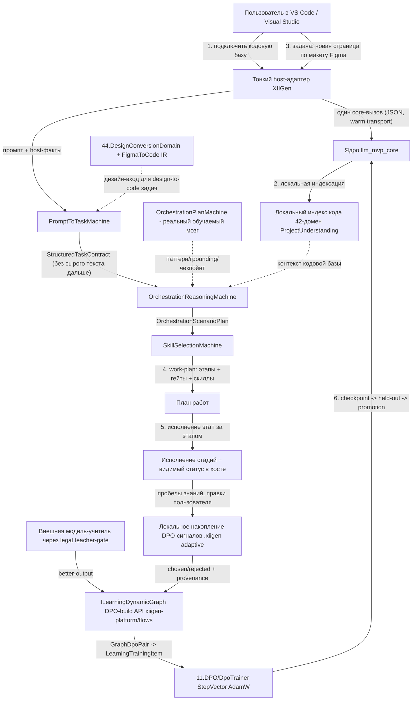

# PLAN-VS-VSCODE-CONTINUE-v1 — план продолжения расширений Visual Studio и VS Code

**Дата создания:** 2026-07-13 (проход 1, кумулятивный — следующие проходы дописывают §1–§5 и детализацию M0–M6).
**Автор прохода 1:** Fable 5 (Ultracode), одиночный bounded-агент фазы 2 планирования.
**База доказательств:** 12-файловый RAG в этой же папке; опорные: `RAG-12-extension-development.md` (текущее состояние сборки + roadmap M0–M6 + Addenda A1/A2), `RAG-10-extensions-orchestration-based-on-our-data.md` (архитектура: OrchestrationPlanMachine, two-machine flow, Authority Ledger v2, host-adapter контракт), `RAG-05-dpo-legal-build.md` (ILearningDynamicGraph DPO-build — обучающая зависимость), `RAG-11-extensions-research.md` (реальный cursor extension.ts + FigmaToCode + унифицированный host-adapter шаблон), `RAG-04-design-to-code-session.md` (44.DesignConversionDomain design→code).

---

## 0. СТАТУС ПЛАНА: PLAN-ONLY (исполнение запрещено до явного одобрения Luba)

> **⚠ CURRENT BRANCH-STATUS OVERLAY (2026-07-28).** Все живые git-факты этого плана
> (вершины веток, дивергенции, конфликты слияния, состояние worktree и хост-репо),
> датированные 2026-07-13 — включая снимок X3.1, литералы OP-67-блока §1.1 и якоря
> milestone-гейтов M0–M6 — УСТАРЕЛИ и замещены файлом
> `BRANCH-STATUS-CURRENT-2026-07-28.md` (эта же папка). При любом конфликте действует
> оверлей. Ключевые перемены: main впитал ветки DesignToCode-clean и
> codex/dpo-implementation (PR #38/#39, 2026-07-24); история DesignToCode переписана
> ~2026-07-19 (якорь 37fe98ac0 больше не существует); картина мержабельности ветки
> orchestrator-extensions перевернулась (28 конфликтов в main, 0 в latest); DPO-ветка
> получила +455 коммитов. Этот блок — навигационный указатель, НЕ разрешение исполнения.

Это ПЛАН, а не разрешение на реализацию (правило R2 — PLAN TASK = PLAN-ONLY).
Ни одна строка этого документа не даёт права: писать/менять продуктовый код, запускать
build/test/runtime/training, создавать/двигать ветки, коммитить, пушить, создавать
work-order исполнителям. Исполнение начинается ТОЛЬКО после явной текущей (unquoted)
фразы одобрения Luba после сдачи плана. STATE-файлы, старые «continue», work-order из
транскриптов и суб-агентские пакеты исполнением НЕ управляют (evidence-only).

План ПРОДОЛЖАЕТ существующую реальность, а не начинает заново:
- одно ядро `llm_mvp_core`; общий центр обучения `11.DPO/DpoTrainer` (настоящий
  градиентный DPO (Direct Preference Optimization): policy/reference LlmModel, AdamW,
  `StepVector` = BackwardLogProbs + AdamW) — RAG-12 P05, RAG-05;
- «мозг» оркестрации, который продолжаем — `OrchestrationPlanMachine`
  (42.ProjectWikiDomain): реально обучаемый и чекпойнтируемый (RAG-10 pass 2-3), НЕ пересборка;
- текущее честное состояние = BUILT_NOT_PROVEN: продуктовый DONE 0/15 фаз,
  dual-path 0/28 сценариев (RAG-12 P08/P31); три «машины» 43.SmartSkillsDomain —
  скрытый детерминизм (keyword/lexical argmax), `semantic_quality_claimed=false` зашито,
  `DpoTrainer` от них отсоединён, единственный настоящий градиентный прогон РЕГРЕССИРОВАЛ
  (RAG-12 P21-P25, R-01 главный риск);
- хосты — тонкие адаптеры над ОДНИМ core-вызовом (сейчас PowerShell+JSON файлообмен
  через `xiigen-extension-core-api.ps1`; нужен тёплый транспорт). Cursor зрелый
  (`extension.ts`, R6 PASS), Claude скелет, Codex рукописный. VS Code = host-4
  (переиспользование cursor-спайна), Visual Studio = host-5 (C# VSIX) — RAG-11 §P;
- design→code = `44.DesignConversionDomain` (реальный, живой working-set — RAG-04);
  FigmaToCode: 18-шаговый детерминированный движок + Element/Style IR переиспользуемы,
  внешний AI заменяется на обучаемые юниты 44 (RAG-11).

---

## 1. GOVERNANCE-БЛОК (правила исполнения будущей реализации)

### 1.1 Ветка и worktree (ADDENDUM A1, решение Luba 2026-07-09)

- **Ветка реализации: `orchestrator-extensions`** — вся реализация ТОЛЬКО на этой ветке
  в каждом участвующем репо, НЕ на `main`/latest. (Luba написала «orchistrator-extensions»;
  план использует исправленную орфографию — подтверждение написания у Luba = открытый
  micro-decision A1 до создания новых веток.)
- **6 участвующих репозиториев**, у каждого свой worktree
  `C:\Projects\<repo>-orchestrator-extensions`:
  1. `llm_mvp_core` (сюда коммитится M0-дельта: 331 файл + 2 зелёных незакоммиченных среза **[FIX-X3 R2-01: числа/статус — RAG-12-снапшот; live 2026-07-13 незакоммиченной 331-файловой дельты НЕТ — оба среза уже ЗАКОММИЧЕНЫ на `DesignToCode-clean` и переносятся в ветку маршрутом WO-M0.0/WO-M0.2 (§P4-C)]**);
  2. `claude-xiigen-smart-skills`;
  3. `cursor-xiigen-smart-skills`;
  4. `codex-xiigen-smart-skills`;
  5. `xiigen-platform-dot-net-angular` (в scope по A2 — здесь открывается DPO-build API);
  6. `xiigen-flows-dot-net-angular` (в scope по A2).
  По RAG-12 (транскрипт-2, §10.1) worktree УЖЕ созданы — первый шаг M0 выполнен;
  план это наследует и перепроверяет, не создаёт заново.
- **Инвариант мержабельности (OP-67, hard-гейт):** ветка `orchestrator-extensions`
  обязана В ЛЮБОЙ момент оставаться чисто-мержабельной обратно в свою latest-ветку И в
  `main` каждого репо. Перед каждым коммитом — no-write `git merge-tree` в обе базы,
  0 конфликтов; правки общих файлов — additive/координированные; никаких add/add на
  генерируемых evidence по общим путям.
  Literal: `mergeability: clean into <latest> AND main (git merge-tree, 0 conflicts)`.
  **[FIX-X3 R5-02/R4-01 — расширение ЕДИНСТВЕННОГО владельца правила мержабельности (второй носитель НЕ заводится):**
  (а) **ПОЗИТИВНОЕ правило путей вывода** (дополняет запрет выше): генерируемые evidence-артефакты
  (отчёты прогонов, eval-JSON, `.trx`, скриншоты, board-файлы) пишутся ТОЛЬКО в branch-уникальные пути
  (например `artifacts/<тема>/by-branch/orchestrator-extensions/…`) ЛИБО в gitignored-каталоги;
  запись генерируемого evidence по пути, который генерируется и на другой ветке/базе, запрещена —
  literal: `no add/add on generated evidence at shared paths` (content/content-конфликт на evidence
  по общему пути — тот же класс нарушения);
  (б) **ремонт УЖЕ существующего конфликта:** live no-write merge-tree 2026-07-13 ветки в latest-базу
  (`codex/chat-gpt-5.5` = 37fe98ac0) даёт ровно **1 CONFLICT (content)** на
  `artifacts/smart-skills-semantic-quality-completion/p22-skillselection-source-disjoint-runtime-eval/p22-source-disjoint-runtime-eval-report.json`
  (обе стороны записали свой вариант p22-evidence по общему пути) — чинится ногой **WO-M0.0** (§P4-C)
  ДО первого коммита M0: выбрать канонную сторону ЛИБО перенести evidence ветки на branch-уникальный путь;
  (в) **реконсиляция дивергенции:** latest-база ушла на +32 коммита вперёд merge-base
  (merge-base 216cf05ac ≠ latest 37fe98ac0) — маршрут ремонта = WO-M0.0(6); до ремонта литерал OP-67
  на latest-ноге ЛОЖЕН (нога `main` чиста: main — строгий предок ветки, merge-tree 0 конфликтов) —
  это факт для ремонта первым слайсом M0, а не разрешение ослабить гейт.]**

**[ОБНОВЛЕНИЕ-ОВЕРЛЕЙ 2026-07-28 — live-факты пунктов (б)/(в) устарели и ЗАМЕЩЕНЫ (`BRANCH-STATUS-CURRENT-2026-07-28.md`): (г)** пере-прогон no-write merge-tree 2026-07-28 даёт ЗЕРКАЛЬНУЮ картину: нога latest ЧИСТА (0 конфликтов; p22-конфликт исчез вместе с переписью истории — сама latest-база `codex/chat-gpt-5.5` откатана к `5084f355e`, якорь `37fe98ac0` больше не существует как git-объект, и роль «latest» требует пере-подтверждения), а нога `main` БОЛЬШЕ НЕ ЧИСТА: 28 конфликтующих файлов (в т.ч. `43.SmartSkillsDomain/XiigenExtensionApiContracts.cs`, девять файлов `44.DesignConversionDomain`, десять тестов, `AGENTS.md`, `CLAUDE.md`, пять файлов `docs/*`, один `tools/*`), потому что main 2026-07-24 впитал ветки `DesignToCode-clean` и `codex/dpo-implementation` (PR #38/#39); main НЕ строгий предок ветки: merge-base `6624161be`, ветка +41 / main +688. Следствия: ремонтная нога p22 из (б) БЕСПРЕДМЕТНА; маршрут WO-M0.0(5)/(6) подлежит пере-деривации от оверлея (Цикл 4 doc-обновления); до пере-деривации литерал OP-67 ЛОЖЕН на ноге main (а не latest, как записано в (в)). Это факт для будущего ремонта, а не разрешение ослабить гейт; пункты (а)–(в) сохранены как история 2026-07-13.]**

> **[BRANCH-STATUS OVERLAY 2026-07-28]** (оверлей C4-01 — рабочие копии ветки исполнения; авторитет: `BRANCH-STATUS-CURRENT-2026-07-28.md`, раздел A.2). Дополнение к пункту (г) выше — теперь о САМИХ рабочих копиях: утверждение этой секции «worktree УЖЕ созданы — первый шаг M0 выполнен» на машине 2026-07-28 ЛОЖНО. `git worktree list` ядра (список привязанных рабочих копий репозитория) показывает 11 записей, все — тематики DPO/GPL (`-DpoImplementation`, `-PrepareToGPL`, `-r19-*`, `-report-*` и т.п.); ни одной копии `*-orchestrator-extensions` не существует. Три хост-репозитория `claude-/cursor-/codex-xiigen-smart-skills` ОТСУТСТВУЮТ в `C:\Projects\` целиком — ни базовой копии, ни worktree. Главная копия `C:\Projects\llm_mvp_core` стоит не на `DesignToCode-clean`, а на `codex/dpo-implementation` (коммит `0f221ac89`) с 486 несохранёнными записями — не трогать. Отдельно: оба «зелёных среза» (`84bc6e916`, `a8a2d9da6`) теперь впитаны в MAIN (слияние PR #38 от 24 июля) и на ветке `orchestrator-extensions` по-прежнему отсутствуют. Следствие: «сверка существующих worktree» (WO-M0.1) и весь счёт «6 репо × worktree» читаются как пере-создание/пере-привязка с нуля, а не проверка существующего; сам список «6 участвующих репозиториев» и решение A1 не отменяются. Это doc-статусный оверлей: он фиксирует факт и НЕ даёт разрешения создавать ветки/worktree или начинать исполнение.

### 1.2 Роль-петля и метод

- Роль-петля: `ARCHITECT_INTERNAL -> EXECUTOR_INTERNAL -> REVIEW_INTERNAL ->
  ARCHITECT_INTERNAL_REPAIR -> EXECUTOR_INTERNAL_CONTINUE`. Parent-сессия = архитектор/
  оркестратор; вся содержательная реализация — через bounded суб-агентов
  (route `gpt-5.5` / `xhigh`, урок RAG-12 §10.1 транскрипт-2, method-pivot Luba).
- Каждый work-order: один слайс, ≤15 минут, точные allowed-files, `git_authority`,
  без commit/push у executor (commit-boundary у parent, §10A из RAG-10 pass 5).
- Проверку «детерминизм не спрятан под обучаемое» владеет parent `REVIEW_INTERNAL`,
  executor self-review эту строку НЕ закрывает (R-20 из ledger v2, RAG-10 pass 7 S4).
- До исполнения плана — минимум 10 независимых plan-review циклов; при приёмке (M6) —
  минимум 10 независимых execution-review (RAG-12 M6, CLAUDE.md 10-Review-Cycle Gate).
- Замороженный порядок (P48-2, hard): вся capability-зависимая proof/scenario-работа
  (token/quality/learnability/lifecycle/dual-path) НЕ строится до прохождения M2
  (реальный обучаемый инференс); до M2 разрешены только host-route scaffolding и
  не-capability гигиена/доки/тесты.

### 1.3 Формат и честность

- План обязан удовлетворять Part A Completeness Contract (§0 UML + §1 алгоритмы
  по-русски + §2 описания с примерами значений + §3 code-refs file:line WHY/HOW/WHAT +
  §4 статус-таблица + §5 иерархия ILearningMachine→ILogicalOrchestrator→ILogicalFlow→
  ILogicalUnit с Input/Output). Проход 1 закрывает каркас + §0; остальное — проходы 2+ (§5 ниже).
- Два легитимных PASS-состояния и их нельзя смешивать: `PASS_AS_HONEST_UNTRAINED_SCAFFOLD`
  (контракт есть, честно not_ready, нет скрытого детерминизма) ≠ `PASS_AS_TRAINED_FEATURE`
  (checkpoint + held-out числа + ablation + fresh-load + continue-training + e2e через
  реальный host). Скелет, выданный за trained feature — класс masquerade (OP-56/57).
- Anti-phantom: каждое «создано/готово/N строк» — только с live-проверкой
  (grep/git/readback); отчёт != доказательство (RAG-10 pass 9 §9.5).

### 1.4 **[FIX-2PH-1]** Двухфазная структура реализации (директива Luba 2026-07-13): Phase 1 = ЛОКАЛЬНЫЙ учитель (Docker Desktop + Ollama), Phase 2 = remote

- По-человечески: сначала ВСЁ проверяется дёшево и приватно ЛОКАЛЬНО — DPO-учитель
  расширений работает на машине пользователя (Ollama на Docker Desktop, модель
  Qwen3.5-9B Q4_K_M, новый профиль `qwen35-local-v1`), данные наружу не уходят
  (`ExternalDataTransfer=false`); hosted-маршрут (`qwen3-together-v1`) становится
  Phase 2. **Phase 2 НЕ стартует до приёмки Phase 1.**
- Единственный владелец СТРУКТУРЫ двухфазного teacher-маршрута (имена этапов
  `TP1_LOCAL`/`TP2_HOSTED`, критерии перехода G-TP-1..G-TP-7, матрица этапов) —
  overlay `dpo legal build/active-codex-execution-two-phase-local-remote-overlay.md`;
  канон профилей учителя — active plan-08 §3.5.2. Этот план только ССЫЛАЕТСЯ
  (второй канон НЕ создаётся). План-локальная проекция: секция
  «Two-Phase Adaptation — проход 1/5» в конце файла (карта вех M0–M6 → фазы,
  профиль-сплит teacher-gate, запись профиля `qwen35-local-v1`). **[FIX-2PH-2:
  + секция «Two-Phase проход 2/5» — Ollama runtime Этапа 1 (Modelfile /
  KV-cache / GPU-check), context-бюджет ≤8192, bounded teacher-call контракт,
  C#-адаптер provenance (`LocalOllamaTeacherClient` в ядре DPO-build, R6),
  новый WO-2PH-RT (G-TP-1 ноги); owner-sync таблицы 2PH-1.4 с plan-08 §3.5.2 =
  CONFIRMED]**
- Маппинг на решения: Phase 1 = материализация №2 local-first (RESOLVED-PER-DOC) —
  v1 живёт целиком локально; Phase 2 = remote-часть, отложенная №12 (владелец
  hosting — after-v1) + hosted-teacher маршрут №10/B-2. Ledger-строка директивы =
  №2PH (Группа 0 §P6-D).

---

## 2. AUTHORITY REQUIREMENTS LEDGER (реестр связывающих требований)

Источник авторитета: (а) целевой поток Luba из 6 шагов (задание фазы 2);
(б) ground-truth из RAG-01..12. Нумерация R-01.. — реестр ЭТОГО плана
(исторический ledger v2 из RAG-10 обозначается «v2:R-xx» и является источником, не живым реестром).
Каждое требование связывающее (binding), пока Luba явно не пометит иначе.

| ID | Требование (связывающее) | Источник | Секция плана, которая покроет |
|----|--------------------------|----------|-------------------------------|
| R-01 | ПРОДОЛЖАТЬ `OrchestrationPlanMachine` (42.ProjectWikiDomain) — единственный реально обучаемый+чекпойнтируемый мозг (train/held-out/atomic checkpoint/export-import). НЕ пересборка, НЕ новая reasoning-машина с нуля. **[FIX-X1 v1-scope-under-target-canon P2-01-DOC: «мозг» здесь = ФАКТ-статус (OPM — единственный сегодня доказанный обучаемый актив) и доказанный домен-узел wiki/plan целевого L5-графа; «мозг» ЦЕЛЕВОЙ архитектуры = `ILearningDynamicGraph` (§1.4.1); требование ПРОДОЛЖАТЬ OPM не меняется]** | RAG-10 pass 2-3 (§2.4, §3.0), RAG-12 §10.5 актив 8 | §0 (узел), §1/§2 (проход 2), M2-детализация (проход 4) |
| R-02 | Реальный обучаемый инференс в 3 машинах 43.SmartSkillsDomain (PromptToTask / OrchestrationReasoning / SkillSelection): заменить keyword-словарь / lookup-replay / lexical bag-of-words argmax; оживить semantic-quality гейт; портировать trainable-integrity паттерн из OrchestrationPlanMachine. **[SUPERSEDED-ANNOTATION P2-01, проход 3]:** формулировка «в 3 машинах … OrchestrationReasoning» — раннее (прохода 1) чтение; живой канон после решения №P2-01 (§1.4): **2 обучаемые машины** (PromptToTaskMachine, SkillSelectionMachine) **+ ORM-43 = тонкий адаптер БЕЗ собственного обучаемого состояния + обучаемым reasoning стадии 2 владеет OPM-42**. Само требование (реальный обучаемый инференс на всех трёх СТАДИЯХ конвейера, снятие словаря/replay/argmax как власти) остаётся связывающим без ослабления. **[FIX-X1 historical-canon, superseded-by-P2-01-DOC: аннотация прохода 3 выше сама устарела — «2 машины + ORM-адаптер БЕЗ обучаемого состояния + OPM владеет стадией 2» НЕ живой канон, а история; живой канон = P2-01-DOC (§1.4.1: ORM-43 = обучаемый узел L5-графа); v1-объём = 2 машины + TokenToSignal + сигнальная нога OPM + графовый хребет WO-M2.8/M2.9; полные узлы = M2b (§1.4.7)]** | RAG-12 P21-P23, M2 (§8.6) | §0, §1 (проход 2), M2-детализация (проход 4), §1.4 (P2-01) |
| R-03 | Обучение расширений — ЧЕРЕЗ `ILearningDynamicGraph` DPO-build (проект `dpo legal build`, статус design-complete, НЕ реализован), реализуемый в `xiigen-platform` + `xiigen-flows`; расширения = КЛИЕНТЫ его «better-model-output → learning-DPO» API. Жёсткая зависимость на критпути M1→M2. НЕ строить собственный/игрушечный движок. | ADDENDUM A2 (RAG-12 §8.7), RAG-05 | §0 (узел DPO-build), M1/M2-детализация (проход 4), decision-ledger (проход 6) |
| R-04 | Общий центр обучения `11.DPO/DpoTrainer` (реальный: StepVector = BackwardLogProbs + AdamW, margin = chosenReward − rejectedReward) должен быть ПОДКЛЮЧЁН к машинам расширений (сейчас grep = 0 вызовов из 43). Единственный исполненный градиентный прогон РЕГРЕССИРОВАЛ (loss↑ к ln2, held-out≈0.56) — риск R-01 проекта. | RAG-12 P05/P25, RAG-05 | §0, M1-детализация (проход 4) |
| R-05 | Тонкие host-адаптеры: **VS Code = host-4** (переиспользовать cursor-спайн `extension.ts`+dist, сменить manifest/брендинг) и **Visual Studio = host-5** (новая C# VSIX-оболочка: `source.extension.vsixmanifest` + VSPackage/`.vsct`; шаблон — реальный `Xiigen.VisualStudio.SmartCodeWiki.vsix`). Оба — по унифицированному 5-ногому host-adapter контракту (MANIFEST / EVENT / ENTRYPOINT / CORE-CALL / TRACE-HONESTY). | RAG-11 §P, RAG-12 P04/P43-2 | §0 (host-слой), §1 host-детализация (проход 3), M3-детализация (проход 5) |
| R-06 | Тёплый поставляемый транспорт вместо per-call `dotnet run`-компиляции через PowerShell-шим с абсолютными путями; единый versioned wire-contract: `schema_version` + `CorrelationId`-эхо + `UserPromptSha256` в ответе; ОДИН core-api и ОДИН контракт (сейчас 2 расходящихся ps1 + 2 контракта). | RAG-12 M3 (P41-1/P44-2/P44-3), RAG-11 §R-1 | §0 (узел Transport), M3-детализация (проход 5) |
| R-07 | Шаги 1-2 целевого потока: пользователь подключается к кодовой базе, код индексируется ЛОКАЛЬНОЙ моделью (local wiki / ProjectUnderstanding-путь 42-домена; повторный вход при изменениях). Приватность: индекс и адаптивное состояние — на стороне пользователя (`.xiigen`), в common-ассеты сырые приватные данные не попадают. | Задание Luba (шаги 1-2), RAG-10 pass 3 §3.3, A-LM-10 | §0 (узел LocalIndex), §1 (проход 2), M3-детализация (проход 5) |
| R-08 | Шаги 3-4: задача пользователя проходит ЧЕРЕЗ ВСЕ стадии оркестрации локальной моделью и порождает work-plan: `raw prompt → PromptToTaskMachine (StructuredTaskContract) → OrchestrationReasoningMachine (OrchestrationScenarioPlan, БЕЗ сырого промпта — анти-replay) → SkillSelection → план работ`. Разрыв словарей стадий 1↔2 (12/15 паттернов недостижимы) обязателен к закрытию. | Задание Luba (шаги 3-4), RAG-10 pass 4 §4.4, RAG-12 P22-G1 | §0 (конвейер), §1 (проход 2), M2-детализация (проход 4) |
| R-09 | Шаг 5: исполнение по стадиям — work-plan исполняется этап за этапом через host-поверхность с видимым статусом каждой стадии (стадия/гейт/итог — человекочитаемо, не машинные токены). | Задание Luba (шаг 5), RAG-12 P46 (UX) | §1/§2 (проход 3), M3/M5-детализация (проходы 5-6) |
| R-10 | Шаг 6: ВНЕШНЯЯ модель обучает ВНУТРЕННЮЮ через DPO на всём недостающем знании: недостающее знание сначала копится ЛОКАЛЬНО (adaptive-нога, `.xiigen`), затем DPO-модуль встраивается во внутреннюю модель (через DPO-build API из R-03 и teacher-gate из R-19). Негативные таксономии готовы: ORCH-01..10, PromptError-01..12, reward-margin 0.45–0.75 overlap. | Задание Luba (шаг 6), RAG-10 pass 6, RAG-05 | §0 (петля обучения), M2/M4-детализация (проходы 4-5) |
| R-11 | Design→code через `44.DesignConversionDomain` (живой working-set; PNG trust-boundary срез уже реализован и зелёный, UNCOMMITTED **[FIX-X3: статус устарел — live 2026-07-13 срез ЗАКОММИЧЕН на `DesignToCode-clean` (84bc6e916 + a8a2d9da6), на ветке `orchestrator-extensions` ОТСУТСТВУЕТ; перенос = WO-M0.0/WO-M0.2]**). FigmaToCode: 18-шаговый детерминированный движок + Element/Style IR переиспользовать как baseline/инфраструктуру, внешние AI-провайдеры заменить на обучаемые юниты 44. Пример задачи шага 3: «новая страница по макету Figma». | RAG-04, RAG-11 (Pass 8-9), RAG-12 §10.1 срез 2 | §0 (узел 44), §1 (проход 3), M2/M3-детализация |
| R-12 | NO HIDDEN DETERMINISM (R4): детерминированные словари/regex/lookup/argmax не могут быть финальной семантической властью; допустимы только как помеченный baseline/eval/инфраструктура. Снять governance-downgrade «детерминизм ок если claimed=false» (P38-1/2). Проверка — независимым REVIEW_INTERNAL (v2:R-20). | CLAUDE.md R4, RAG-12 P38, RAG-10 pass 7 S4 | Все секции; ревью-гейты (проход 6) |
| R-13 | Модели и сеты в репо, split (R5): common — `models/*` + `training-data/*` в `llm_mvp_core` (manifest/checkpoint/locator, экспорт/импорт/апгрейд/rollback/share/continue-training); adaptive — у пользователя `<project>\.xiigen\...`, НИКОГДА не перезаписывается server-upgrade (A-LM-10). Транспорт lifecycle сейчас no-op (`UploadAsync`, in-memory locator) — чинится в M3. | CLAUDE.md R5, RAG-10 pass 4 §4.5, RAG-12 P05-4/5, P26 | §0, M3/M4-детализация (проход 5) |
| R-14 | Простая граница агента (R6): хост владеет ТОЛЬКО manifest + entrypoint + thin-adapter + settings(debug) + README; НОЛЬ семантических решений в хосте (`hostDecisionAuthority:false`); вся логика в `llm_mvp_core`; proof-артефакты живут в core, НЕ раздувают extension-репо (урок Phase 40). Debug-контур: трёхстрочный `xiigen <method>: / input: / output:` (redacted) в каждом хосте. | CLAUDE.md R6, A-LM-11, RAG-10 pass 5 §5.7/CR-13 | §0 (host-слой), M3-детализация (проход 5) |
| R-15 | Dual-path доказательство: каждый сценарий = Path A (автоматический boundary через КОМАНДУ расширения, не fallback) + Path B (видимый локальный desktop: свежий typed→submit→новый ответ, prompt-hash join, скрин/видео) на ОДНОМ prompt-hash. Честный baseline сейчас 0/28 joined. Цель M5: 28 сценариев × хосты (включая VS Code и VS). **[FIX-X4 R2-02 — формула «28 × хосты» уточнена: 28 = УЖЕ СУММА рядов по 3 хостам (9 Claude + 9 Cursor + 10 Codex; RAG-12 P31 `counts.total 28`), НЕ «28 на каждый хост»; расширение host-4/host-5 (№5 подтверждён Luba) добавляет +9+9 рядов → целевой знаменатель M5 = 46 канонических рядов, не 84/102]** | RAG-12 P31-P36, M5 | M5-детализация (проход 6) |
| R-16 | Экономия токенов доказывается ЧИСЛАМИ над no-XIIGen контрольной рукой: реальный токенизатор (не эвристика), РАЗНЫЕ baseline/adaptive входы (сейчас идентичны ⇒ delta структурно 0), числовой порог улучшения, статистика/повторы, non-regression качества. | RAG-12 P15/P27/P47 (особенно P47-5), M4 | M4-детализация (проход 5) |
| R-17 | Сначала СОХРАНИТЬ (M0): закоммитить extension-дельту ядра (331 файл) + 2 зелёных среза (SkillSelection handoff + Design Conversion PNG trust-boundary) в `orchestrator-extensions`; добавить `43.SmartSkillsDomain` и `44.DesignConversionDomain` как Project() в `LlmFromScratch.sln`; зелёный `dotnet build`; полный `.trx` baseline; свести 9 worktree ядра к каноническому. Gate M0 включает merge-tree в latest И main. **[FIX-X3 R2-01: «331 файл»/«9 worktree» — RAG-12-снапшот; live 2026-07-13: дельта живёт как КОММИТЫ на движущемся `DesignToCode-clean` (переносится cherry-pick/merge-маршрутом WO-M0.0), worktree ядра = 12; требование «сначала сохранить» не меняется — меняется live-редакция входов (WO-M0.0, §P4-C)]** | RAG-12 M0 (§8.4) + A1, §10.6 | M0-детализация (проход 4) |
| R-18 | Безопасность: закрыть RCE-вектор (spawn `powershell.exe -ExecutionPolicy Bypass` с core-путями из настроек воркспейса ⇒ открытие вредоносного воркспейса = исполнение произвольного кода); threat-model/Workspace-Trust; подпись; убрать компиляцию из user-пути. Дистрибуция: устанавливаемый артефакт `.vsix` (VS Code и VS), лицензия+канал, установка на чистой машине. | RAG-12 P49-3/P49-4, M6 | M6-детализация (проход 6) |
| R-19 | Легальность данных обучения: license-манифест на каждый common-корпус; teacher/distillation-гейт (зафиксировано НАРУШЕНИЕ: sonnet-derived строки в common); leg-assignment (private → adaptive, не common); закрыть красный license-статус DesignConversion. | RAG-12 P45, M4-legal | M4-детализация (проход 5) |
| R-20 | 13 решений Luba сведены в один decision-gate ledger и получены ДО зависимых работ; ключевое для этого плана — №5: VS Code / Visual Studio как 4-я/5-я host-семья (P43-2) — этим планом ПРЕДЛАГАЕТСЯ к утверждению; №13 — эскалация, если M1-спайк провалится; №11 — минимальный набор хостов при внешнем блокере Codex. + micro-decision A1 (орфография ветки). **[FIX-X4: (а) №5 БОЛЬШЕ НЕ «предлагается» — ПОДТВЕРЖДЁН Luba 2026-07-13 (Группа 0 §P6-D); (б) скобка «(P43-2)» — historical-конфляция R3-02: P43-2 = wiki-plugin семья 42-домена, отдельная строка P43-2-scope (§P6-D группа 3a); (в) счёт «13» — исторический, живой счёт = «Авторитетный пересчёт X4» §P6-D: 25 решений]** **[FIX-2PH-5: указатель «25 решений» в аннотации — historical (дата X4); живой канон = пересчёт [FIX-2PH-1] §P6-D: 26]** | RAG-12 P48-3/P49-6, §8.8 | Decision-ledger секция (проход 6) |
| R-21 | Честность заявлений: два PASS-состояния (honest untrained scaffold ≠ trained feature); никакие boundary/smoke/marker/parse-only свидетельства не поднимают статус выше BUILT_NOT_PROVEN; заявленный прогресс — только с live-verify. | CLAUDE.md OP-56/57, RAG-10 §10.6 T13/T15, RAG-12 P42 | Все секции; ревью-гейты (проход 6) |
| R-22 | Метод исполнения: parent = оркестратор; реализация только через bounded суб-агентов `gpt-5.5`/`xhigh`; ≥10 plan-review до исполнения; ≥10 execution-review в приёмке; commit-boundary у parent; повторная команда Luba = свежая цепочка исполнения. | RAG-12 §10.1 (3)-(4), CLAUDE.md | §1 governance (этот проход), M6 (проход 6) |

Замечание о преемственности: исторический Authority Ledger v2 (v2:R-01..R-20, RAG-10 pass 4)
и Conversation Ledger CR-01..CR-14 остаются источниками; их живые требования влиты выше
(v2:R-05/CR-13 → R-14 debug; v2:R-11/R-20 → R-12; v2:R-12/CR-09 → R-13; CR-10 → R-14 и т.д.).
Двойного живого канона нет: живой реестр — только таблица выше.

> **[BRANCH-STATUS OVERLAY 2026-07-28]** (оверлей C4-05 — live-вставки R-11/R-17; авторитет: `BRANCH-STATUS-CURRENT-2026-07-28.md`). Вставки [FIX-X3] в строках R-11 и R-17 таблицы выше датированы 13 июля и устарели: (а) оба зелёных среза (`84bc6e916`, `a8a2d9da6`) теперь впитаны в MAIN (слияние PR #38 от 24 июля) и по-прежнему отсутствуют на ветке `orchestrator-extensions`; маршрут переноса «WO-M0.0/WO-M0.2 с DesignToCode-clean» подлежит пере-деривации (см. оверлей C4-02 у вехи M0); сама `DesignToCode-clean` перестроена переписью истории (~19 июля) и движется почасово; (б) счёт «worktree ядра = 12» устарел — сейчас 11 привязанных рабочих копий, состав полностью сменился на DPO/GPL-тематику, копий `*-orchestrator-extensions` нет. Сами требования R-11/R-17 по существу НЕ меняются — устарели только их live-числа.

---

## 3. ЦЕЛЕВОЙ ПОТОК ИЗ 6 ШАГОВ (продукт, который план обязан доставить)

### 3.1 Нарратив (по-русски, как это видит пользователь)

1. **Подключение к кодовой базе.** Пользователь в VS Code / Visual Studio открывает
   проект и подключает расширение XIIGen к своей кодовой базе (шаг = выбрать корень
   репозитория; расширение передаёт путь в ядро одним core-вызовом).
2. **Локальная индексация.** Ядро (локальная модель, 42-домен: ProjectUnderstanding /
   local-wiki путь) индексирует код: стек, ссылки, корни проектов, карта файлов.
   Индекс и всё адаптивное состояние остаются локально у пользователя (`.xiigen`),
   ничего приватного не уходит в общие ассеты. Подходит закрытым организациям, где
   внешний AI запрещён регуляцией (первоисточник — направление 2 Luba, RAG-10 pass 9).
3. **Постановка задачи.** Пользователь ставит задачу в панели/команде расширения,
   например: «Сделай новую страницу профиля по этому макету из Figma». Для design→code
   входа макет обрабатывает `44.DesignConversionDomain` (+ переиспользованный
   FigmaToCode Element/Style IR как baseline).
4. **Оркестрация → план работ.** Задача проходит ВСЕ стадии оркестрации локальной
   моделью: `PromptToTaskMachine` (промпт → структурированная задача) →
   `OrchestrationReasoningMachine` (задача БЕЗ сырого промпта → сценарий/этапы) →
   `SkillSelectionMachine` (задача+план → нужные скиллы) — с опорой на реальный мозг
   `OrchestrationPlanMachine` (KNN Mode1/2/3 + grounding + checkpoint). Результат —
   структурированный work-plan (bounded phases + gates).
   **[FIX-X1 v1-scope-under-target-canon P2-01-DOC (то же чтение, что CHAIN-2 в §P6-F): линейный конвейер стадий = v1-ТОПОЛОГИЯ графа (данные), «мозг» целевой архитектуры = L5-машина `ILearningDynamicGraph`, OPM-42 = её доказанный домен-узел wiki/plan (§1.4.1/§1.4.7).]**
5. **Исполнение по стадиям.** Work-plan исполняется этап за этапом; расширение
   показывает по-человечески: какая стадия идёт, что сделано, что осталось, какой гейт
   прошёл; debug-режим показывает точный `xiigen <method>: / input: / output:`.
6. **Обучение: внешняя модель учит внутреннюю (DPO).** Всё недостающее знание
   (модель не смогла / пользователь поправил / внешняя модель ответила лучше)
   сначала копится ЛОКАЛЬНО как DPO-сигналы (chosen/rejected + provenance), затем через
   `ILearningDynamicGraph` DPO-build API (xiigen-platform/flows) и `11.DPO/DpoTrainer`
   встраивается во внутреннюю модель: checkpoint → held-out → promotion. Внешний
   teacher проходит легальный teacher-gate (лицензия/ToS), private-данные — только в
   adaptive-ногу.

### 3.2 Диаграмма потока (Mermaid flowchart, импортируется в draw.io)



Чтение диаграммы: сплошные стрелки — путь запроса/данных по шагам 1-6; пунктирные —
опорные знания (мозг, индекс, дизайн-вход). Обучающая петля (нижняя треть) замыкает
шаг 6 обратно в ядро: после promotion модель отвечает лучше на следующей задаче.

---

## 4. PART A §0 — АРХИТЕКТУРА (классовая диаграмма цели + статусы + симуляции связей)

### 4.0 Класс-диаграмма (Mermaid classDiagram; draw.io: Extras → Edit Diagram)

Статусы в note: ✅ реализовано и работает · ⚠️ частично · 🔶 скелет/стаб · 🆕 не существует, строится этим планом.
Каждый статус обоснован RAG-ссылкой (легенда в 4.1).

```mermaid
classDiagram
    class VSCodeHostAdapter {
        +activate(context)
        +registerCommand xiigen.smartSkills.select
        +chatParticipant / webview panel
        +settings: coreRoot, debugEnabled
    }
    note for VSCodeHostAdapter "ХОСТ-4 (НОВЫЙ) 🆕 - тонкий адаптер VS Code. Переиспользует cursor-спайн (extension.ts + dist), меняются manifest-поля/брендинг. НОЛЬ семантики (R6). RAG-11 §P"

    class VisualStudioVsixAdapter {
        +source.extension.vsixmanifest
        +VSPackage + .vsct команды
        +ToolWindow панель
        +settings: coreRoot, debugEnabled
    }
    note for VisualStudioVsixAdapter "ХОСТ-5 (НОВЫЙ) 🆕 - C# VSIX-оболочка. Шаблон: реальный Xiigen.VisualStudio.SmartCodeWiki.vsix (RAG-12 P04). Тот же JSON-контракт core-вызова"

    class CursorExtension {
        +extension.ts 1345 строк
        +3 команды + chat participant + panel
        +dist/extension.js 48KB
    }
    note for CursorExtension "✅(адаптер)/⚠️(proof) - самый зрелый хост, R6 PASS; сборка невоспроизводима, абсолютные пути, Windows-only транспорт. RAG-12 P13-P16"

    class ClaudePluginAdapter {
        +SessionStart hook
        +claude-entrypoint.js
    }
    note for ClaudePluginAdapter "🔶 СКЕЛЕТ - только SessionStart-hook, нет user-команды/настроек. RAG-12 P09-P12"

    class CodexAdapter {
        +codex-entrypoint.js
    }
    note for CodexAdapter "🔶 + внешний блокер - НЕ зарегистрирован в marketplace Codex; runCli не показывает ответ. RAG-12 P17-P20. Luba-решение №11"

    class XiigenCoreTransport {
        +schema_version
        +CorrelationId echo
        +UserPromptSha256 в ответе
        +warm process stdio/HTTP
    }
    note for XiigenCoreTransport "🆕 ТЁПЛЫЙ ТРАНСПОРТ - заменяет per-call dotnet run через PowerShell-шим (непоставляемо, RCE-риск P49-3). Один контракт на все 5 хостов. RAG-12 M3"

    class XiigenExtensionApiService {
        +ProcessHostExtensionRequest(req) OperationResult
        -цепочка Translate - Plan - DecideSkills
        -ShouldClaimSemanticQuality()
    }
    note for XiigenExtensionApiService "⚠️ ГРАНИЦА ЯДРА (1930 строк) - работает, но: плоская цепь в обход 15.OrchestratorModel, semantic-гейт мёртв по построению, feedback-метод не реализован. RAG-12 P03/P10"

    class LocalCodebaseIndex {
        +UnderstandAsync(root) ProjectUnderstanding
        +StackFacts / References / ProjectRoots
    }
    note for LocalCodebaseIndex "⚠️ Bootstrap - шаги 1-2 потока: локальная индексация кода (42-домен, ProjectUnderstandingUnit / BootstrapProjectScannerUnit, Confidence=1.0 детерминированный baseline). RAG-10 pass 3 §3.3"

    class PromptToTaskMachine {
        +Translate(request) OperationResult
        -alias-словарь ~40 правил
        -пороги 0.01/0.01
    }
    note for PromptToTaskMachine "🔶 HIDDEN DETERMINISM - keyword-словарь как власть, confidence-константы, гейт всегда открыт. Цель M2: обучаемое извлечение StructuredTaskContract. RAG-12 P21"

    class OrchestrationReasoningMachine {
        +Plan(request) OperationResult
        -exact-match replay 15 паттернов
    }
    note for OrchestrationReasoningMachine "🔶 РАЗРЫВ СЛОВАРЕЙ - 12/15 паттернов недостижимы (стадия 1 не эмитит universal_reasoning); rejected-сторона выброшена тренером. Цель M2. RAG-12 P22. [SUPERSEDED-ANNOTATION P2-01, проход 3: раннее чтение 'самостоятельная 3-я обучаемая машина' устарело; целевая роль = ТОНКИЙ контрактный адаптер над OPM-42 без своего обучаемого состояния; обучаемым reasoning стадии 2 владеет OPM-42 - см. §1.4] [FIX-X1 historical-canon, superseded-by-P2-01-DOC: 'целевая роль = тонкий адаптер' - историческое чтение; целевой канон = ОБУЧАЕМЫЙ узел стадии 2 внутри L5-графа (§1.4.1); в v1 узел = честный inference-scaffold (композиция ORM-OPM операционна), trained state узла = веха M2b - §1.4.7]"

    class SkillSelectionMachine {
        +DecideFromTrainedState(request)
        +ExportCheckpoint() / LoadCheckpoint()
        -lexical bag-of-words argmax
    }
    note for SkillSelectionMachine "⚠️ ЧАСТИЧНО - обучаема, checkpoint есть; но власть = частоты слов >=4 симв., rejected не используется, source-disjoint eval отсутствует. Handoff task+plan уже починен (UNCOMMITTED срез 1). RAG-12 P23, §10.1"

    class OrchestrationPlanMachine {
        +GeneratePlanAsync(prompt)
        +TrainOrchestrationBatchAsync(batch)
        +EvaluateAsync(heldOut)
        +SaveCheckpointAsync / LoadCheckpointAsync
        -3 KNN Mode1/2/3 + PromptFlowGroundingModel
    }
    note for OrchestrationPlanMachine "✅ РЕАЛЬНЫЙ МОЗГ (42.ProjectWikiDomain) - обучается, held-out гейт D-17 leakage=0.0, атомарный checkpoint, экспорт/импорт. ПРОДОЛЖАЕМ ЕГО (R-01), портируем его integrity-паттерн в 3 машины. RAG-10 pass 2-3 [SUPERSEDED-ANNOTATION P2-01, проход 4: 'в 3 машины' - формулировка прохода 1; живой канон = 2 обучаемые машины (PromptToTask, SkillSelection) + ORM-43 адаптер + OPM-42 владеет стадией 2; integrity-паттерн портируется в 2 машины (+ TokenToSignal unit, §P3-C) - см. §1.4] [FIX-X1 historical-canon, superseded-by-P2-01-DOC: 'живой канон = 2 машины + адаптер + OPM владеет стадией 2' - история; живой канон = P2-01-DOC (мозг = L5-граф, OPM = доказанный домен-узел, ORM-43 = обучаемый узел); v1-объём порта (2 машины + TokenToSignal + сигнальная нога) остаётся операционным - §1.4.7] [FIX-X2 R1-03: узел читать как доказанный ДОМЕН-УЗЕЛ wiki/plan ВНУТРИ L5-графа ILearningDynamicGraph (узел графа теперь на этой диаграмме); его integrity-паттерн = ЭТАЛОН для остальных узлов; 'РЕАЛЬНЫЙ МОЗГ' = факт-статус единственного доказанного актива, НЕ целевая роль]"

    class DesignConversionDomain44 {
        +Element/Style IR (из FigmaToCode)
        +PNG trust-boundary + live-local server
        +DpoTrainingHandoff - DpoTrainer bridge
    }
    note for DesignConversionDomain44 "✅ ЖИВОЙ working-set - design-to-code вход (шаг 3); 18-шаговый FigmaToCode движок = baseline, внешний AI заменяется юнитами 44. Срез 2 (PNG trust-boundary) зелёный, UNCOMMITTED. RAG-04, RAG-12 §10.1"

    class DpoTrainer {
        +Step / StepMany / StepVector
        +EvaluateMany(heldOut)
        -margin = chosenReward - rejectedReward
        -AdamW, BackwardLogProbs
    }
    note for DpoTrainer "✅ ДВИЖОК РАБОТАЕТ (11.DPO) - но ОТСОЕДИНЁН от 43 (grep=0) и единственный настоящий прогон РЕГРЕССИРОВАЛ (риск R-01 проекта). RAG-12 P05/P25"

    class ILearningDynamicGraphDpoBuild {
        +GraphDpoBuilder.BuildPairAsync(raw) GraphDpoPair
        +TeacherProvenance 20 полей + legal gate
        +learning-DPO API для клиентов
    }
    note for ILearningDynamicGraphDpoBuild "🔶 DESIGN-COMPLETE, НЕ РЕАЛИЗОВАН - внешний DPO-build (ADDENDUM A2): реализуется в xiigen-platform + xiigen-flows; расширения - клиенты API. ЖЁСТКАЯ зависимость M1-M2. RAG-05"

    class ModelServer25 {
        +IModelRepository.UploadAsync
        +IRemoteUnitLocator.LocateAsync
        +RemoteUnitManifest
    }
    note for ModelServer25 "⚠️ СТАБ-ТРАНСПОРТ - UploadAsync no-op, locator in-memory (не переживает рестарт). Цель M3: персистентный locator + promotion/rollback. RAG-12 P05-4/5, P26"

    class AdaptiveUserState {
        +.xiigen/каждая-машина/adaptive/*
        +adaptive-dpo-signals.jsonl
        +continue-training from checkpoint
    }
    note for AdaptiveUserState "⚠️ writer есть, петли нет - шаг 6a: локальное накопление знаний; feedback-метод не доходит до ядра ни с одного хоста. RAG-12 P11/P14/P19/P24"

    %% [FIX-X2] три графовых узла целевого канона P2-01-DOC (закрытие R1-03: §0 теперь несёт L5-граф, согласован с §5/§P6-F)
    class ILearningDynamicGraph {
        +TrainBatchAsync(GraphDpoPair[] адресация Level/NodeOrEdgeId)
        +EvaluateAsync(heldOut per-edge/per-node)
        +LoadTopology(CHAIN-2 данные-файл)
        +checkpoint-агрегация DynamicGraphCheckpointManifest
    }
    note for ILearningDynamicGraph "🆕 L5-МАШИНА-ГРАФ [FIX-X2] - целевой мозг (P2-01-DOC, §1.4.1): ILearningMachine<DynamicGraphDomain>; generic L5-контракт в коде ЕСТЬ (00.Core/LearningMachineContracts.cs:208-:209), специализация NEW - в коде её НЕТ (RAG-05:223); v1-хребет = WO-M2.9 [условно от M1]; полная машина = веха M2b (§1.4.7). НЕ путать с ILearningDynamicGraphDpoBuild: тот узел = внешняя DPO-build нога (builder пар), этот = САМА машина"

    class DynamicGraphTopology {
        +nodes[] / edges[] {id, from, to, kind}
        +v1: CHAIN-2 линейный порядок как ДАННЫЕ-файл (без БД)
    }
    note for DynamicGraphTopology "🆕 ТОПОЛОГИЯ-ДАННЫЕ [FIX-X2] - карта лент графа: данные, а не код (RAG-06:2016-2018); правится без перекомпиляции; v1 = CHAIN-2 файл (WO-M2.9); 9-узловая топология в БД = M2b; [FIX-X6 C7-02] v1-оговорка: топология-как-данные ДОКАЗЫВАЕТСЯ на изолированном минимальном хребте WO-M2.9, ПРОДУКТОВЫЙ v1-конвейер маршрутизируется оркестратором WO-M3.3 + routing-фактом WO-M3.10(b1); топология-driven продуктовое исполнение (graph runtime L4) = M2b"

    class EdgeAuthorityUnit {
        +ExecuteAsync(EdgeAuthorityInput) EdgeAuthorityDecision
        -вход БЕЗ candidate-index/SourcePath
        -веса ребра = состояние L5-машины (A-LM-02)
    }
    note for EdgeAuthorityUnit "🆕 ОБУЧАЕМЫЙ РЕШАТЕЛЬ РЕБРА [FIX-X2] - финал каждого перехода графа (RAG-05:223-228); детерминированный роутер = только генератор кандидатов/eval-only (RAG-05:202-205); v1 = ОДНО именованное ребро graph/edge/stage1-dispatch (WO-M2.8) [условно от M1]; [FIX-X6 C7-03] ПРОДУКТОВАЯ v1-власть развилки stage1-dispatch = routing-факт WO-M3.10(b1), ребро WO-M2.8 = изолированное доказательство обучаемости (не продуктовый роутер v1); продуктовая власть ребра = M2b"

    VSCodeHostAdapter --> XiigenCoreTransport : XiigenExtensionRequest JSON
    VisualStudioVsixAdapter --> XiigenCoreTransport : XiigenExtensionRequest JSON
    CursorExtension --> XiigenCoreTransport : XiigenExtensionRequest JSON
    ClaudePluginAdapter --> XiigenCoreTransport : XiigenExtensionRequest JSON
    CodexAdapter --> XiigenCoreTransport : XiigenExtensionRequest JSON
    XiigenCoreTransport --> XiigenExtensionApiService : versioned wire-contract
    XiigenExtensionApiService --> LocalCodebaseIndex : "подключение/индексация (шаги 1-2)"
    XiigenExtensionApiService --> PromptToTaskMachine : "стадия 1: Translate"
    PromptToTaskMachine --> OrchestrationReasoningMachine : "StructuredTaskContract (анти-replay)"
    OrchestrationReasoningMachine --> SkillSelectionMachine : "ScenarioPlan + task"
    OrchestrationPlanMachine <.. OrchestrationReasoningMachine : "integrity-паттерн + grounding"
    %% [SUPERSEDED-ANNOTATION P2-01, проход 3]: пунктир выше - формулировка прохода 1; живой канон - РАБОЧАЯ композиция: ORM-43 (адаптер) вызывает OPM-42.GeneratePlanFromTaskAsync (§1.4.3); integrity-паттерн портируется в ДВЕ машины (PromptToTask, SkillSelection), не в три
    %% [FIX-X1 v1-scope-under-target-canon P2-01-DOC: композиция ORM->OPM = операционная v1-механика (данные-топология CHAIN-2); слово 'живой канон' в аннотации выше - историческое: живой канон = P2-01-DOC (ORM-43 = обучаемый узел, переходы между узлами = EdgeAuthorityUnit); полная материализация графа = M2b - §1.4.7]
    LocalCodebaseIndex <.. OrchestrationReasoningMachine : "контекст кодовой базы"
    DesignConversionDomain44 <.. PromptToTaskMachine : "design-вход (Figma задачи)"
    SkillSelectionMachine --> AdaptiveUserState : "DPO-сигналы (шаг 6a)"
    AdaptiveUserState --> ILearningDynamicGraphDpoBuild : "chosen/rejected + provenance"
    ILearningDynamicGraphDpoBuild --> DpoTrainer : "GraphDpoPair - LearningTrainingItem"
    DpoTrainer --> ModelServer25 : "checkpoint - manifest - locator"
    ModelServer25 --> OrchestrationPlanMachine : "promotion/fresh-load"
    ModelServer25 --> PromptToTaskMachine : "promotion/fresh-load"
    ModelServer25 --> OrchestrationReasoningMachine : "promotion/fresh-load"
    ModelServer25 --> SkillSelectionMachine : "promotion/fresh-load"
    %% [FIX-X2] связи графового канона (симуляции C19-C21 в §4.2; ветки A11.1-A11.5 в §1.16.4)
    ILearningDynamicGraphDpoBuild --> ILearningDynamicGraph : "C19 GraphDpoPair (Level/NodeOrEdgeId) - TrainBatchAsync [FIX-X2]"
    ILearningDynamicGraph *-- DynamicGraphTopology : "C20 читает топологию-данные в рантайме [FIX-X2]"
    ILearningDynamicGraph *-- EdgeAuthorityUnit : "C21 веса рёбер = состояние машины [FIX-X2]"
    ILearningDynamicGraph o-- OrchestrationPlanMachine : "домен-узел wiki/plan (доказанный; integrity-эталон)"
    ILearningDynamicGraph o-- PromptToTaskMachine : "домен-узел стадии 1"
    ILearningDynamicGraph o-- OrchestrationReasoningMachine : "домен-узел стадии 2 (v1 = честный scaffold; trained state = M2b)"
    ILearningDynamicGraph o-- SkillSelectionMachine : "домен-узел стадии 3"
    ILearningDynamicGraph o-- DesignConversionDomain44 : "домен-узел design"
```

### 4.1 Легенда классов (статус + обоснование)

| Класс | Слой | Что делает | Статус | Основание (RAG) |
|---|---|---|---|---|
| `VSCodeHostAdapter` | host-4 | Тонкий адаптер VS Code: manifest `package.json` contributes, команда/чат/панель, один core-вызов | 🆕 строится (по cursor-спайну) | RAG-11 §P, RAG-12 P43-2 |
| `VisualStudioVsixAdapter` | host-5 | C# VSIX: vsixmanifest + VSPackage + tool-window, тот же JSON-контракт | 🆕 строится (шаблон SmartCodeWiki.vsix) | RAG-11 §P, RAG-12 P04 |
| `CursorExtension` | host | Реальный extension.ts (1345 строк) + dist; 3 команды, chat participant, webview | ✅ адаптер / ⚠️ proof-контур | RAG-12 P13-P16 |
| `ClaudePluginAdapter` | host | Только SessionStart-hook | 🔶 скелет | RAG-12 P09-P12 |
| `CodexAdapter` | host | Рукописный js; не в marketplace | 🔶 + внешний блокер | RAG-12 P17-P20 |
| `XiigenCoreTransport` | граница | Тёплый транспорт + versioned wire-contract (schema_version, CorrelationId, UserPromptSha256) | 🆕 строится (M3) | RAG-12 P41-1/P44 |
| `XiigenExtensionApiService` | ядро 43 | Единственная extension-граница; цепочка стадий 1→2→3 | ⚠️ работает, но плоско + мёртвый semantic-гейт | RAG-12 P03/P10 |
| `LocalCodebaseIndex` | ядро 42 | Индексация кодовой базы (шаги 1-2): stack/references/roots | ⚠️ Bootstrap (детерминированный baseline) | RAG-10 pass 3 §3.3 |
| `PromptToTaskMachine` | ядро 43 | Стадия 1: промпт → StructuredTaskContract | 🔶 keyword-словарь (hidden determinism) | RAG-12 P21 |
| `OrchestrationReasoningMachine` | ядро 43 | Стадия 2: задача → сценарий/этапы | 🔶 replay + разрыв словарей 12/15 | RAG-12 P22. **[SUPERSEDED-ANNOTATION P2-01, проход 3]:** целевой статус = тонкий контрактный адаптер над OPM-42, БЕЗ своего обучаемого состояния (§1.4) **[FIX-X1 historical-canon, superseded-by-P2-01-DOC: «целевой статус = адаптер» — история; целевой статус = ОБУЧАЕМЫЙ узел стадии 2 L5-графа; v1 = честный inference-scaffold (адаптерное поведение), trained state узла = M2b — §1.4.7]** |
| `SkillSelectionMachine` | ядро 43 | Стадия 3: задача+план → скиллы | ⚠️ trainable, но lexical argmax | RAG-12 P23 |
| `OrchestrationPlanMachine` | ядро 42 | Реальный обучаемый мозг: KNN Mode1/2/3, grounding, checkpoint | ✅ ПОЛНЫЙ — продолжаем | RAG-10 pass 2-3 |
| `DesignConversionDomain44` | ядро 44 | Design→code: IR, PNG trust-boundary, DPO-handoff | ✅ живой working-set | RAG-04, RAG-12 §10.1 |
| `DpoTrainer` | ядро 11 | Настоящий градиентный DPO-движок | ✅ движок / ❌ отсоединён + регрессия | RAG-12 P05/P25 |
| `ILearningDynamicGraphDpoBuild` | внешний (platform/flows) | DPO-build API: GraphDpoPair, teacher-gate, авто-петля | 🔶 design-complete, НЕ реализован | RAG-05, A2 |
| `ModelServer25` | ядро 25 | Repository/locator/manifest — publish/promotion | ⚠️ no-op upload, in-memory locator | RAG-12 P05-4/5, P26 |
| `AdaptiveUserState` | пользователь | `.xiigen` adaptive-нога: локальные DPO-сигналы, continue-training | ⚠️ writer есть, online-петли нет | RAG-12 P11/P24 |
| `ILearningDynamicGraph` **[FIX-X2]** | ядро L5 (граф) | Целевой мозг: L5-машина-граф — Train\*/Evaluate/Export/Import, маршрутизация обучения по `Level/NodeOrEdgeId`, чтение топологии, checkpoint-агрегация | 🆕 v1-хребет = WO-M2.9 [условно от M1]; полная машина = M2b | RAG-05:187–228, §1.4.7 |
| `DynamicGraphTopology` **[FIX-X2]** | данные | Карта лент графа (данные, не код); v1 = CHAIN-2 файл | 🆕 WO-M2.9; топология-БД = M2b | RAG-06:2016–2018 |
| `EdgeAuthorityUnit` **[FIX-X2]** | ядро L2 (внутри L5) | Обучаемый финальный решатель ребра «кому дальше»; вход БЕЗ candidate-index/SourcePath | 🆕 WO-M2.8 (одно ребро) [условно от M1]; все рёбра = M2b | RAG-05:223–228 |

### 4.2 Таблица симуляций по связям (каждая стрелка: пример входа → ожидаемый результат)

Колонка «Сейчас» — реальное поведение по RAG; «Цель» — поведение после реализации плана.
Это и есть per-connection simulation, требуемый FC-14/OP-54.

| # | Связь (стрелка) | Пример входа | Сейчас (реально) | Цель (после плана) |
|---|---|---|---|---|
| C1 | VSCodeHostAdapter → Transport | Пользователь: «Сделай новую страницу профиля по макету Figma» + debugEnabled=true | связи нет (host-4 не существует) | `XiigenExtensionRequest{Method:"prompt-to-task", HostName:"VSCode", UserPromptOrTaskText:..., CorrelationId}` за <1 сек через тёплый процесс |
| C2 | VisualStudioVsixAdapter → Transport | Команда меню «XIIGen: поставить задачу» + текст задачи | связи нет (host-5 не существует) | тот же JSON-контракт, что C1 (один контракт на все хосты) |
| C3 | CursorExtension → Transport | Команда `xiigen.smartSkills.select`, промпт из showInputBox | `spawn powershell.exe` → per-call `dotnet run` всего 43-домена (десятки секунд, Windows-only, абсолютные пути) | тот же тёплый транспорт; ответ <2 сек; кросс-платформенно |
| C4 | ClaudePluginAdapter → Transport | SessionStart с зашитым smoke-промптом | вывод уходит в чужой файл в core-репо; пользовательской команды нет | реальная user-команда/skill; ответ виден в сессии Claude |
| C5 | CodexAdapter → Transport | `codex plugin` вызов xiigen | XIIGen не зарегистрирован в marketplace; runCli эхит пустой stdout | зависит от Luba-решения №11 (внешний блокер вендора) |
| C6 | Transport → XiigenExtensionApiService | request JSON из C1 | ps1 фабрикует свой формат ответа при ошибке; нет schema_version/CorrelationId в теле | conformance-тест: ответ несёт `schema_version` + эхо `CorrelationId` + `UserPromptSha256`; round-trip host→core→host зелёный |
| C7 | ApiService → LocalCodebaseIndex | «подключи кодовую базу C:\Projects\my-app» (шаги 1-2) | путь существует как Bootstrap (Confidence=1.0, детерминированный) через 42-домен, но из extension-границы не вызывается | из host-команды «connect»: индекс построен, `StackFacts/References/ProjectRoots` возвращены и закешированы локально |
| C8 | ApiService → PromptToTaskMachine | «Сделай новую страницу профиля по макету Figma» | alias-словарь: совпадёт «page»/«design»-ключи или вернёт `not_ready_no_semantic_task`; порог 0.01 пропускает один keyword | обученное извлечение: `TaskType=design_to_code_task`, requirements/deliverables заполнены, confidence калибрована; held-out uplift на ЗАГРУЖЕННОМ checkpoint |
| C9 | PromptToTask → OrchestrationReasoning | `StructuredTaskContract{TaskType:..., RawPromptSha256:...}` (БЕЗ сырого текста — анти-replay OP-45) | 12/15 паттернов недостижимы (разрыв словарей стадий 1↔2); либо константный baseline-план | словари стадий согласованы; сценарий выбирается обученно; rejected-сторона участвует в DPO-марже |
| C10 | OrchestrationReasoning → SkillSelection | `ScenarioPlan` + структурированная задача | handoff task+plan УЖЕ починен (срез 1, UNCOMMITTED); но выбор = bag-of-words argmax | семантический выбор: ablation-инвариантность, source-disjoint eval, лексический leakage-guard (Jaccard) |
| C11 | OrchestrationPlanMachine ⇢ OrchestrationReasoning | промпт «реализуй OAuth-авторизацию» | OrchestrationPlanMachine сам по себе работает (Mode1 при confidence≥0.75, иначе Mode2 KNN); 43-машины его integrity-паттерн НЕ используют | integrity-паттерн (train/held-out D-17 leakage=0.0/атомарный checkpoint/export-import) портирован в 3 машины (P38-4). **[SUPERSEDED-ANNOTATION P2-01, проход 3]:** цель заменена — пунктир C11 становится РАБОЧЕЙ композицией (ORM-43 как адаптер вызывает `OPM-42.GeneratePlanFromTaskAsync`, §1.4.3); integrity-паттерн портируется в ДВЕ машины (PromptToTask, SkillSelection), стадия 2 обучаемо живёт в самом OPM-42 **[FIX-X1: композиция и порт в 2 машины = v1-scope-under-target-canon P2-01-DOC (операционны); фраза «стадия 2 обучаемо живёт в самом OPM-42» — historical-canon, superseded-by-P2-01-DOC: целевой владелец стадии 2 = обучаемый узел ORM-43 внутри L5-графа, его trained state = M2b — §1.4.7]** |
| C12 | LocalCodebaseIndex ⇢ OrchestrationReasoning | задача «почему заказ не виден в кабинете?» | контекст кодовой базы в план не течёт | сценарий-план цитирует реальные файлы/связи из локального индекса (шаг 4 с реальным контекстом) |
| C13 | DesignConversionDomain44 ⇢ PromptToTask | PNG/Figma-макет страницы профиля | 44 живой (PNG trust-boundary, live-local server 4/4 зелёный), но с конвейером задач не связан | design-вход классифицируется как design_to_code задача; IR (Element/Style) идёт в work-plan как артефакт стадии |
| C14 | SkillSelection → AdaptiveUserState | Пользователь отклонил предложенный план, поправил руками | `feedback`-метод не доходит: Cursor роняет до ядра, ядро не обрабатывает, Codex/Claude не шлют; online-сигналов 4 файла × 1 строка | каждый reject/правка → локальная DPO-строка (chosen/rejected + provenance) в `.xiigen`, счётчик накопления виден пользователю |
| C15 | AdaptiveUserState → ILearningDynamicGraphDpoBuild | 200 локальных DPO-сигналов накоплено | связи нет (DPO-build не реализован) | batch уходит в DPO-build API; `GraphDpoBuilder.BuildPairAsync` нормализует в канон `GraphDpoPair` (14 полей) с teacher-gate **[FIX-2PH-4: teacher-gate читается двухфазно — Phase 1 self-hosted internal-approval (`SELF_HOSTED_NO_PROVIDER_TERMS`), Phase 2 hosted B-2; closed-proprietary → `DATASET_REBUILD_REQUIRED` в обеих — 2PH-4.3–2PH-4.5]** |
| C16 | ILearningDynamicGraphDpoBuild → DpoTrainer | `GraphDpoPair{chosen, rejected, [WRONG: код]}` | связи нет; DpoTrainer из боевого рантайма не вызывается (grep=0) | `LearningTrainingItem` → `StepVector`: margin = chosenReward − rejectedReward; монотонное loss↓; held-out ≫ 0.5 (Gate M1) **[FIX-2PH-4: каждая train-ready строка на входе тренера несёт per-row исход `teacher_output_used_for_training` в NESTED `TeacherProvenance` (базовое поле №8 владельца plan-08 §3.1; вложение — §3.6); 15-е/21-е поле НЕ создаётся]** |
| C17 | DpoTrainer → ModelServer25 | обученный checkpoint-кандидат | `UploadAsync` no-op, locator in-memory (умирает с процессом) | персистентный manifest+locator; promotion гейтится по метрике (не по факту прогона); rollback работает |
| C18 | ModelServer25 → машины (fresh-load) | рестарт хоста после promotion | fresh-load доказан только для OrchestrationPlanMachine/частично; OrchestrationReasoning имел checkpoint-ref-mismatch | все 4 машины: fresh-load + continue-training с загруженного checkpoint; ответ ПОСЛЕ promotion измеримо лучше, чем ДО (то же prompt-hash) |
| C19 **[FIX-X2]** | DpoBuild → ILearningDynamicGraph (TrainBatchAsync) | батч `GraphDpoPair`, среди строк одна с `Level:"edge"`, `NodeOrEdgeId:"graph/edge/stage1-dispatch"` | связи нет (L5-специализация в коде не существует, RAG-05:223) | `TrainBatchAsync` маршрутизирует строку к `EdgeAuthorityState` этого ребра (§1.16.2); незарегистрированный адрес → честный `NODE_TRAINER_NOT_REGISTERED` + карантин-очередь (строка не теряется) [условно от M1] |
| C20 **[FIX-X2]** | ILearningDynamicGraph → DynamicGraphTopology (данные) | правка CHAIN-2 файла: вставить design-узел между стадиями | топологии нет — порядок стадий зашит кодом конвейера | порядок исполнения меняется БЕЗ перекомпиляции (Gate B WO-M2.9); повреждённый файл → честная ошибка, не молчаливый дефолт-порядок |
| C21 **[FIX-X2]** | EdgeAuthorityUnit решает ребро `stage1-dispatch` | сигналы задачи `{design_input_present:0.93, deliverable_page:0.88}` | юнита нет | `EdgeAuthorityDecision{ChosenTargetNodeIds:["design-conversion-44"], Confidence:0.87}` (§2.5.3); необученное ребро → честный candidates-only fallback `EDGE_UNTRAINED_CANDIDATES_ONLY` (WO-M2.8) [условно от M1] |

### 4.3 Главные архитектурные инварианты §0 (сводка)

1. **Один мозг продолжается, не пересоздаётся:** `OrchestrationPlanMachine` — единственный
   узел со статусом «✅ полный обучаемый»; его паттерн (train → held-out(leakage=0.0) →
   атомарный checkpoint → export/import → continue) — эталон для трёх машин 43 (R-01, R-02).
   **[SUPERSEDED-ANNOTATION P2-01, проход 3]:** «эталон для трёх машин 43» — формулировка
   прохода 1, устаревшая после решения №P2-01 (§1.4). Живой канон: integrity-паттерн
   портируется в **ДВЕ обучаемые машины 43** (`PromptToTaskMachine`, `SkillSelectionMachine`);
   `OrchestrationReasoningMachine` = тонкий контрактный адаптер БЕЗ собственного обучаемого
   состояния; обучаемым reasoning стадии 2 владеет сам OPM-42. Итого один живой канон:
   **2 обучаемые машины + ORM-адаптер + OPM-42 владеет стадией 2**.
   **[FIX-X1 historical-canon, superseded-by-P2-01-DOC: «итого один живой канон: 2 машины + ORM-адаптер + OPM-42 владеет стадией 2» — утверждение старого канона КАК ДИЗАЙНА, история прохода 3; живой канон = P2-01-DOC (§1.4.1): мозг = L5-граф `ILearningDynamicGraph`, ORM-43 = обучаемый узел стадии 2; v1-объём (порт integrity в 2 машины + TokenToSignal + сигнальная нога + хребет WO-M2.8/M2.9) и веха M2b — §1.4.7]**
2. **Обучение приходит извне по A2:** узел `ILearningDynamicGraphDpoBuild` — внешняя
   жёсткая зависимость (xiigen-platform/flows); стрелки C15-C16 не существуют, пока он
   не реализован — это и есть узкое место критпути M1→M2 (R-03, R-04).
3. **Хосты не думают:** все 5 host-узлов имеют ровно ОДНУ исходящую стрелку — в транспорт.
   Любая семантика в host-слое = провал R6/R-14.
4. **Privacy-split виден на диаграмме:** `AdaptiveUserState` — единственный узел на стороне
   пользователя; common-модели идут только через `ModelServer25` promotion (R-13).
5. **Тёплый транспорт — один на всех:** узел `XiigenCoreTransport` заменяет 2 расходящихся
   ps1-шима и закрывает RCE-вектор (R-06, R-18).

---

## 5. ОСТАЁТСЯ НА СЛЕДУЮЩИЕ ПРОХОДЫ (кумулятивное заполнение)

Проход 1 (этот) закрыл: PLAN-ONLY декларацию, governance-блок (A1/A2/OP-67/роль-петля),
Authority Requirements Ledger R-01..R-22, целевой 6-шаговый поток (нарратив + диаграмма),
Part A §0 (класс-диаграмма + легенда + 18 симуляций связей + инварианты).

| Проход | Что дописывает | Опора |
|---|---|---|
| **Pass 2** | **Part A §1 + §2 (ядро):** алгоритмы по-русски для OrchestrationPlanMachine (GeneratePlanAsync/Classify/TryGround/Train/Evaluate/checkpoint — точные классы, методы, параметры, шаги), трёх машин 43 (как работают сейчас + как должны работать после M2), LocalCodebaseIndex (шаги 1-2). §2 — описания с примерами реальных значений параметров (живое требование Luba «примеры параметров», RAG-10 pass 8). | RAG-10 pass 2-3, RAG-12 P21-23 |
| **Pass 3** | **Part A §1 + §2 (хосты + design→code):** алгоритмы host-адаптеров VS Code (по cursor-спайну: activate/команды/panel/normalizeMethod-починка/метод-селектор) и Visual Studio (VSIX: vsixmanifest/VSPackage/tool-window); debug-контур `xiigen <method>:`; design→code вход через 44 + FigmaToCode IR; исполнение стадий (шаг 5) с человекочитаемым статусом (P46). | RAG-11 §P/pass 6-9, RAG-04, RAG-12 P13/P46 |
| **Pass 4** | **M0-M2 исполнительная детализация (Part B):** M0 (коммит дельты+2 срезов, .sln, build, .trx, worktree-сверка, merge-tree гейты — по-шагово с точными командами); M1 (feasibility DPO-build по A2: что именно реализуется в platform/flows, Gate ≥1 успешная кривая обучения, эскалация №13); M2 (по-машинно: gap-ID P21-*/P22-*/P23-*/P10-1/P24-*/P25-*/P38-*, Gate M2 held-out uplift + ablation + source-disjoint + независимое ревью). Синхронизация с планом `dpo legal build` (RAG-05). | RAG-12 §8.4-8.7, RAG-05 |
| **Pass 5** | **M3-M4 детализация:** тёплый транспорт + wire-contract + conformance-тесты; реальные host-точки входа 5 хостов; lifecycle/locator/promotion (P26/P30); R6 thin-host SDK (P37); M4 измерение: token с no-XIIGen контрольной рукой (P47-5), semantic scorer, perf, legal license-манифесты + teacher-gate (P45). **Part A §3** (code-refs file:line WHY/HOW/WHAT — сверка против живого worktree `llm_mvp_core-orchestrator-extensions`, т.к. reality-map частично устарел). | RAG-12 §8.9/M3/M4, RAG-11 §R |
| **Pass 6** | **M5-M6 + решения + Part A §4/§5:** dual-path 28×хосты (Path A через команду, Path B видимый desktop, oracle, prompt-hash join); M6 приёмка (≥10 ревью, completion-matrix, git-интеграция, RCE-fix, .vsix дистрибуция, установка на чистой машине); Decision-gate ledger — все 13 решений Luba + micro-decision A1 c рекомендациями **[FIX-X5: «13» — счёт источника RAG-12 на дату авторинга (roadmap-строка, historical); живой счёт = «Авторитетный пересчёт X4» §P6-D: 25 решений]** **[FIX-2PH-5: указатель «25 решений» в аннотации — historical (дата X5); живой канон = пересчёт [FIX-2PH-1] §P6-D: 26]**; **§4 статус-таблица** (по компонентам: что работает/что стаб); **§5 иерархия** ILearningMachine→ILogicalOrchestrator→ILogicalFlow→ILogicalUnit(+ILearningMachinePair) с Input/Output типами и цепочками исполнения. | RAG-12 M5/M6/§8.8, RAG-10 pass 3 §3.3 |
| **Pass 7+** | Тест-стратегия per-branch (unit/integration/e2e/QA/UX/negative/untrained-honesty/trained-acceptance/regression — FC-26); Part A↔Part B parity-сверка (OP-49/FC-19); анти-loophole регистр; коррекция по plan-review находкам (10 review-циклов до исполнения). | CLAUDE.md, plan-review |

**Открытые вопросы к Luba (уже видимые, полный decision-ledger — проход 6):**
1. Утвердить VS Code (host-4) + Visual Studio (host-5) как целевые host-семьи этого плана (решение №5/P43-2).
2. Орфография ветки: `orchestrator-extensions` (исправленное) или `orchistrator-extensions` (как написано) — до создания недостающих веток (micro-decision A1).
3. Судьба Codex при внешнем блокере marketplace (решение №11) — не блокирует VS/VS Code-трек.

---
*Конец прохода 1. Следующие проходы дописывают ниже/внутрь секций, не переписывая принятое.*

---

## Проход 2 — §1 алгоритмы ядра (OrchestrationPlanMachine + 3 машины + LocalCodebaseIndex) + разрешение ORM/OPM + условная readiness

**Дата:** 2026-07-13 (проход 2, кумулятивный; секции прохода 1 не переписаны).
**Автор прохода 2:** Fable 5 (Ultracode), одиночный bounded-агент фазы 2 планирования. PLAN-ONLY (см. §0).
**Что закрывает этот проход (по вердикту Opus 4.8 «PROCEED-WITH-FIXES» на проход 1):**
- **FIX-1** — разрешение отношения `OrchestrationReasoningMachine`(43) ↔ `OrchestrationPlanMachine`(42): кто владеет reasoning стадии 2 и как реальный обучаемый мозг встраивается в 3-машинный конвейер без дублирования → §1.4, решение №P2-01 (НА ПОДТВЕРЖДЕНИЕ LUBA, войдёт в decision-ledger прохода 6).
- **FIX-2** — Part A §1: алгоритмы по-русски для CORE-юнитов, каждый с точным КЛАССОМ + МЕТОДОМ + ПАРАМЕТРАМИ + пошаговым алгоритмом (§1.1–§1.3); плюс расширение симуляций §4.2 до уровня ВЕТОК алгоритмов (FC-14/OP-54) → §1.5.
- **FIX-3** — end-to-end readiness объявлена ЯВНО УСЛОВНОЙ от M1 (внешний нереализованный DPO-build + де-риск регрессировавшего обучения/фейкового токенайзера) → §1.6 + пометка `[условно от M1]` в каждой «Цель»-подсекции.

Нумерация §1.x/§2.x здесь — это Part A Completeness Contract (§1 алгоритмы, §2 описания с примерами); §2 начат для `OrchestrationPlanMachine` (§2.1). Хосты и design→code (§1 host-части) — проход 3.

---

### §1.1 `OrchestrationPlanMachine` (42.ProjectWikiDomain) — реальный обучаемый мозг: как он работает СЕЙЧАС

По-человечески: это машина, которая берёт текст запроса, сначала детерминированной «рамкой» понимает, ЧТО за запрос перед ней (рабочая задача / просьба объяснить / системная команда «загрузи скилы»), затем ОБУЧЕННЫМИ весами слов пытается узнать в запросе знакомый тип потока работ, и в зависимости от уверенности выдаёт либо конкретный заученный план потока (Mode1), либо обобщённый план по ближайшему похожему примеру (Mode2), либо человеческое объяснение (Mode3). Она реально обучается, реально оценивается на отложенных примерах и реально сохраняет/загружает своё состояние атомарным чекпойнтом. Это ЕДИНСТВЕННЫЙ узел архитектуры со статусом «полный обучаемый» (RAG-10 pass 2–3), поэтому план его ПРОДОЛЖАЕТ (R-01), а не пересоздаёт.

#### §1.1.1 Генерация плана — `GeneratePlanAsync`

- **Класс:** `OrchestrationPlanMachine` (файл `42.ProjectWikiDomain/OrchestrationPlanMachine.cs`).
- **Метод:** `GeneratePlanAsync(string prompt, CancellationToken ct) → OperationResult<OrchestrationGenerationResult>`.
- **Параметры:** `prompt` — сырой текст запроса пользователя; `ct` — токен отмены.
- **Выход:** `OrchestrationGenerationResult{PlanText, RouteMode (Passthrough | Mode3HumanExplanation | LearnedFlowGrounding | Mode2Generalization), BoundarySource, MlGenerated, IntentKind, FlowGrounding?, Warnings}` (RAG-10 §2.2).
- **Пошаговый алгоритм (3 шага, RAG-10 §3.1):**
  1. `contract = HumanIntentBoundaryClassifier.Classify(prompt)` — детерминированная рамка: какой это вид запроса, какие потоки разрешены/запрещены (§1.1.2).
  2. Если `contract.Kind == SkillLoadSessionInit` → немедленно `Ok(passthroughResult)` с `MlGenerated=false`: системная команда «загрузи скилы» — ML не должен отвечать на неё планом.
  3. `grounding = _promptFlowGroundingModel.TryGround(prompt, contract)` (§1.1.3). Если `grounding.Confidence ≥ 0.75` И `contract.AllowsLearnedGrounding(grounding.FlowRef)` → `FindLearnedPair` + `TrainedRouteComposerUnit.RenderLearnedFlowPlan` = **Mode1** (текст `LEARNED_FLOW_GROUNDING_PLAN` с FLOW_REF/CONFIDENCE/PREDICTED_PHASES/ARTIFACTS/GATES). Иначе — `_mode2Knn.FindNearestWithScore(prompt, Mode2Generalization)` + `RenderMode2Plan` = **Mode2** (`ORCHESTRATION_PLAN mode=generalized_non_lookup`, NEAREST_PAIR_ID, NEAREST_SCORE). Ветка `HumanOrchestrationExplanation` уходит в `_humanExplanationKnn` + `RenderHumanExplanation` = **Mode3**.

#### §1.1.2 Детерминированная рамка — `HumanIntentBoundaryClassifier.Classify`

- **Класс:** `HumanIntentBoundaryClassifier` (static, `42.ProjectWikiDomain`). **Метод:** `Classify(string prompt) → HumanIntentContract`.
- **Пошаговый алгоритм (RAG-10 §3.1 «Classify»):**
  1. Текст → lowercase.
  2. `FlowSpanRegex` ловит упоминания потоков (`"flow 5"`, `"flow-5"`, `"5"`, `"flow12"`, `"3-b"`) → `FormatFlowScope` нормализует (`5→"FLOW-05"`, `12→"FLOW-12"`) → `AllowedFlowScope` (до 8 значений).
  3. `ForbiddenSpanRegex` ловит исключения (`"3 not now"`, `"5 skip"`, `"2 exclude"`) → `ForbiddenFlowScope` (например `["FLOW-03"]`).
  4. Keyword-детекция вида запроса, **первое совпадение выигрывает**: `load planning skills`/`load skills`/`session init` → `SkillLoadSessionInit`; `explain`/`why`/`how does`/`объясни` → `HumanOrchestrationExplanation`; `migration`/`migrate`/`from python`/`to node` → `DocumentationMigration`; `continue phase`/`next phase`/`\bphase\s+\d` → `PhaseContinuation`; `architecture review` → `ArchitectureReview`; `test plan`/`create tests` → `TestingPlan`; есть упомянутые потоки → `KnownFlowPlanning`; иначе → `ImplementationExecutionRequest`.
  5. Approval-гейт: `until i approve`/`wait for approval`/`pending approval` → `RequiresApprovalGate=true` — план не выдаётся без одобрения.
  6. `RequiresSaveState=true` для `PhaseContinuation` и `KnownFlowPlanning` (машина запоминает контекст).
- **`AllowsLearnedGrounding` — 3 условия блокировки Mode1 (уход в Mode2):** (1) `Kind ∈ {DocumentationMigration, PhaseContinuation, ArchitectureReview, TestingPlan}`; (2) `ForbiddenFlowScope.Contains(grounding.FlowRef)`; (3) `AllowedFlowScope` непуст и не содержит `grounding.FlowRef`.
- **Классификация по R4:** это ЗАКОННЫЙ детерминизм-помощник — он задаёт РАМКУ дозволенного для ML (безопасность, scope), а не содержание плана (RAG-10 §2.4). В плане остаётся с явной меткой «boundary-frame, не semantic authority».

#### §1.1.3 Обученное определение типа задачи — `PromptFlowGroundingModel.TryGround`

- **Класс:** `PromptFlowGroundingModel` (`42.ProjectWikiDomain/PromptFlowGroundingModel.cs`). **Метод:** `TryGround(string prompt, HumanIntentContract contract) → FlowGroundingResult?` (null = «не знаю»).
- **Обученное состояние:** `_weights : Dictionary<FlowRef, OrchestrationFlowGroundingWeights>`, где веса = `{FlowRefWeights: слово→вес, PhaseWeights, ArtifactWeights, GateWeights, StackWeights}` — построены ОБУЧЕНИЕМ (`Train(pair)`), не правилами (D-16: это ЕДИНСТВЕННЫЙ продакшн-механизм flow-grounding; `FlowReferenceDetector` — build-time only).
- **Пошаговый алгоритм (RAG-10 §3.1 «TryGround»):**
  1. `promptTokens = OrchestrationKnnStore.Tokenize(prompt)` — только буквы/цифры, lowercase.
  2. Для каждого `(flowRef, weights)` из `_weights` — `ComputeWeightedScore(promptTokens, weights)`.
  3. `confidence = Math.Min(1.0, 0.70 + bestScore*0.10 + secondScore*0.20)`. Пример: `0.70 + 0.71×0.10 + 0.12×0.20 = 0.795`.
  4. Пороги: `confidence < 0.50` → `null` (→Mode2); `0.50–0.74` → Mode2; `≥ 0.75` и поток не запрещён → Mode1.
- **R4-опасение (обязательная пометка, RAG-10 §2.4 красный флаг №2):** ВЕСА — обученные, но ФОРМУЛА уверенности `0.70 + best×0.10 + second×0.20` — фиксированная детерминированная калибровка, и порог `0.75` завязан именно на неё. По правилу «Y_best-selection determinism classification» она обязана быть ЯВНО классифицирована. Классификация этого плана: **детерминированная калибровочная формула НАД обученными весами = eval/calibration-baseline, НЕ семантическая authority** (авторитет — сами веса); но раз она гейтит выбор Mode1/Mode2, план требует: (а) пометить её в коде/доках literal-меткой `confidence_formula=deterministic_calibration_baseline`; (б) в M2 добавить калибровку уверенности, ОБУЧАЕМУЮ на held-out (например логистическая калибровка score→P(correct) из scratch — Rule 10 позволяет), либо явную note «порог 0.75 = per-carrier tunable» (threshold-scorer-input completeness rule); (в) закрыть P38-3: проставить `knn_role`-метки в 42-домене (grep сейчас = 0). До этого Mode1/Mode2-диспетчеризация честно описывается как «обученные веса + фиксированная калибровка».

#### §1.1.4 Три KNN-картотеки и мера Жаккара — `OrchestrationKnnStore`

- **Класс:** `OrchestrationKnnStore` (`42.ProjectWikiDomain/OrchestrationKnnStore.cs`). **Методы:** `Add(pair)`, `FindNearest(prompt, mode?)`, `FindNearestWithScore(prompt, mode?) → OrchestrationNearestPair(Pair, Score)`, `Tokenize(text)$ → HashSet<string>`, `ExportPairs()/ImportPairs(pairs)`.
- **Машина держит ТРИ отдельных хранилища:** `_promptFlowGroundingModel._knn` (Mode1), `_mode2Knn` (Mode2), `_humanExplanationKnn` (Mode3); каждая обучающая пара помечена `PairMode.Mode1/2/3` и кладётся в своё (RAG-10 §2.3).
- **Похожесть (Жаккар):** оба текста → наборы слов (буквы/цифры, lowercase); `similarity = |общие слова| / |объединение слов|`; 1.0 = идентичны. Пример из документа: «реализуй аутентификацию OAuth» vs «добавь OAuth авторизацию» → общие {oauth}=1, объединение=5 → **0.20**.
- **Роль по D-15 (RAG-06):** KNN = ПАМЯТЬ примеров, не финальный арбитр. В M2 это правило переносится и на 42-домен явной меткой `knn_role=memory` (P38-3).

#### §1.1.5 Обучение — `TrainOrchestrationBatchAsync`

- **Класс/метод:** `OrchestrationPlanMachine.TrainOrchestrationBatchAsync(IReadOnlyList<OrchestrationTrainingPair> batch, CancellationToken ct) → OrchestrationTrainingBatchResult`.
- **Единица обучения:** `OrchestrationTrainingPair(PairId, Mode: PairMode.Mode1/2/3, Prompt, Chosen: OrchestrationPlanChosen(FlowRef, Title, SourcePath, PlanText), RejectedText, ExpectedRouteMode, IsHeldOut)` (RAG-10 §2.2).
- **Пошаговый алгоритм (RAG-10 §2.3):**
  1. Для каждой пары батча: по метке `Mode` пара кладётся в соответствующее KNN-хранилище (`Add(pair)`); `PairId` регистрируется в `_trainedPairIds` (защита от повторного обучения на той же паре).
  2. Для Mode1-пар `PromptFlowGroundingModel.Train(pair)` обновляет словарные веса: какие слова промпта — сигнал для данного `FlowRef` (+ Phase/Artifact/Gate/Stack-веса из `Chosen`).
  3. Пересчитывается `_accuracyAfterLastBatch` — точность растёт постепенно, батч за батчем.
- **Честная граница:** это НЕ градиентный DPO — `RejectedText` в 42-машине не участвует в марже (маржа живёт в `11.DPO/DpoTrainer`); связка «OPM ← DPO-build» — целевой маршрут M2 (§1.2.4), а не текущий код.

#### §1.1.6 Оценка на отложенных примерах — `EvaluateAsync` + гейт D-17

- **Класс/метод:** `OrchestrationPlanMachine.EvaluateAsync(IReadOnlyList<OrchestrationTrainingPair> set, CancellationToken ct) → LearningBatchResult`.
- **Пошаговый алгоритм:** прогоняются пары с `IsHeldOut=true`; ответ машины сравнивается с `ExpectedRouteMode`/`Chosen`; считается accuracy.
- **Гейт D-17 (locked):** `exactPromptLeakageRate` обязан быть `0.0` — любой eval-промпт, ТОЧНО совпавший с train-промптом → `PassesGate=false`; исключать такой промпт из eval без провала ЗАПРЕЩЕНО (защита от загрязнённых accuracy-заявок). Это уже реализовано в 42 (RAG-10 pass 3 §3.0) и по P38-4 является ЭТАЛОНОМ, который M2 портирует в три машины 43. **[SUPERSEDED-ANNOTATION P2-01, проход 4:** «портирует в три машины 43» — формулировка прохода 2; живой канон — порт в **2 машины (+ TokenToSignal unit, §P3-C)**; ORM-43 = адаптер без своего обучаемого состояния, D-17-паттерн для стадии 2 живёт в самом OPM-42 (§1.4).**]** **[FIX-X1: порт D-17 в 2 машины (+TokenToSignal) = v1-scope-under-target-canon P2-01-DOC (операционен, WO-M2.6); хвост аннотации «ORM-43 = адаптер…, D-17 для стадии 2 живёт в OPM-42» — historical-canon, superseded-by-P2-01-DOC (целевой носитель стадии 2 = обучаемый узел ORM-43; D-17/integrity для графовых активов = WO-M2.8/M2.9 v1-хребет + M2b) — §1.4.7]**

#### §1.1.7 Чекпойнт-lifecycle — `ExportCheckpoint` / `SaveCheckpointAsync` / `LoadCheckpointAsync`

- **Методы:** `ExportCheckpoint() → OrchestrationPlanMachineCheckpoint` (3 KNN + веса потоков + история пар/ID); `SaveCheckpointAsync(string path) → LearningMachineExport` — запись АТОМАРНАЯ (`.tmp` → rename); `LoadCheckpointAsync(string path)` — СТАТИЧЕСКИЙ fresh-load, возвращает `OrchestrationPlanMachineLoadResult`; `PromptFlowGroundingModel.ExportWeights()/ImportState(pairs, weights)`.
- **Что это даёт плану:** состояние мозга — переносимый актив: загрузить → продолжить обучение → экспортировать → импортировать. Готовый образец продуктизации lifecycle — 27.TranslationDomain (export/import/publish/load/continue-training + `corpus_sha256` в манифесте, RAG-10 §3.4); M3 повторяет этот образец для OPM-чекпойнта.
- **Ablation-эталон уже существует:** тест `Mode1Grounding_Ablation_EmptyWeightsDegrade` (обнуление весов → деградация Mode1), input-only-feature leakage-guard, exact-prompt-leakage gate, target-label-leakage rejection (G38-4). Ровно этот integrity-паттерн портируется в 3 машины (C11 в §4.2). **[SUPERSEDED-ANNOTATION P2-01, проход 4:** «портируется в 3 машины» — формулировка прохода 2; живой канон — integrity-паттерн портируется в **2 машины (+ TokenToSignal unit, §P3-C)**: `PromptToTaskMachine` и `SkillSelectionMachine`; `OrchestrationReasoningMachine` = тонкий адаптер БЕЗ своего обучаемого состояния, обучаемым reasoning стадии 2 владеет сам OPM-42 (§1.4).**]** **[FIX-X1: порт ablation-эталона в 2 машины (+TokenToSignal) = v1-scope-under-target-canon P2-01-DOC (операционен); хвост «ORM = адаптер без состояния, стадией 2 владеет OPM-42» — historical-canon, superseded-by-P2-01-DOC (целевой канон: обучаемый узел ORM-43; ablation графовых активов = WO-M2.8/M2.9 + M2b) — §1.4.7]**

#### §1.1.8 Сводка §1.1: что РЕАЛЬНО vs что ДОЛЖНО измениться

| Элемент | Сейчас (факт) | Классификация R4 | Что меняется (веха) |
|---|---|---|---|
| Обучение/held-out/чекпойнт | реально работает (RAG-10 pass 3 §3.0) | trainable ✅ | продолжаем; продуктизация актива по образцу 27 (M3) |
| `HumanIntentBoundaryClassifier` | детерминированный regex/keyword | законная РАМКА | остаётся; метка boundary-frame |
| Формула уверенности `0.70+best×0.10+second×0.20` | фиксированная калибровка над обученными весами | deterministic calibration baseline — требует явной метки | M2: обучаемая калибровка на held-out ИЛИ явная per-carrier note порога 0.75 [условно от M1] |
| KNN/Jaccard | детерминированная мера над ОБУЧЕННЫМИ парами | KNN = память (D-15) | метки `knn_role` (P38-3) |
| Связь с DPO-движком 11.DPO | отсутствует (маржа не используется) | — | M2: DPO-build → OPM (§1.2.4) [условно от M1] |

---

### §1.2 Три машины `43.SmartSkillsDomain` — «СЕЙЧАС» (скрытый детерминизм) и «ЦЕЛЬ» (R4-ремонт по машинам)

Общая рамка: по P21–P23 все три машины СЕЙЧАС — «hidden determinism»: путь с промоутнутым чекпойнтом зелёный, но властью выбора являются словарь/replay/лексический argmax, а не обученная семантика; `semantic_quality_claimed=false` — честно, но НЕ снимает требование R-12 (governance-downgrade «детерминизм ок если claimed=false» снимается: G38-2 → R-12). Каждая подсекция ниже: точный текущий алгоритм (класс+метод+параметры+шаги) → целевой обучаемый алгоритм (конкретный blueprint). Все «Цель»-алгоритмы помечены **[условно от M1]** (§1.6).

#### §1.2.1 `PromptToTaskMachine` — стадия 1: промпт → структурированная задача

**СЕЙЧАС — keyword-словарь как власть (RAG-12 P21):**
- **Классы/методы:** `PromptToTaskMachine.Translate(PromptToTaskRequest request) → OperationResult<PromptToTaskResponse>` (`Machine:112`) → `PromptToTaskTaskPatternUnit.Decide` (`Unit.cs:154`).
- **Параметры входа:** `PromptToTaskRequest{RawPrompt, RawPromptSha256, UserLanguage, ...}`; выход — `StructuredTaskContract` (поля `RawPrompt` НЕТ — анти-replay OP-45 держится).
- **Пошаговый алгоритм (факт):**
  1. `ExtractPromptSignals` (`:339`): токены 4–40 символов из промпта.
  2. `BuildUniversalSignalAliases` (`:443-490`): **жёстко зашитый словарь ~40 правил** — `Contains("plan")→"plan"`, `"approval"/"approve"→"approval"`, `"do not implement"→"implementation_authorized_false"`, `"gate"→"missing_gates"`, `"audit"→"audit"`, `"deliverable"/"artifact"→"deliverable"` и т.п.
  3. `BuildNearestPattern` (`:502-529`): `coverage = matched/patternSignals`; `confidence = pattern.Confidence × coverage`, где `pattern.Confidence` — СОХРАНЁННАЯ КОНСТАНТА (0.95/0.94), ничем не обновляемая; `learnedSignals` чекпойнта БУКВАЛЬНО равны alias-токенам кода (`prompt-to-task-v1-checkpoint.json:18-56`).
  4. Гейт `FromLearnedState` (`:99-100`): `minimumConfidence=0.01`, `minimumTopTwoMargin=0.01` — один совпавший keyword из 8-сигнального паттерна даёт ≈0.118 ≫ 0.01 → «ready». Гейт всегда открыт.
  5. Выход: один из 8 taskType (`audit_task, bounded_review_or_consultation_task, deliverable_task, plan_only_or_approval_gated_task, planning_task, scope_task, source_resolution_required_task, structured_audit_task`).
- **Сопутствующие дефекты:** held-out циркулярный (авторские 5 сценариев в раннере, `Unit.cs:247-287`, порог 0.8 промоушен не гейтит); ablation = структурный no-op (`AblationHarness.cs:79` — машина без loader всегда not-ready); continue-training = append готового паттерна (`:254-290`); two-leg схлопнут (`Machine.cs:124-125` — `loadCommonState` всегда null).

**ЦЕЛЬ после M2 — обучаемое извлечение задачи [условно от M1]:**
- **Новый юнит:** `PromptToTaskExtractionUnit : ILogicalUnit<PromptSignalEnvelope, StructuredTaskContract>` внутри машины (уровень L2; машина остаётся `ILearningMachine`-уровнем с lifecycle).
- **Типизированное обученное состояние:** `PromptToTaskLearnedState{SignalWeights: Dictionary<taskType, Dictionary<signal,double>>, CalibrationCurve, StateId, TrainedPairIds}` — веса ВЫУЧЕНЫ из DPO-строк (заменяет hardcoded alias-словарь, P21-1); зашитый словарь остаётся ТОЛЬКО как помеченный `eval-baseline` для ablation-сравнения.
- **Алгоритм обучения (вход-строка → мутация состояния → чекпойнт):** DPO-строка `GraphDpoPair{chosen: корректно заполненный StructuredTaskContract, rejected: near-miss с [WRONG: PromptError-XX]}` → через DPO-build API (§1.2.4) → обновление `SignalWeights` по марже chosen−rejected (rejected-сигналы получают down-weight — сейчас rejected вообще не используется) → checkpoint save (atomic, по образцу OPM §1.1.7).
- **Калибровка порогов (P21-5):** `minimumConfidence`/`minimumTopTwoMargin` подбираются на held-out (не 0.01); уверенность калибруется на P(correct).
- **Continue-training (P21-4):** реальный update весов от новых строк (`metric_before ≠ metric_after` персистится), не append.
- **Two-leg (P21-6):** `LoadState = loadUserState() ?? loadCommonState()` реально соединяется: common из `models/prompt-to-task/*`, adaptive из `<project>/.xiigen/prompt-to-task/adaptive/*` (A-LM-10).
- **Guard-ы:** ablation-гейт «обнуление SignalWeights → деградация held-out» (чинит no-op P21-2-класса); exact-prompt-leakage gate (D-17-паттерн, порт по P38-4); source-disjoint held-out (не авторские сценарии раннера).

#### §1.2.2 `OrchestrationReasoningMachine` — стадия 2: задача → сценарий/план

**СЕЙЧАС — exact-match replay + структурный разрыв словарей (RAG-12 P22):**
- **Классы/методы:** `OrchestrationReasoningMachine.Plan(OrchestrationReasoningRequest request) → OperationResult<OrchestrationReasoningResponse>`; решение в `OrchestrationReasoningScenarioUnit.Decide`; запрос строится `XiigenExtensionApiService.BuildOrchestrationRequest(request, promptToTask.StructuredTask)` (`ApiService:130,:527`), сигналы — `BuildSignalSet` (`:604-627`) из `Task.TaskType/Constraints/...`. **[проход 7, polish — inline-привязка `BuildSignalSet (:604-627)` УСТАРЕЛА]:** живой сверкой §3.1 WHAT-1 метода `BuildSignalSet` в живом ApiService НЕТ (на живых :603+ стоит `BuildHostQualityProjectionResults`; определение `BuildOrchestrationRequest` — живая :522, MOVED −5); реальное построение сигналов стадии 2 живёт в `OrchestrationReasoningScenarioUnit` :545–:584. Плановый `BuildSignalSet(Task)` из §1.4.3 шаг 1 — NET-NEW метод будущего адаптера ORM-43, не живой код (см. `[уточнение прохода 6, FIX-1]`).
- **Параметры входа:** `OrchestrationReasoningRequest{Task: StructuredTaskContract}` — БЕЗ сырого промпта (анти-replay OP-45, тест `Handoff_DoesNotPassRawPromptTextIntoOrchestrationReasoningRequest`).
- **Пошаговый алгоритм (факт):**
  1. Строится набор сигналов запроса из полей задачи.
  2. Паттерн выдаётся ТОЛЬКО при `ExactSignalMatchKind`: `requiredSatisfied = requiredSignals.All(requestSignals.Contains)` (`:553-554,:569`); частичный/структурный overlap → вечный `NotReady` (`:340-347`).
  3. **Разрыв словарей (G1):** 15 обученных паттернов требуют `requiredTaskTypes` = `universal_reasoning`×12 (+3 прочих) — тренер зашивает `RequiredTaskTypes:["universal_reasoning"]` каждому паттерну (`Trainer.cs:171`), но стадия 1 НИКОГДА не эмитит `universal_reasoning` (её словарь = 8 taskType из §1.2.1). Reasoning-axis сигналы (`evidence_linkage_reasoning`, `multi_axis_decomposition_reasoning`, `authority_boundary_reasoning`, …) стадия 1 эмитить не умеет → **12/15 паттернов недостижимы end-to-end**.
  4. Успешный матч → план = **буквальный replay** полей паттерна (`PhaseFamilies/GateFamilies/... = chosenPattern.*`, `Machine.cs:176-185`).
  5. Если стадия 1 упала в baseline (`SourceProvenance["semantic_translation"]=="baseline_internal_runtime_fallback"`, `:560-563`) → возвращается ПОЛНОСТЬЮ ЗАШИТЫЙ константный план (`PhaseFamilies:["runtime-quality-gates"]`, `:489-515`) — одинаковый для любой задачи.
- **Сопутствующие дефекты:** тренер выбрасывает rejected-сторону (`Trainer.cs:159-175`; `Confidence:0.8` зашита `:182`); в данных rejected тоже нет (`chosen_rejected_pair_present=0/12`, P24); continue-training = self-конкатенация с удвоением stateId (`Machine.cs:287-297`); runner-report/held-out артефакта нет (G5); слой 15 (`ProjectWikiOrchestrationFlow`) с extension-границы недостижим (G3: `XiigenExtensionApiService` имеет 0 ссылок на OrchestratorModel).

**ЦЕЛЬ после M2 [условно от M1]:** стадия 2 НЕ достраивается как вторая независимая reasoning-машина. Владелец обучаемого reasoning стадии 2 = `OrchestrationPlanMachine` (42); `OrchestrationReasoningMachine` (43) становится тонким контрактным адаптером над ним. **[FIX-X1 historical-canon, superseded-by-P2-01-DOC: формула «ЦЕЛИ» («владелец = OPM-42; ORM становится тонким адаптером») — история; целевой канон = обучаемый узел ORM-43 внутри L5-графа (§1.4.1). Как v1-объём композиция ORM→OPM остаётся операционной (ярус (ii)); «НЕ достраивается вторая независимая машина-пир» — сохраняется и в целевом каноне; trained state узла = M2b — §1.4.7]** Полное решение, механика композиции, судьба 15 паттернов и закрытие разрыва словарей — §1.4 (FIX-1, решение №P2-01). Требования к обучению стадии 2 (reward-scalarization для план-структур, rejected-сторона, ORCH-01..10) — §1.4.3 шаг 5.

#### §1.2.3 `SkillSelectionMachine` — стадия 3: задача+план → скиллы

**СЕЙЧАС — лексический bag-of-words argmax (RAG-12 P23):**
- **Классы/методы:** `SkillSelectionMachine.DecideFromTrainedState(SkillSelectionRequest request) → SkillSelectionDecision` (`:107`) → `TryDecideWithSemanticUnitsOnly` (`:173`) → каскад из 11 юнитов (`SkillSelectionLogicalHierarchy.cs:441-492`); тренер `LearnPromptFeatureWeights` (`Machine.cs:1370-1382`); сигналы `ExtractPromptUnderstandingSignals` (`Machine.cs:2726`).
- **Пошаговый алгоритм (факт):**
  1. `requestSignals = ExtractPromptUnderstandingSignals(prompt)`: сырые слова промпта — split по пробелам, буквы/цифры, lowercase, длина ≥4, distinct, sort. НИКАКИХ выученных алиасов/эмбеддинга/стемминга: пространство признаков = буквальные ≥4-символьные слова.
  2. Каскад 11 юнитов по порядку (`skill_selection → prompt_context → … → prompt_understanding`); **первый юнит с непустым решением побеждает** (short-circuit).
  3. В каждом юните: `Score = Σ_{signal∈requestSignals} profile.PromptFeatureWeights[signal]` (`:454-455`) — сумма выученных весов слов; `argmax` по скиллам (`:458`); `Score ≤ 0 → нет решения` (`:462`); `SelectedSkillIds=[argmax]` (ровно ОДИН скилл); `Confidence = Math.Min(0.95, 0.50 + Score×0.05)` (`:492`).
  4. Обучение: для КАЖДОГО chosen-скилла `skillProfile[word] += 1` по всем словам промпта; **`pair.Rejected` не используется вообще** — положительно-счётная таблица частот, не preference-optimization.
  5. Если каскад вернул null → позиционный счётчик `_candidatePositionWeights` НЕ выбирает (коррекция P02): возвращается ПУСТОЙ выбор `SelectedSkillIds:[]` с leakage-guard evidence (`:128-142`); `CandidateOrderLeakageGuardUnit` реализован (`:145-148`) — позиция низведена до diagnostics-only. Guard СОХРАНЯЕТСЯ как есть.
- **Сопутствующие дефекты:** `held_out_accuracy:1` циркулярный (лексическая утечка слов train↔eval, не генерализация); source-disjoint runtime eval ОТСУТСТВУЕТ (само-записано: `NO_TRUE_SOURCE_DISJOINT_RUNTIME_EVAL_FOUND`); «900 обученных пар» = 75×12 inflation; ablation-harness нет; на Codex-runtime выбор всё ещё драйвится context/position-счётчиком (`prompt_score=0, context_score=4` — P18/order-leakage).

**ЦЕЛЬ после M2 — семантический выбор [условно от M1]:**
- **Замена авторитета (P23-3):** вместо суммы частот сырых ≥4-символьных слов — выученное представление сигналов: типизированное состояние `SkillRelevanceState{SkillProfiles: Dictionary<skillId, FeatureWeights>, NegativeWeights, CalibrationCurve}`, где признаки = выученный сигнальный словарь (общий с §1.2.1, single-owner — см. §1.4.3 шаг 3), а НЕ буквальные слова; синоним/парафраз без общего слова перестаёт давать Score=0.
- **DPO-маржа (P23-4):** тренер использует rejected-сторону: `NegativeWeights[word] -= η` по словам rejected-скилла; маржа chosen−rejected — через DPO-build строки (§1.2.4).
- **Ablation-harness (P23-5):** word-permutation / synonym-substitution / weight-zeroing на ЗАГРУЖЕННОМ чекпойнте — выбор обязан деградировать; иначе власть не у весов.
- **Лексический leakage-guard (P23-6):** Jaccard-word-overlap контроль train↔eval (ловит утечку, которую `exact_prompt_leakage:0` не видит).
- **Source-disjoint eval (P23-1/2):** held-out из ДРУГИХ источников, чем train; снятие циркулярного `held_out_accuracy:1`; промоушен гейтится по метрике (P26 G5 — порт `DesignConversionPromotionGateEvaluator`-паттерна).
- **Уже починенный handoff:** вход стадии 3 = задача+план (срез 1, UNCOMMITTED — коммитится в M0, R-17); `CandidateOrderLeakageGuardUnit` остаётся.

#### §1.2.4 Общий тренировочный маршрут трёх машин — через DPO-build (R-03/R-04/R-10)

**[SUPERSEDED-ANNOTATION P2-01, проход 4]:** «трёх машин» в заголовке и «все три машины» в первой строке ниже — формулировки прохода 2 (до полного sweep решения №P2-01). Живой канон: этот маршрут обучает **ДВЕ машины (`PromptToTaskMachine`, `SkillSelectionMachine`) + TokenToSignal unit (§P3-C)**; `OrchestrationReasoningMachine` — НЕ обучаемая конечная точка маршрута (тонкий контрактный адаптер без своего обучаемого состояния, §1.4); обучаемый reasoning стадии 2 живёт в OPM-42, и его сигнальная нога (`_signalGroundingWeights`, §P3-B) обучается ТЕМ ЖЕ маршрутом (шаги 1–5 ниже) — но это веса OPM-42, а не третья машина. Сами шаги 1–5 маршрута не меняются. **[FIX-X1: шаги 1–5 маршрута и обучение 2 машин + TokenToSignal + сигнальной ноги = v1-scope-under-target-canon P2-01-DOC (операционны); фраза «ORM — НЕ обучаемая конечная точка маршрута» — historical-canon, superseded-by-P2-01-DOC как ЦЕЛЕВОЕ утверждение (в целевом каноне маршрут адресует узлы/рёбра графа полями `GraphDpoPair.Level/NodeOrEdgeId` через L5 — v1-хребет WO-M2.9; узел ORM-43 как обучаемая конечная точка = M2b); как v1-ФАКТ фраза верна (узел = inference-scaffold до M2b) — §1.4.7]**

Единый маршрут (все три машины **[superseded — см. аннотацию выше: две машины + TokenToSignal unit + сигнальная нога OPM-42]**, ЦЕЛЬ; сейчас НЕ существует — стрелки C15–C16 из §4.2):
1. **Сигналы копятся локально:** reject/правка пользователя, better-output внешнего учителя → `<project>/.xiigen/<machine>/adaptive/adaptive-dpo-signals.jsonl` (writer уже существует, P05; сейчас 4 файла × 1 строка — петля мертва, чинится в M3-wiring).
2. **Нормализация в канон:** batch → DPO-build API (`xiigen-platform`+`xiigen-flows`, ADDENDUM A2) → `GraphDpoBuilder.BuildPairAsync(raw) → GraphDpoPair` (канон 14 полей, владелец plan-07 RAG-05) с nested `TeacherProvenance` (20 полей, владелец plan-08) — легальный teacher-gate: внешний учитель без разрешённой лицензии/ToS не попадает в common (R-19). **[FIX-2PH-4 — двухфазное чтение легальной оси teacher-gate (№2PH): Phase 1 (ДЕФОЛТ v1) — учитель ЛОКАЛЬНЫЙ self-hosted `qwen35-local-v1`, провайдерского ToS НЕТ (`TermsBasis=SELF_HOSTED_NO_PROVIDER_TERMS`, владелец plan-08 §3.5.2); его легальная ось = лицензия весов per-release (G-TP-2) + local deployment proof + retention policy + НОВЫЙ internal-approval (2PH-4.3/2PH-4.4); Phase 2 — hosted `qwen3-together-v1`, ось = Together-ToS B-2 (без изменений); closed-proprietary teacher → `DATASET_REBUILD_REQUIRED` в ОБЕИХ фазах]**
3. **Обучение:** `GraphDpoPair → LearningTrainingItem → 11.DPO/DpoTrainer` — настоящий градиентный движок (policy/reference `LlmModel`, DPO-loss `-log σ(β·margin)`, `margin = chosenReward − rejectedReward`, AdamW, `Step/StepMany/StepVector/EvaluateMany`; atomic metrics `dpo_step_NNNNNN.json` — RAG-12 P05). Сейчас grep `DpoTrainer|LlmModel` в 43 = **0** — машины отсоединены; подключение = ядро M2.
4. **Приёмка:** checkpoint → held-out (D-17-паттерн) → promotion по метрике (loss/reward-margin/delta — сейчас все 88 report'ов UNKNOWN delta, P25 G2) → fresh-load + continue-training probe.
5. **Split:** common-ассеты в `llm_mvp_core` `models/*`+`training-data/*`; adaptive у пользователя в `.xiigen` (R-13, A-LM-10); private-данные — только в adaptive-ногу.

**Весь маршрут [условно от M1]** — см. §1.6: DPO-build design-complete, НЕ реализован; единственный исполненный градиентный прогон РЕГРЕССИРОВАЛ.

---

### §1.3 `LocalCodebaseIndex` (шаги 1–2 потока) — проект юнитов индексации и выборки контекста

По-человечески: при подключении расширение отдаёт ядру корень репозитория; ядро локально строит «карту» кодовой базы (стек, ссылки, корни проектов, карточки файлов) и при изменениях достраивает её инкрементально; при постановке задачи из этой карты выбираются РЕЛЕВАНТНЫЕ фрагменты как контекст для планирования (стрелка C12). Всё — на стороне пользователя (`.xiigen`), ничего приватного в common (R-07).

#### §1.3.1 Уровень и классы (решение по Allowed-trainable-architecture gate)

Индексация разделяется на ДВЕ способности с разной природой:
- **Построение индекса = законная детерминированная инфраструктура** (скан файлов, парсинг, нормализация путей, хеши — разрешённый список Секции 4 EXTENSIONS-PLAN-v2). Это НЕ семантическая власть, обучать её не требуется; честная метка `Confidence=1.0 deterministic baseline`.
  - **Юнит:** `LocalCodebaseIndexUnit : ILogicalUnit<CodebaseIndexRequest, CodebaseIndexSnapshot>` (уровень L2; НОВЫЙ тонкий юнит, делегирующий существующему коду).
  - **Input:** `CodebaseIndexRequest{RepoRootPath, LinkedRepoPaths[], PreviousSnapshotSha256?}`.
  - **Output:** `CodebaseIndexSnapshot{StackFacts, References, ProjectRoots, FileCards[], BuiltAtUtc, SnapshotSha256}`, где `FileCard{RelativePathHash, FileSha256, Tokens[], Predicates[], SizeBytes}`.
- **Выборка контекста под задачу = обучаемая способность** (какие фрагменты релевантны задаче — это семантическое решение, R4 запрещает отдавать его чистому детерминизму как финальной власти).
  - **Юнит:** `CodebaseContextRetrievalUnit : ILogicalUnit<CodebaseContextQuery, CodebaseContextSlice>` (уровень L2), обёрнут lifecycle-ом на уровне машины (train/eval/export/import) — реестрово это лёгкая `ILearningMachine`-обёртка `CodebaseContextMachine` ИЛИ (решается в pass 4 при M2-детализации) включение retrieval-состояния в чекпойнт OPM-42, чтобы не плодить второй актив.
  - **Input:** `CodebaseContextQuery{TaskSignals[] (из StructuredTaskContract), SnapshotRef, MaxFragments}`. **Output:** `CodebaseContextSlice{Fragments[]: {FileCardRef, RelevanceScore, WhySignals[]}, SliceSha256}`.

#### §1.3.2 Алгоритм индексации (шаг 2; переиспользование существующего)

1. Валидация корня: путь отсутствует/недоступен → `BLOCKED_MISSING_PROJECT_ROOT` (паттерн уже существует в `ProjectWikiOrchestrationFlow`, RAG-10 §3.3).
2. Скан структуры: делегирование СУЩЕСТВУЮЩЕМУ пути `BootstrapProjectScannerUnit → ProjectUnderstandingUnit.UnderstandAsync(root) → ProjectUnderstanding{StackFacts, References, ProjectRoots}` (42-домен, Bootstrap, Confidence=1.0 — RAG-10 §3.3). Стек определяется по манифестам (`*.csproj`, `package.json`, …), ссылки — по референсам проектов.
3. Карточки файлов: для каждого файла кода — `FileSha256`, токены (по `OrchestrationKnnStore.Tokenize`-правилам: буквы/цифры, lowercase), опционально компактные логические предикаты через СУЩЕСТВУЮЩИЙ `LogicExtractor` (29.SemanticCompiler, фиксированный словарь 22 предикатов; E17 «passed очень сильно» — RAG-06). `LogicExtractor` здесь — помеченная детерминированная инфраструктура признаков, не семантическая власть.
4. Персист: снапшот в `<project>/.xiigen/codebase-index/snapshot.json` (atomic `.tmp`→rename, тот же паттерн, что §1.1.7); в common-ассеты НЕ уходит НИЧЕГО (R-07/R-13).
5. Повторный вход (инкрементальность): сравнение `FileSha256` карточек со снапшотом → переиндексация только изменённых файлов; `SnapshotSha256` обновляется.

#### §1.3.3 Алгоритм выборки контекста (стрелка C12; ЦЕЛЬ [условно от M1])

1. Кандидаты: K-NN по Жаккару между `TaskSignals` задачи и `Tokens/Predicates` карточек (k≈5–10) — **KNN = память** (D-15, RAG-06: приоритет/KNN/бюджет не перекрывают арбитра; здесь — не перекрывают обученные веса).
2. Ранжирование: `RelevanceScore = Σ learned RelevanceWeights[signal]` — обученные веса релевантности (обучение: chosen = фрагменты, реально процитированные ПРИНЯТЫМ планом/правкой; rejected = фрагменты из ОТКЛОНЁННЫХ планов; маршрут §1.2.4 через DPO-build).
3. До обучения весов юнит честно работает как помеченный `deterministic KNN baseline` (E51A-прецедент: детерминированный K-NN-конвейер бьёт случайный baseline 0.283→0.967 — RAG-06) со статусом `PASS_AS_HONEST_UNTRAINED_SCAFFOLD`, `semantic_quality_claimed=false`.
4. Выход `CodebaseContextSlice` идёт в стадию 2 (OPM-композиция §1.4.3) — план начинает цитировать реальные файлы/связи (закрытие C12 «контекст в план не течёт»).

#### §1.3.4 Статус и приватность

- Существует: Bootstrap-скан (`ProjectUnderstandingUnit`) ✅, `LogicExtractor` ✅, вызов из extension-границы ❌ (C7: из host-команды «connect» путь не вызывается — чинится в M3-wiring), retrieval-юнит ❌ (🆕).
- Приватность: индекс, снапшоты, retrieval-веса adaptive-ноги — только `<project>/.xiigen/` (A-LM-10); в DPO-build уходят только анонимизированные сигналы (hash-референсы карточек, не содержимое) — private → adaptive, не common (R-19).

---

### §1.4 РАЗРЕШЕНИЕ FIX-1: `OrchestrationReasoningMachine`(43) ↔ `OrchestrationPlanMachine`(42) — решение №P2-01 (НА ПОДТВЕРЖДЕНИЕ LUBA)

**[FIX-X1: статус в заголовке — исторический. №P2-01 = RESOLVED-PER-DOCUMENTATION (F1, §1.4.6 актуальный флаг) + направление подтверждено Luba (ILearningDynamicGraph, ORM-43 = обучаемый узел — целевой канон, отступлений нет); подтверждение варианта НЕ требуется; blocking-статус снят (§P7-E.3/§P7-F исправлены этим же проходом). Гибридное разрешение объёма v1 против целевого канона — §1.4.7.]**

#### §1.4.1 Решение (одной фразой)

**Владелец обучаемого reasoning стадии 2 — `OrchestrationPlanMachine` (42.ProjectWikiDomain). `OrchestrationReasoningMachine` (43) НЕ достраивается как вторая независимая обучаемая машина; она становится ТОНКИМ контрактным адаптером стадии 2 над OPM-42: держит анти-replay контракт (`StructuredTaskContract` → `OrchestrationScenarioPlan`), а всё обучаемое (grounding, KNN-память, чекпойнт, held-out, integrity-гейты) живёт в OPM-42 в ЕДИНСТВЕННОМ экземпляре.**

**[CORRECTED-BY-DOC F1: parent misread; documented design = ILearningDynamicGraph node/topology, ORM-43 = trainable node]** — формулировка выше («ORM-43 = тонкий адаптер БЕЗ собственного обучаемого состояния; владелец стадии 2 = OPM-42») сохранена как история прохода 2, но это было ПРОЧТЕНИЕ РОДИТЕЛЯ-верификатора, а не документированный дизайн. Коррекция Luba: «сама машина должна использовать домены внутри и распределять задачу по обучаемому состоянию … это уже так задумано изначально, должно быть в документации». Документированное разрешение (далее **P2-01-DOC**; полный текст с цитатами — секция «Проход F1/5» в конце файла):

- **Мозг расширения = ОДНА L5-машина формы `ILearningDynamicGraph`** ≡ `ILearningMachine<DynamicGraphDomain>` (`00.Core/LearningMachineContracts.cs:208–:209` — RAG-05:221 цитирует :208; живой якорь интерфейса = :209, :208 — комментарий **[FIX-X1 R1-13]**; generic-контракт L5 в коде СУЩЕСТВУЕТ, специализация `DynamicGraphDomain`/`ILearningDynamicGraph` — NEW, в коде её НЕТ, RAG-05:223). Она «учится не одному навыку, а ОТНОШЕНИЯМ между навыками: кто кому передаёт задачу, в каком порядке, как сливать результаты» (RAG-05:187–190) — это буквально «распределять задачу по обучаемому состоянию».
- **Её УЗЛЫ — домены, используемые ВНУТРИ:** «динамический поток ОБОРАЧИВАЕТ эти домены; 9/30-узловой граф — универсальный оркестрационный каркас; конкретные способности приходят как домены-юниты внутри него» (RAG-06:2154–2155): wiki/plan-42 (OPM), orchestration-reasoning-43, skills-43, design-conversion-44 (RAG-06:2161), translation-27 (= node-02 domain-translator, RAG-06:2156).
- **РАСПРЕДЕЛЯЕТ обученное состояние машины:** `DynamicGraphTopology` — карта лент, данные а не код, перекладывается на лету (RAG-05:195; RAG-06:2016–2018) + обучаемый **`EdgeAuthorityUnit`** — финальный решатель каждого ребра, вход `EdgeAuthorityInput` без candidate-index/SourcePath (RAG-05:223–228). «На ребре финал принимает ОБУЧЕННЫЙ узел; детерминистический роутер — либо генератор кандидатов, либо честно baseline/eval-only» (RAG-05:200–205).
- **Обучение — только на L5 (A-LM-02):** узлы/рёбра — чистый inference, `Train*` только на машине (RAG-05:201); «директор» L5 — «единственный с правом перенастраивать станки» (RAG-05:197–198), т.е. узел НЕ имеет Train-власти, но НЕСЁТ обученное состояние, натренированное ЧЕРЕЗ машину; DPO-строка адресует узел/ребро полями `GraphDpoPair.Level / NodeOrEdgeId` (канон блока 07: 14 полей, RAG-05:518–521; owner-дрейф починен Pass37, RAG-05:2264) **[FIX-X1 re-anchor R2-03/R1-14: якорь RAG-05:281 лежит внутри superseded legacy-списка plan-09 §5.1 (~25 полей, RAG-05:279–286) — поля level/node_or_edge_id есть в обоих канонах, но владелец = блок 07; для field-count assert использовать ТОЛЬКО блок 07]**.
- **Поэтому ORM-43 — РЕАЛЬНАЯ ОБУЧАЕМАЯ ЧАСТЬ:** узел стадии 2 с собственным обученным состоянием — его документированная внутренняя структура: `IntentDecomposer → GuideRetriever → PlanComposer → RiskAssessor` («ОБУЧАЕМАЯ единица … ОСНОВА ОРКЕСТРАЦИИ в расширениях» — RAG-10:39/43/114). НЕ полый адаптер и НЕ отдельная машина-пир. Аналогично документирована стадия 3: 11 внутренних обучаемых машин, включая **Routing-машину** — обучаемое распределение («все единицы обучаемы, никакого детерминизма ни для роутинга» — RAG-11:79/89/96).
- **R-01 сохраняется без противоречия:** «Продолжать OrchestrationPlanMachine, а НЕ строить reasoning-машину с нуля» (RAG-10:336) означает «не строить ВТОРУЮ L5-машину-пира», а не «лишить узел стадии 2 обучаемого состояния»: OPM-42 продолжается как доказанный домен-узел wiki/plan + эталон integrity-паттерна, его lifecycle-активы никуда не деваются.

Правки-носители этой коррекции: §1.4.6 (флаг решения), §P6-D строка №P2-01, §P6-F (§5 иерархия), §P4-E (M2). Family-wide sweep остальных adapter-носителей (annotations проходов 3–5) — проход F2; до sweep'а все неаннотированные «ORM-43 = адаптер без обучаемого состояния» читаются как historical/pre-F1, живой канон = P2-01-DOC.

#### §1.4.2 Обоснование (по RAG, каждая строка — проверяемый факт)

1. **RAG-10 §2.4 (сверка план↔реальность, строка ~336):** буквальный вывод — «Продолжать `OrchestrationPlanMachine`, а НЕ строить reasoning-машину с нуля». ORM-43 в реальности — 🔶 СКЕЛЕТ (`Plan()` всегда `not-ready-no-orchestration-inference`).
2. **RAG-10 pass 3 §3.0:** OPM-42 — единственная машина с полным циклом train (`TrainOrchestrationBatchAsync`) → held-out (`EvaluateAsync` + D-17 leakage=0.0) → атомарный checkpoint → export/import. У ORM-43 нет НИ обучения, НИ чекпойнта, НИ актива.
3. **RAG-12 P22:** нынешний «рабочий» путь ORM — exact-match replay 15 авторских паттернов с разрывом словарей (12/15 недостижимы end-to-end), выброшенной rejected-стороной и константным baseline-планом. Продолжать ЭТО как независимую власть = достраивать заведомо сломанную вторую систему.
4. **RAG-12 P38 G38-4 (арх-асимметрия):** эталон trainable-integrity (ablation-тест, leakage-гейты) УЖЕ реализован в 42. Closure = ПОРТировать существующий паттерн, а не изобретать в 43 второй.
5. **R-01 реестра этого плана:** «ПРОДОЛЖАТЬ OrchestrationPlanMachine… НЕ пересборка, НЕ новая reasoning-машина с нуля» — решение №P2-01 исполняет R-01 буквально.
6. **Дублирование стоило бы двойного lifecycle:** два обучаемых стадии-2 актива (веса, чекпойнты, held-out наборы, promotion-гейты) при нулевой доказанной пользе второй машины — прямой риск masquerade (OP-56/57) и двойного канона.

#### §1.4.3 Механика композиции (как OPM-42 встраивается в 3-машинный конвейер без дублирования)

**[FIX-X1 v1-scope-under-target-canon P2-01-DOC: механика композиции ниже (ORM-43 строит envelope → вызывает OPM-42 → маппит результат) — ОПЕРАЦИОННЫЙ v1-объём, на неё ссылаются живые WO-M2.3/§2.4/CHAIN-2 (v1-топология = данные). Заголовочная рамка «ORM (43, АДАПТЕР стадии 2)» и шаг 4 ниже как ЦЕЛЕВЫЕ утверждения — historical-canon, superseded-by-P2-01-DOC: целевой канон = ORM-43 обучаемый узел стадии 2 внутри L5-графа; trained state узла и его 4 юнита = веха M2b (§1.4.7).]**

Целевой путь стадии 2 (заменяет пунктирную стрелку C11 «integrity-паттерн» на РАБОЧУЮ композицию; конвейер R-08 сохраняет все стадии):

```
PromptToTaskMachine (стадия 1)
  → StructuredTaskContract (сигналы задачи; сырого текста НЕТ — OP-45)
  → OrchestrationReasoningMachine (43, АДАПТЕР стадии 2):
      1) BuildSignalSet(Task) → TaskSignalEnvelope
      2) вызов OPM-42.GeneratePlanFromTaskAsync(envelope, contextSlice?)
      3) маппинг OrchestrationGenerationResult → OrchestrationScenarioPlan
  → SkillSelectionMachine (стадия 3)
```

Пошагово, что появляется и что исчезает:
1. **Новый метод у OPM-42:** `GeneratePlanFromTaskAsync(TaskSignalEnvelope envelope, CodebaseContextSlice? context, CancellationToken ct) → OperationResult<OrchestrationGenerationResult>` — тот же трёхшаговый алгоритм §1.1.1, но токены для `TryGround`/KNN берутся из СИГНАЛОВ ЗАДАЧИ (`envelope.Signals`: taskType, constraints, deliverables, evidence-needs), а не из сырого промпта. `TaskSignalEnvelope{Signals[], RawPromptSha256, IntentFrame}` — новый record в `00.Core`. Анти-replay OP-45 усиливается: на extension-пути OPM вообще не видит сырой текст. **[уточнение прохода 6, FIX-1]:** `BuildSignalSet(Task) → TaskSignalEnvelope` (шаг 1 схемы выше) — NET-NEW метод будущего адаптера ORM-43: в живом коде его НЕ существует; не смешивать с находкой живой сверки §3.1 WHAT-1 (в живом `XiigenExtensionApiService` метода `BuildSignalSet` НЕТ — реальное построение сигналов стадии 2 сегодня живёт в `OrchestrationReasoningScenarioUnit` :545–:584, а на живых ApiService :603+ стоит `BuildHostQualityProjectionResults`).
2. **Рамка без сырого текста:** `HumanIntentBoundaryClassifier` на этом пути не перечитывает промпт — `IntentFrame` (Kind/AllowedFlowScope/ForbiddenFlowScope/RequiresApprovalGate) вычисляется ОДИН раз на стадии 1 (где сырой текст легально есть) и едет в envelope. Никакой второй классификатор не создаётся.
3. **Закрытие разрыва словарей (P22-1) — правило единственного владельца:** сигнальный словарь стадий 1↔2 получает ОДНОГО владельца — контракт `TaskSignalEnvelope` (00.Core). Стадия 2 обучается grounding-весам НАД ровно теми сигналами, которые стадия 1 реально эмитит; `universal_reasoning` и прочие никогда-не-эмитимые требования исчезают структурно (нечему расходиться: обе стадии видят один и тот же типизированный словарь).
4. **ORM-43 после композиции НЕ владеет обучаемым состоянием:** его 15 `learnedPatterns` перестают быть runtime-властью (§1.4.5); `OrchestrationReasoningMachine.Plan` = валидация контракта + envelope + вызов OPM + маппинг результата + честные `RiskFlags` (включая `OPM_CHECKPOINT_NOT_LOADED` → not_ready). Никакого второго KNN, второй формулы уверенности, второго чекпойнта. **[FIX-X1 historical-canon, superseded-by-P2-01-DOC: как ЦЕЛЕВОЕ утверждение шаг 4 устарел — в целевом каноне узел ORM-43 НЕСЁТ собственное trained state (тренируемое ЧЕРЕЗ L5, A-LM-02); как v1-ФАКТ шаг верен: в v1 узел = честный inference-scaffold без trained state (до M2b), снятие 15 паттернов из власти — сохраняется (§1.4.7 п.4)]**
5. **Обучение стадии 2 [условно от M1]:** DPO-пары стадии 2 = `{chosen: принятый OrchestrationScenarioPlan, rejected: near-miss план с [WRONG: ORCH-XX]}` (таксономия ORCH-01..10 из RAG-10 pass 1 готова). Так как chosen/rejected — СТРУКТУРЫ (план), обязательна **reward-scalarization rule**: `reward(side) = взвешенная структурная оценка(совпадение PhaseFamilies с эталоном, покрытие GateFamilies, отсутствие ForbiddenActions, связность этапов)` → скаляр; `margin = chosenReward − rejectedReward` → `11.DPO/DpoTrainer.StepVector` через DPO-build (§1.2.4). Точная формула reward(side) фиксируется в M2-детализации (pass 4) как отдельный Gate. **[SUPERSEDED→WO-M2.3, проход 5]:** формула «взвешенная структурная оценка» — эскиз прохода 2, УСТАРЕЛ. Живой канон reward-скаляризации стадии 2 зафиксирован в WO-M2.3 (§P4-E): `reward(side) = Beta·(policyLogP(SerializeCandidate(план) | input_context) − referenceLogP(…))` — logprob-margin по канону §3.2a блока 07 `dpo legal build`; структурная оценка ПОНИЖЕНА до `preference_score`-provenance/Y_best-аудита и НЕ авторствует chosen/rejected. Единственный владелец скаляризации — блок 07.
6. **Fan-out правило (cardinality):** если генератор negative даёт N>1 rejected-вариантов на один chosen — проекция `winner-vs-each-loser` (N−1 отдельных `GraphDpoPair`), владелец проекции — DPO-build builder (канон plan-07).

#### §1.4.4 Отвергнутые альтернативы (с причинами)

**[FIX-X1 historical-canon, superseded-by-P2-01-DOC: таблица ниже — исторический выбор прохода 2 между (A)-адаптером и вариантами B/C/D; документированное разрешение — ТРЕТИЙ путь (P2-01-DOC: узел внутри L5-графа), оба (A) и (B) отклонены документацией (§1.4.6 актуальный флаг). Важно: «v1-план ORM» из варианта B (IntentDecomposer→GuideRetriever→PlanComposer→RiskAssessor) — НЕ отвергнутое содержание: ровно эти 4 юнита = документированная внутренняя структура УЗЛА ORM-43 (RAG-10:43/114); отвергнута только форма «вторая независимая машина-пир». Материализация 4 юнитов узла = веха M2b (§1.4.7 п.3).]**

| Вариант | Суть | Почему отвергнут |
|---|---|---|
| B: достроить ORM-43 по её v1-плану как независимую машину (IntentDecomposer→GuideRetriever→PlanComposer→RiskAssessor) | вторая полная обучаемая машина стадии 2 | дублирует ВЕСЬ уже доказанный lifecycle OPM (train/held-out/checkpoint/ablation); противоречит R-01 и рекомендации RAG-10 §2.4; наследует разрыв словарей и replay-дефекты P22; двойной канон стадии 2 = admission-blocking dual-live-canon |
| C: выбросить ORM-43, ApiService зовёт OPM-42 напрямую | минус один класс | ломает контрактную границу `StructuredTaskContract → OrchestrationScenarioPlan` и место анти-replay гарантии (тест handoff живёт на контракте ORM); конвейер Luba (R-08) требует ПРОХОДА через все стадии; хостам нужен стабильный контракт, а не сигнатура внутренней машины |
| D: оставить обе машины «как есть» и просто дообучать ORM-паттерны | наименьшее движение | оставляет exact-match replay властью стадии 2 (нарушение R-12/R4), разрыв 12/15 не закрывается добавлением паттернов — стадия 1 всё равно не эмитит требуемые сигналы |

#### §1.4.5 Судьба текущих 15 паттернов ORM (quarantine/rebuild — per-field правило)

- 15 авторских `learnedPatterns` (12× `universal_reasoning` + 3 достижимых) **выводятся из runtime-власти** и переводятся в статус `corpus-material` (карантин: `training_allowed=false` до пересмотра).
- Rebuild-правило: содержимое каждого паттерна (PhaseFamilies/GateFamilies/сценарная структура) пересобирается в DPO-строки стадии 2 ПОСЛЕ маппинга его требуемых сигналов на словарь `TaskSignalEnvelope`; паттерны, чьи сигналы не мапятся (reasoning-axis сигналы, которые стадия 1 не эмитит и после M2), остаются eval-only примерами.
- Данные: `orchestration-reasoning-expanded-v1` (12 строк, `chosen_rejected_pair_present=0/12` — P24) НЕ являются DPO-парами; в M2 их rejected-сторона достраивается по ORCH-таксономии либо строки остаются материалом.

#### §1.4.6 Флаг решения

```text
decision_id: P2-01
что решается: владелец обучаемого reasoning стадии 2 = OrchestrationPlanMachine (42);
              OrchestrationReasoningMachine (43) = тонкий контрактный адаптер (без своего обучаемого состояния)
статус: ПРЕДЛОЖЕНО ПЛАНОМ, ТРЕБУЕТ ПОДТВЕРЖДЕНИЯ LUBA
куда идёт: decision-gate ledger (проход 6), рядом с решениями №5/№11/№13 и micro-decision A1
зависимые работы: M2-детализация стадии 2 (pass 4); §5 иерархия (pass 6)
если Luba решит иначе (вариант B): §1.4.3 заменяется планом достройки ORM по v1-плану + отдельный
              lifecycle; трудозатраты и риски варианта B зафиксированы в §1.4.4
```

**[CORRECTED-BY-DOC F1]** Флаг выше — исторический (прочтение родителя). Актуальный флаг решения:

```text
decision_id: P2-01
статус: RESOLVED-PER-DOCUMENTATION (дизайн ILearningDynamicGraph — RAG-05:187–228, RAG-06:2013–2029/2154–2155,
        RAG-10:39/43, RAG-11:89/96; Luba: «это уже так задумано изначально, должно быть в документации»)
что решено ДОКУМЕНТАЦИЕЙ (P2-01-DOC, §1.4.1): мозг = одна L5-машина ILearningDynamicGraph;
        домены (wiki-42/OPM, ORM-43, skills-43, design-44, translation-27) = узлы ВНУТРИ;
        распределение задачи = ОБУЧЕННОЕ состояние машины (DynamicGraphTopology + EdgeAuthorityUnit);
        ORM-43 = ОБУЧАЕМЫЙ узел стадии 2 (IntentDecomposer→GuideRetriever→PlanComposer→RiskAssessor),
        обученное состояние тренируется ЧЕРЕЗ L5 (A-LM-02) — НЕ полый адаптер, НЕ вторая машина-пир
судьба вариантов (A)/(B) из §1.4.4: оба НЕ являются документированным дизайном — (A) лишал узел
        стадии 2 обучаемого состояния (misread родителя), (B) строил вторую независимую машину-пира
        (противоречит R-01/RAG-10:336); документированный третий путь = узел внутри L5-графа
подтверждение Luba: выбор варианта НЕ требуется (вопрос уже решён документацией и подтверждён её
        текущей unquoted-коррекцией); остаётся обычное одобрение плана в целом (§0)
зависимые работы: правки §1.4.1 / §P6-D / §P6-F / §P4-E выполнены проходом F1 (см. «Проход F1/5»);
        family-wide sweep остальных adapter-носителей = проход F2
```

#### §1.4.7 [FIX-X1] DECISION-СТРОКА: гибридное разрешение Gate M2 / материализации графа (закрывает R1-02; канон для всех носителей файла)

**ГИБРИД (канон ревью-раунда R1–R5; направление подтверждено Luba: P2-01-DOC = ILearningDynamicGraph, ORM-43 = обучаемый узел — целевой канон, отступлений нет):**

1. **Канон не отступает.** P2-01-DOC (мозг = ОДНА L5-машина `ILearningDynamicGraph`; домены-узлы внутри; распределение = `DynamicGraphTopology` + `EdgeAuthorityUnit`; ORM-43 = ОБУЧАЕМЫЙ узел стадии 2) = ЦЕЛЕВАЯ архитектура всей Part A; ревизии не подлежит.
2. **Gate M2 v1 ре-скоупится на строимые активы:** существующие (PromptToTask: TokenToSignal + Extraction; SkillSelection; сигнальная нога OPM-42 — WO-M2.1–M2.6 как есть, читаются по ярусу (ii) ниже) ПЛЮС минимальный графовый хребет из двух НОВЫХ bounded WO (полные тексты WO авторит проход X2 **[FIX-X2: исполнено — полные WO-строки в §P4-E; алгоритмы §1.16; примеры §2.5; блюпринт §P4-B2; тест-строки §P7-B.3; parity-строки §P4-F/§P7-C.1]**):
   - **WO-M2.8 «Первый `EdgeAuthorityUnit` на ОДНОМ именованном ребре»** — контракт по RAG-05:223–228 (`EdgeAuthorityInput` БЕЗ candidate-index/SourcePath → `EdgeAuthorityDecision`); обучение строками `GraphDpoPair` с адресацией `NodeOrEdgeId` через минимальный DPO-build (WO-M1.1). Gate B: held-out на edge-решениях (fresh-load) > детерминированного кандидат-генератора (помеченного candidates-only); ablation весов ребра деградирует маршрутизацию; N-тест отклоняет candidate-index/SourcePath во входе; UH-тест честного not_ready до обучения.
   - **WO-M2.9 «Минимальный L5-хребет `ILearningDynamicGraph`»** — специализация `ILearningMachine<DynamicGraphDomain>` (generic-контракт L5 в коде существует: `00.Core/LearningMachineContracts.cs:208–:209`; специализация — NEW); `TrainBatchAsync` МАРШРУТИЗИРУЕТ `GraphDpoPair`-строки по `NodeOrEdgeId` к состояниям узлов/рёбер (≥1 узел + ребро WO-M2.8 доказаны); контракты `IDynamicGraphNode`/`IDynamicGraphEdge` приземляются ЗДЕСЬ; **v1-топология = CHAIN-2 линейный порядок как ДАННЫЕ из файла** (минимально удовлетворяет «граф = данные, не код», RAG-06:2016–2018, БЕЗ БД). Gate B: топология изменена как данные без перекомпиляции → порядок исполнения меняется; grep `Train` по L2/узловым контрактам = 0 (A-LM-02).
   - Оба **[условно от M1]**; оба реализуют канон `dpo legal build` (НЕ второй канон реализации графа); сверка с активной доской `dpo legal build` ДО старта обязательна.
3. **Полная материализация графа = именованная веха M2b, ВНЕ критпути M0→M3:** 9-узловая топология в БД + графовый runtime в L4-оркестраторе + обученное состояние узла ORM-43 (4 юнита `IntentDecomposer→GuideRetriever→PlanComposer→RiskAssessor`) + консолидация `Train*` per-node. M2b получает собственную Gate-строку и строку DECISION-LEDGER (оформляет X2 **[FIX-X2: исполнено — Gate M2b в §P4-E, ledger-строка M2b в §P6-D группа 2]**); синхронизирована с доской `dpo legal build` — второй канон реализации графа не создаётся.
4. **ORM-43 в v1 = честный inference-scaffold** (путь `PASS_AS_HONEST_UNTRAINED_SCAFFOLD`): узел БЕЗ собственного trained state до M2b; агрегат Gate M2 v1 НЕ требует held-out/ablation узла ORM-43 (переносится в Gate M2b) — F1-аннотация Gate M2 (§P4-E) ре-скоупится ЭТОЙ decision-строкой, без молчаливого противоречия.
5. **Гранулярность узла (закрывает направление R1-04):** узел = L2-обёртка над способностью домена (`IDynamicGraphNode`, RAG-06:2127–2128); per-domain машины остаются контейнерами состояния/lifecycle и в v1 тренируются НАПРЯМУЮ (WO-M2.1–M2.4 без изменений); L5-хребет WO-M2.9 ДОПОЛНИТЕЛЬНО доказывает маршрут `NodeOrEdgeId`; полная консолидация `Train*`-власти = M2b.

**Двухъярусная таксономия меток свипа (R5-03; применена X1 ко всем 27 носителям R1-01):** ярус (i) `[historical-canon, superseded-by-P2-01-DOC]` — утверждения СТАРОГО канона («2 машины + ORM-полый-адаптер + OPM-42 владеет стадией 2») КАК ДИЗАЙНА/ЦЕЛИ — только история; ярус (ii) `[v1-scope-under-target-canon P2-01-DOC]` — описания v1-работы, остающиеся ОПЕРАЦИОННЫМИ под целевым каноном (композиция ORM→OPM, сигнальная нога OPM-42, порт integrity-паттерна в 2 машины, симуляции v1-веток). Инвариант после свипа: ровно ОДИН живой канон (P2-01-DOC); ни один живой WO не ссылается на текст яруса (i) как на власть.

---

### §1.5 FIX-2: симуляции на уровне ВЕТОК алгоритмов (расширение таблицы §4.2 до FC-14/OP-54 branch-level)

Таблица §4.2 покрывала стрелки (C1–C18). Ниже — ВЕТКИ алгоритмов §1.1–§1.3: для каждой ветки — конкретный пример входа → что происходит СЕЙЧАС → что обязано происходить ПОСЛЕ плана. Нумерация: A1.x = OPM, A2.x = PromptToTask, A3.x = OrchestrationReasoning, A4.x = SkillSelection, A5.x = LocalCodebaseIndex.

| # | Ветка алгоритма | Пример входа | Сейчас (реально) | Цель (после плана) |
|---|---|---|---|---|
| A1.1 | Classify → `SkillLoadSessionInit` | «load planning skills» | Passthrough: пустой план, `MlGenerated=false` | так же (системная команда — ML молчит) |
| A1.2 | Classify → `HumanOrchestrationExplanation` | «объясни, как работает оркестрация» | Mode3: ближайший пример из `_humanExplanationKnn` → `HUMAN_ORCHESTRATION_EXPLANATION` | так же + пары Mode3 пополняются из принятых объяснений |
| A1.3 | Classify → `KnownFlowPlanning` | «сделай flow 5» | `AllowedFlowScope=["FLOW-05"]`, `RequiresSaveState=true` | так же |
| A1.4 | Classify → forbidden-span | «flows: 3 not now» | `ForbiddenFlowScope=["FLOW-03"]` → Mode1 для FLOW-03 заблокирован | так же |
| A1.5 | Classify → approval-gate | «…and wait for approval» | `RequiresApprovalGate=true` — план не выдаётся без одобрения | так же |
| A1.6 | TryGround, высокая уверенность | «реализуй OAuth-авторизацию» (обученные слова) | best=0.71, second=0.12 → conf=0.795 ≥0.75 → **Mode1** `LEARNED_FLOW_GROUNDING_PLAN` | так же, но conf — калиброванная на held-out величина, формула помечена calibration-baseline (§1.1.8) |
| A1.7 | TryGround, средняя уверенность | частично знакомые слова, conf 0.50–0.74 | **Mode2** generalized (NEAREST_PAIR_ID, NEAREST_SCORE) | так же |
| A1.8 | TryGround → null | незнакомая лексика, conf<0.50 | null → **Mode2** | так же; после дообучения лексика мигрирует в Mode1 |
| A1.9 | `AllowsLearnedGrounding` kind-блок | «create tests for the parser» (`TestingPlan`) | Mode1 запрещён даже при conf≥0.75 → Mode2 | так же |
| A1.10 | Train: пара Mode1 | пара `{Prompt, Chosen(FlowRef…), Mode1}` | grounding-веса обновлены + пара в Mode1-KNN; `_trainedPairIds`+ | так же + маршрут пар из DPO-build (§1.2.4) [условно от M1] |
| A1.11 | Evaluate: train-промпт в held-out | eval-промпт == train-промпт | `exactPromptLeakageRate>0` → `PassesGate=false` (D-17) | так же; паттерн портирован в 3 машины **[SUPERSEDED-ANNOTATION P2-01, проход 4: в 2 машины (+ TokenToSignal unit, §P3-C); ORM-43 = адаптер, стадией 2 владеет OPM-42 — §1.4]** **[FIX-X1 v1-scope-under-target-canon P2-01-DOC: порт в 2 машины (+TokenToSignal) = v1-объём; «ORM = адаптер, стадией 2 владеет OPM» — historical; D-17 для графовых активов приходит с WO-M2.8/M2.9, полные узлы = M2b — §1.4.7]** |
| A1.12 | Checkpoint save/load | `SaveCheckpointAsync(path)` затем `LoadCheckpointAsync(path)` | атомарная запись `.tmp`→rename; fresh-load восстанавливает состояние | так же + продуктизация актива по образцу 27 (M3) |
| A1.13 | Ablation | обнулить grounding-веса | Mode1 деградирует (тест `Mode1Grounding_Ablation_EmptyWeightsDegrade` зелёный) | так же — эталон для A2.4/A4.3 |
| A2.1 | PTT: keyword-совпадение | «Сделай новую страницу профиля по макету Figma» | alias-словарь ловит «page»/«design»-ключи → taskType из 8; conf=const×coverage | обученное извлечение: `TaskType=design_to_code_task`, requirements/deliverables заполнены, conf калибрована [условно от M1] |
| A2.2 | PTT: один keyword из 8-сигнального паттерна | промпт с единственным словом «plan» | conf≈0.118 ≫ порога 0.01 → «ready» (гейт всегда открыт) | калиброванный порог отклоняет; честный `not_ready` + adaptive DPO-сигнал |
| A2.3 | PTT: парафраз без alias-слов | «набросай, как нам двигаться с профилем» | `not_ready_no_semantic_task` (словарь не совпал) | выученный экстрактор понимает синонимы; неизвестное → честный not_ready + сигнал в `.xiigen` |
| A2.4 | PTT: ablation | обнулить SignalWeights загруженной машины | no-op: harness строит машину БЕЗ loader — «деградации» нет by construction | обнуление весов → измеримая деградация held-out (иначе власть не у весов) |
| A2.5 | PTT: continue-training | новый батч DPO-строк | append готового паттерна; `metric_before==metric_after` | update весов; `metric_before≠metric_after` персистится [условно от M1] |
| A3.1 | ORM: достижимый exact-match (3/15) | задача `plan_only_or_approval_gated_task` со всеми required-сигналами | replay полей паттерна → план | адаптер → OPM-композиция: план генерируется, не реплеится (§1.4.3) **[FIX-X1 v1-scope-under-target-canon P2-01-DOC: v1-ветка (композиция операционна); целевой канон = обучаемый узел ORM-43, переходы = EdgeAuthorityUnit; полная материализация = M2b — §1.4.7]** |
| A3.2 | ORM: недостижимый паттерн (12/15) | ЛЮБОЙ реальный промпт (стадия 1 не эмитит `universal_reasoning`) | вечный NotReady — семантическое ядро dead-on-arrival | ветка ИСЧЕЗАЕТ структурно: один владелец словаря `TaskSignalEnvelope` (§1.4.3 шаг 3) **[FIX-X1 v1-scope P2-01-DOC — §1.4.7]** |
| A3.3 | ORM: baseline-fallback | стадия 1 упала в baseline-provenance | КОНСТАНТНЫЙ план `["runtime-quality-gates"]` — одинаков для любой задачи | честный not_ready ИЛИ OPM Mode2-генерализация на реальных сигналах; константный план — только помеченный eval-baseline **[FIX-X1 v1-scope P2-01-DOC — §1.4.7]** |
| A3.4 | ORM: обучение, rejected-сторона | пара с near-miss планом | rejected валидируется и ВЫБРАСЫВАЕТСЯ (`Trainer.cs:159-175`) | reward-scalarization + margin через DpoTrainer (§1.4.3 шаг 5) [условно от M1] **[FIX-X1 v1-scope P2-01-DOC: в целевом каноне строка обучения адресует узел/ребро (`NodeOrEdgeId`, WO-M2.9) — §1.4.7]** |
| A4.1 | SSM: общее ≥4-симв. слово | промпт содержит «checkpoint», у профиля скилла вес этого слова >0 | Score>0 → argmax-скилл; conf=min(0.95, 0.50+Score×0.05) | семантический выбор; ablation-инвариантность к перестановке слов [условно от M1] |
| A4.2 | SSM: синоним/парафраз | «сохрани состояние модели» vs профиль со словом «checkpoint» | Score=0 → нет решения → каскад дальше → пустой выбор | выученное представление сигналов даёт Score>0 без буквального слова |
| A4.3 | SSM: каскад вернул null | ни один из 11 юнитов не дал решения | позиционный счётчик НЕ выбирает: `SelectedSkillIds:[]` + leakage-guard evidence | так же (guard сохраняется); доля пустых выборов падает после обучения |
| A4.4 | SSM: rejected-сторона | пара `{chosen: skill-A, rejected: skill-B}` | `pair.Rejected` не используется (только +1 частотам chosen) | down-weight словам rejected; DPO-маржа через DPO-build [условно от M1] |
| A5.1 | LCI: подключение валидного корня | `connect C:\Projects\my-app` | Bootstrap-путь существует, но из extension-границы НЕ вызывается (C7) | из host-команды: снапшот построен (StackFacts/References/ProjectRoots/FileCards), персистирован в `.xiigen` |
| A5.2 | LCI: корень отсутствует | `connect C:\no-such-dir` | `BLOCKED_MISSING_PROJECT_ROOT` (паттерн есть в `ProjectWikiOrchestrationFlow`) | так же, человекочитаемое сообщение в хосте |
| A5.3 | LCI: повторный вход после правок | изменены 3 файла из 500 | инкрементального пути нет | sha256-diff → переиндексация только 3 файлов |
| A5.4 | LCI: выборка контекста | задача «почему заказ не виден в кабинете?» | контекст в план не течёт (C12) | K-NN кандидаты + обученные веса → slice; план цитирует реальные файлы [условно от M1] |

---

### §1.6 FIX-3: условная readiness — гейт M1 как жёсткое условие всех «Цель»-алгоритмов

**Явное заявление условности (обязательная рамка честности этого плана):**

End-to-end готовность целевого потока (6 шагов §3) и ВСЕ помеченные `[условно от M1]` целевые алгоритмы §1.1–§1.5 УСЛОВНЫ от двух недоказанных предпосылок, и до их снятия ни одна «Цель»-колонка не является обещанием:

1. **Внешний DPO-build НЕ реализован.** По ADDENDUM A2 обучение расширений идёт ЧЕРЕЗ `ILearningDynamicGraph` DPO-build (реализуется в `xiigen-platform`+`xiigen-flows`; статус `design complete, НЕ реализован` — RAG-05, RAG-12 §8.7). Стрелки C15–C16 не существуют, пока он не реализован. Это внешняя-для-этого-плана жёсткая зависимость критпути M1→M2.
2. **Единственный исполненный градиентный прогон РЕГРЕССИРОВАЛ.** Эталонный run: loss 0.68713 → 0.69122 (вернулся к ln2≈0.6931 — случайная инициализация), reward-margin сжался ~3×, held-out 0.56 ≈ монетка (RAG-12 P25 G1). Корень: фейковый токенайзер `StableHash(token)%(vocabSize-1)` + игрушечная модель (1 слой, 64-dim) — P05-3. Это риск R-01 проекта.

**Конкретный гейт M1 (acceptance, из RAG-12 §8.5 в редакции A2):**

```text
Gate M1: >=1 УСПЕШНАЯ кривая обучения на extension-задаче через DPO-build:
  (a) монотонное падение loss (loss_delta < 0 по шагам, не возврат к ln2);
  (b) held-out accuracy >> 0.5 (значимо выше монетки), измеренная на ЗАГРУЖЕННОМ checkpoint
      (fresh-load, не in-memory состояние тренера);
  (c) реальный токенайзер (не hash-модуло) + модель адекватного размера.
Провал from-scratch маршрута (Rule 10, no external ML) => ЭСКАЛАЦИЯ LUBA
  (решение №13 decision-ledger: scope/model-решение), НЕ тихое продолжение.
```

**Следствия по порядку работ (P48-2, заморожено):** до прохождения M1→M2 capability-зависимая proof/scenario-работа (token/quality/learnability/lifecycle/dual-path) НЕ строится; разрешены только host-route scaffolding и не-capability гигиена/доки/тесты. До M2 единственный достижимый честный статус целевых алгоритмов трёх машин **[уточнение прохода 4: двух обучаемых машин + ORM-адаптера — канон P2-01, §1.4]** **[FIX-X1: читать как v1-scope-under-target-canon P2-01-DOC — v1-объём = 2 обучаемые машины + TokenToSignal + сигнальная нога + графовый хребет WO-M2.8/M2.9; формула «ORM-адаптер — канон» — historical-canon, superseded-by-P2-01-DOC; ORM-43 в v1 = честный inference-scaffold УЗЛА (§1.4.7 п.4)]** = `PASS_AS_HONEST_UNTRAINED_SCAFFOLD` (контракт есть, честно not_ready, скрытого детерминизма НЕТ — что само по себе требует снять власть словаря/replay/argmax или пометить её eval-baseline). `PASS_AS_TRAINED_FEATURE` достижим только после M1+M2 гейтов. Статусная формула для отчётов: «сценарий покрыт условно: Path A/B доказательства собраны над scaffold-статусом; trained-feature претензия отложена до M1/M2».

---

### §2.1 `OrchestrationPlanMachine` — описание алгоритма с примерами значений (начало Part A §2)

#### §2.1.1 Человеческая аналогия

Библиотекарь с тремя картотеками и одним фильтром на входе. Сначала фильтр (рамка §1.1.2) решает, что за посетитель пришёл: «служебный курьер» (Passthrough — не обслуживаем планом), «спрашивает, как устроена библиотека» (Mode3 — картотека объяснений), «пришёл за конкретной книгой» или «за чем-то похожим». Потом библиотекарь по ОБУЧЕННОЙ памяти слов решает: «я узнаю этот запрос — это точно раздел FLOW-05» (Mode1, уверенность ≥0.75) или «точно не узнаю, но вот ближайший похожий случай из моей практики» (Mode2). Каждый обслуженный запрос с пометкой «хороший ответ» пополняет картотеки; раз в период библиотекаря экзаменуют на ОТЛОЖЕННЫХ вопросах, которые он не видел (D-17 запрещает подсовывать на экзамене вопросы из учебника); всё его знание помещается в один переносимый ящик (чекпойнт), который можно скопировать на другую машину и продолжить обучение там.

#### §2.1.2 Структуры данных обучения — с примерами значений

Обучающая пара (единица обучения):

```json
{
  "PairId": "orch-pair-0142",
  "Mode": "Mode1",
  "Prompt": "реализуй OAuth-авторизацию для API",
  "Chosen": {
    "FlowRef": "FLOW-05",
    "Title": "OAuth authorization flow",
    "SourcePath": "docs/flows/flow-05-oauth.md",
    "PlanText": "LEARNED_FLOW_GROUNDING_PLAN ... PREDICTED_PHASES: [contract, token-exchange, tests] ..."
  },
  "RejectedText": "generic plan without gates [WRONG: ORCH-04 Missing Gates]",
  "ExpectedRouteMode": "LearnedFlowGrounding",
  "IsHeldOut": false
}
```

**[FIX-PE-10] Канон-аннотация PE-1.3 (свип; иллюстрация выше сохранена evidence-only, НЕ переписана):** ярлык `[WRONG: ORCH-04 Missing Gates]` — исторический описательный, НЕ каноническое имя: канон RAG-10 §6.2 даёт **ORCH-04 = Scope Creep**, а «Missing Gates» — имя PromptError-**04** (таксономия стадии 1, RAG-10 §6.3). При реальном DPO-build этот дефект («generic-план без гейтов») аннотируется каноническим `PromptError-04 Missing Gates` (стадия 1) либо `ORCH-09 Insufficient Verification` (план стадии 2) — правило PE-1.3, no dual-canon.

Обученные веса grounding (фрагмент состояния `PromptFlowGroundingModel._weights`):

```json
{
  "FLOW-05": {
    "FlowRefWeights": { "oauth": 0.71, "авторизац": 0.44, "token": 0.28, "api": 0.12 },
    "PhaseWeights":   { "contract": 0.5, "token-exchange": 0.5, "tests": 0.4 },
    "ArtifactWeights":{ "auth-middleware": 0.3 },
    "GateWeights":    { "integration-green": 0.4 },
    "StackWeights":   { "dotnet": 0.6 }
  }
}
```

Чекпойнт (`ExportCheckpoint()` → `OrchestrationPlanMachineCheckpoint`): три KNN-набора пар (Mode1/Mode2/Mode3), словарные веса потоков, `_trainedPairIds` (история — защита от повторного обучения), `_accuracyAfterLastBatch` (например `0.83`).

#### §2.1.3 Пошаговый inference на живом примере

Вход: `GeneratePlanAsync("реализуй OAuth-авторизацию для нашего API", ct)`.
1. `Classify`: слова «реализуй…» без flow-упоминаний, без «объясни», без approval-маркеров → `IntentKind=ImplementationExecutionRequest`; `AllowedFlowScope=[]`, `ForbiddenFlowScope=[]`, `RequiresApprovalGate=false`. Не Passthrough, не Mode3.
2. `Tokenize` → `{реализуй, oauth, авторизацию, для, нашего, api}`.
3. `TryGround`: скоринг по всем `_weights`; лучший `FLOW-05` bestScore=0.71, второй `FLOW-12` secondScore=0.12 → `confidence = min(1.0, 0.70 + 0.71×0.10 + 0.12×0.20) = 0.795`.
4. `0.795 ≥ 0.75` и `AllowsLearnedGrounding("FLOW-05")=true` → **Mode1**: `FindLearnedPair` → ближайшая Mode1-пара по Жаккару; `RenderLearnedFlowPlan(pair, grounding, contract, prompt)` → `PlanText` = `LEARNED_FLOW_GROUNDING_PLAN / FLOW_REF: FLOW-05 / CONFIDENCE: 0.795 / PREDICTED_PHASES: contract, token-exchange, tests / ...`.
5. Выход: `OrchestrationGenerationResult{RouteMode=LearnedFlowGrounding, MlGenerated=true, IntentKind=ImplementationExecutionRequest, FlowGrounding={FLOW-05, 0.795}, Warnings=[]}`.
Контрпример той же ветки: «сделай тест-план для парсера» → `Classify=TestingPlan` → Mode1 ЗАПРЕЩЁН независимо от уверенности → Mode2 (ближайший общий пример, `mode=generalized_non_lookup`, NEAREST_SCORE например 0.34).

#### §2.1.4 Что машина НЕ делает

- НЕ генерирует текст плана свободной генерацией — она выбирает/комбинирует ОБУЧЕННЫЕ примеры (KNN — память) и рендерит их тремя фиксированными форматами (`TrainedRouteComposerUnit`).
- НЕ использует правила/справочник для определения типа потока (D-16: только обученные веса; `FlowReferenceDetector` — build-time).
- НЕ отвечает планом на системные команды (Passthrough) и НЕ выдаёт план при `RequiresApprovalGate=true` без одобрения.
- НЕ обучается градиентным DPO (маржа chosen−rejected в 42 не считается — это целевой маршрут §1.2.4 [условно от M1]).
- НЕ видит (в целевой композиции §1.4.3) сырой промпт на extension-пути — только `TaskSignalEnvelope`.

#### §2.1.5 Блок сигнатур и параметров (с примерами значений)

```text
GeneratePlanAsync(prompt: "реализуй OAuth-авторизацию для нашего API", ct)
  → Ok(OrchestrationGenerationResult{ RouteMode: LearnedFlowGrounding, PlanText: "LEARNED_FLOW_GROUNDING_PLAN ...",
       MlGenerated: true, FlowGrounding: {FlowRef:"FLOW-05", Confidence:0.795} })

TrainOrchestrationBatchAsync(batch: [orch-pair-0142, orch-pair-0143 (Mode2), ...], ct)
  → OrchestrationTrainingBatchResult{ TrainedCount: 2, SkippedDuplicates: 0, AccuracyAfterBatch: 0.83 }

EvaluateAsync(set: [пары с IsHeldOut=true, 40 шт.], ct)
  → LearningBatchResult{ Accuracy: 0.78, ExactPromptLeakageRate: 0.0, PassesGate: true }
     // если хоть один eval-промпт == train-промпту: ExactPromptLeakageRate>0 → PassesGate=false (D-17)

SaveCheckpointAsync(path: "models/orchestration/orchestration-plan-v2/checkpoint.json")
  → LearningMachineExport{ Sha256: "ab12...", WrittenAtomically: true }   // .tmp → rename

LoadCheckpointAsync(path)  // static fresh-load
  → OrchestrationPlanMachineLoadResult{ Machine: <восстановленная>, PairCount: 412, FlowRefCount: 17 }
```

§2.2 (PromptToTask с примерами значений), §2.3 (SkillSelection), §2.4 (композиция стадии 2 с примерами) — проход 3/4 (см. обновление таблицы проходов ниже).

---

### Обновление «остаётся на следующие проходы» после прохода 2

Проход 2 закрыл: §1.1–§1.3 (алгоритмы ядра по-русски: класс+метод+параметры+шаги), §1.4 (FIX-1: решение №P2-01 ORM=адаптер/OPM=владелец, на подтверждение Luba), §1.5 (FIX-2: 30 веточных симуляций A1.1–A5.4), §1.6 (FIX-3: условная readiness + Gate M1 + эскалация №13), §2.1 (описание OPM с примерами значений).

Дельта к таблице §5 прохода 1:
- **Pass 3** дополнительно к host-части: §2.2–§2.4 (описания PromptToTask/SkillSelection/композиции стадии 2 с примерами значений).
- **Pass 4 (M2-детализация)** обязан: зафиксировать точную формулу reward-scalarization стадии 2 (§1.4.3 шаг 5) как Gate; решить размещение retrieval-состояния LCI (отдельная машина vs чекпойнт OPM, §1.3.1); развернуть per-gap работы P21-*/P22-*/P23-*/P38-* в bounded work-orders.
- **Pass 6 (decision-ledger)** обязан включить решение №P2-01 (§1.4.6) рядом с №5/№11/№13/A1.

**Пакет честности прохода 2:**
- claim_scope: дописаны секции §1.1–§1.6, §2.1 этого файла; НИКАКОЙ код не менялся, тесты/сборки/git-команды не запускались; секции прохода 1 не переписаны.
- evidence_scope: RAG-10 (pass 1–4 срезы: §2.2–2.4, §3.0–3.4), RAG-12 (P05, P21–P25, P26, P38–P40, §8.5–8.8), RAG-05 (grep-срез: GraphDpoPair/TeacherProvenance/владельцы канонов), RAG-06 (grep-срез: LogicExtractor/SemanticCompilerPipeline/K-NN/D-15). file:line кода цитируются ПО RAG-аудитам, не по живому чтению кода — сверка против живого worktree остаётся обязанностью pass 5 (§3 code-refs) и ревью.
- Это ПЛАН (PLAN-ONLY, §0): ни одна «Цель»-колонка не является заявлением о существующей способности; текущие состояния описаны по аудитам RAG.

---
*Конец прохода 2. Следующие проходы дописывают ниже/внутрь секций, не переписывая принятое.*

---

## Проход 3 — FIX-A/B/C consistency + §1/§2 хосты (VS Code host-4 / Visual Studio host-5 / warm transport / R6 SDK / RCE fix) + design→code (44+FigmaToCode) + §2.2-2.4

**Дата:** 2026-07-13 (проход 3, кумулятивный; содержимое проходов 1–2 не переписано — единственные изменения выше по файлу = clearly-marked `[SUPERSEDED-ANNOTATION P2-01, проход 3]` по FIX-A).
**Автор прохода 3:** Fable 5 (Ultracode), одиночный bounded-агент фазы 2 планирования. PLAN-ONLY (см. §0): ни кода, ни тестов, ни git-write.
**Что закрывает этот проход (по вердикту Opus 4.8 «PROCEED-WITH-FIXES» на проход 2):** FIX-A (§P3-A), FIX-B (§P3-B), FIX-C (§P3-C); затем — host-часть Part A §1 (§1.7–§1.12), design→code (§1.13), шаг 5 с человекочитаемым статусом (§1.14), веточные симуляции хостов (§1.15) и §2.2–§2.4.

---

### §P3-A FIX-A — sweep dual-live-canon по решению №P2-01 (исполнено, 6 носителей)

**[FIX-X1 historical-canon, superseded-by-P2-01-DOC: ВЕСЬ §P3-A — исторический sweep проходов 3–4 К СТАРОМУ канону («2 машины + ORM-адаптер + OPM-42 владеет стадией 2»), который после F1 сам superseded; фразы «один живой канон», «живая цель» в таблице и CORRECTED-блоке ниже читаются как история. Живой канон = P2-01-DOC (§1.4.1); действующий sweep = X1 по двухъярусной таксономии §1.4.7 (см. fix-log «Fix X1/5» в конце файла); таблица и grep-readback ниже сохранены как evidence проходов 3–4.]**

Проблема: носители прохода 1 продолжали читать `OrchestrationReasoningMachine`(43) как «3-ю самостоятельно обучаемую машину», что противоречит решению №P2-01 (§1.4: OPM-42 владеет обучаемым reasoning стадии 2, ORM-43 = тонкий адаптер). По правилу `plan-file-family single-owner consistency` / `dual-live-canon is admission-blocking` все носители приведены к ОДНОМУ живому канону: **2 обучаемые машины (PromptToTaskMachine, SkillSelectionMachine) + ORM-адаптер + OPM-42 владеет стадией 2**. Старые формулировки НЕ стёрты — помечены `[SUPERSEDED-ANNOTATION P2-01, проход 3]`.

| # | Носитель (проход 1) | Было (устаревшее чтение) | Аннотация |
|---|---|---|---|
| 1 | Authority-Ledger R-02 (§2, ~L106) | «инференс в 3 машинах … OrchestrationReasoning» | добавлена superseded-аннотация: 2 машины + ORM-адаптер + OPM-42; требование к стадиям сохранено |
| 2 | §0 `note for OrchestrationReasoningMachine` (класс-диаграмма) | «Цель M2» без роли адаптера | в note добавлен `[SUPERSEDED-ANNOTATION P2-01 …]`: целевая роль = тонкий адаптер |
| 3 | §0 стрелка C11 `OrchestrationPlanMachine <.. OrchestrationReasoningMachine` | «integrity-паттерн + grounding» (пунктирная опора) | добавлен mermaid-комментарий `%% [SUPERSEDED-ANNOTATION P2-01 …]`: рабочая композиция вместо пунктира; порт паттерна в ДВЕ машины |
| 4 | Легенда §4.1, строка ORM | без целевой роли | добавлена аннотация: целевой статус = адаптер над OPM-42 |
| 5 | §4.2 строка C11, колонка «Цель» | «портирован в 3 машины (P38-4)» | добавлена аннотация: композиция ORM→`OPM-42.GeneratePlanFromTaskAsync`; порт в ДВЕ машины |
| 6 | §4.3 инвариант 1 | «эталон для трёх машин 43» | добавлена аннотация с полным живым каноном (2 машины + адаптер + OPM владеет стадией 2) |

Проверка одним канонном: после этого прохода ни один носитель не утверждает «3 обучаемые машины» как ЖИВУЮ цель; все такие фразы несут маркер superseded с указателем на §1.4.

**[CORRECTED, проход 4 — заявление строки выше было ЛОЖНЫМ (false completeness claim, класс stale-status-carrier):** sweep прохода 3 покрыл 6 носителей своей таблицы, но ПРОПУСТИЛ ещё 5 живых носителей канона «3 машины» в других местах файла: (1) §0 `note for OrchestrationPlanMachine` («портируем его integrity-паттерн в 3 машины» — бывш. L288); (2) §1.1.6 гейт D-17 («ЭТАЛОН, который M2 портирует в три машины 43» — бывш. L519); (3) §1.1.7 («Ровно этот integrity-паттерн портируется в 3 машины» — бывш. L525); (4) §1.2.4 заголовок «маршрут трёх машин» + тело «все три машины» (бывш. L600+L602) — КРИТИЧНО: это тренировочный маршрут, а ORM-43 не является обучаемой конечной точкой; (5) симуляция A1.11 («паттерн портирован в 3 машины» — бывш. L732). Первые 4 позиции (без §1.1.6) названы верификатором Opus 4.8 (вердикт прохода 3: BLOCKING dual-live-canon); §1.1.6 найден grep-readback'ом прохода 4 как тот же класс. Проход 4 аннотировал все 5 маркером `[SUPERSEDED-ANNOTATION P2-01, проход 4]` (см. §P4-A) + добавил уточнение к §1.6 («целевых алгоритмов трёх машин» → двух обучаемых + адаптер). ИСТИННОЕ состояние ПОСЛЕ прохода 4: все известные носители (6 из sweep прохода 3 + 5 из sweep прохода 4 + 1 уточнение §1.6) несут superseded/уточняющий маркер; grep-readback по «3 машин/три машин/трёх машин/3 обучаем/тремя машин/3-машин» подтверждает — ни одна живая (неаннотированная) фраза плана не утверждает «3 обучаемые машины» как цель; integrity-порт везде читается «в 2 машины (+ TokenToSignal unit)». Остающиеся неаннотированные вхождения «три машины» — ФАКТ-описания текущего состояния кода (три класса машин существуют, все три СЕЙЧАС hidden determinism — §0 статус-строки, §1.2 вводка, заголовок прохода 2) либо «3-машинный конвейер» = три КЛАССА в конвейере стадий (сама механика P2-01, §1.4.3), а не целевой канон обучаемости.**]**

---

### §P3-B FIX-B — перенос feature-space: обученные веса OPM НЕ переносятся в сигнальное пространство (дополнение к §1.4.3 и к M2-scope)

**[FIX-X1 v1-scope-under-target-canon P2-01-DOC: сигнальная нога `_signalGroundingWeights` и весь §P3-B — ОПЕРАЦИОННЫЙ v1-объём (работа домен-узла wiki/plan-42, WO-M2.3); фраза «это и есть точный смысл continue OPM после P2-01» и framing сигнальной ноги как ЕДИНСТВЕННОГО носителя стадии 2 — historical-canon, superseded-by-P2-01-DOC: в целевом каноне стадию 2 несёт обучаемый узел ORM-43 (M2b), а распределение — EdgeAuthorityUnit (v1-хребет WO-M2.8/M2.9) — §1.4.7.]**

**Явное заявление (обязательная рамка честности):**

Существующие обученные grounding-веса OPM-42 (`PromptFlowGroundingModel._weights`, §1.1.3/§2.1.2) ключованы на **словах СЫРОГО ПРОМПТА**: `Tokenize(prompt)` → буквы/цифры lowercase → `FlowRefWeights{"oauth":0.71, "авторизац":0.44, …}`. Пространство признаков extension-пути (§1.4.3) — ДРУГОЕ: `TaskSignalEnvelope.Signals` = типизированные СИГНАЛЫ задачи (`design_to_code_task`, `constraint:plan_only`, `deliverable:new_page`, …), которые стадия 1 эмитит из `StructuredTaskContract`. Слово «oauth» и сигнал `security_auth_flow_task` — разные словари с разным распределением; **прямого переноса весов НЕТ**.

Следствия (это и есть точный смысл «continue OPM» после P2-01):
1. **Переносится (продолжаем без пересборки):** сама машина и её lifecycle/integrity-паттерн — `TrainOrchestrationBatchAsync`, `EvaluateAsync`+D-17 (leakage=0.0), атомарный checkpoint (`.tmp`→rename), export/import, три KNN (K-Nearest Neighbours)-картотеки, ablation-эталон, `_trainedPairIds`. Ничего из этого не пишется заново.
2. **НЕ переносится (требует (RE)-обучения):** grounding-ВЕСА для extension-пути. В состояние OPM добавляется ОТДЕЛЬНАЯ нога `_signalGroundingWeights : Dictionary<FlowRef, OrchestrationSignalGroundingWeights>` (веса НАД сигналами `TaskSignalEnvelope`, не над словами), обучаемая на сигнальном словаре через маршрут §1.2.4 (DPO-build). Raw-prompt-веса продолжают обслуживать прямой (не-extension) путь `GeneratePlanAsync(prompt)`.
3. **Честный статус до обучения:** `GeneratePlanFromTaskAsync` с пустой сигнальной ногой = `PASS_AS_HONEST_UNTRAINED_SCAFFOLD` — честный not_ready/Mode2-fallback, НИКАКОЙ подмены «раз OPM обучен на промптах, extension-путь тоже обучен». Заявка «trained» на extension-пути требует held-out именно на СИГНАЛЬНЫХ парах **[условно от M1]**.
4. **Куда это ложится:** дополнение к шагу 1 §1.4.3 (новый метод читает `_signalGroundingWeights`, не `_weights`) и обязательная строка M2-scope (pass 4): «(RE)-training grounding на сигнальном словаре; held-out по сигнальным парам; ablation по сигнальной ноге».

---

### §P3-C FIX-C — обучаемое извлечение сигналов token→signal: именованный юнит + I/O + алгоритм (блюпринт №1 очереди M2 / прохода 4)

Разрыв, который закрывается: §1.2.1 прохода 2 заменил веса `taskType↔signal`, но САМО извлечение сигналов из токенов промпта осталось жёстко зашитым словарём `BuildUniversalSignalAliases` (~40 правил `Contains("plan")→"plan"`). Правило R4: словарь не может остаться скрытой властью извлечения. Здесь механизм ИМЕНУЕТСЯ и получает I/O и алгоритм; полный per-field блюпринт (примеры positive/rejected/quarantine, точная математика апдейта, lifecycle-пути) — **формально поставлен в очередь как блюпринт №1 M2-детализации прохода 4**.

- **Юнит:** `TokenToSignalAssociationUnit : ILogicalUnit<PromptTokenEnvelope, PromptSignalEnvelope>` (уровень L2, внутри `PromptToTaskMachine`; стоит ПЕРЕД `PromptToTaskExtractionUnit` из §1.2.1).
- **Input:** `PromptTokenEnvelope{Tokens[] (нормализованные токены 4–40 симв., буквы/цифры, lowercase), UserLanguage, RawPromptSha256}`.
- **Output:** `PromptSignalEnvelope{Signals[]: {SignalId (из single-owner словаря TaskSignalEnvelope, §1.4.3 шаг 3), Confidence, ContributingTokens[]}, RawPromptSha256}`.
- **Типизированное обученное состояние:** `TokenSignalAssociationState{TokenWeights: Dictionary<signalId, Dictionary<token,double>>, SignalBias: Dictionary<signalId,double>, CalibrationCurve, StateId, TrainedPairIds}`.
- **Алгоритм инференса (from scratch, Rule 10 — чистый C#, без внешних ML-фреймворков):** multi-label скоринг: для каждого сигнала `s`: `score(s) = SignalBias[s] + Σ_{t∈Tokens} TokenWeights[s][t]`; сигмоидная калибровка `P(s|tokens) = σ(score)`; per-signal порог с held-out; сигналы ниже порога не эмитятся; пустой набор → честный not_ready + adaptive-сигнал в `.xiigen`.
- **Алгоритм обучения (вход-строка → мутация состояния):** аддитивный маржинальный апдейт (логистический градиент, написанный с нуля): для chosen-сигналов с заниженным score → `TokenWeights[s][t] += η`; для rejected/ложных с завышенным → `-= η`; чекпойнт атомарный по образцу §1.1.7.
- **Источник обучающего сигнала:** (1) DPO-строки стадии 1 (`chosen` = корректный `StructuredTaskContract` с правильным набором сигналов; `rejected` = near-miss `[WRONG: PromptError-XX]`) через DPO-build §1.2.4; так как chosen/rejected — МНОЖЕСТВА сигналов, обязательна reward-scalarization: `reward(side) = F1(signals_side, signals_gold)` → `margin = chosenReward − rejectedReward`; (2) правки пользователя (adaptive-нога, A-LM-10); (3) cold-start: текущий alias-словарь ПОНИЖАЕТСЯ до build-time генератора bootstrap-корпуса + eval-baseline (зеркало паттерна D-16 «FlowReferenceDetector build-time only») — в runtime словарь властью не является.
- **Guard-ы:** ablation «обнуление TokenWeights → деградация held-out F1»; порт D-17 exact-prompt-leakage; Jaccard-лексический leakage-guard (P23-6-класс).
- **Статус:** весь юнит **[условно от M1]**; до обучения — `PASS_AS_HONEST_UNTRAINED_SCAFFOLD` с bootstrap-словарём, ЯВНО помеченным `deterministic bootstrap corpus builder, not runtime authority`.

---

### §1.7 Унифицированный host-adapter контракт — 5 ног на каждый хост (RAG-11 §P)

По-человечески: каждый хост (Cursor, Claude, Codex, VS Code, Visual Studio) оборачивает ОДНО ядро. Хост владеет ровно пятью вещами («ногами»), и ни одной больше; всё семантическое — в `llm_mvp_core` (R6/R-14, A-LM-11).

| Нога | Что это | VS Code (host-4) | Visual Studio (host-5) |
|---|---|---|---|
| 1. MANIFEST | нативный дескриптор пакета, который распознаёт загрузчик хоста | `package.json` (`contributes`/`activationEvents`/`commands`) | `source.extension.vsixmanifest` + VSPackage/`.vsct` |
| 2. EVENT/TRIGGER | lifecycle- или user-поверхность, запускающая адаптер | `activationEvents` + registerCommand + chat-participant + panel | команда меню/`.vsct` + tool-window |
| 3. ENTRYPOINT (0 семантики) | тонкий код, собирающий `XiigenExtensionRequest` из фактов хоста | `extension.ts` (cursor-спайн, §1.8) | `XiigenSmartSkillsPackage` (C#, §1.9) |
| 4. CORE-CALL | ЕДИНЫЙ транспорт к ядру (одинаков у всех хостов) | тёплый транспорт §1.10 через SDK §1.11 | тот же транспорт §1.10 через C#-SDK |
| 5. TRACE/HONESTY | request/response/trace + честные флаги + честный downgrade | `hostSemanticDecisionAuthority:false`, `externalAiUsed:false`, debug-трейс | те же флаги, тот же формат |
| — core-owned (не дублирует ни один хост) | машины 43/42/44, контракт-типы, транспорт-хост, модели/сеты + манифесты, обучение/eval/DPO/locator, авторитет split common-vs-adaptive | | |

Урок манифестов (RAG-11 §M.3): `package.json` VS Code игнорирует чужие поля (как Claude `plugin.json`), `.vsixmanifest` — строгая XSD-схема. Поэтому prohibitions/asset-boundary для host-4/5 живут НЕ в манифесте, а в README + `HostFacts` запроса + core-контракте — один контракт, места хранения диктует терпимость схемы хоста.

**Хост НЕ владеет** (ни одна нога): BM25/regex/словарём/скорингом/тренировкой, adjudication `passed`/no-overclaim (G2 P37 — переезжает в core, §1.11), фабрикацией core-ответов (G3), пере-композицией видимого текста (G4), разрешением locator (G5), молчаливым дефолтом метода (G6).

### §1.8 `VSCodeHostAdapter` (host-4) — переиспользование cursor-спайна [Path B не доказан; host-4 не существует — 🆕]

По-человечески: Cursor — форк VS Code (`engines.vscode: ^1.90.0`), поэтому проверенный R6-PASS `extension.ts` из `cursor-xiigen-smart-skills` — готовый спайн; для VS Code меняются manifest-поля/брендинг, режется evidence-балласт (>80% файла), чинятся известные дефекты и меняется транспорт на тёплый.

**[FIX-X3 R3-01 — донор-спайн назван ЯВНО (снятие двусмысленности base-1345 vs worktree-2495):** донором host-4 берётся `extension.ts` РАБОЧЕЙ ветки `orchestrator-extensions` (worktree `cursor-…-orchestrator-extensions`, live 2026-07-13: **2495 строк**, HEAD `678d983`), а НЕ base-`main` (1345 строк). Обоснование: (а) ветка исполнения по A1 — исполняемся на ней в любом случае; (б) worktree-версия УЖЕ несёт часть целей M3 (`schemaVersion:1`, `CorrelationId`-валидация, честный `UNSUPPORTED_METHOD`) — перенос с base-1345 реинтродуцировал бы уже починенные дефекты; (в) честный residual: вердикт «R6 PASS» относился к base-1345 — для worktree-2495 R6-статус подлежит re-baseline (WO-M0.0(9)); это записанный residual, не понижение статуса. Числа §1.8/§1.11 по base остаются историческим снапшотом с меткой.]**

> **[BRANCH-STATUS OVERLAY 2026-07-28]** (оверлей C4-06 — донор-спайн host-4; авторитет: `BRANCH-STATUS-CURRENT-2026-07-28.md`, раздел A.2). Числа донора в [FIX-X3 R3-01] выше (worktree `cursor-…-orchestrator-extensions`, 2495 строк, HEAD `678d983`) на машине 2026-07-28 НЕПРОВЕРЯЕМЫ: репозиторий `cursor-xiigen-smart-skills` — как и его claude-/codex-собратья — ОТСУТСТВУЕТ в `C:\Projects\` целиком (ни базовой копии, ни worktree). Сам принцип «донор = рабочая ветка, не base-main» сохраняется; конкретные числа и HEAD подлежат повторному снятию после восстановления хост-репозиториев в ходе пере-деривации M0 (оверлей C4-02). Doc-статус, не изменение выбора донора.

- **Манифест `package.json`:** `name: vscode-xiigen-smart-skills`; `activationEvents`: `onCommand:xiigen.smartSkills.select`, `onCommand:xiigenSmartSkills.panel`, `onChatParticipant:xiigen-smart-skills`; `contributes.commands` (2 видимые): `xiigen.smartSkills.select` («XIIGen: поставить задачу»), `xiigenSmartSkills.panel` («XIIGen: открыть панель»); `contributes.chatParticipants`: id `xiigen-smart-skills`; `contributes.configuration`: только не-исполняемые настройки — `xiigenSmartSkills.debug` (boolean, default false) и локаторные prefs; **исполняемый путь ядра из настроек воркспейса УБРАН** (§1.12); `capabilities.untrustedWorkspaces: {supported:"limited"}` (Workspace Trust, §1.12). Тест-only команды cursor-спайна (`runtimeProof.invoke`, `__test.*`) в host-4 НЕ переносятся (proof-артефакты живут в core — урок Phase 40, R-14).
- **`activate(context)` — пошагово:**
  1. Создать `XiigenHostClient` (SDK §1.11) с `hostName:"vscode-xiigen-smart-skills"`, `hostType:"VSCode"`.
  2. `registerCommand("xiigen.smartSkills.select", handler)`: если промпт не передан программно — `vscode.window.showInputBox`; вызвать `runVsCodeSmartSkillsRequest(prompt, "command")`.
  3. Feature-detect `vscode.chat.createChatParticipant` → зарегистрировать chat-participant; хендлер → тот же конвейер → `stream.markdown(displayText)`.
  4. `registerCommand("xiigenSmartSkills.panel", …)`: синглтон `createWebviewPanel` c CSP (Content Security Policy) + nonce, `enableCommandUris:false`, `localResourceRoots:[]`; textarea + Submit; `onDidReceiveMessage` → валидация type/непустого промпта → тот же конвейер → `postMessage(submitResult)`. Открытие панели само по себе core НЕ зовёт.
  5. `context.subscriptions.push(client)` — dispose тёплого процесса при деактивации.
- **`runVsCodeSmartSkillsRequest(prompt, entrypoint, options?) → Promise<DisplayResult>` — единый конвейер (бывш. `runCursorSmartSkillsRequest`):**
  1. `request = buildCoreRequest(prompt, method, hostFacts)` — `XiigenExtensionRequest{schemaVersion, HostName, HostType:"VSCode", Method, UserPromptOrTaskText, HostFacts(host_semantic_ranking:false, host_training:false, external_ai:false, host_skill_selection_binding:"pass_through_only"), DebugEnabled, RequestedSkills[], AvailableSkills[], Provenance, CorrelationId}`.
  2. `response = await client.send(request)` — тёплый транспорт §1.10 (НЕ spawn powershell на вызов).
  3. Валидация ответа (эхо `CorrelationId` + `UserPromptSha256` — §1.10) ДО показа.
  4. `displayText = response.ChatDisplayText` — видимый текст композирует ЯДРО (`BuildChatDisplayText`, закрытие G4); при `debug=true` SDK дописывает трёхстрочный трейс `xiigen <method>: / input: <redacted> / output: <redacted>` (R-14).
  5. Показ: information/error message (по severity из `HostStatusTranslator`, §1.14), panel — `submitResult`.
- **Обязательные починки при переносе спайна:** (1) латентный `traceRefs`-баг в `writeRedactedTrace` (мёртвая ветка `test-only-handler-path` с ReferenceError, RAG-11 Pass 6 §7) — удалить вместе с evidence-балластом; (2) `normalizeMethod` МОЛЧА приводил неизвестный метод к `prompt-to-task` (G6 P37) — заменить на честную ошибку `UNKNOWN_METHOD` (валидация по enum в SDK); (3) дрейф `.cursor`-манифеста — у host-4 один дом манифеста (`package.json`); (4) UX-починки G46-1..6 (§1.14): `showErrorMessage` вместо INFO-тоста, человеческие фразы вместо `CONTRACT_ONLY_DOWNGRADE: C:\…`, `role="alert"` в панели, help/примеры, пути — в свёрнутый «Details».
- **Честность статуса:** host-4 = 🆕; Path B (реальный видимый VS Code Extension Host: typed→submit→новый ответ) НЕ доказан ни для одного хоста этой семьи (`runtime_host_proof:false`, RAG-12 P36) — все runtime-заявки host-4 условны до M3/M5; до M2 достижим только `PASS_AS_HONEST_UNTRAINED_SCAFFOLD`-контур (P48-2: до M2 — только host-route scaffolding).

### §1.9 `VisualStudioVsixAdapter` (host-5) — C# VSIX-оболочка [Path B не доказан; host-5 не существует — 🆕]

VSIX (Visual Studio Extension — установочный пакет расширения Visual Studio). Шаблон — реальный `Xiigen.VisualStudio.SmartCodeWiki.vsix` (RAG-12 P04) + host-entrypoint паттерн `wiki-context-hook.exe`+`.vsix` (RAG-02/RAG-04 cross-folder). Та же 5-ногая схема, «толстая» C#-оболочка, но НОЛЬ семантики.

- **Нога 1 MANIFEST:** `source.extension.vsixmanifest` (Identity/DisplayName/InstallationTarget) + `XiigenSmartSkills.vsct` (командная таблица: группа в меню Tools + команда tool-window). Prohibitions в строгую XSD-схему не встают → README + `HostFacts` (урок §1.7).
- **Нога 2/3 — классы и методы:**
  - `XiigenSmartSkillsPackage : AsyncPackage` — **метод** `InitializeAsync(CancellationToken ct, IProgress<ServiceProgressData> progress)`: перейти на UI-thread (`JoinableTaskFactory.SwitchToMainThreadAsync`), получить `OleMenuCommandService`, зарегистрировать 2 команды: «XIIGen: поставить задачу» (обработчик `ExecuteSubmitTaskAsync`) и «XIIGen: панель Smart Skills» (`ShowToolWindowAsync<XiigenSmartSkillsToolWindow>`); создать `XiigenHostClient` (C#-SDK §1.11).
  - `XiigenSmartSkillsToolWindow : ToolWindowPane` + WPF-контрол `XiigenSmartSkillsControl` (textarea-аналог + кнопка Submit + область результата + свёрнутый Details) — зеркало webview-панели host-4.
  - `ExecuteSubmitTaskAsync(string taskText)` — пошагово: (1) построить `XiigenExtensionRequest{HostName:"visualstudio-xiigen-smart-skills", HostType:"VisualStudio", Method, UserPromptOrTaskText: taskText, HostFacts(те же честные флаги), DebugEnabled (из options), CorrelationId}`; (2) `response = await _client.SendAsync(request, ct)` — тот же wire-contract §1.10; (3) валидация эха ДО показа; (4) вывести `ChatDisplayText` в tool-window; при debug — тот же трёхстрочный трейс; ошибки — через `HostStatusTranslator` (человеческая фраза + next step), не сырые токены.
  - `XiigenSmartSkillsOptions : DialogPage` — settings-страница: `DebugEnabled` (bool); исполняемых путей в настройках НЕТ (§1.12).
- **Нога 4 CORE-CALL:** `Process.Start` используется РОВНО для одного — гарантировать запуск тёплого core-процесса (`XiigenHostClient.EnsureCoreAsync`, §1.10); per-call компиляции/`dotnet run`/powershell НЕТ. JSON-контракт байт-в-байт тот же, что у host-4 (один контракт на все 5 хостов — C2 §4.2).
- **Нога 5 TRACE/HONESTY:** те же request/response/trace JSON + `hostSemanticDecisionAuthority:false`; честный downgrade `CORE_UNAVAILABLE` при недоступном ядре.
- **Честность статуса:** host-5 = 🆕; Path B для Visual Studio (Experimental Instance, видимая команда/tool-window) не существует — все runtime-заявки условны до M3/M5. Связь с решением Luba №5 (утвердить host-4/host-5 как целевые семьи, P43-2/G43-2) — см. «Открытые вопросы» прохода 1. **[FIX-X4 R3-03+R3-02: (а) решение №5 ПОДТВЕРЖДЕНО Luba (2026-07-13, текущая unquoted-инструкция; перенесено в Группу 0 §P6-D) — host-4/host-5 больше НЕ ждут подтверждения; (б) ссылка «P43-2/G43-2» выше — де-конфлирована: P43-2 = ДРУГАЯ host-семья (project-wiki plugin 42-домена: `openWikiPanel`/`queryWiki`/Copilot-participant + orchestrator prompt-suite), НЕ smart-skills host-4/5 (43-домен) этого раздела; scope-решение по wiki-plugin семье = отдельная строка P43-2-scope в §P6-D (группа 3a), в №5 НЕ схлопывается]**

### §1.10 `XiigenCoreTransport` — тёплый транспорт + versioned wire-contract (предложение №P3-01) **[FIX-X4 R3-03: №P3-01 ПОДТВЕРЖДЁН Luba 2026-07-13 — «предложение/НА ПОДТВЕРЖДЕНИЕ» ниже = исторические статусы; живой статус = РЕШЕНО, Группа 0 §P6-D]**

По-человечески: сейчас КАЖДЫЙ запрос пользователя = spawn `powershell.exe -ExecutionPolicy Bypass` → временный `.csproj` → `dotnet run` ВСЕГО 43-домена (G41-1: секунды-десятки секунд, нужен .NET SDK (Software Development Kit) и дерево исходников у пользователя — непоставляемо). Заменяется ОДНИМ долгоживущим предсобранным процессом и ОДНИМ версионированным контрактом.

**Решение №P3-01 (механизм назван; НА ПОДТВЕРЖДЕНИЕ LUBA в decision-ledger прохода 6) [FIX-X4: подтверждение ПОЛУЧЕНО — Luba 2026-07-13 подтвердила именно (а): warm `xiigen-core-host.exe` + stdio; строка ledger перенесена в Группу 0]:**
- **Механизм:** долгоживущий предсобранный core-процесс **`xiigen-core-host.exe`** (тонкий console-хост над `XiigenExtensionApiService`, self-contained .NET publish — у пользователя НЕ требуется ни SDK, ни исходники) + протокол **stdio NDJSON (Newline-Delimited JSON — по одной JSON-оболочке на строку через stdin/stdout)**. Процесс запускается хостом один раз на сессию и живёт между запросами («тёплый»).
- **Отвергнутые альтернативы (документированы по Delivery-First):** (а) HTTP localhost — порт-конфликты, firewall-промпты, лишняя сетевая поверхность; (б) named pipe `\\.\pipe\xiigen-*` — ACL/security-поверхность и Windows-специфика; допустима как ВТОРОЙ транспорт позже (шаринг между окнами VS), не v1; (в) полный JSON-RPC (JavaScript Object Notation Remote Procedure Call) с Content-Length framing — избыточен для одного метода-семейства; NDJSON проще и совместим с апгрейдом.
- **[FIX-X4 R1-05] РЕКОНСИЛЯЦИЯ ДВУХ ENTRYPOINT-EXE — `xiigen-core-host.exe` (этот план) ↔ документированный `wiki-context-hook.exe` (чтобы НЕ возникло двух канонов транспорта):**
  - **Что документировано (баланс честности):** документация несёт per-prompt hook-бинарь **`wiki-context-hook.exe`** (проект `42.WikiHookRunner`), «который VS Code `.vsix` и Visual Studio `.vsix` запускают НА КАЖДЫЙ ПРОМПТ» (`WikiOrchestratorFactory.Create → orchestrator.QueryAsync`) — RAG-06:2144–2149; и общую границу «core-exe общаются ТОЛЬКО через JSON stdin/stdout + коды выхода, БЕЗ зависимостей от host-API» — RAG-11:102 (§4A). Итого документированная часть №P3-01 = **предсобранный exe-entrypoint + JSON stdio без SDK/исходников у пользователя**. **Warm-persistence (долгоживущий процесс) и NDJSON-протокол в документации НЕТ** — это УЛУЧШЕНИЕ этого плана над документированным per-prompt baseline, и оно ЗА документацию не выдаётся.
  - **Что решила Luba (2026-07-13):** подтверждён именно warm-вариант — `xiigen-core-host.exe` + stdio (её продуктовое решение поверх документированного baseline; per-prompt spawn отвергнут как источник G41-1-латентности). Warm — Luba-authority, exe+stdio — doc-authority; вместе строка №P3-01 = РЕШЕНО.
  - **Отношение двух exe: СОСУЩЕСТВОВАНИЕ, не замещение.** Это РАЗНЫЕ контуры: `wiki-context-hook.exe` обслуживает wiki-контур **42-домена** (`WikiOrchestratorFactory → QueryAsync`), `xiigen-core-host.exe` — smart-skills контур **43-домена** (console-хост над `XiigenExtensionApiService`). Этот план НЕ выводит `wiki-context-hook.exe` из эксплуатации (из эксплуатации выводятся только 2 ps1-шима 43-контура — см. «Что закрывается» ниже). Судьба wiki-контура: (а) если Luba решит строить wiki-plugin семью (строка P43-2-scope, §P6-D группа 3a) — её entrypoint остаётся документированный hook-паттерн ЛИБО оборачивается тем же warm-транспортом ОТДЕЛЬНЫМ решением (не молча); (б) при out-of-scope — hook-exe остаётся как есть, вне этого плана. Dual-canon не возникает: два exe = два разных домена-контура, и это записано здесь явно.
- **Wire-contract (единственный владелец формы — C#-ядро, файл-владелец `XiigenExtensionWireContract.cs`):**
  - запрос: `XiigenWireEnvelope{schema_version:"1.0", CorrelationId, Method, Payload: XiigenExtensionRequest}`;
  - ответ: `XiigenWireReply{schema_version:"1.0", CorrelationId (ЭХО запроса), UserPromptSha256 (SHA-256 промпта, который ядро реально обработало), Payload: XiigenExtensionResponse}`;
  - хост ОБЯЗАН до показа проверить: `schema_version` совпал, `CorrelationId` эхо совпало, `UserPromptSha256 == sha256(отправленный промпт)` — это закрывает N2/P44-3 (машинно доказуемая привязка «этот видимый ответ = ответ на этот промпт»; Path A/B join строится на этих полях);
  - транспорту и хосту ЗАПРЕЩЕНО фабриковать contract-shaped ответы (закрытие N1/P44-2 и G3 P37): при сбое транспорта SDK возвращает СВОЙ тип `HostTransportFailure{Kind, HumanText, NextStep}`, который ни один код не может перепутать с core-ответом.
- **Алгоритм клиента (`XiigenHostClient.send`) — пошагово:**
  1. `EnsureCore()`: процесс жив? нет → запустить `xiigen-core-host.exe` (путь — ТОЛЬКО из whitelist §1.12), handshake `{"schema_version":"1.0","Method":"handshake"}` → ответ с версией; несовместимая версия → честная ошибка «обновите расширение/ядро».
  2. Собрать envelope, `CorrelationId = uuid`, записать строкой в stdin.
  3. Ждать строку ответа с совпадающим `CorrelationId` (таймаут, например 30 с).
  4. Валидация тройки (schema/echo/sha256) → mismatch = `HostTransportFailure`, ответ НЕ показывается.
  5. Крэш процесса mid-request → один автоперезапуск → повтор → второй сбой = `CORE_UNAVAILABLE` (человеческая фраза, G46).
  6. `dispose()`: послать `{"Method":"shutdown"}`, убить процесс по таймауту.
- **Что закрывается:** G41-1 (per-call компиляция), P08-1 (absolute-path shim), P13-1 (кросс-платформенность: NDJSON-клиент одинаков в TS и C#), N1/N2 (schema_version+CorrelationId+UserPromptSha256), R-06 (сейчас 2 расходящихся ps1 + 2 .cs-контракта → ОДИН core-host + ОДИН контракт; `xiigen-extension-core-api.ps1`/`phase40-extension-core-api.ps1` выводятся из эксплуатации).
- **Gate (M3):** conformance round-trip host→core→host на всех 5 хостах зелёный; cold-vs-warm латентность измерена; тёплый ответ <2 с (цель C3 §4.2). Всё capability-содержимое ответа — **[условно от M1]** (P48-2: транспорт = разрешённый host-route scaffolding).

### §1.11 Тонкий host-SDK — R6-ремонт триплирования (2424 строки → один SDK)

Факт (P37): 2424 строки bespoke host-логики БЕЗ общего SDK — cursor `extension.ts` (1345 стр/~62 функции), claude `claude-entrypoint.js` (535/22), codex `codex-entrypoint.js` (544/30) — с 6 утечками core-обязанностей. Добавлять host-4/5 ПОВЕРХ этого = 5-кратная копия. Ремонт: один тонкий SDK, два языковых лица, оба живут в `llm_mvp_core` (R5 — вся логика в core-репо; host-репо получают SDK как build-артефакт). **[FIX-X3 R3-01: «2424» = снапшот BASE-веток host `main` (1345+535+544); live 2026-07-13 на РАБОЧЕЙ ветке `orchestrator-extensions`: cursor 2495 + claude 1643 + codex 1957 ≈ **6095 строк** — триплирование за время сессий ВЫРОСЛО, что УСИЛИВАЕТ основание R6-ремонта, не ослабляет; целевой гейт «≤300 строк на хост» не меняется; исполнитель re-baseline'ит числа на рабочей ветке в M0 (WO-M0.0(9))]**

- **Пакеты:** `xiigen-host-sdk` (TypeScript — Cursor, VS Code, Claude, Codex) и `Xiigen.HostSdk` (C# — Visual Studio). Идентичная семантика, один conformance-набор.
- **API-поверхность (вся; больше у хоста НЕТ прав):** класс `XiigenHostClient` —
  - `constructor(options{hostName, hostType, debugEnabled})`;
  - `ensureCore() / EnsureCoreAsync()` — запуск/health тёплого процесса (§1.10);
  - `send(method, promptOrTask, hostFacts, ct) → XiigenExtensionResponse | HostTransportFailure`;
  - `buildDebugTrace(response) → string` — трёхстрочный `xiigen <method>: / input: <redacted> / output: <redacted>` (R-14; redaction-логика ЕДИНАЯ, из core-словаря — закрытие G1);
  - `translateStatus(code, lang) → {HumanText, NextStep, Severity}` — обёртка над core-таблицей `HostStatusTranslator` (§1.14);
  - `dispose()`.
- **Куда переезжают 6 утечек P37:**

| Утечка | Было (3 копии) | Становится |
|---|---|---|
| G1 redaction | host `path.basename` ≠ core `RedactPath` | единственная реализация в core; SDK только вызывает |
| G2 adjudication `passed`/no-overclaim | bespoke `normalizeResponse` в каждом хосте | вычисляет ЯДРО и кладёт в ответ; хост показывает |
| G3 фабрикация core-ответов | `buildAdapterErrorResponse` и т.п. | запрещено; `HostTransportFailure` — отдельный тип SDK |
| G4 пере-композиция видимого текста | `stripCoreDebugDisplay`/`slice(0,markerIndex)` | core `BuildChatDisplayText` — единственный композитор |
| G5 разрешение locator в хосте | host сам читает locator-JSON | core-side через `25.ModelServer`; хост передаёт только refs |
| G6 `normalizeMethod` молчаливый дефолт | неизвестный метод → `prompt-to-task` | SDK валидирует по enum; неизвестный → честный `UNKNOWN_METHOD` |

- **Измеримый гейт тонкости (M3):** после SDK каждый host-адаптер = manifest + event-регистрация + вызовы SDK; целевой размер ≤300 строк на хост БЕЗ evidence-балласта (сейчас cursor >1300); proof-артефакты — только в core (Phase-40 урок).
- **[FIX-X7 C8-01 — R6/R-14-классификация learning-API/flow38 DPO-handoff (working-branch утечка, ВНЕ счёта «6 утечек P37» — счётчик P37 не меняется):** живой host-4-донор (cursor-worktree `extension.ts`, 2495) держит learning-API endpoint (`learningApiBaseUrl`), креды и tenant/role-заголовки (`learningApiAuthToken`/`learningApiAuthHeader`/`learningTenantId`/`learningApiRole`/…), СОБИРАЕТ DPO-handoff-тело `createFlow38DpoHandoffRequestBody` (prompt + chosenOutput + rejectedOutput + targetUnitId/targetDpoProject, :643–:664) И САМ отправляет POST `submitFlow38DpoHandoff` (:957–:1002, через `fetchImpl`/`globalThis.fetch`). **Вердикт: это learning-API routing/credential-логика В ХОСТЕ — нарушение R6/R-14 thin-host границы** («хост владеет ТОЛЬКО manifest+entrypoint+thin-adapter+settings; НОЛЬ семантических решений; хосты не думают» — §0 инвариант 3): владение исходящим learning-endpoint'ом, секретами и сборкой обучающего сырья — не тонкий адаптер. **Целевое состояние: исходящие learning-API вызовы + сборка DPO-handoff-тела принадлежат ЯДРУ** (core-call boundary: хост форвардит user-feedback ОДНИМ вызовом SDK `send("feedback", …)`; ядро само владеет endpoint/кредами/телом — это R-10-маршрут «недостающее знание сначала копится ЛОКАЛЬНО, затем DPO-build API» из R-03); у хоста НЕ остаётся ни endpoint-конфига, ни секретов, ни handoff-body-сборки. Ремонт-ноги: WO-M3.7 (переезд утечки в core + grep-гейт), WO-M3.9 (реконсиляция feedback-пути: локальный `adaptive-dpo-signals.jsonl` = канон; HTTP-handoff = core-owned), до переезда — security-ограничения §1.12 п. 7 / WO-M6.4 п. (8).]**

### §1.12 Закрытие RCE-вектора (G49-3): Workspace Trust + whitelist + подпись

RCE (Remote Code Execution — исполнение произвольного кода). Текущий вектор: `extension.ts:661-675` делает `spawn("powershell.exe",["-NoProfile","-ExecutionPolicy","Bypass","-File", coreApiScript, …, "-CoreRoot", coreRoot])`, где ОБА пути — из настроек ВОРКСПЕЙСА; ps1 затем КОМПИЛИРУЕТ и ЗАПУСКАЕТ C# из переданного `-CoreRoot`. Итог: вредоносный воркспейс с своим `.vscode/settings.json` = исполнение произвольного кода при открытии. Ремонт (входит в M3-транспорт и в M6 security-гейт, R-18):

1. **Убрать сам класс вектора:** per-call `powershell -ExecutionPolicy Bypass` и компиляция-из-пользовательского-пути исчезают вместе с ps1-шимами (§1.10 — предсобранный бинарь).
2. **Исполняемый путь НЕ из воркспейса:** `xiigen-core-host.exe` ставится вместе с расширением (extension-install-dir) или machine-level; настройки воркспейса могут менять ТОЛЬКО не-исполняемые prefs (debug, локаторные refs); путь запуска валидируется по whitelist, произвольный `-CoreRoot` запрещён.
3. **Workspace Trust:** host-4 декларирует `capabilities.untrustedWorkspaces:{supported:"limited"}` — в недоверенном воркспейсе core-процесс НЕ запускается, команды отвечают честным человеческим отказом; host-5 — аналогичный trust-чек перед `EnsureCoreAsync`.
4. **Подпись/интегрити:** подписанный exe + проверка sha256 бинаря по манифесту расширения ДО запуска.
5. **Threat-model документ + security review = блокирующий гейт M6** (R-18); дистрибуция `.vsix` (оба хоста) — уже в R-18.
6. **[FIX-X5 R3-04] Не-exec config-пути — тот же config-driven паттерн, отдельный (не-RCE) вектор:** закрытие exec-вектора пп. 1–5 НЕ закрывает НЕ-исполняемые пути из настроек воркспейса: `targetLocatorPath` (живой код: `readTargetLocator` → `fs.readFileSync(resolveTargetPath(pathText, coreRoot))` + `JSON.parse`; base extension.ts config :314, чтение :481–:487) — произвольное чтение+парс файла по пути, заданному недоверенным воркспейсом (arbitrary-file-read / path-traversal), и `UserAdaptiveAssetRoot`/`RollbackAssetRoot` (config :522–:523) — редирект asset-корня. Правило: не-исполняемые config-пути обязаны быть ЛИБО (а) path-constrained — резолв ТОЛЬКО внутри корня проекта/`.xiigen`, canonical-path проверка, traversal (`..`/симлинк наружу корня) → отказ с честной ошибкой, ЛИБО (б) явно записаны в threat-model WO-M6.4 как принятый остаточный риск под Workspace Trust (п. 3: в недоверенном воркспейсе не читаются вовсе). Формулы «локаторные refs» (п. 2 выше) и «локаторные prefs» (§1.8) читаются ТОЛЬКО с этим ограничением; верификация — WO-M6.4 п. (7).
7. **[FIX-X7 C8-01] Learning-API / flow38 DPO-handoff config-поверхность — ТРЕТИЙ класс того же config-driven паттерна (SSRF/exfil + credential-injection + inline-JSON), живёт в host-коде РАБОЧЕЙ ветки и планом до X7 не перечислялся (grep=0).** По-человечески: помимо исполняемого пути (пп. 1–5) и не-исполняемых файловых путей (п. 6) хост рабочей ветки несёт ЦЕЛОЕ семейство настроек, через которые недоверенный воркспейс может задать ЧУЖОЙ исходящий адрес и чужие учётные данные для отправки learning-фидбэка (промпт + chosen/rejected выходы). Live-чтение X7 cursor-worktree `extension.ts` (2495 строк): `learningApiBaseUrl` (config :682–:683 / env `XIIGEN_LEARNING_API_BASE_URL` :169) — ИСХОДЯЩИЙ endpoint из воркспейс-конфига = SSRF/exfil-класс; `learningApiAuthToken` (:688–:694) + `learningApiAuthHeader` (:669–:675, дефолт `Authorization`, Bearer-сборка :752–:756) + `learningTenantId`/`learningTenantHeader`/`learningApiRole`/`learningApiRoleHeader`/`learningIdempotencyKey` (:695–:728) — креды/tenant/role-заголовки из того же воркспейс-конфига = credential-injection-класс; `targetLocatorJson` (:1109–:1112) — inline `JSON.parse` строки прямо из конфига (inline-брат `targetLocatorPath` из п. 6); `createFlow38DpoHandoffRequestBody` (:643–:664) собирает тело `{prompt, chosenOutput, rejectedOutput, feedbackReason, targetUnitId?, targetDpoProject?}`; `submitFlow38DpoHandoff` (:957–:1002) отправляет это тело HTTP-POST'ом на `baseUrl+endpointPath` (URL-сборка :761–:774, POST :980–:984) через `options.fetchImpl` ЛИБО fallback **`globalThis.fetch`** (:960–:961). **Уточнение против смягчения Cycle 8 («grep fetch=0 → хост сам не шлёт»): live-чтение X7 видит fallback `globalThis.fetch` — при его наличии (Node 18+ extension host) хост шлёт POST САМ; exfil-путь НЕ латентен, а opt-in-активен** (честная калибровка: по умолчанию `learningApiBaseUrl`/`idempotencyKey` пусты → валидация :783–:789 даёт честный отказ без отправки; хост при этом честно маркирует `modelTrainingInHost:false`/`semanticQualityClaimed:false` :925–:928 — обучения в хосте нет, речь только о маршрутизации/кредах). Вход пользователя: команда `xiigenSmartSkills.learningFeedback.submit` (:167, регистрация :232–:236) + FLOW-38 секция панели (:2234–:2238). Правило (тот же паттерн «constrain ЛИБО записать остаточный риск», что п. 6): (а) `learningApiBaseUrl` — endpoint-allowlist (или явный user-consent) + Workspace-Trust-гейт: в недоверенном воркспейсе learning-API конфиг НЕ читается, handoff отвечает честным человеческим отказом; (б) `learningApiAuthToken` и auth/tenant/role-заголовки — секреты НЕ читаются из конфига недоверенного воркспейса (только user/machine-level настройки или secret-storage), ЛИБО явная запись остаточного риска в threat-model; (в) `targetLocatorJson` — тот же constraint-класс, что п. 6 (schema/size-проверка, отказ с честной ошибкой); (г) целевое состояние по R6/R-14 — endpoint/креды/handoff-сборка уходят в ЯДРО (§1.11 [FIX-X7], WO-M3.7), у хоста этой поверхности не остаётся вовсе. Верификация — WO-M6.4 п. (8).
8. **[FIX-BIZ №9 — статус решения по этой цепочке:** модель пп.1–7 = **RESOLVED-PER-DOC**, пере-решения Luba не требует: RAG-12:1994 (G49-3-closure предписывает ровно эту цепочку: threat-model + Workspace Trust + вайтлист пути + убрать Bypass + подпись/интегрити + предсобранный бинарь + security-review как блокирующий гейт), RAG-11:531 (двухшаговый installer-паттерн: пользователь ЯВНО ставит ПОДПИСАННЫЙ desktop-agent — marketplace-compliant), RAG-11:102 (core-exe без host-API зависимостей, JSON stdio; ядро владеет семантикой). Строится без ожидания Luba (WO-M3.1/M3.4); Luba-residual = ратификация ЯВНЫХ residual-risk записей threat-model (ЛИБО-ветки WO-M6.4 пп.7–8) при приёмке Gate M6. Ledger-строка: №9 §P6-D [FIX-BIZ].]**

### §1.13 Design→code: `44.DesignConversionDomain` + переиспользование FigmaToCode (шаг 3 потока, ветка «макет Figma»)

По-человечески: когда задача пользователя — «сделай страницу по этому макету», конвейер стадий (§1.4.3) получает design-вход. Его обрабатывает живой домен `44.DesignConversionDomain`; из форка FigmaToCode переиспользуются ДЕТЕРМИНИРОВАННЫЙ front-конвертер и АРХИТЕКТУРА петли улучшения, а внешние Claude/OpenAI-вызовы заменяются обучаемыми юнитами 44 (R7 external-tool-ban, R5 модель-в-репо).

#### §1.13.1 Что уже есть в 44 (честные статусы по RAG-04; file:line — по аудитам, живая сверка = pass 5)

- `DesignConversionMachine : ILearningMachine<DesignConversionDomain>` — **RUNTIME_SCAFFOLD_NOT_TRAINED**: `TrainBatchAsync` no-op (`Machine.cs:57-58`, `AccuracyAfter==AccuracyBefore`), `EvaluateAsync` всегда `PassesGate:false` (`:97`), «обучение» = усреднитель `_weightedSum/ObservationCount`.
- `DesignConversionRoutingFlow` (`ILogicalFlow`) + контракты юнитов `IDesignConversionCriticUnit`/`IDesignConversionImproverUnit`; scaffold-реализации: improver ЧЕСТНО возвращает вход без изменений (`DesignConversionTrainedUnits.cs:160-161`).
- Визуальный QA: `DesignConversionVisualAiComparisonProvider` + `DesignConversionExternalVisualJudgeNetwork` + `DesignConversionBrowserQaProviders` + `DesignConversionLocalRenderQaProbe`; PNG trust-boundary срез РЕАЛИЗОВАН и зелёный (UNCOMMITTED — коммит в M0, R-17). Prod-дефект: судья = эхо-константа 0.40 + потолок улучшения 0.60 < тарифных порогов 0.80–0.90 (замок #6 из 9; лечится снятием эхо-судьи, не обучением).
- Петля: `DesignConversionImprovementLoopCoordinator` (+ monotonic-loop фича-семья; всё OPT_IN_UNWIRED — 0 production-callers).
- DPO-контур: `DesignConversionDpoGenerator`/`DpoDatasetBuilder`/`DpoStorage` — сейчас единственная пара СИНТЕТИЧЕСКАЯ (`rejected = chosen−0.01`, `DpoGenerator.cs:1115-1118`), handoff-гейт 0.10 даёт 0 шагов обучения (`DpoTrainingHandoff.cs:37,:163-164`); Route B (мост → `11.DPO/DpoTrainer`) пуст ЧЕТЫРЕЖДЫ (Н26-1 усечение → margin≡0; Н27-3 нет warm-start; Н27-2 reference≠копия policy; Н27-1 подозрение на инвертированный знак градиента); правильный тренер `LogicalDpoTrainingUnit` (18.CapabilityTraining) НАПИСАН, 0 production-callers.
- Вывод RAG-04: 0/10 звеньев R1–R10 end-to-end; формула домена = `PASS_AS_HONEST_UNTRAINED_SCAFFOLD`. Всё «Цель»-содержимое ниже — **[условно от M1]** (§1.6; де-риск Route B/регрессии — та же зависимость M1).

#### §1.13.2 Что переиспользуется из FigmaToCode (класс+метод+параметры)

**(а) Детерминированный front-конвертер (законная инфраструктура по R4, метка `deterministic front-converter, not semantic authority` — тот же класс, что построение индекса §1.3.2):**
- IR (Intermediate Representation — промежуточное представление): дерево `Element{name, source:SceneNode, sourceType, type(HTML-тег), style:Style, improvedStyle, subElements[], …}` + `Style{name, settings:Setting[], sceneSettings, image, debugHistory}` + `Setting{name,value}` — прямой аналог `DesignTreePayload`/`DesignRenderArtifact` (44).
- `getStyleForElement(node, parentSettings, parentCssSettings, …) → Style` (`styles.ts:1635`) — 18-шаговый CSS-движок per-node: SCENE_INPUT capture → InitiateProperties → parent-context → background/filter/opacity/transform → ветвление по типу (FRAME: flex/padding/border-radius…; TEXT: AdjustText; RECTANGLE; LINE) → MakeImage → позиционные примирки → predictSemanticTag button-reset → `GetElementName`. Каждый шаг логирует `CSSDebugEntry{step,property,value,reason}` — готовая трассируемость для DPO-провенанса.
- `prepareCodeBaseForElement(element,'html',original)` (`element-code.ts:5`) + `prepareCssForElement(element,original)` (`:163`) — Element-дерево → строки HTML+CSS; `data-node-id` — реконсиляция дерева после улучшений.
- `executeOps(ops, nodeMap)` (`op-executor.ts:877`) — модель дельта-правок из 17/18 типов op (`create-frame/set-fill/resize/reorder/…`) — переиспользуется как ТИПИЗИРОВАННЫЙ словарь правок improver-юнита (выход improver = список op, а не «свободный текст»).
- `classifiers.ts` (4 «ML»-функции: classifyLayoutKMeans/computeGap/matchPattern/predictSemanticTag) — детерминированные эвристики с ML-неймингом: переносятся ТОЛЬКО как помеченный eval-baseline/helper, НЕ как trained-units (R4).
- Порт в C#: движок переписывается в 44 как детерминированные шаги внутри `DesignConversionRoutingFlow` (Rule 10 — чистый C#; TS-код = референс-спецификация, построчный порт со снапшот-тестами по `CSSDebugEntry`-трассам).

**(б) Архитектура петли улучшения (переиспользуется КАК ПАТТЕРН, внешние модели → юниты 44):**
- Критик: `compareAndPlan(referenceB64, figmaB64, iteration, …) → ComparisonResult{score, ops[], notes, regionScores}` — роль уходит `IDesignConversionCriticUnit`; рубрика вычитания (старт 100: −15 отсутствующая секция, −10 не на месте/не тот размер, −10 перекрытие, −5 неверный текст, −5 неверный цвет/шрифт, −3 отсутствующий image-placeholder; «score = что видит человек») → словарь `VisualVerdict`/`VisualDefect` для обучения критика.
- Независимый пере-скор: `scoreOnly(…)` ДРУГОЙ моделью после применения правок — оценивается ФИНАЛЬНЫЙ результат, не самоотчёт улучшателя. Это готовое исполнение правила Acceptance-signal independence; в 44 арбитр/QA-провайдер обязан остаться НЕЗАВИСИМЫМ от improver-юнита, чей выход становится chosen.
- Петля `runIterationLoop` (`DesignGeneratorPanel.tsx:825-1096`): экспорт → blank-guard → выбор скиллов → критик → запись в память → focus-regions (<75 дальше, ≥75 залочены) → **downgrade-detect: `score < bestScore−10` → полный откат к `bestOps`** → применить ops → независимый скоринг → трекинг best → выход по порогу/лимиту с восстановлением best. Anti-regression дисциплина откатов портируется в `DesignConversionImprovementLoopCoordinator` (закрывает замок #4 «MaxRenderQaRuns=1» семантикой ограниченного монотонного цикла).
- Память/сырьё: `SceneMemory` (`scene-memory.ts`, поверх clientStorage): `SessionEntry{source, css, html, score, corrections[{className, original, corrected, kept}], userFeedback:'good'|'bad'|'unrated', userComment}`; `addSession` (MAX 10, первыми вытесняются oldest UNRATED — оценённые защищены), `setFeedback`, `computeBest` (человеческий good ПЕРЕКРЫВАЕТ числовой score при выборе эталона — обязана быть классифицирована как Y_best-правило: eval-baseline выбора эталона, НЕ trainable authority), `getByFeedback(scene,'good'|'bad')` — прямой отбор chosen/rejected. Формат `SessionEntry` = входной формат `DesignConversionDpoGenerator` (chosen=good, rejected=bad, corrections = пары-диффы уровня CSS-класса, score/regionScores = сырьё reward-скаляра).
- Skill-advisor контур (advisor+judge две модели + MemoryStore) — прототип выбора скиллов: в ядре эта роль уже принадлежит `SkillSelectionMachine` (стадия 3); отдельный порт не строится (анти-дубль канона).

**(в) Что ЗАМЕНЯЕТСЯ (R7/R5):** прямые вызовы `api.anthropic.com`/`api.openai.com` из iframe (manifest allowedDomains, `anthropic-dangerous-direct-browser-access:true`) НЕ переносятся. Критик/улучшатель/судья = юниты 44 (обучаемые, [условно от M1]); опция «внешний visual-судья R4 on/off» — решение Luba (RAG-04, открытый вопрос №3; дефолт OFF, локальный labeler eval-only).

#### §1.13.3 Целевой конвейер шага 3 (пошагово, соединение с §1.4.3)

1. Пользователь в host-4/5: «Сделай новую страницу профиля по этому макету» + файл-реф макета (PNG/Figma-экспорт). Хост кладёт ТОЛЬКО file-ref в `HostFacts` (никакого парсинга в хосте — R6).
2. Стадия 1 (`PromptToTaskMachine`): классифицирует `design_to_code_task` (C8/C13); design-реф попадает в `StructuredTaskContract.Deliverables`. **[FIX-X4 R2-04: живой 8-типный словарь стадии 1 типа `design_to_code_task` НЕ содержит — семантическая классификация нового типа = обученное извлечение WO-M2.2 → эта нога [условно от M2/WO-M2.2]. До M2 маршрутизация design-задач — НЕ семантикой: детерминированный routing-факт «design-file-ref присутствует в HostFacts» (или явный Method-вариант) с меткой `deterministic routing-fact, not semantic authority` + честный UH-статус; альтернатива «добавить тип в словарь» = новая детерминированная власть → требует явной R4-классификации (baseline/eval-only), молча не делается — сплит гейта в WO-M3.10]** **[FIX-X6 C7-03: этот детерминированный routing-факт (b1) = ПРОДУКТОВАЯ v1-власть развилки `graph/edge/stage1-dispatch` (single-owner до M2b); необученный `EdgeAuthorityUnit` WO-M2.8 продуктовые design-задачи в v1 НЕ маршрутизирует — он изолированное доказательство обучаемости, продуктовая власть ребра = M2b]**
3. Стадия 2 (композиция §1.4.3): work-plan получает design-этап с гейтами (render-QA порог, бюджет итераций).
4. Исполнение design-этапа: `DesignConversionRoutingFlow` — (а) front-конвертер: экспорт → Element/Style IR → baseline HTML+CSS (детерминированно, помечено); (б) рендер: `BrowserQaProviders`/`LocalRenderQaProbe` (+ PNG trust-boundary); (в) критик-юнит → `VisualVerdict{score, defects[]}`; (г) improver-юнит → типизированные дельта-op; (д) `ImprovementLoopCoordinator`: ограниченный цикл с downgrade-detect/rollback-to-best; выход по порогу качества/бюджету.
5. Сырьё обучения: принятые/отклонённые результаты + правки пользователя → `SessionEntry`-формат → `DpoGenerator` (реальные негативы вместо синтетики `chosen−0.01`) → DPO-build → `11.DPO/DpoTrainer` **[условно от M1]**.
6. Честный статус до M1/M2: scaffold-юниты честно отвечают `RUNTIME_SCAFFOLD_NOT_TRAINED_MODEL`; в host-UI это переводится человеческой фразой (§1.14), НЕ прячется.

### §1.14 Шаг 5 потока — исполнение стадий с человекочитаемым статусом (R-09; закрытие G46-1..7)

- **Владелец перевода — ядро:** `HostStatusTranslator` (core, single-owner) — **метод** `Translate(string statusCode, string lang) → HostStatusMessage{HumanText, NextStep, Severity(Info|Warning|Error)}`. Примеры таблицы: `core_endpoint_missing` → «Ядро XIIGen не найдено. Проверьте установку расширения» + severity Error; `prompt_to_task_not_ready_degraded` → «Локальная модель ещё не обучена; показан базовый результат» (честная презентация `PASS_AS_HONEST_UNTRAINED_SCAFFOLD`, G46-4); `UNKNOWN_METHOD` → «Внутренняя ошибка запроса; обновите расширение».
- **Правила хоста (G46-1..3, G46-6):** ошибки — `showErrorMessage` (не INFO-тост); ни одного snake_case-токена и ни одного абсолютного dev-пути в видимом тексте (тест: «видимый текст без snake_case и без `C:\`»); панель: `role="alert"` для ошибок, внутренние пути/refs — в свёрнутый «Details», help-текст + 2 примера промпта; настройки — человеческие описания, «Future»-настройки убраны.
- **Стадийный борд (R-09):** ответ ядра на исполнение work-plan несёт `StageBoard[]: {StageName(по-русски), Meaning, Status(идёт/готово/осталось), GateResult}`; хост рендерит список стадий как есть (композиция — core, G4). Debug-режим дописывает точный `xiigen <method>: / input: / output:` (redacted).
- **Развод аудиторий (G46-7):** Luba/agent-facing карта фаз ≠ продуктовый end-user статус; в host-UI показывается только последний.

### §1.15 Веточные симуляции хостов/транспорта/design→code (продолжение §1.5; FC-14/OP-54)

Нумерация продолжается: A6 = VS Code host-4, A7 = Visual Studio host-5, A8 = транспорт, A9 = SDK/статус, A10 = design→code. «Сейчас» для 🆕-узлов = «не существует»; колонка «Цель» = поведение после реализации плана (host-runtime заявки условны — Path B не доказан).

| # | Ветка | Пример входа | Сейчас | Цель (после плана) |
|---|---|---|---|---|
| A6.1 | команда с промптом | `xiigen.smartSkills.select` + «сделай страницу профиля по макету» | host-4 не существует | request → тёплый транспорт → видимый человеческий ответ <2 c; debug=false — без трейса |
| A6.2 | panel submit, пустой промпт | пустая textarea + Submit | — | honeste-валидация в панели: «Введите задачу» (role=alert), core НЕ вызывается |
| A6.3 | chat-participant недоступен | старый VS Code без `createChatParticipant` | — | feature-detect: участник не регистрируется, команды/панель работают |
| A6.4 | неизвестный метод | `send("skill-selection-v2", …)` | cursor-спайн МОЛЧА приводил к `prompt-to-task` (G6) | честный `UNKNOWN_METHOD` + человеческая фраза; тихого дефолта нет |
| A6.5 | недоверенный воркспейс | открыт repo с чужим `.vscode/settings.json` | RCE-вектор (G49-3) | Workspace Trust limited: core не запускается, честный отказ; исполняемый путь из настроек не читается |
| A6.6 | debug включён | `xiigenSmartSkills.debug=true` | — | к ответу дописан трёхстрочный `xiigen <method>: / input: <redacted> / output: <redacted>` |
| A7.1 | команда меню VS | Tools → «XIIGen: поставить задачу» | host-5 не существует | тот же JSON-контракт, что A6.1 (C2: один контракт на все хосты) |
| A7.2 | tool-window submit | текст в контроле + Submit | — | тот же конвейер; результат в tool-window; Details свёрнуты |
| A8.1 | handshake при первом запросе | `EnsureCore()` на холодном хосте | per-call `dotnet run` (десятки секунд, G41-1) | процесс поднят один раз; handshake ok; далее warm <2 с |
| A8.2 | несовместимая schema_version | ядро 1.0, расширение шлёт 2.0 | версии нет вообще (N1) | честная ошибка «обновите расширение/ядро»; ответ не показывается |
| A8.3 | эхо CorrelationId не совпало | перепутанные строки в stdio | корреляции в теле нет (N2) | ответ ОТБРОШЕН до показа; `HostTransportFailure` |
| A8.4 | `UserPromptSha256` ≠ sha256(отправленного) | гонка/подмена | поля нет (N2) | ответ не показывается; Path A/B join строится на этом поле |
| A8.5 | крэш core mid-request | процесс умер после записи запроса | зависание/сырой стек | 1 автоперезапуск → повтор → при повторном сбое `CORE_UNAVAILABLE` по-человечески |
| A9.1 | перевод статуса | `prompt_to_task_not_ready_degraded` | сырой токен утекал в UI (G46-2/4) | «Локальная модель ещё не обучена; показан базовый результат» |
| A9.2 | сбой транспорта | core exe отсутствует | host ФАБРИКОВАЛ contract-shaped ответ (G3) | `HostTransportFailure` — отдельный тип, не форма core-ответа |
| A10.1 | валидный макет | PNG-экспорт страницы профиля | 44 живой, но с конвейером задач не связан (C13) | IR → baseline HTML+CSS → render-QA → критик → improver-цикл → артефакт в work-plan |
| A10.2 | improver-scaffold | дефектный вход до M2 | improver возвращает вход (честно) | так же честно + человеческая фраза «модель ещё не обучена»; output=input помечен [условно от M1 снимается] |
| A10.3 | деградация в цикле | итерация k: score 62 → 47 | цикла в проде нет (замок #4) | downgrade-detect: откат к best-варианту, цикл останавливается с best |
| A10.4 | пользователь пометил good/bad | good на итог, bad на вариант | сигнал никуда не идёт (C14-класс) | `SessionEntry` → `DpoGenerator` chosen/rejected + corrections-диффы [условно от M1] |
| A10.5 | внешний судья | предложение «спросить GPT-4o» | FigmaToCode зовёт внешний AI напрямую | по умолчанию OFF (R7); включение = явное решение Luba (вопрос №3 RAG-04) |

---

### §1.16 [FIX-X2] Графовый хребет v1 — алгоритмы по-русски: `EdgeAuthorityUnit` и минимальный L5-хребет `ILearningDynamicGraph` (Part A §1 для WO-M2.8/WO-M2.9; исполняет §1.4.7 п.2)

Секция добавлена проходом X2 (закрытие R1-03: §1-алгоритмы графового канона). Всё ниже — ЦЕЛЕВЫЕ алгоритмы 🆕 **[условно от M1]**; ни один класс не существует в коде (RAG-05:223). Алгоритмы 4 внутренних юнитов узла ORM-43 (`IntentDecomposer → GuideRetriever → PlanComposer → RiskAssessor`, RAG-10:43/114) — глубина Part A вехи **M2b** (§1.4.7 п.3): в v1 узел ORM-43 = честный inference-scaffold, работающий композицией §1.4.3; здесь их алгоритмы НЕ выдумываются.

#### §1.16.1 `EdgeAuthorityUnit.ExecuteAsync` — обученное решение одного ребра

Класс: `EdgeAuthorityUnit : ILogicalUnit<EdgeAuthorityInput, EdgeAuthorityDecision>` (уровень 2, чистый inference; Train\*-методов НЕТ — A-LM-02). Метод: `ExecuteAsync(LogicalUnitRequest<EdgeAuthorityInput> request, CancellationToken ct) → OperationResult<LogicalUnitResult<EdgeAuthorityDecision>>`.
Параметры входа `EdgeAuthorityInput` (контракт по RAG-05:223–228, БЕЗ candidate-index/SourcePath): `EdgeId` (напр. `"graph/edge/stage1-dispatch"`), `GraphEdgeKind` (FanOut/FanIn/ManyToMany/MultiOutput/ReturnLoop), `TaskSignals[]` (типизированные сигналы из `TaskSignalEnvelope`), `SourceNodeEvidence[]` (типизированные сигналы результата узла-источника), `CandidateTargetNodeIds[]` (МНОЖЕСТВО без порядка-как-сигнала), `TopologyRef`. Выход `EdgeAuthorityDecision`: `ChosenTargetNodeIds[]`, `Confidence` (калиброванная), `WhySignals[]`, `DecisionEvidenceRef`.

Шаги (по-русски):
1. **Contract-guard (N-ветка A11.3):** вход, несущий `candidate_index`, `source_path`, `file_order` или иной leakage-сигнал из запретного списка, ОТКЛОНЯЕТСЯ с `OperationResult.Fail("leakage input", "EDGE_INPUT_LEAKAGE_REJECTED")` — то же правило защиты, что `CandidateOrderLeakageGuardUnit`.
2. **Кандидаты (D-13 «что пробовать»):** детерминированный кандидат-генератор читает из `TopologyRef` допустимые целевые узлы ребра — он ВСЕГДА помечен `candidates-only` и никогда не является финальной властью (RAG-05:202–205).
3. **Прямой проход по весам ребра:** для каждого кандидата `t`: `score(t) = TargetBias[t] + Σ_{s ∈ TaskSignals ∪ SourceNodeEvidence} SignalToTargetWeights[t][s] · strength(s)`; `p_t = σ(score(t))`. Веса `EdgeAuthorityState` — состояние L5-машины (юнит их читает, не пишет).
4. **Необученное ребро (UH-ветка A11.2):** если состояние ребра пусто (`TrainedPairIds` пуст) — честный fallback: возвращается первый допустимый по топологии кандидат с `DecisionEvidenceRef="EDGE_UNTRAINED_CANDIDATES_ONLY"` и `Confidence` от baseline НЕ калиброванной; решение ПОМЕЧЕНО candidates-only и не выдаётся за обученное.
5. **Финал (TA-ветка A11.1):** argmax по калиброванной `p_t` против per-edge порога `θ_edge` (точка максимума F1 на held-out); ниже порога → честный `not_ready`/возврат к candidates-only с меткой.
6. **Объяснимость:** `WhySignals` = топ-вклады весов; K-NN соседи по train-строкам ребра — только память/діагностика (D-15), выбор не меняют.

#### §1.16.2 `LearningDynamicGraphMachine.TrainBatchAsync` — маршрутизация обучающих строк по `NodeOrEdgeId` + checkpoint-агрегация

Класс: `LearningDynamicGraphMachine : ILearningMachine<DynamicGraphDomain>` (реализация формы `ILearningDynamicGraph`; generic-контракт L5 существует — `00.Core/LearningMachineContracts.cs:208–:209`, специализация NEW). Метод: `TrainBatchAsync(IReadOnlyList<GraphDpoPair> batch, CancellationToken ct) → OperationResult<DynamicGraphTrainReport>`.

Шаги (v1-хребет, WO-M2.9):
1. **Валидация каноном блока 07:** каждая строка — ровно 14 полей `GraphDpoPair`, train-ready только (`DpoTrainReady=true`, teacher-gate пройден в DPO-build WO-M1.1); не-train-ready → в отчёт с причиной, не в обучение.
2. **РАСПРЕДЕЛЕНИЕ по адресу (ветка A11.5):** `pair.Level` ∈ {`edge`,`unit`,`node`,`graph`} + `pair.NodeOrEdgeId` → таблицы состояний машины: `EdgeStates: Dictionary<edgeId, EdgeAuthorityState>`, `NodeStates: Dictionary<nodeId, INodeTrainedStateRef>`. Это и есть документированное «распределять задачу по обучаемому состоянию» на обучающей стороне.
3. **Edge-строки:** логистический DPO-апдейт весов ребра по точной математике блюпринта §P4-B2.3 (мишень = целевой узел; маржа взвешивает шаг).
4. **Node-строки в v1:** маршрутизируются к зарегистрированному тренеру домена; незарегистрированный адрес → честный `NODE_TRAINER_NOT_REGISTERED`, строка уходит в карантин-очередь (НЕ теряется, НЕ throw — Rule 1); полные узловые тренеры = M2b.
5. **Checkpoint-агрегация:** единый атомарный `DynamicGraphCheckpointManifest{TopologyFileSha256, EdgeStateSha256[], NodeStateRefs[], StateId}` — запись `.tmp` → `File.Move` (паттерн §1.1.7); `metric_before`/`metric_after` (per-edge held-out) персистятся.

`EvaluateAsync(heldOut)`: per-edge/per-node held-out с D-17 exact-prompt-leakage=0.0 и source-disjoint правилом — тот же integrity-эталон 42.

#### §1.16.3 `LoadTopology` — топология как ДАННЫЕ (CHAIN-2 файл) и её эволюция

Метод: `LoadTopology(string topologyPath) → OperationResult<DynamicGraphTopology>`. v1-формат — JSON-файл (БЕЗ БД): `{"nodes":[{"id":"prompt-to-task-43"},{"id":"orchestration-reasoning-43"},{"id":"skill-selection-43"},{"id":"design-conversion-44"},{"id":"wiki-plan-42"}], "edges":[{"id":"graph/edge/stage1-dispatch","from":"prompt-to-task-43","to":["orchestration-reasoning-43","design-conversion-44"],"kind":"FanOut"}, …]}` — линейный порядок CHAIN-2 + design-ветка CHAIN-2d как данные.
Шаги: 1) чтение+schema-валидация файла (повреждённый файл → честная ошибка, НЕ молчаливый зашитый порядок — ветка A11.4-negative); 2) sha256 файла фиксируется в манифесте (§1.16.2 шаг 5); 3) исполнение графа идёт ПО ЗАГРУЖЕННОЙ топологии: правка файла (вставка/перестановка узла) меняет порядок исполнения БЕЗ перекомпиляции (Gate B WO-M2.9); 4) эволюция топологии (9-узловая, БД, fan-out/return-loop) — штатная способность машины, объём M2b (RAG-06:2019–2025).

#### §1.16.4 Веточные симуляции графового хребта (продолжение §1.5/§1.15; FC-14/OP-54)

Нумерация продолжается: A11 = графовый хребет v1. «Сейчас» для всех 🆕 = «не существует».

| # | Ветка | Пример входа | Сейчас | Цель (после плана) |
|---|---|---|---|---|
| A11.1 | edge-решение обучено | сигналы `{design_input_present:0.93, deliverable_page:0.88}` на ребре `stage1-dispatch` | не существует | `ChosenTargetNodeIds:["design-conversion-44"]`, conf 0.87 калиброванная; held-out edge-решений на fresh-load > candidates-only baseline [условно от M1] |
| A11.2 | ребро НЕ обучено → честный fallback | тот же вход, `EdgeAuthorityState` пуст | — | `EDGE_UNTRAINED_CANDIDATES_ONLY`: первый допустимый кандидат топологии, помечен candidates-only, НЕ выдан за обученное (UH) |
| A11.3 | leakage-вход отклонён | вход несёт `candidate_index:2` | — | `EDGE_INPUT_LEAKAGE_REJECTED` — contract-guard отклоняет ДО скоринга (RAG-05:226–228) |
| A11.4 | топология-как-данные | правка CHAIN-2 файла: design-узел вставлен между стадиями | порядок зашит кодом | порядок исполнения меняется БЕЗ перекомпиляции; повреждённый файл → честная ошибка |
| A11.5 | Train-маршрут `NodeOrEdgeId` | батч: 1 edge-строка + 1 строка с чужим адресом | — | edge-строка мутирует `EdgeAuthorityState` ребра; чужой адрес → `NODE_TRAINER_NOT_REGISTERED` + карантин; grep `Train` по L2/узловым контрактам = 0 (A-LM-02, L-17) |

---

### §2.2 `PromptToTaskMachine` — описание алгоритма с примерами значений

#### §2.2.1 Человеческая аналогия

Приёмщик заказов в мастерской. Сейчас он работает по ламинированной шпаргалке из ~40 строк («услышал слово "plan" — пиши "планирование"»); если клиент говорит своими словами без слов из шпаргалки — приёмщик разводит руками («not_ready»); если совпало хоть одно слово — уверенно оформляет заказ (гейт-порог 0.01 пропускает всё). Цель M2 — приёмщик, ВЫУЧИВШИЙ соответствие «слова клиента → сигналы заказа» на реальных исправленных заказах (юнит §P3-C), с честной калиброванной уверенностью.

#### §2.2.2 Структуры данных — с примерами значений

Текущий чекпойнт (факт, `prompt-to-task-v1-checkpoint.json:18-56`): `learnedSignals` паттернов БУКВАЛЬНО равны alias-токенам кода; `pattern.Confidence` — сохранённые константы:

```json
{ "patternId": "plan_only_or_approval_gated_task-v1",
  "signals": ["plan", "approval", "implementation_authorized_false", "missing_gates"],
  "confidence": 0.95 }
```

Целевое состояние (M2, §1.2.1 + §P3-C): `PromptToTaskLearnedState{SignalWeights: {"design_to_code_task": {"design_input_present":1.9, "deliverable_page":1.4, …}}, CalibrationCurve, StateId, TrainedPairIds}` + `TokenSignalAssociationState` (§P3-C).

#### §2.2.3 Пошаговый inference на живом примере

Вход: `Translate(PromptToTaskRequest{RawPrompt:"Сделай новую страницу профиля по макету Figma", RawPromptSha256:"9f3a…", UserLanguage:"ru"})`.
- **Сейчас (факт):** 1) `ExtractPromptSignals` → токены `{сделай, новую, страницу, профиля, макету, figma}`; 2) alias-словарь — АНГЛОЯЗЫЧНЫЕ ключи (`Contains("page")`, `"design"`) → на русском промпте совпадений может не быть → `not_ready_no_semantic_task`; на английском эквиваленте совпадут «page»/«design» → `coverage=matched/patternSignals`, например 2/8=0.25 → `confidence = 0.95×0.25 = 0.2375 ≫ 0.01` → «ready», `TaskType` из 8 зашитых.
- **Цель (M2) [условно от M1]:** 1) `TokenToSignalAssociationUnit` (§P3-C): токены → сигналы `{design_input_present:0.93, deliverable_page:0.88, implementation_request:0.71}`; 2) `PromptToTaskExtractionUnit`: сигналы → `StructuredTaskContract{TaskType:"design_to_code_task", Deliverables:["new profile page"], Requirements:[…], RawPromptSha256:"9f3a…"}` (сырого текста в контракте НЕТ — OP-45); 3) калиброванная уверенность, порог с held-out; незнакомое → честный not_ready + adaptive-сигнал в `.xiigen`.

#### §2.2.4 Что машина НЕ делает

- НЕ передаёт сырой промпт дальше по конвейеру (анти-replay OP-45; только `RawPromptSha256`).
- НЕ видит кодовую базу (контекст-выборка — C12/§1.3, стадия 2).
- Сейчас НЕ учится на rejected (P24: rejected отсутствует в данных) и НЕ калибрует уверенность (константы 0.95/0.94 × coverage; гейт 0.01 всегда открыт) — оба факта = цели M2.
- НЕ выбирает скиллы и НЕ строит план (стадии 2–3).

#### §2.2.5 Блок сигнатур (с примерами значений)

```text
Translate(request: {RawPrompt:"Make a new profile page from this Figma design", RawPromptSha256:"9f3a…"})
  → Ok(PromptToTaskResponse{ StructuredTask: {TaskType:"design_to_code_task", Deliverables:["new profile page"],
       RawPromptSha256:"9f3a…"}, Confidence: 0.87 /*цель: калибр.*/, Status:"ready" })
  // сейчас: Confidence = 0.95×coverage; гейт minimumConfidence=0.01 — всегда открыт (P21)
TokenToSignalAssociationUnit.ExecuteAsync({Tokens:["make","new","profile","page","figma","design"]})
  → Ok(PromptSignalEnvelope{ Signals:[{SignalId:"design_input_present", Confidence:0.93,
       ContributingTokens:["figma","design"]}, {SignalId:"deliverable_page", Confidence:0.88, …}] })   [условно от M1]
```

### §2.3 `SkillSelectionMachine` — описание алгоритма с примерами значений

#### §2.3.1 Человеческая аналогия

Кадровик, подбирающий исполнителя по стопке резюме. Сейчас он считает, сколько ОДИНАКОВЫХ слов (длиной ≥4 букв) в заявке и в резюме каждого кандидата, и берёт того, у кого сумма «очков за слова» больше (argmax). Синоним губит выбор: заявка «сохрани состояние модели» не совпадёт со словом «checkpoint» в резюме → ноль очков → «никого не выбрал». Цель M2 — кадровик, понимающий СИГНАЛЫ заявки (общий выученный словарь с §P3-C), а не буквальные слова.

#### §2.3.2 Структуры данных — с примерами значений

Текущее обученное состояние (факт): положительно-счётная таблица частот на профиль скилла:

```json
{ "skillId": "SK-CHECKPOINT-LIFECYCLE",
  "PromptFeatureWeights": { "checkpoint": 12, "save": 9, "export": 7, "atomic": 3 } }
```

Обучение: за каждый chosen-скилл `+1` всем словам промпта; `pair.Rejected` НЕ используется вообще. Целевое состояние (M2, §1.2.3): `SkillRelevanceState{SkillProfiles(признаки = сигнальный словарь), NegativeWeights, CalibrationCurve}`.

#### §2.3.3 Пошаговый inference на живом примере

Вход: `DecideFromTrainedState(SkillSelectionRequest{Prompt:"реализуй сохранение checkpoint для машины", Task, Plan})` (handoff task+plan — срез 1, UNCOMMITTED → M0).
- **Сейчас (факт):** 1) `ExtractPromptUnderstandingSignals` → `{реализуй, сохранение, checkpoint, машины}` (≥4 симв., lowercase, distinct, sort); 2) каскад 11 юнитов, первый непустой побеждает; 3) в юните: `Score(SK-CHECKPOINT-LIFECYCLE) = weights["checkpoint"]=12` (остальные слова не в профиле) → argmax → ровно ОДИН скилл; `Confidence = min(0.95, 0.50 + 12×0.05) = 0.95`; 4) каскад пуст → ПУСТОЙ выбор `SelectedSkillIds:[]` (позиционный счётчик НЕ выбирает — guard P02 сохраняется).
- **Контрпример (дефект):** «сохрани состояние модели» — ни одного общего ≥4-слова с профилем → Score=0 → пустой выбор. **Цель [условно от M1]:** сигнальное представление даёт Score>0 без буквального слова; rejected-сторона даёт down-weight (`NegativeWeights`); ablation/word-permutation обязаны деградировать выбор; source-disjoint held-out снимает циркулярный `held_out_accuracy:1`.

#### §2.3.4 Что машина НЕ делает

- НЕ понимает синонимы/парафразы (пространство признаков = буквальные ≥4-символьные слова) — цель M2.
- НЕ использует rejected-сторону пар (только +1 частотам chosen) — цель M2 (DPO-маржа).
- НЕ выбирает по позиции кандидата (`CandidateOrderLeakageGuardUnit` — позиция = diagnostics-only; guard сохраняется).
- НЕ имеет source-disjoint eval (само-записано `NO_TRUE_SOURCE_DISJOINT_RUNTIME_EVAL_FOUND`) — цель M2.

#### §2.3.5 Блок сигнатур (с примерами значений)

```text
DecideFromTrainedState(request: {Prompt:"реализуй сохранение checkpoint для машины", Task, Plan})
  → SkillSelectionDecision{ SelectedSkillIds:["SK-CHECKPOINT-LIFECYCLE"], Confidence:0.95,
       Evidence:{unit:"skill_selection", score:12} }
  // пустой каскад: SelectedSkillIds:[] + leakage-guard evidence (позиция НЕ выбирает)
ExportCheckpoint() → {SkillProfiles: 41 профиль, StateId:"ss-v1-…", Sha256:"c0de…"}
LoadCheckpoint(path) → восстановленное состояние; fresh-load проба — гейт M2/M3
```

### §2.4 Композиция стадии 2 (OPM-42 + ORM-адаптер) — описание с примерами значений

**[FIX-X1 v1-scope-under-target-canon P2-01-DOC: вся §2.4 (аналогия «прораб/диспетчер», структуры данных, inference-пример, сигнатуры) — ОПЕРАЦИОННОЕ описание v1-композиции; рамка «второй прорабской не строится» и §2.4.4 первый пункт как ЦЕЛЕВЫЕ утверждения — historical-canon, superseded-by-P2-01-DOC (целевой канон: диспетчер ORM-43 — сам ОБУЧАЕМЫЙ узел с trained state, тренируемым через L5; его выучка = M2b; «второй машины-ПИРА не строится» — сохраняется) — §1.4.7.]**

#### §2.4.1 Человеческая аналогия

Опытный прораб (OPM-42) сидит в прорабской и владеет всей выученной практикой планирования; у окошка приёма (ORM-43) стоит диспетчер, который НЕ планирует сам: он проверяет заявку по форме (контракт), передаёт прорабу карточку С СИГНАЛАМИ задачи (не пересказ сырых слов клиента — анти-replay) и переводит план прораба обратно на язык формы. Прораб один; второй прорабской не строится (P2-01). Важно (§P3-B): прораб выучил практику на ЯЗЫКЕ КЛИЕНТОВ (сырые слова); карточки диспетчера написаны на ДРУГОМ языке (сигналы) — читать карточки прораб научится только после дообучения на сигнальном словаре.

#### §2.4.2 Структуры данных — с примерами значений

```json
TaskSignalEnvelope: {
  "Signals": ["design_to_code_task", "deliverable:new_page", "design_input_present", "constraint:budget_iterations"],
  "RawPromptSha256": "9f3a…",
  "IntentFrame": { "Kind": "ImplementationExecutionRequest", "AllowedFlowScope": [],
                   "ForbiddenFlowScope": [], "RequiresApprovalGate": false } }
```

Сигнальная нога весов OPM (ЦЕЛЬ, §P3-B; сейчас НЕ существует): `_signalGroundingWeights = {"FLOW-DESIGN-PAGE": {SignalWeights: {"design_to_code_task":0.83, "deliverable:new_page":0.55}, PhaseWeights:{…}}}` [условно от M1].

#### §2.4.3 Пошаговый inference на живом примере

Вход в ORM-адаптер: `Plan(OrchestrationReasoningRequest{Task: StructuredTaskContract{TaskType:"design_to_code_task", …}})`.
1. Валидация контракта; `BuildSignalSet(Task)` → `TaskSignalEnvelope` (пример выше); `IntentFrame` приехал со стадии 1 — второй классификатор НЕ создаётся.
2. Вызов `OPM-42.GeneratePlanFromTaskAsync(envelope, contextSlice?)`: тот же трёхшаговый алгоритм §1.1.1, но `TryGround` считает по `_signalGroundingWeights` (сигналы, НЕ слова). Пример [условно от M1]: best=0.83 (FLOW-DESIGN-PAGE), second=0.10 → `confidence = min(1.0, 0.70+0.83×0.10+0.10×0.20)=0.803 ≥ 0.75` → Mode1-план; при пустой сигнальной ноге (до обучения) → честный Mode2/not_ready (`PASS_AS_HONEST_UNTRAINED_SCAFFOLD`).
3. Маппинг `OrchestrationGenerationResult → OrchestrationScenarioPlan{PhaseFamilies:["ir-conversion","render-qa","critic-improve-loop"], GateFamilies:["visual-threshold","budget"], StageBoard[…]}` + честные `RiskFlags` (`OPM_CHECKPOINT_NOT_LOADED`, `SIGNAL_GROUNDING_UNTRAINED`).
4. Ответ уходит стадии 3 (`SkillSelectionMachine`).

#### §2.4.4 Что композиция НЕ делает

- ORM-43 НЕ владеет обучаемым состоянием: ни весов, ни KNN, ни чекпойнта, ни второй формулы уверенности (P2-01); его 15 паттернов — corpus-material в карантине (§1.4.5). **[FIX-X1 historical-canon, superseded-by-P2-01-DOC как ЦЕЛЕВОЕ утверждение; как v1-ФАКТ верно (узел = inference-scaffold до M2b); карантин 15 паттернов сохраняется — §1.4.7]**
- OPM-42 на extension-пути НЕ видит сырой промпт (только `TaskSignalEnvelope` + `RawPromptSha256`).
- Существующие raw-prompt-веса OPM НЕ выдаются за обученность сигнального пути (§P3-B) — это была бы masquerade (OP-56/57).
- До M1 маршрут DPO-обучения стадии 2 (reward-scalarization §1.4.3 шаг 5) НЕ существует — все trained-заявки условны.

#### §2.4.5 Блок сигнатур (с примерами значений)

```text
OrchestrationReasoningMachine.Plan(request: {Task:{TaskType:"design_to_code_task", …}})   // АДАПТЕР
  → Ok(OrchestrationReasoningResponse{ ScenarioPlan:{PhaseFamilies:["ir-conversion","render-qa",
       "critic-improve-loop"], GateFamilies:["visual-threshold","budget"]},
       RiskFlags:["SIGNAL_GROUNDING_UNTRAINED"] })   // честный флаг до M2
OrchestrationPlanMachine.GeneratePlanFromTaskAsync(envelope: TaskSignalEnvelope, context: CodebaseContextSlice?, ct)
  → Ok(OrchestrationGenerationResult{ RouteMode: Mode2Generalization /*до обучения сигн. ноги*/,
       MlGenerated:true, Warnings:["signal grounding untrained — Mode2 fallback"] })   [условно от M1]
```

---

### §2.5 [FIX-X2] `EdgeAuthorityUnit` — описание алгоритма с примерами значений (Part A §2 для WO-M2.8)

#### §2.5.1 Человеческая аналогия

Стрелочник на развилке конвейера. По накладной тележки (сигналам задачи — не по сырому тексту и не по номеру пути в списке) он решает, в какой цех отправить тележку дальше. Карта допустимых путей (топология) говорит ему, КУДА вообще можно; выучил он — КУДА ПРАВИЛЬНО для этой накладной. Пока не обучен — честно говорит «ещё не выучил, везу по первому допустимому пути из карты» и вешает на тележку бирку candidates-only.

#### §2.5.2 Структуры данных — с примерами значений

Типизированное обучаемое состояние (хранится как состояние L5-машины, блюпринт §P4-B2.2):

```json
{ "EdgeId": "graph/edge/stage1-dispatch", "StateId": "edge-stage1-dispatch-v1",
  "SignalToTargetWeights": {
    "design-conversion-44":        { "design_input_present": 1.7, "deliverable_page": 0.9 },
    "orchestration-reasoning-43":  { "plan_only": 1.2, "implementation_request": 0.8 } },
  "TargetBias": { "design-conversion-44": 0.0, "orchestration-reasoning-43": 0.1 },
  "CalibrationCurve": "held-out бины score→P(correct)", "TrainedPairIds": ["edge-pair-0003", "…"] }
```

#### §2.5.3 Пошаговый inference на живом примере

Вход: `ExecuteAsync(EdgeAuthorityInput{EdgeId:"graph/edge/stage1-dispatch", GraphEdgeKind:"FanOut", TaskSignals:[{design_input_present:0.93},{deliverable_page:0.88}], CandidateTargetNodeIds:["orchestration-reasoning-43","design-conversion-44"], TopologyRef:"chain-2.json"})`.
1. Contract-guard: leakage-полей нет → вход принят.
2. Кандидаты из топологии: {стадия-2, design-44} (candidates-only генератор).
3. Скоринг: `score(design-44) = 0.0 + 1.7×0.93 + 0.9×0.88 = 2.373` → `σ(2.373) ≈ 0.91`; `score(стадия-2) = 0.1 + 0 ≈ 0.1` → `σ(0.1) ≈ 0.52`.
4. Финал: `p=0.91 ≥ θ_edge=0.65` → `EdgeAuthorityDecision{ChosenTargetNodeIds:["design-conversion-44"], Confidence:0.87 /*калибр. по curve*/, WhySignals:["design_input_present (вклад 1.58)","deliverable_page (0.79)"]}`. **[FIX-X6 C7-04 — согласование с §1.16.1 шаг 5: порог `θ_edge` применяется к КАЛИБРОВАННОЙ вероятности (θ_edge = точка максимума F1 на held-out КАЛИБРОВАННОЙ кривой), а не к сырой σ; живое чтение шага 4: сырая `σ(2.373)≈0.91` → калиброванная по `CalibrationCurve` `p=0.87` → гейт `0.87 ≥ θ_edge=0.65` — исход примера НЕ меняется (обе величины выше порога), в отчёт идёт та же `Confidence:0.87`]**
До обучения тот же вход даёт `EDGE_UNTRAINED_CANDIDATES_ONLY` (первый допустимый кандидат, помечен) — ветка A11.2.

#### §2.5.4 Что юнит НЕ делает

- НЕ видит сырой промпт (только типизированные сигналы; анти-replay OP-45).
- НЕ видит candidate-index/SourcePath/file_order — leakage-вход отклоняется контрактом (RAG-05:226–228).
- НЕ имеет `Train*`-методов: веса тренируются ТОЛЬКО через `ILearningDynamicGraph.TrainBatchAsync` (A-LM-02, сторож L-17).
- НЕ выбирает скиллы и НЕ строит план — только «кому дальше» на СВОЁМ ребре.

#### §2.5.5 Блок сигнатур (с примерами значений)

```text
EdgeAuthorityUnit.ExecuteAsync({EdgeId:"graph/edge/stage1-dispatch", TaskSignals:[{design_input_present:0.93},…],
    CandidateTargetNodeIds:["orchestration-reasoning-43","design-conversion-44"]})
  → Ok(EdgeAuthorityDecision{ ChosenTargetNodeIds:["design-conversion-44"], Confidence:0.87,
       WhySignals:["design_input_present","deliverable_page"], DecisionEvidenceRef:"edge-ev-0042" })   [условно от M1]
  // необучен → Ok(…{ChosenTargetNodeIds:[первый допустимый], DecisionEvidenceRef:"EDGE_UNTRAINED_CANDIDATES_ONLY"})
  // leakage-вход → Fail("leakage input", "EDGE_INPUT_LEAKAGE_REJECTED")
LearningDynamicGraphMachine.TrainBatchAsync([GraphDpoPair{Level:"edge", NodeOrEdgeId:"graph/edge/stage1-dispatch", …}])
  → Ok(DynamicGraphTrainReport{ EdgeRowsTrained:1, QuarantinedRows:0, MetricBefore:0.55, MetricAfter:0.71 })   [условно от M1]
```

---

### Обновление «остаётся на следующие проходы» после прохода 3

Проход 3 закрыл: FIX-A (6 носителей сведены к одному канону P2-01), FIX-B (§P3-B: сигнальная нога весов OPM, дополнение §1.4.3/M2), FIX-C (§P3-C: `TokenToSignalAssociationUnit` — имя+I/O+алгоритм, блюпринт №1 очереди прохода 4), §1.7–§1.12 (5-ногий контракт, VS Code host-4, Visual Studio host-5, тёплый транспорт №P3-01, host-SDK, RCE-fix), §1.13 (design→code: 44 + FigmaToCode reuse), §1.14 (шаг 5 human-readable), §1.15 (веточные симуляции A6–A10), §2.2–§2.4.

Дельта к таблице §5 прохода 1 и обновлению прохода 2:
- **Pass 4 (M0–M2, Part B)** дополнительно обязан: (1) блюпринт №1 = `TokenToSignalAssociationUnit` (§P3-C) в полном per-field формате (positive/rejected/quarantine примеры, точная математика апдейта, lifecycle user/cache→repo/common→backup→continue); (2) M2-строка «(RE)-training grounding OPM на сигнальном словаре + held-out на сигнальных парах» (§P3-B); (3) точная формула reward-scalarization стадии 2 (перенос из прохода 2).
- **Pass 5 (M3–M4)** обязан детализировать: conformance-набор wire-contract (§1.10) как исполняемые гейты; SDK-гейт тонкости ≤300 строк/хост (§1.11); RCE-чеклист (§1.12) как M3-строки + M6-security-гейт; Part A §3 code-refs — живая сверка file:line, цитированных в §1.13.1 по RAG-04.
- **Pass 6 (decision-ledger)** обязан включить: №P3-01 (механизм транспорта: stdio NDJSON persistent process; альтернативы named-pipe/HTTP — отвергнуты с причинами) рядом с №P2-01/№5/№11/№13/A1; вопрос «внешний visual-судья on/off» (RAG-04 №3, дефолт OFF).

**Пакет честности прохода 3:**
- claim_scope: дописана секция «Проход 3» этого файла + 6 clearly-marked `[SUPERSEDED-ANNOTATION P2-01, проход 3]` в носителях прохода 1 (R-02, note ORM, %% у стрелки C11, легенда §4.1, строка C11 §4.2, инвариант 1 §4.3). НИКАКОЙ код не менялся; тесты/сборки/git-команды не запускались; содержимое проходов 1–2 сверх помеченных аннотаций не переписано.
- evidence_scope: RAG-11 (Pass 6 §1–8: extension.ts/manifest/panel/транспорт/R6-вердикт/traceRefs-баг; Pass 7 §L–S: 5-ногий контракт, 3-way diff, дефекты R; Pass 8 §8.1–8.11: Element/Style IR, 18-шаговый движок, classifiers, op-executor, связь с 44; Pass 9 §9.1–9.10: критик/улучшатель/scoreOnly/scene-memory/DPO-сырьё), RAG-12 (P37 триплирование 2424/6 утечек; P40; G41-1; P43 G43-2; P44 N1–N3; P45; P46 G46-1..7; P48-2; G49-3; §8.9 M3), RAG-04 (10.Б executive summary: 0/10 R1–R10, 9 замков, Route B 4 пустоты, эхо-судья/потолок 0.60, LogicalDpoTrainingUnit 0 callers), RAG-10 (§P A-LM-11, XiigenExtensionRequest/Response). file:line кода цитируются ПО RAG-аудитам, не по живому чтению кода — живая сверка = pass 5 (§3 code-refs) и ревью.
- Все host-runtime заявки помечены условными: `runtime_host_proof:false` (RAG-12 P36) — Path B не доказан ни для одного хоста; host-4/host-5 = 🆕 (не существуют). Все capability-заявки — **[условно от M1]** (§1.6). Это ПЛАН (PLAN-ONLY, §0).

---
*Конец прохода 3. Следующие проходы дописывают ниже/внутрь секций, не переписывая принятое.*

---

## Проход 4 — FIX-A-complete + FIX-C-full блюпринт + Part B: M0 (save) / M1 (de-risk) / M2 (real inference) execution backbone

**Дата:** 2026-07-13 (проход 4, кумулятивный; содержимое проходов 1–3 не переписано — единственные изменения выше по файлу = clearly-marked `[SUPERSEDED-ANNOTATION P2-01, проход 4]` (5 носителей), одно `[уточнение прохода 4]` в §1.6 и один `[CORRECTED, проход 4]`-блок в §P3-A).
**Автор прохода 4:** Fable 5 (Ultracode), одиночный bounded-агент фазы 2 планирования. PLAN-ONLY (см. §0): ни кода, ни тестов, ни git-write; всё ниже — план работ, а НЕ разрешение исполнять.
**Что закрывает этот проход (по вердикту Opus 4.8 «PROCEED-WITH-FIXES» на проход 3):** FIX-A-COMPLETE (BLOCKING dual-live-canon — §P4-A), FIX-C-FULL (полный per-field блюпринт `TokenToSignalAssociationUnit` — §P4-B); затем — Part B исполнительный хребет первых трёх вех: M0 (§P4-C), M1 (§P4-D), M2 (§P4-E), с branch-parity картой Part A↔Part B (§P4-F).

---

### §P4-A FIX-A-COMPLETE — доснятие dual-live-canon (5 пропущенных носителей + коррекция ложного заявления полноты)

**[FIX-X1 historical-canon, superseded-by-P2-01-DOC — ДОПОЛНИТЕЛЬНЫЙ носитель, найденный X1 сверх перечня R1-01 (28-й): весь §P4-A — исторический sweep-отчёт прохода 4 К СТАРОМУ канону; фразы «живой канон = 2 обучаемые машины + ORM-43 адаптер + OPM-42 владеет стадией 2» в таблице и вывод grep-readback («integrity-порт везде читается в 2 машины») читаются как история проходов 3–4. Живой канон = P2-01-DOC (§1.4.1); действующий sweep = X1 по двухъярусной таксономии §1.4.7 (fix-log «Fix X1/5» в конце файла); таблица сохранена как evidence.]**

По-человечески: проход 3 свёл 6 носителей к одному канону P2-01 и ЗАЯВИЛ полноту («ни один носитель не утверждает 3 обучаемые машины»), но заявление было ложным — верификатор Opus 4.8 нашёл ещё живые носители дальше по файлу. Проход 4 аннотировал ВСЕ найденные + исправил само ложное заявление (класс stale-status-carrier / false completeness claim).

| # | Носитель | Было (живое утверждение «3 машины») | Что сделано (проход 4) |
|---|---|---|---|
| 1 | §0 `note for OrchestrationPlanMachine` (бывш. L288) — САМЫЙ ВАЖНЫЙ: note §0-диаграммы | «портируем его integrity-паттерн в 3 машины» | inline-аннотация в note: живой канон = 2 обучаемые машины + ORM-43 адаптер + OPM-42 владеет стадией 2; порт в 2 машины (+ TokenToSignal unit) |
| 2 | §1.1.6 гейт D-17 (бывш. L519; найден grep-readback'ом прохода 4, тот же класс) | «ЭТАЛОН, который M2 портирует в три машины 43» | аннотация: порт в 2 машины (+ TokenToSignal unit); D-17 для стадии 2 живёт в OPM-42 |
| 3 | §1.1.7 ablation-эталон (бывш. L525) | «Ровно этот integrity-паттерн портируется в 3 машины» | аннотация: в 2 машины (+ TokenToSignal unit); ORM = адаптер |
| 4 | §1.2.4 заголовок + первая строка тела (бывш. L600+L602) — КРИТИЧНО: тренировочный маршрут | «маршрут трёх машин» / «все три машины, ЦЕЛЬ» | блок-аннотация под заголовком + inline-маркер в теле: маршрут обучает ДВЕ машины (+ TokenToSignal unit); ORM-43 — НЕ обучаемая конечная точка; сигнальная нога OPM-42 обучается тем же маршрутом, но это веса OPM, не третья машина |
| 5 | Симуляция A1.11 (бывш. L732) | «паттерн портирован в 3 машины» | аннотация в ячейке «Цель»: в 2 машины (+ TokenToSignal unit) |
| 6 | §1.6 (бывш. L778) | «целевых алгоритмов трёх машин» (слабый носитель) | короткое уточнение: двух обучаемых машин + ORM-адаптера |
| 7 | §P3-A заключительная строка (бывш. L906) | ЛОЖНОЕ заявление полноты sweep'а прохода 3 | `[CORRECTED, проход 4]`: заявление признано ложным; перечислены пропущенные носители; записано истинное состояние |

**Grep-readback (выполнен в этом проходе):** поиск `3 машин|три машин|трёх машин|трех машин|3 обучаем|три обучаем|тремя машин` по всему файлу; после фильтрации аннотированных строк остаются ТОЛЬКО: факт-описания текущего кода (три класса машин существуют; «все три машины СЕЙЧАС hidden determinism» — §1.2 вводка; статус-строки), заголовки, чья аннотация стоит строкой ниже (§4.3 инвариант 1, §1.2.4), навигационные заголовки проходов, и substring-ложное срабатывание («внуТРИ МАШИНы»). Ни одна живая фраза не утверждает «3 обучаемые машины» как цель; integrity-порт везде читается «в 2 машины (+ TokenToSignal unit)». Носители канона P2-01 всего: 6 (проход 3) + 5 (проход 4) + 1 уточнение = 12.

---

### §P4-B FIX-C-FULL — `TokenToSignalAssociationUnit`: полный per-field блюпринт (блюпринт №1 очереди M2)

Проход 3 (§P3-C) дал имя+I/O+эскиз алгоритма. Здесь — ПОЛНЫЙ инстанцированный блюпринт по Concrete Repair Blueprint Gate: конкретные positive/rejected/quarantine DPO-строки, точная математика апдейта (вход-строка → мутация типизированного состояния → атомарный чекпойнт), роль KNN, полная lifecycle-цепочка. Весь юнит **[условно от M1]**.

#### §P4-B.1 Напоминание контракта (из §P3-C, без изменений)

`TokenToSignalAssociationUnit : ILogicalUnit<PromptTokenEnvelope, PromptSignalEnvelope>` (L2, внутри `PromptToTaskMachine`, ПЕРЕД `PromptToTaskExtractionUnit`). Обученное состояние: `TokenSignalAssociationState{TokenWeights: Dictionary<signalId, Dictionary<token,double>>, SignalBias: Dictionary<signalId,double>, CalibrationCurve, StateId, TrainedPairIds}`.

#### §P4-B.2 Конкретные DPO-строки (канон `GraphDpoPair` 14 полей, владелец блок 07 плана `dpo legal build`)

**POSITIVE (train-ready) — реальный token→signal пример:**

```json
{ "PairId": "tts-pair-0007", "Level": "unit", "NodeOrEdgeId": "prompt-to-task/token-to-signal",
  "InputContext": { "Tokens": ["make","new","profile","page","figma","design"],
                    "UserLanguage": "en", "RawPromptSha256": "9f3a…" },
  "Chosen":   { "Signals": ["design_input_present","deliverable_page","implementation_request"] },
  "Rejected": { "Signals": ["plan_only_or_approval_gated_task"] },
  "WrongMarkers": ["[WRONG: PromptError-03 WrongTaskClass — макет Figma прочитан как plan-only запрос]"],
  "Reason": "Слова figma+design+page при отсутствии approval-маркеров = design-вход с deliverable, а не plan-only",
  "TeacherProvenance": { "teacher_access_mode": "first_party_user_correction", "hosting_provider": "local",
      "model_id": "user-correction", "model_license": "ProjectInternal", "service_mode": "plain",
      "grounding_used": false, "teacher_output_used_for_training": true, "closed_proprietary_model": false,
      "source_ref": "adaptive-dpo-signals.jsonl#42", "…": "(все 20 полей заполнены; presence_rate=1.0)" },
  "SourceIds": ["session-2026-07-…"], "HeldOut": false, "CandidateOrderInvariant": true,
  "ExcludedLeakageSignals": ["candidate_index","source_path","source_id","file_order","correlation_id","exact_prompt"],
  "DpoTrainReady": true }
```

**REJECTED-сторона как near-miss (второй пример — синонимия):** `InputContext.Tokens=["набросай","страницу","профиля","этому","макету"]` (ru); `Chosen.Signals=["design_input_present","deliverable_page"]`; `Rejected.Signals=[]` c `WrongMarkers:["[WRONG: PromptError-07 EmptySignalSet — парафраз без alias-слов дал пустой набор → ложный not_ready]"]`; `Reason`: «макет = design-вход и на русском парафразе; пустой набор — ошибка словаря, не свойство задачи». Это ровно дефект A2.3 (§1.5).

**[FIX-PE-10] Канон-аннотация PE-1.3 (свип; обе иллюстрации выше сохранены evidence-only, НЕ переписаны):** ярлыки `PromptError-03 WrongTaskClass` и `PromptError-07 EmptySignalSet` — описательные иллюстративные, НЕ канонические имена: канон RAG-10 §6.3 даёт **PromptError-03 = Weak Goal Decomposition** и **PromptError-07 = Product Decision Masquerade**. Сами дефекты примеров (неверный класс задачи; пустой сигнальный набор) на канонические номера 03/07 не мапятся — при реальном DPO-build они получают ЯВНЫЕ доменно-локальные коды (например `ptt_wrong_task_class`, `ptt_empty_signal_set`) с указанием родительского класса; переиспользование канонических НОМЕРОВ с другими именами запрещено (правило PE-1.3, no dual-canon).

**QUARANTINE (не train-ready для common) — два обязательных класса:**
1. **Легальный карантин:** та же строка, но `TeacherProvenance.model_id="claude-sonnet-4"`, `teacher_output_used_for_training=true` → шаг 1 ScanContamination + шаг 2 denylist гейта блока 08 → вердикт `DATASET_REBUILD_REQUIRED` (закрытая модель как teacher для common — никогда; инвариант блока 08). Строка НЕ попадает в батч; фиксируется в манифесте с `RowRejectionReason`.
2. **Privacy-карантин:** `InputContext.Tokens` содержат приватные токены проекта пользователя (имена внутренних классов/доменов) и `raw_private_text_copied=true` без redaction → `BLOCK_FOR_COMMON` → строка легальна ТОЛЬКО для adaptive-ноги (`LegScope=PersonalAdaptive`, `.xiigen`); в common — только после redaction+approval (R-19, A-LM-10).

**Fan-out:** если у одного промпта N>1 неверных прочтений — winner-vs-each-loser: N−1 отдельных строк (канон §3.2a блока 07); поле `Rejected` никогда не несёт список.

#### §P4-B.3 Точная математика обучения (вход-строка → мутация состояния → чекпойнт)

From scratch, чистый C# (Rule 10). Один такт обучения на одну train-ready строку:

1. **Reward-скаляризация сторон (стороны = МНОЖЕСТВА сигналов):** `reward(side) = F1(Signals_side, Signals_gold)`, где gold = `Chosen.Signals` (подтверждённый пользователем/учителем набор); `margin = reward(chosen) − reward(rejected)`. Пример tts-pair-0007: reward(chosen)=F1({d,p,i},{d,p,i})=1.0; reward(rejected)=F1({plan_only},{d,p,i})=0.0; margin=1.0. Если `margin ≤ 0.05` → строка `LOW_CONTRAST`, не учим.
2. **Per-signal мишени:** для каждого `s ∈ Chosen.Signals`: `y_s = 1`; для каждого `s ∈ Rejected.Signals \ Chosen.Signals` (явные негативы из `[WRONG:]`): `y_s = 0`. Прочие сигналы словаря в этом такте не трогаются (sparse update).
3. **Прямой проход:** `score(s) = SignalBias[s] + Σ_{t∈Tokens} TokenWeights[s][t]`; `p_s = σ(score(s)) = 1/(1+e^(−score))`.
4. **Логистический градиент (написан вручную):** `g_s = p_s − y_s`. Мутация состояния — для каждого `t ∈ InputContext.Tokens`: `TokenWeights[s][t] ← (TokenWeights[s][t] − η·g_s·w) · (1 − η·λ)`; `SignalBias[s] ← SignalBias[s] − η·g_s·w`; где `w = clamp(margin, 0.1, 1.0)` (маржа взвешивает шаг), `η = 0.1` с затуханием `η_k = 0.1/(1+k/500)` (k = счётчик тактов), `λ = 1e-4` (L2-распад против взрыва весов частых токенов). Числовой пример: `p_s=0.31` для gold-сигнала `design_input_present` (y=1, w=1.0) → `g=−0.69` → каждый из 6 токенов получает `+0.069` к весу этого сигнала; токен `figma` за ~10 таких строк накапливает ≈0.6 и начинает уверенно голосовать.
5. **Калибровка порогов:** после каждого батча per-signal порог `θ_s` = точка максимума F1 на held-out (не глобальные 0.01); `CalibrationCurve` — монотонная кусочная score→P(correct) по held-out бинам.
6. **Учёт:** `TrainedPairIds += PairId` (защита от повторного обучения — паттерн `_trainedPairIds` OPM §1.1.5); `metric_before`/`metric_after` (held-out F1) персистятся в runner-report (P21-4: continue ≠ append).
7. **Атомарный чекпойнт (паттерн §1.1.7):** сериализация `TokenSignalAssociationState` → JSON invariant-culture → запись `checkpoint.json.tmp` → `File.Move` (atomic rename) → sha256 чекпойнта в манифест. Никакой записи чекпойнта при `MeetsGate=false` батча.

#### §P4-B.4 Роль KNN/nearest (классификация по D-15)

`knn_role=memory` — K-NN (K-Nearest Neighbours) по Жаккару между `Tokens` входа и `Tokens` train-строк (k≈5) даёт: (а) `ContributingTokens`/`WhySignals` объяснимость («сигнал design_input_present — как в примерах tts-pair-0007, tts-pair-0113»); (б) provenance ближайших примеров для debug-трейса. K-NN НЕ выбирает сигналы (властью являются `TokenWeights`); ablation-проверка асимметрии: обнуление TokenWeights ОБЯЗАНО ронять held-out F1, отключение KNN НЕ меняет выбор (иначе власть утекла в память — нарушение D-15).

#### §P4-B.5 Lifecycle-цепочка (полная, по образцу 27.TranslationDomain)

1. **Load: user/cache ПЕРВЫМ:** `<project>/.xiigen/prompt-to-task/token-to-signal/adaptive/checkpoint.json` (adaptive-нога, A-LM-10; НИКОГДА не перезаписывается server-upgrade).
2. **Fallback: repo/common ВТОРЫМ:** `models/prompt-to-task/token-to-signal-v1/checkpoint.json` + манифест (`corpus_sha256`, checkpoint sha256, версия) через locator `25.ModelServer` (`IRemoteUnitLocator`; персистентный locator — зависимость M3, до неё честный local-only). `LoadState = loadUserState() ?? loadCommonState()` (P21-6, two-leg реально соединён).
3. **Backup/export/import/share:** `ExportCheckpoint() → LearningMachineExport{Sha256}`; share/публикация — ТОЛЬКО common-нога после promotion-гейта по метрике; adaptive-нога экспортируется как личный backup пользователя, приватные токены в common не уходят без redaction+approval (R-19).
4. **Continue-training from checkpoint:** загрузить (user или common) → дообучить новым батчем по §P4-B.3 → `metric_before ≠ metric_after` персистится; retrain-from-zero только как явно помеченный cold-start (bootstrap-корпус из alias-словаря, D-16-зеркало: словарь = build-time генератор + eval-baseline, НЕ runtime-власть).
5. **Guard-ы (перенос эталона 42):** ablation (обнуление TokenWeights → деградация F1); D-17 exact-prompt-leakage gate (eval-промпт == train-промпт → PassesGate=false); Jaccard-лексический leakage-guard train↔eval; source-disjoint held-out (не авторские сценарии раннера). До обучения юнит = `PASS_AS_HONEST_UNTRAINED_SCAFFOLD` (честный not_ready; bootstrap-словарь помечен `deterministic bootstrap corpus builder, not runtime authority`).

---

### §P4-B2 [FIX-X2] `EdgeAuthorityUnit`: полный per-field блюпринт (блюпринт №2 очереди M2; Concrete Repair Blueprint Gate; для WO-M2.8)

По образцу §P4-B. Весь юнит **[условно от M1]**; в коде НЕ существует (RAG-05:223).

#### §P4-B2.1 Контракт и допустимый архитектурный уровень

`EdgeAuthorityUnit : ILogicalUnit<EdgeAuthorityInput, EdgeAuthorityDecision>` (L2, чистый inference — allowed level по Allowed-trainable-architecture gate; ВНУТРИ L5-машины `ILearningDynamicGraph`, чьё состояние он читает). Типизированное обучаемое состояние: `EdgeAuthorityState{EdgeId, SignalToTargetWeights: Dictionary<targetNodeId, Dictionary<signalId,double>>, TargetBias: Dictionary<targetNodeId,double>, CalibrationCurve, StateId, TrainedPairIds}` — владелец записи состояния = L5-машина (A-LM-02); юнит Train\*-методов не имеет. Алгоритм inference — §1.16.1; примеры значений — §2.5.

#### §P4-B2.2 Конкретные DPO-строки (канон `GraphDpoPair` 14 полей, владелец блок 07; адресация `Level:"edge"`)

**POSITIVE (train-ready) — решение ребра `stage1-dispatch`:**

```json
{ "PairId": "edge-pair-0003", "Level": "edge", "NodeOrEdgeId": "graph/edge/stage1-dispatch",
  "InputContext": { "TaskSignals": [{"design_input_present":0.93},{"deliverable_page":0.88}],
                    "SourceNodeEvidence": [{"stage1_task_type":"design_to_code_task"}], "RawPromptSha256": "9f3a…" },
  "Chosen":   { "TargetNodeId": "design-conversion-44" },
  "Rejected": { "TargetNodeId": "orchestration-reasoning-43" },
  "WrongMarkers": ["[WRONG: ORCH-04 WrongStageRouting — design-задача ушла в текстовый reasoning мимо design-узла]"],
  "Reason": "Сигналы design_input_present+deliverable_page при подтверждённом design_to_code_task = переход в design-узел 44, а не в текстовую стадию 2",
  "TeacherProvenance": { "teacher_access_mode": "first_party_user_correction", "model_id": "user-correction",
      "model_license": "ProjectInternal", "teacher_output_used_for_training": true, "closed_proprietary_model": false,
      "…": "(все 20 полей заполнены; presence_rate=1.0)" },
  "SourceIds": ["session-2026-07-…"], "HeldOut": false, "CandidateOrderInvariant": true,
  "ExcludedLeakageSignals": ["candidate_index","source_path","source_id","file_order","correlation_id","exact_prompt"],
  "DpoTrainReady": true }
```

**REJECTED-сторона как near-miss (второй пример):** `InputContext.TaskSignals=[{plan_only:0.9},{approval_gate:0.7}]`; `Chosen.TargetNodeId="orchestration-reasoning-43"`; `Rejected.TargetNodeId="design-conversion-44"` с `WrongMarkers:["[WRONG: ORCH-05 SpuriousDesignRoute — plan-only задача отправлена в design-узел без design-входа]"]` — обратное направление той же развилки (симметрия против однобокого обучения ребра).

**[FIX-PE-10] Канон-аннотация PE-1.3 (свип; обе edge-иллюстрации выше сохранены evidence-only, НЕ переписаны):** ярлыки `ORCH-04 WrongStageRouting` и `ORCH-05 SpuriousDesignRoute` — описательные иллюстративные, НЕ канонические имена: канон RAG-10 §6.2 даёт **ORCH-04 = Scope Creep** и **ORCH-05 = Wrong Unit Selection**. Маршрутизационные дефекты ребра семантически ближе всего к каноническому `ORCH-05 Wrong Unit Selection`; при реальном DPO-build edge-негативы аннотируются либо им, либо ЯВНЫМИ доменно-локальными кодами (например `edge_wrong_stage_routing`, `edge_spurious_design_route`) — правило PE-1.3, no dual-canon.

**QUARANTINE — три обязательных класса:** 1) **легальный:** `TeacherProvenance.model_id="claude-sonnet-4"` → `DATASET_REBUILD_REQUIRED` (закрытая модель как teacher для common — никогда; гейт блока 08 в WO-M1.1); 2) **leakage-карантин:** строка, чей `InputContext` несёт `candidate_index`/`source_path` → отклонена anti-leakage гейтом builder'а (`ExcludedLeakageSignals`), в батч не попадает, фиксируется с `RowRejectionReason` — это та же дисциплина, что contract-guard рантайма (§1.16.1 шаг 1), выполненная на обучающей стороне; 3) **privacy:** приватные токены проекта в сигналах без redaction → `BLOCK_FOR_COMMON`, строка легальна только для adaptive-ноги (`.xiigen`).

**Fan-out:** при N>1 неверных целевых узлах — winner-vs-each-loser: N−1 отдельных строк (канон §3.2a блока 07); `Rejected` никогда не несёт список.

#### §P4-B2.3 Точная математика обучения (вход-строка → мутация состояния → чекпойнт)

Та же from-scratch логистическая схема, что §P4-B.3, с мишенью «целевой узел» (исполняется ВНУТРИ `TrainBatchAsync` L5-машины — §1.16.2 шаг 3):
1. **Reward-скаляризация:** стороны — одиночные целевые узлы: `reward(side) = [side.TargetNodeId == gold]` (gold = подтверждённый `Chosen.TargetNodeId`); `margin = reward(chosen) − reward(rejected) = 1.0` для валидной пары; `margin ≤ 0.05` (например chosen==rejected) → `LOW_CONTRAST`, не учим.
2. **Мишени:** `y_{chosen.Target} = 1`; `y_{rejected.Target} = 0`; прочие целевые узлы словаря ребра в такте не трогаются (sparse).
3. **Прямой проход:** `score(t) = TargetBias[t] + Σ_{s∈InputContext.TaskSignals∪SourceNodeEvidence} SignalToTargetWeights[t][s]·strength(s)`; `p_t = σ(score(t))`.
4. **Логистический градиент:** `g_t = p_t − y_t`; для каждого сигнала `s` входа: `SignalToTargetWeights[t][s] ← (SignalToTargetWeights[t][s] − η·g_t·strength(s)·w)·(1 − η·λ)`; `TargetBias[t] ← TargetBias[t] − η·g_t·w`; `w = clamp(margin, 0.1, 1.0)`, `η = 0.1` с затуханием `η_k = 0.1/(1+k/500)`, `λ = 1e-4`. Числовой пример: `p=0.31` для gold-узла (y=1, w=1.0, strength=1.0) → `g=−0.69` → вес каждого вкладывающего сигнала `+0.069` (та же арифметика, что §P4-B.3 шаг 4).
5. **Калибровка:** per-edge порог `θ_edge` = максимум F1 на held-out; `CalibrationCurve` — монотонная score→P(correct).
6. **Учёт + чекпойнт:** `TrainedPairIds += PairId`; `metric_before/after` (per-edge held-out) персистятся; состояние ребра входит в атомарный `DynamicGraphCheckpointManifest` L5-машины (§1.16.2 шаг 5) — отдельного «своего» чекпойнта юнит НЕ пишет.

#### §P4-B2.4 Роль KNN/nearest (классификация по D-15)

`knn_role=memory`: K-NN (K-Nearest Neighbours) по Жаккару между сигнальными множествами входа и train-строк ребра (k≈5) — только объяснимость (`WhySignals`, provenance ближайших примеров) и debug-трейс. Властью являются `SignalToTargetWeights`; ablation-асимметрия: обнуление весов ОБЯЗАНО ронять held-out edge-решений, отключение KNN НЕ меняет выбор (иначе власть утекла в память — нарушение D-15).

#### §P4-B2.5 Lifecycle-цепочка (в составе L5-машины)

1. **Load user/cache ПЕРВЫМ:** `<project>/.xiigen/dynamic-graph/edges/stage1-dispatch/adaptive/state.json` (A-LM-10, никогда не перезаписывается upgrade).
2. **Fallback repo/common ВТОРЫМ:** `models/dynamic-graph/edges/stage1-dispatch-v1/state.json` — через манифест L5-машины и locator 25.ModelServer; `LoadState = loadUserState() ?? loadCommonState()`.
3. **Backup/export/import/share:** через `ExportAsync/ImportAsync` L5-машины (состояние ребра — часть `DynamicGraphCheckpointManifest`); share common — только после promotion по метрике.
4. **Continue-training from checkpoint:** загрузить → дообучить по §P4-B2.3 → `metric_before ≠ metric_after`; retrain-from-zero только как явно помеченный cold-start.
5. **Guard-обойма:** ablation (обнуление весов → деградация); D-17 exact-prompt/exact-signal leakage-gate; source-disjoint held-out; contract-guard leakage-входа (A11.3); UH до обучения = `EDGE_UNTRAINED_CANDIDATES_ONLY` (`PASS_AS_HONEST_UNTRAINED_SCAFFOLD`-путь).

---

### §P4-C Part B — M0 «СНАЧАЛА СОХРАНИТЬ» (веха-фундамент; bounded work-orders + Gate B каждому)

По-человечески: прежде чем что-либо строить, спасаем уже сделанное: 331 незакоммиченный файл ядра (+2 зелёных среза) уходят фазовыми коммитами в ветку `orchestrator-extensions` (решение A1), 43/44 становятся полноправными членами `.sln`, сборка и полный тестовый baseline фиксируются, мержабельность в ОБЕ базы доказывается, а 9 расходящихся worktree сводятся к каноническому. Всё — по RAG-12 §8.4 в редакции ADDENDUM A1. Каждый WO ниже — отдельный bounded суб-агентский слайс (§1.2 governance: ≤15 мин, точные allowed-files, `git_authority` явно, commit-boundary у parent либо отдельный commit-only WO).

**[FIX-X3 R2-01/R4-02 — реальность-анкоровка вехи M0:** вводка выше («331 незакоммиченный файл», «9 расходящихся worktree») — снапшот RAG-12 на момент авторинга; live 2026-07-13 картина ДРУГАЯ: незакоммиченной дельты в этой форме нет (срезы уже закоммичены на движущемся `DesignToCode-clean` и отсутствуют на ветке), worktree ядра = 12, ветка `orchestrator-extensions` чиста и ЗАПУШЕНА, а no-write merge-tree в latest-базу уже несёт 1 pre-existing конфликт (p22-evidence). Поэтому веха ОТКРЫВАЕТСЯ новым **WO-M0.0** (live re-inventory + divergence-repair) — все последующие WO-M0.x читают свои входы из его результатов, НЕ из чисел RAG-12-снапшота.]**

| WO | Работа (по-русски) | gap-ID | Gate B (точное условие прохождения) |
|---|---|---|---|
| **WO-M0.0** 🆕 **[FIX-X3]** | **Live re-inventory + divergence-repair — ПЕРВЫЙ слайс M0, предшествует ВСЕМ остальным WO-M0.x.** Работа (инвентарные git-команды read-only; ремонты (5)/(6) — отдельные bounded commit-слайсы по §1.2): **(1) porcelain-инвентаризация всех 6 `orchestrator-extensions`-worktree** (3 .NET + 3 host) с судьбой КАЖДОЙ записи (commit/discard/gitignore); live-факт 2026-07-13: core-worktree чист (HEAD `b293045bd`, запушен: `origin/orchestrator-extensions` = HEAD), cursor чист (`678d983`), codex чист (`97c2acc`), platform чист (`709e348`), flows чист (`b9d5f27`), **claude = 1 запись `M AGENTS.md`** (незакоммиченная governance-правка — судьба обязательна, R5-05); **(2) junk/gitignore-правила ДО любых коммитов:** porcelain канонического checkout ядра (`C:\Projects\llm_mvp_core`, `DesignToCode-clean`) = 39 записей, ВСЕ — untracked junk (`NuGet/`, `TestResults/`, `.tmp/`, `.codex-remote-png-build/` …) → в gitignore, НЕ в коммиты; **(3) инвентаризация дельты ядра:** незакоммиченной «331-файловой» дельты live НЕ существует — modified = 0; оба зелёных среза УЖЕ ЗАКОММИЧЕНЫ на `DesignToCode-clean` (PNG trust-boundary: `84bc6e916` «Preserve measured PNG dimensions at trust boundary» + `a8a2d9da6` «Authorize browser evidence with typed receipts»; HEAD движется: на снимке X3 = `a46e43580`) и ОТСУТСТВУЮТ на ветке (`merge-base` = `6624161be`; `DesignToCode-clean` +180 / ветка +2191) → записать named-маршрут переноса (cherry-pick диапазона срезов ЛИБО merge `DesignToCode-clean`→ветка, с обоснованием выбора) и вывести из него live `required_commit_group` для WO-M0.2; **(4) инвентаризация УЖЕ ЗАПУШЕННЫХ коммитов ветки** (`b293045bd` «Bound DPO handoff trainer failures», `b1cdc0a22`, `c5faa9bdd` …): они ОПУБЛИКОВАНЫ — карантин локальной мерой невозможен; классификация принять/ревью-постфактум + проверка на дубли с фазами Ph1–Ph6 WO-M0.2; **(5) ремонт p22-конфликта ДО первого коммита M0:** live merge-tree ветки в latest (`codex/chat-gpt-5.5` = `37fe98ac0`) даёт ровно 1 CONFLICT (content): `artifacts/smart-skills-semantic-quality-completion/p22-skillselection-source-disjoint-runtime-eval/p22-source-disjoint-runtime-eval-report.json` — выбрать канонную сторону ЛИБО перенести evidence ветки на branch-уникальный путь (правило §1.1 [FIX-X3]); **(6) divergence-repair «от latest»:** merge-base `216cf05ac` ≠ latest `37fe98ac0` (ветка +3846 / база +32; среди 32 не только доки: `2b7c8fe97` fix portable manifest refs + 3 p22-тест-коммита) → merge latest→ветка ПОСЛЕ ремонта (5) ЛИБО задокументированное решение о дивергенции; нога `main` чиста (main `47503f372` — строгий предок, ветка +5086, merge-tree 0 конфликтов); **(7) prune-кандидаты worktree:** live 12 записей ядра, из них 2 detached `…-integrate-net9`/`-2` (`73a75b994`/`4c1d95e81`) — проверенные ПРЕДКИ HEAD ветки, 0 уникальных коммитов → prune без потери контента (исполняет WO-M0.7); **(8) foreign-контент platform/flows:** ветка `orchestrator-extensions` в platform (+24 над main) / flows (+21) УЖЕ несёт коммиты соседнего проекта (design-conversion/FLOW-47 validation: «Validate design conversion correlation ids», «Validate FLOW-47 tenant identifiers») — ИНВЕНТАРИЗОВАТЬ (хэши+темы), НЕ откатывать; + чужие platform-worktree в `llm_mvp_core/.tmp/*` (3 шт., ветки `codex/design-conversion-*`) и `C:/tmp/…-durable-idempotency` — в инвентарь; **(9) re-baseline рабочей ветки для §3/§P5-D и M3-host-baseline (R3-01):** свежие `wc -l`/якоря НА ветке (core `XiigenExtensionApiService.cs` 2093; cursor extension.ts 2495 / claude 1643 / codex 1957) — до опоры любого M3-WO на §3-якорь **[FIX-X7 C8-01 — drift-note (тот же класс, что R3-01, теперь для ФУНКЦИОНАЛЬНОЙ поверхности, не счётчиков строк): рабочий host-4-донор УЖЕ несёт config-driven learning-API/flow38 DPO-handoff поверхность, которой в host-модели плана НЕТ (`learningApiBaseUrl`/`learningApiAuthToken`+tenant/role-заголовки, `targetLocatorJson`, команда `xiigenSmartSkills.learningFeedback.submit`, `createFlow38DpoHandoffRequestBody`+`submitFlow38DpoHandoff` POST через `fetchImpl`/`globalThis.fetch`; grep base-host = 1 вхождение против множества на ветке — поверхность выросла НА рабочей ветке); re-baseline обязан ИНВЕНТАРИЗОВАТЬ эту функциональную поверхность (список config/env-ключей + entrypoints + endpoint-path), НЕ предполагая более простую host-модель плана; судьба поверхности = R6-классификация §1.11 [FIX-X7] (endpoint/креды/handoff-сборка → core, WO-M3.7) + реконсиляция feedback-пути в WO-M3.9 + security-ограничения §1.12 п. 7/WO-M6.4(8) до переезда]**. Все числа этой строки = live-снимок X3 (2026-07-13, read-only git); при исполнении снять СВЕЖИЙ снимок теми же командами — снимок плана есть baseline-доказательство, не замена | R2-01, R3-01, R4-01, R4-02, R5-05 (леджер ревью) | **Gate B:** (а) свежая инвентарь-таблица «6 worktree × porcelain-запись → судьба» существует; porcelain всех 6 = 0 ЛИБО каждая запись несёт явную судьбу; (б) gitignore-правила junk-классов внесены ДО первого коммита M0; (в) named-маршрут переноса дельты записан, `required_commit_group` выведен live (НЕ из «331+545»); (г) p22-конфликт отремонтирован: no-write merge-tree ветки в latest = **0 конфликтов**; (д) divergence-решение по +32 коммитам базы записано и исполнено/задокументировано; (е) инвентарь уже-запушенных коммитов ветки + foreign-коммитов platform/flows существует с классификацией каждого; (ж) re-baseline-числа рабочей ветки для §3/M3 зафиксированы. **Этот WO предшествует всем остальным WO-M0.x** |
| **WO-M0.1** | Сверка ветки/worktree (НЕ создание заново): подтвердить, что worktree `C:\Projects\llm_mvp_core-orchestrator-extensions` (и по одному на каждое участвующее репо) существуют и смотрят на ветку `orchestrator-extensions` от latest. Орфография ветки — micro-decision A1: до СОЗДАНИЯ недостающих веток нужна явная фраза Luba | A1 | `git worktree list` каждого из 6 репо содержит `<repo>-orchestrator-extensions`; ветка = копия latest (`git merge-base` = latest HEAD); для недостающих — зафиксирован блокер «ждёт A1-подтверждения», НЕ тихое создание **[FIX-X3 R2-01/R4-05 — Gate B переписан от live: (1) «недостающих» live НЕТ — worktree+ветка существуют во всех 6 репо (проверено 2026-07-13), нога «блокер ждёт A1» указывает на пустое множество; A1 старт M0 НЕ гейтит (ре-скоуп §P6-D группа 1); (2) условие «ветка = копия latest (merge-base = latest HEAD)» на ядре УЖЕ ЛОЖНО (merge-base `216cf05ac` ≠ latest `37fe98ac0`, база +32) и провалом WO НЕ является. Живой Gate B: (а) все 6 worktree существуют и смотрят на `orchestrator-extensions` (перепроверить свежо); (б) дивергенция с latest НЕ «отсутствует», а РЕКОНСИЛИРОВАНА маршрутом WO-M0.0(6) — merge latest→ветка либо задокументированное решение о дивергенции]** |
| **WO-M0.2** | Фазовые коммиты 331-файловой дельты ядра в `orchestrator-extensions` (Rule 6: один коммит на фазу, message перечисляет файлы). Предложенные фазы: Ph1 контракты `00.Core`; Ph2 `43.SmartSkillsDomain`; Ph3 `44.DesignConversionDomain` + зелёный срез 2 (PNG trust-boundary); Ph4 зелёный срез 1 (SkillSelection handoff task+plan); Ph5 тесты; Ph6 tools/доки. Каждая фаза: exact-ledger staging (`required_commit_group` vs `git diff --cached --name-only`), pre-commit гейты (`git diff --check` и т.д.) ОТДЕЛЬНЫМИ командами с проверкой exit-code, БЕЗ chaining | P40-1, R-17 | после Ph6: `git status --porcelain` в worktree ядра НЕ содержит ни одного файла дельты (0 untracked/modified из 331+545); каждый коммит — ровно одна фаза, message с файлами; оба зелёных среза внутри Ph3/Ph4. **[дополнение прохода 5]:** перед КАЖДЫМ фазовым коммитом Ph1–Ph6 (не только после Ph6) — no-write `git merge-tree` ветки в latest-базу (`codex/chat-gpt-5.5`) И в `main`, 0 конфликтов; evidence каждой фазы несёт literal `mergeability: clean into codex/chat-gpt-5.5 AND main (git merge-tree, 0 conflicts)` — OP-67 действует на КАЖДЫЙ коммит; WO-M0.6 остаётся финальной агрегирующей проверкой, а не единственной **[FIX-X3 R2-01 — предпосылка «331+545» снята: «331» = RAG-12-снапшот счёта незакоммиченной дельты ядра; «545» НИГДЕ в плане не определено (единственное вхождение как счётчик — эта строка) — как числа приёмки НЕ ИСПОЛЬЗОВАТЬ. Live 2026-07-13: modified = 0 (незакоммиченной дельты нет), porcelain 39 = untracked junk (в gitignore по WO-M0.0(2)); оба зелёных среза УЖЕ ЗАКОММИЧЕНЫ на `DesignToCode-clean` и отсутствуют на ветке. Живой Gate B: `required_commit_group` = live-вывод WO-M0.0(3); механизм переноса — named-маршрут WO-M0.0(3) (cherry-pick срезов с `DesignToCode-clean` в ветку ЛИБО merge с обоснованием), НЕ «коммит porcelain из 331+545»; после переноса porcelain worktree ветки = 0 содержательных записей И merge-tree в обе базы = 0 конфликтов (p22 уже отремонтирован WO-M0.0(5))]** |
| **WO-M0.3** | Добавить `43.SmartSkillsDomain` и `44.DesignConversionDomain` как `Project()` в `LlmFromScratch.sln` | P41-2 | `dotnet sln LlmFromScratch.sln list` содержит оба .csproj; последующий build (WO-M0.4) зелёный с ними внутри |
| **WO-M0.4** | Зелёная сборка всего дерева под тяжело-модифицированное состояние | P35-6 | `dotnet build` exit-code 0, 0 ошибок (warnings фиксируются списком, не блокируют M0) |
| **WO-M0.5** | Полный `.trx` baseline: один полный `dotnet test` прогон с логгером trx; записать total/passed/failed + commit-hash | P39-4 | `.trx` файл существует и читается; в evidence зафиксированы total/passed/failed И hash коммита, на котором прогнан; failed=0 ЛИБО каждый failed назван и получает repair-строку ДО закрытия M0 (Rule 4) |
| **WO-M0.6** | Инвариант мержабельности ПОСЛЕ коммита дельты: no-write `git merge-tree` ветки `orchestrator-extensions` в latest-базу (`codex/chat-gpt-5.5`) И в `main` | P40-3, OP-67 | literal-строка в evidence: `mergeability: clean into codex/chat-gpt-5.5 AND main (git merge-tree, 0 conflicts)` — считено ПО НОВОМУ дереву (старый merge-tree без 18.5k строк бессодержателен) |
| **WO-M0.7** | Свести 9 расходящихся worktree/checkout ядра к одному каноническому + worktree A1: инвентаризация (какие уникальные коммиты где), слияние/архивация, удаление лишних | P40-5 | инвентарь-таблица «worktree → уникальные коммиты → судьба»; итог: 1 канонический checkout + 1 worktree `orchestrator-extensions`; ни один уникальный коммит не потерян (каждый либо влит, либо явно archived с причиной) **[FIX-X3 R2-01(д)/R4-02 — счёт переписан от live: «9 расходящихся» — RAG-12-снапшот; live 2026-07-13 `git worktree list` ядра = 12 записей (вкл. 2 внутренние `.claude/worktrees`, 2 detached `codex-wt-mergeability-*`, `_uus-worktrees`); из них 2 detached `…-integrate-net9`/`-2` (`73a75b994`/`4c1d95e81`) — проверенные ПРЕДКИ HEAD ветки с 0 уникальных коммитов → prune-кандидаты без потери контента; инвентарь-таблица строится от live-счёта WO-M0.0(1)/(7), не от «9»]** |

**Gate M0 (агрегат, приёмка вехи):** зелёный build (WO-M0.4) + сохранённый полный `.trx` (WO-M0.5) + ВСЕ extension-исходники под git в `orchestrator-extensions` (WO-M0.2) + merge-tree чист в latest И main ПОСЛЕ коммита дельты (WO-M0.6) + worktree-инвентарь сведён (WO-M0.7) + 43/44 в `.sln` (WO-M0.3). Зависимости: M0 — корень критпути, блокирует всё. M0 не содержит capability-работ — заморозка P48-2 не нарушается. **[FIX-X3 R2-01/R4-01 — агрегат дополнен: Gate M0 включает **WO-M0.0** (live re-inventory + p22-ремонт + divergence-реконсиляция) как ПЕРВЫЙ обязательный слайс вехи; live 2026-07-13 merge-tree-нога Gate M0 на latest ПАДАЕТ (1 pre-existing конфликт p22-evidence) и проходит только ПОСЛЕ ремонта WO-M0.0(5)/(6); нога main чиста уже сейчас]**

> **[BRANCH-STATUS OVERLAY 2026-07-28]** (оверлей C4-02 — пере-анкеровка вехи M0; авторитет: `BRANCH-STATUS-CURRENT-2026-07-28.md`, разделы A.1–A.3). ВСЕ «live-факты 2026-07-13» в строках WO-M0.0 … WO-M0.7 (WO = work-order, ограниченный рабочий наряд) и в Gate M0 выше — исторический снимок; на 2026-07-28 верно следующее. (1) Рабочих копий больше нет: ни одного worktree (привязанной рабочей копии) `*-orchestrator-extensions` не существует — `git worktree list` ядра = 11 записей, все DPO/GPL-тематики; хост-репозитории claude/cursor/codex отсутствуют на машине целиком. Пункты WO-M0.0(1) «porcelain-инвентаризация всех 6 worktree» и Gate B WO-M0.1 «worktree существуют во всех 6 репо» опираются на несуществующие объекты. (2) Ремонт p22 беспредметен: проверка слияния «на бумаге» (`git merge-tree`, без касания файлов) ветки `orchestrator-extensions` (`b293045bd`, статична с 10 июля) в latest-базу `codex/chat-gpt-5.5` даёт 0 конфликтов — единственный p22-конфликт исчез вместе с переписью истории базы; сама база откатана к `5084f355e`, старый якорь `37fe98ac0` больше не существует как git-объект, И база теперь — строгий предок main (то есть «чисто в latest» стало слабее «чисто в main») — роль «latest» требует пере-подтверждения. Ноги WO-M0.0(5) и (6) в прежних числах беспредметны. (3) Нога main перевернулась: merge-tree ветки в main (`df379c624` — 24 июля впитал PR #38 `DesignToCode-clean` и PR #39 `codex/dpo-implementation`) даёт 28 конфликтующих файлов (контракт `43.SmartSkillsDomain/XiigenExtensionApiContracts.cs`, девять файлов `44.DesignConversionDomain`, десять тестов, `AGENTS.md`, `CLAUDE.md`, пять `docs/*`, один `tools/*`); main больше НЕ строгий предок ветки: общий предок `6624161be`, ветка +41 / main +688. Литерал правила мержабельности OP-67 «0 конфликтов в обе базы» сегодня ЛОЖЕН на ноге main (а не latest, как в тексте 13 июля). (4) Маршрут переноса зелёных срезов изменился: оба среза (`84bc6e916`, `a8a2d9da6`) теперь предки MAIN и по-прежнему отсутствуют на ветке — named-маршрут WO-M0.0(3) «cherry-pick/merge с DesignToCode-clean» подлежит пере-деривации от нового ландшафта (перенос через main упирается в те же 28 конфликтов). (5) Счёты WO-M0.7 устарели: не «12 записей worktree», а 11, состав полностью другой (DPO/GPL); prune-кандидаты `…-integrate-net9*` уже не существуют. Следствие для Gate M0: агрегат в редакции 13 июля непроходим и непроверяем в старых терминах; входы всех WO-M0.x подлежат пере-деривации от свежего re-inventory — сам принцип «M0 открывается WO-M0.0 (live re-inventory)» этим ПОДТВЕРЖДАЕТСЯ, именно он и сработал. Тест-строки §P7-B.1 для WO-M0.0/M0.1/M0.6, цитирующие хэши `216cf05ac`/`37fe98ac0` и литерал «clean into codex/chat-gpt-5.5 AND main», читаются через этот же оверлей (парный штамп C4-08 той же даты). Это doc-статусный оверлей: он фиксирует устаревание, НЕ переписывает work-orders и НЕ даёт разрешения начинать исполнение.

---

### §P4-D Part B — M1 «DE-RISK ОБУЧАЮЩЕГО ДВИЖКА» (feasibility-спайк ЧЕРЕЗ DPO-build; критпуть)

По-человечески: единственный настоящий градиентный прогон в проекте РЕГРЕССИРОВАЛ (loss вернулся к ln2≈0.693 = случайная инициализация; held-out 0.56 ≈ монетка), и корень известен — фейковый токенайзер `StableHash(token)%(vocabSize−1)` и игрушечная модель (1 слой, 64-dim). Пока не доказано, что НАШ from-scratch движок способен выучить хоть одну extension-задачу, строить на нём M2 запрещено (P48-2). По ADDENDUM A2 спайк НЕ строит отдельный игрушечный движок: M1 = реализация/потребление МИНИМАЛЬНОГО пути внешнего DPO-build (`ILearningDynamicGraph`, проект `dpo legal build` — design-complete, НЕ реализован) в `xiigen-platform`+`xiigen-flows`: `GraphDpoBuilder → GraphDpoPair → 11.DPO/DpoTrainer.StepVector`. Рабочий образец подключения уже есть в репо: Route B `18.CapabilityTraining` → `LogicalDpoTrainingUnit.ExecuteAsync` → `DpoTrainer.StepVector` → `BackwardLogProbs + AdamW.Step` — подтверждено ВЖИВУЮ (RAG-08 pass 9: `LlmIngredientLogicalUnits.cs:355/:372` → `DpoTrainer.cs:173/:203-213`); переиспользуем как референс, НЕ пишем второй.

| WO | Работа (по-русски) | gap-ID / источник | Gate B (точное условие) |
|---|---|---|---|
| **WO-M1.1** | Минимальный хребет DPO-build в platform/flows (по канонам плана `dpo legal build`, single-owner: канон `GraphDpoPair` — блок 07, `TeacherProvenance` — блок 08; этот WO РЕАЛИЗУЕТ их минимальный путь, НЕ форкает): record `GraphDpoPair` (14 полей) + nested `TeacherProvenance` (20 полей = 13+5+2 RR6) + `GraphDpoBuilder.BuildPairAsync` (шаг-0 защита + 4 гейта: legal / split / authority+anti-leakage / порог overlap≥0.60→LOW_CONTRAST, reason≥24) + `TeacherProvenanceGateUnit.Evaluate` (8 шагов, 6 вердиктов incl. `EVAL_ONLY`) + `AllowedTeacherRegistry` с family→canonical-license map + профиль `qwen3-together-v1` (`APPROVED_BY_LUBA_2026-07-07`) **[FIX-X3 R1-08/R2-05/R4-02 — веточная реконсиляция + точное размещение: (1) ветка исполнения WO-M1.1 = `orchestrator-extensions` в platform/flows; live 2026-07-13 в ОБОИХ репо эта ветка существует и УЖЕ ЗАНЯТА контентом соседнего проекта (platform +24 / flows +21 коммитов над main — design-conversion/FLOW-47 validation) — НЕ откатывается, инвентаризуется WO-M0.0(8); (2) governance-реконсиляция: `llm_mvp_core` live несёт ОБЕ ветки — документированную рабочую ветку проекта `dpo legal build` **`DPOLegalLearning`** И `orchestrator-extensions`; в platform/flows ветки `DPOLegalLearning` НЕТ → конфликт не технический, а координационный. ДО первого M1/M2-коммита ядра ОБЯЗАТЕЛЬНА записанная реконсиляционная строка: признаёт ли активный план `dpo legal build` ветку `orchestrator-extensions` местом реализации своего минимального пути (сверка с активной доской `dpo legal build` — уже требование агрегата Gate M1); отношение к `DPOLegalLearning` в ядре: {та же/отдельная с merge-правилом/уступает} — фиксируется той же строкой; (3) точный сплит размещения (NET-NEW плановый дизайн X3 — синхронизировать с доской `dpo legal build` при сверке (2)): контракты `GraphDpoPair`/`TeacherProvenance` + `GraphDpoBuilder` + `TeacherProvenanceGateUnit` + `AllowedTeacherRegistry` → `xiigen-platform-dot-net-angular`, новый проект `Xiigen.Platform.DpoBuild` (.csproj; namespace `Xiigen.Platform.DpoBuild`); flow/API-адаптер («better-model-output → learning-DPO» API для клиентов-расширений) → `xiigen-flows-dot-net-angular`, проект `Xiigen.Flows.DpoBuildApi`; контракт-тесты Gate B → именованный тест-проект `Xiigen.Platform.DpoBuild.Tests` (тот же test-host, что существующие .NET-тесты platform)]** **[FIX-BIZ №10 — B-2-предусловие профиля: профиль `qwen3-together-v1` в `AllowedTeacherRegistry` несёт документированное B-2-предусловие — `ACCEPT` для hosted train/common валиден ТОЛЬКО при записанном `ProviderTermsProof` (`provider_terms_checked=true`, непустой `terms_snapshot_ref`, hosted-approve Luba — RAG-05:2254–2256); до записи — BLOCK/QUARANTINE (RAG-05:2208–2209); спайк M1 на локальных SS-парах БЕЗ hosted-teacher-материала этим НЕ гейтится]** **[FIX-2PH-1 — профиль-сплит (№2PH, Luba 2026-07-13): `AllowedTeacherRegistry` несёт ДВА профиля — (Phase 1, ДЕФОЛТ v1) `qwen35-local-v1`: локальный Ollama Qwen3.5-9B Q4_K_M, self-hosted, `ExternalDataTransfer=false` (канон полей — plan-08 §3.5.2; план-локальная запись — секция Two-Phase Adaptation 2PH-1.4); (Phase 2) `qwen3-together-v1` — hosted-маршрут; B-2-предусловие выше читается как Phase-2-only. Локальный профиль ACCEPT-валиден для train/common ТОЛЬКО при записанном internal-approval (лицензия весов per-release + local deployment proof + retention policy — проход 4); teacher-запрос ОБОИХ профилей — BOUNDED unit-level (input_context, Y_best, target_node_or_edge_id, conditions, rubric → improved Y_goal), НЕ весь репозиторий; нормализация семьи Qwen3.5→Qwen3 — ЯВНОЙ записью family-map, не fuzzy (проход 4)]** **[FIX-2PH-4 — легальный регистр Phase-1 ИНСТАНЦИРОВАН (проход 4): поля записи `AllowedTeacherRegistry` (allow/denylist, host_roles, self_hosted_hosts, geography, RR6, оба профиля) + явная запись `family_alias_map "Qwen3.5"→"Qwen3"` + данные `family_canonical_license` = 2PH-4.1; digest-pinning (`model_version` = manifest/blob sha256, изменяемый тег запрещён как идентичность, несовпадение served-модели → `BLOCK(served_model_mismatch)`) = 2PH-4.2; Phase-1 legal basis (deployment proof + retention, `TermsBasis=SELF_HOSTED_NO_PROVIDER_TERMS`) = 2PH-4.3; НОВЫЙ internal-approval (`ApprovalBasis=LUBA_TWO_PHASE_DECISION_2026-07-13`; одобрение 2026-07-07 НЕ переносится) = 2PH-4.4; family-license coherence (Apache-2.0 PROVISIONAL до G-TP-2, нормализация provenance/eval-only) = 2PH-4.5]** **[FIX-2PH-2 — Phase-1 teacher client НАЗВАН и привязан (проход 2PH-2): teacher-вызов Этапа 1 исполняет C#-класс `LocalOllamaTeacherClient` (проекция overlay §0/§4 Алгоритм 2) — живёт в ЯДРЕ DPO-build этого WO (проект `Xiigen.Platform.DpoBuild`; граница R6: teacher-вызов = core-логика, host-расширения остаются тонкими API-клиентами и учителя НЕ вызывают); I/O: `GenerateCandidatesAsync(TeacherGenerationRequest, k)` → `OperationResult<IReadOnlyList<TeacherCandidate>>`; bounded request-контракт (закрытый перечень полей) + context-бюджет ≤8192 с детерминированной порезкой + детерминированная сборка 20-полевой provenance ПОСЛЕ ответа LLM (НЕ силами LLM; `TeacherProvenanceAdapter`) = секции 2PH-2.2–2PH-2.4; execution-предусловие среды Этапа 1 = WO-2PH-RT (G-TP-1, 2PH-2.5): до его Gate B train/common строки локального профиля НЕ ACCEPT (SelectProvider-правило владельца §3.5.2)]** **[FIX-2PH-3 — Y_best-vs-Y_goal quality gate + `IndependentDomainScorer` НАЗВАНЫ и привязаны (проход 2PH-3): шаг выбора chosen в цепочке этого WO исполняет детерминированный eval-only `IndependentDomainScorer.SelectChosen(ScoringInput{YgoalCandidates[K], Ybest, Domain, ScorerId}) → OperationResult<ChosenSelection{Chosen, Rejected[], Scores[], TeacherOutputUsedForTraining}>` (проекция overlay §4 Алгоритм 3; живёт в ядре `Xiigen.Platform.DpoBuild` рядом с builder'ом; НЕ trainable authority — явная классификация deterministic eval-only baseline по Y_best-determinism правилу); точное решение: `chosen = Y_goal ⇔ Score(Y_goal) > Score(Y_best)` (строгое >; ничья → Y_best; `teacher_output_used_for_training` = true ⇔ chosen=Y_goal); Y_goal = argmax score по K генерациям учителя (K=3 дефолт — генерации 1/2/3 по направлению Luba; per-кандидатные seeds base+i — 2PH-2.1); rejected = проигравшие стороны через fan-out winner-vs-each-loser (§1.4.3 шаг 6, владелец проекции — builder этого WO); per-row исход `teacher_output_used_for_training` пишется в pair-build evidence builder'а (канал Y_best-аудита/`preference_score`-provenance WO-M2.3), НЕ новым полем каноник-record'ов (GraphDpoPair=14, TeacherProvenance=20 — без 15-го/21-го поля; маппинг на owner-поле §3.1 класса `used_for_training`, если владелец его несёт, = owner-sync нога прохода 4); полная спецификация = секция 2PH-3.1–2PH-3.3]** | A2; RAG-05 §2.A/2.B | контракт-тесты: пара с 13/20 полями провенанса → НЕ train-ready (`presence_rate<1.0`); sonnet-teacher строка → `DATASET_REBUILD_REQUIRED`; пустая сторона → `EMPTY_SIDE` без throw (Rule 1); overlap 0.7 → `LOW_CONTRAST`; qwen3-профиль → `ACCEPT`; `train_ready_without_triad_count=0` **[FIX-BIZ №10 — негативный случай добавлен: qwen3-профиль с ПУСТЫМ `terms_snapshot_ref`/без hosted-approve → НЕ `ACCEPT` (вердикт `BLOCK_FOR_HOSTED`), B-2 RAG-05:2254–2256; позитивный `ACCEPT`-случай выше читается «при заполненном B-2-предусловии»]** **[FIX-2PH-1 — два новых контракт-случая локального профиля: (а) `qwen35-local-v1`-строка с записанным internal-approval (verified-лицензия весов + local deployment proof + retention) → `ACCEPT`; (б) `qwen35-local-v1`-строка БЕЗ local deployment proof ЛИБО без verified-лицензии весов → НЕ `ACCEPT` (локальный BLOCK-вердикт; точный enum-вердикт — проход 4) **[FIX-2PH-4 — точный вердикт НАЗВАН (канон владельца §3.5.2 SelectProvider + C6 self-hosted-нога; НЕ новое enum-значение): отсутствие ЛЮБОГО из предусловий {digest-пин ≠ `PENDING_PIN_AT_PULL`, retention policy, deployment proof, per-release лицензия G-TP-2} → `QUARANTINE(self_hosted_retention_or_pin_missing)`; если per-release проверка G-TP-2 НАШЛА непермиссивную лицензию → `BLOCK(license_incompatible)` (C5); digest served-модели ≠ пину → `BLOCK(served_model_mismatch)` (ADD-08)]**; прежний qwen3-hosted негатив B-2 — без изменений (Phase 2)]** **[FIX-2PH-3 — три новых контракт-случая quality gate: (в) НЕЗАВИСИМОСТЬ scorer'а — инверсия self-report учителя `current_output_is_already_optimal` при неизменных текстах НЕ меняет `ChosenSelection` (арбитр self-report не читает — acceptance-signal independence); (г) слабый учитель: все K кандидатов скорят ниже Y_best → chosen=Y_best, `teacher_output_used_for_training=false`, счёт принятых-с-учителем пар падает, НО на КАЖДОЙ построенной паре держится инвариант `Score(chosen) ≥ Score(каждого rejected)` (fewer-accepted-not-worse); (д) ничья `Score(Y_goal)==Score(Y_best)` → chosen=Y_best (решает строгое >)]** |
| **WO-M1.2** | Реальный токенайзер вместо hash-модуло: from-scratch subword/BPE (Byte Pair Encoding) на корпусе спайка (Rule 10 — чистый C#, без внешних ML) | P05-3 | round-trip `Decode(Encode(text))==text` на 100% строк корпуса спайка; коллизий нет by construction (у hash-модуло они были структурными); OOV-доля < 1% на held-out текстах |
| **WO-M1.3** | Модель адекватного размера: поднять policy/reference `LlmModel` с (1 слой, 64-dim) до способной ёмкости; sanity-проба ёмкости ПЕРЕД длинным прогоном **[FIX-2PH-3 — Phase-1 student-констрейнт (цитированное направление Luba): «способная ёмкость» ограничена сверху классом ≤3–4B параметров ЛИБО узкоспециализированной моделью — разрыв teacher(9B)→student обязан оставаться реальным; в v1 констрейнт выполнен by construction (from-scratch C#-юниты на порядки ниже потолка); выход за потолок (вкл. опции эскалации WO-M1.6/№13) = НОВОЕ продуктовое решение Luba, не тихий апсайз — 2PH-3.4]** | P05-3 | overfit-проба: модель доводит 10-парный тренировочный срез до accuracy 1.0 (margin>0 на всех 10) за ≤200 шагов — доказательство «ёмкость есть», иначе размер пересматривается ДО спайка |
| **WO-M1.4** | Спайк-прогон на ОДНОЙ extension-задаче (рекомендация: skill-selection пары — самые богатые данные; выбор фиксируется в work-order) **[FIX-P601 — выбор ЗАФИКСИРОВАН: skill-selection (№P6-01 РЕШЕНО, Fable 5 по делегированию Luba 2026-07-13; override-право Luba сохранено).** Почему именно она: (1) ЕДИНСТВЕННАЯ extension-задача с ГОТОВЫМИ реальными парами в достаточном объёме — авторитетный корпус `training-data/skill-selection/skill-selection-v1/corpus-snapshot.jsonl` 88 строк / `training_pair_count:75` (RAG-12:1267) + отдельный held-out файл `skill-selection-heldout-v1` 12 строк (RAG-12:1264); для сравнения prompt-to-task = всего 12 строк (train 8 / held-out 4, RAG-12:1261), orchestration-reasoning = 12 строк БЕЗ rejected-стороны (`chosen_rejected_pair_present=0/12`, RAG-12:1262 — DPO-маржа физически невозможна на уровне данных); (2) документированный принцип выбора первого настоящего обученного юнита = «данные готовы» (RAG-06:2205–2207, Q6-дефолт «splitter первым (данные готовы)» — проекция на extension-задачи однозначно даёт skill-selection); (3) сам план SkillSelectionMachine документирует «Skill selection может быть первым проверяемым доменом» (RAG-11:150, §8.2). Данные спайка: ТОЛЬКО авторитетный корпус (88) + heldout-v1 (12); файл-сирота 38 строк `skill-selection-training-v1` (divergent root, RAG-12:1263) — КАРАНТИН, в спайк НЕ входит. Шаг-0 приёмки батча — через минимальный DPO-build WO-M1.1: pair-presence chosen/rejected = N/N, legal/provenance-гейт, `EMPTY_SIDE`/`LOW_CONTRAST`-отсев]**: train-ready `GraphDpoPair` батч → `LearningTrainingItem` → `DpoTrainer.StepVector` (margin = chosenReward − rejectedReward, AdamW, атомарные `dpo_step_NNNNNN.json` на каждый шаг) | P25-1, P48-4; №P6-01 [FIX-P601] | **Gate M1a: монотонное падение loss** — тренд loss_delta<0 по шагам, БЕЗ возврата к ln2≈0.6931; reward-margin растёт (не сжимается ~3× как в регрессировавшем прогоне) **[FIX-P601 — анти-reward-hacking guard-обойма Gate M1a (уроки RAG-03:427–460/478–479 + RAG-12:450/1244–1252); Gate M1a засчитывается ТОЛЬКО при всех пяти: (а) NO-CONSTANT-PROMPT — `input_context` КАЖДОЙ строки несёт реальный per-row промпт + кандидатный контекст; нормализованные input_context батча НЕ идентичны (класс отказа «постоянный Prompt без источника» RAG-03:427–428/:448–449 — тренер физически не обусловлен на вход); (б) LENGTH-BALANCE — распределения длин chosen↔rejected сбалансированы, систематический перекос (rejected длиннее/короче в ≥2/3 строк) = провал гейта (класс «Maximum length contrast» RAG-03:450–456); (в) `[WRONG:]`-маркер СРЕЗАН из тренируемого представления rejected ДО токенизации (иначе тренер учит детекцию тега, не предпочтение; runner исторически ТРЕБОВАЛ маркер в данных — RAG-12:450); (г) токенайзер = ТОЛЬКО реальный BPE из WO-M1.2, hash-модуло запрещён; (д) 0 ручных правок пар под токены/метрику (класс «инженерия токенайзера batch-028» RAG-03:456–460); любая правка пары фиксируется и проходит re-review]** |
| **WO-M1.5** | Held-out на ЗАГРУЖЕННОМ чекпойнте: сохранить чекпойнт → fresh-load в НОВОМ процессе/инстансе → `EvaluateMany` на source-disjoint held-out наборе (D-17: exact-prompt-leakage=0.0) | P25-3 | **Gate M1b: held-out ≫ 0.5** — значимо выше монетки (ориентир: ≥0.70 при N≥40 пар; точный порог/N фиксируется в work-order) **[FIX-X4 R2-06: ориентир повышен до ДЕФОЛТА ПЛАНА — Gate M1b = held-out ≥0.70 при N≥40 пар; work-order может только УЖЕСТОЧИТЬ (порог выше / N больше), ослабление — только явным словом Luba]**; измерено именно на fresh-load, НЕ на in-memory состоянии тренера **[FIX-P601 — Gate M1b ИНСТАНЦИРОВАН для задачи спайка skill-selection (№P6-01 РЕШЕНО): метрика = held-out preference-accuracy (`EvaluateMany`: chosen скорится выше rejected) ≥0.70 при N≥40 source-disjoint SS-пар НА fresh-load в новом процессе. Состав N (дефолт; work-order может только УЖЕСТОЧИТЬ): 12 пар `skill-selection-heldout-v1` (RAG-12:1264) + ≥28 source-disjoint пар из 75-парного авторитетного корпуса (RAG-12:1267) → train ≤47 / held-out ≥40. Source-disjoint для ЭТОЙ задачи = непересекающиеся `source_ids` И D-17 exact-prompt-leakage=0.0 И дополнительный ЛЕКСИЧЕСКИЙ overlap-guard train↔held-out по ≥4-символьным словам (Jaccard-порог фиксируется в work-order) — exact-replay-проверки НЕДОСТАТОЧНО: `held_out_accuracy:1` лексического argmax был циркулярным именно из-за словарной утечки, которую exact-prompt-чек не ловит (RAG-12:1244–1252). ABLATION-MUST-DEGRADE: та же held-out оценка на обнулённых весах / необученной reference-модели → ≈0.5 (иначе измеренный сигнал не от обучения — провал). Если после legal/pair-гейтов WO-M1.1 достижимых пар < 40 — честный дефицит-репорт (точное число + причина отбраковки) и пополнение пар маршрутом WO-M1.1 builder ЛИБО явное слово Luba; ТИХОЕ снижение N запрещено]** |
| **WO-M1.6** | Ветка эскалации: если после ограниченного числа конфигураций (например 3: токенайзер×размер×lr) Gate M1 не пройден — СТОП capability-трека и эскалация Luba, решение №13 (scope/model при ограничении Rule 10 no-external-ML). НЕ тихое продолжение, НЕ тихий downgrade | P48-4, №13 | evidence-пакет эскалации: все прогоны с кривыми loss/margin/held-out + вывод «from-scratch маршрут не достигает Gate M1» + варианты для решения Luba; M2 остаётся замороженным |

**Gate M1 (агрегат):** ≥1 УСПЕШНАЯ кривая обучения на extension-задаче через DPO-build = M1a + M1b + реальный токенайзер (WO-M1.2) одновременно (формула §1.6 без изменений). **Синхронизация проектов (A2):** DPO-build — отдельный проект со своим планом/гейтами и своим «реализуй»; WO-M1.1 исполняет его МИНИМАЛЬНЫЙ путь для нужд спайка и обязан быть сверен с активным планом `dpo legal build` до запуска (никакого второго канона полей). Зависимости: M1 зависит от M0 (собираемое дерево); M1 блокирует ВЕСЬ M2.

**[FIX-PE-10] Wiring cross-ref (каталог примеров промптов → WO-M1.1; это ССЫЛКА, НЕ новый WO — счётчик WO не двигается):** исполнитель WO-M1.1 (builder минимального DPO-build) обязан использовать секцию «## Каталог примеров промптов (DPO positive/negative) под 8 задач» (PE-1..PE-9, конец этого файла) как БИБЛИОТЕКУ SEED-ФОРМ DPO-пар: 8 заполненных шаблонов PE-1.4 дают per-домен (1) эскизы 14-полевой проекции `GraphDpoPair` с адресацией `NodeOrEdgeId` по карте PE-1.5, (2) bounded teacher-запросы контракта 2PH-2.3 с per-доменными рубриками `IndependentDomainScorer`, (3) доменные overlap-гейты (ORCH-окно G4 0.45–0.75 / set-based 0.60 переводов с runtime-каветой 0.50 / односторонний 0.75 с вычитанием рамки для code/doc/sql/markup), (4) негативные таксономии с каноном имён PE-1.3 и (5) honesty-гейты (strip `[WRONG:]` до токенизации — гейт (в) WO-M1.4; acceptance-signal independence 2PH-3.2; anti-reward-hacking PE-1.2 п.7; карантин-классы). Сводная DpoTrainReady-матрица по 8 задачам и границы применения — секция «Prompt-Examples проход 10/10». Границы честности: каталог = plan-content SEED-ФОРМЫ (SYNTHETIC_SEED-авторские образцы по форме живых якорей), НЕ построенные пары и НЕ capability — builder строит реальные пары сам по канонам блока 07 (`GraphDpoPair` 14) / блока 08–plan-08 §3.1 (`TeacherProvenance` 20); при конфликте канон `dpo legal build` ПОБЕЖДАЕТ каталог (single-owner, второй канон не создаётся).

---

### §P4-E Part B — M2 «РЕАЛЬНЫЙ ОБУЧАЕМЫЙ ИНФЕРЕНС» (узкое место критпути; per-машинные work-orders; ВСЁ [условно от M1])

По-человечески: это веха, где словарь/replay/argmax перестают быть властью, а канон P2-01 материализуется: **2 обучаемые машины (PromptToTask, SkillSelection) + TokenToSignal unit + сигнальная нога OPM-42; ORM-43 = адаптер**. **[CORRECTED-BY-DOC F1: канон «…ORM-43 = адаптер» — прочтение родителя, исправлено по документации (P2-01-DOC, §1.4.1): обучаемых частей у M2 БОЛЬШЕ, а не меньше — reasoning/routing-обучение тренирует ЧЕРЕЗ L5-машину `ILearningDynamicGraph` (а) `DynamicGraphTopology` + `EdgeAuthorityUnit` = обучаемое РАСПРЕДЕЛЕНИЕ задачи по узлам, (б) обученные состояния домен-узлов, ВКЛЮЧАЯ узел ORM-43 (узел ДЕРЖИТ обученное состояние: IntentDecomposer→GuideRetriever→PlanComposer→RiskAssessor — RAG-10:43); маршрут тот же — DPO-build A2, адресация `GraphDpoPair.node_or_edge_id` (канон блока 07: RAG-05:518–521, Pass37 RAG-05:2264; якорь RAG-05:281 — superseded plan-09-список, для field-count НЕ использовать **[FIX-X1 re-anchor R2-03]**); всё по-прежнему [условно от M1]]** **[FIX-X1 → decision-строка §1.4.7: v1-агрегат M2 ре-скоупится — из графовых активов v1 строит ТОЛЬКО хребет WO-M2.8 (первый EdgeAuthorityUnit) + WO-M2.9 (минимальный L5-хребет, топология CHAIN-2 как данные-файл); полные узлы (вкл. trained state ORM-43), топология-БД, графовый runtime = веха M2b вне критпути]** От M2 зависит ~60% доказательных дыр. Каждый WO — bounded слайс с собственным Gate; `semantic_quality_claimed=false` снимается ТОЛЬКО после реального прироста (никаких «claimed по факту прогона»).

| WO | Работа (по-русски) | gap-ID | Gate (точное условие; всё — на ЗАГРУЖЕННОМ чекпойнте) |
|---|---|---|---|
| **WO-M2.1** | PromptToTask, нога А: реализовать `TokenToSignalAssociationUnit` ПОЛНОСТЬЮ по блюпринту §P4-B (типизированное состояние, логистический апдейт с маржой, per-signal калибровка, KNN=memory, lifecycle user→common→backup→continue) | P21-1 (часть), §P3-C | held-out F1 сигналов НА fresh-load чекпойнте > F1 alias-словаря (eval-baseline) с зазором, зафиксированным в work-order **[FIX-X4 R2-06: ДЕФОЛТ ПЛАНА — зазор ≥ +0.05 абсолютного F1 над alias-baseline (NET-NEW плановый дефолт X4, не цитата документации); work-order может только УЖЕСТОЧИТЬ, ослабление — только явным словом Luba]**; ablation: обнуление TokenWeights роняет F1; KNN-off НЕ меняет выбор; D-17 leakage=0.0; source-disjoint held-out |
| **WO-M2.2** | PromptToTask, нога Б: `PromptToTaskExtractionUnit` — выученные `SignalWeights` (сигналы→taskType) заменяют alias-словарь как ВЛАСТЬ; калибровка порогов на held-out (снять 0.01/0.01); реальный continue-training (update весов, не append); two-leg `loadUserState() ?? loadCommonState()` реально соединён | P21-1/4/5/6 | held-out accuracy taskType на fresh-load > baseline; порог отклоняет одно-keyword промпт (A2.2 сим); `metric_before ≠ metric_after` персистится; common из `models/prompt-to-task/*`, adaptive из `.xiigen` — оба пути пробованы тестом |
| **WO-M2.3** | OPM-42, сигнальная нога (FIX-B): (RE)-training grounding на словаре `TaskSignalEnvelope` — `_signalGroundingWeights` обучается маршрутом §1.2.4; **фиксация reward-скаляризации стадии 2 (обязательство прохода 2 — исполнено ЗДЕСЬ):** принимается канон §3.2a блока 07 `dpo legal build` — `SerializeCandidate(план)` (объект → CanonicalJson invariant-culture; `OrderedPatternIds` → join «\|»), `reward(side) = Beta·(policyLogP(serialized \| input_context) − referenceLogP(serialized \| input_context))`, `margin = chosenReward − rejectedReward`; эскиз прохода 2 («взвешенная структурная оценка» §1.4.3 шаг 5) ПОНИЖАЕТСЯ до `preference_score`-provenance/Y_best-аудита — судейские/структурные скоры НЕ авторствуют chosen/rejected и НЕ заменяют reward (single-owner: скаляризацией владеет блок 07) **[CORRECTED-BY-DOC F1: «владелец обучаемого reasoning стадии 2 = OPM-42» — misread; по P2-01-DOC (§1.4.1) обучение стадии 2 идёт ЧЕРЕЗ L5-машину `ILearningDynamicGraph` и тренирует ТРИ составляющие: (а) обученное состояние УЗЛА ORM-43 — узел СОХРАНЯЕТ своё trained state (IntentDecomposer→GuideRetriever→PlanComposer→RiskAssessor, RAG-10:43); (б) `DynamicGraphTopology`; (в) `EdgeAuthorityUnit` = обучаемое распределение; адресация обучающих строк — `GraphDpoPair.level/node_or_edge_id` (канон блока 07: RAG-05:518–521, Pass37 :2264; НЕ superseded plan-09-список :279–286 **[FIX-X1 re-anchor R2-03]**); «сигнальная нога OPM-42» остаётся работой домен-узла wiki/plan-42, но перестаёт быть единственным носителем стадии 2; reward-скаляризация блока 07 и Gate-условия строки — БЕЗ изменений; [условно от M1]]** **[FIX-X1 v1-scope-under-target-canon P2-01-DOC: сигнальная нога = v1-объём этого WO; обучение узла ORM-43/топологии-БД в v1 НЕ выполняется (M2b); графовый хребет = WO-M2.8/M2.9 (§1.4.7)]** | §P3-B, P22-1/2/4/6 | held-out именно на СИГНАЛЬНЫХ парах (не raw-prompt) на fresh-load; ablation сигнальной ноги → деградация; raw-prompt путь `GeneratePlanAsync(prompt)` регрессионно НЕ ухудшен; разрыв словарей закрыт структурно (0 паттернов с никогда-не-эмитимыми required-сигналами; A3.2 ветка исчезла) |
| **WO-M2.4** | SkillSelection: выученное сигнальное представление (общий словарь с §P3-C, single-owner) заменяет lexical bag-of-words argmax как власть; rejected-сторона → `NegativeWeights` (DPO-маржа через DPO-build); ablation-harness (word-permutation / synonym-substitution / weight-zeroing); Jaccard-лексический leakage-guard train↔eval; source-disjoint held-out (снять циркулярный `held_out_accuracy:1`); `CandidateOrderLeakageGuardUnit` СОХРАНЯЕТСЯ | P23-1/2/3/4/5/6 | source-disjoint held-out uplift на fresh-load; синоним-тест A4.2 даёт Score>0 без буквального слова; все три ablation-оси деградируют выбор; Jaccard-guard ловит подсаженную утечку (негативный тест); пустой каскад по-прежнему НЕ выбирается позицией |
| **WO-M2.5** | Сквозное: оживить semantic-quality гейт (`ShouldClaimSemanticQuality` эмитит позитивную evidence, не мёртв by construction); ПОДКЛЮЧИТЬ DpoTrainer к машинам расширений ЧЕРЕЗ DPO-build API (расширения = КЛИЕНТЫ API по A2, не прямая связка): grep `DpoTrainer\|LlmModel` в 43 = 0 → клиентский вызов API появляется; материализовать НАСТОЯЩИЕ DPO-пары (chosen/rejected присутствуют; orchestration 0/12 → rebuild по правилам карантина §1.4.5); training-report'ы с loss/reward-margin/DELTA (снять 88×UNKNOWN); promotion гейтится по метрике | P10-1, P24-1/3/4, P25-2/4/5 | тест: успешный обученный ответ порождает позитивную semantic-evidence; в 43 есть вызов DPO-build клиента (grep>0) и НЕТ прямого `new DpoTrainer` (границы A2 соблюдены); ≥1 датасет с реальными парами и `chosen_rejected_pair_present=N/N`; свежие report'ы несут числовой delta; promotion отклоняет кандидата без прироста метрики |
| **WO-M2.6** | Порт trainable-integrity эталона 42 в **2 машины (+ TokenToSignal unit)** — канон P2-01 **[FIX-X1 v1-scope-under-target-canon P2-01-DOC: «порт в 2 машины» = v1-объём WO (операционен); integrity-scope v1 дополняют WO-M2.8/WO-M2.9 (графовый хребет, авторит X2 — их integrity-гейты записаны в их Gate B); integrity полных M2b-активов = веха M2b (§1.4.7)]**: ablation-тесты, D-17 exact-prompt gate, input-only-feature guard, target-label-leakage rejection; снять governance-downgrade R4 «детерминизм ок если claimed=false»; проставить `knn_role`-метки (в 42 тоже — P38-3, grep сейчас 0); независимый (НЕ parent-self) аудит введённых юнитов | P38-1/2/3/4/5 | каждый обучаемый актив имеет все 4 integrity-гейта зелёными; в губернансе не осталось строки-downgrade (grep); `knn_role` grep > 0 в 42 и 43; аудит-пакет от НЕЗАВИСИМОГО ревьюера приложен |
| **WO-M2.8** 🆕 **[FIX-X2]** | Первый `EdgeAuthorityUnit` на ОДНОМ именованном ребре **`graph/edge/stage1-dispatch`** (переход после стадии 1; `GraphEdgeKind=FanOut`; кандидаты: узел стадии 2 `orchestration-reasoning-43` \| design-узел `design-conversion-44` — развилка C13/CHAIN-2d): класс `EdgeAuthorityUnit : ILogicalUnit<EdgeAuthorityInput, EdgeAuthorityDecision>` (алгоритм §1.16.1, примеры §2.5); вход `EdgeAuthorityInput{EdgeId, GraphEdgeKind, TaskSignals[], SourceNodeEvidence[], CandidateTargetNodeIds[], TopologyRef}` — БЕЗ candidate-index/SourcePath, contract-guard отклоняет leakage-вход (RAG-05:226–228); выход `EdgeAuthorityDecision{ChosenTargetNodeIds[], Confidence, WhySignals[], DecisionEvidenceRef}`; типизированное состояние `EdgeAuthorityState` (блюпринт §P4-B2) хранится как состояние L5-машины (A-LM-02 — юнит без Train\*); обучение строками `GraphDpoPair{Level:"edge", NodeOrEdgeId:"graph/edge/stage1-dispatch"}` через минимальный DPO-build WO-M1.1 (канон блока 07, 14 полей); детерминированный роутер из топологии остаётся ТОЛЬКО генератором кандидатов с меткой `candidates-only` **[FIX-X6 C7-03 — v1-власть развилки НАЗВАНА (single-owner, снятие двойной v1-власти): в v1 `EdgeAuthorityUnit` = ДОКАЗАТЕЛЬСТВО обучаемого edge-authority В ИЗОЛЯЦИИ (харнесс WO-M2.8/WO-M2.9) [условно от M1], НЕ продуктовый роутер развилки `stage1-dispatch`; ПРОДУКТОВАЯ v1-власть той же развилки = детерминированный routing-факт WO-M3.10(b1) («design-file-ref присутствует в HostFacts», метка `deterministic routing-fact, not semantic authority`, R4-compliant честный candidate-generator/eval-baseline-класс). Поэтому необученное ребро (UH-fallback A11.2: first-allowed-candidate = `orchestration-reasoning-43`) НИКОГДА не мисроутит design-задачу в v1-продукте — продуктовые запросы через необученное ребро НЕ идут. `EdgeAuthorityUnit` становится продуктовой властью развилки только на M2b (либо ранее — явной decision-строкой после снятия [условно от M1] и прохождения TA)]** | §1.4.7 п.2; R1-02/R1-03/R4-03 (леджер) | Gate B: (а) TA — held-out на edge-решениях НА fresh-load чекпойнте > candidates-only baseline (метка baseline обязана присутствовать в evidence); (б) N — ablation: обнуление `SignalToTargetWeights` деградирует held-out маршрутизацию; (в) N — вход с `candidate_index`/`source_path` ОТКЛОНЯЕТСЯ контрактом (`EDGE_INPUT_LEAKAGE_REJECTED`); (г) UH — необученное ребро → честный `EDGE_UNTRAINED_CANDIDATES_ONLY`, решение помечено candidates-only и НЕ выдано за обученное; D-17 + source-disjoint held-out. **[условно от M1]** |
| **WO-M2.9** 🆕 **[FIX-X2]** | Минимальный L5-хребет `ILearningDynamicGraph`: специализация `ILearningMachine<DynamicGraphDomain>` (generic-контракт L5 в коде СУЩЕСТВУЕТ — `00.Core/LearningMachineContracts.cs:208–:209`; специализация NEW); `TrainBatchAsync` МАРШРУТИЗИРУЕТ `GraphDpoPair`-строки по `Level/NodeOrEdgeId` к состояниям узлов/рёбер (алгоритм §1.16.2; ≥1 ребро WO-M2.8 доказано round-trip'ом; незарегистрированный адрес → честный `NODE_TRAINER_NOT_REGISTERED` + карантин-очередь, строка не теряется, без throw — Rule 1); контракты **`IDynamicGraphNode`/`IDynamicGraphEdge`** приземляются ЗДЕСЬ (строки §5/§P6-F; закрытие dropped-owner-type R4-03); **v1-топология = CHAIN-2 линейный порядок (+ ветка CHAIN-2d) как ДАННЫЕ-файл** (JSON `nodes[]/edges[]{id,from,to,kind}` — §1.16.3; БЕЗ БД; «граф = данные, не код», RAG-06:2016–2018); checkpoint-агрегация: атомарный `DynamicGraphCheckpointManifest{TopologyFileSha256, EdgeStateSha256[], NodeStateRefs[], StateId}` | §1.4.7 п.2; R1-02/R4-03/R4-04 (леджер) | Gate B: (а) топология изменена как ДАННЫЕ (правка файла: вставка/перестановка узла) → порядок исполнения меняется БЕЗ перекомпиляции; повреждённый файл → честная ошибка, не молчаливый зашитый порядок **[FIX-X6 C7-02: Gate B(а) проверяется на ИЗОЛИРОВАННОМ минимальном backbone-харнессе WO-M2.9 (правка файла + повторный прогон в изоляции), НЕ на продуктовом конвейере — в v1 продуктовый 6-шаговый конвейер исполняется через orchestrator-маршрут WO-M3.3 (фикс-порядок стадий) + WO-M3.10(b1) для design-развилки; «топология-как-данные управляет исполнением» становится ПРОДУКТОВЫМ механизмом маршрутизации только на M2b (graph runtime L4)]**; (б) grep `Train` по контрактам `IDynamicGraphNode`/`IDynamicGraphEdge`/L2-юнитам = **0** — Train-маршрут ТОЛЬКО `ILearningDynamicGraph.TrainBatchAsync` (A-LM-02; сторож L-17); (в) edge-строка батча доходит до `EdgeAuthorityState` ребра WO-M2.8 (round-trip адресации `NodeOrEdgeId`); (г) манифест: save → fresh-load восстанавливает топологию + состояние ребра (sha256 совпали); **[FIX-X8 C9-02]** (д — ОПЦИОНАЛЬНЫЙ v1-микро-assert сторожа L-15) изолированный backbone-прогон харнесса эмитит `DecisionEvidenceRef` в выходе `EdgeAuthorityDecision` ребра WO-M2.8 (проверяется ПРИСУТСТВИЕ decision-записи в harness-трассе; ПОЛНЫЙ execution-trace-зуб L-15 «переход без decision-записи → прогон не засчитан как графовый» скоуплен на **Gate M2b(е)** — в v1 продуктовый конвейер обходит ребро by design, C7-02/C7-03). **[условно от M1]** |

**Gate M2 (агрегат, приёмка вехи):** на КАЖДОМ обучаемом активе канона P2-01 (PromptToTask: TokenToSignal + Extraction; SkillSelection; сигнальная нога OPM-42) — измеренный held-out semantic uplift на ЗАГРУЖЕННОМ чекпойнте + ablation-деградация + source-disjoint eval + независимое sub-agent-ревью; **[CORRECTED-BY-DOC F1: список обучаемых активов агрегата читается по P2-01-DOC — в него ВКЛЮЧАЮТСЯ узел ORM-43 (его обученное состояние), `DynamicGraphTopology` и `EdgeAuthorityUnit`, тренируемые через L5-машину `ILearningDynamicGraph`; ORM-43 из класса «НЕ обучаемых» ИСКЛЮЧЁН (misread); те же четыре integrity-условия (held-out uplift / ablation / source-disjoint / независимое ревью) применяются и к этим активам]** **[FIX-X1 DECISION — явная строка решения, ре-скоупит F1-аннотацию выше (гибрид §1.4.7, закрывает R1-02): агрегат Gate M2 **v1** = существующие активы (TokenToSignal + Extraction; SkillSelection; сигнальная нога OPM-42) ПЛЮС графовый хребет **WO-M2.8** (первый `EdgeAuthorityUnit` на ОДНОМ именованном ребре) и **WO-M2.9** (минимальный L5-хребет `ILearningDynamicGraph` + контракты `IDynamicGraphNode`/`IDynamicGraphEdge`; v1-топология = CHAIN-2 как ДАННЫЕ-файл, без БД) — оба WO авторит X2, оба [условно от M1], с теми же 4 integrity-условиями. Узел ORM-43 в v1 = честный inference-scaffold: его held-out/ablation в агрегат Gate M2 v1 НЕ входят — переносятся в **Gate M2b** (полная материализация: топология-БД, графовый runtime L4, обученное состояние узла ORM-43 с 4 юнитами, консолидация Train*), именованная веха ВНЕ критпути M0→M3, собственная Gate-строка + ledger-строка (оформляет X2); синхронизация с доской `dpo legal build` обязательна — второй канон реализации графа не создаётся]** `semantic_quality_claimed=false` снят ТОЛЬКО после реального прироста; promotion — по loss/reward-margin, НЕ по факту прогона. **Весь §P4-E [условно от M1]** (§1.6): при провале M1 ни один WO-M2.x не стартует — действует ветка эскалации WO-M1.6. **[FIX-2PH-3 — teacher-петля R-10 в M2 И M2b идёт ТОЛЬКО через Y_best-vs-Y_goal quality gate: каждая auto-DPO строка teacher-петли (в v1 — локальный учитель `qwen35-local-v1`), входящая в обучение активов Gate M2 и Gate M2b, построена через `IndependentDomainScorer.SelectChosen` (WO-M1.1 [FIX-2PH-3]: chosen = Y_goal ⇔ Score(Y_goal) > Score(Y_best), иначе Y_best); single authority per pair-source (снятие hidden-authority двусмысленности по Y_best-determinism правилу): у teacher-loop auto-DPO пар власть над chosen = ТОЛЬКО детерминированный eval-only scorer; у user/acceptance-пар (C14/C15) власть = реальный accept/reject сигнал, scorer там НЕ авторствует; reward-скаляризация ОБУЧЕНИЯ остаётся у канона блока 07 (logprob-margin, WO-M2.3) — судейские/структурные скоры chosen НЕ переопределяют и reward НЕ заменяют; self-confidence учителя и обучаемого юнита арбитром НЕ являются (acceptance-signal independence; родственный сторож L-14 §P7-D) — полная спецификация 2PH-3.1–2PH-3.2]**

**Веха M2b [FIX-X2] — формализация §1.4.7 п.3 (полная материализация графа; ВНЕ критпути M0→M3, после Gate M2 v1):**
- **Объём:** 9-узловая топология в БД (RAG-06:2019–2025) + графовый runtime в L4-оркестраторе (читатель топологии, §P6-F уровень 4) + обученное состояние узла ORM-43 (4 юнита `IntentDecomposer→GuideRetriever→PlanComposer→RiskAssessor`, RAG-10:43/114) + консолидация `Train*`-власти per-node на L5-машине (§1.4.7 п.5).
- **Gate M2b (агрегат):** (а) топология загружается из БД и правится без перекомпиляции; (б) на КАЖДОМ обученном узловом активе (включая узел ORM-43) — held-out uplift на fresh-load + ablation-деградация + source-disjoint eval + независимое ревью (те же 4 integrity-условия, что Gate M2); (в) per-node UH-тесты честного not_ready до обучения (сторож L-18); (г) extension-маршрут обучения адресует ТОЛЬКО `Level/NodeOrEdgeId` — прямые вызовы per-machine `Train*` из extension-пути grep = 0; (д) сверка с активной доской `dpo legal build` — второй канон реализации графа НЕ создан; **[FIX-X8 C9-02]** (е) трасса ИСПОЛНЕНИЯ graph-runtime несёт `EdgeAuthorityDecision`/`DecisionEvidenceRef` на КАЖДОМ переходе обученного ребра; переход без decision-записи → прогон НЕ засчитан как графовый (сторож L-15 §P7-D — его execution-trace-зуб живёт ЗДЕСЬ, когда ребро становится продуктовой властью; в v1 — только опциональный harness-микро-assert WO-M2.9(д)).
- **Порядок и честность:** M2b НЕ блокирует M3–M6; до Gate M2b полная графовая способность НЕ заявляется (узел ORM-43 остаётся `PASS_AS_HONEST_UNTRAINED_SCAFFOLD`); глубина Part A для M2b-активов — при авторинге M2b-среза (в этом плане они несутся в §0/§4/§5 со статусом 🆕/M2b); тест-стратегия M2b-активов = веха M2b (§P7-B.3). Ledger-строка: §P6-D группа 2 (M2b). Всё **[условно от M1]**.

---

### §P4-F Branch-parity карта Part A↔Part B (M0–M2)

Каждый work-order обязан отображаться на ветку алгоритма Part A (§1), и наоборот — ни одна «Цель»-ветка M0–M2-объёма не остаётся без WO (OP-49/FC-19):

| WO (Part B) | Ветка Part A (§1) | Симуляции §1.5/§4.2 |
|---|---|---|
| WO-M0.1–M0.7 | §0 статусы UNCOMMITTED (срезы 1–2), governance §1.1 A1/OP-67 | C10 (handoff-срез), C13 (PNG-срез); инфраструктура — без capability-веток |
| WO-M0.0 **[FIX-X3]** | governance §1.1 OP-67 [FIX-X3-расширение] (evidence-пути, p22-ремонт, divergence), §P5-D [FIX-X3]-граница (re-baseline рабочей ветки) | инфраструктура — без capability-веток (как WO-M0.1–M0.7) |
| WO-M1.1 | §1.2.4 маршрут (шаги 2–3), §1.4.3 шаг 6 fan-out | C15, C16 |
| WO-M1.2–M1.5 | §1.6 Gate M1 (a)(b)(c) | C16 («монотонное loss↓; held-out ≫ 0.5»), C18 (fresh-load) |
| WO-M1.6 | §1.6 «эскалация №13» | — (ветка решения Luba) |
| WO-M2.1 | §P3-C / §P4-B | A2.3, A2.4; §2.2.3 «Цель» |
| WO-M2.2 | §1.2.1 «ЦЕЛЬ после M2» | A2.1, A2.2, A2.5; C8 |
| WO-M2.3 | §1.4.3 шаги 1–5 + §P3-B + §2.4.3 | A3.1, A3.2, A3.3, A3.4; C9, C11 |
| WO-M2.4 | §1.2.3 «ЦЕЛЬ после M2» | A4.1, A4.2, A4.3, A4.4; C10 |
| WO-M2.5 | §1.2.4 шаги 1–5; §1.2.1/§1.2.3 DPO-строки | C14, C15, C16, C17 |
| WO-M2.6 | §1.1.6–§1.1.7 (эталон), §1.2.1/§1.2.3 guard-ы | A1.11 (аннотированный: порт в 2 машины), A1.13, A2.4 |
| WO-M2.8 **[FIX-X2]** | §1.16.1 (алгоритм ребра) + §2.5 (примеры) + блюпринт §P4-B2 | A11.1, A11.2, A11.3; C21 |
| WO-M2.9 **[FIX-X2]** | §1.16.2–§1.16.3 (L5-хребет + топология-данные) + §5/§P6-F (L5-строка машины, L2-строки `IDynamicGraphNode`/`IDynamicGraphEdge`) | A11.4, A11.5; C19, C20 |

**[FIX-X1 v1-scope-under-target-canon P2-01-DOC: строки WO-M2.3/WO-M2.6 выше мапятся на v1-ветки (§1.4.3 композиция, §P3-B сигнальная нога, §1.1.6–§1.1.7 порт эталона) — операционны; графовые ветки целевого канона (edge-решение / честный fallback необученного ребра / отклонение leakage-входа / топология-как-данные / Train-маршрут NodeOrEdgeId) получают строки этой карты при добавлении WO-M2.8/WO-M2.9 проходом X2; полная материализация = M2b (§1.4.7).]** **[FIX-X2: исполнено — строки WO-M2.8/WO-M2.9 добавлены в таблицу выше; графовые ветки = A11.1–A11.5 (§1.16.4), связи = C19–C21 (§4.2).]**

Ветки Part A объёма M0–M2 без WO — НЕ обнаружены (LCI retrieval §1.3.3 и все host/транспорт-ветки A6–A10 — объём M3+, проход 5; размещение retrieval-состояния LCI — решено НЕ решать до M2-опыта: остаётся открытой строкой прохода 5, помечено в §1.3.1).

---

### Обновление «остаётся на следующие проходы» после прохода 4

Проход 4 закрыл: FIX-A-COMPLETE (5 носителей + коррекция ложного заявления §P3-A + grep-readback — §P4-A), FIX-C-FULL (полный блюпринт `TokenToSignalAssociationUnit` — §P4-B), Part B M0 (7 WO + Gate M0 — §P4-C), M1 (6 WO + Gate M1 + эскалация №13 — §P4-D), M2 (6 WO + Gate M2, канон P2-01 материализован в WO — §P4-E), branch-parity карту M0–M2 (§P4-F), фиксацию reward-скаляризации стадии 2 (в WO-M2.3, обязательство прохода 2 исполнено).

Дельта к таблицам «остаётся» проходов 1–3:
- **Pass 5 (M3–M4)** дополнительно обязан: решить размещение retrieval-состояния LCI (§1.3.1 — отложено «после M2-опыта», нужна явная строка решения); M3-wiring ветки C7 (host-команда «connect») и C14 (feedback-петля) — их WO не входят в M0–M2; живая сверка §3 code-refs (в т.ч. file:line, цитированных в §P4-B/§P4-C по RAG-аудитам).
- **Pass 6 (decision-ledger)** обязан включить: №13 (эскалация M1 — уже описана в WO-M1.6, нужна ledger-строка), выбор ОДНОЙ extension-задачи для спайка M1 (WO-M1.4 — рекомендация skill-selection, требует фиксации), micro-decision A1 (орфография ветки — блокирует WO-M0.1 для недостающих веток), №P2-01/№P3-01 (перенос из проходов 2–3).
- **Pass 7+ (тест-стратегия per-branch)** обязан: развернуть Gate B каждого WO M0–M2 в полную тест-пирамиду (unit/integration/e2e/negative/untrained-honesty/trained-acceptance/regression — FC-26); для §P4-B добавить negative-тесты quarantine-классов (легальный + privacy).

**Пакет честности прохода 4:**
- claim_scope: дописана секция «Проход 4» этого файла + 5 clearly-marked `[SUPERSEDED-ANNOTATION P2-01, проход 4]` (в §0 note OPM, §1.1.6, §1.1.7, §1.2.4 заголовок+тело, A1.11) + 1 `[уточнение прохода 4]` (§1.6) + 1 `[CORRECTED, проход 4]` (§P3-A, исправление ложного заявления полноты). НИКАКОЙ код не менялся; тесты/сборки/git-write не запускались (единственные выполненные команды — read-only чтение файлов и grep-readback этого же плана); содержимое проходов 1–3 сверх помеченных аннотаций не переписано.
- evidence_scope: RAG-12 (§8.1–8.8: executive verdict, M0/M1/M2 backbone + gap-ID P40-1/P41-2/P35-6/P39-4/P40-3/P40-5/P48-4/P21-*/P22-*/P23-*/P10-1/P24-*/P25-*/P38-*, ADDENDUM A1/A2, регрессировавший прогон + фейковый токенайзер); RAG-05 (§2.A/2.B: `TeacherProvenance` 20 полей, `GraphDpoPair` 14 полей, `BuildPairAsync` 4 гейта, 8-шаговая машина вердикта, family→license map, qwen3-together-v1 APPROVED, reward-скаляризация §3.2a, fan-out winner-vs-each-loser; §7.1: DpoTrainer/StepVector детали); RAG-08 (pass 9: Route B `LogicalDpoTrainingUnit → DpoTrainer.StepVector → BackwardLogProbs + AdamW.Step` подтверждена подключённой вживую, file:line); RAG-10 (§OPM train/checkpoint — skim-сверка, детально уже процитирован в §1.1). file:line кода цитируются ПО RAG-аудитам — живая сверка = pass 5.
- Все WO — ПЛАН работ (PLAN-ONLY, §0): исполнение только после явного одобрения Luba; весь §P4-D/§P4-E дополнительно **[условно от M1]**; ни одна «Цель»/Gate-строка не является заявлением существующей способности.

---
*Конец прохода 4. Следующие проходы дописывают ниже/внутрь секций, не переписывая принятое.*

---

## Проход 5 — FIX-1/FIX-2 + M3 (product spine) + M4 (measurement) Part B + §3 live code-ref reconciliation + LCI placement

**Дата:** 2026-07-13 (проход 5, кумулятивный; содержимое проходов 1–4 не переписано — единственные изменения выше по файлу = 2 clearly-marked правки: `[SUPERSEDED→WO-M2.3, проход 5]` в §1.4.3 шаг 5 и `[дополнение прохода 5]` в Gate B WO-M0.2).
**Автор прохода 5:** Fable 5 (Ultracode), одиночный bounded-агент фазы 2 планирования. PLAN-ONLY (см. §0): ни продуктового кода, ни тестов, ни git-write; живой код читался ТОЛЬКО read-only для сверки §3.
**Что закрывает этот проход (по вердикту Opus 4.8 «PROCEED-WITH-FIXES» на проход 4; блокирующий FIX-A закрыт):** FIX-1 и FIX-2 (§P5-A); затем Part B M3 (§P5-B), Part B M4 (§P5-C), живая сверка Part A §3 code-refs (§P5-D — долг пакетов честности проходов 2–4), решение размещения LCI-retrieval (§P5-E), branch-parity карта M3–M4 (§P5-F).

---

### §P5-A FIX-1/FIX-2 — исполнено (2 marked-правки выше по файлу)

| # | Фикс | Где | Что сделано |
|---|---|---|---|
| 1 | FIX-1 (single-owner reward-скаляризации) | §1.4.3 шаг 5 | добавлен forward-маркер `[SUPERSEDED→WO-M2.3, проход 5]`: эскиз «взвешенная структурная оценка» устарел; живой канон = logprob-margin `reward(side)=Beta·(policyLogP−referenceLogP)` над `SerializeCandidate(план)` (канон §3.2a блока 07); структурный скор понижен до `preference_score`-provenance/Y_best-аудита. Dual-live-canon по reward-скаляризации снят: владелец один (WO-M2.3/блок 07) |
| 2 | FIX-2 (OP-67 на каждый коммит) | Gate B WO-M0.2 (§P4-C) | добавлена строка `[дополнение прохода 5]`: no-write `git merge-tree` в `codex/chat-gpt-5.5` И в `main` (0 конфликтов) — перед КАЖДЫМ фазовым коммитом Ph1–Ph6, с literal-строкой mergeability в evidence каждой фазы; WO-M0.6 остаётся финальной агрегирующей проверкой |

---

### §P5-B Part B — M3 «ПРОДУКТОВЫЙ ХРЕБЕТ» (host + транспорт + wiring + lifecycle + R6; ярус P1)

По-человечески: M3 превращает «честный untrained scaffold с host-скелетами» в поставляемый продукт: настоящие точки входа в VS Code и Visual Studio, ОДИН тёплый транспорт вместо per-call компиляции через PowerShell, ОДИН версионированный контракт, маршрут через оркестратор (а не жёсткую линейную цепь в обход 15.OrchestratorModel), рабочий lifecycle моделей (locator/promotion/rollback) и тонкий SDK вместо 2424 триплированных строк. Порядок P48-2 соблюдён: host-route scaffolding разрешён до M2, но ЛЮБОЕ capability-содержимое ответов — **[условно от M1/M2]**; Gate M3 в части «ответ осмыслен» проверяем только после M2. Каждый WO — bounded суб-агентские слайсы по governance §1.2 (parent дробит WO на слайсы ≤15 мин при исполнении, как в §P4-C).

| WO | Работа (по-русски) | gap-ID | Gate B (точное условие прохождения) |
|---|---|---|---|
| **WO-M3.1** | Тёплый транспорт (§1.10, решение №P3-01): предсобранный self-contained `xiigen-core-host.exe` (console-хост над `XiigenExtensionApiService`) + протокол stdio NDJSON; запуск один раз на сессию; handshake с версией; авторестарт 1 раз при крэше; вывод из эксплуатации ОБОИХ ps1-шимов (`xiigen-extension-core-api.ps1`, `phase40-extension-core-api.ps1`) и temp-csproj генерации | P41-1, P08-1, P13-1, G41-1 | conformance round-trip host→core→host зелёный на всех 5 хостах; у пользователя требуется ТОЛЬКО .NET runtime (не SDK, не дерево исходников); cold-vs-warm латентность измерена, тёплый ответ <2 с (цель C3/A8.1); grep temp-csproj/`dotnet run` в транспортном пути = 0 |
| **WO-M3.2** | Versioned wire-contract с ОДНИМ владельцем формы — новый файл-владелец `XiigenExtensionWireContract.cs` (ядро): `XiigenWireEnvelope{schema_version, CorrelationId, Method, Payload}` / `XiigenWireReply{schema_version, CorrelationId-эхо, UserPromptSha256, Payload}`; валидация тройки (schema/echo/sha256) ДО показа; `HostTransportFailure` — отдельный SDK-тип, фабрикация contract-shaped ответов запрещена | P44-2, P44-3, N1, N2, G3(P37) | conformance-тесты веток A8.2–A8.4 зелёные (mismatch schema/echo/sha256 → ответ НЕ показан); grep владельцев контракта = 1 файл (сейчас 3 расходящихся: 2 ps1 + .cs); ответ ядра несёт `schema_version`+`CorrelationId`+`UserPromptSha256` (живой контракт-блок ApiService — §3.1 — их сейчас НЕ несёт); негативный тест: сбой транспорта порождает `HostTransportFailure`, не XiigenExtensionResponse **[FIX-X3 R3-01 — Gate B ре-скоуплен в «verify/extend existing», НЕ «build from zero»: заявление «их сейчас НЕ несёт» сверено на BASE (`DesignToCode-clean`, ApiService 1929 строк); на РАБОЧЕЙ ветке `orchestrator-extensions` ApiService = 2093 строки, а cursor-host-worktree УЖЕ несёт `schemaVersion:1` + `CorrelationId`-валидацию + честный `UNSUPPORTED_METHOD` (live-факты R3/X3) — часть Gate B УЖЕ ВЫПОЛНЕНА на ветке исполнения. Живой Gate B: (а) re-baseline рабочей ветки (WO-M0.0(9)); (б) ВЕРИФИЦИРОВАТЬ существующую валидацию и ДОСТРОИТЬ недостающее: файл-владелец `XiigenExtensionWireContract.cs` (1 владелец формы вместо 3), `UserPromptSha256`, `HostTransportFailure`-тип, conformance на всех 5 хостах; уже-выполненная часть не проваливает гейт и не закрывает его без верификации]** **[FIX-X7 C8-01 — wire-contract boundary-note: граничная поверхность host↔core, которую single-owner контракт и re-baseline WO-M0.0(9) обязаны инвентаризовать, включает и ИСХОДЯЩИЙ learning-API/flow38 DPO-handoff путь хоста рабочей ветки (config-семейство `learningApi*` + `createFlow38DpoHandoffRequestBody`/`submitFlow38DpoHandoff` POST — §1.12 п. 7): контракт-владелец либо ПОГЛОЩАЕТ этот путь (core-owned handoff по R6 — §1.11 [FIX-X7]/WO-M3.7), либо явно записывает его отдельным legacy-путём с судьбой; молча оставить вне контракта нельзя]** **[FIX-X8 C9-01 — РАСЩЕПЛЕНИЕ [FIX-X3]-кредита: host-скоуп ≠ core-скоуп; CORE reply-тройка = 0/3 (живое CORE-чтение цикла 9, рабочая ветка, `43.SmartSkillsDomain/`):** [FIX-X3]-кредит «schemaVersion+CorrelationId уже выполнены на ветке» относится ТОЛЬКО к HOST-стороне (TS-хост эмитит `schemaVersion:1` в JSON и валидирует CorrelationId = **host 2/3**, sha256 отсутствует); на СТОРОНЕ ЯДРА reply-конверт несёт **0 из 3**: (а) `XiigenExtensionResponse` (`XiigenExtensionApiContracts.cs` :30–:40) НЕ несёт ни поля `schema_version`, ни поля `CorrelationId` — CorrelationId эхается ТОЛЬКО внутри debug-trace (ApiService :1204), НЕ в конверте ответа; (б) `XiigenExtensionRequest` (:6–:18) НЕ несёт ни `schema_version`, ни `UserPromptSha256` (ядро ВАЛИДИРУЕТ CorrelationId на входе — contracts :169–:181 — но НЕ эхает его в reply-конверт; свой `promptSha256` ядро считает только для provenance/trace :107/:246 — входящего wire-поля для сверки НЕТ); (в) ловушка ложного позитива: проверки `SchemaVersion == 1` в service :1945/:1984/:1999 — это CHECKPOINT/trained-state persistence, НЕ wire-конверт; исполнитель, грепнув «SchemaVersion», НЕ должен зачесть wire-тройку. Живой сплит Gate B (явный): **ВЕРИФИЦИРОВАТЬ существующее (host: schema-эмиссия + CorrelationId-валидация) И ПОСТРОИТЬ недостающее (core reply-тройка 0/3)** — `schema_version` + эхо `CorrelationId` на уровне конверта + `UserPromptSha256` ДОБАВЛЯЮТСЯ в core-records `XiigenExtensionRequest`/`XiigenExtensionResponse` через single-owner `XiigenExtensionWireContract.cs`; host-side JSON-кредит core-reply-конверт НЕ покрывает и закрыть эту часть гейта НЕ может]** |
| **WO-M3.3** | Маршрут через оркестратор: заменить жёсткую линейную цепь `Translate→Plan→DecideSkills` в `XiigenExtensionApiService.ProcessHostExtensionRequest` (живая привязка :88, цепь :117–:155 — §3.1) на путь через `ILogicalOrchestrator`/`15.OrchestratorModel` (`ProjectWikiOrchestrationFlow`), с сохранением анти-replay гарантий; честный документированный fallback при отсутствии оркестратора (BOOTSTRAP_FALLBACK-паттерн 42-домена) | P10-6, P44-1, P22-3 | grep `OrchestratorModel` в `43.SmartSkillsDomain` > 0 (живой факт сейчас: 0 — подтверждено read-only грепом прохода 5); e2e-тест: extension-запрос проходит через `ILogicalOrchestrator`-маршрут; тест анти-replay (`Handoff_DoesNotPassRawPromptTextIntoOrchestrationReasoningRequest`) остаётся зелёным; fallback-ветка помечена честным warning |
| **WO-M3.4** | Host-4 VS Code по §1.8: перенос cursor-спайна, manifest `package.json` (2 команды + chat-participant + panel + Workspace Trust `untrustedWorkspaces:{supported:"limited"}`); починки при переносе: `normalizeMethod`→честный `UNKNOWN_METHOD` (G6), срез evidence-балласта (>80% файла; test-only команды `runtimeProof.invoke` — живая привязка extension.ts:118/:150/:200 — в host-4 НЕ переносятся), UX-починки G46-1..6; исполняемый путь из настроек воркспейса УБРАН (§1.12) | ~~P43-2~~ **[FIX-X4 R3-02: P43-2 СНЯТ из gap-колонки — это gap ДРУГОЙ host-семьи (project-wiki plugin 42-домена), этот WO строит smart-skills host-4 (43-домен); корректное основание = решение №5 (подтверждено Luba)]** №5, G6(P37), G46-1..6, G49-3 | команда+панель+chat регистрируются и зовут SDK (не bespoke-транспорт); адаптер ≤300 строк без балласта (гейт §1.11); симуляции A6.1–A6.6 покрыты тестами; в недоверенном воркспейсе core-процесс НЕ стартует (A6.5); ни одного snake_case-токена/абс-пути в видимом тексте (G46-тест) **[FIX-X3 R3-01 — Gate B ре-скоуплен в «verify/extend existing»: починка «`normalizeMethod` МОЛЧА → prompt-to-task (G6) — заменить» сверена на base-`main` (1345 строк); на РАБОЧЕЙ ветке cursor-worktree extension.ts = 2495 строк и УЖЕ несёт честный `UNSUPPORTED_METHOD` — G6-нога частично закрыта на ветке исполнения. Живой Gate B: донор-спайн host-4 = worktree-2495 рабочей ветки (решение §1.8 [FIX-X3]); баланс «что осталось чинить/резать» выводится re-baseline'ом рабочей ветки (WO-M0.0(9)), а не base-снапшотом; уже-починенное верифицируется, не строится заново]** |
| **WO-M3.5** | Host-5 Visual Studio по §1.9: VSIX-оболочка (`source.extension.vsixmanifest` + `XiigenSmartSkillsPackage:AsyncPackage` + `.vsct` + ToolWindow/WPF + `DialogPage` настройки без исполняемых путей); C#-SDK `Xiigen.HostSdk` как транспортный клиент | ~~P43-2~~ **[FIX-X4 R3-02: P43-2 СНЯТ — другая host-семья (wiki-plugin 42); основание этого WO = решение №5 (подтверждено Luba)]** №5, P04 | JSON-запрос байт-в-байт тот же контракт, что host-4 (C2/A7.1 — conformance-тест общий); tool-window рендерит `StageBoard` из ответа (R-09); Experimental Instance smoke зафиксирован как Path B-кандидат (полный Path B — M5); честный `CORE_UNAVAILABLE` при недоступном ядре |
| **WO-M3.6** | Ремонт существующих хостов: **Cursor** — убрать absolute-path дефолты (`package.json` default `C:\Projects\...ps1` — P13-2), settings-схема (P13-3), убрать test-команды из прод-манифеста (P13-4), воспроизводимая сборка dist (P13-7), убрать canned auto-run (P14-4); **traceRefs-баг: живой сверкой прохода 5 НЕ ВОСПРОИЗВОДИМ (§3.7) — строка «удалить баг» заменяется на «re-check при переносе спайна»**; **Claude** — реальная user-точка входа/настройки/вывод в рабочую область/локатор/одна копия (P09-1..6, P11-6); **Codex** — только blocker-запись и подготовка к решению Luba №11 (внешний блокер marketplace P17-1 НЕ чинится этим планом) | P13-2/3/4/7, P14-4, P09-1..6, P11-6, P17-* | Cursor: grep абс-путей в манифесте/дефолтах = 0; тест-only команды вне прод-манифеста; сборка dist воспроизводима (двойная сборка → идентичный хэш); Claude: команда видна пользователю и возвращает ответ в сессию (C4); Codex: blocker-evidence с точным экраном/причиной, БЕЗ попытки обхода вендора |
| **WO-M3.7** | R6 тонкий host-SDK (§1.11): пакеты `xiigen-host-sdk` (TS) + `Xiigen.HostSdk` (C#), оба живут в `llm_mvp_core`; API-поверхность ровно из §1.11; переезд 6 утечек P37 в core (redaction G1, adjudication G2, запрет фабрикации G3, композиция видимого текста G4 → core `BuildChatDisplayText`, locator G5 → 25.ModelServer, метод-валидация G6) **[FIX-X7 C8-01: + working-branch утечка learning-API/flow38 DPO-handoff (ВНЕ счёта P37; источник — леджер C8-01): endpoint/креды/tenant-role-заголовки/handoff-body-сборка/POST (`resolveFlow38DpoHandoffConfig`+`createFlow38DpoHandoffRequestBody`+`submitFlow38DpoHandoff`, host `extension.ts` :643–:1002) переезжают в core по R6-классификации §1.11 [FIX-X7]; у хоста остаётся ТОЛЬКО форвард user-feedback через SDK]** | P37-1..6 | каждый из 5 host-адаптеров ≤300 строк без evidence-балласта; grep bespoke `normalizeResponse`/`buildAdapterErrorResponse`/`stripCoreDebugDisplay` в host-репо = 0; один conformance-набор SDK зелёный в обоих языках; redaction-словарь один (core), хосты только вызывают; **[FIX-X7 C8-01]** grep `learningApiBaseUrl\|learningApiAuthToken\|createFlow38DpoHandoffRequestBody\|submitFlow38DpoHandoff` по host-адаптерам = 0 (learning-endpoint/креды/handoff-сборка живут в core; хост форвардит feedback через SDK) |
| **WO-M3.8** | Lifecycle/locator/promotion через `25.ModelServer`: персистентный locator (сейчас `InMemoryRemoteUnitLocator.cs` — живой файл, умирает с процессом), реальный `UploadAsync` ЛИБО честный local-only режим, программный `index.json`, integrity-гейт (sha256 чекпойнта по манифесту), promotion-гейт машин по метрике, исполнители Rollback/Quarantine/Continue; 43-домен грузит модели ЧЕРЕЗ `IRemoteUnitLocator` (живой факт: grep `IModelRepository\|IRemoteUnitLocator\|UploadAsync\|LocateAsync` в 43 = 0 — обход и на записи, и на чтении) **[FIX-BIZ №12 — remote-скоуп зафиксирован: v1 = ЧЕСТНЫЙ local-only режим per №2 RESOLVED-PER-DOC (RAG-11:95 A-007/A-007A split + RAG-11:106 «server library = source of truth»; апгрейд НИКОГДА не перезаписывает adaptive); remote-часть (`UploadAsync` на реальный удалённый сервер, remote-хостинг) ОТЛОЖЕНА вместе с решением №12 — владелец/плательщик remote-хостинга планом НЕ назначается (business-owner residual, после-v1, §P6-D №12 [FIX-BIZ]); этот WO исполняет local-only ногу ЦЕЛИКОМ (персистентный locator, integrity, promotion, rollback) — «ЛИБО честный local-only режим» из формулы WO = выбранная v1-ветка]** | P26-1..8, P30-1/2, P05-4/5/6, P11-4, P17-8 | grep `IRemoteUnitLocator\|LocateAsync` в 43 > 0; locator переживает рестарт процесса (persist-тест); promotion отклоняет кандидата без прироста метрики (негативный тест); rollback-проба исполняется над реальным checkpoint; adaptive-root per-user (`.xiigen`) не затирается upgrade (A-LM-10-тест) |
| **WO-M3.9** | Wiring C7 + C14 + feedback-handler: host-команда «connect» → `LocalCodebaseIndexUnit` (§1.3.2, снапшот в `.xiigen`); `feedback`-метод обрабатывается ядром end-to-end (живой факт RAG-12: grep `feedback` handler = 0; Cursor роняет до ядра, ядро не обрабатывает); reject/правка пользователя → строка в `adaptive-dpo-signals.jsonl` + видимый счётчик накопления; все 3 метода (`prompt-to-task`/`orchestration`/`skill-selection`) + `connect`/`feedback` доступны с каждого хоста; валидация `Method` по enum **[FIX-X7 C8-02 — method-enum нормализация при re-baseline: host рабочей ветки несёт `supportedXiigenMethods = ["prompt-to-task","orchestration-plan","skill-selection"]` (extension.ts:182), а канон конвейера стадии 2 = `orchestration-reasoning` (`OrchestrationReasoningMachine`; path-marker того же host-файла :1242 уже использует `orchestration-reasoning`) — рассинхрон имени метода стадии 2 (`orchestration-plan` vs `orchestration-reasoning`) РЕКОНСИЛИРУЕТСЯ при нормализации enum здесь + в single-owner wire-contract WO-M3.2 (рекомендация: канон = имя машины стадии 2; рассинхрон фиксируется re-baseline'ом WO-M0.0(9))]** **[FIX-X8 C9-03 — НЕ-ломающее направление нормализации (уточняет/разворачивает рекомендацию X7; живое CORE-чтение цикла 9):** single-owner wire-константа ЯДРА = `OrchestrationPlanMethod = "orchestration-plan"` (`XiigenExtensionApiContracts.cs` :64, в `MethodNames` :74–:81); тот же токен несут host `supportedXiigenMethods` (extension.ts :182) И checkpoint-пути (`models/orchestration/orchestration-plan-v2/...`). Буквальное исполнение рекомендации X7 «канон = имя машины стадии 2» (т.е. rename wire-метода `orchestration-plan`→`orchestration-reasoning`) было бы ЛОМАЮЩИМ изменением установленного wire-контракта сразу на core-константе, host-supported-list и checkpoint-путях — оно НЕ заказывается. Канон направления: **wire-метод-токен `orchestration-plan` ОСТАЁТСЯ стабильным публичным именем контракта**; нормализуется ТОЛЬКО ВНУТРЕННЕЕ пространство — path-marker/label стадии 2 (host :1242 `orchestration-reasoning`) приводится к wire-имени, ЛИБО в single-owner wire-контракте WO-M3.2 фиксируются два НАМЕРЕННО-разных namespace'а: wire-метод = API-verb `orchestration-plan` (публичный, стабильный), node-id/имя машины = стадия конвейера `orchestration-reasoning` (внутреннее; документируется комментарием у константы). Ломающий rename wire-метода этим WO ЗАПРЕЩЁН]** **[FIX-X7 C8-01-грань — реконсиляция feedback-пути: план описывает feedback → ЛОКАЛЬНЫЙ `adaptive-dpo-signals.jsonl`, а host рабочей ветки уже несёт HTTP-POST `submitFlow38DpoHandoff` на config-`learningApiBaseUrl` (зачаточная другая реализация R-10-пути); канон = R-10 «недостающее знание сначала копится ЛОКАЛЬНО» (локальный jsonl); HTTP-handoff допустим только как core-owned путь ПОСЛЕ переезда §1.11 [FIX-X7]/WO-M3.7 — host-owned POST на config-URL этим WO НЕ легализуется]** | P11-2/3, P14-1/2/5, P10-2/3, P18-1/2/3, C7, C14 | A5.1: из host-команды «connect» снапшот построен и персистирован в `.xiigen` (StackFacts/References/ProjectRoots/FileCards); A5.2: несуществующий корень → человекочитаемый `BLOCKED_MISSING_PROJECT_ROOT`; C14: reject/правка порождает НОВУЮ adaptive-строку (счётчик +1 виден); негативный тест: неизвестный Method → `UNKNOWN_METHOD`; feedback доказан e2e минимум на 1 хосте |

**Gate M3 (агрегат, приёмка вехи):** реальный prompt→answer ЧЕРЕЗ команду каждого доступного хоста (НЕ fallback) по тёплому транспорту + conformance wire-contract пройден + маршрут через оркестратор жив + машины грузятся через locator без failure + C7/C14 подключены. Осмысленность СОДЕРЖИМОГО ответов — **[условно от M1/M2]**: до M2 Gate M3 принимается в статусе `PASS_AS_HONEST_UNTRAINED_SCAFFOLD`-контура (честные not_ready/degraded ответы через настоящий транспорт). Зависимости: WO-M3.1/M3.2 блокируют M3.4–M3.7; M3.8 блокирует fresh-load часть Gate M2 (C18); M3.9 блокирует петлю C14→C15.

---

### §P5-C Part B — M4 «ИЗМЕРЕНИЕ ПОЗАДИ РЕАЛЬНОГО ИНФЕРЕНСА» (token/semantic/perf/lifecycle-proof/legal; ярус P2; ВЕСЬ [условно от M1/M2], зависит от M2+M3)

По-человечески: M4 доказывает, что расширение что-либо УЛУЧШАЕТ — числами над контрольной рукой, а не наличием артефакта. Живой стандарт сейчас отсутствует (P47: ни на одном хосте нет измеренного доказательства улучшения). Ключевые ловушки, которые эти WO закрывают: считались токены ВИДИМОГО ответа, а не downstream-контекста хост-LLM; baseline/adaptive входы были ИДЕНТИЧНЫ (delta структурно 0); `CpuMs==ElapsedMs` (обе wall-clock); контрольной руки без XIIGen не существовало. Замороженный порядок P48-2: ни один WO-M4.x не стартует до прохождения M1→M2.

| WO | Работа (по-русски) | gap-ID | Gate B (точное условие) |
|---|---|---|---|
| **WO-M4.1** | Token-инструментирование: кросс-хостовая эмиссия token-трейса; предмет измерения = **downstream host-LLM-context токены** (сколько токенов контекста получает LLM хоста С расширением и БЕЗ него), НЕ токены видимого ответа; реальный токенизатор (переиспользуется WO-M1.2, не эвристика длины); починка `prompt_hash`-инварианта (join строится на `UserPromptSha256` из WO-M3.2) | P27-1/3/4, P15-1 | на одном prompt-hash собраны обе стороны трейса (with/without) со всех хостов семейства; токенизатор round-trip зелёный; unit-тест: видимый ответ НЕ входит в измеряемую величину |
| **WO-M4.2** | No-XIIGen контрольная рука + арифметика дельты: контрольная рука = тот же сценарий/prompt-hash БЕЗ расширения (все текущие baseline — XIIGen-внутренние, внешнего контроля нет — P47-5, корень «delta=0»); РАЗНЫЕ baseline/adaptive входы (P15-2/3 — сейчас идентичны); арифметика редукции + acceptance-правило; объявленный ЧИСЛОВОЙ порог улучшения (сейчас grep threshold = 0 — продуктового критерия успеха нет); join token+quality (экономия не засчитывается при падении качества) | P47-5/3, P27-2/5/6, P15-2/3 | измеренная delta над no-XIIGen контролем с ЗАРАНЕЕ объявленным порогом (порог фиксируется в work-order до прогона, не после) **[FIX-X4 R2-06: ДЕФОЛТ ПЛАНА — редукция downstream host-LLM-context токенов ≥10% при quality-non-regression (NET-NEW плановый дефолт X4); work-order может только УЖЕСТОЧИТЬ порог, ослабление — только явным словом Luba]**; негативный тест: при идентичных входах гейт отклоняет прогон как невалидный (`identical_arms_invalid`); token-выигрыш без quality-non-regression НЕ засчитывается |
| **WO-M4.3** | Статистика + non-regression: повторы (`repeat_count ≥ N`, N фиксируется в work-order **[FIX-X4 R2-06: ДЕФОЛТ ПЛАНА — N ≥ 10 повторов на сценарий (NET-NEW плановый дефолт X4); work-order может только УВЕЛИЧИТЬ N, уменьшение — только явным словом Luba]**; сейчас single-shot `repeat_count:null`), дисперсия/доверительный интервал, значимость дельты; golden non-regression baseline (сейчас grep regression.baseline = 0) | P47-4/6 | отчёт несёт mean/CI/N и вывод о значимости (CI дельты не пересекает 0 — или честный `NOT_SIGNIFICANT`); golden-baseline зафиксирован и последующие прогоны сравниваются против него автоматически |
| **WO-M4.4** | Semantic-quality: оживление гейта за реальным инференсом — реальный per-pair scorer (не константы), одобренные eval-входы, прогон ЗАГРУЖЕННОГО checkpoint на source-disjoint наборе, capture всех 4 слоёв конвейера, inter-rater проверка; `ShouldClaimSemanticQuality` (живая привязка: вызов ApiService:155, определение :1364 — §3.1) эмитит позитивную evidence ТОЛЬКО при реальном uplift (связка с WO-M2.5; сейчас `semantic_quality_claimed=false` зашито и в `RuntimePolicyRefs` ApiService:539-545) | P28-1..6, P10-1 | двусторонняя проба: гейт ПРОХОДИТ на checkpoint с доказанным uplift И ПАДАЕТ на ablation-обнулённом checkpoint (гейт жив в обе стороны, не false-by-construction и не true-by-construction); eval-набор source-disjoint + D-17 leakage=0.0 |
| **WO-M4.5** | Perf по-настоящему: реальная latency-инструментализация (сейчас grep `Stopwatch\|latency` в ApiService = 0); реальный `CpuMs` (процессное CPU-время, НЕ wall-clock: живой класс дефекта `CpuMs==ElapsedMs`); реальный `PeakRamMb` (пиковое значение, не мгновенный `GC.GetTotalMemory` снимок); числовые пороги + дисперсия; $-стоимость эффекта расширения (не бюджет одной CLI-команды) | P47-1/2/7 | в отчёте `CpuMs` и `ElapsedMs` из РАЗНЫХ источников измерения (негативный тест: равенство обоих полей на CPU-bound сценарии = провал); RAM — пик, не снимок; пороги объявлены до прогона; повторы по правилу WO-M4.3 |
| **WO-M4.6** | Legal/provenance: license-манифест на КАЖДЫЙ common-корпус по эталону `design-conversion/real-s3-v1/source-manifest.schema.json` (сейчас seed/orchestration/skill-selection промоутнуты как common БЕЗ license/terms/source_uri); teacher/distillation-гейт применён к ПРОМОУТНУТЫМ данным (не только к новым): зафиксированное НАРУШЕНИЕ — `sonnet-derived` строки в common (`orchestration-reasoning-common-corpus-manifest.json` `source_ref:"sonnet-local-analyzes:*"`, `model_leg:"common"`) → карантин/`DATASET_REBUILD_REQUIRED` (инвариант блока 08: закрытая модель как teacher для common — никогда); единственный разрешённый внешний teacher-профиль = `qwen3-together-v1` (`APPROVED_BY_LUBA_2026-07-07`, WO-M1.1); leg-assignment починка (private `.clinerules`/локальные файлы → adaptive, не common); закрыть КРАСНЫЙ license-статус самого DesignConversion (`allows_training:false`, `license_or_authority_ref:"not_proven"`) **[FIX-BIZ №10 — go/no-go статус: основная часть RESOLVED-PER-DOC — (1) GO для `qwen3-together-v1` уже дан Luba (`APPROVED_BY_LUBA_2026-07-07`, RAG-05:482–493: Apache-2.0 + Together ToS 7.2 output-права + ZDR); (2) NO-GO закрытых моделей = предписанная политика (`closed && used_for_training ⇒ DATASET_REBUILD_REQUIRED`, «никакое разрешение Luba это не снимает» — RAG-05:477–478), карантин sonnet-derived этого WO исполняется ПО ПРЕДПИСАНИЮ; (3) единственный confirm-item = B-2: перед hosted train/common записать ProviderTermsProof (exact model-id, verbatim Together-ToS snapshot, ZDR/retention/output-ownership, `provider_terms_checked=true`, непустой `terms_snapshot_ref`) + hosted-approve Luba (RAG-05:2208–2209/:2254–2256); до записи qwen3-маршрут для hosted train/common = BLOCK/QUARANTINE]** **[FIX-2PH-1 — двухфазное чтение teacher-гейта (№2PH, Luba 2026-07-13): формула «единственный разрешённый внешний teacher-профиль = `qwen3-together-v1`» живёт как «единственный разрешённый HOSTED профиль (Phase 2)»; ДЕФОЛТ v1 / Phase 1 = локальный `qwen35-local-v1` (Ollama, self-hosted, `ExternalDataTransfer=false`) со СВОИМ internal-approval гейтом (проход 4) **[FIX-2PH-4 — состав internal-approval НАЗВАН: (а) per-release лицензия весов verified (G-TP-2), (б) deployment proof `self-hosted-deployment-proof-qwen35-local-v1.json`, (в) retention policy `self-hosted-retention-policy-qwen35-local-v1.json`, (г) `ApprovalBasis=LUBA_TWO_PHASE_DECISION_2026-07-13` — 2PH-4.3/2PH-4.4; license-манифест Phase-1 дополнительно несёт `TermsBasis=SELF_HOSTED_NO_PROVIDER_TERMS` + запиненный `model_version` (sha256-digest, 2PH-4.2)]**; license-манифест каждого Phase-1 common-корпуса несёт `hosting_provider=LocalOllama` / `teacher_access_mode=local_self_hosted_open_weight` — принадлежность фазе ВЫВОДИТСЯ из этих СУЩЕСТВУЮЩИХ полей provenance (21-е поле НЕ добавляется; single-owner: TeacherProvenance 20 полей = plan-08 §3.1)]** | P45-1..5, R-19 | каждый common-корпус имеет проходной license-манифест (schema-валидация зелёная); sonnet-derived строки в common = 0 (карантин исполнен, манифест несёт `RowRejectionReason` на каждую строку); негативный тест teacher-гейта: sonnet-строка → `DATASET_REBUILD_REQUIRED`, qwen3-строка → `ACCEPT`; DesignConversion-корпус либо proven-license, либо `training_allowed=false` карантин с явной записью **[FIX-2PH-1: + двусторонний тест локального профиля — `qwen35-local-v1`-строка с записанным internal-approval → `ACCEPT`; без него → локальный BLOCK-вердикт **[FIX-2PH-4: точный вердикт = `QUARANTINE(self_hosted_retention_or_pin_missing)` (C6 self-hosted-нога владельца §3.5.2); при доказанно непермиссивной per-release лицензии → `BLOCK(license_incompatible)` (C5)]**; sonnet-негатив и qwen3-hosted случаи — без изменений]** |
| **WO-M4.7** | Lifecycle-proof (измерение, не wiring — wiring в WO-M3.8): continue-training uplift (`metric_before ≠ metric_after` на реальном батче); реальные share/anonymize (в shared payload НЕТ приватных токенов — проверка, не декларация); `SourceHashesVerified` реально считается; personal-нога всех 4 сфер; upgrade/rollback над БОЕВЫМ checkpoint (не фикстурой) | P30-3..8, P25-6, P05-8, P26-8 | continue-training проба: загрузить→дообучить→метрика изменилась и персистирована; anonymize-тест: грep приватных токенов проекта в shared-артефакте = 0; rollback над боевым checkpoint исполнен и модель отвечает версией ДО; negative: подмена checkpoint с неверным sha256 → отказ загрузки |

**Gate M4 (агрегат, приёмка вехи):** измеренное улучшение над **no-XIIGen контролем** с объявленным числовым порогом + статистическая значимость + non-regression качества + каждый common-корпус с проходным license-манифестом + lifecycle-proof пробы зелёные. **Весь §P5-C [условно от M1/M2]**; при провале M1 действует эскалация WO-M1.6 (№13), и M4 не стартует.

---

### §P5-D Part A §3 — CODE-REFERENCES: живая сверка file:line (закрытие долга «file:line цитируются по RAG-аудитам»)

Проходы 2–4 честно помечали: «file:line — по RAG-аудитам, живая сверка = pass 5». Здесь эта сверка ВЫПОЛНЕНА read-only чтением живых файлов (worktree `C:\Projects\llm_mvp_core`, ветка DesignToCode-clean; `C:\Projects\cursor-xiigen-smart-skills`). Формат: WHY (зачем план цитирует это место) / HOW (что живой код реально делает) / WHAT (живая привязка + вердикт). Вердикты: **MATCHED** (строка совпала), **MOVED** (код есть, строка/файл сместились), **NOT-REPRODUCIBLE** (заявление аудита не воспроизводится в живом коде).

**[FIX-X3 R3-01 — граница этой сверки (BASE-ветки, НЕ ветка исполнения):** вся сверка §3.1–§3.9 выполнена на BASE-ветках — `DesignToCode-clean` ядра и host-`main`; это ветки АУДИТА. Ветка ИСПОЛНЕНИЯ = `orchestrator-extensions`, и она live уже ушла вперёд (2026-07-13): core `XiigenExtensionApiService.cs` 1929 → **2093** строки; hosts: cursor 1345 → **2495**, claude 535 → **1643**, codex 544 → **1957** (сумма base 2424 → ветка ≈6095); core-worktree несёт реализационные коммиты (`b293045bd`…) сверх base, причём worktree-host уже реализует `schemaVersion`/`CorrelationId`/`UNSUPPORTED_METHOD`. Следствия: (а) все line-якоря §3 валидны ТОЛЬКО для base-чтения; (б) исполнитель ОБЯЗАН re-baseline'ить рабочую ветку в M0 (WO-M0.0(9)) ДО опоры любого M3-WO на §3-якорь; (в) «долг честности закрыт» (§3.9) держится для base-веток, НЕ для ветки исполнения — re-baseline ветки НЕ выполнен этим планом и честно записан долгом M0.]**

> **[BRANCH-STATUS OVERLAY 2026-07-28]** (оверлей C4-07 — граница сверки §3 устарела вторично; авторитет: `BRANCH-STATUS-CURRENT-2026-07-28.md`, разделы A.1/A.2). К границе [FIX-X3 R3-01] выше добавились факты 2026-07-28: (а) сверка §3.1–§3.9 велась на «worktree `C:\Projects\llm_mvp_core`, ветка DesignToCode-clean» — сегодня эта копия стоит на `codex/dpo-implementation` (`0f221ac89`, 486 несохранённых записей — не трогать), а сама `DesignToCode-clean` перестроена переписью истории (~19 июля) поверх main и движется почасово: base-якоря §3 больше не привязаны к воспроизводимому чекауту; (б) числа рабочей ветки по хостам (cursor 2495 / claude 1643 / codex 1957) непроверяемы — хост-репозитории отсутствуют на машине (см. оверлей C4-06). Вердикты MATCHED/MOVED сохраняются как честная история сверки 13 июля; для любой опоры M3-работ обязателен свежий re-baseline после пере-деривации M0 (оверлей C4-02). Doc-статус, содержание сверки не переписывается.

#### §3.1 `XiigenExtensionApiService.cs` (граница ядра; живой размер 1929 строк — план говорил «1930», MATCHED)

- **WHY:** единственная extension-граница; план чинит её плоскую цепь (WO-M3.3) и мёртвый semantic-гейт (WO-M4.4).
- **HOW:** `ProcessHostExtensionRequest` (живая :88) исполняет линейную цепь стадий; `BuildOrchestrationRequest` вызывается на :130 (**MATCHED** с планом «ApiService:130»), определение на **:522** (план цитировал «:527» — **MOVED −5**); передаёт `Task: structuredTask` напрямую (:527 живая) + `RuntimePolicyRefs` с зашитыми `"semantic_quality_claimed"="false"`, `"deterministic_shortcut"="forbidden"` (:539–:545). `ShouldClaimSemanticQuality`: вызов :155, определение :1364.
- **WHAT-1 (КОРРЕКЦИЯ ПРИВЯЗКИ):** метода **`BuildSignalSet` в живом ApiService НЕТ** — план §1.2.2 цитировал «`BuildSignalSet` (`:604-627`)»; на живых :603–:635 находится `BuildHostQualityProjectionResults`. Построение сигнального набора стадии 2 живёт в `OrchestrationReasoningScenarioUnit` (:545–:584: `requiredSignals`/`matchedSignals`/`coverage`). Вердикт: **MOVED/RENAMED** — ссылка §1.2.2 перепривязана сюда; смысл дефекта (сигналы из полей задачи, exact-match гейт) не изменился.
- **WHAT-2 (живое подтверждение G3):** grep `OrchestratorModel` по живому ApiService = **0 хитов** — заявление «плоская цепь в обход 15.OrchestratorModel» **MATCHED live** (основание WO-M3.3).

#### §3.2 `PromptToTaskMachine.cs` (786 строк) + `PromptToTaskTaskPatternUnit.cs` (664 строки) — стадия 1

- **WHY:** это машина, чей keyword-словарь план заменяет обучаемым извлечением (WO-M2.1/M2.2, блюпринт §P4-B).
- **HOW/WHAT:** `Translate` — Machine **:112 MATCHED**; `Decide` — Unit **:154 MATCHED**; `ExtractPromptSignals` — Unit **:339 MATCHED**; словарь `BuildUniversalSignalAliases` — Unit **:443 MATCHED**; `BuildNearestPattern` — Unit **:502 MATCHED**; гейт `FromLearnedState` с `minimumConfidence = 0.01` / `minimumTopTwoMargin = 0.01` — Unit **:99–:100 MATCHED**; two-leg `loadUserState() ?? loadCommonState()` — Unit :290, а Machine :124–:125 конструирует юнит БЕЗ common-loader'а (`FromLearnedState(learnedState)` — один аргумент) — заявление «two-leg схлопнут» **MATCHED** по существу; эмиссия baseline-provenance `"semantic_translation"="baseline_internal_runtime_fallback"` — Machine :557.

#### §3.3 `OrchestrationReasoningMachine.cs` (791) + `ScenarioUnit.cs` (720) + `Trainer.cs` (267) — стадия 2

- **WHY:** exact-match replay и разрыв словарей — то, что P2-01 заменяет композицией с OPM-42 (WO-M2.3).
- **HOW/WHAT:** `requiredSatisfied = requiredSignals.All(requestSignals.Contains)` — ScenarioUnit **:553–:554 MATCHED**; вечный NotReady при не-exact — ScenarioUnit **:340 MATCHED** (`ExactSignalMatchKind` определён :109, присваивается :570 — план «:569», ±1); тренер зашивает `RequiredTaskTypes: ["universal_reasoning"]` — Trainer **:171 MATCHED**; `Confidence: 0.8` — Trainer **:182 MATCHED**; rejected-сторона тренером НЕ потребляется (grep `Rejected` по Trainer = 0 строк использования) — **MATCHED**; буквальный replay полей паттерна — Machine **:177–:185 MATCHED** (план «:176-185»); константный план `PhaseFamilies: ["runtime-quality-gates"]` — Machine **:493 MATCHED** (внутри цитированного диапазона :489-515); проверка baseline-provenance — Machine **:561 MATCHED** (диапазон :560-563); continue-training = self-конкатенация с удвоением StateId — Machine **:287–:297 MATCHED** (живая :292: `StateId = $"{existingState.StateId}:continued:{deltaState.StateId}"`).

#### §3.4 `SkillSelectionMachine.cs` (2981) + `SkillSelectionLogicalHierarchy.cs` (2276) — стадия 3

- **WHY:** lexical argmax — власть, которую WO-M2.4 заменяет; `CandidateOrderLeakageGuardUnit` план СОХРАНЯЕТ.
- **HOW/WHAT:** `DecideFromTrainedState` — Machine **:107 MATCHED**; `TryDecideWithSemanticUnitsOnly` — Machine **:173 MATCHED**; пустой выбор с leakage-guard evidence — Machine **:128–:142 MATCHED** (позиция НЕ выбирает; `RequiresSecondPass:true`); `EvaluateCandidateOrderLeakage` → `new CandidateOrderLeakageGuardUnit(...)` — Machine **:145–:148 MATCHED**; сам guard-класс (`ILogicalUnit<SkillSelectionRequest, CandidateOrderLeakageReport>`) — Hierarchy **:271** (доп. живая привязка); сумма весов слов `requestSignals.Sum(signal => profile.PromptFeatureWeights.GetValueOrDefault(signal))` — Hierarchy **:454–:455 MATCHED**; argmax — Hierarchy **:458–:460 MATCHED**; `Score <= 0 → NoDecision` — Hierarchy **:462 MATCHED**; `Confidence = Math.Min(0.95, 0.50 + Score*0.05)` — Hierarchy **:492 MATCHED**; `LearnPromptFeatureWeights` — Machine **:1370 MATCHED**; `ExtractPromptUnderstandingSignals` — Machine **:2726 MATCHED**.
- **Живая деталь сверх RAG (полезно для WO-M2.4):** каскад из 11 юнитов несёт СТУПЕНЧАТЫЕ базы уверенности `0.50/0.52/0.54/0.56/0.57/0.58/0.59/0.60` (Hierarchy :492/:613/:785/:957/:1121/:1296/:1483/:1655/…) — то есть детерминированных калибровочных констант больше, чем одна цитированная формула; все они попадают под ту же классификацию «deterministic calibration baseline» и снимаются калибровкой WO-M2.4. **[уточнение прохода 6, FIX-2]:** перечень выше — НЕ исчерпывающая инвентаризация, а иллюстративная калибровочная выборка для WO-M2.4, и хвост списка передан со сбитой попарной привязкой «строка↔константа» (живые сверенные пары включают :1483=0.60, :1655=0.59, :1827=0.58; констант в каскаде больше, чем перечислено). Точная ПОЛНАЯ карта «Hierarchy-строка → калибровочная константа» по всем юнитам каскада — задача WO-M2.4, не этой сверки.

#### §3.5 `11.DPO/DpoTrainer.cs` (346 строк) — настоящий градиентный движок

- **WHY:** центр обучения R-04; M1-спайк идёт через его `StepVector`.
- **HOW/WHAT:** `StepVector` — **:173 MATCHED** (точно); градиентные вызовы `BackwardLogProbs(policy, ChosenIds, +gradMargin·Beta)` / `(RejectedIds, −gradMargin·Beta)` — **:203–:204 MATCHED** (план «:203-213» — диапазон включает и AdamW-шаг); `AdamW` — поле :19, конструктор `weightDecay: 0.01f` :27; `Step` :33, `StepMany` :75, `BackwardLogProbs` определение :272. Всё **MATCHED**.

#### §3.6 `42.ProjectWikiDomain/OrchestrationPlanMachine.cs` — реальный мозг (OPM-42)

- **WHY:** R-01 «продолжаем, не пересоздаём»; §1.1 описывал алгоритмы по RAG-10 без живых строк.
- **HOW/WHAT (живые привязки добавлены впервые):** `GeneratePlanAsync` **:55**; `TrainOrchestrationBatchAsync` **:167**; `EvaluateAsync` **:247** (внутри вызывает `GeneratePlanAsync` :261 — eval через реальный inference-путь); `SaveCheckpointAsync` **:378**; статический fresh-load `LoadCheckpointAsync` **:415**. Все 5 lifecycle-методов §1.1 существуют в живом коде — **MATCHED** (полный цикл train→eval→checkpoint→fresh-load подтверждён на уровне сигнатур).

#### §3.7 `cursor-xiigen-smart-skills/src/extension.ts` (живой размер 1345 строк — MATCHED с RAG-12 P13)

- **WHY:** cursor-спайн — донор host-4; RCE-вектор — основание §1.12/WO-M3.4.
- **HOW/WHAT-1 (RCE — ПОДТВЕРЖДЁН):** `spawn("powershell.exe", [..., "-ExecutionPolicy", "Bypass", "-File", coreApiScript, ...])` — живые **:661–:663+ MATCHED** (план «:661-675»); пути приходят из настроек → вектор жив, ремонт §1.12 обоснован.
- **HOW/WHAT-2 (traceRefs-баг — НЕ ВОСПРОИЗВОДИМ):** RAG-11 (Pass 6 §7) описывал мёртвую ветку `options.evidenceMode==="test-only-handler-path"` с ReferenceError на `traceRefs` внутри `writeRedactedTrace` (src ~:1225 версии на 1629 строк; dist :927/:1055). ЖИВАЯ сверка: `writeRedactedTrace` = **:1003–:1045**, ветки `evidenceMode`/`hostHandlerOnlyRef` НЕТ ни в src, ни в dist (grep = 0 в обоих). RAG-11 аудировал ДРУГУЮ версию файла (1629 строк vs живые 1345). Вердикт: **NOT-REPRODUCIBLE** — дефект либо уже удалён, либо был в другом снапшоте; строка починки в §1.8 (1) и WO-M3.6 понижена до «re-check при переносе спайна». Это ровно тот класс расхождения, ради которого существовал долг §3.
- **HOW/WHAT-3 (test-only балласт — ПОДТВЕРЖДЁН):** `runtimeProofCommand = "xiigenSmartSkills.runtimeProof.invoke"` :118, регистрация :150, `testOnlyCommandAdapter: true` :200 — балласт жив, срез в host-4 обоснован (P13-4).

#### §3.8 `44.DesignConversionDomain` + DPO-handoff — живой working-set УШЁЛ ВПЕРЁД от RAG-04-снапшота

- **WHY:** design→code вход (§1.13); 44 — живой working-set с UNCOMMITTED правками, поэтому дрейф ожидался.
- **HOW/WHAT-1 (`DesignConversionMachine.cs`):** `TrainBatchAsync` — определение **:56–:58** (план «:57-58»); но семантика «no-op усреднитель» ЭВОЛЮЦИОНИРОВАЛА: живой код применяет learned-weight дельты (:83–:85) и carry-forward точности БЕЗ held-out измерения — `CarryForwardAccuracyWithoutHeldOutMeasurement` **:87** (+ авторский комментарий :884 «TrainBatchAsync does not perform held-out measurement; it carries forward»); усреднитель `_weightedSum`/`ObservationCount` — живые **:1140–:1188 MATCHED**. `EvaluateAsync` `PassesGate: false` — живая **:133** (план «:97» — **MOVED +36**), с честной GateNote «…scaffold does not perform learned visual evaluation yet». Итог: класс дефекта ТОТ ЖЕ (scaffold без реального eval), привязки обновлены.
- **HOW/WHAT-2 (`DesignConversionTrainedUnits.cs`, improver):** план «:160-161 — improver ЧЕСТНО возвращает вход без изменений». Живые **:160–:165**: возврат входа без изменений теперь УСЛОВНЫЙ — только при `selectedRules.Count == 0`; иначе применяются локальные правила коррекции (`EnsureLocalImproverClass`/`AppendLocalImproverCss`) с честным ChangeReason «no learned visual fix is claimed» (:173). Вердикт: **MOVED/EVOLVED** — working-set продвинулся дальше RAG-04; честность сохранена (не masquerade), §1.13.1-строка уточнена этой сверкой.
- **HOW/WHAT-3 (`DpoGenerator`):** синтетический негатив `rejectedScore = chosenScore − 0.01` — живые **:1115/:1118 MATCHED** (точно); при этом живой файл уже несёт realistic-negative гейты (`rejected_not_realistic_negative` :875, `chosen_rejected_pair_not_proven` :999) — материал для WO-M2.5.
- **HOW/WHAT-4 (`DpoTrainingHandoff` — ФАЙЛ ПЕРЕЕХАЛ):** план цитировал «`DpoTrainingHandoff.cs:37,:163-164`» как файл 44-домена. Живой файл: **`25.ModelServer/DesignConversion/DesignConversionDpoTrainingHandoff.cs`** (НЕ в 44!); порог `LocalAblationScoreDeltaThreshold = 0.10` — живая **:48** (план «:37» — **MOVED**); gate-fail выход `PassesQualityGate=false` → пустой handoff — живые **:79–:90**; сам гейт `EvaluateLocalAblationQualityGate` :379+. Вердикт: **MOVED (файл+строки)** — важно для WO-M3.8 (это и есть кусок 25.ModelServer-wiring 44-домена).
- **HOW/WHAT-5 (`25.ModelServer` locator):** `InMemoryRemoteUnitLocator.cs` существует как отдельный живой файл (`25.ModelServer/Remote/`) вместе с контрактами `IRemoteUnitLocator.cs`/`IModelRepository.cs`/`RemoteUnitManifest.cs` — заявление «locator in-memory» **MATCHED** на уровне файла; персист — WO-M3.8.

#### §3.9 Сводная таблица сверки

| Блок | Сверено привязок | MATCHED | MOVED/RENAMED/EVOLVED | NOT-REPRODUCIBLE |
|---|---|---|---|---|
| ApiService (§3.1) | 6 | 4 (:88, :130, 1929 строк, G3-grep=0) | 2 (def :527→:522; `BuildSignalSet`→ScenarioUnit :545-584) | 0 |
| PromptToTask (§3.2) | 8 | 8 | 0 | 0 |
| OrchestrationReasoning (§3.3) | 9 | 9 (одна ±1: :569→:570) | 0 | 0 |
| SkillSelection (§3.4) | 11 | 11 | 0 | 0 |
| DpoTrainer (§3.5) | 5 | 5 | 0 | 0 |
| OPM-42 (§3.6) | 5 | 5 (привязки добавлены впервые) | 0 | 0 |
| extension.ts (§3.7) | 4 | 3 (spawn :661+, 1345 строк, test-only :118/:150/:200) | 0 | 1 (traceRefs-баг) |
| 44+handoff+locator (§3.8) | 8 | 4 (:1115/:1118, `_weightedSum` :1140+, locator-файл, def :56) | 4 (PassesGate :97→:133; no-op→carry-forward :87/:884; improver :160-165 evolved; handoff файл 44→25.ModelServer, :37→:48) | 0 |
| **Итого** | **56** | **49** | **6** | **1** |

**Вывод сверки:** 43-домен и 11.DPO совпали с RAG-аудитами почти строка-в-строку (аудиты свежие и точные — доверие к gap-ID высокое); дрейф сосредоточен ровно там, где ожидался: живой working-set 44-домена (UNCOMMITTED эволюция) и cursor extension.ts (RAG-11 аудировал версию 1629 строк). Все дальнейшие ссылки плана на эти места читаются в редакции §3.1–§3.8. Долг «file:line по RAG-аудитам, не по живому чтению» пакетов честности проходов 2–4 — ЗАКРЫТ для цитированных блоков.

---

### §P5-E Решение №P5-01 — размещение LCI-retrieval: ОТДЕЛЬНАЯ `CodebaseContextMachine` (НА ПОДТВЕРЖДЕНИЕ LUBA) **[FIX-X4 R1-06: статус переведён в RESOLVED-PER-DOC — отдельное adaptive-first состояние на стороне пользователя УЖЕ документировано: RAG-11:95 (A-007/A-007A: split «серверная библиотека vs `{user_project_root}\.xiigen\…`», `SkillSelectionMachinePair : ILearningMachinePair<Personal,Global>`, «апгрейд сервера НИКОГДА не перезаписывает проектное состояние») + RAG-06:358–370 (узел N20 arbiter-aware-KNN-memory: retrieval = узел-память графа, D-15 KNN=память). Рекомендация (A) СОВПАДАЕТ с документированным паттерном; Luba-слово не требуется, ветка «если Luba решит иначе (B)» в §P5-E.5 сохранена как её право override]**

#### §P5-E.1 Решение (одной фразой)

**Retrieval-состояние выборки контекста кодовой базы (§1.3.3) живёт в ОТДЕЛЬНОЙ лёгкой машине `CodebaseContextMachine : ILearningMachine<CodebaseContextDomain>` (обёртка над `CodebaseContextRetrievalUnit`), с adaptive-first lifecycle на стороне пользователя (`<project>/.xiigen/codebase-context/`); в чекпойнт OPM-42 retrieval-состояние НЕ вкладывается.**

#### §P5-E.2 Обоснование (по правилам, каждая строка — проверяемый аргумент)

1. **Privacy-split (A-LM-10/R-07/R-13) — решающий аргумент:** retrieval-веса обучаются на ПРИВАТНЫХ сигналах пользователя (какие фрагменты ЕГО кодовой базы цитировались принятыми планами). Чекпойнт OPM-42 — common-актив (`models/orchestration/*`, promotion через 25.ModelServer). Вложение user-private весов в common-чекпойнт либо утекает приватное в common (нарушение R-19), либо заставляет один чекпойнт-файл жить двумя несовместимыми lifecycle (server-upgrade перезаписывает common, но НИКОГДА не смеет трогать adaptive — A-LM-10). Разные владельцы данных ⇒ разные активы.
2. **Разный ритм lifecycle:** retrieval-состояние мутирует непрерывно per-user/per-project (каждый принятый план/правка); веса OPM-42 обновляются через promotion-гейты по метрике. Общий чекпойнт связал бы промоушен мозга с шумом локального retrieval.
3. **Разное пространство признаков:** retrieval-веса ключованы на токены/предикаты `FileCard` ЛОКАЛЬНОЙ кодовой базы (никогда не покидают машину пользователя); сигнальная нога OPM — на словаре `TaskSignalEnvelope` (§P3-B). Слияние словарей в одном состоянии — источник leakage.
4. **Single-owner БЕЗ dual-canon:** двойного канона стадии 2 НЕ возникает — `CodebaseContextMachine` владеет вопросом «какие фрагменты релевантны», OPM-42 владеет «какой план породить из сигналов+контекста»; интерфейс между ними — уже определённый вход `contextSlice?` метода `GeneratePlanFromTaskAsync` (§1.4.3 шаг 1). Одна способность = один владелец. **[FIX-X1 historical-canon, superseded-by-P2-01-DOC (только фраза «OPM-42 владеет "какой план породить"» как ЦЕЛЕВОЕ владение стадией 2): в целевом каноне план стадии 2 порождает обучаемый узел ORM-43 внутри L5-графа (M2b); в v1 сигнальная нога OPM = работа узла wiki/plan-42 — фраза операционно верна для v1; сам single-owner аргумент №P5-01 (retrieval ≠ план) НЕ меняется — §1.4.7]**
5. **Контраргумент прохода 2 («не плодить второй актив») снят:** второй COMMON-актив не создаётся — актив живёт в `.xiigen` пользователя (adaptive-first); common-нога v1 = пустая/опциональные cold-start priors. Реестровая цена = одна лёгкая машина-обёртка, что дешевле, чем ломать privacy-split общего чекпойнта.
6. **A-LM-02 соблюдён:** `Train*` — только на `ILearningMachine`-уровне; `CodebaseContextRetrievalUnit` остаётся чистым L2-инференс-юнитом.

#### §P5-E.3 Отвергнутая альтернатива

| Вариант | Суть | Почему отвергнут |
|---|---|---|
| B: retrieval-состояние внутрь чекпойнта OPM-42 | один файл-актив, нет новой машины | смешивает common и adaptive владения в одном чекпойнте (нарушение A-LM-10/R-19 — аргумент 1); связывает promotion мозга с per-user шумом (аргумент 2); смешение словарей признаков (аргумент 3); экономия «один актив» иллюзорна — активы всё равно два (common-мозг + private-retrieval), просто склеенные в один файл с двумя lifecycle |

#### §P5-E.4 Контракт и wiring (дополнение к §1.3; исполнение — WO-M3.9 + M2-маршрут)

- **Машина:** `CodebaseContextMachine : ILearningMachine<CodebaseContextDomain>` — lifecycle (Train/Evaluate/Export/Import) над `CodebaseContextRetrievalUnit` (§1.3.1, I/O без изменений); чекпойнт `<project>/.xiigen/codebase-context/checkpoint.json` (атомарный, паттерн §1.1.7); D-17/ablation/Jaccard-guard портируются (та же обойма, что §P4-B.5 шаг 5).
- **Обучение [условно от M1]:** маршрут §1.2.4 (chosen = фрагменты, процитированные ПРИНЯТЫМ планом; rejected = фрагменты отклонённых планов; reward-scalarization = F1 по множеству фрагментов — зеркало §P4-B.3 шаг 1); private-данные НЕ уходят в common (анонимизированные hash-референсы — §1.3.4).
- **C7 (connect):** WO-M3.9 — host-команда «connect» → `LocalCodebaseIndexUnit` → снапшот в `.xiigen`; retrieval-машина читает снапшот по `SnapshotRef`.
- **C14 (feedback):** WO-M3.9 — reject/правка → adaptive DPO-строка; строки retrieval-класса помечаются `NodeOrEdgeId: "codebase-context/retrieval"` и кормят эту машину тем же маршрутом.
- **До обучения:** `PASS_AS_HONEST_UNTRAINED_SCAFFOLD` — помеченный `deterministic KNN baseline` (E51A-прецедент, §1.3.3 шаг 3).

#### §P5-E.5 Флаг решения

```text
decision_id: P5-01
что решается: retrieval-состояние LCI = отдельная CodebaseContextMachine (adaptive-first, .xiigen);
              НЕ вкладывается в чекпойнт OPM-42
статус: ПРЕДЛОЖЕНО ПЛАНОМ, ТРЕБУЕТ ПОДТВЕРЖДЕНИЯ LUBA
        [FIX-X4 R1-06: статус выше — исторический; живой статус = RESOLVED-PER-DOC
        (RAG-11:95 A-007/A-007A .xiigen-split + pair-паттерн; RAG-06:358-370 N20 KNN=память);
        зависимые WO (WO-M3.9) НЕ блокируются ожиданием Luba; override-право Luba сохранено ниже]
куда идёт: decision-gate ledger (проход 6), рядом с №P2-01/№P3-01/№5/№11/№13/A1
зависимые работы: WO-M3.9 (C7/C14 wiring); обучающий маршрут retrieval [условно от M1]
если Luba решит иначе (вариант B): §P5-E.4 заменяется схемой двухсекционного чекпойнта OPM
              (common-секция + adaptive-секция с раздельными writer'ами); риски варианта B — §P5-E.3
```

---

### §P5-F Branch-parity карта Part A↔Part B (M3–M4)

Каждый WO отображается на ветку алгоритма Part A, и наоборот — ни одна «Цель»-ветка объёма M3–M4 не остаётся без WO (OP-49/FC-19):

| WO (Part B) | Ветка Part A (§1) | Симуляции §1.5/§1.15/§4.2 |
|---|---|---|
| WO-M3.1 | §1.10 (алгоритм клиента шаги 1–6) | A8.1, A8.5; C3, C6 |
| WO-M3.2 | §1.10 wire-contract (валидация тройки) | A8.2, A8.3, A8.4; C6 |
| WO-M3.3 | §0 узел ApiService («плоская цепь»), §1.4.3 (конвейер стадий) | C6→C8→C9→C10; A9.2 |
| WO-M3.4 | §1.8 (activate/команды/panel/починки) + §1.12 + §1.14 | A6.1–A6.6; C1 |
| WO-M3.5 | §1.9 (VSIX: InitializeAsync/ExecuteSubmitTaskAsync/ToolWindow) | A7.1, A7.2; C2 |
| WO-M3.6 | §1.8 «обязательные починки» (в редакции §3.7) + §0 узлы Claude/Codex | C3, C4, C5 |
| WO-M3.7 | §1.11 (API-поверхность SDK + 6 утечек) | A9.1, A9.2; A6.4 |
| WO-M3.8 | §1.1.7 (продуктизация актива), §0 узел ModelServer25, §P4-B.5 (lifecycle-цепочка) | C17, C18 |
| WO-M3.9 | §1.3.2 (индексация), §1.3.4, §1.14 (статус), §P5-E.4 | A5.1, A5.2, A5.3; C7, C14 |
| WO-M4.1 | §1.6 (рамка честности измерений) + R-16 | C1/C3 (трейс-поля) |
| WO-M4.2 | R-16 (no-XIIGen контроль) | — (новый измерительный контур) |
| WO-M4.3 | R-16 (статистика/повторы) | — |
| WO-M4.4 | §0 узел ApiService (semantic-гейт, в редакции §3.1), §1.2.4 шаг 4 | C8 («held-out uplift»), A2.1 |
| WO-M4.5 | R-16 + §1.10 Gate (латентность) | A8.1 (warm <2 c) |
| WO-M4.6 | §1.2.4 шаг 2 (teacher-gate), §P4-B.2 (quarantine-классы), R-19 | C15 (легальный гейт) |
| WO-M4.7 | §1.1.7 + §P4-B.5 (lifecycle), §1.2.1 P21-4 | C17, C18; A2.5 |

Ветки Part A объёма M3–M4 без WO — НЕ обнаружены. Ветки M5–M6 (dual-path 28×хосты, приёмка, дистрибуция `.vsix`, security-гейт M6) — проход 6 по плану §5. **[уточнение прохода 6, FIX-3]:** карта §P5-F (как и §P4-F) полна на уровне «WO ↔ секция/ветка Part A» (parity map complete at WO↔section level); она НЕ заявляет доказанного попарного branch-by-branch паритета (каждая ветка каждого алгоритма ↔ проверяющее тест-условие) — эта полная поветочная parity-сверка и тест-стратегия = объём прохода 7 (FC-26 + финальная OP-49/FC-19 сверка).

---

### Обновление «остаётся на следующие проходы» после прохода 5

Проход 5 закрыл: FIX-1/FIX-2 (§P5-A, 2 marked-правки in-place), Part B M3 (9 WO + Gate M3 — §P5-B), Part B M4 (7 WO + Gate M4 — §P5-C), живую сверку Part A §3 по 56 привязкам (49 MATCHED / 6 MOVED / 1 NOT-REPRODUCIBLE — §P5-D; долг честности проходов 2–4 закрыт), решение №P5-01 размещения LCI-retrieval + wiring C7/C14 (§P5-E), branch-parity карту M3–M4 (§P5-F).

Дельта к таблицам «остаётся» проходов 1–4:
- **Pass 6 (M5–M6 + решения + §4/§5)** обязан: M5 dual-path 28×хосты (Path A/Path B/oracle/prompt-hash join — на полях `UserPromptSha256` из WO-M3.2); M6 приёмка (≥10 execution-review, completion-matrix, git-интеграция, RCE-fix финальный гейт, `.vsix` дистрибуция, чистая машина); Decision-gate ledger: №P2-01, №P3-01, **№P5-01 (новое)**, №5, №11, №13, A1, выбор задачи M1-спайка, вопрос «внешний visual-судья on/off»; **§4 статус-таблица** — использовать живые вердикты §P5-D (особенно эволюцию 44-домена §3.8); **§5 иерархия** — включить `CodebaseContextMachine` (P5-01) в уровень ILearningMachine.
- **Pass 7+ (тест-стратегия per-branch)** обязан: развернуть Gate B каждого WO M3–M4 в тест-пирамиду (FC-26), особо: negative-тесты wire-contract (A8.2–A8.4), `identical_arms_invalid` (WO-M4.2), двустороннюю пробу semantic-гейта (WO-M4.4), teacher-gate негативы (WO-M4.6); Part A↔Part B parity-сверку финальную (OP-49/FC-19); анти-loophole регистр.
- **Ревью-долг:** заявление RAG-11 о traceRefs-баге отражено как NOT-REPRODUCIBLE (§3.7) — при первом же касании cursor-спайна исполнителем перепроверить на актуальной версии файла.

**Пакет честности прохода 5:**
- claim_scope: дописана секция «Проход 5» этого файла + 2 clearly-marked правки in-place (FIX-1 маркер в §1.4.3 шаг 5; FIX-2 строка в Gate B WO-M0.2). НИКАКОЙ продуктовый код не менялся; тесты/сборки/git-write НЕ запускались; выполненные команды — ТОЛЬКО read-only чтение/grep живых файлов (`llm_mvp_core`: 43/44/11.DPO/42/25.ModelServer; `cursor-xiigen-smart-skills`: src+dist+`git log` read-only) и подсчёт строк (`wc -l`); содержимое проходов 1–4 сверх двух помеченных правок не переписано.
- evidence_scope: живой код (56 привязок §P5-D — впервые НЕ по RAG-аудитам, а прямым чтением); RAG-12 (Pass 9/10: M3 стр.702-704 / M4 стр.706-708 backbone + gap-ID P26/P27/P28/P30/P37/P41/P44/P45/P46/P47/P49; §7.5/§7.7); RAG-11 (§7 traceRefs-описание — версия файла 1629 строк, расхождение зафиксировано; §P host-шаблоны); RAG-10 (skim: 27.TranslationDomain lifecycle-образец, privacy-инвариант common-активов); RAG-05 (канон блока 07/08 — через §P4-B/§P4-D, без повторного глубокого чтения); RAG-04 (статусы 44 — скорректированы живой сверкой §3.8).
- Все WO — ПЛАН работ (PLAN-ONLY, §0): исполнение только после явного одобрения Luba; весь §P5-C и capability-часть §P5-B — **[условно от M1/M2]**; ни одна Gate-строка не является заявлением существующей способности; вердикты MATCHED/MOVED §P5-D — заявления о ЖИВОМ коде, проверенные read-only чтением этого прохода.

---
*Конец прохода 5. Следующие проходы дописывают ниже/внутрь секций, не переписывая принятое.*

---

## Проход 6 — FIX-1/2/3 + M5 (dual-path) + M6 (acceptance/distribution) Part B + DECISION-LEDGER + §4 статус + §5 иерархия

**Дата:** 2026-07-13 (проход 6, кумулятивный; содержимое проходов 1–5 не переписано — единственные изменения выше по файлу = 3 clearly-marked правки `[уточнение прохода 6, FIX-1/2/3]` в §1.4.3 шаг 1, §3.4 и §P5-F).
**Автор прохода 6:** Fable 5 (Ultracode), одиночный bounded-агент фазы 2 планирования. PLAN-ONLY (см. §0): ни продуктового кода, ни тестов, ни git-write; чтение — только этот план + RAG-файлы (read-only).
**Что закрывает этот проход (по вердикту Opus 4.8 «READY-TO-PROCEED, 3 minor fixes» на проход 5):** FIX-1/2/3 (§P6-A, исполнены ПЕРВЫМИ); затем Part B M5 (§P6-B), Part B M6 (§P6-C), сводный DECISION-LEDGER всех решений Luba (§P6-D — главный артефакт прохода), Part A **§4 статус-таблица** (§P6-E) и Part A **§5 иерархия** (§P6-F), branch-parity карта M5–M6 (§P6-G). Этим Part A Completeness Contract закрыт по всем секциям §0–§5. **[проход 7, polish — уточнение формулы «закрыт»]:** читать строго как «SECTIONS §0–§5 present at depth» (секции присутствуют на требуемой глубине); per-branch тест-стратегия (FC-26) и branch-by-branch parity (OP-49/FC-19) закрыты только проходом 7 (§P7-B/§P7-C). Ничто в этой строке НЕ означает execution-ready: план остаётся PLAN-ONLY до явного одобрения Luba, ответов decision-ledger и метод-гейта ≥10 plan-review циклов (§P7-E).

---

### §P6-A FIX-1/2/3 — исполнено (3 marked-правки выше по файлу)

| # | Фикс | Где | Что сделано |
|---|---|---|---|
| 1 | FIX-1 (NET-NEW метка планового `BuildSignalSet`) | §1.4.3 шаг 1 | добавлена строка `[уточнение прохода 6, FIX-1]`: плановый `BuildSignalSet(Task) → TaskSignalEnvelope` — NET-NEW метод будущего адаптера ORM-43; НЕ смешивать с живой находкой §3.1 WHAT-1 (живого `BuildSignalSet` в ApiService НЕТ; реальное сигналостроение стадии 2 — `OrchestrationReasoningScenarioUnit` :545–:584; на ApiService :603+ — `BuildHostQualityProjectionResults`) |
| 2 | FIX-2 (инвентарь ступенчатых констант — не исчерпывающий) | §3.4 «Живая деталь» | добавлена строка `[уточнение прохода 6, FIX-2]`: перечень — иллюстративная НЕ-исчерпывающая выборка со сбитым хвостом попарной привязки (живые пары включают :1483=0.60, :1655=0.59, :1827=0.58; констант больше); полная карта «строка→константа» = задача WO-M2.4 |
| 3 | FIX-3 (scope-заявление паритета §P5-F) | §P5-F финальная строка | добавлена строка `[уточнение прохода 6, FIX-3]`: карта полна на уровне WO↔section; branch-by-branch parity-ДОКАЗАННОСТЬ не заявляется — это тест-стратегия прохода 7 (FC-26 + OP-49/FC-19) |

---

### §P6-B Part B — M5 «DUAL-PATH SAME-SCENARIO ПОКРЫТИЕ» (28 сценариев × хосты; ярус P2; ВЕСЬ [условно от M1/M2/M3/M4])

По-человечески: M5 доказывает КАЖДЫЙ пользовательский сценарий двумя ногами на ОДНОМ и том же промпте: Path A — автоматический boundary-прогон ЧЕРЕЗ СОБРАННУЮ КОМАНДУ РАСШИРЕНИЯ (не in-process fallback, не direct-module, не fabricated), Path B — видимый локальный desktop в реальном хосте (свежий typed→submit→новый ответ + скриншот/видео). Обе ноги сшиваются (join) по `UserPromptSha256` из wire-contract WO-M3.2 — это машинно доказуемая привязка «этот видимый ответ = ответ на этот промпт». Честный baseline сейчас: **0/28 joined** (собственный `product-readiness-scenario-board.json`: `full_joined_pass:0`; 14 «accepted» — все narrow/scoped, `formal_joined_pass=false`; RAG-12 P31), исполнение застряло в `NEEDS_SCENARIO_REPAIR`, инвентарь устарел (2026-06-27).

**Канонический инвентарь (RAG-12 P31): 28 сценариев = 9 типов × хост (9 Claude + 9 Cursor + 10 Codex; у Codex 10-й — `codex-chat-ui-marker`).** 9 типов: (1) product-readiness-product-workflow; (2) full-extension-entrypoint; (3) token-savings-baseline; (4) semantic-quality-heldout; (5) learnability-training-continue; (6) dpo-quality-provenance; (7) asset-lifecycle-roundtrip; (8) checkpoint-promotion-reload; (9) locator-update-reload. По R-15 цель этого плана расширяет матрицу на host-4 (VS Code) и host-5 (Visual Studio): +9 рядов на каждый новый хост (те же 9 типов) — расширение доски условно от решения Luba №5 (§P6-D).

**[FIX-X6 C7-01 — ПРИОРИТЕТ-РЕКОНСИЛЯЦИЯ доски M5 по №5 (Luba 2026-07-13, Группа 0 §P6-D):** host-4 (VS Code) + host-5 (Visual Studio) = **v1-LEAD-хосты и ПЕРВИЧНАЯ цель приёмки M5** — их ряды (+9+9, те же 9 типов) заводятся как **first-class ряды доски**, а НЕ как append-расширение; условная формула «условно от решения №5» выше — историческая (№5 ПОДТВЕРЖДЁН, условие снято ещё X4). 28 существующих рядов (9 Claude + 9 Cursor + 10 Codex) = **legacy-нормализация / вторичный контур**: доска СОХРАНЯЕТСЯ для регрессии и НЕ выбрасывается (Codex — под внешним вендорским блокером №11; Claude — скелет, §P6-E строка 2; Cursor — R6-PASS), но v1-знаменатель приёмки ЦЕНТРИРУЕТСЯ на host-4/5-сценариях: очередь «≥1 joined pass на хост» ведут host-4/5 (см. Gate M5 [FIX-X6]), а нормализация legacy-28 (WO-M5.1) идёт параллельно/по мере готовности и НЕ является предусловием host-4/5-приёмки.]**

Порядок заморожен (P48-2): ни один WO-M5.x не стартует до прохождения M1→M2 (capability) и M3 (команды/транспорт/wiring); token/quality-сценарии дополнительно зависят от M4. Каждый WO — bounded суб-агентские слайсы по governance §1.2; scenario-prep правило CLAUDE.md обязательно: `Scenario prep NEEDS_FIX blocks executor work order` — executor не получает run-команду, пока подготовка сценария (точные клики/ввод/ожидаемое видимое состояние/моменты скриншотов) не написана по-русски и не прошла независимое ревью PASS.

| WO | Работа (по-русски) | gap-ID | Gate B (точное условие прохождения) |
|---|---|---|---|
| **WO-M5.1** | Ремонт и нормализация доски сценариев: вывести канонический 28-инвентарь в ЖИВОЙ board (сейчас свёрнут в 3 фазовых ряда); нормализовать `counts` (внутренне противоречив, ~40 историч. ключей); починить mojibake (ряды 6, 11, 15); переклассифицировать blocker-as-pass/ceremony/label-inflation (P34-5/6/8) и Codex-папки 24/25/26 (P34-7); добавить per-row поле сравнения A↔B (`required_match` заполняется, не только определяется); [при подтверждении №5] **[FIX-X4: №5 ПОДТВЕРЖДЁН Luba 2026-07-13 — условие снято, ряды host-4/host-5 добавляются БЕЗУСЛОВНО]** добавить ряды host-4/host-5 (+9+9, те же 9 типов) с честным статусом `not_started` **[FIX-X6 C7-01 — приоритет работ ВНУТРИ WO: ряды host-4/5 заводятся как FIRST-CLASS lead-ряды доски (первичная цель приёмки по №5), НЕ как приложение к 28; нормализация 28 legacy-рядов (mojibake/counts/blocker-as-pass/Codex-папки) остаётся обязательной для регрессии, но она — вторичный контур и НЕ предусловие заведения и прохождения host-4/5-рядов; порядок исполнения WO: сперва завести host-4/5-ряды, затем/параллельно нормализовать legacy-28]** | P31-2/3/6/7, P34-5..8, R-15 | board: `counts` раскладывает все ряды без противоречий (сумма категорий = total); mojibake grep = 0; каждый ряд несёт `path_a_status`/`path_b_status`/`joined_status`/`blocker_or_next_action`; ни один ряд не классифицирован «accepted» при `formal_joined_pass=false` (переклассификация исполнена); дата/generated_at свежие |
| **WO-M5.2** | Path A харнесс ЧЕРЕЗ команду расширения (закрытие «fallback-вместо-команды»): единый Path A-раннер, который вызывает СОБРАННУЮ команду хоста (VS Code/Cursor: `executeCommand('xiigen.smartSkills.select', prompt)` в Extension Host; VS: команда VSPackage; Claude/Codex: реальная entrypoint-команда), а не in-process модуль; достроить 16/28 недостающих команд-сценариев (P35-1/2); end-to-end product-workflow сценарий (P35-3); mutation-boundary харнесс (P35-4); прогон в CI (P35-5) | P32-2, P33-2, P34-2, P35-1..5 | evidence каждого Path A-прогона несёт: имя ВЫЗВАННОЙ команды хоста + `CorrelationId` + `UserPromptSha256` из wire-reply; негативный тест: подмена команды на direct-module вызов детектируется и прогон помечается `fallback_not_command` (не засчитывается); 28/28 сценариев имеют исполняемую Path A-команду или явный blocker-ряд |
| **WO-M5.3** | Path B per-host блюпринт (по образцу RAG-11 Pass 5 local-testing планов): для каждого хоста — точка входа (Cursor: hooks/установленное расширение; Claude: `--plugin-dir`/`claude --debug` `[hook] → exit 0`; Codex: `codex marketplace add ./…` — единственный путь, `--plugin-dir` НЕТ; VS Code: установленный `.vsix` (F5 dev-load допустим ТОЛЬКО как промежуточная ступень с честной меткой `dev_host_not_installed_artifact`); VS: Experimental Instance → затем установленный `.vsix`); процедура: baseline БЕЗ расширения → включить → тот же промпт typed→submit→НОВЫЙ ответ; маркер на поверхности САМОГО расширения (не чужой — P36-3); детерминированное наведение окна (P36-4); скриншот/видео (P36-1/2 — сейчас 0 видео); redaction-лог, `no secrets captured` | P36-1..5, P32-4/5, P33-3/5, P34-3 | каждый Path B-прогон: свежий видимый ответ (не re-photo/stale), prompt-hash маркер виден на поверхности расширения, скриншот+видео сохранены по заранее названным путям, redaction-лог приложен; scenario-prep пакет прошёл независимое ревью PASS ДО запуска (иначе `Scenario prep NEEDS_FIX blocks executor work order`) |
| **WO-M5.4** | Correctness-oracle + e2e-слой: оракул строится на wire-reply payload + файловых артефактах (`UserPromptSha256`, `ChatDisplayText`, trace), НЕ на UIA-скрейпинге экрана (живой урок: UIA-снятие текста провалилось `"Argument types do not match"` — текст машинно не captured; скриншот остаётся визуальным доказательством, оракул — данными); e2e-слой в .NET (P39-5); исполняющий token-04 сценарий (P39-2) | P39-1/2/5, P12, P16, P20 | для каждого типа сценария написано машинно-проверяемое правило корректности (совпадение полей ответа с ожиданием), и оно исполняется в Path A-прогоне; e2e-тесты зелёные в CI; ни один oracle не зависит от захвата текста с экрана |
| **WO-M5.5** | A↔B join: одно поле сравнения на ряд — Path A и Path B исполняют ОДИН сценарий с ОДНИМ промптом; join-ключ = `UserPromptSha256` (одна сессия, P33-4); в board-ряд пишутся оба прогона + вердикт `full_joined_pass` | P31-5, P44-3, P33-4 | ряд получает `full_joined_pass=true` ТОЛЬКО при: Path A через команду (WO-M5.2) + Path B видимый (WO-M5.3) + равенство `UserPromptSha256` обеих ног + oracle PASS (WO-M5.4); любые несовпадения → ряд остаётся open с причиной |
| **WO-M5.6** | Честный реестр host-path блокеров (блокер ≠ стоп): **Codex** — внешний вендорский блокер: `codex_plugin_command_scope:"marketplace_management_only_from_help"`, `direct_local_plugin_app_invoke_path_found:false` — вендор может НЕ давать пути локальной инвокации вовсе (G49-2, решение Luba №11); **Path B privacy** — скриншоты/видео реальных воркспейсов проходят redaction-review до сохранения в evidence (`no secrets captured`); **dev-host vs installed** — Path B на F5/dev-load не закрывает дистрибуционную часть (M6), помечается честно; каждый блокер: точный экран/состояние, причина по-человечески, следующий bounded шаг **[FIX-BIZ №11 — направление ЗАФИКСИРОВАНО (РЕКОМЕНДОВАНО-Fable, консистентно Luba-№5): v1 = подмножество БЕЗ Codex (host-4/5 lead + Cursor + Claude по готовности); Codex-ряды ждут вендорского пути локальной инвокации — его может не появиться вовсе (RAG-12:994/:1993, G49-2) — с честным blocker-объектом, НЕ блокируя приёмку остальных; Luba-residual = ратификация состава релиза «v1 без Codex» при приёмке]** | G49-2, P17-*, P20-4, №11 | каждый заблокированный ряд board несёт `blocker{screen_state, human_reason, next_action}`; ни один блокер не оформлен как `product-ready count = 0`-стоп (`NOT READY is a bounded sub-agent work queue, not a stop`); Codex-ряды при внешнем блокере ждут решения №11, НЕ блокируя VS Code/VS/Cursor/Claude-ряды **[FIX-BIZ: читается по зафиксированному направлению №11 — ждут появления вендорского пути + ратификации состава релиза]** |

**Gate M5 (агрегат, приёмка вехи):** сначала **≥1 реальный full joined pass на КАЖДЫЙ доступный хост** (Path A через команду + Path B видимый + join по `UserPromptSha256` + oracle PASS), затем масштабирование до 28×3 accepted (+ ряды host-4/host-5 при №5) **[FIX-X4 R2-02 — знаменатель исправлен: «28×3» ЧИТАЛОСЬ как 84 ряда и ПРОТИВОРЕЧИЛО канону; канон (вводка §P6-B + RAG-12 P31 `counts.total 28`): 28 = УЖЕ СУММА рядов по 3 хостам (9 Claude + 9 Cursor + 10 Codex). Живой Gate M5 = «ВСЕ 28 канонических рядов инвентаря accepted + 9+9 рядов host-4/host-5 (№5 подтверждён Luba) = 46 рядов», НЕ 84 и НЕ 102; умножение убрано]** **[FIX-X6 C7-01 — приоритет приёмки внутри знаменателя 46 (арифметика НЕ меняется): **Gate M5 v1 = СНАЧАЛА ≥1 полный joined pass на host-4 И на host-5** (lead-цель приёмки по №5: Path A через команду + Path B видимый + join по `UserPromptSha256` + oracle PASS на КАЖДОМ из двух), **ЗАТЕМ breadth** по остальной доске; v1-знаменатель приёмки центрируется на host-4/5-рядах (9+9), а 28 legacy-рядов остаются в знаменателе 46 как регрессионный/вторичный контур (Codex-ряды контингентны от №11 и НЕ блокируют host-4/5; Claude-скелет и Cursor-ряды принимаются по мере готовности). Формула «≥1 joined pass на КАЖДЫЙ доступный хост» уточняется порядком очереди: первые два хоста в очереди = host-4 и host-5]**; заблокированные ряды — только с честным blocker-объектом и next action. **[FIX-BIZ №11 — контингентность Codex формализована: «≥1 joined pass на КАЖДЫЙ доступный хост» читается по v1-набору БЕЗ Codex (host-4/5 lead + Cursor + Claude по готовности), пока вендорский путь локальной инвокации Codex не существует (G49-2, RAG-12:994/:1993); появление пути добавляет Codex-ряды обратно в знаменатель БЕЗ пере-открытия уже принятых рядов; Luba-residual №11 = ратификация состава релиза при приёмке]** **Весь §P6-B [условно от M1/M2/M3/M4]** (P48-2): до M2 сценарии capability-классов недостижимы; scaffold-статусная формула отчёта — «Path A/B доказательства собраны над `PASS_AS_HONEST_UNTRAINED_SCAFFOLD`; trained-feature претензия отложена до M1/M2». Зависимости: WO-M5.2 требует M3 (команды+транспорт); типы 3–4 (token/semantic) требуют M4; WO-M5.5 требует WO-M3.2 (`UserPromptSha256`).

---

### §P6-C Part B — M6 «ПРИЁМКА + ИНТЕГРАЦИЯ + ДИСТРИБУЦИЯ» (ярус P3 + внешние действия; зависит от M5)

По-человечески: M6 — финальная веха: независимые ревью вместо самопроверок, честная completion-матрица по определению «полного расширения», git-интеграция с доказанной мержабельностью, БЛОКИРУЮЩИЙ security-гейт (RCE закрыт и проверен), устанавливаемый артефакт на чистой машине и формальный реестр рисков. Ключевая честность: текущий 50-pass ledger САМО-ПРОТИВОРЕЧИВ (заголовок `0/50` при 10 самозаверенных pass-секциях — RAG-12 P42-1), а requirements-matrix покрывает только упаковочную задачу (0 продуктовых строк, P42-2) — обе подмены заменяются реальными артефактами.

| WO | Работа (по-русски) | gap-ID | Gate B (точное условие прохождения) |
|---|---|---|---|
| **WO-M6.1** | ≥10 НЕЗАВИСИМЫХ sub-agent execution-review (замена само-противоречивого ledger 0/50↔10): каждое ревью = отдельный bounded суб-агент со своим id, requested model/effort, точным scope (плановая веха/машина/хост), вердиктом PASS/FAIL, находками и recheck-evidence; parent self-review НЕ считается (`checklist row != cycle`); non-PASS ревью не входит в счёт 10; ревью покрывают: 3+2 хоста, отсутствие скрытого детерминизма (R-12, независимый REVIEW_INTERNAL — v2:R-20), lifecycle моделей, DPO/легал, тесты/QA, доки | P02-8, P42-1 | видимый реестр ревью 1..10+: каждый ряд несёт reviewer-id, scope, вердикт, находки, fix-refs, recheck; счёт = только PASS от независимых суб-агентов; старый 50-pass ledger помечен historical/evidence-only с текущим вердиктом рядом (stale-status-carrier снят) |
| **WO-M6.2** | Completion coverage matrix по Full Extension Definition (P42-2): по КАЖДОМУ хосту × каждому требованию определения полного расширения — реальный host entrypoint; settings/debug-поверхность; target-locator/core-API путь; prompt→task; task→orchestration; task/plan→skills; локальный adaptive-learning путь; export/import/backup/continue-training; QA через живой хост либо явно-scoped handler-evidence. Каждая ячейка: доказательство или честный gap | P42-2 | матрица существует, покрывает ПРОДУКТОВЫЕ строки (не упаковку), каждая ячейка = ссылка на evidence или `NOT_PROVEN` с next action; ни одна строка не закрыта boundary/smoke/marker/parse-only свидетельством (эскалация статуса выше BUILT_NOT_PROVEN — только по полному определению R-21) |
| **WO-M6.3** | Git-интеграция и мержабельность (атомарно core+host): фазовые push всех участвующих репо; финальный no-write `git merge-tree` ветки `orchestrator-extensions` в latest-базу И в `main` КАЖДОГО репо (OP-67); версионная связка core+host (номер версии расширения пинит версию core-host.exe/контракта — P40-6); интеграция host-репо и core-репо согласованная (никакой host не публикуется против несовместимого core) **[FIX-X4 R4-06 — дизамбигуация P40-6 (номер двузначен ВНУТРИ самого RAG-12): здесь P40-6 в чтении RAG-12:2206 (M6-backbone: ВЕРСИОННАЯ СВЯЗКА core+host — номер версии расширения пинит версию core-host.exe/контракта); репо-топология под тем же номером P40-6 в чтении RAG-12:2009 (§7.10 №6) — это решение №6 (§P6-D), НЕ этот WO]** | P40-2/3/4/6, OP-67 | literal в evidence каждого репо: `mergeability: clean into <latest> AND main (git merge-tree, 0 conflicts)`; версии core и хостов взаимно запинены (manifest несёт совместимую версию контракта, conformance-тест WO-M3.2 зелёный на паре версий); все фазовые коммиты запушены **[FIX-X3 R4-01 — базы и предусловие переписаны от live: (1) live 2026-07-13 литерал на latest-ноге ядра ЛОЖЕН — merge-tree ветки в `codex/chat-gpt-5.5` (`37fe98ac0`) даёт ровно 1 CONFLICT (content) на p22-evidence JSON; нога main чиста (main `47503f372` — строгий предок, ветка +5086, 0 конфликтов); (2) ПРЕДУСЛОВИЕ этого WO: p22-конфликт отремонтирован и дивергенция +32 реконсилирована в WO-M0.0(5)/(6) ещё в M0 И не регрессировала к M6 (правило evidence-путей §1.1 [FIX-X3] действовало все вехи); (3) реальные базы фиксируются live на момент исполнения (`git rev-parse codex/chat-gpt-5.5` / `main` КАЖДОГО репо), не хэшами этого плана; для platform/flows «latest» = их `main` (live ветка там +24/+21 над main — чужой контент соседнего проекта, инвентаризован WO-M0.0(8), НЕ откатывается этим WO)]** |
| **WO-M6.4** | **SECURITY — БЛОКИРУЮЩИЙ гейт M6 (RCE-fix верификация):** проверить исполнение цепочки §1.12 в живом артефакте: (1) ps1-шимы и per-call компиляция из user-пути ОТСУТСТВУЮТ в поставке; (2) `-ExecutionPolicy Bypass` grep = 0; (3) исполняемый путь ядра НЕ читается из настроек воркспейса (whitelist, произвольный `-CoreRoot` запрещён); (4) Workspace Trust: в недоверенном воркспейсе core не стартует; (5) подпись/sha256-integrity бинаря проверяется до запуска; (6) threat-model документ написан и прошёл security-review; **[FIX-X5 R3-04]** (7) не-exec config-пути (`targetLocatorPath` — чтение+`JSON.parse` файла по пути воркспейса; `UserAdaptiveAssetRoot`/`RollbackAssetRoot` — редирект asset-корня): path-constraint внутри корня проекта/`.xiigen` (canonical-резолв, traversal → отказ) ЛИБО явная запись остаточного риска в threat-model под Workspace Trust — §1.12 п. 6; **[FIX-X7 C8-01]** (8) learning-API/flow38 DPO-handoff config-семейство (§1.12 п. 7 — поверхность рабочей ветки, до X7 не перечислялась): `learningApiBaseUrl` (исходящий endpoint = SSRF/exfil-класс), `learningApiAuthToken` + auth/tenant/role-заголовки (credential-injection из воркспейс-конфига), `targetLocatorJson` (inline `JSON.parse`), сборка+отправка handoff-тела prompt+chosen/rejected (`createFlow38DpoHandoffRequestBody` → `submitFlow38DpoHandoff` POST через `fetchImpl`/`globalThis.fetch`): endpoint-allowlist + Workspace-Trust-гейт + секреты НЕ из недоверенного воркспейс-конфига, ЛИБО явная запись остаточного риска в threat-model; **[FIX-BIZ №9 — статус решения: security-модель этого WO = RESOLVED-PER-DOC (цепочка §1.12 пп.1–7: Workspace Trust + signed exe + whitelist + path-constraint + endpoint-allowlist + core-owned креды/handoff; основания RAG-12:1994 G49-3-closure + RAG-11:531 installer-паттерн + RAG-11:102 core-граница) — исполнение и верификация НЕ ждут отдельного слова Luba; её residual = РАТИФИКАЦИЯ явных residual-risk записей threat-model (ЛИБО-ветки пп.7–8 этого WO) при приёмке Gate M6; ledger: №9 §P6-D [FIX-BIZ]]** | P49-3, G49-3, R-18 | негативные тесты: вредоносный workspace-`settings.json` с чужим путём → core НЕ запускается, честный отказ; подменённый бинарь (sha256 mismatch) → отказ загрузки; grep `ExecutionPolicy.*Bypass` по поставке = 0; security-review вердикт PASS приложен; **[FIX-X5 R3-04]** не-exec пути: негативный тест «`targetLocatorPath`/asset-root наружу корня проекта (traversal/чужой абсолютный путь) → отказ чтения с честной ошибкой» ЛИБО threat-model несёт явную запись принятого остаточного риска (ровно одно из двух доказано); **[FIX-X7 C8-01]** learning-API-семейство: негативный тест «недоверенный воркспейс задаёт чужой `learningApiBaseUrl`/`learningApiAuthToken` в `.vscode/settings.json` → конфиг НЕ используется, handoff отвечает честным отказом, prompt/chosen/rejected и секреты НЕ уходят на чужой endpoint и НЕ утекают в лог» + `targetLocatorJson` покрыт тем же constraint-тестом, что `targetLocatorPath` (inline-вариант), ЛИБО threat-model несёт явную запись остаточного риска по learning-API семейству (ровно одно из двух доказано); **без PASS этого WO Gate M6 закрыт быть НЕ может** |
| **WO-M6.5** | Дистрибуция — устанавливаемый артефакт на чистой машине: снять `private:true`/`license:"UNLICENSED"` (лицензия = решение Luba №8); добавить `repository/icon/CHANGELOG/LICENSE/.vscodeignore`; packaging: `vsce package` → `.vsix` (VS Code; тот же build → Cursor/Windsurf/Open VSX — Wave-1 паттерн RAG-11) и VSIX Visual Studio (Wave-2: C#-оболочка §1.9); Claude/Codex — канал вендора (Codex: `codex marketplace add`, при внешнем блокере — решение №11); аккаунт издателя; убрать абсолютные dev-пути; установка на ЧИСТОЙ машине (без SDK/исходников — только .NET runtime, №P3-01) + Path B-прогон на УСТАНОВЛЕННОМ артефакте **[FIX-BIZ №8 — канал ЗАФИКСИРОВАН per-doc, публикационный residual выделен: v1-каналы = VS Code Marketplace (Tier-1, авто-публикация без ручного ревью — RAG-11:293) + Open VSX тем же `.vsix` (Cursor/Windsurf/VSCodium/Theia — RAG-11:533/:540, Wave-1) для host-4; Visual Studio Marketplace (Wave-2 — RAG-11:535/:541) для host-5; Claude/Codex — канал вендора (Codex под №11); MCP-канал — после-v1 рычаг (RAG-11:296). Лицензионная модель — рекомендация freemium offline-HMAC вариант A (RAG-11:423–429; caveat: секрет извлекаем из бинаря, отзыва без ребилда нет → вариант B при масштабировании :430/:433). Packaging/`.vsix`-сборка/канал-механика Luba НЕ ждут; ПУБЛИКАЦИЯ ждёт Luba-residual №8: юридический тип лицензии (EULA vs MIT/Apache-2.0), цены (ориентиры RAG-11:433), аккаунт издателя]** | P49-4, G49-4, №8 | `.vsix` собирается воспроизводимо (двойная сборка → идентичный хэш); установка на чистой машине задокументирована (скриншоты/лог); один Path B joined pass исполнен именно на установленном артефакте (не F5 dev-load); манифесты не содержат абс. dev-путей (grep = 0); лицензия/канал соответствуют решению №8 **[FIX-BIZ: канал-часть проверяется против per-doc фиксации выше; лицензия-часть — против Luba-residual (тип+цены+издатель), без её слова публикация не исполняется]** |
| **WO-M6.6** | Risk-register + host-compat: формальный реестр рисков (сейчас grep `risk register\|probability\|mitigation` = 0) с полями id/риск/вероятность/воздействие/экспозиция/митигация/контингенс/владелец/триггер/статус; засеять **R-01** неспособность from-scratch движка (митигация: Gate M1 + эскалация №13); **R-02** вендор меняет/закрывает host-поверхность (острейший — Codex; митигация: пин+compat-матрица+мониторинг deprecation P49-2, решение №11); **R-03** RCE/провал security-review (митигация: WO-M6.4 блокирующий); **R-04** маркетплейс отклоняет публикацию (митигация: ранний dry-run ревью правил канала); **R-05** ToS вендора-учителя запрещает distillation (митигация: terms_snapshot+юр.ревью+решение №10; при запрете — пересборка common из permissive) | P49-1/2, G49-1/2/5 | реестр существует со всеми 10 полями на каждый из R-01..R-05 (+новые по ходу); compat-матрица host-API с минимальными версиями и тестом на пин; каждый риск имеет владельца и триггер; реестр — живой артефакт M6-приёмки, не разовый файл |

> **[BRANCH-STATUS OVERLAY 2026-07-28]** (оверлей C4-03 — финальная мержабельность WO-M6.3; авторитет: `BRANCH-STATUS-CURRENT-2026-07-28.md`, событие S3). Строка WO-M6.3 выше несёт [FIX-X3 R4-01] с live-фактами 13 июля — они ЗЕРКАЛЬНО перевернулись. Сегодня: нога latest ЧИСТА (проверка слияния «на бумаге» `git merge-tree` даёт 0 конфликтов; сама latest-база `codex/chat-gpt-5.5` откатана переписью истории к `5084f355e`, старый якорь `37fe98ac0` не существует как git-объект, и база — строгий предок main), а нога main НЕСЁТ 28 конфликтующих файлов (main `df379c624` 24 июля впитал PR #38/#39; общий предок `6624161be`, ветка +41 / main +688; main больше не предок ветки). То есть финальный литерал «mergeability: clean into <latest> AND main … 0 conflicts» сегодня ЛОЖЕН на ноге main, а «предусловие (2)» строки (p22-ремонт WO-M0.0(5)/(6)) в прежнем виде беспредметно. Принцип пункта (3) той же строки — «реальные базы фиксируются live на момент исполнения, не хэшами этого плана» — ПОДТВЕРЖДАЕТСЯ и остаётся руководящим; конкретные хэши и направления ремонтов подлежат пере-деривации от оверлей-файла (см. также оверлей C4-02 у вехи M0). Doc-статус: гейт не ослабляется и не переписывается.

**Gate M6 (агрегат, финальная приёмка):** устанавливаемый артефакт доказан на чистой машине (WO-M6.5) **+** dual-path принят (Gate M5) **+** все ≥10 независимых ревью PASS (WO-M6.1) **+** completion-matrix без незакрытых продуктовых строк или с явными Luba-принятыми сужениями (WO-M6.2) **+** git-интеграция/мержабельность зафиксированы literal-строками (WO-M6.3) **+** security-гейт ПРОЙДЕН (WO-M6.4 — блокирующий) **+** risk-register жив (WO-M6.6). Зависимости: M6 зависит от M5; WO-M6.5 частично параллелизуем (packaging-гигиена не capability-зависима — разрешена P48-2 как не-capability работа), но clean-machine proof требует M3-транспорта.

---

### §P6-D DECISION-LEDGER — сводный реестр ВСЕХ решений Luba (главный артефакт для ревью Luba)

По-человечески: это ЕДИНСТВЕННОЕ место, где собраны все вопросы, которые может решить только Luba. Каждая строка: что решается, какие варианты, что рекомендует план, почему это решение продуктовое (а не техническое, которое план решил бы сам), и что именно заблокировано до ответа. Источники: 13 решений RAG-12 (§7.10 №1–№12 + №13 эскалация из G48-4), решения, рождённые этим планом (№P2-01/№P3-01/№P5-01), micro-decision A1 и два вопроса, поднятые проходами 4–5. Дубли сведены; уже принятые решения Luba помечены РЕШЕНО и остаются историческими строками, чтобы их не переспрашивать. **[FIX-X4: авторитетный ПЕРЕСЧЁТ всех строк реестра — в конце этой секции («Авторитетный пересчёт X4»); он заменяет все прежние счётчики («13 решений», «3+16», «17 открытых»)]**

> **[BRANCH-STATUS OVERLAY 2026-07-28]** (оверлей C4-04 — два новых факта окружения; авторитет: `BRANCH-STATUS-CURRENT-2026-07-28.md`, разделы A.1/A.2, событие S5). Два факта, которых этот план нигде не знает; оба — КОНТЕКСТ для строк реестра, НЕ новые решения и НЕ разрешение действовать. (Факт 1 — GPL/AGPL-волна 23–26 июля.) В ядре появилась новая ветка `PrepareToGPL` (`31346d892` = main + 19 коммитов: лицензирование данных, README, вынос личных путей машины в рантайм-резолверы); соседние репозитории несут коммиты «Prepare to AGPL» (`xiigen-open-llm`, `ba85d80`) и «prepare to gpl» (`xiigen-mvp`, `84b57250`). Это прямой контекст решения №8 (юридический тип лицензии и канал публикации, WO-M6.5): выбор GPL/AGPL-семейства для ядра меняет допустимые модели дистрибуции расширений; решение остаётся за Luba — оверлей лишь фиксирует, что волна существует и в плане не отражена. (Факт 2 — раздвоение имени DpoImplementation.) Серверная ветка `origin/DpoImplementation` (`233b1f0ee`, застыла 10 июля) НЕ является предком локальной рабочей копии `C:\Projects\llm_mvp_core-DpoImplementation`, стоящей на `0f221ac89` — точке ЛИНИИ `codex/dpo-implementation` (живая DPO-линия, движется ежедневно); разница линий — тысячи коммитов. Единственное место, где план называет ветку `DpoImplementation` по имени — провенанс-строка аудита `dpo legal build` (baseline `504bcba93`) — по проверке предков относится к ЛОКАЛЬНОЙ (codex-)линии, не к серверной. Любая координационная строка плана, ссылающаяся на «ветку DPO-проекта» по имени (сверка WO-M1.1 с активным планом `dpo legal build`, отношение к `DPOLegalLearning`), обязана называть линию хэшем, а не именем. Правило не-переобещания: продвижение codex-линии НЕ означает, что спроектированные ЭТИМ планом компоненты уже реализованы — знак равенства между реализованным там и дизайном плана без содержательного аудита не ставится (см. событие S4 оверлей-файла).

**Группа 0 — УЖЕ РЕШЕНО Luba (не переспрашивать; строки для памяти):**

| № | Вопрос | Решение Luba | Дата/источник | Следствие в плане |
|---|---|---|---|---|
| A1-часть | Ветка реализации отдельная от main/latest | ДА: ветка `orchistrator-extensions` (орфография — см. A1 ниже), worktree на каждое репо | 2026-07-09, ADDENDUM A1 | governance §1.1; WO-M0.1 |
| №4 | Мультипроектность: `xiigen-platform`/`xiigen-flows` в scope? | ДА: DPO-build (`ILearningDynamicGraph`) реализуется в platform+flows; расширения — клиенты API | 2026-07-09, ADDENDUM A2 | R-03; WO-M1.1; M2-маршрут |
| teacher-профиль | Единственный разрешённый внешний teacher-профиль | `qwen3-together-v1` — `APPROVED_BY_LUBA_2026-07-07` **[FIX-2PH-1 — двухфазное чтение (№2PH, Luba 2026-07-13): строка живёт как «единственный разрешённый HOSTED teacher-профиль» = Phase 2; одобрение 2026-07-07 route-specific (hosted Qwen3-235B-A22B via Together, RAG-05:482–493) и на локальный маршрут строкой-заменой НЕ переносится. ДЕФОЛТ v1 / Phase 1 = НОВЫЙ ЛОКАЛЬНЫЙ профиль `qwen35-local-v1` (Qwen3.5-9B Q4_K_M, Ollama, self-hosted; канон — plan-08 §3.5.2; план-локальная запись — секция Two-Phase Adaptation 2PH-1.4) со СВОИМ гейтом: internal-approval (лицензия весов Apache-2.0 per-release + local deployment proof + retention policy) — полная легальная детализация = проход 4]** | RAG-05/RAG-12 P45 | WO-M4.6; WO-M1.1 |
| **№P3-01** **[FIX-X4 R3-03 — перенесён из Группы 2]** | Механизм тёплого транспорта host↔core | ПОДТВЕРЖДЕНО: вариант (а) — warm `xiigen-core-host.exe` (self-contained) + stdio; per-prompt spawn отвергнут. Документированная часть (exe + JSON stdio, RAG-06:2144–2149 + RAG-11:102) и Luba-часть (warm) разграничены в §1.10 [FIX-X4 R1-05] | 2026-07-13, текущая unquoted-инструкция Luba (зафиксирована ревью-раундом, ledger R3-03) | WO-M3.1 (транспорт) и WO-M6.5 (.vsix) РАЗБЛОКИРОВАНЫ; реконсиляция с `wiki-context-hook.exe` — §1.10 |
| **№5** **[FIX-X4 R3-03 — перенесён из Группы 3]** | 4-я/5-я host-семьи: VS Code + Visual Studio в поставке? | ПОДТВЕРЖДЕНО: вариант (а) — оба, host-4 (VS Code) и host-5 (Visual Studio), ПЕРВЫМИ в приоритете | 2026-07-13, текущая unquoted-инструкция Luba (зафиксирована ревью-раундом, ledger R3-03) | WO-M3.4/M3.5, ряды host-4/5 в M5 (WO-M5.1: +9+9 безусловно), .vsix оба канала (WO-M6.5) — РАЗБЛОКИРОВАНЫ. ВНИМАНИЕ (R3-02): №5 НЕ покрывает P43-2 wiki-plugin семью — см. группу 3a. **[FIX-X6 C7-01]** приоритет «ПЕРВЫМИ» отражён в структуре доски M5: host-4/5 = v1-lead-цель приёмки (first-class ряды), 28 legacy-рядов = вторичная нормализация — §P6-B/WO-M5.1/Gate M5 [FIX-X6] |
| **№2PH** **[FIX-2PH-1]** | Двухфазная реализация teacher-маршрута: Phase 1 local / Phase 2 remote | ПОДТВЕРЖДЕНО (живая unquoted-директива Luba 2026-07-13): Phase 1 = ЛОКАЛЬНЫЙ учитель на Docker Desktop + Ollama — Qwen3.5-9B Q4_K_M, НОВЫЙ профиль `qwen35-local-v1`, `ExternalDataTransfer=false` — ДЕФОЛТ v1; Phase 2 = remote/hosted-маршрут (`qwen3-together-v1` + remote model-server), стартует ТОЛЬКО после приёмки Phase 1. Владелец структуры: overlay `two-phase-local-remote-overlay` (TP1_LOCAL/TP2_HOSTED, G-TP-1..7); канон профилей: active plan-08 §3.5.2 | 2026-07-13, текущая unquoted-инструкция Luba (двухфазная реализация teacher-маршрута) | Секция «Two-Phase Adaptation — проход 1/5» (карта M0–M6 → фазы + профиль-запись); §1.4 governance-анкер; WO-M1.1/WO-M4.6 [FIX-2PH-1] (профиль-сплит); №10 [FIX-2PH-1] (ToS-сплит); №2/№12 — Phase-мэппинг; remote-часть WO-M3.8 = Phase 2 |

**Группа 1 — micro-decision, блокирует немедленно:**

| № | Вопрос | Опции | Рекомендация плана | Почему решает Luba | Блокирует |
|---|---|---|---|---|---|
| **A1** | Орфография ветки: `orchestrator-extensions` (исправленная) или `orchistrator-extensions` (как написано Luba) | (а) исправленная; (б) как написано | (а) `orchestrator-extensions` — уже используемое в worktree написание | имя ветки — её явное слово; тихая «поправка» орфографии = подмена инструкции | WO-M0.1: создание НЕДОСТАЮЩИХ веток в 6 репо (существующие worktree не трогаются) **[FIX-X3 R4-05 — blocking-скоуп ре-скоуплен (live-ПУСТ): ветки/worktree `orchestrator-extensions` УЖЕ существуют во ВСЕХ 6 репо (проверено live 2026-07-13; варианта (б) `orchistrator-extensions` нигде нет) — «создание недостающих» блокирует пустое множество. Живой предмет A1 = РАТИФИКАЦИЯ существующего написания (а) ЛИБО приказ переименования в (б); блокирует ТОЛЬКО «переименование-если-(б)», НЕ старт WO-M0.0/WO-M0.1 и НЕ старт вехи M0]** |

**Группа 2 — решения, РОЖДЁННЫЕ этим планом (архитектурные, предложены и обоснованы в теле плана):**

| № | Вопрос | Опции | Рекомендация плана | Почему решает Luba | Блокирует |
|---|---|---|---|---|---|
| **№P2-01** | Кто владеет обучаемым reasoning стадии 2 | (A) OPM-42 владеет; ORM-43 = тонкий контрактный адаптер БЕЗ своего обучаемого состояния; (B) достроить ORM-43 как независимую 2-ю машину | ~~**(A)**~~ **[CORRECTED-BY-DOC F1: статус строки переведён из «предложено планом / ждёт Luba, рекомендация (A)» в RESOLVED-PER-DOCUMENTATION — вопрос уже был решён документацией (дизайн `ILearningDynamicGraph`: RAG-05:187–228, RAG-06:2154–2155, RAG-10:39/43, RAG-11:89/96); ни (A), ни (B): машина использует домены ВНУТРИ как узлы и РАСПРЕДЕЛЯЕТ задачу обученным состоянием (DynamicGraphTopology + EdgeAuthorityUnit), ORM-43 = ОБУЧАЕМЫЙ узел стадии 2, тренируемый через L5 (A-LM-02); adapter-канон родителя был misread — исправлен в §1.4.1/§1.4.6/§P6-F/§P4-E, см. «Проход F1/5»]** | (историч.) менял архитектурный канон конвейера и судьбу 15 обученных паттернов (карантин §1.4.5 — сохраняется и при P2-01-DOC) | WO-M2.3 (перечитан по P2-01-DOC); §5 иерархия (аннотирована F1); блокировка зависимых WO по этому вопросу СНЯТА (решение документационное, не Luba-pending) |
| **№P3-01** | Механизм тёплого транспорта host↔core | (а) `xiigen-core-host.exe` (self-contained) + stdio NDJSON; (б) HTTP localhost; (в) named pipe; (г) полный JSON-RPC | **(а)** — минимальная поверхность, кросс-платформенно, без порт/ACL-рисков; альтернативы отвергнуты в §1.10 **[FIX-X4 R3-03: строка ИСТОРИЧЕСКАЯ — Luba 2026-07-13 ПОДТВЕРДИЛА (а); живая строка = Группа 0; зависимые WO разблокированы]** | форма поставки ядра на машину пользователя = продуктовое обязательство (что качает и запускает пользователь) | WO-M3.1 (транспорт); WO-M6.5 (что пакуется в .vsix) |
| **№P5-01** | Где живёт retrieval-состояние выборки контекста кодовой базы | (A) отдельная лёгкая `CodebaseContextMachine` (adaptive-first, `.xiigen`); (B) внутри чекпойнта OPM-42 | **(A)** — privacy-split (приватные веса НЕ в common-чекпойнте), разные ритмы lifecycle; обоснование §P5-E.2 **[FIX-X4 R1-06: RESOLVED-PER-DOC — отдельное adaptive-first состояние у пользователя УЖЕ документировано: RAG-11:95 (A-007/A-007A `.xiigen`-split + `SkillSelectionMachinePair : ILearningMachinePair<Personal,Global>` + «апгрейд НИКОГДА не перезаписывает проектное состояние») + RAG-06:358–370 (N20 arbiter-aware-KNN-memory, D-15 KNN=память); (A) совпадает с документацией, (B) ей противоречит (смешение common/adaptive lifecycle); Luba-слово НЕ требуется, override-право сохранено (§P5-E.5)]** | ~~касается приватности пользовательских данных и состава common-ассетов~~ [FIX-X4: документация уже решила privacy-split] | WO-M3.9 РАЗБЛОКИРОВАН (исполняется по документированному паттерну); §5 иерархия (уровень ILearningMachine) |
| **№P6-01** | Задача M1-спайка (одна extension-задача для de-risk прогона WO-M1.4) | (а) skill-selection пары; (б) prompt-to-task; (в) orchestration стадии 2 | **(а) skill-selection** — самые богатые реальные данные; фиксируется в work-order WO-M1.4 **[FIX-P601 — РЕШЕНО: (а) skill-selection (Fable 5 Ultracode по делегированию Luba, 2026-07-13).** Luba на вопрос «какую задачу выбрать» ответила текущей unquoted-фразой «спроси у Fable 5 ultracode» — выбор делегирован и ВЫВЕДЕН из документации, не изобретён. Основания: (1) данные ГОТОВЫ только у skill-selection: авторитетный корпус 88 строк / 75 eligible-пар (RAG-12:1267) + held-out файл 12 строк (RAG-12:1264); (2) документированный принцип «первым обучается тот, у кого данные готовы» (RAG-06:2205–2207, Q6-дефолт) + «Skill selection может быть первым проверяемым доменом» (RAG-11:150, §8.2); (3) Gate M1b требует N≥40 held-out — достижимо ТОЛЬКО на skill-selection-данных (75+12 против 12 у PTT). Почему НЕ (б) prompt-to-task: вход конвейера и полный блюпринт §P4-B есть, но корпус = 12 строк (train 8 / held-out 4, RAG-12:1261) — N≥40 недостижим без АВТОРИНГА нового корпуса; спайк-вопрос «учится ли тренер вообще» затянулся бы на корпус-строительство, которое по плану — M2-работа (WO-M2.1). Почему НЕ (в) orchestration/EdgeAuthorityUnit: ближе всех к целевому канону `ILearningDynamicGraph`, но графовые типы в коде НЕ существуют (7 NEW-типов, RAG-05:223–228), хребет строит WO-M2.9, сам [условно от M1] — выбор (в) создаёт циклическую зависимость M1↔M2 и инвертирует критпуть; плюс OR-данные физически без rejected-стороны (`chosen_rejected_pair_present=0/12`, RAG-12:1262). Риск lexical-argmax reward-hack УЧТЁН: спайк НЕ переиспользует bag-of-words машину — тренируется from-scratch `DpoTrainer.StepVector` на `GraphDpoPair`-батче, а утечка/артефакты закрываются guard-обоймой Gate M1a/M1b (WO-M1.4/M1.5 [FIX-P601]: no-constant-prompt, length-balance, срез `[WRONG:]`-маркера, реальный BPE WO-M1.2, source-disjoint + лексический ≥4-симв. overlap-guard, ablation-must-degrade, fresh-load; уроки RAG-03:427–460/:478–479 + RAG-12:1244–1252)]** | выбор определяет, на чём проект докажет обучаемость движка — продуктовый приоритет **[FIX-P601: Luba делегировала выбор Fable 5 ultracode текущей unquoted-фразой — строка перестала быть Luba-pending; override-право Luba сохранено: явное иное слово меняет задачу спайка без пересмотра остального M1]** | WO-M1.4 (спайк не стартует без зафиксированной задачи) **[FIX-P601: задача ЗАФИКСИРОВАНА = skill-selection → блокировка WO-M1.4 этим решением СНЯТА; исполнение по-прежнему гейтится общим одобрением плана Luba + метод-гейтом ≥10]** |
| **№P6-02** | Внешний visual-судья в design→code QA: on/off | (а) OFF — только локальный labeler (eval-only); (б) ON — внешняя модель как судья | **(а) OFF по умолчанию** (R7 external-tool-ban; RAG-04 вопрос №3); включение — только явным решением | использование внешнего AI — прямое R7-исключение, только Luba | ничего при OFF; при ON — WO-M4.4 получает внешний контур + teacher-gate |
| **M2b** **[FIX-X2]** | Веха полной материализации графа: топология-БД (9 узлов), графовый runtime L4, обученное состояние узла ORM-43 (4 юнита), консолидация `Train*` per-node — ВНЕ критпути M0→M3 | (а) M2b после Gate M2 v1 (гибрид §1.4.7: v1 = существующие активы + хребет WO-M2.8/M2.9); (б) полная материализация сразу в M2 | **(а)** — РАЗРЕШЕНО ревью-раундом R1–R5 (каноническое гибридное разрешение Gate M2, леджер); отдельное слово Luba НЕ требуется, если гибрид не отвергнут при одобрении плана в целом | вариант (б) клал бы ~7 NEW-типов + топологию-БД + узловые тренеры на самую рискованную веху ДО доказательства M1 (единственный градиентный прогон РЕГРЕССИРОВАЛ) | ничего сейчас (M3–M6 не блокирует); Gate M2b (§P4-E) — до заявления ПОЛНОЙ графовой способности и trained-state узла ORM-43 |

**Группа 3 — 13 решений RAG-12 (§7.10 №1–№12 + №13), сведённые и де-дублированные:** **[FIX-X4 R2-07 — счёт заголовка: источник даёт 13 номеров, в таблице ниже 12 строк, потому что №4 решён и живёт в Группе 0; после X4 из этих 12: №5 → Группа 0 (Luba), №1/№2/№3/№6/№7 → RESOLVED-PER-DOC (документация, Luba-слово не нужно), Luba-pending остаются 6: №8, №9, №10, №11, №12, №13]**

| № | Вопрос | Опции | Рекомендация плана | Почему решает Luba | Блокирует |
|---|---|---|---|---|---|
| **№1** | Движок инференса: трансформерный DPO from-scratch vs словарь/детерминизм | (а) обучаемый from-scratch маршрут (Rule 10); (б) остаться на словарях | **(а)** — словарь как финальная власть запрещён R4/R-12; детерминизм — только помеченный baseline; физабилити проверяет M1-спайк ДО стройки **[FIX-X4 R1-06: RESOLVED-PER-DOC — документация УЖЕ выбрала обучаемый маршрут: RAG-05:200–208 (три жёстких правила: Train\* только на L5; запрет скрытого детерминизма — детерминированный роутер = ТОЛЬКО генератор кандидатов/`baseline/eval-only`; легальная дистилляция ТОЛЬКО open-weight permissive на from-scratch маршруте) + RAG-05:296–300 (plan-10: настоящая последовательность `Load(base)→Load(lora)→Apply→Step→Evaluate→PromoteOrRollback`; «наивная SetValue-мутация НЕ принимается как доказательство обучаемости»). Вариант (б) документации ПРОТИВОРЕЧИТ. БИЗНЕС-ОСТАТОК у Luba: масштаб инвестиции (сколько вкладывать в собственный движок) — он всплывает ТОЛЬКО при провале Gate M1 через №13]** | масштаб инвестиции в собственный движок vs скромный продукт (бизнес-остаток — живой) | маршрут (а) РАЗБЛОКИРОВАН per-doc; Gate M1 остаётся физабилити-гейтом; при провале → №13 (Luba) |
| **№2** | Lifecycle моделей: remote/marketplace (25.ModelServer) vs local-only | (а) v1 = честный local-only + персистентный locator, remote позже; (б) сразу remote | **(а)** — WO-M3.8 делает local-only честным; remote требует владельца хостинга (№12) **[FIX-X4 R1-06: RESOLVED-PER-DOC — документированный split: RAG-11:95 (A-007/A-007A: серверная библиотека `server://xiigen/skill-library/{version}` vs проектное состояние `{user_project_root}\.xiigen\…`; апгрейд НИКОГДА не перезаписывает проектное) + RAG-11:106 (conflict-policy: «server library = source of truth, extension copy read-only») + CLAUDE.md Trainable-unit lifecycle («user/cache first → repo/common fallback → backup/export/import/share → continue-training»). Рекомендация (а) local-first + versioned библиотека СОВПАДАЕТ с документацией. Деньги/владение remote-хостингом остаются №12 (Luba)]** | ~~remote = деньги/владение инфраструктурой~~ [FIX-X4: денежная часть отделена в №12] | WO-M3.8 РАЗБЛОКИРОВАН (local-only per-doc); remote-часть — №12 |
| **№3** | Маршрут конвейера: через `ILogicalOrchestrator`/15 vs fixed-linear | (а) через оркестратор (WO-M3.3); (б) оставить плоскую цепь | **(а)** — плоская цепь обходит собственную архитектуру уровней (G3 подтверждён живым grep=0) **[FIX-X4 R1-06: RESOLVED-PER-DOC — маршрут через оркестратор УЖЕ канон: CLAUDE.md §Project wiki domain документирует ДВА пути регистрации в `15.OrchestratorModel` (`project_documentation_pipeline` + `project-wiki-orchestration-flow` TD2 с честным BOOTSTRAP_FALLBACK) + RAG-06:2016–2018 («граф = данные, не код: топология в БД, оркестратор ЧИТАЕТ её в рантайме» — L4 = читатель топологии; по P2-01-DOC L4 дополнительно = исполнитель топологии L5-машины). Вариант (б) документации противоречит]** | ~~закрепляет архитектурный канон продукта~~ [FIX-X4: канон уже закреплён документацией] | WO-M3.3 РАЗБЛОКИРОВАН (per-doc, с BOOTSTRAP_FALLBACK-паттерном) |
| **№5** | 4-я/5-я host-семьи: VS Code + Visual Studio в поставке? | (а) да, оба (этот план); (б) только VS Code; (в) нет | **(а)** — целевой поток Luba назван для VS/VS Code; переиспользование cursor-спайна делает host-4 дешёвым **[FIX-X4 R3-03: строка ИСТОРИЧЕСКАЯ — Luba 2026-07-13 ПОДТВЕРДИЛА (а), host-4/host-5 первыми; живая строка = Группа 0; зависимые WO разблокированы. P43-2 wiki-plugin семья в №5 НЕ входит — группа 3a]** | состав поставки = продуктовое обещание | WO-M3.4/M3.5; ряды host-4/5 в M5 (WO-M5.1); .vsix оба канала (WO-M6.5) |
| **№6** | Репо-топология: monorepo/submodule vs отдельные host-репо | (а) оставить 3(+2) отдельных host-репо + SDK как build-артефакт из core; (б) monorepo | **(а)** — минимальное движение, R5 соблюдён (логика в core; host-репо тонкие) **[FIX-X4 R1-06: RESOLVED-PER-DOC — топология УЖЕ документирована: RAG-11:81 (UP-009: «хост-пакеты в ОТДЕЛЬНЫХ репо `[cursor/claude/codex]-xiigen-smart-skills`») + RAG-11:98 (A-011: «три host-репо … каждое владеет ТОЛЬКО упаковкой/адаптером/копиями exe/локатором; все семантические решения — в llm_mvp_core») + RAG-05:230–233 (§B: документированный перечень участвующих репо). Рекомендация (а) СОВПАДАЕТ; monorepo (б) документации противоречит]** | ~~структура репозиториев — долгосрочное владение~~ [FIX-X4: структура уже задана документацией] | WO-M6.3 (версионная связка — живое основание P40-6/RAG-12:2206); порядок коммитов M0 — РАЗБЛОКИРОВАНЫ |
| **№7** | Teacher/distillation политика для УЖЕ промоутнутых sonnet-derived строк в common | (а) карантин + `DATASET_REBUILD_REQUIRED` (инвариант блока 08); (б) оставить с записанными terms | **(а)** — закрытая модель как teacher для common — никогда; исполняет WO-M4.6 **[FIX-X4 R1-06: RESOLVED-PER-DOC, вердикт ПРЕДПИСАН — это НЕ выбор Luba, а документированная политика: RAG-05:248–252 («Claude, OpenAI, Gemini — никогда как teacher-для-обучения; … Закрытая модель для обучения → `DATASET_REBUILD_REQUIRED`») + RAG-05:261–263 (enum вердиктов: {ACCEPT, BLOCK_FOR_HOSTED, BLOCK_FOR_COMMON, DATASET_REBUILD_REQUIRED, QUARANTINE, EVAL_ONLY}). Вариант (б) «оставить с записанными terms» документации ПРЯМО ПРОТИВОРЕЧИТ и остаётся в таблице только как её право явного override]** | ~~признание/пересборка обучающих данных — продуктовая цена~~ [FIX-X4: цена признана документированной политикой] | WO-M4.6 исполняет карантин ПО ПРЕДПИСАНИЮ (не «по умолчанию»); (б) = только явный override Luba против документации |
| **№8** | Лицензия + канал дистрибуции расширений (сейчас `private:true`/`UNLICENSED`) | лицензия: MIT/Apache-2.0/проприетарная; каналы: VS Code Marketplace, Open VSX, VS Marketplace, вендорские (Claude/Codex) | план НЕ выбирает лицензию (правовое решение); канал — Wave-1 паттерн (один build → VS Code/Cursor/Windsurf/Open VSX) + VS Marketplace (Wave-2) **[FIX-BIZ — РЕКОМЕНДОВАНО-Fable (по делегированию Luba «Спроси у Fable 5 ultracode», 2026-07-13), сплит док-часть/бизнес-остаток: КАНАЛ = resolved-per-doc: v1 host-4 через VS Code Marketplace (Tier-1 дистрибуции: вход полностью автоматический, БЕЗ ручного ревью, данные публичны — RAG-11:293–294) + Open VSX тем же `.vsix` (покрывает Cursor/Windsurf/VSCodium/Theia почти бесплатно — RAG-11:533, Wave-1 «один build → 4 платформы» RAG-11:540); host-5 через Visual Studio Marketplace (Wave-2, архитектурно чистейшая .NET-платформа — RAG-11:535/:541); Claude/Codex — канал вендора (Codex контингентен от №11); MCP-канал (ОДИН сервер сразу доступен Claude Code+Cursor+Copilot, 97M SDK-загрузок/мес — RAG-11:296/:1428) — документированный будущий рычаг, в v1 НЕ обязателен. ЛИЦЕНЗИОННАЯ МОДЕЛЬ = рекомендация: freemium offline-HMAC вариант A (Free/Pro-tiers, env `XIIGEN_LICENSE_KEY`, HMAC-подпись, продажа Gumroad/Lemon Squeezy/Stripe, БЕЗ сервера, ~2-3 часа — RAG-11:423–429) с документированным честным caveat: HMAC-секрет встроен в exe при сборке (извлекаем из бинаря), ключ передаваем, отзыва без ребилда нет → вариант B (онлайн-активация) при масштабировании (RAG-11:429–:433 «A сейчас, B при масштабировании»). BUSINESS-OWNER-RESIDUAL (решает ТОЛЬКО Luba): (а) юридический ТИП лицензии в манифесте — проприетарная-EULA vs открытие кода расширения под MIT/Apache-2.0; (б) монетизация/цены — док-ориентиры Free $0 / Pro $49/год / Team $149/год / Unlimited $499/год / Lifetime $149 (RAG-11:433) суть ориентиры, НЕ решение; (в) identity аккаунта издателя]** | лицензия и публичный канал — правовое/деловое решение владельца **[FIX-BIZ: сужено — владельческим остаётся тип лицензии + цены + издатель; канал-механика документирована]** | WO-M6.5 ЦЕЛИКОМ (packaging возможен, публикация — нет) **[FIX-BIZ: packaging + канал-механика + `.vsix`-сборка РАЗБЛОКИРОВАНЫ per-doc; заблокирована ТОЛЬКО ПУБЛИКАЦИЯ до Luba-residual (тип лицензии + цены + издатель)]** |
| **№9** | Security/workspace-trust модель: кто вправе задавать пути ядра | (а) цепочка §1.12: пути только install-dir/machine-level + whitelist + Workspace Trust + подпись; (б) мягче | **(а)** — закрывает RCE-класс структурно **[FIX-BIZ — RESOLVED-PER-DOC (техническая модель документирована, пере-решения Luba не требует): security-модель = цепочка §1.12 ЦЕЛИКОМ, пп.1–7: Workspace-Trust-гейт (недоверенный воркспейс → core НЕ стартует) + подписанный/sha256-проверяемый `xiigen-core-host.exe` из install-dir/machine-level + whitelist исполняемого пути (произвольный `-CoreRoot` запрещён) + path-constraint не-exec config-путей (п.6, X5) + endpoint-allowlist / креды-НЕ-из-недоверенного-воркспейса / core-owned learning-handoff (п.7, X7). Основания: RAG-12:1994 (G49-3 closure предписывает ровно это: threat-model + Workspace Trust + вайтлист пути + убрать `-ExecutionPolicy Bypass` + подпись/интегрити + предсобранный подписанный бинарь + security-review как блокирующий гейт) + RAG-11:531 (документированный двухшаговый installer-паттерн: пользователь ЯВНО ставит ПОДПИСАННЫЙ desktop-agent; «плагин молча качает и запускает exe» флагнёт ревью маркетплейса) + RAG-11:102 (ядро владеет всей семантикой; core-exe без host-API зависимостей, только JSON stdio). Вариант (б) «мягче» документации противоречит. BUSINESS-OWNER-RESIDUAL (узкий): РАТИФИКАЦИЯ принятия остаточных рисков — явные residual-risk записи threat-model (ЛИБО-ветки WO-M6.4 пп.7–8) подписывает владелец при приёмке Gate M6; сама модель уже задана документацией]** | принятие security-модели продукта = ответственность владельца **[FIX-BIZ: сужено — владельческой остаётся ратификация residual-risk записей threat-model при Gate M6, не выбор модели]** | WO-M6.4 (блокирующий гейт); WO-M3.1/M3.4 **[FIX-BIZ: определение модели РАЗБЛОКИРОВАНО per-doc — WO-M3.1/M3.4 строят по §1.12 без ожидания слова Luba; WO-M6.4 остаётся блокирующим по своей природе (verification), Luba ратифицирует residual-risk записи при приёмке]** |
| **№10** | Внешне-правовой риск ToS/distillation: go/no-go | (а) прочитать+записать terms_snapshot каждого вендора → юр.ревью → go/no-go; (б) принять риск без чтения | **(а)**; до вердикта — никакой vendor-derived материал в common **[FIX-BIZ — RESOLVED-PER-DOC в основной части (go/no-go в общем виде переспрашивать НЕ нужно): (1) GO для дистилляции с `qwen3-together-v1` УЖЕ ДАН Luba — `APPROVED_BY_LUBA_2026-07-07` (RAG-05:482–493: Qwen3 Apache-2.0 ⇒ дистилляция разрешена; Together ToS 7.2 отдаёт клиенту все права на Output, no-distillation-клаузы не найдено, ZDR доступен; C6 terms-карантин снят ТОЛЬКО для этого маршрута); (2) NO-GO для закрытых моделей (Claude/OpenAI/Gemini) как teacher = ПРЕДПИСАННАЯ политика, НЕ выбор: `closed && used_for_training ⇒ DATASET_REBUILD_REQUIRED`, «никакое разрешение Luba это не снимает» (RAG-05:248–251/:477–478); judge/eval-only допустим при `used_for_training=false`; (3) семейный дефолт: DeepSeek(MIT) — то же чистое основание, но НЕ blanket-approved; Kimi(modified-MIT)/GLM/Mistral — per-model verify (RAG-05:2257–2259). ЕДИНСТВЕННЫЙ живой confirm-item = B-2 (внешний terms/approval-гейт, НЕ дизайн-дыра — RAG-05:2208–2209): перед hosted train/common использованием записать `ProviderTermsProof` (exact model-id, verbatim Together-ToS snapshot, ZDR/retention/output-ownership, `service_mode=plain`, `grounding_used=false`, `provider_terms_checked=true`, НЕПУСТОЙ `terms_snapshot_ref`) + финальный hosted-approve Luba (RAG-05:2254–2256); до записи — BLOCK/QUARANTINE]** | правовой риск проекта принимает только владелец **[FIX-BIZ: сужено — владельческим остаётся ТОЛЬКО B-2 hosted-approve по записанному terms_snapshot; политика (whitelist/denylist/rebuild) предписана документацией]** | обучение common на любом внешнем teacher-материале; risk R-05 **[FIX-BIZ: блокирует ТОЛЬКО B-2-остаток (terms_snapshot + hosted-approve) перед hosted train/common; сам процесс и вердикты пере-решения не требуют]** **[FIX-2PH-1 — ToS-сплит по фазам (№2PH, Luba 2026-07-13): (Phase 1, ДЕФОЛТ v1) учитель `qwen35-local-v1` ЛОКАЛЬНЫЙ self-hosted (Docker Desktop + Ollama) — провайдерского ToS-гейта НЕТ (Together ToS / B-2 к локальному маршруту НЕ применяются); вместо него НОВЫЙ internal-approval гейт локального маршрута: (а) лицензия весов Qwen3.5-9B проверена permissive для дистилляции (per-release, execution-гейт G-TP-2 overlay), (б) local deployment proof (Docker/Ollama, digest-pin модели), (в) retention/privacy policy локального инференса; до записи internal-approval локальный train/common = BLOCK (полная детализация = проход 4) **[FIX-2PH-4 — детализация ИСПОЛНЕНА: реестр/поля + `family_alias_map` + `family_canonical_license` = 2PH-4.1; digest-pinning = 2PH-4.2; deployment proof + retention (Phase-1 legal basis, `SELF_HOSTED_NO_PROVIDER_TERMS`) = 2PH-4.3; НОВЫЙ internal-approval (`ApprovalBasis=LUBA_TWO_PHASE_DECISION_2026-07-13`; одобрение 2026-07-07 route-specific, НЕ переносится) = 2PH-4.4; family-license coherence (Apache-2.0 PROVISIONAL до G-TP-2) = 2PH-4.5; точный вердикт до записи = `QUARANTINE(self_hosted_retention_or_pin_missing)`, при непермиссивной per-release лицензии — `BLOCK(license_incompatible)`]**. (Phase 2) hosted `qwen3-together-v1` — прежний B-2-остаток (terms_snapshot + hosted-approve) БЕЗ изменений; Phase 2 НЕ стартует до приёмки Phase 1]** |
| **№11** | Минимально-жизнеспособный набор хостов при внешнем блокере Codex | (а) выпускать подмножество (Cursor+VS Code+VS+Claude) не дожидаясь Codex; (б) требовать все | **(а)** — блокер вендора (G49-2) вне нашего контроля; Codex-ряды M5 ждут отдельно **[FIX-BIZ — РЕКОМЕНДОВАНО-Fable, направление уже задано Luba-подтверждённым №5 (Группа 0: host-4/host-5 ПЕРВЫМИ, 2026-07-13): v1 выпускает (а) подмножество БЕЗ Codex — host-4 (VS Code) + host-5 (Visual Studio) как lead-хосты приёмки + Cursor (R6-PASS спайн) + Claude по мере готовности; Codex добавляется, КОГДА вендор даст путь локальной инвокации — сейчас его может не быть ВОВСЕ: `codex_plugin_command_scope:"marketplace_management_only_from_help"`, `direct_local_plugin_app_invoke_path_found:false` (RAG-12:994), «вендор может НЕ давать пути инвокации локально-авторского плагина вовсе ⇒ один из хостов может оказаться неосуществим без OpenAI-курации» (RAG-12:1993, G49-2). Блокер внешний/вендорский — v1 на нём НЕ блокируется: Codex-ряды M5 несут честный blocker-объект (WO-M5.6) и ждут отдельно, НЕ гейтя host-4/5/Cursor/Claude. Вариант (б) «требовать все» отдал бы релиз под контроль внешнего вендора — отвергнут. BUSINESS-OWNER-RESIDUAL (узкий): формальная ратификация состава релиза «v1 без Codex» при приёмке (состав поставки = продуктовое обещание); направление уже следует из её №5]** | состав релиза = продуктовое обещание **[FIX-BIZ: сужено — владельческой остаётся ратификация состава «v1 без Codex» при приёмке; техническое направление документировано + консистентно №5]** | форма Gate M5/M6 для Codex-рядов; WO-M5.6 **[FIX-BIZ: v1-хосты НЕ заблокированы; ждут только Codex-ряды (внешний вендорский блокер + ратификация состава релиза)]** |
| **№12** | Кто платит/владеет хостингом при remote-lifecycle | (а) отложить до после-v1 (v1 = local-only по №2); (б) назначить владельца сейчас | **(а)** **[FIX-BIZ — РЕКОМЕНДОВАНО-Fable: (а) ОТЛОЖИТЬ до после-v1. Обоснование per-doc: v1 = local-only уже RESOLVED-PER-DOC через №2 (RAG-11:95 — A-007/A-007A split: серверная библиотека `server://xiigen/skill-library/{version}` vs проектное `.xiigen`-состояние, «апгрейд сервера НИКОГДА не перезаписывает проектное состояние»; RAG-11:106 — conflict-policy «server library = source of truth, extension copy read-only»; CLAUDE.md Trainable-unit lifecycle) — удалённого хостинга в v1 НЕ СУЩЕСТВУЕТ, значит владельца назначать НЕЧЕМУ, а изобретать владельца план не вправе (проверено: вопрос владения/оплаты нигде в документации не решён — RAG-12:1997 G49-6(д)/:2015 §7.10-12 адресуют его Luba). BUSINESS-OWNER-RESIDUAL (ПОДЛИННОЕ владельческое решение, ЦЕЛИКОМ у Luba/компании, план его НЕ предрешает): кто оперирует и платит за remote model-server (инфраструктура/деньги/юр.ответственность) — решается КОГДА remote-sync реально строится (после-v1), с документированной канвой A-007 «server = source of truth» как архитектурной рамкой]** | деньги/владение **[FIX-BIZ: без изменений — это единственная строка группы, где residual = ВСЁ решение (отложенное); документация решает только «когда решать» (после-v1), не «кто»]** | remote-часть WO-M3.8; связан с №2 **[FIX-BIZ: в v1 НЕ блокирует НИЧЕГО — WO-M3.8 local-only нога идёт per №2; отложена только remote-часть, вместе с решением]** |
| **№13** | Эскалация при провале M1-спайка: scope/model-решение при ограничении Rule 10 (no external ML) | (а) сузить scope обучаемости; (б) пересмотреть Rule 10; (в) другой from-scratch подход | план не предрешает — WO-M1.6 готовит evidence-пакет (кривые всех прогонов + варианты) | смена правил проекта или его границ — только Luba | ВЕСЬ путь после провала M1 (M2+ заморожены до ответа) |

**Дедуп-примечания:** №4 закрыт ADDENDUM A2 (группа 0). №7 и №10 — родственные, но разные: №7 = внутренняя политика к конкретным промоутнутым строкам; №10 = внешняя правовая go/no-go по distillation вообще. №2 и №12 связаны (remote-lifecycle), рекомендация плана откладывает оба в after-v1. №5 покрывает и старую формулировку «VS Code/Visual Studio wiki-plugin как 4-я host-семья» (P43-2), и host-4/host-5 этого плана — одна строка, не две. **[FIX-X4 R3-02 — предыдущее предложение НЕВЕРНО и помечается historical: P43-2 (RAG-12 G43-2 :1887 / Pass10 :2223) = project-wiki plugin host-семья **42-домена** со СВОИМИ entrypoints (`xiigen.openWikiPanel`/`ShowWikiPanelCommand`/`CopyWikiContextCommand`/Copilot-chat-participant→`queryWiki`) и СВОИМ orchestrator prompt-suite (4 scenario_class); №5 = smart-skills host-4/host-5 **43-домена** (`xiigen.smartSkills.select`/panel/chat-participant `xiigen-smart-skills`). Это ДВЕ РАЗНЫЕ семьи = ДВЕ строки; схлопывание молча роняло wiki-entrypoints + prompt-suite требование RAG-12. Живые строки P43-2-scope/P43-3/P43-4 — группа 3a ниже]** №11 не дублирует №5: №5 — «строим ли VS/VS Code», №11 — «ждём ли Codex». Решения №P2-01/№P3-01/№P5-01/№P6-01 блокируют конкретные WO, но НЕ блокируют утверждение плана в целом: план несёт для каждого явную ветку «если Luba решит иначе».

**Группа 3a [FIX-X4 R3-02] — P43-строки де-конфляции (scope-решения Luba; в №5 НЕ входят):**

| № | Вопрос | Опции | Рекомендация плана | Почему решает Luba | Блокирует |
|---|---|---|---|---|---|
| **P43-2-scope** | Wiki-plugin host-семья 42-домена: строить ли её entrypoints (`openWikiPanel`/`ShowWikiPanelCommand`/`CopyWikiContextCommand`/Copilot-participant→`queryWiki`) + прогнать orchestrator prompt-suite (scenario_classes: `figma_to_full_system_orchestration`, `figma_into_existing_system`, `system_from_user_explanation_without_complete_design`, `multi_user_diet_application_with_daily_feedback`) против repository scopes? | (а) строить — ОТДЕЛЬНЫМИ WO (не WO-M3.4/M3.5: те строят 43-семью); (б) явный out-of-scope с записью | план НЕ предрешает — RAG-12 G43-2 closure формулирует ровно эту вилку («если plugin в поставке — построить и прогнать suite, покрыть каждый scenario_class; иначе явно вынести из scope»); транспортная канва при (а) — реконсиляция §1.10 [FIX-X4 R1-05] | состав поставки (вторая продуктовая семья) = продуктовое обещание | только wiki-plugin семью и plugin-orchestration claim; №5/host-4/host-5/M3–M6 этого плана НЕ блокирует |
| **P43-3** | Advanced wiki question classes 42-домена: 14 подклассов, не 7 бакетов (CLAUDE.md:1375/:1388) — class-by-class coverage-матрица «класс → runtime-invoked ответ + evidence» | (а) в scope этого плана; (б) out-of-scope — передать плану wiki-контура 42 | **(б) out-of-scope этого плана** — предмет = wiki-качество 42-домена, этот план строит smart-skills расширения 43; при (а) потребуется отдельный WO + M5-ряды | граница между двумя продуктовыми контурами (42 wiki vs 43 расширения) — её слово | ничего в M0–M6 этого плана; блокирует только wiki-coverage claim |
| **P43-4** | Q6-04 замкнутый local learning-loop как NAMED-сценарий per host: наблюдённый AI output → gap detected → DPO row → adaptive continue-training → held-out ПОСЛЕ > pre-adaptive baseline | (а) добавить named-ряд Q6-04 в M5-board (per host) при исполнении WO-M5.1 — инфраструктура уже в плане: ingestion C14 = WO-M3.9, continue-training proof = WO-M4.7; (б) out-of-scope | **(а)** — это ядро adaptive-value-prop самого плана (петля R-10/C14); named-ряд делает её ДОКАЗУЕМОЙ, цена = +1 тип ряда в board | включение ряда в приёмочную доску = продуктовый критерий приёмки | при (а) — ничего (WO-M5.1 добавляет ряд); ряд сам [условно от M1/M2/M3/M4] как весь M5 |

**Авторитетный пересчёт X4 (единственный живой счёт реестра; заменяет «13 решений» / «3 решено + 16 открытых» / «17 открытых строк» — R1-09/R2-07):** **[FIX-2PH-5 — grep-hardening: слова «единственный живой счёт реестра» в этой шапке — HISTORICAL (были верны только на дату X4; изолированно как живое заявление НЕ читаются); весь блок X4-пересчёта — исторический носитель на свою дату; живой канон реестра = пересчёт [FIX-2PH-1] ниже: итого 26]**
- **РЕШЕНО (переспрашивать нельзя): 7** = A1-часть (Luba 2026-07-09), №4 (Luba 2026-07-09), teacher-профиль (Luba 2026-07-07), №P2-01 (RESOLVED-PER-DOCUMENTATION, F1), №P3-01 (Luba 2026-07-13), №5 (Luba 2026-07-13), M2b (разрешена ревью-раундом R1–R5).
- **RESOLVED-PER-DOC этим пассом X4 (Luba-слово не требуется; ветка «если Luba решит иначе» сохранена у каждой): 6** = №1-док-часть (RAG-05:200–208/:296–300; бизнес-остаток «масштаб инвестиции» — у Luba через №13), №2 (RAG-11:95/:106 + CLAUDE.md lifecycle), №3 (CLAUDE.md §Project-wiki-domain + RAG-06:2016–2018), №6 (RAG-11:81/:98 + RAG-05:230–233), №7 (RAG-05:248–252/:261–263 — вердикт ПРЕДПИСАН), №P5-01 (RAG-11:95 + RAG-06:358–370).
- **ОТКРЫТО — подлинно Luba: 9** = A1 (ратификация написания; re-scope X3), №P6-01 (задача M1-спайка) **[FIX-P601: РЕШЕНО — Fable 5 по делегированию Luba («спроси у Fable 5 ultracode», 2026-07-13), выбор (а) skill-selection, обоснование в строке №P6-01 Группы 2; счёт «9 открытых Luba» этого пересчёта — исторический на момент X4; живой счёт после P601 = **8 РЕШЕНО + 8 открытых Luba** (итог 25 не меняется)]**, №P6-02 (ON/OFF visual-judge; механика документирована — RAG-05:249–251 + RAG-06:2200–2204, сам переключатель = R7-слово Luba), №8 (лицензия — бизнес; канал — док-часть Wave-1), №9 (ПРИНЯТИЕ security-модели; канва документирована RAG-11:102), №10 (go/no-go; процесс документирован RAG-05:246–272), №11, №12, №13 (контингентная эскалация; де-риск-маршрут документирован).
- **ОТКРЫТО — scope-решения P43 (добавлены X4): 3** = P43-2-scope, P43-3, P43-4.
- **Итого уникальных решений в реестре: 25** **[FIX-2PH-5 — historical→26: под-итог «25» верен только на дату X4; живой итог реестра = 26 (пересчёт [FIX-2PH-1] ниже, +№2PH)]** (7 + 6 + 9 + 3; перенесённые строки №P3-01/№5 в группах 2/3 — исторические указатели, НЕ отдельные решения). Блокируют старт зависимых WO сейчас ТОЛЬКО: A1 (только переименование-если-(б)), №P6-01 (только WO-M1.4) **[FIX-P601: №P6-01 РЕШЕНО (skill-selection) — WO-M1.4 РАЗБЛОКИРОВАН; живой blocking-остаток стартовой вехи = ТОЛЬКО A1 (переименование-если-(б))]**; №8 блокирует только ПУБЛИКАЦИЮ (WO-M6.5-часть), №9 — приёмку WO-M6.4, №10 — обучение на внешнем teacher-материале, №11/№12/№13 — свои контингентные ветки.

**[FIX-BIZ] Пересчёт после решений №8–№12 (ЕДИНСТВЕННЫЙ живой счёт реестра; пересчёт X4 и P601-вставка выше — исторические носители на свои даты; итог 25 НЕ меняется):** **[FIX-2PH-4 — historical: слова «ЕДИНСТВЕННЫЙ живой счёт» и «итог 25» верны только на дату FIX-BIZ; живой канон = 26 (№2PH), единственный живой носитель — пересчёт [FIX-2PH-1] ниже]**
- **РЕШЕНО (Luba / делегировано / ревью-раунд): 8** = A1-часть, №4, teacher-профиль, №P2-01 (doc, F1), №P3-01, №5, M2b, №P6-01 (Fable-делегат, P601).
- **RESOLVED-PER-DOC: 8** = прежние 6 (№1-док-часть, №2, №3, №6, №7, №P5-01) **+ №9** (модель = цепочка §1.12 пп.1–7; RAG-12:1994 + RAG-11:531/:102; Luba-residual = ратификация residual-risk записей threat-model при Gate M6) **+ №10** (GO qwen3-together уже дан Luba 2026-07-07, NO-GO закрытых предписан — RAG-05:482–493/:248–251/:477–478; confirm-item = B-2 terms_snapshot + hosted-approve, RAG-05:2254–2256). Ветка «если Luba решит иначе» сохранена у каждой.
- **РЕКОМЕНДОВАНО-Fable + BUSINESS-OWNER-RESIDUAL (новая категория FIX-BIZ): 3** = **№8** (канал = per-doc Wave-1/Wave-2 + freemium offline-HMAC; residual: юридический тип лицензии + цены + издатель), **№11** (v1 = подмножество без Codex, консистентно Luba-№5; residual: ратификация состава релиза при приёмке), **№12** (отложить до после-v1; residual: владелец/плательщик remote-хостинга — подлинно владельческое, решается когда remote-sync строится).
- **ОТКРЫТО — подлинно Luba (полные, без рекомендованного per-doc дефолта): 3** = A1 (ратификация написания ветки), №P6-02 (ON/OFF внешнего visual-judge — R7-слово), №13 (контингентная эскалация при провале M1).
- **ОТКРЫТО — scope-решения P43: 3** = P43-2-scope, P43-3, P43-4.
- **Итого 25** **[FIX-2PH-5 — historical→26: под-итог «25» верен только на дату FIX-BIZ; живой итог реестра = 26 (пересчёт [FIX-2PH-1] ниже, +№2PH)]** (8 + 8 + 3 + 3 + 3). Блокируют сейчас: A1 (только переименование-если-(б)); №8 — только ПУБЛИКАЦИЮ (packaging/`.vsix` идут); №10 — только hosted train/common до записи B-2; №11 — только Codex-ряды; №12 — только remote-часть WO-M3.8; №13 — контингентен от провала M1; №9 больше НЕ держит ожидание (модель per-doc, ратификация — на приёмке Gate M6). Живой blocking-остаток СТАРТОВОЙ вехи не изменился: ТОЛЬКО A1.

**[FIX-2PH-1] Пересчёт после директивы №2PH (ЕДИНСТВЕННЫЙ живой счёт реестра; [FIX-BIZ]-пересчёт выше — исторический носитель на свою дату):**
- **РЕШЕНО (Luba / делегировано / ревью-раунд): 9** = прежние 8 [FIX-BIZ] + **№2PH** (двухфазная реализация teacher-маршрута, живая директива Luba 2026-07-13, Группа 0).
- Остальные категории БЕЗ изменений: RESOLVED-PER-DOC 8; РЕКОМЕНДОВАНО-Fable + BUSINESS-OWNER-RESIDUAL 3; ОТКРЫТО — подлинно Luba 3 (A1, №P6-02, №13); P43-scope 3.
- **Итого 26** (9 + 8 + 3 + 3 + 3). Блокирующая картина: без изменений, КРОМЕ №10 — его B-2-остаток гейтит теперь ТОЛЬКО Phase-2 hosted train/common; Phase-1 локальный teacher-маршрут (`qwen35-local-v1`) гейтится СВОИМ internal-approval гейтом (№10 [FIX-2PH-1] + секция Two-Phase Adaptation 2PH-1.4; детализация — проход 4 **[FIX-2PH-4: исполнена — 2PH-4.1–2PH-4.5]**). Живой blocking-остаток стартовой вехи НЕ изменился: ТОЛЬКО A1.

---

### §P6-E Part A §4 — СТАТУС-ТАБЛИЦА (по компонентам; живые вердикты §P5-D учтены)

Легенда: ✅ реализовано и работает · ⚠️ частично · 🔶 скелет/стаб/скрытый детерминизм · 🆕 не существует, строится планом. «Что работает / что стаб» — по живой сверке §P5-D, где она была; иначе по RAG-аудитам (помечено). Все «строится» — [условно от M1/M2] в capability-части.

| # | Компонент | Статус | Что РЕАЛЬНО работает | Что стаб/дыра (и какой WO чинит) |
|---|---|---|---|---|
| 1 | `CursorExtension` (host) | ✅ адаптер / ⚠️ proof | живой extension.ts 1345 строк (§3.7 MATCHED); 3 команды + chat + panel; R6 PASS | RCE-вектор подтверждён живым :661+ (WO-M3.1/M6.4); абс.пути/test-балласт :118/:150/:200 (WO-M3.6); Path B joined = 0 (M5); traceRefs-баг NOT-REPRODUCIBLE — re-check при переносе |
| 2 | `ClaudePluginAdapter` (host) | 🔶 скелет | SessionStart-hook запускается | нет user-команды/настроек/вывода в сессию (WO-M3.6); Path B 0/9 |
| 3 | `CodexAdapter` (host) | 🔶 + внешний блокер | рукописный entrypoint существует | не зарегистрирован в marketplace вендора; путь локальной инвокации может отсутствовать вовсе (G49-2; решение №11; WO-M5.6) |
| 4 | `VSCodeHostAdapter` (host-4) | 🆕 | — (не существует) | строится по cursor-спайну (WO-M3.4); зависит от решения №5 |
| 5 | `VisualStudioVsixAdapter` (host-5) | 🆕 | — (не существует) | C# VSIX-оболочка (WO-M3.5); зависит от решения №5 |
| 6 | `XiigenCoreTransport` (граница) | 🆕 | — (сейчас 2 расходящихся ps1-шима + per-call `dotnet run`) | `xiigen-core-host.exe` + stdio NDJSON + wire-contract (WO-M3.1/M3.2; решение №P3-01) |
| 7 | Host-SDK (`xiigen-host-sdk` TS + `Xiigen.HostSdk` C#) | 🆕 | — (2424 bespoke-строки в 3 хостах, 6 утечек P37) | один SDK, оба лица в core (WO-M3.7) |
| 8 | `XiigenExtensionApiService` (ядро 43) | ⚠️ | живая граница 1929 строк, `ProcessHostExtensionRequest` :88 работает (§3.1) | плоская цепь в обход 15 (grep=0 live; WO-M3.3); semantic-гейт мёртв by construction (WO-M4.4); feedback-метод не обработан (WO-M3.9) |
| 9 | `LocalCodebaseIndexUnit` (шаги 1–2) | ⚠️ Bootstrap / 🆕 юнит | Bootstrap-скан 42 (`ProjectUnderstandingUnit`, Confidence=1.0) существует; `LogicExtractor` существует | из extension-границы НЕ вызывается (C7; WO-M3.9); тонкий юнит-обёртка 🆕 (§1.3.1); инкрементальность 🆕 |
| 10 | `CodebaseContextMachine` + `CodebaseContextRetrievalUnit` | 🆕 | — | retrieval-выборка контекста (№P5-01; WO-M3.9 wiring; обучение [условно от M1]) |
| 11 | `PromptToTaskMachine` (стадия 1) | 🔶 hidden determinism | путь с чекпойнтом зелёный; анти-replay контракт держится (тест жив) | власть = alias-словарь ~40 правил (живые :443/:502/:99–:100 MATCHED); гейт 0.01 всегда открыт; two-leg схлопнут :124–:125 (WO-M2.1/M2.2) |
| 12 | `TokenToSignalAssociationUnit` | 🆕 | — | полный блюпринт §P4-B готов; реализация = WO-M2.1 [условно от M1] |
| 13 | `PromptToTaskExtractionUnit` | 🆕 | — | выученные SignalWeights вместо словаря (WO-M2.2) [условно от M1] |
| 14 | `OrchestrationReasoningMachine` (стадия 2) | 🔶 → целевой адаптер | контрактная граница + анти-replay тест живы | exact-match replay :553–:554, разрыв словарей 12/15, константный план :493, rejected выброшен :171 — все MATCHED live; целевая роль = тонкий адаптер над OPM-42 (P2-01; WO-M2.3) **[FIX-X1 historical-canon, superseded-by-P2-01-DOC: «целевой адаптер / целевая роль = тонкий адаптер» — история; целевая роль = ОБУЧАЕМЫЙ узел стадии 2 L5-графа; v1 = честный inference-scaffold (композиция WO-M2.3), trained state узла = M2b — §1.4.7]** |
| 15 | `SkillSelectionMachine` (стадия 3) | ⚠️ | trainable, checkpoint есть; handoff task+plan починен (срез 1, UNCOMMITTED → M0); `CandidateOrderLeakageGuardUnit` жив :145–:148 | власть = lexical bag-of-words argmax :454–:462 + ступенчатые константы 0.50–0.60 (§3.4 + FIX-2); rejected не используется; source-disjoint eval нет (WO-M2.4) |
| 16 | `OrchestrationPlanMachine` (OPM-42) | ✅ полный / 🆕 сигнальная нога | ЕДИНСТВЕННЫЙ полный обучаемый цикл: train :167 / eval :247 (D-17 leakage=0.0) / atomic checkpoint :378 / fresh-load :415 — все живые (§3.6) | сигнальная нога `_signalGroundingWeights` для extension-пути НЕ существует (§P3-B; WO-M2.3); `GeneratePlanFromTaskAsync` NET-NEW; knn_role-метки grep=0 (WO-M2.6) **[FIX-X1 v1-scope-under-target-canon P2-01-DOC: сигнальная нога = v1-работа домен-узла wiki/plan-42; OPM = доказанный узел целевого L5-графа, не «мозг» целевой архитектуры — §1.4.7]** |
| 17 | `DesignConversionDomain44` (design→code) | ✅ working-set / ⚠️ eval | живой working-set УШЁЛ ВПЕРЁД (§3.8): learned-weight дельты :83–:85, условный improver :160–:165, realistic-negative гейты; PNG trust-boundary зелёный (UNCOMMITTED → M0) | carry-forward точности БЕЗ held-out :87; `PassesGate:false` :133; синтетический негатив :1115/:1118; Route B пуст 4× (WO-M2.5/M4.4; [условно от M1]) |
| 18 | `DpoTrainer` (11.DPO) | ✅ движок / ❌ отсоединён | настоящий градиентный DPO: StepVector :173, BackwardLogProbs :203–:204, AdamW — живые (§3.5) | grep вызовов из 43 = 0; единственный прогон РЕГРЕССИРОВАЛ (риск R-01; WO-M1.2–M1.5 де-риск) |
| 19 | `ILearningDynamicGraphDpoBuild` (внешний, platform/flows) | 🔶 design-complete | канон полей (GraphDpoPair 14, TeacherProvenance 20 — владелец plan-08 §3.1) спроектирован (RAG-05); **[FIX-PE-10]** seed-формы пар по 8 типам задач — «Каталог примеров промптов» (PE-1..PE-9 + DpoTrainReady-матрица PE-10) как библиотека шаблонов для WO-M1.1 (wiring cross-ref §P4-D; plan-content, НЕ построенные пары) | НЕ реализован; стрелки C15–C16 не существуют (WO-M1.1 — минимальный путь; A2) |
| 20 | `ModelServer25` (lifecycle) | ⚠️ | контракты + `InMemoryRemoteUnitLocator` существуют (живой файл, §3.8) | UploadAsync no-op; locator умирает с процессом; promotion/rollback не гейтятся метрикой (WO-M3.8) |
| 21 | `AdaptiveUserState` (`.xiigen`) | ⚠️ | writer adaptive-строк существует | петли нет: feedback не доходит до ядра ни с одного хоста (4 файла × 1 строка; WO-M3.9, C14) |
| 22 | `HostStatusTranslator` + StageBoard (шаг 5 UX) | 🆕 | — (сырые машинные токены в UI, G46) | единый переводчик статусов + стадийный борд (§1.14; WO-M3.4/M3.7) |
| 23 | `ILearningDynamicGraph` (L5-машина-граф) **[FIX-X2]** | 🆕 | — (generic-контракт `ILearningMachine<TDomain>` в коде ЕСТЬ: `00.Core/LearningMachineContracts.cs:208–:209`) | специализация `DynamicGraphDomain` в коде НЕ существует (RAG-05:223); v1-хребет (TrainBatchAsync-маршрутизация по `NodeOrEdgeId` + топология-файл + манифест) = WO-M2.9 [условно от M1]; полная машина = M2b. **Связка со строкой 19:** строка 19 = внешняя DPO-build-нога (builder пар, platform/flows), строка 23 = САМА машина — документированная форма мозга (§1.4.1, F1) |
| 24 | `DynamicGraphTopology` (топология-данные) **[FIX-X2]** | 🆕 | — | v1 = CHAIN-2 (+CHAIN-2d) как данные-файл без БД (WO-M2.9, §1.16.3); 9-узловая топология в БД + эволюция = M2b **[FIX-X6 C7-02: v1-оговорка — «топология-данные управляет исполнением» доказывается на изолированном backbone WO-M2.9; продуктовый 6-шаговый конвейер v1 маршрутизируется WO-M3.3 (orchestrator/15) + WO-M3.10(b1), топология-driven продуктовый runtime (L4) = M2b]** |
| 25 | `EdgeAuthorityUnit` (решатель рёбер) **[FIX-X2]** | 🆕 | — | v1 = ОДНО именованное ребро `graph/edge/stage1-dispatch` (WO-M2.8, блюпринт §P4-B2) [условно от M1]; до обучения — честный candidates-only (UH, A11.2); все рёбра/арбитры = M2b **[FIX-X6 C7-03: в v1 продуктовую design-развилку маршрутизирует routing-факт WO-M3.10(b1) (single-owner); ребро WO-M2.8 = изолированное доказательство обучаемости, продуктовая власть ребра = M2b]** |
| 26 | `IDynamicGraphNode` / `IDynamicGraphEdge` (контракты узла/ребра) **[FIX-X2]** | 🆕 | — | L2-контракты: узел = обёртка способности домена (RAG-06:2127–2128); приземляются в WO-M2.9 (§5/§P6-F); `Train*` на них = 0 by contract (A-LM-02; сторож L-17) |
| 27 | Узловые юниты ORM-43: `IntentDecomposer`/`GuideRetriever`/`PlanComposer`/`RiskAssessor` **[FIX-X2]** | 🆕 | — (до X2 жили только в прозе §1.4.1/§P6-F) | документированная внутренняя структура узла стадии 2 (RAG-10:43/114); в v1 узел = честный inference-scaffold БЕЗ trained state (§1.4.7 п.4, композиция §1.4.3); материализация + обучение юнитов = M2b (Gate M2b) |

Сводка честности: строк ✅ без оговорок — 0 из 22 в смысле продуктового E2E; статус проекта остаётся **BUILT_NOT_PROVEN** (0/15 фаз done, 0/28 dual-path joined), и НИ ОДНА строка выше не эскалирует его — эскалация возможна только через гейты M0→M6. **[FIX-X2: с добавлением графовых строк 23–27 — 0 из 27; все пять новых строк 🆕 (в коде не существуют) и вердикт BUILT_NOT_PROVEN не меняют.]**

---

### §P6-F Part A §5 — ИЕРАРХИЯ ILearningMachine → ILogicalOrchestrator → ILogicalFlow → ILogicalUnit (+ ILearningMachinePair) с Input/Output и цепочками исполнения

По-человечески: это карта «кто на каком этаже живёт» целевой архитектуры. Правило A-LM-02 (locked): `Train*` — ТОЛЬКО на уровне 5; юниты и потоки — чистый инференс. Всё 🆕/[условно от M1] — целевое состояние по канону P2-01.

**[CORRECTED-BY-DOC F1: parent misread; documented design = ILearningDynamicGraph node/topology, ORM-43 = trainable node]** — таблицы ниже сохранены как история прохода 6; документированная целевая вершина иерархии (P2-01-DOC, §1.4.1 + «Проход F1/5»):

**Уровень 5 (документированная цель) — ОДНА машина-граф `ILearningDynamicGraph`** ≡ `ILearningMachine<DynamicGraphDomain>` (`00.Core/LearningMachineContracts.cs:208–:209`, RAG-05:221 **[FIX-X1 R1-13: живой якорь интерфейса = :209; generic-контракт L5 в коде СУЩЕСТВУЕТ, специализация `DynamicGraphDomain`/`ILearningDynamicGraph` — NEW, в коде её НЕТ (RAG-05:223); v1-хребет специализации = WO-M2.9, §1.4.7]**). Train/Evaluate/Export/Import — ТОЛЬКО здесь (A-LM-02, RAG-05:201); это «верхний обучающий уровень L5 поверх существующей 5-уровневой иерархии — НЕ новый 6-й уровень» (RAG-05:189–190). Инференс-вход/выход extension-пути: `TaskSignalEnvelope + CodebaseContextSlice? → work-plan (OrchestrationGenerationResult → этапы+гейты+скиллы)`. Обучаемое состояние машины (= то, чем она РАСПРЕДЕЛЯЕТ задачу): (а) **`DynamicGraphTopology`** — карта лент между узлами, ДАННЫЕ а не код, перекладывается на лету (RAG-05:195; RAG-06:2016–2018); (б) веса **`EdgeAuthorityUnit : ILogicalUnit<EdgeAuthorityInput, EdgeAuthorityDecision>`** (L2) — обучаемый ФИНАЛЬНЫЙ решатель каждого ребра «кому дальше», вход БЕЗ candidate-index/SourcePath (RAG-05:223–228; тот же класс защиты, что `CandidateOrderLeakageGuardUnit`); рёбра типизированы `GraphEdgeKind` = FanOut/FanIn/ManyToMany/MultiOutput/ReturnLoop (RAG-05:224); (в) обученные состояния домен-узлов. Обучающая единица адресует узел/ребро: `GraphDpoPair.Level / NodeOrEdgeId` (канон блока 07: 14 полей, RAG-05:518–521; Pass37 :2264 **[FIX-X1 re-anchor R2-03: RAG-05:281 — superseded plan-09-список, для field-count не использовать]**) — маршрут §1.2.4 через DPO-build (A2) сохраняется, конечные точки переадресуются узлам графа.

**Домен-узлы ВНУТРИ машины (чистый inference, обученное состояние тренируется ЧЕРЕЗ L5):** «динамический поток ОБОРАЧИВАЕТ эти домены … конкретные способности приходят как домены-юниты внутри него» (RAG-06:2154–2155): wiki/plan-узел = OPM-42 (ПРОДОЛЖАЕТСЯ, R-01 — доказанный актив + integrity-эталон); стадия-1 узел = PromptToTask-43 (внутренние юниты TokenToSignal/Extraction, §P3-C/§1.2.1); **стадия-2 узел = OrchestrationReasoning-43 — ОБУЧАЕМЫЙ узел** с документированной внутренней структурой `IntentDecomposer → GuideRetriever → PlanComposer → RiskAssessor` (RAG-10:39/43/114), НЕ полый адаптер; стадия-3 узел = SkillSelection-43 (документированная схема — 11 обучаемых машин, включая **Routing-машину = обучаемое распределение**, RAG-11:89/96; в коде сконденсированы — RAG-11:112); design-узел = 44.DesignConversionDomain (RAG-06:2161); translation-узел = 27.TranslationDomain (= node-02 domain-translator, RAG-06:2156). Существующие per-domain `ILearningMachine`-активы из таблицы ниже НЕ выбрасываются: их checkpoint/lifecycle-активы становятся состоянием узлов, `Train*`-власть консолидируется на L5-машине.

**Авторитет распределения (D-13/14/15, RAG-06:2026–2029; «это ровно EdgeAuthorityUnit/GraphDPO в RAG-05» — RAG-06:2130–2131):** Priority решает *что пробовать*; KNN = память; обученный узел ребра/арбитр = *что принято* (hard-gate); External-AI = advisory, никогда не authority.

**Уровень 5 — `ILearningMachine<TDomain>` (обучение+lifecycle; Train/Evaluate/Export/Import):**

| Машина | Домен | Input → Output (инференс-вход машины) | Статус |
|---|---|---|---|
| `OrchestrationPlanMachine` (42) | оркестрация | прямой путь: `prompt:string → OrchestrationGenerationResult`; extension-путь 🆕: `TaskSignalEnvelope + CodebaseContextSlice? → OrchestrationGenerationResult` | ✅ полный цикл; сигнальная нога 🆕 (WO-M2.3) |
| `PromptToTaskMachine` (43) | стадия 1 | `PromptToTaskRequest{RawPrompt, RawPromptSha256, UserLanguage} → PromptToTaskResponse{StructuredTaskContract}` | 🔶→целевая обёртка над юнитами №12–13 (WO-M2.1/M2.2) |
| `SkillSelectionMachine` (43) | стадия 3 | `SkillSelectionRequest{Prompt, Task, Plan} → SkillSelectionDecision{SelectedSkillIds[], Confidence}` | ⚠️→семантический выбор (WO-M2.4) |
| `CodebaseContextMachine` 🆕 | контекст кодовой базы | lifecycle-обёртка над `CodebaseContextRetrievalUnit` (I/O ниже) | №P5-01; adaptive-first `.xiigen` |
| `DesignConversionMachine` (44) | design→code | design-вход → conversion-результат (IR/HTML+CSS + verdicts) | scaffold; eval-ремонт WO-M4.4/M2.5 |
| `OrchestrationReasoningMachine` (43) | стадия 2 | `OrchestrationReasoningRequest{Task} → OrchestrationReasoningResponse{ScenarioPlan}` | НЕ обучаемая машина по P2-01: контрактный АДАПТЕР без Train-власти (класс остаётся, обучаемого состояния нет) **[CORRECTED-BY-DOC F1: ОБУЧАЕМЫЙ УЗЕЛ стадии 2 внутри L5-графа — обученное состояние ЕСТЬ (документированные внутренние юниты IntentDecomposer→GuideRetriever→PlanComposer→RiskAssessor, RAG-10:43/114); верно лишь «без Train-ВЛАСТИ»: Train* — на L5-машине (A-LM-02), узел несёт состояние, натренированное через неё; «обучаемого состояния нет» — misread, см. §1.4.1 P2-01-DOC]** |
| `ILearningDynamicGraph` ≡ `ILearningMachine<DynamicGraphDomain>` 🆕 **[FIX-X2]** | граф-оркестрация (домен = ОТНОШЕНИЯ между навыками: кто кому передаёт, в каком порядке — RAG-05:187–190) | Train-вход: `GraphDpoPair[]` с адресацией `Level/NodeOrEdgeId` (§1.16.2); инференс extension-пути: `TaskSignalEnvelope + CodebaseContextSlice? → work-plan`; топология — из данных (§1.16.3) | 🆕 v1-хребет = WO-M2.9 [условно от M1] (маршрутизация + CHAIN-2 файл + манифест-агрегация + ребро WO-M2.8); полная машина = M2b; строка 23 §4; `Train*` ВСЕГО графа — ТОЛЬКО здесь (A-LM-02) |

**Уровень 4 — `ILogicalOrchestrator` (RunAsync(LogicalOrchestratorRequest) → LogicalOrchestratorResult):** маршрут extension-запроса через `15.OrchestratorModel` (`ProjectWikiOrchestrationFlow` под `project-wiki-orchestration-flow`) — ЦЕЛЬ WO-M3.3 (сейчас плоская цепь в ApiService в обход 15, live grep=0); честный BOOTSTRAP_FALLBACK при отсутствии оркестратора.

**Уровень 3 — `ILogicalFlow<TInput>` (ExecuteAsync(LogicalFlowRequest<TInput>) → LogicalFlowResult):** `ProjectWikiOrchestrationFlow` (вход: user-task; выход: оркестрованный ответ); `DesignConversionRoutingFlow` (вход: design-задача + IR; выход: design-этап work-plan c QA-вердиктами); flow-адаптеры машин в `15.OrchestratorModel/Logical/`.

**Уровень 2 — `ILogicalUnit<TInput,TOutput>` (чистый инференс):**

| Юнит | Input → Output | Владелец/статус |
|---|---|---|
| `TokenToSignalAssociationUnit` 🆕 | `PromptTokenEnvelope{Tokens[], UserLanguage, RawPromptSha256} → PromptSignalEnvelope{Signals[]{SignalId, Confidence, ContributingTokens[]}}` | внутри PTT; блюпринт §P4-B; WO-M2.1 |
| `PromptToTaskExtractionUnit` 🆕 | `PromptSignalEnvelope → StructuredTaskContract` | внутри PTT; WO-M2.2 |
| `LocalCodebaseIndexUnit` 🆕(обёртка) | `CodebaseIndexRequest{RepoRootPath, LinkedRepoPaths[], PreviousSnapshotSha256?} → CodebaseIndexSnapshot{StackFacts, References, ProjectRoots, FileCards[]}` | делегирует Bootstrap-скану 42; детерминированная инфраструктура (Confidence=1.0); WO-M3.9 |
| `CodebaseContextRetrievalUnit` 🆕 | `CodebaseContextQuery{TaskSignals[], SnapshotRef, MaxFragments} → CodebaseContextSlice{Fragments[]{FileCardRef, RelevanceScore, WhySignals[]}}` | обёрнут `CodebaseContextMachine` (№P5-01) |
| `CandidateOrderLeakageGuardUnit` ✅ | `SkillSelectionRequest → CandidateOrderLeakageReport` | живой (Hierarchy :271); СОХРАНЯЕТСЯ как guard |
| `OrchestrationReasoningScenarioUnit` | сигналы задачи → решение сценария | сейчас exact-match ядро ORM; после P2-01 — внутренность адаптера, без semantic-власти **[CORRECTED-BY-DOC F1: внутренность ОБУЧАЕМОГО узла — целевая документированная структура узла: IntentDecomposer/GuideRetriever/PlanComposer/RiskAssessor (RAG-10:43); replay-ядро уходит в карантин §1.4.5 (без изменений)]** |
| `EdgeAuthorityUnit` 🆕 **[ADDED-BY-DOC F1]** | `EdgeAuthorityInput (без candidate-index/SourcePath) → EdgeAuthorityDecision` | обучаемый финальный решатель КАЖДОГО ребра графа = механизм РАСПРЕДЕЛЕНИЯ задачи по узлам (RAG-05:223–228); веса — состояние L5-машины; детерминистический роутер — только генератор кандидатов/eval-baseline (RAG-05:202–205) **[FIX-X2: v1 = одно ребро `stage1-dispatch`, WO-M2.8; алгоритм §1.16.1, блюпринт §P4-B2]** |
| `IDynamicGraphNode` 🆕 **[FIX-X2]** | контракт узла-обёртки: `DynamicGraphNodeInput{TaskSignalEnvelope \| доменный вход, NodeStateRef} → DynamicGraphNodeOutput{доменный результат, NodeEvidence[]}` | L2-обёртка над способностью домена (гранулярность узла — RAG-06:2127–2128, §1.4.7 п.5); per-domain машина остаётся контейнером состояния/lifecycle; `Train*` в контракте = 0 (A-LM-02, чистый inference; сторож L-17); приземляется в WO-M2.9 |
| `IDynamicGraphEdge` 🆕 **[FIX-X2]** | контракт ребра: `{EdgeId, FromNodeId, ToNodeIds[], GraphEdgeKind, EdgeStateRef}` — `GraphEdgeKind` = FanOut/FanIn/ManyToMany/MultiOutput/ReturnLoop (RAG-05:224) | описывает переход в `DynamicGraphTopology` (данные); финал перехода = `EdgeAuthorityUnit`; `Train*` = 0 (A-LM-02); приземляется в WO-M2.9 |
| `IDesignConversionCriticUnit` / `IDesignConversionImproverUnit` (44) | render/IR → `VisualVerdict{score, defects[]}` / verdict → типизированные дельта-op | scaffold; обучаемые цели [условно от M1] |
| `LogicalDpoTrainingUnit` (18.CapabilityTraining) ✅ | training-вход → `DpoTrainer.StepVector`-прогон | живой референс Route B (0 production-callers; переиспользуется M1) |

**Уровень 1 — `ILearningMachinePair<TPersonal, TGlobal>`:** two-leg каждой машины — personal/adaptive нога (`<project>/.xiigen/<machine>/adaptive/*`, НИКОГДА не перезаписывается upgrade — A-LM-10) + common/global нога (`models/<machine>/*` через locator 25.ModelServer); `LoadState = loadUserState() ?? loadCommonState()` (порядок обязателен; P21-6 чинит схлопнутый two-leg PTT). Анонимизированный sync personal→common — только через redaction+approval (R-19).

**Вне уровней (внешний контракт, A2):** DPO-build (`ILearningDynamicGraphDpoBuild`, xiigen-platform/flows): `GraphDpoBuilder.BuildPairAsync(raw) → GraphDpoPair(14 полей) → LearningTrainingItem → 11.DPO/DpoTrainer.StepVector`; 43-домен — КЛИЕНТ этого API (grep `new DpoTrainer` в 43 должен остаться 0 — граница A2, WO-M2.5).

**Помеченные цепочки исполнения 6-шагового потока (labeled execution chains):**

```text
CHAIN-1 «подключение + индексация» (шаги 1–2):
  host connect-команда → XiigenCoreTransport (NDJSON) → XiigenExtensionApiService
  → LocalCodebaseIndexUnit.ExecuteAsync(CodebaseIndexRequest) → CodebaseIndexSnapshot
  → persist <project>/.xiigen/codebase-index/snapshot.json          [WO-M3.9; C7, A5.1–A5.3]

CHAIN-2 «задача → work-plan» (шаги 3–4; канон P2-01):
  prompt → PromptToTaskMachine:
    TokenToSignalAssociationUnit(PromptTokenEnvelope) → PromptSignalEnvelope
    → PromptToTaskExtractionUnit → StructuredTaskContract (сырой текст ДАЛЬШЕ НЕ идёт — OP-45)
  → OrchestrationReasoningMachine (АДАПТЕР): BuildSignalSet(Task)[NET-NEW] → TaskSignalEnvelope
  → CodebaseContextMachine: CodebaseContextRetrievalUnit(query) → CodebaseContextSlice
  → OPM-42.GeneratePlanFromTaskAsync(envelope, slice) → OrchestrationGenerationResult
  → маппинг → OrchestrationScenarioPlan → SkillSelectionMachine → work-plan (этапы+гейты+скиллы)
                                                                    [WO-M2.1–M2.4; C8–C10, A2–A4]
CHAIN-2d design-ветка (шаг 3 «страница по макету Figma»):
  design-реф в HostFacts → стадия 1 классифицирует design_to_code_task
  → DesignConversionRoutingFlow: IR → render-QA → критик → improver-цикл (downgrade-detect/rollback)
  → design-этап в work-plan                                          [§1.13; C13, A10.1–A10.4]

CHAIN-3 «исполнение по стадиям» (шаг 5):
  work-plan → этап за этапом → StageBoard[]{StageName, Meaning, Status, GateResult}
  → HostStatusTranslator → host рендерит по-русски (+debug: xiigen <method>/input/output)
                                                                    [§1.14; WO-M3.4/M3.7; A9.1]
CHAIN-4 «обучение: внешняя модель учит внутреннюю» (шаг 6):
  reject/правка/better-output → .xiigen/<machine>/adaptive/adaptive-dpo-signals.jsonl (шаг 6a)
  → DPO-build API (platform/flows): BuildPairAsync → GraphDpoPair (teacher-gate: qwen3 ACCEPT, sonnet → DATASET_REBUILD_REQUIRED)
  → DpoTrainer.StepVector (margin = chosenReward − rejectedReward) → checkpoint
  → held-out (D-17) → promotion по метрике (ModelServer25) → fresh-load в машины CHAIN-2
                                                                    [WO-M1.x/M2.5/M3.8; C14–C18; ВЕСЬ условно от M1]
```

**[CORRECTED-BY-DOC F1 — как читать CHAIN-2 по P2-01-DOC]:** фиксированная линейная цепочка CHAIN-2 (стадия 1 → адаптер → OPM → стадия 3) — это v1-ТОПОЛОГИЯ графа, т.е. ДАННЫЕ (`DynamicGraphTopology`), а не зашитый код (RAG-06:2016–2018 «граф = данные, не код»); каждый шаг = inference домен-узла; шаг «OrchestrationReasoningMachine (АДАПТЕР)» перечитывается как «ОБУЧАЕМЫЙ узел стадии 2»; владелец перехода между узлами — обученный `EdgeAuthorityUnit` (не хардкод порядка); эволюция топологии (fan-out/return-loop, вставка узла между стадиями) — штатная способность машины, а не переписывание конвейера (RAG-05:193–195, RAG-06:2019–2025).

**[FIX-X6 C7-02/C7-03 — v1-оговорка к чтению выше (предотвращение overclaim «v1-продукт = граф-данные»):** чтение F1 описывает ЦЕЛЕВОЙ канон. В **v1** «топология-как-данные управляет исполнением» ДОКАЗЫВАЕТСЯ на изолированном минимальном backbone WO-M2.9 (Gate B(а): правка файла + повторный прогон в изоляции), а **ПРОДУКТОВЫЙ 6-шаговый конвейер v1 маршрутизируется orchestrator-маршрутом WO-M3.3 (фикс-порядок стадий через 15.OrchestratorModel) + WO-M3.10(b1) (design-развилка)**; топология-driven ПРОДУКТОВОЕ исполнение (читатель топологии в L4 graph runtime) = веха **M2b** (§P4-E M2b-scope; §P7-C.4 residual п.1). Аналогично фраза «владелец перехода между узлами — обученный `EdgeAuthorityUnit`» — целевое состояние (M2b): в v1 ПРОДУКТОВАЯ власть design-развилки `graph/edge/stage1-dispatch` = детерминированный routing-факт WO-M3.10(b1) (метка `deterministic routing-fact, not semantic authority`, R4-compliant), а `EdgeAuthorityUnit` WO-M2.8 = доказательство обучаемого edge-authority В ИЗОЛЯЦИИ [условно от M1] — необученное ребро (first-allowed-candidate) НЕ маршрутизирует продуктовые design-задачи в v1 (single-owner власти развилки — см. WO-M2.8/WO-M3.10 [FIX-X6 C7-03]).]**

---

### §P6-G Branch-parity карта Part A↔Part B (M5–M6) — уровень WO↔section (FIX-3 scope)

| WO (Part B) | Ветка/секция Part A | Симуляции/связи |
|---|---|---|
| WO-M5.1 | R-15 (dual-path требование), §P6-E строки board-статусов | C1–C5 (per-host); счётчики P31 |
| WO-M5.2 | §1.8/§1.9 (команды хостов), §1.10 (wire-поля join) | A6.1, A7.1; A8.4 (`UserPromptSha256`) |
| WO-M5.3 | §1.8–§1.9 Path B заявления («Path B не доказан»), §1.14 (видимый статус) | A6.1–A6.6, A7.1–A7.2 |
| WO-M5.4 | §1.10 (валидация тройки — данные для оракула) | A8.2–A8.4 |
| WO-M5.5 | §1.10 wire-contract (join-ключ) | A8.4; C6 |
| WO-M5.6 | §0 note CodexAdapter (внешний блокер), §1.3.4 privacy | C5; решение №11 |
| WO-M6.1 | §1.2 governance (≥10 execution-review) | — (процессный гейт) |
| WO-M6.2 | R-21 (два PASS-состояния), Full Extension Definition | все C/A — как denominators матрицы |
| WO-M6.3 | §1.1 governance (OP-67 мержабельность), R-17 | — |
| WO-M6.4 | §1.12 (RCE-цепочка) | A6.5 |
| WO-M6.5 | §1.9–§1.10 (артефакт+транспорт в поставке), R-18 | A8.1 (установка без SDK) |
| WO-M6.6 | §1.6 (риск R-01), R-18/R-19/R-20 | — |

Ветки Part A объёма M5–M6 без WO — НЕ обнаружены. **Scope-заявление (единое с FIX-3):** карта полна на уровне WO↔section; branch-by-branch parity-доказанность и тест-пирамида каждого Gate B — проход 7 (FC-26 + финальная OP-49/FC-19 сверка).

---

### Обновление «остаётся на следующие проходы» после прохода 6

Проход 6 закрыл: FIX-1/2/3 (§P6-A, 3 marked-правки in-place), Part B M5 (6 WO + Gate M5 — §P6-B), Part B M6 (6 WO + Gate M6, security = блокирующий — §P6-C), сводный DECISION-LEDGER (3 группы: 3 решённых + 1 micro + 5 плановых + 13 RAG-12, дедуп — §P6-D), Part A §4 статус-таблицу (22 компонента, живые вердикты — §P6-E), Part A §5 иерархию (5 уровней + 4+1 цепочки исполнения — §P6-F), branch-parity карту M5–M6 (§P6-G). **Part A Completeness Contract: §0–§5 присутствуют все.** **[проход 7, polish]:** формула читается как «SECTIONS §0–§5 present at depth; per-branch test-strategy + branch-parity = проход 7» — НЕ как execution-ready и НЕ как полная admission-готовность до §P7-B/§P7-C и метод-гейта §P7-E (≥10 независимых plan-review циклов до исполнения).

- **Pass 7+ обязан:** тест-стратегию per-branch для ВСЕХ Gate B (M0–M6) по FC-26 (unit/integration/e2e/QA/UX/negative/untrained-honesty/trained-acceptance/regression); финальную Part A↔Part B parity-сверку branch-by-branch (OP-49/FC-19 — снимает scope-границу FIX-3); анти-loophole регистр; коррекции по находкам plan-review (10 независимых review-циклов до исполнения — governance §1.2).
- **Ревью-долг прохода 6:** (а) расширение доски M5 на host-4/5 (+9+9 рядов) записано условным от №5 — при ином решении Luba WO-M5.1 сужается до 28×3 **[FIX-X4 R2-02+R3-03: формула историческая — №5 ПОДТВЕРЖДЁН Luba 2026-07-13 (условие снято), а «28×3» было неверным чтением: 28 = уже сумма рядов по 3 хостам; живой знаменатель = 46 рядов (28+9+9), см. Gate M5 [FIX-X4]]**; (б) счёт «13 решений RAG-12» реконструирован как §7.10 №1–№12 + №13 (эскалация G48-4) — проверить на ревью, что нумерация №5/№11/№13 всюду в плане совпадает с ledger (grep прохода 6: совпадает); (в) `:1827=0.58` в FIX-2 взят из вердикта верификатора Opus 4.8 (живой файл этим проходом не перечитывался — read-only обязанность прохода 7/ревью).

**Пакет честности прохода 6:**
- claim_scope: дописана секция «Проход 6» этого файла + 3 clearly-marked правки in-place (`[уточнение прохода 6, FIX-1]` в §1.4.3 шаг 1; `[уточнение прохода 6, FIX-2]` в §3.4; `[уточнение прохода 6, FIX-3]` в §P5-F). НИКАКОЙ продуктовый код не менялся; тесты/сборки/git-write НЕ запускались; живой код репозиториев в этом проходе НЕ читался (все живые file:line — из сверки §P5-D прохода 5, кроме :1827 — см. ревью-долг); содержимое проходов 1–5 сверх трёх помеченных правок не переписано.
- evidence_scope: RAG-12 (P31 — 28-сценарный инвентарь+счётчики+таксономия 9×хост; §7.8 P48 критпуть+G48-3/4; §7.9 P49 G49-1..6 + топ-риски R-01..R-05; §7.10 — 12 решений Luba; Pass 9 M5/M6 backbone стр.710-716 + P35/P36/P39/P40/P42/P43; §8.3/§8.7 A1/A2); RAG-11 (Pass 5 — Path B per-host блюпринты: Claude `--plugin-dir`/debug-hooks, Codex `codex marketplace add` (нет `--plugin-dir`), Cursor hooks; UIA-провал текст-оракула; Pass 3-4 skim — marketplace/licensing: freemium, Cursor Team Marketplace; §AJ Wave-1 (один build → VS Code/Cursor/Windsurf/Open VSX) + Wave-2 (Visual Studio)); RAG-05/RAG-07 (skim-статус: teacher/legal каноны — через уже процитированные §P4-B/WO-M4.6, повторное глубокое чтение не выполнялось); RAG-10 (skim: A-LM-11 host-boundary); этот план (проходы 1–5 — включая живые вердикты §P5-D).
- Все WO — ПЛАН работ (PLAN-ONLY, §0): исполнение только после явного одобрения Luba; **весь §P6-B [условно от M1/M2/M3/M4]**, весь §P6-C — от M5; ни одна Gate-строка не является заявлением существующей способности; DECISION-LEDGER — вопросы к Luba, а не принятые решения (кроме группы 0, где решения Luba уже существуют с датами).

---
*Конец прохода 6. Следующие проходы дописывают ниже/внутрь секций, не переписывая принятое.*

---

## Проход 7 (финал) — POLISH + re-verify + тест-стратегия (FC-26) + branch-parity + anti-loophole + governance-блок + completion-matrix + финальная readiness

**Дата:** 2026-07-13 (проход 7, ФИНАЛЬНЫЙ авторский, кумулятивный; содержимое проходов 1–6 не переписано — единственные изменения выше по файлу = 3 clearly-marked правки `[проход 7, polish]` в §1.2.2, в шапке прохода 6 и в «Обновлении после прохода 6»).
**Автор прохода 7:** Fable 5 (Ultracode), одиночный bounded-агент фазы 2 планирования. PLAN-ONLY (см. §0): ни продуктового кода, ни тестов, ни git-write; живой код читался ТОЛЬКО read-only для повторной сверки 3 self-flagged пунктов (§P7-A).
**Что закрывает этот проход (по вердикту Opus 4.8 «READY-TO-PROCEED» на проход 6):** POLISH (§P7-A.1), re-verify 3 пунктов (§P7-A.2); затем ТЕСТ-СТРАТЕГИЯ per-WO по FC-26 (§P7-B — крупнейший остававшийся admission-пробел), полная branch-by-branch Part A↔Part B parity (§P7-C — снимает scope-границу FIX-3), АНТИ-LOOPHOLE регистр (§P7-D), plan governance orchestration block + completion coverage matrix + метод-гейт (§P7-E), финальное readiness-заявление (§P7-F).

---

### §P7-A POLISH + RE-VERIFY (исполнено первым)

#### §P7-A.1 Polish (3 marked-правки in-place)

| # | Где | Что сделано |
|---|---|---|
| 1 | шапка прохода 6 (бывш. :1680) | `[проход 7, polish]`: формула «Part A Completeness Contract закрыт» ужесточена до «SECTIONS §0–§5 present at depth; per-branch test-strategy + branch-parity = проход 7» — НЕ читать как execution-ready |
| 2 | «Обновление после прохода 6» (бывш. :1909) | та же ужесточающая аннотация ко второму носителю формулы (single-owner sweep: оба носителя несут одинаковое чтение) |
| 3 | §1.2.2 (бывш. :568) | inline-привязка `BuildSignalSet (:604-627)` аннотирована УСТАРЕВШЕЙ на самом месте с указателем на живую сверку §3.1 WHAT-1 и `[уточнение прохода 6, FIX-1]` (живого `BuildSignalSet` в ApiService нет; :603+ = `BuildHostQualityProjectionResults`; сигналостроение стадии 2 — `OrchestrationReasoningScenarioUnit` :545–:584; плановый `BuildSignalSet(Task)` — NET-NEW) |

#### §P7-A.2 Re-verify 3 self-flagged пунктов (живое read-only чтение этим проходом)

| # | Пункт (ревью-долг прохода 6) | Живой результат прохода 7 | Вердикт |
|---|---|---|---|
| 1 | `:1827=0.58` (из вердикта верификатора; проход 6 файл не перечитывал) | grep по живому `43.SmartSkillsDomain/SkillSelectionLogicalHierarchy.cs`: **:1827 = `Math.Min(0.95, 0.58 + scored.Score * 0.05)`** — пара «строка↔константа» точна. Полный живой инвентарь ступенчатых баз в этом файле — **11 вхождений**: :492=0.50, :613=0.52, :785=0.54, :957=0.56, :1121=0.57, :1296=0.58, :1483=0.60, :1655=0.59, :1827=0.58, :1999=0.58, :2171=0.58. Это подтверждает FIX-2 («перечень не исчерпывающий»): за пределами иллюстративной выборки живут ещё :1296/:1999/:2171. Важное уточнение атрибуции: константы живут в `SkillSelectionLogicalHierarchy.cs` (как и говорит §3.4), а НЕ в `SkillSelectionMachine.cs` (grep по Machine-файлу = 0 таких констант) | **CONFIRMED** (:1827=0.58 точно; атрибуция §3.4 к Hierarchy верна) |
| 2 | traceRefs NOT-REPRODUCIBLE + живой размер extension.ts | `wc -l` живого `cursor-xiigen-smart-skills/src/extension.ts` = **1345 строк** (MATCHED §3.7). grep `hostHandlerOnlyRef` по всему репо = **0**; grep `evidenceMode` = **0**; живой `writeRedactedTrace` = **:1003–:1045**, внутри НЕТ ни мёртвой ветки, ни out-of-scope обращения (все используемые имена — параметры функции). Прецизионное уточнение к §3.7: слово `traceRefs` как ОБЫЧНАЯ переменная встречается 63 раза (легитимные использования в других функциях); заявление «grep = 0» §3.7 относится и продолжает относиться к идентификаторам бага-ветки (`evidenceMode`/`hostHandlerOnlyRef`), не к имени переменной | **CONFIRMED** (NOT-REPRODUCIBLE держится; 1345 строк; строка WO-M3.6 «re-check при переносе спайна» остаётся) |
| 3 | Полная карта «строка → калибровочная константа» | НЕ перечисляется здесь семантически (какой юнит каскада владеет какой константой, какие ещё константы живут вне паттерна `0.5x + Score*0.05`) — это входная зависимость **WO-M2.4** (снятие ступенчатых баз обучаемой калибровкой); живой счёт 11 вхождений из строки 1 — верхняя-видимая, не доказанно-полная граница | **ЗАФИКСИРОВАНО как WO-M2.4 dependency** |

---

### §P7-B ТЕСТ-СТРАТЕГИЯ per work-order (Plan testability gate / FC-26)

По-человечески: ниже для КАЖДОГО work-order M0–M6 объявлено, какими слоями тестов исполнитель обязан доказать его Gate B. Это ТРЕБОВАНИЯ к тестам, которые исполнитель напишет; НИ ОДИН тест не существует и не заявляется пройденным (PLAN-ONLY). «Tests later» без слоя = провал admission — поэтому слои объявлены здесь для всех 47+2 WO. **[FIX-X2: 47+2+2 — X2 добавил графовые WO-M2.8/WO-M2.9 (§P4-E); их тест-строки — в §P7-B.3; всего 51 WO.]** **[FIX-X3: 47+2+2+1 — X3 добавил WO-M0.0 (live re-inventory, §P4-C); его тест-строка — в §P7-B.1; всего **52 WO**.]** **[FIX-2PH-2: 47+2+2+1+1 — проход 2PH-2 добавил WO-2PH-RT (провижининг локального Ollama-учителя, G-TP-1; спецификация + Gate B + тест-слои QA/N — секция «Two-Phase проход 2/5», 2PH-2.5); всего **53 WO**.]**

**Легенда слоёв:** **U** = unit (чистая функция/математика); **I** = integration (связка компонентов, load/persist, conformance); **E** = e2e/host (реальный хост/Extension Host/Experimental Instance/установленный артефакт); **QA** = QA-автоматизация (скриптовые greps/counts/schema-валидации/board-инварианты, воспроизводимые прогоны); **UX** = UX-автоматизация (человеческие фразы, никаких snake_case/абс-путей в видимом тексте, role="alert", help/примеры — G46-класс); **N** = negative (подсаженный дефект ОБЯЗАН ловиться; mismatch → отказ); **UH** = untrained-honesty (доказательство `PASS_AS_HONEST_UNTRAINED_SCAFFOLD`: честный not_ready, нет скрытого детерминизма, нет фейковых метрик); **TA** = trained-acceptance (`PASS_AS_TRAINED_FEATURE`: held-out uplift на ЗАГРУЖЕННОМ чекпойнте + ablation + source-disjoint + fresh-load/continue); **R** = regression (уже живое поведение не сломано; golden baseline).

**Два PASS-состояния (обязательная рамка, OP-56/57):** слой **UH** и слой **TA** — РАЗНЫЕ наборы тестов с разными вердиктами, и их запрещено смешивать. UH-тесты проверяют, что необученная способность (а) честно отвечает not_ready/degraded, (б) не подменяется словарём/replay/argmax как властью, (в) не эмитит фейковые DPO/чекпойнт/метрики, (г) честно деградирует через хост. TA-тесты проверяют настоящую обученность: числовой held-out uplift на fresh-load чекпойнте, деградацию при ablation, source-disjoint eval, continue-training. До прохождения M1/M2 ЕДИНСТВЕННЫЙ достижимый PASS для capability-веток = UH; отчёт, выдающий UH-зелёное за TA — masquerade (анти-loophole L-10, §P7-D). Все TA-строки ниже — **[условно от M1]**.

**Дополнение Part B [проход 7] — два новых WO (закрытие branch-parity дыр §P7-C, там же обоснование):**

| WO | Работа (по-русски) | gap-ID | Gate B (точное условие) |
|---|---|---|---|
| **WO-M2.7** 🆕 | Обучение `CodebaseContextMachine` (№P5-01): retrieval-веса маршрутом §1.2.4 (chosen = фрагменты, процитированные ПРИНЯТЫМ планом; rejected = фрагменты отклонённых планов; reward = F1 по множеству фрагментов — §P5-E.4); adaptive-first `.xiigen`; guard-обойма §P4-B.5 шаг 5 (ablation/D-17/Jaccard/source-disjoint) | C12, A5.4, §P5-E.4 | held-out F1 фрагментов на fresh-load чекпойнте > помеченного `deterministic KNN baseline` (E51A); anonymization-тест: приватные токены проекта в common/shared артефактах = 0; до обучения — честный KNN-baseline label (UH). **[условно от M1]**. Агрегат Gate M2 прохода 4 задним числом НЕ переписывается: WO-M2.7 гейтится отдельно и обязателен до приёмки любого M5-сценария, опирающегося на C12 (план цитирует реальные файлы) |
| **WO-M3.10** 🆕 | Design→code wiring (C13/A10.1/A10.3): (а) порт детерминированного front-конвертера FigmaToCode в шаги `DesignConversionRoutingFlow` — построчный порт со снапшот-тестами по `CSSDebugEntry`-трассам (§1.13.2а; метка `deterministic front-converter, not semantic authority`); (б) классификация design-входа: design-реф в HostFacts → стадия 1 → `design_to_code_task` → design-этап в work-plan (C13); (в) wiring `ImprovementLoopCoordinator`: ограниченный монотонный цикл + downgrade-detect/rollback-to-best (A10.3; замок #4); (г) честные scaffold-фразы improver в host-UI (A10.2, через §1.14) | C13, A10.1–A10.3, замки #4/#6 (RAG-04) | снапшот-тесты порта зелёные против TS-референса (трассы `CSSDebugEntry` совпали); e2e: design-задача порождает design-этап в work-plan с IR-артефактом; negative: подсаженный score-drop (62→47) → rollback-to-best исполнен, цикл остановлен с best; PNG trust-boundary срез остаётся зелёным (R). Wiring = разрешённый P48-2 scaffolding; обученность критика/improver — **[условно от M1/M2]**, отдельные TA-строки. Агрегат Gate M3 задним числом НЕ переписывается; WO-M3.10 обязателен для CHAIN-2d и design-сценариев M5 **[FIX-X4 R2-04 — ГЕЙТ РАСЩЕПЛЁН на две ноги (условная пометка выше стояла только на критике/improver, а классификация зависела от M2 МОЛЧА): нога (b1) pre-M2 wiring — маршрутизация design-задачи НЕ семантикой, а детерминированным routing-фактом «design-file-ref присутствует в HostFacts» (или явный `Method`-вариант) с меткой `deterministic routing-fact, not semantic authority` + честный UH-статус; её e2e-гейт достижим в M3. Нога (b2) семантическая классификация `design_to_code_task` стадией 1 — живой 8-типный словарь стадии 1 этого типа НЕ содержит → **[условно от M2/WO-M2.2]**; альтернатива «дописать тип в детерминированный словарь» = новая скрытая детерминированная власть → допустима ТОЛЬКО с явной R4-классификацией (помеченный eval-baseline), не молча — см. §1.13.3 шаг 2 [FIX-X4]]** **[FIX-X6 C7-03 — нога (b1) = ПРОДУКТОВАЯ v1-ВЛАСТЬ design-развилки `graph/edge/stage1-dispatch` (single-owner до M2b): детерминированный routing-факт (b1) — ЕДИНСТВЕННЫЙ v1-механизм продуктовой маршрутизации design-задач на этой развилке; `EdgeAuthorityUnit` WO-M2.8 на той же развилке = только изолированное доказательство обучаемости [условно от M1] и продуктовые запросы в v1 НЕ маршрутизирует (его необученный first-allowed-fallback не может мисроутить design-задачу — он вне продуктового пути); передача продуктовой власти ребру = M2b (см. WO-M2.8 [FIX-X6] и v1-оговорку CHAIN-2 §P6-F [FIX-X6])]** |

#### §P7-B.1 M0 «сначала сохранить» (инфраструктура; capability-слоёв нет — UH/TA не применимы)

| WO | Слои | Конкретные тесты/assertion (исполнителю написать) |
|---|---|---|
| WO-M0.0 **[FIX-X3]** | QA, N | QA: скрипт-assert инвентарь-таблицы «6 worktree × porcelain → судьба» (полнота: каждая live-запись имеет судьбу); после ремонта — `git merge-tree --write-tree <ветка> <latest>` exit 0/0 конфликтов на ядре; gitignore-правила видимы в diff ДО первого коммита; re-baseline числа (ApiService/3 host entrypoints) записаны с командой происхождения. N: подсаженная porcelain-запись без судьбы → инвентарь-гейт падает; неотремонтированный p22 → merge-tree-assert падает (проверка не пустая) |
| WO-M0.1 | QA, N | QA: скрипт-assert `git worktree list` 6 репо содержит `<repo>-orchestrator-extensions`, merge-base = latest HEAD **[FIX-X3: assert переписан — merge-base = latest HEAD live ЛОЖЕН (216cf05ac ≠ 37fe98ac0); живой assert: дивергенция с latest реконсилирована по WO-M0.0(6) (merge-tree exit 0 ЛИБО записанное divergence-решение)]**. N: отсутствующая ветка → зафиксированный блокер-объект «ждёт A1», а НЕ тихое создание (assert: git-write команд в логе WO нет) **[FIX-X3: live «отсутствующих» нет (R4-05) — N-тест сохраняется как guard на случай будущего репо, старт M0 не гейтит]** |
| WO-M0.2 | QA, N, R | QA: per-фаза `required_commit_group == git diff --cached --name-only` (точное множество); message перечисляет файлы. N: подсаженный whitespace-дефект → `git diff --check` печатает → commit ОБЯЗАН абортироваться (анти-`chained_precommit_check_bypass`). R: merge-tree 0 конфликтов в обе базы ПЕРЕД каждой фазой (literal в evidence) |
| WO-M0.3 | I, R | I: `dotnet sln list` содержит оба .csproj. R: build после включения зелёный |
| WO-M0.4 | I | I: `dotnet build` exit 0, 0 ошибок; warnings — списком |
| WO-M0.5 | R, QA | R: полный `.trx` baseline (total/passed/failed + commit-hash). QA: failed=0 ЛИБО каждый failed поименован с repair-строкой |
| WO-M0.6 | QA, N | QA: literal `mergeability: clean into codex/chat-gpt-5.5 AND main (git merge-tree, 0 conflicts)` по НОВОМУ дереву. N: umely-подсаженный конфликтующий файл в тест-ветке → merge-tree его ловит (проба, что проверка не пустая) |
| WO-M0.7 | QA | QA: инвентарь-таблица «worktree → уникальные коммиты → судьба»; assert: `git log`-разность = 0 потерянных уникальных коммитов |

> **[BRANCH-STATUS OVERLAY 2026-07-28]** (оверлей C4-08 — тест-строки вехи M0; авторитет: `BRANCH-STATUS-CURRENT-2026-07-28.md`; парный к оверлею C4-02 у самой вехи M0). Строки WO-M0.0/WO-M0.1/WO-M0.6 таблицы выше цитируют факты 13 июля, которые перевернулись: хэши `216cf05ac`/`37fe98ac0` мертвы (`37fe98ac0` не существует как git-объект; latest-база откатана переписью истории к `5084f355e`); «6 worktree» не существуют (0 привязанных рабочих копий `*-orchestrator-extensions`; хост-репозитории отсутствуют на машине); литерал «clean into codex/chat-gpt-5.5 AND main (git merge-tree, 0 conflicts)» сегодня ЛОЖЕН на ноге main — 28 конфликтующих файлов (общий предок `6624161be`, ветка +41 / main +688), при чистой ноге latest. Сами СЛОИ тестов (QA/N/R) как требования сохраняются; конкретные assert-значения подлежат пере-деривации от оверлей-файла (детали — C4-02). Doc-статус, тест-требования не ослабляются.

#### §P7-B.2 M1 «de-risk движка» (критпуть)

| WO | Слои | Конкретные тесты/assertion |
|---|---|---|
| WO-M1.1 | U, I, N, QA, UH | U: `GraphDpoPair` = ровно 14 полей, `TeacherProvenance` = 20 (field-count assert против канона блоков 07/08). I: `BuildPairAsync` проходит 4 гейта по порядку. N: sonnet-teacher → `DATASET_REBUILD_REQUIRED`; 13/20 полей → не train-ready; пустая сторона → `EMPTY_SIDE` БЕЗ throw (Rule 1); overlap 0.7 → `LOW_CONTRAST`; qwen3-профиль → `ACCEPT`. QA: `train_ready_without_triad_count=0` на батче. UH: при нуле валидных пар builder честно возвращает пустой train-ready набор с причинами **[FIX-2PH-3 — FC-26 строки Y_best-vs-Y_goal gate + `IndependentDomainScorer` (2PH-3.1/2PH-3.2): N: flip-тест независимости арбитра — инверсия `current_output_is_already_optimal` при неизменных текстах → `ChosenSelection` БЕЗ изменений (scorer self-report не читает); N: ничья скоров → chosen=Y_best (строгое >); QA: batch-инвариант — на каждой построенной паре `Score(chosen) ≥ Score(каждого rejected)` И `teacher_output_used_for_training` согласован с веткой гейта (true ⇔ chosen=Y_goal); UH: слабый учитель (все K генераций ниже Y_best) → честный отчёт «меньше принятых-с-учителем пар» с причинами, ни одна пара с chosen, скорящим ниже Y_best, НЕ построена (fewer-accepted-not-worse)]** |
| WO-M1.2 | U, N, R | U: `Decode(Encode(text))==text` на 100% корпуса спайка. N: OOV-доля <1% на held-out; hash-модуло-коллизия невозможна by construction (тест класса коллизии). R: токенайзер детерминирован (двойной прогон → идентичные id) |
| WO-M1.3 | I, N | I: overfit-проба — 10 пар до accuracy 1.0 (margin>0 у всех) за ≤200 шагов. N: провал пробы → размер пересматривается ДО спайка (assert: длинный прогон не стартует) |
| WO-M1.4 | I, N, TA-прекурсор | I: батч → `StepVector` → атомарные `dpo_step_NNNNNN.json` на каждый шаг. N: тренд loss к ln2≈0.6931 детектируется и прогон помечается REGRESSED (не тихо продолжается). TA-прекурсор: loss_delta<0 монотонно; reward-margin растёт |
| WO-M1.5 | TA, N, QA | TA: held-out ≫0.5 (ориентир ≥0.70, N≥40) на fresh-load в НОВОМ процессе. N: попытка eval на in-memory состоянии тренера → тест-харнесс отклоняет (provenance fresh-load обязателен). QA: D-17 exact-prompt-leakage = 0.0 |
| WO-M1.6 | QA, N | QA: эскалационный evidence-пакет полон (все кривые + вывод + варианты для №13). N: состояние «M2 заморожен» assert'ится (ни один WO-M2.x не стартовал после провала) |

#### §P7-B.3 M2 «реальный обучаемый инференс» (все TA-строки [условно от M1])

| WO | Слои | Конкретные тесты/assertion |
|---|---|---|
| WO-M2.1 | U, I, UH, TA, N, R | U: логистический апдейт §P4-B.3 на известном случае (p=0.31, y=1, w=1.0 → каждый токен +0.069). I: атомарный чекпойнт save→fresh-load→идентичное состояние. UH: необученный юнит — пустой сигнальный набор → честный not_ready + adaptive-строка; bootstrap-словарь несёт метку `not runtime authority`. TA: held-out F1 > alias-baseline (зазор из WO) на fresh-load. N: обнуление TokenWeights роняет F1; KNN-off НЕ меняет выбор; D-17; quarantine-классы §P4-B.2 (sonnet-строка → REBUILD; приватная без redaction → BLOCK_FOR_COMMON). R: alias-словарь остаётся доступным как eval-baseline |
| WO-M2.2 | U, I, UH, TA, N | U: `SignalWeights`-апдейт по марже. I: two-leg `loadUserState() ?? loadCommonState()` — оба пути пробованы. UH: до обучения гейт НЕ всегда-открыт (порог с held-out, не 0.01) и машина честно not_ready. TA: held-out accuracy taskType > baseline на fresh-load; A2.2 — одно-keyword промпт ОТКЛОНЁН порогом. N: continue-training с `metric_before==metric_after` → провал гейта (append-подмена ловится) |
| WO-M2.3 | U, I, UH, TA, N, R | U: reward-скаляризация logprob-margin на синтетической паре (канон блока 07; знак margin корректен). I: композиция ORM-адаптер → `GeneratePlanFromTaskAsync` → маппинг. UH: пустая сигнальная нога → честный Mode2/not_ready + `SIGNAL_GROUNDING_UNTRAINED` RiskFlag. TA: held-out на СИГНАЛЬНЫХ парах (fresh-load); ablation сигнальной ноги → деградация. N: структурный assert «0 паттернов с никогда-не-эмитимыми required-сигналами» (A3.2 исчезла). R: raw-prompt путь `GeneratePlanAsync` не ухудшен — регрессионный набор по веткам A1.1–A1.9 (Passthrough/Mode3/scope/forbidden/approval/пороги 0.50/0.75) |
| WO-M2.4 | U, UH, TA, N, R | U: `NegativeWeights`-апдейт (down-weight словам rejected). UH: необученное сигнальное представление → пустой выбор с честной evidence (не argmax-подмена). TA: source-disjoint held-out uplift на fresh-load; A4.2 — синоним без общего слова даёт Score>0. N: все 3 ablation-оси (word-permutation/synonym-substitution/weight-zeroing) деградируют выбор; Jaccard-guard ловит ПОДСАЖЕННУЮ утечку train↔eval; пустой каскад НЕ выбирается позицией. R: `CandidateOrderLeakageGuardUnit` (живой :145–:148/Hierarchy :271) остаётся зелёным; снятие 11 ступенчатых констант (§P7-A.2 п.1) калибровкой — с regression-порогом на существующих сценариях |
| WO-M2.5 | I, QA, UH, TA, N | I: в 43 есть клиентский вызов DPO-build (grep>0) и НЕТ `new DpoTrainer` (граница A2). QA: ≥1 датасет с `chosen_rejected_pair_present=N/N`; свежие report'ы несут числовой delta (0×UNKNOWN). UH: до реального прироста `ShouldClaimSemanticQuality` НЕ эмитит позитивную evidence. TA: успешный обученный ответ порождает позитивную semantic-evidence (двусторонность — WO-M4.4). N: promotion отклоняет кандидата без прироста метрики |
| WO-M2.6 | QA, N, R | QA: на каждом обучаемом активе все 4 integrity-гейта зелёные; grep governance-downgrade = 0; grep `knn_role` >0 в 42 И 43; независимый (не parent-self) аудит-пакет приложен. N: каждый гейт пробуется на отказ (подсаженный exact-prompt в eval → PassesGate=false; подсаженная target-label утечка → rejection). R: эталонные тесты 42 (`Mode1Grounding_Ablation_EmptyWeightsDegrade` и семья) остаются зелёными |
| WO-M2.7 🆕 | UH, TA, N, I | UH: до обучения — помеченный `deterministic KNN baseline` (E51A), честный label в slice. TA: held-out F1 фрагментов на fresh-load > KNN-baseline. N: anonymization — grep приватных токенов проекта в common/shared = 0; D-17/Jaccard-guard. I: чтение снапшота по `SnapshotRef`; чекпойнт в `.xiigen` атомарный |
| WO-M2.8 🆕 **[FIX-X2]** | U, I, UH, TA, N | U: логистический edge-апдейт §P4-B2.3 на известном случае (мишень = целевой узел; p=0.31, y=1, w=1.0 → вклад каждого сигнала +0.069; margin=1.0 на валидной паре). I: строка `GraphDpoPair{Level:"edge", NodeOrEdgeId:"graph/edge/stage1-dispatch"}` из WO-M1.1-пути доходит до `EdgeAuthorityState` (round-trip через `TrainBatchAsync` WO-M2.9). UH: необученное ребро → `EDGE_UNTRAINED_CANDIDATES_ONLY`, решение помечено candidates-only и НЕ выдано за обученное (A11.2). TA: held-out edge-решений на fresh-load чекпойнте > candidates-only baseline (A11.1). N: вход с `candidate_index`/`source_path` → `EDGE_INPUT_LEAKAGE_REJECTED` (A11.3); ablation (обнуление `SignalToTargetWeights`) деградирует held-out; KNN-off НЕ меняет выбор (D-15 асимметрия); D-17 + source-disjoint; quarantine-классы §P4-B2.2 (sonnet → REBUILD; leakage-строка → отклонена builder'ом; приватная без redaction → BLOCK_FOR_COMMON) **[FIX-X6 C7-05 — continue-training assertion (по образцу WO-M2.2; исполняет §P4-B2.5 шаг 4 и TA-легенду «fresh-load/continue»): TA+: continue-training ребра — загрузить чекпойнт → дообучить ВТОРЫМ батчем по §P4-B2.3 → `metric_before ≠ metric_after` персистится; N+: append-подмена (`metric_before == metric_after` при валидном втором батче) → провал гейта]** |
| WO-M2.9 🆕 **[FIX-X2]** | U, I, QA, N, R | U: маршрутизация `Level/NodeOrEdgeId` → правильная таблица состояний (edge/node/graph; A11.5). I: манифест-агрегация save→fresh-load восстанавливает топологию (sha256) + состояние ребра; правка CHAIN-2 файла → порядок исполнения меняется БЕЗ перекомпиляции (A11.4). QA: grep `Train` по контрактам `IDynamicGraphNode`/`IDynamicGraphEdge`/L2-юнитам = 0 (A-LM-02; сторож L-17). N: незарегистрированный `NodeOrEdgeId` → `NODE_TRAINER_NOT_REGISTERED` + карантин-очередь (строка НЕ теряется, БЕЗ throw — Rule 1); повреждённый топология-файл → честная ошибка, НЕ молчаливый зашитый порядок. R: пути WO-M2.1–M2.6 не затронуты — их тесты остаются зелёными **[FIX-X6 C7-05 — fresh-load/continue-training assertion (по образцу WO-M2.2; исполняет §P4-B2.5 шаг 4 и TA-легенду «fresh-load/continue»): I+: после save → fresh-load манифеста ВТОРОЙ train-батч через `TrainBatchAsync` дообучает ВОССТАНОВЛЕННОЕ состояние ребра (continue-training на fresh-load, не с нуля) → обновлённый `DynamicGraphCheckpointManifest` (новый `EdgeStateSha256`; `metric_before ≠ metric_after` персистятся); N+: второй валидный батч, после которого `metric_before == metric_after` (append-подмена) → провал гейта]** |

**[FIX-X1 v1-scope-under-target-canon P2-01-DOC: тест-строки WO-M2.3/WO-M2.6 выше покрывают v1-объём (сигнальная нога, порт integrity в 2 машины); тест-строки графового хребта (WO-M2.8: UH честного not_ready ребра / TA held-out edge-решений / N leakage-вход отклонён; WO-M2.9: топология-как-данные без перекомпиляции / grep Train по L2-контрактам = 0) добавляет X2; тест-стратегия полных M2b-активов (узел ORM-43, топология-БД, графовый runtime) = веха M2b — §1.4.7.]** **[FIX-X2: исполнено — тест-строки WO-M2.8/WO-M2.9 добавлены в таблицу выше. Явная строка (закрытие R1-07): тест-стратегия полных M2b-активов (обученный узел ORM-43 и его 4 юнита, 9-узловая топология-БД, графовый runtime L4, консолидация Train\*) = веха M2b и её Gate M2b (§P4-E); в §P7-B она НЕ притворяется покрытой.]**

#### §P7-B.4 M3 «продуктовый хребет»

| WO | Слои | Конкретные тесты/assertion |
|---|---|---|
| WO-M3.1 | I, QA, N, E, R | I: conformance round-trip host→core→host на 5 хостах. QA: cold-vs-warm латентность измерена; warm <2 c; grep temp-csproj/`dotnet run` в транспортном пути = 0. N: крэш core mid-request → ровно 1 авторестарт → повтор → второй сбой = `CORE_UNAVAILABLE` (A8.5). E: запуск через реальную команду хоста. R: оба ps1-шима выведены (grep вызовов = 0) |
| WO-M3.2 | U, N, QA | U: сериализация envelope/reply (schema_version/CorrelationId/UserPromptSha256). N: A8.2 (schema mismatch), A8.3 (echo mismatch), A8.4 (sha256 mismatch) → ответ НЕ показан; сбой транспорта → `HostTransportFailure`, НЕ contract-shaped ответ (A9.2). QA: grep владельцев формы контракта = 1 файл |
| WO-M3.3 | I, R, UH, N | I: e2e extension-запрос проходит через `ILogicalOrchestrator` (grep `OrchestratorModel` в 43 >0). R: `Handoff_DoesNotPassRawPromptTextIntoOrchestrationReasoningRequest` остаётся зелёным. UH: fallback без оркестратора → честный BOOTSTRAP_FALLBACK warning. N: подсаженный обход оркестратора детектируется conformance-трейсом |
| WO-M3.4 | E, N, UX, QA, R | E: команда/панель/chat регистрируются и отвечают в Extension Host (A6.1–A6.3). N: A6.4 неизвестный метод → `UNKNOWN_METHOD` (тихого дефолта нет); A6.5 недоверенный воркспейс → core НЕ стартует. UX: видимый текст без snake_case и без `C:\` (автотест); ошибки → showErrorMessage; role="alert"; help + 2 примера; пустой промпт → «Введите задачу» без core-вызова (A6.2). QA: адаптер ≤300 строк без балласта; test-only команды вне прод-манифеста. R: A6.6 debug-трейс — три строки redacted |
| WO-M3.5 | E, I, UX, N | E: Experimental Instance — команда меню + tool-window отвечают (A7.1–A7.2). I: JSON-запрос байт-в-байт равен host-4 (общий conformance C2). UX: tool-window рендерит `StageBoard` по-русски; Details свёрнуты. N: недоступное ядро → честный `CORE_UNAVAILABLE` |
| WO-M3.6 | QA, E, N, R | QA: grep абс-путей в манифесте/дефолтах Cursor = 0; двойная сборка dist → идентичный хэш. E: Claude — user-команда видна и возвращает ответ в сессию (C4). N: Codex — blocker-evidence с точным экраном/причиной БЕЗ обхода вендора. R: re-check traceRefs-класса при переносе спайна (§3.7/§P7-A.2: сейчас NOT-REPRODUCIBLE) |
| WO-M3.7 | U, I, QA, N | U: API-поверхность SDK (ровно 6 методов §1.11). I: один conformance-набор зелёный в TS И C#. QA: grep bespoke `normalizeResponse`/`buildAdapterErrorResponse`/`stripCoreDebugDisplay` в host-репо = 0; redaction-словарь один (core). N: G6 — неизвестный метод в SDK → `UNKNOWN_METHOD` |
| WO-M3.8 | I, N, QA, R | I: locator переживает рестарт процесса (persist-тест); rollback-проба над реальным checkpoint → модель отвечает версией ДО. N: promotion без прироста метрики → отклонён; checkpoint с неверным sha256 → отказ загрузки. QA: grep `IRemoteUnitLocator|LocateAsync` в 43 >0. R: A-LM-10 — adaptive-root пользователя НЕ затирается upgrade |
| WO-M3.9 | E, I, N, QA, UX | E: A5.1 — «connect» из host-команды → снапшот в `.xiigen`; feedback e2e ≥1 хост. I: **A5.3 (явный тест, добавлен проходом 7)** — изменены 3 файла из 500 → переиндексированы ровно 3 (sha256-diff), `SnapshotSha256` обновлён. N: A5.2 несуществующий корень → `BLOCKED_MISSING_PROJECT_ROOT`; неизвестный Method → `UNKNOWN_METHOD`. QA: C14 — reject/правка → adaptive-строка, счётчик +1 виден. UX: блокер-сообщение человекочитаемо |
| WO-M3.10 🆕 | U, I, E, N, UH, R | U: снапшот-тесты порта против TS-референса (`CSSDebugEntry`-трассы совпали по шагам). I: C13 — design-реф в HostFacts → `design_to_code_task` → `DesignConversionRoutingFlow` вызван; IR-артефакт в work-plan **[FIX-X4 R2-04: I-строка расщеплена по сплиту гейта — pre-M2 I-тест: design-реф в HostFacts → детерминированный routing-факт (помеченный) → `DesignConversionRoutingFlow` вызван; семантический I-тест «стадия 1 классифицирует `design_to_code_task`» = [условно от M2/WO-M2.2]]**. E: design-задача из host-команды порождает design-этап (A10.1). N: A10.3 — подсаженный score-drop → rollback-to-best, цикл остановлен с best. UH: improver-scaffold честная фраза в UI (A10.2) **[FIX-X4: + UH-тест routing-ноги — до M2 ответ честно помечает маршрутизацию как deterministic routing-fact, не семантику]**. R: PNG trust-boundary остаётся зелёным |

#### §P7-B.5 M4 «измерение» (весь блок [условно от M1/M2])

| WO | Слои | Конкретные тесты/assertion |
|---|---|---|
| WO-M4.1 | U, I, N | U: реальный токенайзер (переиспользован WO-M1.2), round-trip. I: обе руки трейса (with/without) на ОДНОМ prompt-hash со всех хостов семейства. N: unit-assert — токены ВИДИМОГО ответа НЕ входят в измеряемую величину (предмет = downstream host-LLM-context) |
| WO-M4.2 | QA, N, TA | QA: числовой порог объявлен в work-order ДО прогона. N: идентичные baseline/adaptive входы → прогон отклонён `identical_arms_invalid` (анти-loophole L-02). TA: delta над no-XIIGen контролем ≥ порога И quality-non-regression (join: экономия без качества не засчитывается) |
| WO-M4.3 | QA, N | QA: отчёт несёт mean/CI/N; golden baseline зафиксирован, автосравнение последующих прогонов. N: CI дельты пересекает 0 → честный `NOT_SIGNIFICANT` (не тихая заявка) |
| WO-M4.4 | TA, N, QA | TA: гейт ПРОХОДИТ на чекпойнте с доказанным uplift. N: гейт ПАДАЕТ на ablation-обнулённом чекпойнте — двусторонняя проба (анти-loophole L-03: не false- и не true-by-construction). QA: eval source-disjoint; D-17 = 0.0 |
| WO-M4.5 | N, QA, I | N: `CpuMs == ElapsedMs` на CPU-bound сценарии → провал (разные источники измерения обязательны). QA: RAM — пик, не снимок; пороги до прогона; повторы по WO-M4.3. I: инструментализация в живом пути ApiService (grep Stopwatch >0) |
| WO-M4.6 | QA, N, I | QA: schema-валидация license-манифеста КАЖДОГО common-корпуса зелёная. N: sonnet-строка → `DATASET_REBUILD_REQUIRED`; qwen3-строка → `ACCEPT` (двусторонний тест гейта). I: карантин ИСПОЛНЕН — grep sonnet-derived в common = 0, каждая строка с `RowRejectionReason` |
| WO-M4.7 | TA, N, I | TA: continue-training — загрузить→дообучить→`metric_before ≠ metric_after` персистировано. N: подмена checkpoint (sha256 mismatch) → отказ; grep приватных токенов в shared-артефакте = 0. I: rollback над боевым checkpoint → ответ версии ДО |

#### §P7-B.6 M5 «dual-path» (весь блок [условно от M1/M2/M3/M4])

| WO | Слои | Конкретные тесты/assertion |
|---|---|---|
| WO-M5.1 | QA, N | QA: board — `counts` без противоречий (сумма категорий = total); mojibake grep = 0; каждый ряд несёт path_a/path_b/joined/blocker-поля; даты свежие. N: ряд «accepted» при `formal_joined_pass=false` → автоматическая переклассификация (label-inflation ловится) |
| WO-M5.2 | E, N, QA | E: Path A вызывает СОБРАННУЮ команду хоста (executeCommand/VSPackage/entrypoint), evidence несёт имя команды + CorrelationId + UserPromptSha256. N: подмена на direct-module → детект `fallback_not_command`, прогон НЕ засчитан (анти-loophole L-04). QA: 28/28 (+9+9 при №5) имеют команду или blocker-ряд |
| WO-M5.3 | E, QA, N | E: Path B — свежий typed→submit→НОВЫЙ видимый ответ; маркер на поверхности САМОГО расширения (анти-loophole L-05); скриншот+видео по заранее названным путям. QA: redaction-лог, `no secrets captured`; scenario-prep прошёл независимое ревью PASS ДО запуска. N: re-photo/stale ответ детектируется (timestamp/CorrelationId join) |
| WO-M5.4 | I, N, E | I: машинно-проверяемое правило корректности per тип сценария исполняется в Path A. N: oracle, зависящий от захвата текста с экрана → отклонён (урок UIA-провала). E: e2e-слой .NET зелёный в CI |
| WO-M5.5 | QA, N | QA: `full_joined_pass=true` только при равенстве `UserPromptSha256` обеих ног + команда + видимость + oracle PASS. N: несовпадение хэшей → ряд остаётся open с причиной |
| WO-M5.6 | QA, N | QA: каждый заблокированный ряд несёт `blocker{screen_state, human_reason, next_action}`. N: блокер, оформленный как «product-ready count = 0»-стоп → отклоняется review (NOT READY = очередь, не стоп) |

#### §P7-B.7 M6 «приёмка + дистрибуция»

| WO | Слои | Конкретные тесты/assertion |
|---|---|---|
| WO-M6.1 | QA, N | QA: реестр ревью 1..10+ — каждый ряд: reviewer-id, scope, вердикт, находки, fix-refs, recheck. N: parent self-review НЕ считается (`checklist row != cycle`); non-PASS не входит в счёт; старый 50-pass ledger помечен historical (stale-status-carrier снят) |
| WO-M6.2 | QA, N | QA: матрица по Full Extension Definition — ПРОДУКТОВЫЕ строки, каждая ячейка = evidence-ссылка или `NOT_PROVEN`+next action. N: попытка закрыть строку boundary/smoke/marker/parse-only свидетельством → отклоняется (анти-loophole L-10/R-21) |
| WO-M6.3 | QA, I | QA: literal `mergeability: clean into <latest> AND main (git merge-tree, 0 conflicts)` per репо; все фазовые коммиты запушены. I: версии core↔хостов взаимно запинены; conformance WO-M3.2 зелёный на паре версий |
| WO-M6.4 | N, QA, E | N: вредоносный workspace-`settings.json` с чужим путём → core НЕ запускается, честный отказ; подменённый бинарь (sha256 mismatch) → отказ; grep `ExecutionPolicy.*Bypass` по поставке = 0. QA: threat-model документ + security-review PASS приложены. E: проверки исполнены на установленном артефакте. БЕЗ PASS — Gate M6 закрыт быть не может |
| WO-M6.5 | E, QA, N | E: установка на ЧИСТОЙ машине (только .NET runtime) задокументирована; ≥1 Path B joined pass на УСТАНОВЛЕННОМ артефакте (не F5). QA: двойная сборка `.vsix` → идентичный хэш; grep абс. dev-путей в манифестах = 0. N: F5 dev-load помечается `dev_host_not_installed_artifact` и дистрибуционную часть НЕ закрывает |
| WO-M6.6 | QA, N | QA: реестр рисков — все 10 полей на каждый R-01..R-05; compat-матрица host-API с версионным пином и тестом на пин. N: риск без владельца/триггера → реестр не принят |

---

### §P7-C ПОЛНАЯ BRANCH-BY-BRANCH PART A↔PART B PARITY (OP-49/FC-19; снятие scope-границы FIX-3)

По-человечески: ниже КАЖДАЯ ветка алгоритмов Part A (50 веточных симуляций A1.1–A10.5 из §1.5/§1.15 + 18 связей C1–C18 из §4.2) прошита в конкретный work-order Part B и в слой теста §P7-B. Обратное направление (каждый WO → секции/ветки Part A) уже доказано картами §P4-F/§P5-F/§P6-G и дополняется здесь двумя новыми WO. Найденные при сверке ДЫРЫ перечислены явно и закрыты в этом же проходе.

#### §P7-C.1 Прямое направление: ветка → WO → слой теста

| Ветка | WO (Part B) | Слой/тест |
|---|---|---|
| A1.1 Passthrough (системная команда) | WO-M2.3 | R (raw-prompt regression suite) |
| A1.2 Mode3 объяснение | WO-M2.3 | R |
| A1.3 KnownFlowPlanning scope | WO-M2.3 | R |
| A1.4 forbidden-span блок Mode1 | WO-M2.3 | R + N |
| A1.5 approval-gate | WO-M2.3 | R + N |
| A1.6 TryGround ≥0.75 → Mode1 | WO-M2.3 (+метка калибровки WO-M2.6) | R + TA (калиброванная conf) |
| A1.7 conf 0.50–0.74 → Mode2 | WO-M2.3 | R |
| A1.8 conf <0.50 → null → Mode2 | WO-M2.3 | R |
| A1.9 kind-блок Mode1 | WO-M2.3 | R + N |
| A1.10 Train Mode1-пара | WO-M1.1 + WO-M2.5 | I/TA (маршрут DPO-build) |
| A1.11 D-17 leakage-гейт | WO-M2.6 (порт в 2 машины) + WO-M1.5 | N/QA |
| A1.12 checkpoint save/load | WO-M3.8 (продуктизация) | I |
| A1.13 ablation-эталон | WO-M2.6 | N + R |
| A2.1 keyword → обученное извлечение | WO-M2.2 | TA |
| A2.2 одно-keyword гейт | WO-M2.2 | N (порог отклоняет) |
| A2.3 парафраз без alias-слов | WO-M2.1 | TA |
| A2.4 ablation no-op → реальный | WO-M2.1 + WO-M2.6 | N |
| A2.5 continue-training ≠ append | WO-M2.2 + WO-M4.7 | TA/N |
| A3.1 достижимый exact-match → композиция | WO-M2.3 | I/TA |
| A3.2 недостижимые 12/15 → структурное закрытие | WO-M2.3 | N (structural assert: 0 паттернов) |
| A3.3 baseline-fallback → честный not_ready | WO-M2.3 | UH |
| A3.4 rejected → reward-margin | WO-M2.3 + WO-M2.5 | U/TA |
| A4.1 общее слово → семантич. выбор | WO-M2.4 | TA |
| A4.2 синоним без общего слова | WO-M2.4 | TA |
| A4.3 пустой каскад + guard | WO-M2.4 | R/N (guard сохранён) |
| A4.4 rejected → NegativeWeights | WO-M2.4 | U/TA |
| A5.1 connect валидный корень | WO-M3.9 | E |
| A5.2 отсутствующий корень | WO-M3.9 | N/UX |
| A5.3 инкрементальная переиндексация | WO-M3.9 (**+ явный I-тест §P7-B.4 — закрытие GAP-3**) | I |
| A5.4 выборка контекста | WO-M3.9 (wiring) + **WO-M2.7 (обучение — закрытие GAP-2)** | UH/TA |
| A6.1 команда с промптом | WO-M3.4 | E |
| A6.2 пустой промпт в панели | WO-M3.4 | UX/N |
| A6.3 chat-participant feature-detect | WO-M3.4 | E |
| A6.4 неизвестный метод | WO-M3.4 + WO-M3.7 | N |
| A6.5 недоверенный воркспейс | WO-M3.4 (+WO-M6.4 финальная верификация) | N |
| A6.6 debug-трейс | WO-M3.4 | R/UX |
| A7.1 команда меню VS | WO-M3.5 | E/I |
| A7.2 tool-window submit | WO-M3.5 | E/UX |
| A8.1 handshake/warm | WO-M3.1 | I/QA |
| A8.2 schema mismatch | WO-M3.2 | N |
| A8.3 echo mismatch | WO-M3.2 | N |
| A8.4 sha256 mismatch | WO-M3.2 (+WO-M5.5 join) | N/QA |
| A8.5 крэш mid-request | WO-M3.1 | N |
| A9.1 перевод статуса | WO-M3.7 + WO-M3.4 | UX |
| A9.2 transport-сбой ≠ core-ответ | WO-M3.2 + WO-M3.7 | N |
| A10.1 валидный макет → конвейер | **WO-M3.10 (НОВЫЙ — закрытие GAP-1)** | I/E |
| A10.2 improver-scaffold честность | WO-M3.10 (+§1.14) | UH |
| A10.3 downgrade-detect → rollback | WO-M3.10 | N |
| A10.4 good/bad → DPO-сырьё | WO-M2.5 (+WO-M3.9 C14-канал) | I/TA |
| A10.5 внешний судья OFF | решение №P6-02 (ledger) — WO не нужен при OFF; при ON → WO-M4.4 контур | — (decision-строка) |

| Связь | WO | Слой |
|---|---|---|
| C1 | WO-M3.4 + WO-M3.1 | E |
| C2 | WO-M3.5 | I |
| C3 | WO-M3.1 + WO-M3.6 | I/QA |
| C4 | WO-M3.6 | E |
| C5 | WO-M5.6 (решение №11) | QA (blocker-ряд) |
| C6 | WO-M3.2 | I/N |
| C7 | WO-M3.9 | E |
| C8 | WO-M2.2 | TA |
| C9 | WO-M2.3 | I/R (анти-replay) |
| C10 | WO-M0.2 Ph4 (срез 1) + WO-M2.4 | R/TA |
| C11 | WO-M2.3 | I/TA |
| C12 | **WO-M2.7** + WO-M3.9 | TA/I |
| C13 | **WO-M3.10** | I |
| C14 | WO-M3.9 | E/QA |
| C15 | WO-M1.1 + WO-M2.5 | I/N |
| C16 | WO-M1.4 + WO-M2.5 | TA |
| C17 | WO-M3.8 | I/N |
| C18 | WO-M3.8 (+fresh-load-условия гейтов M2) | TA/I |

**[FIX-X2] Графовые ветки и связи целевого канона (добавлены вместе с WO-M2.8/WO-M2.9; симуляции — §1.16.4 и §4.2):**

| Ветка/связь | WO (Part B) | Слой/тест |
|---|---|---|
| A11.1 edge-решение обучено (held-out на fresh-load) | WO-M2.8 | TA |
| A11.2 ребро не обучено → честный candidates-only fallback | WO-M2.8 | UH |
| A11.3 leakage-вход (candidate_index/source_path) отклонён | WO-M2.8 | N |
| A11.4 топология-как-данные (правка файла без перекомпиляции; повреждённый файл → честная ошибка) | WO-M2.9 | I/N |
| A11.5 Train-маршрут `Level/NodeOrEdgeId` (адресация к состоянию; чужой адрес → карантин; grep Train по L2 = 0) | WO-M2.9 | U/QA |
| C19 DpoBuild → `ILearningDynamicGraph.TrainBatchAsync` | WO-M2.9 (+WO-M1.1 путь строк) | I |
| C20 `ILearningDynamicGraph` → `DynamicGraphTopology` (данные) | WO-M2.9 | I/N |
| C21 `EdgeAuthorityUnit` решает ребро `stage1-dispatch` | WO-M2.8 | TA/UH |

**[FIX-X1 v1-scope-under-target-canon P2-01-DOC: маппинги A1.11/A3.1–A3.4/C9/C11 → WO-M2.3/WO-M2.6 выше отражают v1-ветки (операционны); графовые ветки целевого канона (edge-решение обучено / честный fallback необученного ребра / отклонение leakage-входа / топология-как-данные / Train-маршрут NodeOrEdgeId) получают строки §P7-C.1 в X2 вместе с WO-M2.8/WO-M2.9; parity-вердикт «residual 0» (§P7-C.2) читается «на состоянии до F1» — пере-штамповка после добавления графовых веток = X5 (§1.4.7).]** **[FIX-X2: исполнено — строки A11.1–A11.5 и C19–C21 добавлены выше; полный пересчёт счётчиков/residual остаётся за X5, 0-residual здесь НЕ заявляется.]**

#### §P7-C.2 Обратное направление: WO → ветки

Все 47 WO проходов 4–6 уже отображены на секции/ветки Part A картами §P4-F (M0–M2), §P5-F (M3–M4), §P6-G (M5–M6); два новых WO прохода 7 отображены при рождении: WO-M2.7 → A5.4/C12/§P5-E.4; WO-M3.10 → A10.1–A10.3/C13/§1.13.2–§1.13.3. WO без Part A-ветки — **0**. **[FIX-X2: +2 графовых WO пасса X2 отображены при рождении: WO-M2.8 → A11.1–A11.3/C21/§1.16.1/§2.5/§P4-B2; WO-M2.9 → A11.4–A11.5/C19–C20/§1.16.2–§1.16.3/§P6-F; итого WO = 51, «WO без Part A-ветки — 0» сохраняется и для новых; полный пересчёт parity = X5.]** **[FIX-X3: +1 инфраструктурный WO-M0.0 отображён при рождении (§P4-F: governance §1.1 OP-67-расширение + §P5-D-граница; без capability-веток, как WO-M0.1–M0.7) — итого WO = **52**; полный пересчёт parity по-прежнему X5.]** **[FIX-2PH-2: +1 environment-WO прохода 2PH-2 отображён при рождении: WO-2PH-RT → §1.4 [FIX-2PH-1/2]-анкер + 2PH-1.3 (маппинг G-TP-1) + 2PH-2.1/2PH-2.5 (спецификация/Gate B); environment/infrastructure-класс, capability-веток Part A НЕ несёт (тот же класс, что WO-M0.0/WO-M0.1–M0.7) — итого WO = **53**; полная parity-пере-штамповка §P7-C.4 по 2PH-проходам = долг прохода 2PH-5.]**

#### §P7-C.3 Найденные и закрытые дыры (честный итог сверки)

| # | Дыра (найдена этой сверкой) | Закрытие |
|---|---|---|
| GAP-1 | Ветки A10.1 (design-конвейер e2e), A10.3 (downgrade-detect/rollback), связь C13 и порт front-конвертера §1.13.2а НЕ имели номерного WO (design→code описан в Part A, но не в Part B) | **WO-M3.10** добавлен (§P7-B, Gate B полный) |
| GAP-2 | Обучающая нога A5.4/C12 (retrieval-веса `CodebaseContextMachine`) висела на «§1.2.4-маршруте» без номерного WO | **WO-M2.7** добавлен (§P7-B) |
| GAP-3 | A5.3 (инкрементальная переиндексация) имела WO-M3.9-мэппинг, но Gate B WO-M3.9 её не assert'ил | явный I-тест внесён в тест-строку WO-M3.9 (§P7-B.4) |

**Вердикт паритета:** после закрытий GAP-1..3 — **50/50 веток + 18/18 связей имеют WO и слой теста; 49/49 WO имеют Part A-ветку. Residual-дыр: 0.** **[FIX-X2: счёт этого вердикта — ИСТОРИЧЕСКИЙ (состояние прохода 7, до F1/X2). После X2 живой счёт: веток 55 (50 + A11.1–A11.5), связей 21 (18 + C19–C21), WO 51 (49 + WO-M2.8/WO-M2.9); «residual 0» ЗДЕСЬ НЕ заявляется — branch-by-branch пере-штамповка parity целиком = X5 (леджер R5/§1.4.7).]** **[FIX-X3: WO 51 → **52** (+ WO-M0.0, инфраструктурный — веток/связей capability-класса не добавляет); residual по-прежнему НЕ заявлен, пере-штамповка = X5.]** Scope-границы `[уточнение прохода 6, FIX-3]` (§P5-F) и §P6-G («branch-by-branch — проход 7») этим СНЯТЫ: заявленная там работа выполнена здесь. Оговорка честности: паритет доказан на уровне «ветка ↔ WO ↔ объявленный слой теста»; исполненных тестов не существует (PLAN-ONLY) — исполнитель обязан материализовать каждый слой, и ревью M6 сверяет фактические тесты против §P7-B/§P7-C.

#### §P7-C.4 [FIX-X5] ПЕРЕ-ШТАМПОВКА PARITY — живой вердикт (пересчитан этим пассом по живым таблицам §P7-C.1/§P7-C.2, НЕ унаследован от «residual 0» §P7-C.3)

По-человечески: после раунда ревью R1–R5 и фиксов X1–X4 счёты паритета устарели (X2 добавил графовые ветки/связи/WO, X3 — WO-M0.0). Этот блок пере-доказывает паритет заново построчным пересчётом.

**Прямое направление (ветка → WO), пересчёт по строкам таблиц §P7-C.1 этим пассом:**
- веток **55** = 50 v1-веток (A1.1–A1.13 = 13; A2.1–A2.5 = 5; A3.1–A3.4 = 4; A4.1–A4.4 = 4; A5.1–A5.4 = 4; A6.1–A6.6 = 6; A7.1–A7.2 = 2; A8.1–A8.5 = 5; A9.1–A9.2 = 2; A10.1–A10.5 = 5) + 5 графовых (A11.1–A11.5, добавлены X2);
- связей **21** = C1–C18 (18) + C19–C21 (3, добавлены X2);
- покрытие: **54 ветки несут WO + слой теста; ровно ОДНА ветка (A10.5 «внешний судья OFF») по дизайну замкнута на decision-строку №P6-02** (WO не нужен при OFF; при ON → контур WO-M4.4) — документированное решение реестра, НЕ дыра; все **21/21 связей** несут WO + слой.
- **Итог прямого направления: 55/55 веток и 21/21 связей адресованы (54 → WO; 1 → decision-строка по дизайну).**

**Обратное направление (WO → ветка/секция Part A): 52/52.** 47 WO проходов 4–6 — карты §P4-F/§P5-F/§P6-G; WO-M2.7/WO-M3.10 — отображены при рождении (проход 7); WO-M2.8/WO-M2.9 — при рождении (X2: A11.1–A11.3/C21/§1.16.1/§2.5/§P4-B2 и A11.4–A11.5/C19–C20/§1.16.2–§1.16.3/§P6-F); WO-M0.0 — при рождении (X3: governance §1.1/OP-67 + §P5-D-граница; инфраструктурный, capability-веток не несёт — тот же класс, что WO-M0.1–M0.7). **WO без Part A-привязки = 0.**

**Честный residual (named-список, не «0 по наследству»):**
1. **M2b-активы** (топология-БД 9 узлов, графовый runtime L4, trained state узла ORM-43 с 4 юнитами, консолидация Train\*) — НАМЕРЕННО не имеют v1-веток/WO: их Part A-глубина, ветки и тест-стратегия штампуются при авторинге вехи M2b и гейтятся Gate M2b (§1.4.7 п. 3, §P4-E). Это заявленный deferral канонического гибридного разрешения, а не непокрытая ветка v1-скоупа.
2. **5 membership-связей §0** (домен-узлы OPM/PTT/ORM/SSM/44 ВНУТРИ графа; добавлены X2) — структурные (принадлежность узла графу), не поведенческие: отдельных симуляций/WO не несут; их поведенческая нагрузка покрыта C20 (машина→топология), A11.5 (Train-маршрутизация) и вехой M2b (runtime-исполнение узлов).
3. **Сплит-ноги WO-M3.10** (X4: b1 — детерминированный routing-факт pre-M2; b2 — семантическая классификация `design_to_code_task` [условно от M2/WO-M2.2]) — живут ВНУТРИ строк A10.1–A10.3/C13 того же WO; отдельными ветками не нумеруются, обе ноги несут Gate-условия в самом WO.

**Вердикт §P7-C.4: residual непокрытых веток/связей/WO v1-скоупа = 0 — ДОКАЗАН пересчётом выше; deferrals 1–3 названы явно и каждый гейтится (M2b → Gate M2b; membership → C20/A11.5/M2b; сплит M3.10 → его Gate B).** Оговорка честности §P7-C.3 (parity = «ветка ↔ WO ↔ объявленный слой», исполненных тестов не существует, PLAN-ONLY) действует и для этого вердикта.

#### §P7-C.5 [FIX-2PH-5] ПЕРЕ-ШТАМПОВКА PARITY ПОСЛЕ ДВУХФАЗНОЙ АДАПТАЦИИ (2PH-1..2PH-5) — живой вердикт (пересчитан проходом 2PH-5 по живому файлу, НЕ унаследован от §P7-C.4)

По-человечески: двухфазная адаптация добавила один WO (WO-2PH-RT) и много спецификации (Ollama runtime, quality gate, легальный регистр Phase-1), но НЕ добавила capability-веток Part A. Этот блок пере-доказывает паритет заново.

**Архитектурное решение по новым сущностям (single-owner; подтверждение решений 2PH-2.6/2PH-3.6):** `LocalOllamaTeacherClient`, `TeacherProvenanceAdapter`, `IndependentDomainScorer` и QualityGate-шаг (`SelectChosen`) — **КОМПОНЕНТЫ ХРЕБТА WO-M1.1** (ядро `Xiigen.Platform.DpoBuild`), НЕ новые §0-узлы этого плана: их §0/§4-канон живёт в overlay `two-phase-local-remote-overlay.md`, канон полей — plan-08 §3.1/§3.5.2; в этом плане — план-локальные проекции (2PH-2.4/2PH-3.1/2PH-3.2) + ячейки WO-M1.1/WO-M4.6/WO-2PH-RT. §0 этого плана остаётся **20 узлов / 21 связь-симуляция**; второй канон НЕ создан.

**Прямое направление (ветка → WO), пересчёт этим проходом:** ветки **55** = 50 v1 (состав по семьям — §P7-C.4) + 5 графовых A11.1–A11.5; grep этого прохода: строк `A12.x` = **0** (capability-веток 2PH-проходами НЕ добавлено). Связи **21** = C1–C21; строк `C22+` = **0**; C15/C16 получили двухфазное ЧТЕНИЕ [FIX-2PH-4] — обновление симуляций in-place, НЕ новые связи. Покрытие без изменений против §P7-C.4: **54 ветки → WO + слой теста; A10.5 → decision-строка №P6-02 by design; 21/21 связей → WO + слой. Итог: 55/55 и 21/21 адресованы.**

**Обратное направление (WO → ветка/секция Part A): 53/53.** 52/52 — доказаны §P7-C.4 (карты §P4-F/§P5-F/§P6-G + отображения при рождении WO-M2.7/WO-M3.10/WO-M2.8/WO-M2.9/WO-M0.0); **WO-2PH-RT** — отображён при рождении (2PH-2.6): §1.4 анкер + 2PH-1.3 (G-TP-1 → execution-предусловие WO-M1.1) + 2PH-2.1/2PH-2.5; environment/infrastructure-класс (как WO-M0.0/WO-M0.1–M0.7), capability-веток Part A не несёт. Контрольный пересчёт WO-имён этим проходом (grep-извлечение уникальных идентификаторов по живому файлу): ровно **53** (WO-M0.0–WO-M6.6 = 52 + WO-2PH-RT) — совпадает с живыми носителями счёта (§P7-B шапка «47+2+2+1+1, всего 53»; §P7-C.2; §P7-F). **WO без Part A-привязки = 0.**

**Честный residual (named, не «0 по наследству»):**
1.–3. Три deferral'а §P7-C.4 (M2b-активы; membership-связи §0; сплит-ноги WO-M3.10) — БЕЗ изменений, каждый гейтится как записано там.
4. **Двухфазная спецификация не имеет отдельных §0-веток BY DESIGN** (компоненты — проекции канона overlay/plan-08, решение выше): её тест-покрытие живёт в Gate B / FC-26-строках WO-M1.1 ([FIX-2PH-3/2PH-4]), WO-M4.6 ([FIX-2PH-4]) и WO-2PH-RT (слои QA/N, 2PH-2.5) — заявленный single-owner паттерн, не непокрытая ветка.
5. **Метод-долг (НЕ parity-дыра):** контент 2PH-1..2PH-5 не покрыт ≥10-гейтом — честная оговорка §P7-E.3/§P7-F [FIX-2PH-5]. **[FIX-2PH-6: долг ЗАКРЫТ — owed focused re-review двухфазной дельты исполнен независимым циклом Opus (леджер, блок «Two-Phase Focused Re-Review»; вердикт STABLE-END-AFTER-MINOR-FIX, ADMISSIBLE-CONFIRMED сохранён); живой статус — §P7-E.3/§P7-F [FIX-2PH-6]]**

**Вердикт §P7-C.5: residual непокрытых веток/связей/WO v1-скоупа = 0 — подтверждён пересчётом этого прохода (55/55 веток, 21/21 связей, 53/53 WO), НЕ унаследован.** Оговорка честности §P7-C.3 (parity = «ветка ↔ WO ↔ объявленный слой», исполненных тестов НЕ существует, PLAN-ONLY) действует и здесь.

---

### §P7-D АНТИ-LOOPHOLE РЕГИСТР (лазейки, в которые исполнение НЕ имеет права упасть)

По-человечески: это список известных подмен, которыми исполнение могло бы «пройти гейты», ничего не доказав. Каждая лазейка получает сторожа — конкретный гейт/тест конкретного WO. Ревью (parent REVIEW_INTERNAL + WO-M6.1) обязано проверять каждый пункт списком.

| # | Лазейка | Как выглядит подмена | Сторож (гейт/тест) | WO |
|---|---|---|---|---|
| L-01 | relabel-lexical-as-trained | lexical argmax/словарь переименован «обученным юнитом», семантическая власть не сменилась | 3 ablation-оси (permutation/synonym/zeroing) ОБЯЗАНЫ деградировать выбор; синоним-тест A4.2; независимый REVIEW_INTERNAL владеет проверкой (v2:R-20, R-12) | WO-M2.4, WO-M2.6 |
| L-02 | token_delta-0-by-identical-arms | baseline и adaptive руки получают ИДЕНТИЧНЫЕ входы → delta структурно 0 → «нет регрессии» выдаётся за измерение | негативный тест `identical_arms_invalid`: идентичные входы → прогон отклонён; контрольная рука = no-XIIGen | WO-M4.2 |
| L-03 | semantic-gate-false-by-construction | гейт, который НЕ МОЖЕТ пройти (или не может упасть) by construction, выдаётся за живой контроль | двусторонняя проба: гейт ПРОХОДИТ на uplift-чекпойнте И ПАДАЕТ на ablation-обнулённом | WO-M4.4 (+WO-M2.5) |
| L-04 | Path-A-fallback-not-command | Path A прогнан in-process/direct-module мимо собранной команды расширения — «boundary» без хоста | evidence несёт имя ВЫЗВАННОЙ команды + CorrelationId + UserPromptSha256; подмена → `fallback_not_command`, не засчитывается | WO-M5.2 |
| L-05 | Path-B-native-not-extension | видимый «ответ» на чужой/нативной поверхности хоста (или re-photo старого) выдаётся за ответ расширения | маркер на поверхности САМОГО расширения (P36-3); свежий typed→submit→НОВЫЙ ответ; join по UserPromptSha256 | WO-M5.3, WO-M5.5 |
| L-06 | checkpoint-hardcoded-path | машина грузит чекпойнт по зашитому пути мимо locator/manifest → fresh-load/promotion «зелёные» без lifecycle | grep `IRemoteUnitLocator|LocateAsync` в 43 >0; sha256-integrity: подмена бинаря/чекпойнта → отказ загрузки | WO-M3.8, WO-M4.7 |
| L-07 | dual-live-canon | два живых канона одного контракта/таксономии/статуса (вкл. stale-status-carrier: шапка говорит одно, тело другое) | single-owner sweep при КАЖДОМ изменении общего контракта (прецеденты §P3-A/§P4-A этого плана); grep-readback; WO-M6.1 проверяет отсутствие живых дублей; старые статусы помечаются historical | WO-M6.1, WO-M6.2 (+дисциплина sweep) |
| L-08 | distillation-without-teacher-gate | внешний teacher-материал (закрытая модель) попадает в common без легального гейта | `TeacherProvenanceGateUnit`: sonnet → `DATASET_REBUILD_REQUIRED`, qwen3 (approved) → `ACCEPT`; presence_rate=1.0; карантин промоутнутых нарушений **[FIX-2PH-4 — двухфазный сторож: Phase-1 позитив = `qwen35-local-v1`-строка с записанным internal-approval (digest запинен + retention + deployment proof + per-release лицензия) → `ACCEPT`; без предусловий → `QUARANTINE(self_hosted_retention_or_pin_missing)` (C6 self-hosted-нога владельца §3.5.2); закрытые маркеры → `DATASET_REBUILD_REQUIRED` в ОБЕИХ фазах — без изменений]** | WO-M1.1, WO-M4.6 |
| L-09 | RCE (вредоносный воркспейс) | исполняемый путь ядра из настроек воркспейса → открытие чужого репо = исполнение кода | цепочка §1.12: пути только install-dir/whitelist; Workspace Trust; подпись/sha256; негативный тест «вредоносный settings.json → core не стартует»; grep `ExecutionPolicy Bypass` = 0; БЛОКИРУЮЩИЙ гейт | WO-M6.4 (+WO-M3.1/M3.4) |
| L-10 | overclaim-scaffold-as-trained | UH-зелёное (честный скелет) выдаётся за trained feature; boundary/smoke/marker поднимает статус | два PASS-состояния разделены слоями UH≠TA (§P7-B); completion-matrix не принимает boundary/smoke/marker/parse-only; статус выше BUILT_NOT_PROVEN — только через полное определение R-21 | WO-M6.2, WO-M6.1 (+§1.6) |
| L-11 | review-count-inflation | ledger-ряды/self-review выдаются за N независимых ревью (прецедент: 50-pass ledger 0/50↔10) | `checklist row != cycle`; считаются только PASS независимых суб-агентов с id/scope/recheck; parent self-review = 0 | WO-M6.1 |
| L-12 | gate-chaining bypass | pre-commit/проверочная команда сцеплена с commit/push и «проехала» после провала | гейты ОТДЕЛЬНЫМИ командами с проверкой exit-code; негативный тест: подсаженный дефект абортирует коммит | WO-M0.2 (+все commit-boundary WO) |
| L-13 **[FIX-X2]** | topology-hardcoded-not-data | порядок узлов зашит кодом (или файл-топология игнорируется рантаймом), но подаётся как «граф = данные» | Gate B WO-M2.9(а): правка CHAIN-2 файла ОБЯЗАНА менять порядок исполнения без перекомпиляции (A11.4); повреждённый файл → честная ошибка, не молчаливый зашитый порядок; grep зашитого порядка стадий в graph-runtime пути | WO-M2.9 |
| L-14 **[FIX-X2]** | deterministic-router-as-edge-authority | детерминированный роутер (класс кандидата: `MultiSubPhaseRouterUnit` фикс-веса 0.55/0.25/0.20/0.02, `isLearned:false`) — ФИНАЛЬНАЯ власть ребра, переименованная в «обученное распределение» (L-01 для рёбер) | held-out edge-решений на fresh-load ОБЯЗАН превосходить candidates-only baseline; ablation весов ребра ОБЯЗАН деградировать маршрутизацию; роутер несёт метку `candidates-only`/eval-baseline (RAG-05:202–205); независимый REVIEW_INTERNAL | WO-M2.8, WO-M2.6 |
| L-15 **[FIX-X2]** | edge-bypass-by-hardcoded-order | жёсткий порядок стадий обходит `EdgeAuthorityUnit`, а отчёт заявляет «обученное распределение» | трасса исполнения v1-топологии несёт `EdgeAuthorityDecision`/`DecisionEvidenceRef` на переходе обученного ребра; переход без decision-записи → прогон НЕ засчитан как графовый **[FIX-X8 C9-02 — скоупинг по образцу L-18: продуктово-кусающий execution-trace-зуб этого сторожа = **Gate M2b(е)** — в v1 продуктовый конвейер обходит ребро BY DESIGN (C7-02/C7-03: продуктовая маршрутизация = WO-M3.3 фикс-порядок + WO-M3.10(b1)), поэтому «переход обученного ребра без decision-записи» в v1-продукте не наступает и v1 НЕ делает заявку, от которой этот зуб сторожит; v1-зуб (опциональный микро-assert): изолированный backbone-харнесс эмитит `DecisionEvidenceRef` в выходе `EdgeAuthorityDecision` — Gate B WO-M2.9(д)]** | WO-M2.8 + WO-M2.9 **[FIX-X8 C9-02: execution-trace-зуб — Gate M2b (§P4-E), как у L-18; v1-владельцы несут только harness-микро-assert]** |
| L-16 **[FIX-X2]** | leakage-input-on-edge | `candidate_index`/`source_path`/`file_order` (позиционные/провенансные сигналы) в `EdgeAuthorityInput` или в train-строках ребра | contract-guard: leakage-вход → `EDGE_INPUT_LEAKAGE_REJECTED` (A11.3, RAG-05:226–228); builder-гейт: `ExcludedLeakageSignals` в каждой edge-строке; `CandidateOrderInvariant=true` assert | WO-M2.8 (+WO-M1.1 builder) |
| L-17 **[FIX-X2]** | Train\*-leak-to-node/edge (A-LM-02-violation) | `Train*`/update-методы появляются на узле/ребре/L2-юните (`IDynamicGraphNode`/`IDynamicGraphEdge`/`EdgeAuthorityUnit`) — «обучение работает», но иерархия сломана | архитектурный тест: grep `Train` по L2/узловым/рёберным контрактам = **0**; Train-маршрут — ТОЛЬКО `ILearningDynamicGraph.TrainBatchAsync` (locked A-LM-02) | WO-M2.9 (+ревью WO-M6.1) |
| L-18 **[FIX-X2]** | node-fake-trained-state | узел ЗАЯВЛЯЕТ «обученное состояние», а состояние = счётчик/словарь/replay (класс L-01, распространённый на КАЖДЫЙ узел графа) | per-node UH-тест честного not_ready до обучения + per-node ablation в **Gate M2b**; в v1 узел ORM-43 ОБЯЗАН нести честный scaffold-статус (§1.4.7 п.4) — trained-заявка узла до Gate M2b = masquerade (L-10) | Gate M2b (§P4-E); для ребра v1 — WO-M2.8 |

---

### §P7-E PLAN GOVERNANCE ORCHESTRATION BLOCK + COMPLETION COVERAGE MATRIX + МЕТОД-ГЕЙТ

#### §P7-E.1 Governance-блок исполнения (консолидация §1.1–§1.3 + недостающие поля)

- **Requirements Ledger → секции:** §2 (R-01..R-22, колонка покрытия) — существует с прохода 1; каждая строка замкнута на milestone/гейт матрицей §P7-E.2.
- **Роль-петля:** `ARCHITECT_INTERNAL → EXECUTOR_INTERNAL → REVIEW_INTERNAL → ARCHITECT_INTERNAL_REPAIR → EXECUTOR_INTERNAL_CONTINUE`. Parent-сессия = архитектор/оркестратор, НЕ исполнитель; вся содержательная реализация — bounded суб-агенты (`requested_model=gpt-5.5`, `requested_reasoning_effort=xhigh`; downgrade — только явной текущей фразой Luba). Проверку «детерминизм не спрятан под обучаемое» владеет parent REVIEW_INTERNAL (executor self-review её НЕ закрывает).
- **Branch rule:** вся реализация ТОЛЬКО на `orchestrator-extensions` (орфография — micro-decision A1) в 6 репо; `git checkout` на main/latest как «решение проблемы» ЗАПРЕЩЁН; OP-67: no-write `git merge-tree` в latest И main перед КАЖДЫМ коммитом (literal-строка в evidence); commit-boundary у parent либо отдельный commit-only WO с точным файловым множеством.
- **Разрешённая верификация:** целевые `dotnet test --filter` по Gate B текущего WO; read-only greps/readbacks/wc; no-write merge-tree; conformance-раннеры, поименованные в WO; полный `dotnet test` — только там, где Gate прямо требует (WO-M0.5, приёмки вех).
- **Запрещённая верификация:** полный тест-прогон как ритуал вне Gate-требования; git-write в артефактных WO (`allowed_git_commands=NONE`); внешние AI-инструменты (R7 — только явное разрешение Luba, см. №P6-02); UIA-скрейпинг экрана как oracle (урок WO-M5.4); фабрикация contract-shaped ответов в тестовой обвязке.
- **State-поля (STATE.json исполнения):** `current_milestone`, `current_wo`, `gate_status` (per-WO: NOT_STARTED/IN_PROGRESS/NEEDS_FIX/PASS), `next_action`, `goal_reached`, `stop_allowed`, `decision_blockers[]` (открытые строки §P6-D, блокирующие текущий WO), `scenario_counters{total, path_a, path_b, joined, blocked}` (M5), `plan_completion_hole_register`, `score_audit`. Обновление — на границах WO и вех; STATE = память, НЕ авторизация исполнения.
- **Score-penalty правила:** −1000 — нарушение явной инструкции Luba (Первый Закон), premature/soft-stop при известном next_action, executor self-approval/пропуск architect finish review, ceremony-as-delivery (процесс-пакет вместо заказанного артефакта), UH-зелёное поданное как TA; −500 — plan-задача породила код (R2), repair до идентификации skill-gap, ответ не-первым на прямой вопрос (R1).
- **Commit/push = checkpoint, не стоп:** после commit/push при `goal_reached=false` и известном next_action исполнение продолжается (`final_between_bounded_slices_forbidden`); статус — по-русски, счётчиками (`STATUS_FORMAT_HUMAN_GATE`), машинные метки после человеческого объяснения.

#### §P7-E.2 Completion coverage matrix (требование → evidence-класс → веха → гейт)

| R | Требование (кратко) | Evidence-класс | Веха | Гейт приёмки |
|---|---|---|---|---|
| R-01 | продолжать OPM-42 | живые сигнатуры §3.6 + сигнальная нога **[FIX-X1 v1-scope P2-01-DOC: сигнальная нога = работа домен-узла wiki/plan-42 (§1.4.7)]** | M2 | Gate M2 (TA на сигнальных парах) |
| R-02 | реальный инференс всех стадий (канон P2-01) **[FIX-X1: читать «канон P2-01» как v1-scope-under-target-canon P2-01-DOC; v1-агрегат Gate M2 = по decision-строке §1.4.7 (вкл. хребет WO-M2.8/M2.9); полные графовые активы = Gate M2b]** | WO-M2.1–M2.4 (+WO-M2.8/M2.9 из X2) | M2 | Gate M2 |
| R-03 | обучение через DPO-build (клиенты API) | WO-M1.1; grep-границы A2 | M1/M2 | Gate M1 + гейт WO-M2.5 |
| R-04 | DpoTrainer подключён; регрессия снята | WO-M1.2–M1.5 кривые | M1 | Gate M1 (a+b+c) |
| R-05 | host-4 VS Code + host-5 VS | WO-M3.4/M3.5 | M3 | Gate M3 (+решение №5) |
| R-06 | тёплый транспорт, один контракт | WO-M3.1/M3.2 conformance | M3 | Gate M3 |
| R-07 | локальная индексация, privacy | WO-M3.9 (+WO-M2.7) | M3 | A5.x-тесты + anonymization |
| R-08 | конвейер через все стадии | WO-M3.3 + WO-M2.x | M2/M3 | e2e через оркестратор |
| R-09 | видимый стадийный статус | StageBoard + HostStatusTranslator | M3 | UX-тесты G46 (WO-M3.4/M3.7) |
| R-10 | внешняя модель учит внутреннюю | CHAIN-4: WO-M1.x/M2.5/M3.8/M4.6 | M1–M4 | Gate M1/M2/M4 |
| R-11 | design→code через 44 + FigmaToCode | §1.13 + WO-M3.10 | M3 (+M2 capability) | снапшот+e2e гейты WO-M3.10 |
| R-12 | no hidden determinism | integrity-гейты + независимое ревью | M2 | гейт WO-M2.6 |
| R-13 | модели/сеты в репо, split | lifecycle-пробы | M3/M4 | гейты WO-M3.8/M4.7 |
| R-14 | тонкая граница агента (R6) | SDK + ≤300 строк + 6 утечек | M3 | гейт WO-M3.7 |
| R-15 | dual-path 28×хосты | board + joined-прогоны | M5 | Gate M5 |
| R-16 | токены числами над контролем | no-XIIGen рука + статистика | M4 | Gate M4 (WO-M4.1–M4.3/M4.5) |
| R-17 | сначала сохранить | коммиты+`.trx`+merge-tree | M0 | Gate M0 |
| R-18 | security/RCE + дистрибуция | threat-model + чистая машина | M6 | WO-M6.4 (блокирующий) + WO-M6.5 |
| R-19 | легальность данных | license-манифесты + teacher-gate | M1/M4 | гейты WO-M1.1/M4.6 |
| R-20 | 13+ решений Luba до зависимых работ | DECISION-LEDGER §P6-D | до вех | ledger-ответы (blocking-колонка) |
| R-21 | честность: два PASS-состояния | UH/TA-слои §P7-B + матрица | все вехи | WO-M6.2 (+дисциплина §1.6) |
| R-22 | метод: sub-agents, ≥10+≥10 ревью | реестры ревью | до исполнения / M6 | метод-гейт §P7-E.3 + WO-M6.1 |

#### §P7-E.3 Метод-гейт (ТРЕБУЕМЫЙ, НЕ выполненный — заявляется как гейт, не как факт)

```text
метод-гейт (обязателен, статус на дату прохода 7):
  до исполнения:  >=10 НЕЗАВИСИМЫХ plan-review циклов этого плана.
                  Засчитано сейчас: 0/10.
                  [FIX-X5 R5-01: «0/10» выше — исторический статус на дату прохода 7.
                   ЖИВОЙ счёт = 5/10 по расщеплённому правилу (а) ниже: циклы R1-R5
                   (леджер PLAN-REVIEW-FINDINGS-LEDGER.md, 36 находок) + применённые
                   фиксы X1-X5 + recheck. 5 НЕ выдаётся за >=10: гейт НЕ выполнен,
                   требуются ещё >=5 НЕЗАВИСИМЫХ циклов ПО ПОСТ-ФИКС состоянию плана
                   (после X5) до старта исполнения.]
                  Честное разграничение: 6 пер-проходных вердиктов верификатора Opus 4.8
                  (проходы 1-6: PROCEED-WITH-FIXES x4, READY-TO-PROCEED x2) - это
                  authoring-loop QC, НЕ независимые plan-review циклы формата
                  10-Review-Cycle Gate (id/scope/verdict/findings/recheck по каждому);
                  в счёт 10 они НЕ входят.
  при приёмке:    >=10 НЕЗАВИСИМЫХ execution-review (WO-M6.1). Засчитано: 0/10.
  правила счёта:  каждый цикл = отдельный bounded суб-агент со своим id, scope,
                  вердиктом, находками, recheck-evidence; parent self-review = 0;
                  non-PASS не считается; ledger-ряд != цикл (L-11).
  [FIX-X5 R5-01 — ПРАВИЛА СЧЁТА РАСЩЕПЛЕНЫ; единый блок выше = historical.
   Его буквальное чтение («non-PASS не считается» для ОБОИХ гейтов) обнуляло бы
   продуктивные plan-review циклы, находящие дефекты, — противоречие канону
   CLAUDE.md «10 Review Cycle Gate» (цикл = ревью+находки+fix+recheck).
   (а) PLAN-REVIEW циклы (до исполнения): цикл = отдельный bounded суб-агент
       со своим id/scope/вердиктом/находками/fix-refs/recheck; вердикт
       NEEDS-FIX/findings ДОПУСТИМ — цикл засчитывается ПОСЛЕ применённого
       fix + recheck; parent self-review = 0; ledger-ряд != цикл.
   (б) EXECUTION-REVIEW приёмки (WO-M6.1): PASS-only, БЕЗ ИЗМЕНЕНИЙ
       (CLAUDE.md Final Execution Review Gate: non-PASS не входит в счёт 10).
   Живой счёт по правилу (а): 5/10 = циклы R1, R2, R3, R4, R5 (по одному
   bounded Fable-5 агенту на цикл; 36 находок; фиксы X1-X5 применены;
   recheck = grep-readback X1.5/X3.3/X4.7/X5.5). ЧЕСТНОЕ РАЗГРАНИЧЕНИЕ:
   5 ревью + 5 фиксов = 5 циклов, НЕ 10 (fix-пасс — не review-цикл).
   Остальные >=5 циклов обязаны ревьюить ПОСТ-ФИКС состояние плана.]
исполнение НЕ стартует, пока: (а) Luba явно одобрила план текущей unquoted-фразой;
(б) отвечены blocking-строки DECISION-LEDGER для стартовой вехи (минимум A1 для WO-M0.1;
№5/№P3-01/№P5-01/№P6-01 - до их зависимых WO
  [FIX-X1: №P2-01 из blocking-списка ИСКЛЮЧЁН - RESOLVED-PER-DOCUMENTATION (F1, §P6-D)
   + направление подтверждено Luba; зависимые WO по нему НЕ блокируются - §1.4.7]
  [FIX-X3 R4-05: A1 ре-скоуплен - предмет = ратификация написания существующих веток;
   старт M0 (WO-M0.0/WO-M0.1) A1 НЕ гейтит; блокируется только переименование-если-(б) -
   §P6-D группа 1]
  [FIX-X4 R3-03+R1-06: из blocking-списка ИСКЛЮЧЕНЫ ещё три -
   №5 и №P3-01 ПОДТВЕРЖДЕНЫ Luba 2026-07-13 (перенесены в Группу 0 §P6-D);
   №P5-01 = RESOLVED-PER-DOC (RAG-11:95 + RAG-06:358-370; WO-M3.9 разблокирован,
   override-право Luba сохранено). ЖИВОЙ blocking-остаток стартовой вехи:
   A1 (только переименование-если-(б)) + №P6-01 (только WO-M1.4);
   №8 гейтит только публикацию, №9 - приёмку WO-M6.4, №10 - внешний teacher-материал]
  [FIX-P601: №P6-01 РЕШЕНО — Fable 5 по делегированию Luba («спроси у Fable 5
   ultracode», 2026-07-13), выбор (а) skill-selection (обоснование — строка №P6-01
   §P6-D + WO-M1.4/M1.5 [FIX-P601]); WO-M1.4 разблокирован; живой blocking-остаток
   стартовой вехи = ТОЛЬКО A1 (переименование-если-(б)); override-право Luba сохранено]);
  [FIX-BIZ: бизнес/правовая группа №8–№12 разрешена/рекомендована по документации
   (Fable по делегированию Luba, 2026-07-13; §P6-D [FIX-BIZ]):
   №9 = RESOLVED-PER-DOC (модель §1.12; Luba ратифицирует residual-risk записи при Gate M6);
   №10 = RESOLVED-PER-DOC в основной части (GO qwen3-together уже дан Luba; остаток =
   только B-2 terms_snapshot + hosted-approve перед hosted train/common);
   №8 = канал per-doc, публикацию гейтит Luba-residual (тип лицензии + цены + издатель);
   №11 = v1 без Codex (residual: ратификация состава релиза);
   №12 = отложен до после-v1 (residual: владелец remote-хостинга).
   Живой blocking-остаток стартовой вехи НЕ изменился: ТОЛЬКО A1]);
  [FIX-2PH-1 (№2PH, Luba 2026-07-13): №10-остаток B-2 гейтит теперь ТОЛЬКО
   Phase-2 hosted train/common; Phase-1 (ДЕФОЛТ v1) = локальный учитель
   `qwen35-local-v1` (Docker Desktop + Ollama) со СВОИМ internal-approval гейтом
   (лицензия весов + local deployment proof + retention — проход 4);
   живой blocking-остаток стартовой вехи НЕ изменился: ТОЛЬКО A1];
  [FIX-2PH-4: детализация internal-approval исполнена — 2PH-4.1–2PH-4.5
   (ApprovalBasis=LUBA_TWO_PHASE_DECISION_2026-07-13; до записи предусловий —
   QUARANTINE(self_hosted_retention_or_pin_missing)); blocking-остаток
   стартовой вехи НЕ изменился: ТОЛЬКО A1];
(в) пройден метод-гейт >=10 plan-review.
  [FIX-X5 R5-01: статус (в) после раунда R1-R5/X1-X5 = 5/10 — гейт НЕ пройден;
   до старта исполнения нужны ещё >=5 независимых циклов по пост-фикс состоянию.]
  [FIX-2PH-5 — doc-sync C10-01 (одноразовый, по рекомендации цикла 10):
   pre-execution plan-review метод-гейт = 10/10 ЗАКРЫТ — per-cycle evidence:
   леджер PLAN-REVIEW-FINDINGS-LEDGER.md, блок «METHOD-GATE CLOSURE (10/10)»
   (R1-R5 Fable 5 + циклы 6-10 Opus 4.8, кросс-модельно; финальный вердикт
   цикла 10 = ADMISSIBLE-CONFIRMED). Счёты «0/10»/«5/10» выше — честные
   снимки своих дат (живой счётчик = леджер by design, C10-01: это НЕ
   stale-carrier и НЕ overclaim). Execution-review >=10 (пост-M6, WO-M6.1,
   PASS-only) = ОТДЕЛЬНЫЙ гейт, остаётся 0/10.
   ЧЕСТНАЯ ОГОВОРКА ДВУХФАЗНОЙ ДЕЛЬТЫ: 10 циклов покрывали план ДО
   двухфазной адаптации (последнее покрытое состояние = пост-X8); контент
   ПОСЛЕ цикла 10 — P601, FIX-BIZ и ВСЯ двухфазная адаптация 2PH-1..2PH-5
   (№2PH, WO-2PH-RT, quality gate, легальный регистр Phase-1) — в >=10-гейт
   НЕ входил; у него только пер-пассовые валидации Opus 4.8 (authoring-loop
   QC, НЕ независимые review-циклы — то же разграничение, что для проходов
   1-6 выше). Перед стартом исполнения этой дельте ПОЛОЖЕН focused
   re-review (>=1 независимый plan-review цикл по двухфазному контенту
   ЛИБО включение дельты в стартовое ревью исполнения) — открытый
   метод-долг, названный честно; см. §P7-F [FIX-2PH-5].]
  [FIX-2PH-6 — ЗАКРЫТИЕ ДВУХФАЗНОГО МЕТОД-ДОЛГА (2026-07-13): положенный
   focused re-review двухфазной дельты ИСПОЛНЕН — >=1 независимый цикл
   Opus 4.8 (Ultracode) по ВСЕЙ дельте P601 + FIX-BIZ + 2PH-1..2PH-5
   (леджер PLAN-REVIEW-FINDINGS-LEDGER.md, блок «Two-Phase Focused
   Re-Review»). Вердикт: STABLE-END-AFTER-MINOR-FIX — ADMISSIBLE-CONFIRMED
   СОХРАНЁН; admission-blocking регрессий = 0; все 6 review-осей PASS;
   найдены только 3 LOW/housekeeping residual'а undercount-направления
   (FRR-01/02/03 — исправлены пассом 2PH-6; overclaim = 0).
   ИТОГОВАЯ REVIEW-ПОСТУРА ВСЕГО ПЛАНА: base pre-execution plan-review =
   10/10 ЗАКРЫТ (пост-X8, леджер) + двухфазная дельта покрыта 5
   пер-пассовыми валидациями Opus (authoring-loop QC) + >=1 независимым
   owed focused re-review циклом Opus (леджер). Открытого two-phase
   метод-долга НЕ осталось; строки «открытый метод-долг» в [FIX-2PH-5]
   выше = снимок своей даты. Execution-review >=10 (пост-M6, WO-M6.1,
   PASS-only) = ОТДЕЛЬНЫЙ гейт, остаётся 0/10 — БЕЗ изменений
   (активируется только исполнением после одобрения Luba).]
```

---

### §P7-F ФИНАЛЬНОЕ READINESS-ЗАЯВЛЕНИЕ (честное закрытие авторской фазы)

**Что этот план ЕСТЬ.** Полный читаемый план продолжения расширений VS Code / Visual Studio на 7 кумулятивных проходов:
- **Part A §0–§5 на глубине:** §0 класс-диаграмма (17 узлов, note+статус каждому, 18 симуляций связей) + §1 алгоритмы по-русски (класс+метод+параметры+шаги: OPM-42, 3 машины 43, LCI, хосты 4/5, транспорт, SDK, RCE-fix, design→code, шаг 5) + §2 описания с примерами значений (§2.1–§2.4) + §3 живая code-ref сверка (56 привязок: 49 MATCHED / 6 MOVED / 1 NOT-REPRODUCIBLE; +3 re-verify прохода 7) + §4 статус-таблица (22 компонента) + §5 иерархия (5 уровней, I/O, 4+1 цепочки исполнения) **[FIX-X2: после X2 — §0: 20 узлов / 21 симуляция связей (добавлены `ILearningDynamicGraph`/`DynamicGraphTopology`/`EdgeAuthorityUnit`, C19–C21); §1: +§1.16 (графовые алгоритмы + A11.1–A11.5); §2: +§2.5; §4: 27 компонентов (строки 23–27); §5: +L5-строка машины-графа и L2-строки `IDynamicGraphNode`/`IDynamicGraphEdge`]**;
- **Part B M0–M6:** **49 work-orders** (47 проходов 4–6 + WO-M2.7/WO-M3.10 прохода 7), каждый с Gate B; агрегатные гейты вех; критпуть и заморозка P48-2 **[FIX-X2: **51 work-orders** — + WO-M2.8/WO-M2.9 (X2, §P4-E), каждый с Gate B; + веха M2b с Gate M2b (вне критпути) и ledger-строкой §P6-D]** **[FIX-X3: **52 work-orders** — + WO-M0.0 live re-inventory (X3, §P4-C), с Gate B и тест-строкой §P7-B.1]** **[FIX-2PH-2: **53 work-orders** — + WO-2PH-RT (провижининг локального Ollama-учителя, G-TP-1; проход 2PH-2, секция 2PH-2.5), с Gate B и тест-слоями QA/N]**;
- **решения:** DECISION-LEDGER §P6-D (3 решено + 16 открытых, каждая с рекомендацией и веткой «если иначе») **[FIX-X2: + строка M2b (разрешена ревью-раундом, не Luba-pending); пересчёт всех счётных носителей решений = X4]** **[FIX-X4 — авторитетный пересчёт исполнен (§P6-D «Авторитетный пересчёт X4»): 25 уникальных решений = 7 РЕШЕНО (вкл. №P3-01/№5 — Luba 2026-07-13, M2b — ревью-раунд) + 6 RESOLVED-PER-DOC (№1-док/№2/№3/№6/№7/№P5-01) + 9 подлинно-Luba + 3 P43-scope (группа 3a); счёт «3+16» — исторический]** **[FIX-2PH-6 — терминал каскада (FRR-03-класс, свип §P7-F этим пассом): живой счёт решений = **26** (+№2PH; живой пересчёт §P6-D [FIX-2PH-1] — единственный живой носитель счёта); «25» выше = снимок X4-даты]**;
- **тесты:** тест-стратегия per-WO по 9 слоям с two-PASS дисциплиной (§P7-B);
- **паритет:** branch-by-branch 50 веток + 18 связей ↔ 49 WO, residual 0 (§P7-C) **[FIX-X2: счёт устарел — после X2: 55 веток / 21 связь / 51 WO (§P7-C.3-аннотация); residual пере-доказывает X5, 0-residual здесь НЕ заявляется]** **[FIX-X3: 52 WO (+ инфраструктурный WO-M0.0)]** **[FIX-X5: пере-штамповка ИСПОЛНЕНА — §P7-C.4: 55 веток + 21 связь ↔ 52 WO; прямое покрытие 55/55 и 21/21 (54 ветки → WO, A10.5 → decision-строка №P6-02 по дизайну), обратное 52/52; residual непокрытых веток/связей/WO v1-скоупа = 0 ДОКАЗАН пересчётом (не унаследован), поименованные deferrals (M2b-активы, membership-связи §0, сплит-ноги WO-M3.10) — §P7-C.4]** **[FIX-2PH-6 — терминал каскада (FRR-03, owed re-review Opus; зеркало обработки соседнего Part-B-bullet, получившего [FIX-2PH-2]-терминал): строка [FIX-X5] выше = снимок на дату X5; живой канон после двухфазной адаптации = 55 веток + 21 связь ↔ **53 WO** (+ WO-2PH-RT), residual v1-скоупа = 0 — живой parity-вердикт = **§P7-C.5** (пере-штамповка 2PH-5.2, пересчитана, НЕ унаследована)]**;
- **лазейки:** анти-loophole регистр L-01..L-12 со сторожами (§P7-D) **[FIX-X2: L-01..L-18 — графовые сторожа L-13..L-18 добавлены]**;
- **управление:** governance-блок + completion coverage matrix R-01..R-22 + метод-гейт (§P7-E).

**Чем этот план НЕ является.** Он НЕ execution-ready и НЕ разрешение исполнять (R2, §0): (а) требуется явное текущее одобрение Luba после сдачи; (б) требуются ответы blocking-строк DECISION-LEDGER (минимум A1 до первого git-действия WO-M0.1; №5, №P3-01, №P5-01, №P6-01 — до их зависимых WO **[FIX-X1: №P2-01 исключён из blocking-списка — RESOLVED-PER-DOCUMENTATION (F1) + подтверждён Luba; блокировка зависимых WO снята — §1.4.7]** **[FIX-X3 R4-05: A1 ре-скоуплен — ратификация написания существующих веток; старт M0 (WO-M0.0/WO-M0.1) A1 НЕ гейтит, блокируется только переименование-если-(б)]** **[FIX-X4 R3-03+R1-06: №5/№P3-01 ПОДТВЕРЖДЕНЫ Luba 2026-07-13 (Группа 0 §P6-D), №P5-01 = RESOLVED-PER-DOC — все три из blocking-списка исключены; живой blocking-остаток = A1 (только переименование-если-(б)) + №P6-01 (WO-M1.4) **[FIX-P601: №P6-01 РЕШЕНО (skill-selection, делегировано Fable) — остаток = только A1]** **[FIX-BIZ: №8–№12 разрешены/рекомендованы по документации (§P6-D [FIX-BIZ]) — №9 per-doc (ратификация residual-risk при Gate M6), №10 per-doc (остаток = B-2 confirm), №8 гейтит только публикацию (residual: тип лицензии+цены+издатель), №11 — только Codex-ряды, №12 — только remote-часть]**; публикацию гейтит №8, приёмку security — №9, внешний teacher-материал — №10]**); (в) метод-гейт ≥10 независимых plan-review циклов НЕ пройден (0/10 — §P7-E.3) **[FIX-X5 R5-01: живой счёт = 5/10 (циклы R1–R5 + фиксы X1–X5 + recheck; расщеплённое правило (а) §P7-E.3); гейт по-прежнему НЕ пройден — ещё ≥5 независимых циклов ПО ПОСТ-ФИКС состоянию; 5 НИКОГДА не подаётся как выполненный ≥10]**. Ни один тест из §P7-B не существует; ни одна способность не заявлена существующей сверх живых вердиктов §3/§P7-A.2.

**Критический путь и главный риск.** `M0 (сохранить) → M1 (de-risk движка) → M2 (реальный инференс) → M3 (продуктовый хребет) → M4 (измерение) → M5 (dual-path) → M6 (приёмка/дистрибуция)`. Узкое место — **M1→M2**: внешний DPO-build (`ILearningDynamicGraph`, platform/flows) design-complete, но НЕ реализован, а единственный исполненный градиентный прогон РЕГРЕССИРОВАЛ (loss→ln2, held-out≈0.56). Поэтому **end-to-end способность целевого 6-шагового потока = [условно от M1 feasibility]**: при провале Gate M1 действует эскалация №13 (scope/model-решение Luba), и весь capability-трек (M2, M4, capability-часть M5) остаётся замороженным (P48-2). Независимы от M1: M0 целиком; host-route scaffolding M3; packaging-гигиена M6.5-части.

**Текущий честный статус проекта:** BUILT_NOT_PROVEN (продуктовый DONE 0/15 фаз, dual-path 0/28 joined) — этот план сам по себе НИЧЕГО не эскалирует; эскалация возможна только исполнением гейтов M0→M6 после одобрения.

**Пакет честности прохода 7:**
- claim_scope: дописана секция «Проход 7» этого файла + 3 clearly-marked правки `[проход 7, polish]` (§1.2.2 привязка `BuildSignalSet`; шапка прохода 6; «Обновление после прохода 6»). НИКАКОЙ продуктовый код не менялся; тесты/сборки/git-write НЕ запускались; содержимое проходов 1–6 сверх трёх помеченных правок не переписано. Новые WO-M2.7/WO-M3.10 — дополнение Part B этим проходом (агрегатные гейты M2/M3 проходов 4–5 задним числом НЕ переписаны; условия их обязательности названы в их Gate B).
- evidence_scope: живое read-only чтение прохода 7 — grep ступенчатых констант по `43.SmartSkillsDomain/SkillSelectionLogicalHierarchy.cs` (11 вхождений, :1827=0.58 подтверждена) и `SkillSelectionMachine.cs` (0); `wc -l` живого `cursor-xiigen-smart-skills/src/extension.ts` (1345); grep `hostHandlerOnlyRef`/`evidenceMode` по репо (0/0) + чтение живого `writeRedactedTrace` :1003–:1045. Остальное — этот план (проходы 1–6, включая §P5-D) и RAG-05/10/11/12 в уже процитированных срезах (повторное глубокое чтение не выполнялось).
- Это ПЛАН (PLAN-ONLY, §0). Авторская фаза 7 проходов завершена; следующий шаг НЕ авторский: независимые plan-review циклы (метод-гейт §P7-E.3), ответы Luba по DECISION-LEDGER и её явное одобрение.

**[FIX-X5] READINESS-ЗАЯВЛЕНИЕ ПОСЛЕ РАУНДА РЕВЬЮ+ФИКСОВ (R1–R5 + X1–X5) — живая редакция поверх текста прохода 7 выше:**
- **Что план ЕСТЬ сейчас.** ПОЛНЫЙ читаемый план: Part A §0–§5 (после X2/X3: §0 — 20 узлов / 21 связь-симуляция; §1 вкл. §1.16 графовые алгоритмы; §2 вкл. §2.5; §3 — живая сверка с явной base-границей и re-baseline-маршрутом WO-M0.0(9); §4 — 27 компонентов; §5 — с L5/L2-графовыми строками) + Part B M0–M6 (**52 work-orders**, каждый с Gate B; WO-M0.0 live re-inventory первым **[FIX-2PH-2: живой счёт = 53 — + WO-2PH-RT, 2PH-2.5]**) + веха **M2b** вне критпути + DECISION-LEDGER (**25 решений** = 7 РЕШЕНО + 6 RESOLVED-PER-DOC + 9 подлинно-Luba + 3 P43-scope **[FIX-2PH-3: живой счёт решений = 26 (+№2PH — живой пересчёт §P6-D [FIX-2PH-1]); «25 решений» в этой строке = X5-снапшот на свою дату, historical — зеркало живой строки [FIX-2PH-1] ниже]**) + тест-стратегия 9 слоёв (§P7-B) + parity 55 веток / 21 связь / 52 WO с ДОКАЗАННЫМ residual (§P7-C.4) + анти-loophole L-01..L-18 + governance-блок/матрица R-01..R-22/метод-гейт (§P7-E).
- **Архитектура P2-01 = ДОКУМЕНТИРОВАННЫЙ канон `ILearningDynamicGraph`:** машина использует домены ВНУТРИ как узлы и РАСПРЕДЕЛЯЕТ задачу обученным состоянием (DynamicGraphTopology-данные + EdgeAuthorityUnit); ORM-43 = ОБУЧАЕМЫЙ узел стадии 2; v1 = гибрид §1.4.7 (существующие активы + хребет WO-M2.8/M2.9), полная материализация графа = M2b. Один живой канон; старый adapter-канон везде помечен historical (свип X1, 27+1 носителей).
- **Метод-гейт:** 5/10 независимых plan-review циклов (R1–R5 + применённые фиксы X1–X5 + recheck; правило счёта (а) §P7-E.3 [FIX-X5]) — гейт **НЕ выполнен**; требуются ещё ≥5 циклов ПО ПОСТ-ФИКС состоянию плана до старта исполнения.
- **Статус: PLAN-ONLY (R2, §0), исполнение по-прежнему запрещено.** До исполнения: (а) явное текущее одобрение Luba (вкл. неявную ратификацию гибрида M2b); (б) живой blocking-остаток решений: A1 (только переименование-если-(б)) + №P6-01 (только WO-M1.4) **[FIX-P601: №P6-01 РЕШЕНО (skill-selection, Fable по делегированию Luba) — живой blocking-остаток = только A1]**; свои зависимые ветки гейтят №8 (публикация), №9 (приёмка WO-M6.4), №10 (внешний teacher-материал), №11/№12/№13 (контингентные), №P6-02 (ON/OFF), P43-2-scope/P43-3/P43-4 (scope-слова) **[FIX-BIZ — уточнение по решениям №8–№12 (Fable, 2026-07-13, §P6-D [FIX-BIZ]): №9 = RESOLVED-PER-DOC (гейтит только ратификация residual-risk записей threat-model при приёмке Gate M6); №10 = RESOLVED-PER-DOC в основной части (гейтит только B-2 terms_snapshot + hosted-approve); №8 = канал per-doc, публикацию гейтит residual (тип лицензии + цены + издатель); №11 = v1 без Codex (гейтит только Codex-ряды + ратификация состава); №12 = отложен (гейтит только remote-часть WO-M3.8); полностью открытыми у Luba остаются A1, №P6-02, №13 + 3 P43-scope]**; (в) метод-гейт ≥10 (см. выше); (г) M1-feasibility остаётся главным риском: критпуть M0→M6 с узким местом M1→M2 (единственный исполненный градиентный прогон РЕГРЕССИРОВАЛ); M2b — вне критпути.
- **Честный статус проекта НЕ менялся:** BUILT_NOT_PROVEN (продуктовый DONE 0/15 фаз, dual-path 0/28 joined); ревью-раунд и фиксы меняли ТОЛЬКО план — ни одна способность не создана и не заявлена.

**[FIX-2PH-1 — двухфазная адаптация (№2PH, живая директива Luba 2026-07-13; проход 1/5):** план получил двухфазную структуру — **Phase 1** = ЛОКАЛЬНЫЙ DPO-учитель на Docker Desktop + Ollama (`qwen35-local-v1`, Qwen3.5-9B Q4_K_M; ДЕФОЛТ v1; весь критпуть M0→M6 живёт в Phase 1, `ExternalDataTransfer=false`) / **Phase 2** = remote (hosted `qwen3-together-v1` + remote-части №12/WO-M3.8; НЕ стартует до приёмки Phase 1) — карта вех, профиль-сплит и запись профиля в секции «Two-Phase Adaptation — проход 1/5»; счёт решений: **26** (живой пересчёт §P6-D [FIX-2PH-1]; счёт «25» в тексте выше — исторический); счёт WO = 52 — проходом 1 НЕ изменён (возможные новые WO локального маршрута — проходы 2–4, с последующей parity-пере-штамповкой) **[FIX-2PH-2: проход 2 добавил WO-2PH-RT (Ollama runtime provisioning, G-TP-1) → живой счёт WO = **53** (носители: §P7-B шапка, §P7-C.2, §P7-F); parity-пере-штамповка §P7-C — долг прохода 2PH-5]**; readiness НЕ меняется: PLAN-ONLY, исполнение запрещено, метод-гейт 5/10 НЕ пройден.]**

**[FIX-2PH-5 — ИТОГОВОЕ ДВУХФАЗНОЕ READINESS-ЗАЯВЛЕНИЕ (проход 5/5 двухфазной адаптации, ФИНАЛЬНЫЙ; живая редакция поверх блоков прохода 7 / [FIX-X5] / [FIX-2PH-1] выше; строка «метод-гейт 5/10 НЕ пройден» в [FIX-2PH-1]-хвосте — снимок своей даты, см. метод-гейт ниже):**
- **Статус плана: ADMISSIBLE-CONFIRMED (финальный вердикт независимого цикла 10, леджер) + TWO-PHASE-ADAPTED (проходы 2PH-1..2PH-5).** **Phase 1 (ДЕФОЛТ v1, local-first):** ВЕСЬ критпуть M0→M6 исполняется с ЛОКАЛЬНЫМ DPO-учителем — Qwen3.5-9B Q4_K_M, профиль `qwen35-local-v1`, Ollama на Docker Desktop; `ExternalDataTransfer=false` — инвариант всей фазы; вход выхода учителя в обучение охраняет quality gate 2PH-3.1 (`chosen = Y_goal ⇔ Score(Y_goal) > Score(Y_best)`; арбитр — независимый детерминированный `IndependentDomainScorer`, K=3); легальная основа Phase 1 = per-release weights-license (G-TP-2) + deployment proof + retention + НОВЫЙ internal-approval (2PH-4.3/2PH-4.4; execution-гейты, не plan-блокеры). **Phase 2 (remote):** hosted-учитель `qwen3-together-v1` (вход = B-2 №10) + remote-ноги WO-M3.8/№12; **Phase 2 НЕ стартует до приёмки Phase 1** (G-TP-1..G-TP-3 закрыты execution-доказательствами + B-2 записан + фазовый go Luba). Единственная авторитетная карта веха→фаза = 2PH-1.3 (+ консолидированное подтверждение [FIX-2PH-5] там же).
- **Ортогональность подтверждена:** двухфазная адаптация меняет ТОЛЬКО teacher-маршрут DPO-build — какая модель отвечает на bounded unit-level запрос и каким гейтом легализуется её выход (2PH-1.2); graph/orchestrator/host-слои и Part A/Part B архитектура НЕ пересобирались. Parity после адаптации ПЕРЕ-ДОКАЗАН: 55 веток / 21 связь / **53 WO**, residual v1-скоупа = 0 (§P7-C.5; deferrals named).
- **Метод-гейт (doc-sync C10-01):** pre-execution plan-review = **10/10 ЗАКРЫТ** по леджеру («METHOD-GATE CLOSURE (10/10)»: R1–R5 Fable 5 + циклы 6–10 Opus 4.8, кросс-модельно; счёты «0/10»/«5/10» в теле выше — честные снимки своих дат, живой счётчик = леджер by design). **ЧЕСТНАЯ ОГОВОРКА:** 10 циклов покрывали план ДО двухфазной адаптации (последнее покрытое состояние — пост-X8); контент после цикла 10 (P601, FIX-BIZ и ВСЯ двухфазная адаптация 2PH-1..2PH-5) в ≥10-гейт НЕ входил — у него только пер-пассовые валидации Opus 4.8 (authoring-loop QC, не независимые циклы). Двухфазные правки закрытый 10/10 НЕ инвалидируют (отревьюенное ядро плана не переписывалось: ортогональный teacher-маршрут + marked-аннотации), но two-phase дельте перед стартом исполнения ПОЛОЖЕН focused re-review — ≥1 независимый plan-review цикл по двухфазному контенту ЛИБО включение дельты в стартовое ревью исполнения; это ОТКРЫТЫЙ метод-долг, названный честно (носители: §P7-E.3 [FIX-2PH-5] + эта строка). Execution-review ≥10 (пост-M6, WO-M6.1, PASS-only) = отдельный гейт, 0/10.
- **Статус: PLAN-ONLY — исполнение запрещено** (R2, §0; живая директива Luba 2026-07-13: «не надо исполнять»). Критпуть M0→M6 с узким местом M1→M2 (единственный исполненный градиентный прогон РЕГРЕССИРОВАЛ) — БЕЗ изменений; ВЕСЬ критпуть живёт в Phase 1; все capability-заявления остаются [условно от M1].
- **Остаток ратификаций Luba:** (а) явное одобрение плана текущей unquoted-фразой; (б) **A1** — единственный blocking-остаток стартовой вехи (ратификация написания ветки; блокирует только переименование-если-(б)); (в) **двухфазный go-гейт** — приёмка Phase 1 + фазовый go на Phase 2 (её слово, после G-TP-1..3 + B-2); (г) owner-residuals: №8 (тип лицензии + цены + издатель — гейтит только публикацию), №9 (ратификация residual-risk записей threat-model при Gate M6), №10/B-2 (гейтит только Phase-2 hosted train/common), №11 (ратификация состава релиза «v1 без Codex»), №12 (владелец remote-хостинга, after-v1), №13 (контингентная эскалация при провале M1), №P6-02 (ON/OFF внешнего visual-judge — R7-слово), P43-2-scope/P43-3/P43-4 (scope-слова); internal-approval `qwen35-local-v1` (2PH-4.4) = execution-гейт Phase-1 train/common, НЕ plan-блокер.
- **Живые счётчики:** WO = **53**; решения = **26** (пересчёт [FIX-2PH-1] §P6-D — единственный живой носитель); ветки/связи = 55/21; знаменатель M5 = 46. **Честный статус проекта НЕ менялся: BUILT_NOT_PROVEN** (продуктовый DONE 0/15 фаз, dual-path 0/28 joined) — двухфазная адаптация НИЧЕГО не эскалирует; эскалация возможна только исполнением гейтов M0→M6 после одобрения.]**

**[FIX-2PH-6 — ЗАКРЫТИЕ ДВУХФАЗНОГО МЕТОД-ДОЛГА + СТАБИЛЬНЫЙ КОНЕЦ (проход 2PH-6, 2026-07-13; живая редакция поверх [FIX-2PH-5] выше):**
- **Owed focused re-review двухфазной дельты = ИСПОЛНЕН.** Независимый цикл Opus 4.8 (Ultracode) по ВСЕЙ дельте P601 + FIX-BIZ + 2PH-1..2PH-5 — леджер `PLAN-REVIEW-FINDINGS-LEDGER.md`, блок «Two-Phase Focused Re-Review». Вердикт: **STABLE-END-AFTER-MINOR-FIX** — ADMISSIBLE-CONFIRMED сохранён; admission-blocking регрессий = 0; все 6 review-осей PASS (integration coherence / 6-stage coverage / readiness-to-implement / precision items / honesty+method-gate / stable-end); найдены только 3 LOW/housekeeping residual'а (FRR-01/02/03, все undercount-направления; overclaim = 0) — исправлены этим пассом 2PH-6. Строка «ОТКРЫТЫЙ метод-долг» в [FIX-2PH-5] выше = снимок своей даты; долг ЗАКРЫТ.
- **Итоговая review-постура ВСЕГО плана:** base pre-execution plan-review = **10/10 ЗАКРЫТ** (пост-X8, леджер «METHOD-GATE CLOSURE (10/10)») **+ двухфазная дельта покрыта** 5 пер-пассовыми валидациями Opus (authoring-loop QC) **+ ≥1 независимым owed focused re-review циклом Opus** (леджер). Открытого two-phase метод-долга НЕТ. План = **полностью отревьюенный, стабильный конец**: ADMISSIBLE-CONFIRMED + TWO-PHASE-ADAPTED + STABLE-END. **Execution-review ≥10 (пост-M6, WO-M6.1, PASS-only) = ОТДЕЛЬНЫЙ гейт, 0/10 — БЕЗ изменений** (активируется только исполнением).
- **Дальше — НЕ ещё plan-review, а подлинно-Luba шаги:** явное одобрение плана + A1 + двухфазный go-гейт (приёмка Phase 1 → фазовый go на Phase 2) + owner-residuals (№8/№9/№10-B-2/№11/№12/№13/№P6-02/P43×3) + M1-feasibility при исполнении. **Статус: PLAN-ONLY** («не надо исполнять»); **BUILT_NOT_PROVEN не менялся**; живые счётчики БЕЗ изменений: WO = **53** / решения = **26** / ветки/связи = 55/21 / знаменатель M5 = 46 — пасс 2PH-6 счётчики не двигал (только метки/readback).]**

---
*Конец прохода 7 — финального авторского прохода. План дальше меняется только по находкам независимых plan-review циклов и решениям Luba.*

---

## Проход F1/5 (Fable) — P2-01 разрешён по документации (ILearningDynamicGraph): машина использует домены внутри + распределяет по обучаемому состоянию; ORM-43 = обучаемый узел. + карта открытых вопросов→документация для F2-F5

**Дата:** 2026-07-13. **Автор:** Fable 5 (Ultracode), одиночный bounded-агент, проход F1 из 5 detail-проходов по открытым вопросам. PLAN-ONLY (§0): ни кода, ни тестов, ни git-write; правки — ТОЛЬКО этот файл.
**Директива Luba (текущая, unquoted):** открытые вопросы плана «все должны быть уже решены в документации» — для каждого НАЙТИ разрешение в документации и ДОБАВИТЬ деталь в план; НЕ изобретать новые решения, а ПОДНЯТЬ документированные. По P2-01 её прямая коррекция: «сама машина должна использовать домены внутри и распределять задачу по обучаемому состоянию», «это уже так задумано изначально, должно быть в документации».

### §F1.1 P2-01-DOC — документированное разрешение самого большого открытого вопроса (как машина рассуждает на стадии 2)

**Вердикт одной фразой:** framing прохода 2 («OPM-42 владеет стадией 2; ORM-43 = полый адаптер без обучаемого состояния») был MISREAD родителя-верификатора; документированный дизайн уже существовал и другой: **мозг расширения — ОДНА обучающаяся машина-граф уровня L5 (`ILearningDynamicGraph`), которая использует домены КАК УЗЛЫ ВНУТРИ себя и РАСПРЕДЕЛЯЕТ задачу по узлам своим ОБУЧЕННЫМ состоянием (топология + обучаемый решатель рёбер); ORM-43 — реальная обучаемая часть: узел стадии 2 с собственным trained state, тренируемым ЧЕРЕЗ машину.**

Доказательная база (каждая строка — проверенная живым чтением цитата, file:line по файлам RAG этой папки):

| # | Документированный факт | Источник (file:line) | Цитата/суть |
|---|---|---|---|
| 1 | Мозг = L5-машина, которая учится РАСПРЕДЕЛЕНИЮ | RAG-05-dpo-legal-build.md:187–190 | «обучаемый динамический граф — модель, которая учится не одному навыку, а **отношениям между навыками**: кто кому передаёт задачу, в каком порядке, как сливать результаты. Это **верхний обучающий уровень L5** поверх существующей 5-уровневой иерархии — НЕ новый 6-й уровень» |
| 2 | Точный контракт машины | RAG-05:197–198, 221 | «директор с ночной сменой обучения = `ILearningDynamicGraph` (≡ `ILearningMachine<DynamicGraphDomain>`, L5) — единственный с правом перенастраивать станки»; маппинг-строка: L5, `00.Core/LearningMachineContracts.cs:208` **[FIX-X1 R1-13: живой якорь = :208–:209 (:208 — комментарий, :209 — интерфейс); специализация в коде — NEW]** |
| 3 | Узлы/рёбра — inference; Train* только на машине | RAG-05:200–201 + CLAUDE.md A-LM-02 (locked) | «Обучение только на L5 (A-LM-02): узлы/рёбра — чистый inference, `Train*` только на машине» |
| 4 | Финал на ребре — ОБУЧЕННЫЙ узел; детерминизм — только кандидат-генератор | RAG-05:202–205 | «на каждом ребре финал принимает **обученный** узел; детерминистический роутер — либо генератор кандидатов, либо честно `baseline/eval-only`» |
| 5 | Механизм распределения назван: топология-данные + обучаемый решатель ребра | RAG-05:195, 223–228 | `DynamicGraphTopology` «хранится как данные, перекладывается на лету»; `EdgeAuthorityUnit` — «обучаемый финальный решатель ребра, вход `EdgeAuthorityInput` без candidate-index/SourcePath → выход `EdgeAuthorityDecision`»; `GraphEdgeKind` = FanOut/FanIn/ManyToMany/MultiOutput/ReturnLoop |
| 6 | Обучающая строка адресует узел/ребро | RAG-05:281 **[FIX-X1 re-anchor R2-03: канонический владелец = БЛОК 07 (14 полей, RAG-05:518–521; Pass37 :2264 чинил owner-дрейф); :281 лежит в superseded plan-09 §5.1-списке (~25 полей, :279–286) — поля Level/NodeOrEdgeId есть в обоих, факт держится, но field-count assert целится ТОЛЬКО в блок 07]** | канон `GraphDpoPair` (владелец plan-09 §5.1 — **[FIX-X1: атрибуция superseded; владелец = блок 07]**) несёт поля `level`, `node_or_edge_id` — DPO-пара тренирует КОНКРЕТНЫЙ узел/ребро графа через L5 |
| 7 | Домены — ВНУТРИ графа (прямой ответ «использовать домены внутри») | RAG-06-llm-dynamic-flow.md:2154–2155 | «**динамический поток ОБОРАЧИВАЕТ эти домены.** 9/30-узловой граф — это универсальный оркестрационный каркас; конкретные способности приходят как **домены-юниты внутри него**» |
| 8 | Конкретные домены-узлы поимённо | RAG-06:2156–2171 | translation-27 = node-02 domain-translator; 44.DesignConversionDomain = «ещё один домен для флоу»; local_wiki (42) / language_translate / external_domains = «домены-кандидаты для дин.потока» |
| 9 | Форма графа v1/v2 | RAG-06:2019–2025 | v1 = 9 узлов (domain-splitter→domain-translator→scheme-planner→domain-processor→applier→result-translator→arbiter-selector→arbiter-units→formatter); v2 = 30 узлов N00–N29; «граф = данные, не код: топология лежит в своей БД, оркестратор читает её в рантайме» (:2016–2018) |
| 10 | Авторитет распределения (кто что решает) | RAG-06:2026–2029, 349–354, 2130–2131 | D-13/14/15: «Priority решает *что пробовать*; KNN = память; Arbiter = что принято (hard-gate); External-AI = advisory»; «Заблокированные D-13/14/15 … — это ровно `EdgeAuthorityUnit`/GraphDPO в RAG-05» |
| 11 | ORM-43 документирована как ОБУЧАЕМАЯ с внутренней структурой | RAG-10-extensions-orchestration-based-on-our-data.md:39, 43, 114 | «`OrchestrationReasoningMachine` — это ОБУЧАЕМАЯ единица (не детерминистическая эвристика) … служит ОСНОВОЙ ОРКЕСТРАЦИИ в расширениях»; базовые `ILogicalUnit`: `IntentDecomposer`, `GuideRetriever`, `PlanComposer`, `RiskAssessor`; цепочка «IntentDecomposer → GuideRetriever (сотни архитектурных гайдов) → PlanComposer → RiskAssessor» |
| 12 | Распределение/роутинг документирован ОБУЧАЕМЫМ и на стадии скиллов | RAG-11-extensions-research.md:79, 89, 96, 100 | UP-006: «все единицы обучаемы, никакого детерминизма ни для роутинга…»; A-001A: 11 семантических адаптеров, включая **Routing**; A-009: «11 отдельных обучаемых машин … нельзя схлопнуть в lookup/regex»; runtime-цепочка …→TaskType→**Routing**→SkillCandidate→… |
| 13 | «Продолжать OPM» ≠ «ORM без состояния» | RAG-10:336 | «Продолжать `OrchestrationPlanMachine`, а НЕ строить reasoning-машину с нуля» — это запрет на ВТОРУЮ машину-ПИРА с нуля; в графовом дизайне OPM-42 продолжает жить как доказанный домен-узел wiki/plan + integrity-эталон, а стадия 2 остаётся обучаемым УЗЛОМ (факты 3–6, 11) |

**Итоговое чтение P2-01-DOC (то, что теперь несут §1.4.1/§1.4.6/§P6-D/§P6-F/§P4-E):** ни вариант (A) «полый адаптер», ни вариант (B) «вторая независимая машина» не являются документированным дизайном. Документированный третий путь: одна L5-машина `ILearningDynamicGraph`; домены (wiki-42/OPM, ORM-43, skills-43, design-44, translation-27) — её узлы, чистый inference с обученным состоянием; распределение задачи по узлам — обученная `DynamicGraphTopology` + обучаемый `EdgeAuthorityUnit`; обучение любого узла (включая узел ORM-43) и распределения — ТОЛЬКО через `Train*` машины (A-LM-02), строками `GraphDpoPair` с адресацией `node_or_edge_id` через DPO-build (ADDENDUM A2 при этом обретает полный смысл: `ILearningDynamicGraph` — не только внешний builder пар, это документированная ФОРМА самого мозга, чей DPO-build — его обучающая нога). Существующие активы не выбрасываются: OPM-42 lifecycle/integrity-паттерн, анти-replay контракт стадий, карантин 15 паттернов (§1.4.5), reward-скаляризация блока 07 (WO-M2.3) — всё сохраняется; меняется ВЛАДЕЛЕЦ распределения и статус ORM-43 (обучаемый узел, не полый адаптер).

### §F1.2 Что именно исправлено этим проходом (все правки — marked, старый текст сохранён)

| # | Носитель | Было (misread) | Стало (P2-01-DOC) | Маркер |
|---|---|---|---|---|
| 1 | §1.4.1 (решение одной фразой) | «ORM-43 = тонкий адаптер БЕЗ обучаемого состояния; всё обучаемое живёт в OPM-42» | добавлен полный блок P2-01-DOC с 6 опорами (машина-граф L5; домены-узлы; топология+EdgeAuthorityUnit; A-LM-02; ORM-43 = обучаемый узел; R-01 без противоречия) | `[CORRECTED-BY-DOC F1: parent misread; documented design = ILearningDynamicGraph node/topology, ORM-43 = trainable node]` |
| 2 | §1.4.6 (флаг решения) | статус «ПРЕДЛОЖЕНО ПЛАНОМ, ТРЕБУЕТ ПОДТВЕРЖДЕНИЯ LUBA», рекомендация (A) | второй актуальный флаг: `RESOLVED-PER-DOCUMENTATION`; (A) и (B) оба отклонены документацией; выбор варианта у Luba НЕ запрашивается (вопрос был решён в документации) | `[CORRECTED-BY-DOC F1]` |
| 3 | §P6-D DECISION-LEDGER, строка №P2-01 | «Luba-pending, рекомендация **(A)**» | `RESOLVED-PER-DOCUMENTATION`; рекомендация (A) зачёркнута; блокировка зависимых WO по этому вопросу снята | `[CORRECTED-BY-DOC F1]` в ячейке рекомендации |
| 4 | §P6-F (§5 иерархия), вводка | вершина = набор per-domain машин; ORM-43 «без обучаемого состояния» | добавлен блок «Уровень 5 (документированная цель) — ОДНА машина-граф» с I/O-типами, тремя составляющими обучаемого состояния, списком домен-узлов и авторитетом D-13/14/15 | `[CORRECTED-BY-DOC F1 …]` |
| 5 | §P6-F, L5-таблица, строка ORM | «НЕ обучаемая машина … обучаемого состояния нет» | «ОБУЧАЕМЫЙ УЗЕЛ стадии 2 … верно лишь “без Train-ВЛАСТИ” (A-LM-02)» | аннотация в ячейке |
| 6 | §P6-F, L2-таблица | строки без графовых контрактов | аннотирована строка `OrchestrationReasoningScenarioUnit`; ДОБАВЛЕНА строка `EdgeAuthorityUnit` (I/O: `EdgeAuthorityInput → EdgeAuthorityDecision`) | `[ADDED-BY-DOC F1]` |
| 7 | §P6-F, после CHAIN-блока | CHAIN-2 читался как зашитый линейный конвейер с ORM-адаптером | добавлено чтение по P2-01-DOC: CHAIN-2 = v1-топология (данные), шаги = inference узлов, переходы = EdgeAuthorityUnit | `[CORRECTED-BY-DOC F1 — как читать CHAIN-2 …]` |
| 8 | §P4-E (M2), вводка | канон «2 машины + ORM-адаптер» | reasoning/routing-обучение M2 тренирует через L5: топологию + EdgeAuthorityUnit + состояния узлов, включая узел ORM-43; [условно от M1] сохранён | `[CORRECTED-BY-DOC F1 …]` |
| 9 | §P4-E, строка WO-M2.3 | владелец стадии 2 = OPM-42 (сигнальная нога) | обучение стадии 2 = узел ORM-43 + топология + EdgeAuthorityUnit через L5; сигнальная нога остаётся работой узла wiki/plan-42; Gate-условия и reward-скаляризация блока 07 без изменений | аннотация в ячейке |
| 10 | §P4-E, Gate M2 (агрегат) | ORM-43 вне списка обучаемых активов | узел ORM-43 + топология + EdgeAuthorityUnit ВКЛЮЧЕНЫ в агрегат с теми же 4 integrity-условиями | аннотация в абзаце |

**Долг F2 (family-wide sweep):** остальные носители adapter-канона (аннотации `[SUPERSEDED-ANNOTATION P2-01]` проходов 3–5 и зависимый от них текст) этим проходом НЕ переписаны — по правилу минимального marked-diff. До sweep'а действует объявление §1.4.1: все неаннотированные «ORM-43 = адаптер без обучаемого состояния» — historical/pre-F1; живой канон — P2-01-DOC. Список носителей для F2: R-02 (§2, ~L106); §0 note ORM + note OPM + комментарий C11 (~L272/288/337); §4.1 строка ORM (~L363); §4.2 C11 (~L389); §4.3 инвариант 1 (~L400–408); §1.1.6/§1.1.7 (~L519/525); §1.2.2 «ЦЕЛЬ» (~L578); §1.2.4 аннотация (~L602–604); A1.11 (~L734); §1.6 уточнение (~L778); §P3-A таблица+CORRECTED-блок; §P3-B (framing «стадией 2 владеет OPM»); §2.4 (композиция стадии 2); §P5-A; §P6-E строки 14/16 статус-таблицы; §P7-B/§P7-C упоминания WO-M2.3-канона.

### §F1.3 Карта ВСЕХ оставшихся открытых вопросов → где в документации лежит разрешение (маршрут для F2–F5)

Легенда классификации: **ДОК-ТЕХ** = разрешение уже документировано, F-проходу осталось поднять деталь в план; **ДОК-ЧАСТЬ** = документирована канва/дефолт, остаток мал; **БИЗНЕС** = подлинно продуктовое/правовое решение Luba, документация его НЕ содержит (и не должна).

| Вопрос (ledger) | Где документировано разрешение (file:line — проверять F-проходом живым чтением) | Класс | Какой F-проход |
|---|---|---|---|
| №P2-01 стадия 2 | RAG-05:187–228/281; RAG-06:2013–2029/2154–2171; RAG-10:39/43/114/336; RAG-11:79/89/96/100 | ДОК-ТЕХ — **РЕШЕН этим проходом F1** | F1 ✔ (F2 — sweep носителей) |
| №P3-01 транспорт host↔core | RAG-06:2146–2149 — документирован РЕАЛЬНЫЙ host-entrypoint: бинарь `wiki-context-hook.exe` (42.WikiHookRunner), «который VS Code `.vsix` и Visual Studio `.vsix` запускают на каждый промпт»; RAG-11:102 (§4A) — core-exe `*-machine-runner.exe` «общаются ТОЛЬКО через JSON stdin/stdout + коды выхода, БЕЗ зависимостей от Claude/Codex/Cursor/VSCode API» | ДОК-ТЕХ: exe + JSON stdio — уже канон двух документов; рекомендация (а) №P3-01 СОВПАДАЕТ с документацией → строку ledger переводить в resolved-per-doc с деталями (имя exe, контракт stdio, warm-режим) | F2 |
| №P5-01 размещение LCI-retrieval | RAG-11:95 (A-007/A-007A) — документирован split «серверная библиотека vs `{user_project_root}\.xiigen\{wiki-domain,…}`» + `SkillSelectionMachinePair : ILearningMachinePair<Personal,Global>` + «апгрейд сервера НИКОГДА не перезаписывает проектное состояние»; RAG-06:358–370 — узел N20 arbiter-aware-KNN-memory (retrieval = узел-память графа), D-15 KNN=память | ДОК-ТЕХ: adaptive-first отдельное состояние на стороне пользователя + pair-паттерн документированы; рекомендация (A) №P5-01 совпадает; в терминах P2-01-DOC — узел-память | F2 |
| №P6-01 задача M1-спайка | RAG-06:2205–2207 (§9.3 Q6): «кто первым становится настоящим обученным юнитом?» — документированный дефолт «splitter первым (данные готовы)»; RAG-05:235–236 — доска 12 фаз/26 подфаз/59 подшагов задаёт документированный ПОРЯДОК реализации (прочитать соответствующий блок доски) | ДОК-ЧАСТЬ: порядок и дефолт документированы для dynamic-flow; проекция на extension-задачу (skill-selection vs splitter-аналог) — уточнить по доске RAG-05; остаток = продуктовый приоритет | F3 |
| №P6-02 внешний visual-judge | RAG-05:249–251 — «Claude, OpenAI, Gemini — никогда как teacher … допустимы как judge только при `used_for_training=false`»; RAG-06:2200–2204 (§9.3 Q5) — дефолт: external-вызов остаётся симулированным до явного решения, включение только через `PermissionGate` single-use, idle-only; D-14 (RAG-06:349–351) | ДОК-ТЕХ по механике (OFF-дефолт + judge-канал с гейтами документированы); включение = R7-подтверждение Luba (одна строка) | F3 |
| №1 движок инференса | RAG-05:200–208 — легальная дистилляция open-weight (Qwen3/DeepSeek/Kimi/GLM/Mistral) на from-scratch маршруте; RAG-05:296–300 (plan-10) — документированная НАСТОЯЩАЯ последовательность обучения `Load(base) → Load(lora) → Apply → Step → Evaluate → PromoteOrRollback`; CLAUDE.md Rule 10 | ДОК-ТЕХ: обучаемый from-scratch маршрут = канон документации (рекомендация (а) совпадает); масштаб инвестиции — бизнес-остаток | F4 |
| №2 remote-vs-local lifecycle | RAG-11:95/106 — документированы `server://xiigen/skill-library/{version}` + локальная копия + conflict-policy «server library = source of truth, extension copy read-only» + независимый апгрейд без перезаписи проектного состояния; CLAUDE.md Trainable-unit lifecycle: «user/cache first → repo/common fallback → backup/export/import/share → continue-training» | ДОК-ТЕХ: local-first + versioned серверная библиотека документированы (рекомендация (а) совпадает); remote-хостинг как ДЕНЬГИ — см. №12 | F4 |
| №3 маршрут через оркестратор/15 | CLAUDE.md §Project wiki domain — ДВА документированных пути регистрации в `15.OrchestratorModel` (`project_documentation_pipeline`, `project-wiki-orchestration-flow` TD2 c BOOTSTRAP_FALLBACK); RAG-06:2016–2018 — «топология в БД, оркестратор ЧИТАЕТ её в рантайме» (L4 = читатель топологии графа) | ДОК-ТЕХ: через оркестратор — канон (рекомендация (а) совпадает); по P2-01-DOC L4 дополнительно = исполнитель топологии L5-машины | F4 |
| №5 VS Code/VS host-семьи | Задание Luba (сама папка «visual studio & visual studio code continue»); RAG-06:2146–2149 — VS Code `.vsix` И Visual Studio `.vsix` уже документированы как хосты, запускающие hook-exe | ДОК-ЧАСТЬ: направление задано самим заданием и документацией; формальное «да, оба в поставке» = продуктовое слово Luba (состав обещания) | F5 |
| №6 репо-топология | RAG-11:81 (UP-009) — «хост-пакеты в ОТДЕЛЬНЫХ репо `[cursor/claude/codex]-xiigen-smart-skills`»; RAG-11:98 (A-011) — host-репо владеют ТОЛЬКО упаковкой; RAG-05:230–233 (§B) — документированный перечень участвующих репо | ДОК-ТЕХ: отдельные тонкие host-репо + core = канон (рекомендация (а) совпадает) | F5 |
| №7 карантин sonnet-строк | RAG-05:248–252 — «Закрытая модель для обучения → `DATASET_REBUILD_REQUIRED`»; RAG-05:261–263 — вердикты {…, DATASET_REBUILD_REQUIRED, QUARANTINE, EVAL_ONLY} | ДОК-ТЕХ: карантин/пересборка = ПРЕДПИСАННЫЙ документацией вердикт, не опция (рекомендация (а) совпадает; (б) противоречит документации) | F3 |
| №8 лицензия + канал | Лицензия расширений: в документации НЕ выбрана (правовое слово владельца). Канал: RAG-11:118–119 — существует `XIIGEN-MARKETPLACE-MASTER.md`/`-PLAN.md` (стратегия 20+ платформ) — прочитать в F4 и поднять документированную Wave-стратегию | лицензия = БИЗНЕС; канал = ДОК-ЧАСТЬ (marketplace-master) | F4 |
| №9 security/workspace-trust | RAG-11:102 — документированная граница: core-exe БЕЗ host-API зависимостей, только JSON stdio (снимает класс «пути ядра из настроек воркспейса»); RAG-06:2146–2149 — модель запуска hook-exe | ДОК-ЧАСТЬ: канва (exe-граница, stdio) документирована; конкретная цепочка §1.12 — план-предложение; ПРИНЯТИЕ security-модели = слово владельца | F5 |
| №10 ToS/distillation go/no-go | RAG-05:246–272 (plan-08 целиком) — документирован ВЕСЬ процесс: `TeacherProvenance` (LicenseSnapshotRef/TermsSnapshotRef/…), family→licenses (Qwen3 Apache-2.0, DeepSeek MIT, Kimi modified-MIT), разрешённые common-лицензии (MIT, Apache-2.0, ProjectInternal, Synthetic; CC BY 4.0 с атрибуцией; запрет CC BY-SA/GPL/unknown), вердикт-машина; CLAUDE.md family→canonical-license invariant | процесс = ДОК-ТЕХ (поднять в план целиком); финальное go/no-go по прочитанным terms = БИЗНЕС | F3 |
| №11 мин. набор хостов при блокере Codex | RAG-11:104 (5.10) — внешний блокер документирован (`codex.exe --help` → `Access is denied`; гейт валидирует JSON-трейсы, не CLI) | БИЗНЕС (состав релиза); документация даёт только факт блокера — рекомендация (а) остаётся рекомендацией | F5 |
| №12 владелец/оплата хостинга | нигде не документировано (проверено: RAG-05 §E, RAG-06 §9.3, RAG-11, RAG-12 §7.10 — вопрос везде адресован Luba) | БИЗНЕС (деньги/владение) — честно оставить Luba | — |
| №13 эскалация при провале M1 | Маршрут ДО эскалации документирован: RAG-05:296–300 (plan-10 реальная последовательность, «наивная SetValue-мутация НЕ …»), RAG-12 P05-3/P25 (корень регрессии: фейковый токенайзер + игрушечная модель) — т.е. документация предписывает СНАЧАЛА исправить документированные корни; сама эскалация (сузить scope / пересмотреть Rule 10) = смена границ проекта | де-риск = ДОК-ТЕХ; эскалация = БИЗНЕС (только при провале после документированного де-риска) | F4 |
| A1 орфография ветки | нигде (её явное слово; тихая правка орфографии = подмена инструкции) | БИЗНЕС-micro — оставить Luba | — |

**Сводка карты:** из 17 открытых строк ledger — 1 решена этим проходом (№P2-01); 8 = ДОК-ТЕХ (№P3-01, №P5-01, №P6-02-механика, №1, №2, №3, №6, №7) — F2–F5 переводят их в resolved-per-doc, поднимая детали; 4 = ДОК-ЧАСТЬ (№P6-01, №5, №8-канал, №9, №13-де-риск); 4 = подлинно БИЗНЕС (№8-лицензия, №11, №12, A1 + финальные go/no-go №10 и триггер №13) — их документация не содержит и содержать не должна, они остаются Luba. **[FIX-X4 R1-09 — арифметика этой сводки была НЕСВОДИМОЙ (карта перечисляет 18 строк, «4 ДОК-ЧАСТЬ» перечисляет 5 позиций, «4 БИЗНЕС» — 6, расщепление №8/№10/№13 на под-части не оговорено) и она БОЛЬШЕ НЕ счётный носитель: единственный живой счёт = «Авторитетный пересчёт X4» в §P6-D (25 решений: 7 РЕШЕНО + 6 RESOLVED-PER-DOC + 9 Luba + 3 P43). Маршрут «F2–F5» исполнен fix-пассами: №P3-01/№5 подтверждены Luba 2026-07-13 (X4 → Группа 0); №1/№2/№3/№6/№7/№P5-01 — RESOLVED-PER-DOC (X4); №P6-02-механика документирована, ON/OFF остаётся Luba; №8-канал/№9-канва/№10-процесс/№13-де-риск — док-части подняты в соответствующие строки §P6-D]** **[FIX-BIZ — маршрут F5-строк исполнен: классификация строк №8/№9/№10/№11/№12 этой карты — историческая на дату F1; живые вердикты = §P6-D [FIX-BIZ] (№9 per-doc целиком, не «канва»; №10 per-doc в основной части, residual = B-2 confirm; №8/№11/№12 = РЕКОМЕНДОВАНО-Fable + узкие business-owner residuals); единственный живой счёт = «Пересчёт после решений №8–№12» §P6-D]** **[FIX-2PH-5: оба указателя «единственный живой счёт» в аннотациях выше — historical на свои даты (X4 / FIX-BIZ), их целевые блоки в §P6-D несут собственные historical-метки; живой канон реестра = пересчёт [FIX-2PH-1] §P6-D: 26]**

### §F1.4 Пакет честности прохода F1

- claim_scope: изменён ТОЛЬКО этот файл. 10 marked-правок in-place (§F1.2, все с маркером `[CORRECTED-BY-DOC F1 …]`/`[ADDED-BY-DOC F1]`, старый текст сохранён) + эта секция. НИКАКОЙ код не менялся; тесты/сборки/git-write не запускались; RAG-файлы и CLAUDE.md читались READ-ONLY.
- evidence_scope: живое чтение этим проходом — RAG-05:180–300 (мастер-план ILearningDynamicGraph §A.2–A.4, plan-08 legal gate, plan-07 GraphDpoPair, plan-10 lifecycle); RAG-06:32–96/151–159/295–380/2005–2209 (архитектура (a), D-13/14/15, 30-узловая топология, WRAP-связка с доменами, §9.3 вопросы, wiki-context-hook.exe); RAG-10:36–125/336 (ORM-дизайн: 4 юнита, ОБУЧАЕМАЯ единица; конвейер двух машин; дельта план↔реальность); RAG-11:75–119 (UP-006/UP-009, A-001..A-011, 11 машин + Routing, §4/§4A, 5.10, дельта 11→2); этот план целиком по оглавлению + прицельно §1.4/§P3-A/§P4-E/§P6-D/§P6-E/§P6-F/§P7-E/§P7-F. Все file:line в §F1.1/§F1.3 — по живому чтению НЫНЕШНИХ RAG-файлов (не по памяти).
- Ограничение: RAG-файлы — конспекты первоисточников (планов `dpo legal build`, dynamic-flow, skills-extension); при исполнении сверка с первоисточниками остаётся обязанностью review-циклов. P2-01-DOC — surfaced документированное решение, НЕ новое изобретение этого прохода; ничто здесь не является разрешением исполнять (§0, PLAN-ONLY).
- Долги, переданные F2: family-wide sweep adapter-носителей (список в §F1.2); перевод ledger-строк №P3-01/№P5-01 в resolved-per-doc с деталями.

---
*Конец прохода F1/5. Проходы F2–F5 работают по карте §F1.3 и списку долгов §F1.2/§F1.4.*

---

## Fix X1/5 — Gate-M2 hybrid + 27-carrier dual-canon two-tier sweep + P2-01 unblock + GraphDpoPair owner re-anchor

**Дата:** 2026-07-13. **Автор:** Fable 5 (Ultracode), одиночный bounded-агент, fix-пасс X1 из 5 (по упорядоченному плану FINAL REVIEW SUMMARY леджера `PLAN-REVIEW-FINDINGS-LEDGER.md`). PLAN-ONLY: правки — ТОЛЬКО этот файл, все marked `[FIX-X1]`, старый текст сохранён; ни кода, ни тестов, ни git-write.
**Закрытые находки:** R1-01 (BLOCKING, свип 27 носителей + 1 дополнительный), R1-02 (BLOCKING, Gate M2 — гибридное разрешение), R5-03 (HIGH, двухъярусная таксономия), R2-03/R1-14 (re-anchor владельца GraphDpoPair), R1-13 (якорь :208–:209 + NEW-статус), R1-10 (аннотация §3.1/§3.2/R-01), stale-блокировка №P2-01 (§P7-E.3/§P7-F).

### X1.1 Decision-строка Gate M2 (гибрид, R1-02)

Вписана ДВАЖДЫ: (а) новый **§1.4.7** — полная decision-строка из 5 пунктов (канон не отступает; Gate M2 v1 = существующие активы + WO-M2.8 «первый EdgeAuthorityUnit на ОДНОМ ребре» + WO-M2.9 «минимальный L5-хребет, IDynamicGraphNode/IDynamicGraphEdge, топология CHAIN-2 как ДАННЫЕ-файл без БД» — оба авторит X2, оба [условно от M1]; полная материализация = именованная веха **M2b** ВНЕ критпути M0→M3 со своей Gate-строкой + ledger-строкой; ORM-43 в v1 = честный inference-scaffold, его held-out/ablation → Gate M2b; гранулярность узла: узел = L2-обёртка, per-domain машины в v1 тренируются напрямую — закрывает направление R1-04) + двухъярусная таксономия R5-03; (б) **§P4-E Gate M2** — явная `[FIX-X1 DECISION]`-строка, ре-скоупящая F1-аннотацию агрегата (узел ORM-43/топология-БД исключены из v1-агрегата, перенесены в Gate M2b). §P4-E вводка получила указатель на §1.4.7.

### X1.2 Свип 27+1 носителей по двухъярусной таксономии (R1-01 × R5-03)

Ярусы: (i) = `[historical-canon, superseded-by-P2-01-DOC]`; (ii) = `[v1-scope-under-target-canon P2-01-DOC]`. Строки — по нумерации перечня R1-01 леджера (line-refs — ДО этого пасса; после вставок файл сдвинут вниз на ~60 строк).

| # R1-01 | Носитель (был :line) | Ярус | Что сделано |
|---|---|---|---|
| 1 | R-02 ledger (:106) | (i) | аннотация: «живой канон 2+адаптер» = история; v1-объём и M2b названы |
| 2 | §0 note ORM (:272) | (i) | в note: «целевая роль = адаптер» — history; цель = обучаемый узел; v1 = scaffold |
| 3 | §0 note OPM (:288) | (i) | в note: «живой канон…» — history; v1-порт операционен |
| 4 | §0 mermaid C11 (:337) | (ii) | новый %%-комментарий: композиция = v1-механика; переходы = EdgeAuthorityUnit |
| 5 | §4.1 строка ORM (:363) | (i) | «целевой статус = адаптер» — history; v1 = scaffold, M2b |
| 6 | §4.2 C11 «Цель» (:389) | (ii)+(i) | композиция/порт = v1-scope; «стадия 2 живёт в OPM» — history |
| 7 | §4.3 инвариант 1 (:400–:408) | (i) | «итого один живой канон…» — history; живой канон = P2-01-DOC |
| 8 | §1.1.6 D-17 (:519) | (ii)+(i) | порт в 2 машины = v1; хвост про ORM-адаптер — history |
| 9 | §1.1.7 ablation (:525) | (ii)+(i) | то же |
| 10 | §1.2.2 «ЦЕЛЬ после M2» (:578) | (i) | целевая формула — history; композиция как v1 — ярус (ii); «не строить машину-пира» сохраняется |
| 11 | §1.2.4 (:602–:604) | (ii)+(i) | шаги 1–5 маршрута = v1-scope; «ORM НЕ обучаемая конечная точка» — history как цель, факт для v1 |
| 12 | §1.4.3 целиком (:680–:698) | (ii), шаг 4 — (i) | секционная аннотация + отдельный маркер на шаге 4 («НЕ владеет состоянием» — history как цель, факт v1) |
| 13 | §1.4.4 альтернативы (:700–:706) | (i) | документированное разрешение = третий путь; 4 юнита из варианта B = структура УЗЛА (M2b), отвергнута только форма «машина-пир» |
| 14 | A1.11 (:765) | (ii) | порт в 2 машины = v1; графовый D-17 → WO-M2.8/M2.9, M2b |
| 15 | A3.1–A3.4 (:773–:776) | (ii) ×4 | полный маркер на A3.1, короткие на A3.2–A3.4 |
| 16 | §1.6 (:809) | (ii)+(i) | «канон P2-01» → v1-scope; «ORM-адаптер — канон» — history; scaffold УЗЛА |
| 17 | §P3-A (:928–:941) | (i) секционно | весь §P3-A = исторический sweep к старому канону; действующий sweep = X1 |
| 18 | §P3-B (:945–:956) | (ii) секционно | сигнальная нога = v1-объём узла wiki/plan-42; «единственный носитель стадии 2» — history |
| 19 | §2.4 (:1244–:1287) | (ii) секционно, §2.4.4 п.1 — (i) | вся композиция операционна; «НЕ владеет состоянием» — history как цель/факт v1 |
| 20 | WO-M2.6 (:1445) | (ii) | «порт в 2 машины» = v1-объём; integrity-scope дополняют WO-M2.8/M2.9 (X2); M2b |
| 21 | §P4-F строки (:1463–:1466) | (ii) | аннотация после таблицы: v1-ветки; графовые ветки добавит X2 |
| 22 | §P5-E.2 арг.4 (:1628) | (i) точечно | «OPM владеет "какой план породить"» — history как целевое владение; аргумент №P5-01 не меняется |
| 23 | §P6-E строки 14/16 (:1831/:1833) | 14 — (i); 16 — (ii) | «целевой адаптер» — history; сигнальная нога = v1-работа узла |
| 24 | §P7-B.3 (:2038/:2041) | (ii) | аннотация после таблицы: v1-тесты; тест-строки WO-M2.8/M2.9 = X2; M2b-тесты = M2b |
| 25 | §P7-C.1 (:2103–:2124/:2164–:2166) | (ii) | аннотация после C-таблицы: v1-маппинги; графовые ветки = X2; «residual 0» = до-F1, пере-штамповка = X5 |
| 26 | §P7-E.2 R-01/R-02 (:2229–:2230) | (ii) | уточнение DOC-редакции канона; R-02 evidence дополнена «+WO-M2.8/M2.9 из X2» |
| 27 | §P7-E.3 (:2269) + §P7-F (:2285) | коррекция | №P2-01 ИСКЛЮЧЁН из обоих blocking-списков (см. X1.3) |
| +28 | **§P4-A (:1349–:1363) — дополнительный носитель, найденный X1 сверх перечня R1-01** | (i) секционно | тот же класс, что §P3-A: sweep-отчёт прохода 4 к старому канону; аннотирован |

Дополнительно вне перечня (R1-10): R-01 ledger (:105) — ярус (ii) («мозг» = факт-статус + узел целевого графа); §3.1 шаг 4 (:151–:156) — аннотация «конвейер = v1-топология, мозг = L5-граф, OPM = узел»; §3.2 диаграмма (:179) — %%-комментарий тем же чтением; §1.4 заголовок — «НА ПОДТВЕРЖДЕНИЕ LUBA» помечен историческим.

Итог по ярусам: чисто (i) — 8 носителей (1, 2, 3, 5, 7, 13, 17, +28) + точечные (i)-маркеры внутри 22, §1.4.3-шаг-4, §2.4.4; чисто (ii) — 9 (4, 14, 15, 18, 20, 21, 24, 25, 26); смешанные (ii)+(i) — 6 (6, 8, 9, 10, 11, 16, 19 — v1-текст операционен, целевые фразы старого канона помечены history); коррекция статуса — 27; вне перечня — 4 (R-01, §3.1, §3.2, заголовок §1.4).

### X1.3 Снятие stale-блокировки №P2-01 (§P7-E.3/§P7-F)

Оба финальных blocking-списка исправлены: №P2-01 исключён с маркером `[FIX-X1]` (RESOLVED-PER-DOCUMENTATION (F1, §P6-D) + направление подтверждено Luba; зависимые WO не блокируются). Остальные blocking-строки (A1, №5, №P3-01, №P5-01, №P6-01) НЕ тронуты — их судьба = X4 (Luba-подтверждения №P3-01/№5 переносит в Группу 0 проход X4 по R3-03).

### X1.4 Re-anchor владельца GraphDpoPair (R2-03 + R1-14) и якоря контракта (R1-13)

Все 4 носителя superseded-владельца перенаправлены на канон блока 07 (14 полей, RAG-05:518–521; Pass37 :2264), якорь RAG-05:281 помечен «superseded plan-09 §5.1-список (~25 полей), для field-count НЕ использовать»: §1.4.1; §P4-E вводка; WO-M2.3; §P6-F. §F1.1 факт 6 — исправлена атрибуция владельца в обеих ячейках. Пост-фикс grep `RAG-05:281` = 4 вхождения, ВСЕ внутри самих FIX-X1 re-anchor-аннотаций (0 живых legacy-атрибуций). R1-13: якорь `LearningMachineContracts.cs:208` → `:208–:209` в §1.4.1 и §P6-F (+примечание в §F1.1 факт 2) + явная строка «generic-контракт L5 существует, специализация DynamicGraphDomain — NEW».

### X1.5 Grep-readback (обязательный, по формуле работы)

Паттерны: `3 машин|три машин|трёх машин|3 обучаем|полый адаптер|hollow` и `OPM.{0,20}владеет|владеет стадией`. Результат: `hollow` = 0. Все живые (неаннотированные) вхождения классифицированы: (а) ФАКТ-описания текущего кода/состава («3 машины 43» в заголовке прохода 2, roadmap-таблице, §1.2 вводке, §P7-F Part A-сводке — три класса машин существуют); (б) исторические evidence-записи, чья секция несёт FIX-X1-метку (§P3-A, §P4-A, §F1.1/§F1.2 — описания того, что делали проходы 3–4/F1); (в) цитаты старого канона ВНУТРИ аннотаций (SUPERSEDED/CORRECTED/FIX-X1 — включая тексты меток §1.4.7); (г) «НЕ полый адаптер» — утверждения САМОГО P2-01-DOC (отрицание). **0 неаннотированных живых утверждений старого канона как цели/живого канона.** Инвариант достигнут: ровно ОДИН живой канон — P2-01-DOC; v1-операционные носители несут ярус (ii).

### X1.6 Пакет честности X1

- claim_scope: изменён ТОЛЬКО этот файл; ~40 marked-правок `[FIX-X1]` in-place (старый текст сохранён везде) + эта секция. Код/тесты/git-write — НЕ выполнялись. Леджер и RAG читались READ-ONLY.
- evidence_scope: леджер R1–R5 целиком (572 строки, включая FINAL SUMMARY с гибридным разрешением и таксономией R5-03); прицельное чтение всех 27+1 носителей в живом файле; пост-фикс grep-readback (X1.5) этим пассом. RAG-05/06/10/11 повторно НЕ перечитывались — file:line-опоры взяты из уже верифицированных R1-цитат леджера (Verified-OK: doc-faithfulness подтверждена R1).
- Ограничения: WO-M2.8/WO-M2.9 и веха M2b здесь — DECISION-строка (§1.4.7); их полные WO-тексты, Gate-строки, ledger-строка M2b, строки §4 №23–27, §5-носители, тест-строки §P7-B и свип счётчиков WO 49→51 — проход X2 (по каскадам разрешения R5). Счётные носители (§F1.3 «17», §P7-F «3+16»), перенос №P3-01/№5 в Группу 0 — X4. Пере-штамповка §P7-C parity — X5. Метод-гейт: этот пасс — fix-пасс, НЕ review-цикл; счёт остаётся 0/10 до правила R5-01 (X5).

**Долг → X2:** авторинг WO-M2.8/WO-M2.9 + Gate M2b + ledger-строка M2b; §0 узел L5-машины + починка note OPM (§0-диаграмма всё ещё без узла ILearningDynamicGraph — R1-03); §1.x/§2.x алгоритмы и примеры графовых активов; §4 строки 23–27; §5 IDynamicGraphNode/Edge-строки; блюпринт EdgeAuthorityUnit по §P4-B; тест-строки §P7-B; L-13..L-18; свип счётчиков 49→51. **[FIX-X2: весь долг исполнен — см. «Fix X2/5» ниже]**

---
*Конец Fix X1/5. Следующий: X2 (Part A графовая полнота + WO-M2.8/M2.9 + M2b) по упорядоченному плану леджера.*

---

## Fix X2/5 — Part A graph completeness: WO-M2.8/M2.9 + M2b + §0/§1/§2/§4/§5 graph rows + EdgeAuthorityUnit blueprint + FC-26 rows + L-13..L-18 + WO-counter 49→51

**Дата:** 2026-07-13. **Автор:** Fable 5 (Ultracode), одиночный bounded-агент, fix-пасс X2 из 5 (по упорядоченному плану FINAL REVIEW SUMMARY леджера). PLAN-ONLY: правки — ТОЛЬКО этот файл, все marked `[FIX-X2]`, старый текст сохранён; ни кода, ни тестов, ни git-write.
**Закрытые находки:** R1-03 (BLOCKING, Part A графовые дыры §0/§1/§2/§4 + блюпринт EdgeAuthorityUnit), R4-03 (HIGH, dropped-owner-type `IDynamicGraphNode`/`IDynamicGraphEdge` = 0 носителей → строки §4 №26 + §5 L2 + WO-M2.9), R1-07 (HIGH, FC-26 тест-строки графовых WO + явная строка «тест-стратегия M2b = веха M2b»), R1-11 + R4-04 (MEDIUM, графовые лазейки L-13..L-18), R5-04 (LOW, свип счётчиков WO 49→51), плюс исполнение обязательств decision-строки §1.4.7 п.2/п.3 (полные тексты WO-M2.8/M2.9, Gate M2b, ledger-строка M2b).

### X2.1 Авторинг WO-M2.8 / WO-M2.9 + веха M2b

- **WO-M2.8** (§P4-E, полная строка): первый `EdgeAuthorityUnit` на ОДНОМ именованном ребре `graph/edge/stage1-dispatch` (FanOut-развилка после стадии 1: узел стадии 2 | design-узел 44 — ветка C13/CHAIN-2d); контракт `EdgeAuthorityInput` БЕЗ candidate-index/SourcePath → `EdgeAuthorityDecision`; состояние `EdgeAuthorityState` — состояние L5-машины (A-LM-02); обучение `GraphDpoPair{Level:"edge", NodeOrEdgeId}` через WO-M1.1. Gate B: TA held-out edge-решений на fresh-load > candidates-only baseline; ablation-деградация; N leakage-вход отклонён; UH честный `EDGE_UNTRAINED_CANDIDATES_ONLY`. **[условно от M1]**.
- **WO-M2.9** (§P4-E, полная строка): минимальный L5-хребет `ILearningDynamicGraph` ≡ `ILearningMachine<DynamicGraphDomain>` (generic существует :208–:209, специализация NEW); `TrainBatchAsync` маршрутизирует по `Level/NodeOrEdgeId`; контракты `IDynamicGraphNode`/`IDynamicGraphEdge` приземляются здесь; v1-топология = CHAIN-2(+2d) как ДАННЫЕ-файл без БД; checkpoint-агрегация `DynamicGraphCheckpointManifest`. Gate B: топология правится как данные без перекомпиляции; grep `Train` по L2/узловым контрактам = 0; round-trip адресации до ребра WO-M2.8; манифест save→fresh-load. **[условно от M1]**.
- **Веха M2b** формализована (§P4-E, после Gate M2): объём (топология-БД 9 узлов, графовый runtime L4, trained state узла ORM-43 с 4 юнитами, консолидация Train\*), **Gate M2b** из 5 условий (те же 4 integrity-условия per-node + per-node UH L-18 + grep-гейт адресации + сверка с доской `dpo legal build`), вне критпути M0→M3; **ledger-строка M2b** — §P6-D группа 2 (разрешена ревью-раундом, НЕ Luba-pending). Все `[условно от M1]` сохранены.

### X2.2 §0 — графовая полнота диаграммы (R1-03)

Добавлены 3 класса с note-for+статусом 🆕: `ILearningDynamicGraph` (с явной развязкой от `ILearningDynamicGraphDpoBuild`: builder-нога ≠ сама машина), `DynamicGraphTopology`, `EdgeAuthorityUnit`; связи C19 (DpoBuild→TrainBatchAsync), C20 (машина→топология-данные), C21 (машина→решатель ребра) + 5 membership-связей домен-узлов (OPM/PTT/ORM/SSM/44 как узлы ВНУТРИ графа, ORM-узел с пометкой «v1 scaffold; trained state = M2b»). Note OPM починена `[FIX-X2 R1-03]`: «РЕАЛЬНЫЙ МОЗГ» = факт-статус; целевая роль = доказанный ДОМЕН-УЗЕЛ wiki/plan, integrity-паттерн = эталон. §4.1 легенда: +3 строки; §4.2: +3 симуляции связей C19–C21 (итого §0: 20 узлов, 21 связь-симуляция).

### X2.3 §1/§2/блюпринт — алгоритмы графового хребта

- **§1.16** (новая секция, Part A §1): §1.16.1 `EdgeAuthorityUnit.ExecuteAsync` — класс+метод+параметры+6 шагов по-русски (contract-guard leakage; candidates-only генератор D-13; прямой проход по весам; честный UH-fallback; калиброванный финал; KNN=память D-15); §1.16.2 `LearningDynamicGraphMachine.TrainBatchAsync` — 5 шагов (валидация блока 07; РАСПРЕДЕЛЕНИЕ по `Level/NodeOrEdgeId`; edge-апдейт §P4-B2.3; node-строки v1 → `NODE_TRAINER_NOT_REGISTERED`+карантин; манифест-агрегация); §1.16.3 `LoadTopology` — CHAIN-2 данные-файл, пример JSON, эволюция = M2b; §1.16.4 веточные симуляции A11.1–A11.5. Явная строка: алгоритмы 4 юнитов узла ORM-43 = глубина Part A вехи M2b (в v1 узел = честный scaffold) — НЕ выдуманы здесь.
- **§2.5** (новая секция, Part A §2): человеческая аналогия (стрелочник), структуры данных с примерами значений (`EdgeAuthorityState` JSON), пошаговый inference с арифметикой (score 2.373 → σ≈0.91 → conf 0.87), «что НЕ делает», блок сигнатур.
- **§P4-B2** (блюпринт №2 по Concrete Repair Blueprint Gate, образец §P4-B): допустимый уровень (L2 внутри L5); типизированное состояние; POSITIVE/near-miss REJECTED/3 QUARANTINE-класса (легальный sonnet→REBUILD; leakage-строка; privacy) DPO-примеры канона блока 07 с `Level:"edge"`; точная математика апдейта (reward по gold-узлу, margin, логистический градиент, η/λ, числовой пример +0.069); KNN=memory c ablation-асимметрией; lifecycle user/cache → repo/common → export/import/share → continue-training В СОСТАВЕ манифеста L5-машины.

### X2.4 §4/§5 — статус и иерархия

- **§4 (§P6-E):** строки **23–27** добавлены (R4-03): 23 `ILearningDynamicGraph` (со связкой «строка 19 = builder-нога, строка 23 = сама машина»), 24 `DynamicGraphTopology`, 25 `EdgeAuthorityUnit`, 26 `IDynamicGraphNode`/`IDynamicGraphEdge`, 27 узловые юниты ORM-43 — все 🆕 (в коде не существуют), каждая с честным v1-vs-M2b сплитом; сводка честности обновлена «0 из 27», BUILT_NOT_PROVEN не тронут.
- **§5 (§P6-F):** L5-таблица + строка машины-графа (домен, Train-вход `GraphDpoPair[]`/адресация, инференс-I/O, `Train*` всего графа только здесь — A-LM-02); L2-таблица + строки `IDynamicGraphNode` (I/O узла-обёртки; Train\*=0) и `IDynamicGraphEdge` (I/O ребра; GraphEdgeKind 5 членов) + указатель v1/WO-M2.8 в строке `EdgeAuthorityUnit`.

### X2.5 FC-26 + анти-loophole + parity-строки

- **§P7-B.3:** тест-строки WO-M2.8 (U/I/UH/TA/N) и WO-M2.9 (U/I/QA/N/R) добавлены; аннотация-закрытие: тест-стратегия полных M2b-активов = веха M2b/Gate M2b, в §P7-B не притворяется покрытой (R1-07).
- **§P7-D:** L-13 topology-hardcoded-not-data; L-14 deterministic-router-as-edge-authority; L-15 edge-bypass-by-hardcoded-order; L-16 leakage-input-on-edge; L-17 Train\*-leak-to-node/edge (A-LM-02-violation); L-18 node-fake-trained-state — каждая со сторожем (конкретный гейт/тест) и WO (R1-11 + R4-04).
- **Parity-носители:** §P4-F +2 строки (WO-M2.8 → A11.1–A11.3/C21; WO-M2.9 → A11.4–A11.5/C19–C20); §P7-C.1 +8 строк (A11.1–A11.5, C19–C21); §P7-C.2 аннотирован (+2 WO отображены при рождении).

### X2.6 Свип счётчиков WO 49→51 (R5-04; по инвентарю R5)

Сведённые носители (каждый — `[FIX-X2]`-аннотация, старый текст сохранён): (1) §P7-B шапка «47+2» → «47+2+2, всего 51»; (2) §P7-C.2 «47 WO + два новых» → «+2 X2, итого 51»; (3) §P7-C.3 «50/50 + 18/18 ↔ 49/49, residual 0» → помечен ИСТОРИЧЕСКИМ, живой счёт 55 веток/21 связь/51 WO, **0-residual НЕ заявлен** — пере-штамповка parity = X5; (4) §P7-F «49 work-orders» → «51 work-orders + веха M2b»; (5) §P7-F «50 веток + 18 связей ↔ 49 WO, residual 0» → счёт устарел, residual пере-доказывает X5; (6) §P4-F/§P7-B — новые WO-строки внесены; §P7-F Part A-сводка → «20 узлов/21 связь; §4 = 27 компонентов; +§1.16/§2.5». §P7-E.2 R-02 «(+WO-M2.8/M2.9 из X2)» — теперь указывает на существующие строки. Плюс закрыты stale-указатели «авторит X2»/«оформляет X2» в §1.4.7 и «Долг → X2» в X1.6.

### X2.7 Пакет честности X2

- claim_scope: изменён ТОЛЬКО этот файл; ~25 marked-правок `[FIX-X2]` in-place (старый текст сохранён везде) + эта секция. Код/тесты/git-write — НЕ выполнялись; НИКАКОЙ продуктовый код не создан (WO-M2.8/M2.9/M2b — ПЛАН работ, PLAN-ONLY §0, все `[условно от M1]`).
- evidence_scope: леджер R1–R5 (X2-scope + гибридное разрешение Gate M2 + R1-03/R1-07/R4-03/R4-04/R5-04); живое чтение целевых секций этого файла (шапка/§0/§1.4/§1.5–§1.16-зона/§2.4/§P4-B–§P4-F/§P6-C–§P6-F/§P7-B–§P7-F/§F1/X1) этим пассом. RAG-05/06/10 повторно не перечитывались — контрактные опоры (7 NEW-типов, EdgeAuthorityInput/Decision, GraphEdgeKind, A-LM-02, узел=L2, «граф=данные», 4 юнита ORM) взяты из R1-verified цитат леджера и уже-верифицированных F1/X1-носителей плана. Поля `EdgeAuthorityState`/`DynamicGraphNodeInput`/`DynamicGraphCheckpointManifest`/`NODE_TRAINER_NOT_REGISTERED` и имя ребра `graph/edge/stage1-dispatch` — ПЛАНОВЫЙ дизайн этого пасса (NET-NEW, как `TaskSignalEnvelope`), не цитаты документации.
- Ограничения/долги: пере-штамповка §P7-C parity (новые счёты веток/связей/WO + residual) = **X5** — 0-residual этим пассом НЕ заявлен; перенос №P3-01/№5 в Группу 0 + пересчёт счётных носителей решений (§F1.3 «17», §P7-F «3+16», заголовок группы 3) = **X4**; M0/live-git/мержабельность = **X3**. Метод-гейт: этот пасс — fix-пасс, НЕ review-цикл; счёт остаётся 0/10 (правило R5-01 применяет X5: после X1–X5 + recheck → честные «5/10», НЕ выполненный гейт).

**Долг → X3:** WO-M0.0 live re-inventory (карта R4-02 + снимок R5: porcelain всех 6 репо, junk/gitignore до коммитов, реконсиляция +32 коммитов базы, ремонт p22-конфликта, prune integrate-net9); позитивное правило evidence-путей в §1.1:57–62 (single owner, R5-02); Gate B WO-M0.1/M0.2/M0.7/WO-M6.3 от live; пере-сверка §3/§P5-D + M3-baseline на рабочей ветке (core 2093 / hosts ≈6095); §1.11 «2424» base-метка; реконсиляция ветки DPOLegalLearning + конкретика размещения WO-M1.1. **[FIX-X3: весь долг исполнен — см. «Fix X3/5» ниже]**

---
*Конец Fix X2/5. Следующий: X3 (M0 live-git + мержабельность + рабочая ветка) по упорядоченному плану леджера.*

---

## Fix X3/5 — WO-M0.0 live re-inventory + evidence-path positive rule + M0/M3 Gate re-anchor to working branch + DPOLegalLearning reconciliation + A1 re-scope

**Дата:** 2026-07-13. **Автор:** Fable 5 (Ultracode), одиночный bounded-агент, fix-пасс X3 из 5 (по упорядоченному плану FINAL REVIEW SUMMARY леджера). PLAN-ONLY: правки — ТОЛЬКО этот файл, все marked `[FIX-X3]`, старый текст сохранён; ни продуктового кода, ни тестов, ни git-write; git использовался ТОЛЬКО read-only (`worktree list`/`rev-parse`/`status --porcelain`/`log`/`merge-base`/`rev-list --count`/`merge-tree --write-tree`/`branch`) для свежего live-снимка.
**Закрытые находки:** R2-01 (BLOCKING, M0 от устаревшего снапшота → WO-M0.0), R3-01 (BLOCKING, §3/M3-baseline на base-ветках → границы/ре-скоупы/донор-спайн), R4-01 (BLOCKING, live merge-конфликт + позитивное правило evidence-путей + ремонтная нога), R4-02/R5-05 (live-карта + porcelain всех 6 репо), R5-02 (расширение единственного владельца §1.1, не второй носитель), R1-08/R2-05 (реконсиляция DPOLegalLearning + размещение WO-M1.1), R4-05 (A1 re-scope), R1-12 (свип по живым строкам, не по устаревшим якорям).

### X3.1 Свежий live-снимок X3 (2026-07-13, все команды read-only; сверен со снимком R5 — картина стабильна, 3 дельты)

| Объект | Значение X3 | vs R5 |
|---|---|---|
| `DesignToCode-clean` HEAD (канонический checkout) | **`a46e43580`** «Serialize idempotent local promotions» | ДВИНУЛСЯ (+2 коммита от `e4eced048`) — подтверждает «движущийся checkout» |
| Porcelain канонического checkout | **39 записей, ВСЕ untracked junk; modified = 0** — 4 PNG trust-boundary файла ЗАКОММИЧЕНЫ (`84bc6e916` + `a8a2d9da6` покрывают все 4; `git log` по файлам проверен) и НЕ на ветке (`merge-base --is-ancestor` = false) | НОВОЕ vs R5 (было 41, из них 4 modified) — «незакоммиченная дельта» стала КОММИТАМИ base-ветки |
| `orchestrator-extensions` HEAD (core) | `b293045bd`; worktree чист; `origin/orchestrator-extensions` = HEAD (запушено) | без изменений |
| latest-база `codex/chat-gpt-5.5` | `37fe98ac0`; merge-base `216cf05ac`; ветка +3846 / база +32 | без изменений |
| main-нога | main `47503f372` — строгий предок; ветка +5086; merge-tree → main: 0 конфликтов | без изменений |
| **merge-tree ветки → latest** | exit 1, ровно **1 CONFLICT (content)**: `artifacts/…/p22-source-disjoint-runtime-eval-report.json` | тот же 1, не размножился |
| Дивергенция ветка ↔ `DesignToCode-clean` | merge-base `6624161be`; ветка +2191 / DesignToCode-clean **+180** | +2 (было +178/+180 R4→R5) |
| Worktree ядра | 12 записей; 2 detached `…-integrate-net9`/`-2` (`73a75b994`/`4c1d95e81`) — `merge-base --is-ancestor` ПОДТВЕРДИЛ: оба предки HEAD ветки, 0 уникальных коммитов | без изменений |
| Host worktree | claude `408e0fe` porcelain **1 (`M AGENTS.md`)**; cursor `678d983` чист; codex `97c2acc` чист; все 3 на ветке `orchestrator-extensions` | без изменений |
| Platform/flows worktree | platform `709e348` чист, **+24 над main**; flows `b9d5f27` чист, **+21 над main** (design-conversion/FLOW-47 validation — чужой проект); ветки `DPOLegalLearning` в platform/flows НЕТ; в core ЕСТЬ обе (`DPOLegalLearning` + `orchestrator-extensions`) | без изменений |

> **[ЗАМЕЩЁН 2026-07-28]** Все строки снимка X3.1 выше — исторические факты 2026-07-13.
> Действующий снимок — `BRANCH-STATUS-CURRENT-2026-07-28.md` (эта же папка). Главное,
> что изменилось: перепись истории DesignToCode (~07-19) уничтожила `37fe98ac0` и
> откатила latest-базу к `5084f355e`; main впитал обе рабочие линии (PR #38/#39) и
> перестал быть предком ветки (28 конфликтов, merge-base `6624161be`, +41/+688);
> p22-конфликт исчез; host-worktree и репо smart-skills на машине отсутствуют;
> worktree-набор ядра теперь DPO/GPL-тематический. Решения X3 (какие WO написаны)
> в силе; устарели только git-числа.

### X3.2 Что именно исправлено (все правки marked `[FIX-X3]`, старый текст сохранён)

1. **WO-M0.0 написан** (§P4-C, первая строка таблицы M0 + вводная реальность-анкоровка): 9 ног — porcelain-инвентаризация всех 6 worktree (вкл. `M AGENTS.md` claude-host); junk/gitignore ДО коммитов; инвентаризация дельты ядра (срезы УЖЕ закоммичены на `DesignToCode-clean` → named-маршрут переноса cherry-pick/merge + live `required_commit_group`); инвентаризация уже-запушенных коммитов ветки (опубликованы — принять/ревью-постфактум); ремонт p22-конфликта ДО первого коммита; divergence-repair +32 (merge latest→ветка ЛИБО задокументированное решение); prune-кандидаты integrate-net9 (проверенные предки); foreign-контент platform/flows (+24/+21 — инвентаризовать, не откатывать) + чужие worktree в `.tmp`; re-baseline рабочей ветки для §3/M3. Gate B из 7 условий (а)–(ж); WO предшествует всем WO-M0.x; gap-строка = R2-01/R3-01/R4-01/R4-02/R5-05.
2. **Правило evidence-путей** (R5-02/R4-01): §1.1 OP-67-блок — ЕДИНСТВЕННЫЙ владелец — расширен in-place: (а) позитивное правило путей вывода (branch-уникальные `artifacts/<тема>/by-branch/<ветка>/…` ЛИБО gitignored; literal `no add/add on generated evidence at shared paths`); (б) ремонтная нога p22 → WO-M0.0(5); (в) реконсиляция +32 → WO-M0.0(6). Второй носитель НЕ создан.
3. **Gate B от live:** WO-M0.1 («ветка = копия latest» live ЛОЖНО и не провал WO → verify existing + divergence-реконсиляция; «недостающих» нет); WO-M0.2 («331+545» снято: 331 = RAG-12-снапшот, 545 нигде не определено; живой гейт = live `required_commit_group` + named-маршрут переноса, НЕ коммит porcelain); WO-M0.7 (9 → live 12, prune-кандидаты); Gate M0 (агрегат включает WO-M0.0; merge-tree-нога latest сегодня падает и проходит после ремонта); WO-M6.3 (предусловие = p22+дивергенция отремонтированы в M0 и не регрессировали; базы live на момент исполнения; platform/flows latest = их main); §P7-B.1 тест-строки WO-M0.0 (новая) и WO-M0.1 (merge-base-assert переписан).
4. **Re-anchor §3/§P5-D/M3 на рабочую ветку** (R3-01): §P5-D-вводка — явная граница «сверка = BASE-ветки; ветка исполнения ушла (core 1929→2093; cursor 1345→2495, claude 535→1643, codex 544→1957 ≈6095); §3-якоря валидны только для base; re-baseline = WO-M0.0(9); „долг закрыт“ держится для base»; §1.11 «2424» помечен base-снапшотом (live ≈6095 — усиливает R6-ремонт); §1.8 — донор-спайн host-4 назван ЯВНО: worktree-2495 рабочей ветки (обоснование 3 пунктами; residual: R6-PASS относился к base-1345 — re-baseline честно записан); Gate B WO-M3.2/WO-M3.4 ре-скоуплены в «verify/extend existing» (schemaVersion/CorrelationId/UNSUPPORTED_METHOD УЖЕ есть на ветке — верифицировать и достроить, не строить с нуля и не проваливать гейт из-за уже-сделанного); R-11/R-17 (§2) — stale-статусы «UNCOMMITTED»/«331»/«9 worktree» помечены.
5. **DPOLegalLearning-реконсиляция + размещение WO-M1.1** (R1-08/R2-05/R4-02): в WO-M1.1 вписано — ветка исполнения = `orchestrator-extensions` (live занята соседним design-conversion/FLOW-47 контентом: platform +24 / flows +21 — инвентаризация WO-M0.0(8)); core несёт ОБЕ ветки (`DPOLegalLearning` + `orchestrator-extensions`), в platform/flows `DPOLegalLearning` НЕТ → координационная реконсиляционная строка ОБЯЗАТЕЛЬНА до первого M1/M2-коммита ядра (признаёт ли план `dpo legal build` ветку местом реализации минимального пути; отношение к `DPOLegalLearning`); точный сплит размещения (NET-NEW дизайн X3): контракты/builder/registry → `xiigen-platform` проект `Xiigen.Platform.DpoBuild`; flow/API-адаптер → `xiigen-flows` проект `Xiigen.Flows.DpoBuildApi`; тесты → `Xiigen.Platform.DpoBuild.Tests`.
6. **A1 re-scope** (R4-05): §P6-D группа 1 — blocking-скоуп live-ПУСТ (ветки существуют во всех 6 репо, варианта (б) нигде нет); предмет = ратификация написания ЛИБО приказ переименования; блокирует ТОЛЬКО «переименование-если-(б)», НЕ старт WO-M0.0/WO-M0.1/M0. Синхронизированы: WO-M0.1 (Gate B + тест-строка §P7-B.1), §P7-E.3 (код-блок), §P7-F.
7. **Свип счётчиков WO 51→52** (профилактика R5-04-класса при добавлении WO-M0.0): §P7-B шапка («47+2+2+1, всего 52»), §P7-C.2 («итого WO = 52»), §P7-C.3 («52 WO»), §P7-F (:«52 work-orders» + parity-строка), §P4-F (+строка WO-M0.0, инфраструктура без capability-веток), §P7-B.1 (+тест-строка). Residual parity по-прежнему НЕ заявлен — пере-штамповка = X5.

### X3.3 Grep-readback X3 (пост-фикс, по формуле работы)

- `«331+545»` как счётчик приёмки — 0 живых вхождений без [FIX-X3]-пометки (носители: WO-M0.2 аннотирован; «331» в §1.1/R-17/§P4-C-вводке аннотированы снапшот-метками).
- `no add/add on generated evidence at shared paths` — литерал присутствует у единственного владельца (§1.1 OP-67-блок [FIX-X3]); второго носителя правила не создано.
- `merge-base = latest HEAD` — оба носителя (Gate B WO-M0.1, тест-строка §P7-B.1) несут [FIX-X3]-коррекцию.
- Счётчик WO: «51» без [FIX-X3]-соседа = 0 живых вхождений (все 5 носителей аннотированы до 52); «49 work-orders» — только внутри исторических [FIX-X2]-цепочек.
- `orchistrator-extensions` (вариант (б)) — упоминается только как опция решения A1, live-веток с таким именем нет (проверено `git branch`/worktree-листами).

### X3.4 Пакет честности X3

- claim_scope: изменён ТОЛЬКО этот файл; ~27 marked-правок `[FIX-X3]` in-place (старый текст сохранён везде; пост-фикс grep: 36 вхождений маркера, включая эту секцию) + эта секция. Продуктовый код/тесты/git-write — НЕ выполнялись; ремонт p22-конфликта, merge latest→ветка, gitignore-правки, prune worktree ЗДЕСЬ НЕ ИСПОЛНЯЛИСЬ — они СПЛАНИРОВАНЫ ногами WO-M0.0 (PLAN-ONLY, §0). Имена `Xiigen.Platform.DpoBuild`/`Xiigen.Flows.DpoBuildApi`/`Xiigen.Platform.DpoBuild.Tests` и путь `artifacts/<тема>/by-branch/…` — NET-NEW плановый дизайн X3, не цитаты документации; сверка с доской `dpo legal build` записана обязательной ногой WO-M1.1.
- evidence_scope: live read-only git этим пассом по всем 6 репо (см. таблицу X3.1 — каждая строка получена командой этого пасса, включая `git log` по 4 trust-boundary файлам и `merge-base --is-ancestor` для integrate-net9 и `84bc6e916`); леджер R1–R5 целиком; прицельное чтение целевых секций плана (§1.1/§2/§1.8–§1.12/§P4-C/§P4-D/§P4-F/§P5-B/§P5-D/§P6-C/§P6-D/§P7-B/§P7-C/§P7-E/§P7-F/X1/X2). RAG-05/10/11/12 повторно не перечитывались — их факты взяты из R1–R5-verified цитат леджера.
- Ограничения/долги: перенос №P3-01/№5 в Группу 0 + единый пересчёт счётных носителей решений (§F1.3 «17», §P7-F «3+16», заголовок группы 3 «13») + де-конфляция P43-2 + Gate M5 «28×3» + отложенные пороги + P40-6 дизамбигуация = **X4**; пере-штамповка §P7-C parity (52 WO / 55 веток / 21 связь, residual) + метод-гейт правила счёта (R5-01) + не-exec config-пути §1.12 = **X5**. Метод-гейт: этот пасс — fix-пасс, НЕ review-цикл; счёт остаётся 0/10 (правило R5-01 применяет X5: после X1–X5 + recheck → честные «5/10», НЕ выполненный гейт). Live-снимок X3 — baseline-доказательство на дату 2026-07-13; при исполнении WO-M0.0 снимает СВЕЖИЙ.

**Долг → X4:** перенос №P3-01/№5 в Группу 0 с датой/источником Luba-подтверждения; resolve-from-doc 6 ДОК-ТЕХ строк по карте R1-06; строка реконсиляции `xiigen-core-host.exe` ↔ `wiki-context-hook.exe` (R1-05); де-конфляция P43-2 (снять из gap-колонок WO-M3.4/M3.5) + строки P43-2-scope/P43-3/P43-4; единый пересчёт счётных носителей решений; Gate M5/R-15 «28×3» → «28 = сумма рядов»; сплит гейта WO-M3.10 (R2-04); повышение отложенных порогов (R2-06); дизамбигуация P40-6 (R4-06). **[FIX-X4: весь долг исполнен — см. «Fix X4/5» ниже]**

---
*Конец Fix X3/5. Следующий: X4 (DECISION-LEDGER + открытые вопросы + счётные носители) по упорядоченному плану леджера.*

---

## Fix X4/5 — Luba confirms → Group 0 + 6 open-questions RESOLVED-PER-DOC + transport reconciliation + P43 de-conflation + decision recount + M5/M3.10/threshold/P40-6

**Дата:** 2026-07-13. **Автор:** Fable 5 (Ultracode), одиночный bounded-агент, fix-пасс X4 из 5 (по упорядоченному плану FINAL REVIEW SUMMARY леджера). PLAN-ONLY: правки — ТОЛЬКО этот файл, все marked `[FIX-X4]`, старый текст сохранён; ни продуктового кода, ни тестов, ни git-write; RAG-файлы и леджер читались READ-ONLY.
**Закрытые находки:** R3-03 (MEDIUM, Luba-подтверждения №P3-01/№5 → Группа 0 + разблокировка), R1-06 (HIGH, 6 ДОК-ТЕХ строк resolved-per-doc в тело плана), R1-05 (HIGH, реконсиляция `xiigen-core-host.exe` ↔ `wiki-context-hook.exe`), R3-02 (HIGH, де-конфляция P43-2 + строки P43-2-scope/P43-3/P43-4), R1-09/R2-07 (MEDIUM/LOW, единый авторитетный пересчёт счётных носителей), R2-02 (HIGH, Gate M5/R-15 «28×3»), R2-04 (MEDIUM, сплит гейта WO-M3.10), R2-06 (LOW, дефолты отложенных порогов), R4-06 (LOW, дизамбигуация P40-6).

### X4.1 Luba-подтверждения → Группа 0 (R3-03)

№P3-01 (warm `xiigen-core-host.exe` + stdio) и №5 (host-4/host-5 первыми) перенесены в Группу 0 §P6-D двумя новыми строками с датой/источником «2026-07-13, текущая unquoted-инструкция Luba (зафиксирована ревью-раундом, ledger R3-03)»; старые строки в Группах 2/3 помечены историческими указателями. Шапки статусов сняты: §1.10 заголовок + строка «Решение №P3-01» (подтверждение ПОЛУЧЕНО), §1.9 хвост (№5 подтверждён), WO-M5.1 «[при подтверждении №5]» → безусловно. Blocking-списки §P7-E.3 и §P7-F: №5/№P3-01 исключены; живой blocking-остаток стартовой вехи = A1 (только переименование-если-(б)) + №P6-01 (только WO-M1.4).

### X4.2 Resolve-from-doc — 6 документированных строк (R1-06; каждая с источником и сохранённым override-правом Luba)

| Строка | Документированное разрешение | Источник (живое чтение этим пассом) |
|---|---|---|
| №1 движок | обучаемый from-scratch маршрут; детерминизм = только генератор кандидатов/`baseline/eval-only`; реальная последовательность `Load(base)→Load(lora)→Apply→Step→Evaluate→PromoteOrRollback`, «наивная SetValue-мутация НЕ принимается» | RAG-05:200–208 + RAG-05:296–300; бизнес-остаток «масштаб инвестиции» остаётся Luba (через №13) |
| №2 lifecycle | local-first + versioned серверная библиотека: `server://xiigen/skill-library/{version}` vs `{root}\.xiigen\…`, «апгрейд НИКОГДА не перезаписывает проектное состояние», «server library = source of truth, extension copy read-only» | RAG-11:95 + RAG-11:106 + CLAUDE.md Trainable-unit lifecycle; деньги remote = №12 (Luba) |
| №3 маршрут | через оркестратор: ДВА документированных пути регистрации в `15.OrchestratorModel` + BOOTSTRAP_FALLBACK; «топология в БД, оркестратор ЧИТАЕТ её в рантайме» | CLAUDE.md §Project wiki domain + RAG-06:2016–2018 |
| №6 репо-топология | отдельные тонкие host-репо + вся логика в core: UP-009 «хост-пакеты в ОТДЕЛЬНЫХ репо», A-011 «host-репо владеют ТОЛЬКО упаковкой» | RAG-11:81 + RAG-11:98 + RAG-05:230–233 |
| №7 карантин | вердикт ПРЕДПИСАН: «Закрытая модель для обучения → `DATASET_REBUILD_REQUIRED`» + enum вердиктов — это документированная политика, НЕ выбор Luba; вариант (б) документации противоречит и остаётся только как явный override | RAG-05:248–252 + RAG-05:261–263 |
| №P5-01 LCI | отдельное adaptive-first состояние у пользователя: A-007/A-007A `.xiigen`-split + `ILearningMachinePair`-паттерн; retrieval = узел-память графа (N20, D-15 KNN=память) | RAG-11:95 + RAG-06:358–370; §P5-E заголовок + флаг §P5-E.5 аннотированы |

Носители правок: строки §P6-D (Группы 2/3) + §P5-E. НЕ тронуты (подлинно Luba, документация не содержит и не должна): №8-лицензия, №9-принятие, №10-go/no-go, №11, №12, №13-триггер, №P6-01, №P6-02-ON/OFF, A1.

### X4.3 Реконсиляция транспорта (R1-05)

Новый блок в §1.10: документированная часть = **per-prompt `wiki-context-hook.exe`** (42.WikiHookRunner; «VS Code `.vsix` и Visual Studio `.vsix` запускают на каждый промпт» — RAG-06:2144–2149) + exe/JSON-stdio граница (RAG-11:102); **warm-persistence и NDJSON в документации НЕТ** — это улучшение плана, подтверждённое Luba 2026-07-13, за документацию НЕ выдаётся. Отношение двух exe = СОСУЩЕСТВОВАНИЕ разных контуров (42 wiki-hook ↔ 43 smart-skills core-host); `wiki-context-hook.exe` из эксплуатации НЕ выводится; судьба wiki-контура связана со строкой P43-2-scope.

### X4.4 Де-конфляция P43-2 (R3-02)

P43-2 снят из gap-колонок WO-M3.4/WO-M3.5 (заменён на №5 — их истинное основание); дедуп-примечание §P6-D «№5 покрывает P43-2 — одна строка, не две» помечено НЕВЕРНЫМ/historical; §1.9-хвост и R-20 де-конфлированы. Добавлена **Группа 3a** (3 строки): **P43-2-scope** (wiki-plugin семья 42-домена: entrypoints `openWikiPanel`/`queryWiki`/… + orchestrator prompt-suite 4 scenario_class — строить отдельными WO ИЛИ явный out-of-scope; вилка = RAG-12 G43-2 closure, слово Luba), **P43-3** (14 wiki-подклассов — рекомендация out-of-scope этого плана, слово Luba), **P43-4** (Q6-04 learning-loop — рекомендация (а): named-ряд в M5-board через WO-M5.1).

### X4.5 Авторитетный пересчёт решений (R1-09/R2-07)

Единственный живой счёт (§P6-D «Авторитетный пересчёт X4»): **25 уникальных решений = 7 РЕШЕНО** (A1-часть, №4, teacher-профиль, №P2-01-per-doc, №P3-01-Luba, №5-Luba, M2b-ревью) **+ 6 RESOLVED-PER-DOC** (№1-док, №2, №3, №6, №7, №P5-01) **+ 9 подлинно-Luba** (A1, №P6-01, №P6-02, №8–№13) **+ 3 P43-scope**. Сведённые носители: вводка §P6-D, заголовок Группы 3 («13» → 12 строк, №4 в Группе 0), §P7-F «3+16», сводка §F1.3 «из 17» (объявлена НЕ-счётным носителем: её арифметика была несводимой — 18 строк/5 позиций/6 позиций), R-20 «13 решений», ревью-долг прохода 6.

### X4.6 Мелкие фиксы (R2-02/R2-04/R2-06/R4-06)

- **Gate M5 + R-15 + ревью-долг прохода 6 («28×3»):** 28 = УЖЕ СУММА рядов по 3 хостам (9+9+10; RAG-12 P31 `counts.total 28`); живой знаменатель M5 = 46 рядов (28 + 9+9 host-4/5, №5 подтверждён), НЕ 84/102.
- **Сплит гейта WO-M3.10 (+§1.13.3 шаг 2 + тест-строка §P7-B.4):** нога (b1) pre-M2 wiring = детерминированный routing-факт «design-file-ref в HostFacts» с меткой + честный UH; нога (b2) семантическая классификация `design_to_code_task` = **[условно от M2/WO-M2.2]** (живой 8-типный словарь типа не содержит); дописывание типа в словарь = только с явной R4-классификацией.
- **Дефолты порогов (все — NET-NEW плановые дефолты X4; work-order может только УЖЕСТОЧИТЬ, ослабление — только явным словом Luba):** WO-M1.5 Gate M1b = held-out ≥0.70 при N≥40; WO-M2.1 зазор ≥ +0.05 абс. F1 над alias-baseline; WO-M4.2 порог = редукция downstream-токенов ≥10% при quality-non-regression; WO-M4.3 N ≥ 10 повторов.
- **P40-6 (WO-M6.3):** дизамбигуация двузначного номера — здесь чтение RAG-12:2206 (версионная связка core+host); репо-топология под тем же номером (RAG-12:2009) = решение №6.

### X4.7 Grep-readback X4 (пост-фикс, по формуле работы)

- «28×3» — 2 живых вхождения, ОБА внутри [FIX-X4]-аннотированных носителей (Gate M5, ревью-долг прохода 6); неаннотированных = 0.
- «НА ПОДТВЕРЖДЕНИЕ LUBA» — живые вхождения только у №P2-01-носителей (аннотированы X1/F1 как исторические) и у №P3-01/№P5-01 (аннотированы [FIX-X4] этим пассом); неаннотированных живых = 0.
- P43-2 в gap-колонках WO-M3.4/M3.5 — зачёркнут с [FIX-X4]-заменой на №5 в обоих; строки P43-2-scope/P43-3/P43-4 существуют (Группа 3a).
- Счётчики решений: «13 решений»/«3+16»/«из 17» — все живые носители несут [FIX-X4]-аннотацию с указателем на «Авторитетный пересчёт X4» (25 = 7+6+9+3). **[FIX-2PH-4 — historical: «25 = 7+6+9+3» — X4-снапшот на свою дату; живой счёт решений = 26 (§P6-D [FIX-2PH-1], №2PH)]**
- Маркер `[FIX-X4]` — 38 вхождений до этой секции (пост-секционный итог — в пакете честности).

### X4.8 Пакет честности X4

- claim_scope: изменён ТОЛЬКО этот файл; ~35 marked-правок `[FIX-X4]` in-place (старый текст сохранён везде: перенесённые строки ledger оставлены историческими указателями, снятые формулы зачёркнуты, не удалены) + эта секция. Продуктовый код/тесты/git-write — НЕ выполнялись. Дефолты порогов X4.6 и рекомендации по P43-3/P43-4 — NET-NEW плановые решения этого пасса (помечены), НЕ цитаты документации.
- evidence_scope: живое чтение этим пассом — леджер R1–R5 целиком (573 строки); RAG-05:195–210/:246–263/:294–301 (три жёстких правила, teacher-гейт/вердикты, plan-10 последовательность); RAG-06:2144–2150 (`wiki-context-hook.exe` per-prompt); RAG-11:79–82/:94–99/:104–107 (UP-009, A-007/A-007A/A-009/A-011, conflict-policy, 5.10 блокер); RAG-12:1886–1890/:2222–2226 (G43-2/3/4 + P43-1..4); CLAUDE.md §Project wiki domain (два пути регистрации) — все file:line в X4-аннотациях взяты из ЭТОГО чтения, не из памяти; прицельное чтение целевых секций плана (§2/§1.8–§1.13/§P4-D/§P4-E/§P5-B/§P5-C/§P5-E/§P6-B/§P6-C/§P6-D/§P7-B/§P7-E/§P7-F/§F1.3/X1–X3).
- Ограничения: подтверждения Luba по №P3-01/№5 приняты из текущей authority работ-ордера этого раунда (зафиксированы леджером R3-03) — прямой цитаты её сообщения в файлах нет, поэтому источник записан как «текущая unquoted-инструкция, зафиксирована ревью-раундом»; если Luba при одобрении плана скорректирует любую из строк — строка возвращается в открытые. RESOLVED-PER-DOC-строки несут сохранённое override-право Luba. Метод-гейт: этот пасс — fix-пасс, НЕ review-цикл; счёт остаётся 0/10 (правило R5-01 применяет X5).

**Долг → X5:** расщепление правил счёта метод-гейта §P7-E.3 (R5-01: plan-review циклы ≠ PASS-only приёмка; честные «5/10» с per-cycle ссылками); пере-штамповка §P7-C parity (52 WO / ~55 веток / 21 связь; residual пере-доказать, не унаследовать); строка не-exec config-путей §1.12/WO-M6.4 (R3-04: `targetLocatorPath`/asset-roots); финальный family-wide grep-readback (dual-canon литералы, счётчики, stale-блокировки) + финальный пакет честности раунда.

---
*Конец Fix X4/5. Следующий: X5 (метод-гейт + parity + финальный admission-свип) по упорядоченному плану леджера.*

---

## Fix X5/5 — method-gate split (honest 5/10) + parity re-stamp (52 WO) + non-exec config-paths + full admission sweep (36 findings cross-check) + final readback + readiness statement

**Дата:** 2026-07-13. **Автор:** Fable 5 (Ultracode), одиночный bounded-агент, fix-пасс X5 из 5 — ФИНАЛЬНЫЙ fix-пасс раунда (по упорядоченному плану FINAL REVIEW SUMMARY леджера `PLAN-REVIEW-FINDINGS-LEDGER.md`). PLAN-ONLY: правки — ТОЛЬКО этот файл, все marked `[FIX-X5]`, старый текст сохранён; ни продуктового кода, ни тестов, ни git-write; леджер и CLAUDE.md читались READ-ONLY.
**Закрытые находки этим пассом:** R5-01 (MEDIUM, расщепление правил счёта метод-гейта + честный счёт 5/10), R3-04 (LOW, не-exec config-пути §1.12/WO-M6.4), parity-долг R1-07/X2/X3 (пере-штамповка §P7-C.4). Плюс: полный admission-свип всех 36 находок R1–R5 (X5.4), финальный family-wide grep-readback (X5.5), обновлённое readiness-заявление §P7-F (X5.6).

### X5.1 Метод-гейт: правила счёта расщеплены, честный счёт 5/10 (R5-01)

§P7-E.3: (а) PLAN-REVIEW циклы — цикл с вердиктом NEEDS-FIX/findings ДОПУСТИМ и засчитывается ПОСЛЕ применённого fix + recheck (канон CLAUDE.md «10 Review Cycle Gate»: цикл = ревью+находки+fix+recheck); (б) EXECUTION-REVIEW приёмки (WO-M6.1) — PASS-only, БЕЗ ИЗМЕНЕНИЙ (Final Execution Review Gate). Единый старый блок правил помечен historical. Носители счёта обновлены: §P7-E.3 «Засчитано сейчас: 0/10» (исторический) + [FIX-X5]-строка живого счёта; §P7-E.3 условие (в); §P7-F (в). **Живой счёт: 5/10 = циклы R1–R5** (по одному bounded Fable-5 агенту на цикл, 36 находок; фиксы X1–X5 применены; recheck = grep-readback X1.5/X3.3/X4.7/X5.5). **ЧЕСТНОЕ РАЗГРАНИЧЕНИЕ: 5 ревью + 5 фиксов = 5 циклов, НЕ 10; гейт НЕ выполнен — требуются ещё ≥5 НЕЗАВИСИМЫХ циклов ПО ПОСТ-ФИКС состоянию плана (после X5) до старта исполнения. 5 НИКОГДА не подаётся как выполненный ≥10.** Приёмочный счёт WO-M6.1 (0/10, PASS-only) НЕ тронут.

### X5.2 Пере-штамповка parity — §P7-C.4 (R1-07-parity + долг X2/X3)

Новый §P7-C.4, пересчёт ПО ЖИВЫМ таблицам (не унаследован): **прямое** — 55 веток (50 v1 + 5 A11.x; поблочная арифметика 13+5+4+4+4+6+2+5+2+5+5) и 21 связь (C1–C21): 55/55 и 21/21 адресованы (54 ветки → WO + слой теста; A10.5 → decision-строка №P6-02 по дизайну); **обратное** — 52/52 WO имеют Part A-привязку (47 картами §P4-F/§P5-F/§P6-G; M2.7/M3.10, M2.8/M2.9, M0.0 — при рождении); **честный residual** — непокрытых веток/связей/WO v1-скоупа = 0 (ДОКАЗАН), поименованные deferrals: (1) M2b-активы → Gate M2b; (2) 5 membership-связей §0 — структурные, покрыты C20/A11.5/M2b; (3) сплит-ноги WO-M3.10 — внутри строк A10.1–A10.3/C13 с Gate-условиями в самом WO. Счётные носители parity сведены: §P7-F parity-строка несёт [FIX-X5]-вердикт.

### X5.3 Не-exec config-пути (R3-04)

§1.12 п. 6 (новый): `targetLocatorPath` (чтение+`JSON.parse` файла по пути недоверенного воркспейса — arbitrary-file-read/path-traversal; base config :314, чтение :481–:487) и `UserAdaptiveAssetRoot`/`RollbackAssetRoot` (config :522–:523, редирект asset-корня) обязаны быть ЛИБО path-constrained (резолв только внутри корня проекта/`.xiigen`, canonical, traversal → отказ), ЛИБО явно записаны в threat-model как принятый остаточный риск под Workspace Trust; формулы «локаторные refs/prefs» (§1.12 п. 2 / §1.8) читаются только с этим ограничением. WO-M6.4: пункт (7) в объём работ + негативный тест в Gate B («traversal/чужой абсолютный путь → отказ чтения с честной ошибкой» ЛИБО явная запись в threat-model — ровно одно из двух доказано).

### X5.4 ПОЛНЫЙ ADMISSION-СВИП: 36 находок R1–R5 → фикс → статус (кросс-чек этим пассом по живому файлу)

Статусы: **РЕШЕНО** = закрыто в тексте плана; **РЕШЕНО+WO-нога** = plan-фикс планирует исполнительную ногу (исполнение после одобрения — R2 PLAN-ONLY запрещает исполнять сейчас); **РЕШЕНО+Luba-строка** = фикс создал предписанную находкой строку решения Luba (это и есть требуемый исход, не остаток).

| Находка (severity) | Чем закрыта | Статус |
|---|---|---|
| R1-01 (BLOCKING, dual-canon 27 носителей) | X1.2 — свип 27+1 по двухъярусной таксономии; grep-readback X1.5 | РЕШЕНО |
| R1-02 (BLOCKING, Gate M2 невыполним) | X1.1 — decision-строка гибрида §1.4.7 + ре-скоуп агрегата §P4-E; X2.1 — WO-M2.8/M2.9 + Gate M2b | РЕШЕНО (полная материализация = M2b по каноническому разрешению леджера — заявленный deferral) |
| R1-03 (BLOCKING, Part A графовые дыры) | X2.2–X2.4 — §0 (20 узлов/21 связь), §1.16, §2.5, §4 №23–27, §5-строки, блюпринт §P4-B2 | РЕШЕНО (глубина M2b-активов штампуется при авторинге M2b — по разрешению) |
| R1-04 (HIGH, Train\*-консолидация/гранулярность) | X1.1 п. 5 — узел = L2-обёртка, per-domain машины v1 тренируются напрямую; консолидация = M2b (явной строкой) | РЕШЕНО |
| R1-05 (HIGH, warm не документирован; 2 exe) | X4.3 — реконсиляция §1.10: документированное = per-prompt `wiki-context-hook.exe`+stdio; warm = план, подтверждён Luba; сосуществование контуров 42/43 | РЕШЕНО |
| R1-06 (HIGH, 8 ДОК-ТЕХ строк не внесены) | X4.2 — 6 строк RESOLVED-PER-DOC с источниками; X4.1 — №P3-01 в Группу 0; №P6-02-механика в пересчёте; бизнес-строки НЕ тронуты (как предписано) | РЕШЕНО |
| R1-07 (HIGH, FC-26 тест-дыры графа) | X2.5 — тест-строки WO-M2.8/M2.9 в §P7-B.3 + строка «тест-стратегия M2b = веха M2b»; parity-часть = §P7-C.4 (X5.2) | РЕШЕНО |
| R1-08 (HIGH, ветка DPOLegalLearning) | X3.2(5) — реконсиляционная строка ОБЯЗАТЕЛЬНА до первого M1/M2-коммита ядра; live-факты в WO-M1.1 | РЕШЕНО+WO-нога (сверка с активным планом dpo legal build — нога WO-M1.1) |
| R1-09 (MEDIUM, арифметика вопросов) | X4.5 — авторитетный пересчёт: 25 = 7+6+9+3 **[FIX-2PH-4 — historical: 25 — счёт эпохи X4 на его дату; живой = 26 (§P6-D [FIX-2PH-1], №2PH)]**; носители сведены | РЕШЕНО |
| R1-10 (MEDIUM, «мозг OPM» в §3.1/§3.2) | X1 (вне перечня) — аннотации §3.1/§3.2/R-01: конвейер = v1-топология, мозг = L5-граф, OPM = доказанный узел | РЕШЕНО |
| R1-11 (MEDIUM, графовые лазейки) | X2.5 — L-13..L-16 со сторожами и WO | РЕШЕНО |
| R1-12 (MEDIUM, устаревшие якоря долга F1) | X1.2 — свип исполнен по живым строкам перечня R1-01, не по якорям §F1.2 | РЕШЕНО |
| R1-13 (LOW, якорь :208–:209) | X1.4 — якорь исправлен + NEW-статус специализации | РЕШЕНО |
| R1-14 (LOW, legacy-список field-count) | X1.4 — «канон = блок 07; plan-09-список superseded, для field-count НЕ использовать» (вкл. WO-M1.1) | РЕШЕНО |
| R2-01 (BLOCKING, M0 от устаревшего снапшота) | X3.2(1)(3) — WO-M0.0 live re-inventory (9 ног); Gate B WO-M0.1/M0.2/M0.7/Gate M0 переписаны от live; «331+545» снято | РЕШЕНО+WO-нога (сам re-inventory/ремонт = исполнение WO-M0.0) |
| R2-02 (HIGH, «28×3») | X4.6 — 28 = СУММА рядов по 3 хостам; живой знаменатель M5 = 46 | РЕШЕНО |
| R2-03 (MEDIUM, superseded-владелец в F1-носителях) | X1.4 — все 4 носителя переанкорены на блок 07 | РЕШЕНО |
| R2-04 (MEDIUM, классификационная нога WO-M3.10) | X4.6 — сплит гейта: b1 детерминированный routing-факт с меткой; b2 [условно от M2/WO-M2.2] | РЕШЕНО |
| R2-05 (MEDIUM, размещение WO-M1.1) | X3.2(5) — точный сплит: `Xiigen.Platform.DpoBuild` / `Xiigen.Flows.DpoBuildApi` / `Xiigen.Platform.DpoBuild.Tests` (NET-NEW дизайн, помечен) | РЕШЕНО |
| R2-06 (LOW, отложенные пороги) | X4.6 — дефолты в плане (M1b ≥0.70/N≥40; M2.1 ≥+0.05 F1; M4.2 ≥10%; M4.3 N≥10) + «WO может только ужесточить» | РЕШЕНО |
| R2-07 (LOW, заголовок группы 3 «13») | X4.5 — заголовок аннотирован (13 источника → 12 строк, №4 в Группе 0) | РЕШЕНО |
| R3-01 (BLOCKING, §3/M3-baseline на base-ветках) | X3.2(4) — base-граница §P5-D объявлена; §1.11 base-метка (live ≈6095); донор-спайн назван (worktree-2495); Gate WO-M3.2/M3.4 → verify/extend | РЕШЕНО+WO-нога (re-baseline якорей на ветке = WO-M0.0(9)) |
| R3-02 (HIGH, P43-2 конфляция) | X4.4 — P43-2 снят из gap-колонок WO-M3.4/M3.5; дедуп-примечание помечено НЕВЕРНЫМ/historical; Группа 3a: P43-2-scope/P43-3/P43-4 | РЕШЕНО+Luba-строки (scope-вилки — предписанный исход находки) |
| R3-03 (MEDIUM, Luba-подтверждения не отражены) | X4.1 — №P3-01/№5 в Группу 0 с датой/источником; blocking-списки §P7-E.3/§P7-F очищены | РЕШЕНО |
| R3-04 (LOW, не-exec config-пути) | **X5.3** — §1.12 п. 6 + WO-M6.4 п. (7) + негативный тест Gate B | РЕШЕНО (этим пассом) |
| R4-01 (BLOCKING, live merge-конфликт + правило evidence-путей) | X3.2(2) — позитивное правило путей у единственного владельца §1.1 (literal `no add/add on generated evidence at shared paths`); ремонт p22 = WO-M0.0(5), дивергенция +32 = WO-M0.0(6); WO-M6.3 переписан от live | РЕШЕНО+WO-нога (сам ремонт конфликта = исполнение M0) |
| R4-02 (MEDIUM, live-карта для WO-M0.0) | X3.1 — свежий снимок X3 (3 дельты против R5) + WO-M0.0 написан ОТ карты | РЕШЕНО |
| R4-03 (HIGH, `IDynamicGraphNode`/`Edge` = 0 носителей) | X2.4 — §4 строка 26, §5 L2-строки, приземление контрактов в WO-M2.9 (пост-фикс grep: 16 вхождений) | РЕШЕНО |
| R4-04 (MEDIUM, Train\*-утечка / fake-trained-state) | X2.5 — L-17 (grep Train по L2 = 0) + L-18 (per-node UH/ablation в Gate M2b) | РЕШЕНО |
| R4-05 (MEDIUM, blocking-скоуп A1 live-пуст) | X3.2(6) — A1 ре-скоуплен: предмет = ратификация написания; блокирует только переименование-если-(б) | РЕШЕНО+Luba-строка (ратификация — её слово, как предписано) |
| R4-06 (LOW, двузначный P40-6) | X4.6 — дизамбигуация в WO-M6.3 (RAG-12:2206 vs :2009) | РЕШЕНО |
| R5-01 (MEDIUM, слитые правила счёта) | **X5.1** — правила расщеплены; честный счёт 5/10; носители §P7-E.3/§P7-F обновлены | РЕШЕНО (этим пассом) |
| R5-02 (MEDIUM, коррекция R4-01: позитивное правило) | X3.2(2) — расширение СУЩЕСТВУЮЩЕГО блока §1.1 (single owner, второй носитель не создан — readback X3.3) | РЕШЕНО |
| R5-03 (HIGH, таксономия меток свипа) | X1.2 — двухъярусная (i)/(ii) таксономия, колонка яруса на каждый носитель; живые WO не ссылаются на (i)-текст | РЕШЕНО |
| R5-04 (LOW, свип счётчиков WO) | X2.6 (49→51) + X3.2(7) (51→52) — все носители сведены (readback X3.3/X5.5) | РЕШЕНО |
| R5-05 (LOW, porcelain всех 6 репо) | X3.2(1) — нога WO-M0.0: porcelain 6 worktree (вкл. `M AGENTS.md` claude-host), судьба каждой записи | РЕШЕНО |

**Итог свипа: 36/36 находок закрыты на уровне плана; нерешённых НЕТ.** Из них 4 несут исполнительные WO-ноги (R1-08, R2-01, R3-01, R4-01 — исполнение запрещено до одобрения, R2 PLAN-ONLY), 3 создали предписанные Luba-строки (R3-02 → P43-2-scope/P43-3/P43-4; R4-05 → A1-ратификация), 2 закрыты этим пассом X5 (R3-04, R5-01). Deferral-класс «M2b» (R1-02/R1-03/R1-04/R1-07-части) — каноническое гибридное разрешение самого ревью-раунда, гейтится Gate M2b.

### X5.5 Финальный family-wide grep-readback (пост-фикс, этим пассом)

- **Dual-canon литералы** (`2 обучаемые машины`/`тонкий адаптер`/`владеет стадией`/`без обучаемого состояния`/`полый адаптер`/`hollow`): все вхождения классифицированы — (а) historical-текст ВНУТРИ носителей с локальной [FIX-X1]/[SUPERSEDED]/[CORRECTED-BY-DOC F1]-меткой (spot-check этим пассом: §4.3 инвариант 1, §P4-E вводка, §P6-E строки 14/16 — метка присутствует прямо в носителе); (б) цитаты старого канона внутри самих FIX-аннотаций и fix-логов; (в) легитимные ДРУГИЕ смыслы («тонкий адаптер VS Code» = R6 thin-host, §0 note host-4); (г) отрицания («НЕ полый адаптер») в тексте P2-01-DOC. **Неаннотированных живых утверждений старого канона = 0; живой канон ровно ОДИН — P2-01-DOC.**
- **Счётчики WO:** живой счёт = **52** (§P7-B шапка «47+2+2+1, всего 52»; §P7-C.2 «итого WO = 52»; §P7-F «52 work-orders»); «49/51 work-orders» — только внутри historical [FIX-X2/X3]-цепочек. **[FIX-2PH-3: живой счёт теперь 53 — + WO-2PH-RT (2PH-2.5); эта строка = X5-снапшот (grep-readback на дату X5), historical]**
- **«28×3»:** живых носителей 2 (Gate M5, ревью-долг прохода 6) — оба [FIX-X4]-аннотированы; неаннотированных = 0.
- **«13 решений»:** все носители аннотированы ([FIX-X4]-указатели на «Авторитетный пересчёт X4»; roadmap-строка Pass 6 доаннотирована [FIX-X5] этим пассом); живой счёт = 25 (7+6+9+3). **[FIX-2PH-3: X5-снапшот, historical — живой счёт решений = 26 (+№2PH, пересчёт §P6-D [FIX-2PH-1]); тот же prior-round класс, что строка «Счётчики WO» выше, аннотирован той же правкой]**
- **Метод-гейт:** «0/10» до-исполнения (§P7-E.3 и §P7-F (в)) — оба носителя несут [FIX-X5]-строку живого счёта 5/10; «0/10» приёмки (WO-M6.1) — корректен, НЕ тронут; «0/10 R1–R10» (§1.13.1) — другой предмет (RAG-04-звенья), не носитель метод-гейта.
- **`IDynamicGraphNode`:** 16 вхождений (> 0 — dropped-owner-type закрыт).
- **«residual 0»:** старый вердикт §P7-C.3 — historical с [FIX-X2/X3]-метками; живой вердикт = §P7-C.4 (доказан пересчётом, deferrals поименованы).
- **Blocking-остаток стартовой вехи** (§P7-E.3/§P7-F): A1 (только переименование-если-(б)) + №P6-01 (только WO-M1.4) — stale-блокировки №P2-01/№5/№P3-01/№P5-01 сняты (X1/X4).

**[FIX-2PH-5 — ФИНАЛЬНАЯ ПЕРЕ-ШТАМПОВКА БЛОКА X5.5 (исполнение долга 2PH-1.6/[FIX-2PH-3]): весь блок X5.5 выше = grep-readback-СНАПШОТ на дату X5, historical как целое (его счёт-строки уже несут точечные [FIX-2PH-3]-аннотации). Живые значения после 2PH-1..2PH-5: WO = 53 (§P7-B шапка «47+2+2+1+1, всего 53»; §P7-C.2; §P7-F); решения = 26 (единственный живой носитель — пересчёт [FIX-2PH-1] §P6-D); ветки = 55 / связи = 21 (§P7-C.4 + §P7-C.5); blocking-остаток стартовой вехи = ТОЛЬКО A1 (№P6-01 РЕШЕНО P601); метод-гейт pre-execution = 10/10 ЗАКРЫТ по леджеру (METHOD-GATE CLOSURE, цикл 10; строки «5/10» в теле плана — честные снимки своих дат, doc-sync C10-01 исполнен в §P7-E.3/§P7-F [FIX-2PH-5]); execution-review (WO-M6.1, PASS-only) = 0/10 ОТКРЫТ. Финальный family-wide grep-readback после двухфазной адаптации = 2PH-5.4.]**

### X5.6 Readiness-заявление обновлено (§P7-F)

Добавлен блок «[FIX-X5] READINESS-ЗАЯВЛЕНИЕ ПОСЛЕ РАУНДА РЕВЬЮ+ФИКСОВ»: план = ПОЛНЫЙ читаемый план (Part A §0–§5 + Part B M0–M6 из 52 WO + M2b + 25 решений + 9 слоёв тестов + parity §P7-C.4 + L-01..L-18 + governance); архитектура P2-01 = документированный канон `ILearningDynamicGraph` (домены-узлы внутри, распределение обученным состоянием, ORM-43 = обучаемый узел; v1-гибрид §1.4.7, полная материализация = M2b); метод-гейт 5/10 (ещё ≥5 циклов по пост-фикс состоянию); статус PLAN-ONLY — нужны явное одобрение Luba + остаток подлинно-Luba решений + M1-feasibility (критпуть M0→M6, узкое место M1→M2; M2b вне критпути); BUILT_NOT_PROVEN не менялся. **[FIX-2PH-6 — historical-тег (FRR-03, owed re-review Opus): весь абзац X5.6 выше = снимок на дату X5; живой канон = **53 WO** (+ WO-2PH-RT) / **26 решений** (живой пересчёт [FIX-2PH-1] §P6-D) / живой parity-вердикт = **§P7-C.5** (пере-штамповка 2PH-5.2) / метод-гейт pre-execution = **10/10 ЗАКРЫТ** по леджеру + двухфазная дельта покрыта owed focused re-review (закрытие — §P7-E.3/§P7-F [FIX-2PH-6]); живое readiness-заявление = §P7-F [FIX-2PH-5]/[FIX-2PH-6]]**

### X5.7 Пакет честности X5 (финальный пакет раунда)

- claim_scope: изменён ТОЛЬКО этот файл; 10 marked-правок `[FIX-X5]` in-place (§P7-E.3 ×3, §P7-F ×3, §P7-C.4 новый, §1.12 п. 6, WO-M6.4 ×2, roadmap Pass 6) + эта секция. Продуктовый код/тесты/git-write — НЕ выполнялись. Файл после X5: **3088 строк** (wc -l, факт; до X5 было 2950); маркер `[FIX-X5]` — 18 вхождений (вкл. fix-лог).
- evidence_scope: леджер R1–R5 целиком (573 строки, включая FINAL SUMMARY/X5-scope) — живое чтение этим пассом; прицельное живое чтение целевых секций плана (§1.12/§1.13/§P6-C/§P6-D/§P7-C/§P7-D/§P7-E/§P7-F/§F1/X1–X4-логи); пересчёт parity — по живым строкам таблиц §P7-C.1/§P7-C.2 этого файла; grep-readback X5.5 — команды этого пасса (вкл. spot-check аннотаций на строках-носителях). RAG-05/06/10/11/12 повторно НЕ перечитывались — их факты взяты из R1–R5-verified цитат леджера; live-git этим пассом НЕ запускался (снимок X3.1 остаётся последним; при исполнении WO-M0.0 снимает свежий).
- Ограничения/честность счёта: этот пасс — fix-пасс, НЕ review-цикл; счёт метод-гейта после раунда = **5/10** (правило (а) §P7-E.3), НЕ 10 и НЕ «выполнено»; следующий обязательный шаг раунда — ещё ≥5 НЕЗАВИСИМЫХ plan-review циклов ПО ПОСТ-ФИКС состоянию (после X5), затем решения Luba и её явное одобрение. Admission-вердикт леджера «ADMISSIBLE-AFTER-FIXES» этим свипом подтверждён: все 6 admission-blocking гейтов CLAUDE.md из FINAL SUMMARY закрыты (dual-canon → X1; Gate M2 → X1/X2; Part A Completeness → X2; FC-26 → X2; M0/M3 live-git → X3; mergeability Level 1 → X3), исполнение по-прежнему гейтится одобрением/blocking-строками/метод-гейтом ≥10.

---
*Конец Fix X5/5 и всего раунда ревью+фиксов R1–R5/X1–X5. Дальше: ещё ≥5 независимых plan-review циклов пост-фикс состояния (метод-гейт §P7-E.3), решения Luba по DECISION-LEDGER, её явное одобрение.*

---

## Fix X6 — cycle-7 findings (C7-01 M5 host-4/5 priority + C7-02 v1-graph caveat + C7-03 design-fork v1-authority + C7-04/05)

**Дата:** 2026-07-13. **Автор:** Fable 5 (Ultracode), одиночный bounded fix-агент X6 (PLAN-ONLY, R2: ни продуктового кода, ни тестов, ни git-write; правился ТОЛЬКО этот файл). **Вход:** леджер «## Cycle 7» (независимый Opus deep-focus, кросс-модельный, вердикт ADMISSIBLE-CONFIRMED + 3 MEDIUM + 2 LOW). Подтверждения Luba, применённые фиксами: №5 = host-4 (VS Code) + host-5 (Visual Studio) ПЕРВЫМИ; P2-01 = документированный канон `ILearningDynamicGraph` (граф = цель, v1 = ограниченный хребет, полная материализация = M2b вне критпути).

### Что исправлено (по-находочно; все правки — clearly-marked `[FIX-X6]`, старый текст сохранён)

| Находка | Носители правки | Что изменилось |
|---|---|---|
| **C7-01 (MEDIUM)** — приоритет-инверсия доски M5 против «host-4/5 ПЕРВЫМИ» | §P6-B вводка (после канонического инвентаря — новый блок реконсиляции); WO-M5.1 (приоритет работ внутри WO); Gate M5 (приоритет приёмки внутри знаменателя 46); §P6-D Группа 0 строка №5 (следствие в плане) | host-4/5 названы **v1-LEAD-хостами и первичной целью приёмки M5** (first-class ряды, не append); 28 существующих рядов = **legacy-нормализация/вторичный контур** (СОХРАНЯЮТСЯ для регрессии: Codex — блокер №11, Claude — скелет, Cursor — R6-PASS); **Gate M5 v1 = сначала ≥1 полный joined pass на host-4 И host-5, затем breadth**; знаменатель 46 НЕ меняется (нового счётчика нет), центр приёмки — host-4/5-ряды; нормализация legacy-28 — не предусловие host-4/5-приёмки |
| **C7-02 (MEDIUM)** — framing «v1 = топология-данные» vs M2b-deferral L4-runtime | CHAIN-2 correction note §P6-F (новый v1-оговорочный блок, совмещён с C7-03); §0 note `DynamicGraphTopology`; §4 строка 24; WO-M2.9 Gate B(а) | однострочная v1-оговорка на всех 4 носителях: «топология-как-данные управляет исполнением» ДОКАЗЫВАЕТСЯ в v1 на изолированном минимальном backbone WO-M2.9; **ПРОДУКТОВЫЙ 6-шаговый конвейер v1 маршрутизируется WO-M3.3 (orchestrator/15, фикс-порядок) + WO-M3.10(b1)**; топология-driven ПРОДУКТОВОЕ исполнение (graph runtime L4) = только M2b. Overclaim «v1-продукт = граф-данные» закрыт |
| **C7-03 (MEDIUM)** — двойная v1-власть на design-развилке `stage1-dispatch` | WO-M2.8; WO-M3.10 (Gate B хвост); §1.13.3 шаг 2; §0 note `EdgeAuthorityUnit`; §4 строка 25; CHAIN-2 note §P6-F (совмещённый блок) | v1-власть развилки НАЗВАНА single-owner'ом: **ПРОДУКТОВАЯ v1-власть = детерминированный routing-факт WO-M3.10(b1)** (метка `deterministic routing-fact, not semantic authority`, R4-compliant); **`EdgeAuthorityUnit` WO-M2.8 = доказательство обучаемости В ИЗОЛЯЦИИ [условно от M1]**, продуктовые запросы в v1 НЕ маршрутизирует → необученное ребро (first-allowed = `orchestration-reasoning-43`) НЕ может мисроутить design-задачу в v1-продукте; передача продуктовой власти ребру = M2b (или ранее явной decision-строкой) |
| **C7-04 (LOW)** — θ_edge: калиброванная p_t (§1.16.1) vs сырая σ=0.91 (§2.5.3) | §2.5.3 шаг 4 (аннотация; §1.16.1 шаг 5 — канон, не тронут) | согласовано: порог `θ_edge` применяется к КАЛИБРОВАННОЙ вероятности (θ_edge = max-F1 на held-out калиброванной кривой); живое чтение примера: σ(2.373)≈0.91 сырая → калиброванная p=0.87 → `0.87 ≥ 0.65`; исход примера НЕ меняется |
| **C7-05 (LOW)** — continue-training assertion отсутствовал в тест-строках графового хребта | §P7-B.3 тест-строка WO-M2.8; §P7-B.3 тест-строка WO-M2.9 | добавлены (по образцу WO-M2.2, исполняют §P4-B2.5 шаг 4 + TA-легенду «fresh-load/continue»): WO-M2.8 — TA+: загрузить чекпойнт → второй батч → `metric_before ≠ metric_after` персистится; N+: append-подмена (`==`) → провал гейта; WO-M2.9 — I+: fresh-load манифеста → второй `TrainBatchAsync` дообучает ВОССТАНОВЛЕННОЕ состояние (новый `EdgeStateSha256`); N+: append-подмена → провал |

### Grep-readback X6 (пост-фикс, этим пассом)

- **M5-приоритет host-4/5 однозначен:** «v1-LEAD» / «lead» носители = §P6-B [FIX-X6]-блок + WO-M5.1 + Gate M5 + строка №5 Группы 0 — все 4 несут одно и то же чтение (host-4/5 = первичная цель приёмки; 28 = legacy-нормализация/вторичный контур; сначала joined pass host-4+host-5, затем breadth); знаменатель 46 сохранён (арифметика [FIX-X4] не тронута), нового счётчика/нового знаменателя НЕ введено.
- **v1-власть design-развилки названа:** «ПРОДУКТОВАЯ v1-власть … = … routing-факт WO-M3.10(b1)» — носители WO-M2.8 / WO-M3.10 / §1.13.3 шаг 2 / §0 note EdgeAuthorityUnit / §4 строка 25 / CHAIN-2 note §P6-F: все шесть согласованы (routing-факт (b1) = single-owner до M2b; ребро WO-M2.8 = изолированное доказательство; передача власти = M2b). Двойной v1-власти не осталось: ни один носитель больше не читается как «необученное ребро маршрутизирует продуктовую design-задачу».
- **v1-graph caveat присутствует на всех 4 носителях C7-02** (CHAIN-2 note, §0 note топологии, §4 строка 24, WO-M2.9 Gate B(а)) — одинаковое чтение: доказательство = изолированный backbone WO-M2.9; продуктовая маршрутизация v1 = WO-M3.3 + WO-M3.10(b1); L4 graph runtime = M2b.
- **Нет нового dual-canon / дрейфа счётчиков:** WO = 52 (X6 не добавил и не убрал ни одного WO), ветки = 55, связи = 21, решения = 25, знаменатель M5 = 46 — не тронуты; §1.16.1 шаг 5 (канон калиброванной p_t) остался единственным каноном порога — §2.5.3 приведён К нему (не создан второй); parity-вердикт §P7-C.4 не менялся (правки X6 — оговорки/приоритет-framing/тест-assertions внутри существующих носителей, ни одной новой ветки/связи).

### Пакет честности X6

- claim_scope: изменён ТОЛЬКО этот файл; **16** marked-правок `[FIX-X6]` in-place (§P6-B ×1, WO-M5.1 ×1, Gate M5 ×1, §P6-D №5 ×1, §0 notes ×2, §4 строки 24/25 ×2, WO-M2.8 ×1, WO-M2.9 Gate B ×1, WO-M3.10 ×1, §1.13.3 ×1, CHAIN-2 note ×1 (совмещённый C7-02/03), §2.5.3 ×1, §P7-B.3 ×2 — итого 16) + этот fix-лог. Продуктовый код/тесты/git-write — НЕ выполнялись; RAG-док и леджер читались read-only.
- Метод-гейт: X6 — fix-пасс, НЕ review-цикл; счёт метод-гейта ПОСЛЕ цикла 7 = **7/10** (по леджеру Cycle 7; правило §P7-E.3(а) + уточнение C6-01) и этим пассом НЕ увеличивается; нужны ещё ≥3 независимых цикла по пост-X6 состоянию. Историческая строка «5/10» в X5.7 — evidence-only (счёт на момент X5).
- Admission-статус: ADMISSIBLE-CONFIRMED (вердикт цикла 7) сохраняется; все 5 находок цикла 7 были non-blocking и закрыты этим пассом на уровне плана. Исполнение по-прежнему гейтится: явное одобрение Luba + подлинно-Luba blocking-строки (A1-ратификация, №8–№13, №P6-01) + метод-гейт ≥10.

---
*Конец Fix X6 (находки цикла 7 закрыты). Дальше — циклы 8–10 независимого plan-review по пост-X6 состоянию.*

---

## Fix X7 — cycle-8 findings (C8-01 learning-API/flow38 SSRF+credential+R6-boundary enumeration + C8-02 method-enum)

**Дата:** 2026-07-13. **Автор:** Fable 5 (Ultracode), одиночный bounded fix-агент X7 (PLAN-ONLY, R2: ни продуктового кода, ни тестов, ни git-write; правился ТОЛЬКО этот файл). **Вход:** леджер «## Cycle 8» (независимый Opus deep-focus, кросс-модельный, вердикт ADMISSIBLE-CONFIRMED + 1 MEDIUM C8-01 + 1 LOW C8-02, обе non-blocking). **Независимое live-чтение host-кода этим пассом (read-only):** `cursor-xiigen-smart-skills-orchestrator-extensions/src/extension.ts` — config-интерфейс :45–:69, константы/env :165–:186, регистрация команды :232–:236, `flow38DpoHandoffField` :632, `createFlow38DpoHandoffRequestBody` :643–:664, `resolveFlow38DpoHandoffConfig` :666–:730, headers :732–:759, URL :761–:774, валидация :776–:789, результат-контракт :908–:929, `submitFlow38DpoHandoff` :957–:1002, `readTargetLocator`/`targetLocatorJson` :1108–:1154, path-marker :1242, панель FLOW-38 :2234–:2238.

### Что исправлено (по-находочно; все правки — clearly-marked `[FIX-X7]`, старый текст сохранён)

| Находка | Носители правки | Что изменилось |
|---|---|---|
| **C8-01 (MEDIUM), грань (а) — security enumeration** | §1.12 — НОВЫЙ п. 7; WO-M6.4 — новый пункт работы (8) + новый негативный тест в Gate B | learning-API/flow38 config-семейство перечислено как ТРЕТИЙ класс config-driven паттерна: `learningApiBaseUrl` (исходящий endpoint = SSRF/exfil), `learningApiAuthToken`+auth/tenant/role-заголовки (credential-injection), `targetLocatorJson` (inline `JSON.parse`), сборка+POST handoff-тела prompt+chosen/rejected; правило «constrain ЛИБО записать остаточный риск»: endpoint-allowlist + Workspace-Trust-гейт + секреты НЕ из недоверенного воркспейс-конфига; негативный тест в WO-M6.4 Gate B («чужой baseUrl/token в `.vscode/settings.json` → не используется/честный отказ/нет утечки»). **Уточнение против смягчения Cycle 8:** live-чтение X7 видит `globalThis.fetch`-fallback (:960–:961) + POST (:980–:984) — хост при наличии глобального fetch шлёт запрос САМ (exfil opt-in-активен, не латентен); честная калибровка сохранена: дефолтные конфиги пусты → валидация :783–:789 даёт честный отказ, `modelTrainingInHost:false` (:925–:928) |
| **C8-01, грань (б) — plan-vs-host drift** | WO-M0.0 нога (9) — drift-note | re-baseline рабочей ветки обязан ИНВЕНТАРИЗОВАТЬ функциональную learning-API/flow38-поверхность (config/env-ключи + entrypoints + endpoint-path), а не предполагать более простую host-модель плана; тот же класс, что R3-01, но для функциональной поверхности, не счётчиков строк (grep base-host = 1 против множества на ветке — поверхность выросла на рабочей ветке); судьба = R6-переезд в core + реконсиляция feedback-пути WO-M3.9 + ограничения §1.12 п. 7/WO-M6.4(8) |
| **C8-01, грань (в) — R6/R-14 boundary** | §1.11 — новый bullet R6/R-14-классификации; WO-M3.7 (работа + Gate B grep=0); WO-M3.9 feedback-реконсиляция; WO-M3.2 boundary-note | вердикт: host рабочей ветки держит learning-API endpoint+креды+tenant/role-заголовки и СОБИРАЕТ+ОТПРАВЛЯЕТ DPO-handoff-тело (prompt+chosen/rejected) — это learning-API routing/credential-логика В ХОСТЕ = нарушение R6/R-14 thin-host; целевое: исходящие learning-API вызовы + сборка handoff-тела принадлежат ЯДРУ (R-10-маршрут), хост форвардит feedback ОДНИМ вызовом SDK; ремонт-ноги WO-M3.7 (переезд + grep `learningApiBaseUrl\|learningApiAuthToken\|createFlow38DpoHandoffRequestBody\|submitFlow38DpoHandoff` в host-адаптерах = 0) / WO-M3.9 (локальный `adaptive-dpo-signals.jsonl` = канон, HTTP-handoff = core-owned); утечка вынесена ВНЕ счёта «6 утечек P37» (счётчик P37 не тронут) |
| **C8-02 (LOW) — method-enum рассинхрон** | WO-M3.9 (нота к «валидация Method по enum») | host `supportedXiigenMethods` несёт `"orchestration-plan"` (:182), а канон стадии 2 = `orchestration-reasoning` (`OrchestrationReasoningMachine`; path-marker :1242 уже использует `orchestration-reasoning`); нормализовать имя метода стадии 2 при работе WO-M3.9 (enum) + WO-M3.2 (single-owner wire-contract); рекомендация — канон = имя машины стадии 2; рассинхрон фиксируется re-baseline'ом WO-M0.0(9) |

### Grep-readback X7 (пост-фикс, этим пассом)

- **learning-API поверхность теперь перечислена в §1.12:** новый **п. 7** §1.12 несёт все ключи — `learningApiBaseUrl` (SSRF/exfil), `learningApiAuthToken`/`learningApiAuthHeader`/`learningTenantId`/`learningApiRole`+заголовки (credential-injection), `targetLocatorJson` (inline JSON.parse), `createFlow38DpoHandoffRequestBody`+`submitFlow38DpoHandoff` (сборка+POST). До X7 grep этих имён по плану = 0; после X7 — перечислены в §1.12 п. 7, WO-M6.4 п. (8)+Gate B, §1.11 R6-bullet, WO-M0.0(9) drift-note, WO-M3.7, WO-M3.9, fix-лог.
- **WO-M6.4 несёт learning-API enumeration:** пункт работы (8) + негативный тест Gate B («чужой baseUrl/token в `.vscode/settings.json` → не используется/честный отказ/нет утечки», `targetLocatorJson` покрыт constraint-тестом ЛИБО остаточный риск) — ровно одно из двух доказано; «без PASS WO-M6.4 Gate M6 закрыт быть НЕ может» сохранено.
- **R6-boundary-строка присутствует:** §1.11 несёт явную R6/R-14-классификацию learning-API/flow38 как host-boundary-нарушения + целевое «endpoint/креды/handoff-сборка → ядро»; WO-M3.7 несёт grep-гейт = 0 по 4 именам; WO-M3.9 несёт feedback-реконсиляцию (локальный jsonl = канон). Все три грани C8-01 (a/б/в) закрыты.
- **Живой host-surface, перечисленный этим пассом (read-only):** команда `xiigenSmartSkills.learningFeedback.submit` (:167/:232–:236); config-семейство `learningApi*`/`learningTenant*`/`targetLocatorJson` (:45–:69, :165–:186, :666–:730, :1108–:1112); сборка тела `createFlow38DpoHandoffRequestBody` (:643–:664); POST `submitFlow38DpoHandoff` через `fetchImpl`/`globalThis.fetch` (:957–:1002); панель FLOW-38 (:2234–:2238); path-marker `orchestration-reasoning` (:1242) vs `supportedXiigenMethods` `orchestration-plan` (:182).
- **Нет нового dual-canon / дрейфа счётчиков:** WO = 52 (X7 не добавил и не убрал ни одного WO — только пункт работы (8) внутри существующего WO-M6.4 и ноты внутри существующих WO-M3.7/M3.9/M3.2/M0.0), ветки = 55, связи = 21, решения = 25, знаменатель M5 = 46, счёт «6 утечек P37» — НЕ тронут (learning-API утечка помечена ВНЕ счёта P37). Живой канон архитектуры остаётся ОДИН (P2-01-DOC). Новых noteworthy-инвариантов/меток свипа X5.5 X7 не нарушил.

### Пакет честности X7

- claim_scope: изменён ТОЛЬКО этот файл; marked-правки `[FIX-X7]` in-place: §1.12 п. 7 (новый), WO-M6.4 (пункт работы (8) + негативный тест Gate B — 2 носителя), WO-M0.0(9) drift-note, §1.11 R6-bullet (новый), WO-M3.7 (работа + Gate B grep=0 — 2 носителя), WO-M3.9 (C8-02 method-enum + C8-01 feedback-реконсиляция), WO-M3.2 boundary-note + этот fix-лог. Продуктовый код/тесты/git-write — НЕ выполнялись; host-код `extension.ts` и леджер читались read-only.
- evidence_scope: леджер «## Cycle 8» целиком (C8-01/C8-02 + фокусы 1–6 + снимок); прицельное живое чтение целевых секций плана (§1.11/§1.12/§1.13.3/§P5-B WO-M3.2/M3.7/M3.9/§P6-C WO-M6.4/§P4-C WO-M0.0/§2 R-14/§4.3); независимое live-чтение host-кода рабочей ветки `cursor-…-orchestrator-extensions/src/extension.ts` (2495) read-only — точные :line подтверждены грепом этого пасса. Live-git этим пассом НЕ запускался (снимок Cycle 8 остаётся последним; при исполнении WO-M0.0 снимает свежий).
- Метод-гейт: X7 — fix-пасс, НЕ review-цикл; счёт метод-гейта ПОСЛЕ цикла 8 = **8/10** (по леджеру Cycle 8) и этим пассом НЕ увеличивается; нужны ещё ≥2 независимых цикла по пост-X7 состоянию.
- Admission-статус: ADMISSIBLE-CONFIRMED (вердикт цикла 8) сохраняется; обе находки цикла 8 (C8-01 MEDIUM, C8-02 LOW) были non-blocking и закрыты этим пассом на уровне плана (все 3 грани C8-01 + C8-02). Исполнение по-прежнему гейтится: явное одобрение Luba + подлинно-Luba blocking-строки (A1-ратификация, №8–№13, №P6-01) + метод-гейт ≥10.

---
*Конец Fix X7 (находки цикла 8 закрыты: C8-01 все 3 грани + C8-02). Дальше — циклы 9–10 независимого plan-review по пост-X7 состоянию; метод-гейт 8/10.*

---

## Fix X8 — cycle-9 findings (C9-01 core reply-triple 0/3 scope + C9-02 L-15 M2b teeth + C9-03 non-breaking method-name)

**Дата:** 2026-07-13. **Автор:** Fable 5 (Ultracode), одиночный bounded fix-агент X8 (PLAN-ONLY, R2: ни продуктового кода, ни тестов, ни git-write; правился ТОЛЬКО этот файл). **Вход:** леджер «## Cycle 9» (независимый Opus deep-focus, кросс-модельный, вердикт ADMISSIBLE-CONFIRMED + 1 MEDIUM C9-01 + 1 LOW-MEDIUM C9-02 + 1 LOW C9-03, все non-blocking). Live-код этим пассом НЕ перечитывался: CORE-факты (contracts :6–:18/:30–:40/:64/:74–:81/:169–:181; service :107/:246/:527/:1204/:1246/:1945/:1984/:1999) взяты из независимого CORE-чтения цикла 9 (леджер :871–:889) — цикл 9 читал живую рабочую ветку read-only.

### Что исправлено (по-находочно; все правки — clearly-marked `[FIX-X8]`, старый текст сохранён)

| Находка | Носители правки | Что изменилось |
|---|---|---|
| **C9-01 (MEDIUM) — CORE reply-тройка = 0/3 vs host-кредит [FIX-X3]** | WO-M3.2 Gate B (§P5-B) — новая нота после [FIX-X7]-boundary-note | [FIX-X3]-кредит «schemaVersion+CorrelationId уже выполнены на ветке» РАСЩЕПЛЁН: он относится ТОЛЬКО к HOST-стороне (TS-хост эмитит `schemaVersion:1` + валидирует CorrelationId = host 2/3, sha256 отсутствует); CORE reply-конверт = **0/3**: `XiigenExtensionResponse` не несёт ни `schema_version`, ни `CorrelationId` (эхо — только в debug-trace :1204, не в конверте); `XiigenExtensionRequest` не несёт `schema_version`/`UserPromptSha256` (CorrelationId валидируется на входе :169–:181, но не эхается в конверт; свой promptSha256 :107/:246 — provenance-only). Ловушка ложного позитива названа: `SchemaVersion == 1` в :1945/:1984/:1999 = checkpoint/trained-state, НЕ wire. Явный сплит: «ВЕРИФИЦИРОВАТЬ существующее (host) И ПОСТРОИТЬ недостающее (core reply-тройка 0/3)» — все 3 поля строятся в core-records через single-owner `XiigenExtensionWireContract.cs`; host-JSON-кредит core-reply не покрывает. §P5-D :1817 boundary-note правки НЕ потребовала: там реализация корректно атрибутирована «worktree-host» (host-скоуп) |
| **C9-02 (LOW-MEDIUM) — L-15 без v1-зубов** | §P7-D строка L-15 (зуб + владельцы); Gate M2b — новый пункт (е); WO-M2.9 Gate B — новый опциональный пункт (д) | L-15 скоуплен по образцу L-18: продуктово-кусающий execution-trace-зуб («трасса несёт `EdgeAuthorityDecision`/`DecisionEvidenceRef`; переход без decision-записи → прогон НЕ засчитан как графовый») ЯВНО привязан к **Gate M2b(е)** — в v1 конвейер обходит ребро by design (C7-02/C7-03), v1 не делает заявку, от которой сторож сторожит; v1-зуб = ОПЦИОНАЛЬНЫЙ микро-assert WO-M2.9 Gate B(д): изолированный backbone-харнесс эмитит `DecisionEvidenceRef` в выходе `EdgeAuthorityDecision` ребра WO-M2.8 |
| **C9-03 (LOW) — направление method-name реконсиляции** | WO-M3.9 (§P5-B) — новая нота после [FIX-X7 C8-02]-ноты | НЕ-ломающее направление названо: wire-метод-токен `orchestration-plan` (single-owner CORE-константа `OrchestrationPlanMethod`, contracts :64; тот же токен в host supported-list :182 и checkpoint-путях) ОСТАЁТСЯ стабильным публичным контрактом; буквальный rename `orchestration-plan`→`orchestration-reasoning` = breaking wire-change и НЕ заказывается; нормализуется только ВНУТРЕННИЙ path-marker/label стадии 2, ЛИБО два намеренно-разных namespace'а (wire-verb vs node-id/machine-имя) фиксируются в single-owner wire-контракте WO-M3.2 с комментарием у константы. Ломающий rename этим WO запрещён |

### Grep-readback X8 (пост-фикс, этим пассом)

- **Core reply-тройка 0/3 теперь ЯВНАЯ:** grep `0/3` / `0 из 3` по плану — носители: WO-M3.2 [FIX-X8 C9-01] («CORE reply-тройка = 0/3», «reply-конверт несёт 0 из 3», «ПОСТРОИТЬ недостающее (core reply-тройка 0/3)») + этот fix-лог. До X8 grep «0/3» по плану = 0 живых вхождений (кредит читался как «часть уже выполнена» без host/core-расщепления).
- **L-15 несёт M2b-зуб:** §P7-D строка L-15 несёт `Gate M2b(е)` + «v1-зуб (опциональный микро-assert)»; Gate M2b несёт новый пункт **(е)** («переход без decision-записи → прогон НЕ засчитан как графовый»); WO-M2.9 Gate B несёт пункт **(д — ОПЦИОНАЛЬНЫЙ v1-микро-assert сторожа L-15)». Скоупинг-паттерн идентичен L-18 (v1-носитель + явный Gate-M2b-носитель).
- **Non-breaking направление C9-03 присутствует:** WO-M3.9 несёт «wire-метод-токен `orchestration-plan` ОСТАЁТСЯ стабильным публичным именем» + «Ломающий rename wire-метода этим WO ЗАПРЕЩЁН»; рекомендация X7 «канон = имя машины стадии 2» сохранена как старый текст и развёрнута, не удалена.
- **Нет нового dual-canon / дрейфа счётчиков:** WO = **52** (X8 не добавил и не убрал ни одного WO — только ноты внутри существующих WO-M3.2/M3.9, пункт (д) внутри существующего Gate B WO-M2.9, пункт (е) внутри существующего Gate M2b, скоупинг внутри существующей строки L-15), ветки = **55**, связи = **21**, решения = **25**, знаменатель M5 = **46**. Ни один counter-носитель (§P7-B шапка, §P7-C.2/C.3/C.4, §P7-F, Gate M5) X8 не трогал.

### Пакет честности X8

- claim_scope: изменён ТОЛЬКО этот файл; **5** marked-правок `[FIX-X8]` in-place (WO-M3.2 Gate B ×1, §P7-D L-15 ×1 (зуб+владельцы в одной строке), Gate M2b ×1, WO-M2.9 Gate B ×1, WO-M3.9 ×1) + этот fix-лог. Продуктовый код/тесты/git-write — НЕ выполнялись; леджер читался read-only; live-код этим пассом не перечитывался (CORE-факты — из независимого CORE-чтения цикла 9).
- evidence_scope: леджер «## Cycle 9» целиком (C9-01/C9-02/C9-03 + фокусы 1–6 + live-снимок C9); прицельное живое чтение целевых секций плана (§P5-B WO-M3.2/M3.9, §P4-E WO-M2.8/M2.9/Gate M2/Gate M2b, §P7-D L-13..L-18, §P5-D :1817, X7 fix-лог).
- Метод-гейт: X8 — fix-пасс, НЕ review-цикл; счёт метод-гейта ПОСЛЕ цикла 9 = **9/10** (по леджеру Cycle 9) и этим пассом НЕ увеличивается; нужен ещё ≥1 независимый цикл (цикл 10, ФИНАЛЬНЫЙ) по пост-X8 состоянию.
- Admission-статус: ADMISSIBLE-CONFIRMED (вердикт цикла 9) сохраняется; все 3 находки цикла 9 были non-blocking и закрыты этим пассом на уровне плана. Исполнение по-прежнему гейтится: явное одобрение Luba + подлинно-Luba blocking-строки (A1-ратификация, №8–№13, №P6-01) + метод-гейт ≥10.

---
*Конец Fix X8 (находки цикла 9 закрыты: C9-01 + C9-02 + C9-03). Дальше — цикл 10 (ФИНАЛЬНЫЙ) независимого plan-review по пост-X8 состоянию; метод-гейт 9/10.*

---

## Decision №P6-01 (Fable) — M1 feasibility-spike task = skill-selection

**Дата:** 2026-07-13. **Автор:** Fable 5 (Ultracode), одиночный bounded decision-агент `[FIX-P601]` (PLAN-ONLY, R2: ни продуктового кода, ни тестов, ни git-write; правился ТОЛЬКО этот файл; RAG-файлы читались read-only). **Авторитет решения:** Luba на вопрос «какую M1-задачу выбрать» ответила текущей unquoted-фразой **«спроси у Fable 5 ultracode»** — решение делегировано этому агенту с рамкой «ответ должен быть выведен из документации, не изобретён». Override-право Luba полностью сохранено: её явное иное слово меняет задачу спайка без пересмотра остального M1.

### Решение одной фразой

Задача M1-спайка (WO-M1.4) = **(а) skill-selection**: единственная extension-задача, у которой настоящие DPO-пары УЖЕ существуют в объёме, достаточном для честного feasibility-сигнала (включая N≥40 held-out Gate M1b), — выбор повторяет документированный принцип «первым обучается тот, у кого данные готовы», а её известный lexical-reward-hack-риск закрывается guard-обоймой, встроенной в Gate M1a/M1b.

### Обоснование (всё — документация, file:line по файлам RAG этой папки)

| # | Факт | Источник |
|---|---|---|
| 1 | Авторитетный SS-корпус: 88 строк / `training_pair_count:75` (единственный корпус, который берёт runner) | RAG-12:1267 |
| 2 | Отдельный SS held-out файл: 12 строк | RAG-12:1264 |
| 3 | prompt-to-task: всего 12 строк (train 8 / held-out 4; `chosen_rejected_pair_present=12/12`) — N≥40 недостижим без авторинга корпуса | RAG-12:1261 |
| 4 | orchestration-reasoning: 12 строк БЕЗ rejected-стороны (`chosen_rejected_pair_present=0/12`) — DPO-маржа невозможна на уровне данных | RAG-12:1262 |
| 5 | Документированный принцип выбора первого обученного юнита: «splitter первым (**данные готовы**)» — проекция на extension-задачи даёт skill-selection | RAG-06:2205–2207 (Q6) |
| 6 | Сам план SkillSelectionMachine: «Skill selection может быть первым проверяемым доменом» | RAG-11:150 (§8.2) |
| 7 | Регрессировавший прогон, который спайк де-рискует: loss вырос ОБРАТНО к ln2≈0.693, margin сжался ~3×, held-out 0.56 ≈ монетка; токенайзер фейковый `StableHash(token)%(vocabSize−1)`, модель 1 слой/64-dim | RAG-12:160/:450–:453/:1407–:1409 |
| 8 | Тренер-хребет спайка реален и подключаем: `DpoTrainer.StepVector` (policy/reference `LlmModel`, AdamW, `-log σ(β·margin)`, атомарные `dpo_step_*.json`) | RAG-05 §7.1; RAG-12:445–447 |
| 9 | `GraphDpoPair`-канон адресует задачу спайка (`level`/`node_or_edge_id`), 5 входных форматов входят через явные адаптеры — SS-пары поднимаются без второго канона | RAG-05:281–292 |

### Почему НЕ два других кандидата

- **(б) prompt-to-task (`TokenToSignalAssociationUnit`):** вход конвейера и ПОЛНЫЙ per-field блюпринт §P4-B существуют, но корпус = 12 строк (факт 3) — Gate M1b (N≥40) физически недостижим; спайк-вопрос «учится ли тренер ВООБЩЕ» затянулся бы на корпус-строительство, которое по плану — M2-работа (WO-M2.1). Задача НЕ отвергнута по существу: она — первый M2-потребитель доказанного тренера.
- **(в) EdgeAuthorityUnit / orchestration стадии 2:** максимально выровнен с целевым каноном `ILearningDynamicGraph`, но 7 графовых NEW-типов в коде НЕ существуют (RAG-05:223–228), минимальный хребет строит WO-M2.9, который сам **[условно от M1]** — выбор (в) создаёт циклическую зависимость M1↔M2 и инвертирует критпуть; плюс OR-датасет физически без rejected-стороны (факт 4). Ребро получит свой честный прогон в WO-M2.8 ПОСЛЕ доказанного M1.

### Анти-reward-hacking guard-обойма спайка (внесена в Gate M1a/M1b)

Уроки RAG-03 (перевод: принятый сигнал оказался артефактом, не качеством) + RAG-12 (циркулярный held-out SS):
1. **NO-CONSTANT-PROMPT** (Gate M1a-а): `input_context` каждой строки несёт реальный per-row промпт + кандидатный контекст; нормализованные input_context батча не идентичны — класс отказа «постоянный Prompt без источника» (RAG-03:427–428/:448–449: тренер физически не мог обусловиться на вход).
2. **LENGTH-BALANCE** (M1a-б): перекос длины chosen↔rejected ≥2/3 строк = провал — класс «Maximum length contrast» (RAG-03:450–456).
3. **Срез `[WRONG:]`-маркера** из тренируемого rejected-текста до токенизации (M1a-в) — иначе тренер учит детекцию тега (маркер исторически ТРЕБОВАЛСЯ runner'ом — RAG-12:450).
4. **Реальный BPE-токенайзер WO-M1.2** (M1a-г); hash-модуло запрещён (корень регрессии — RAG-12:450–453).
5. **Запрет ручной инженерии пар под токены/метрику** (M1a-д) — класс «batch-028 BPE-подбор» (RAG-03:456–460).
6. **Source-disjoint held-out + ЛЕКСИЧЕСКИЙ ≥4-симв. overlap-guard train↔held-out** (M1b): exact-prompt-leakage=0.0 НЕДОСТАТОЧНО — `held_out_accuracy:1` лексического argmax был циркулярным из-за словарной утечки, которую exact-replay-чек не ловит (RAG-12:1244–1252).
7. **Ablation-must-degrade** (M1b): та же held-out оценка на обнулённых весах/необученной reference → ≈0.5, иначе сигнал не от обучения.
8. **Fresh-load в НОВОМ процессе** (уже в WO-M1.5, сохранено).

### Числа Gate M1b для skill-selection

Порог = held-out preference-accuracy **≥0.70** (дефолт плана X4 — НЕ ослаблен) при **N≥40** source-disjoint пар; состав N (дефолт): 12 (`skill-selection-heldout-v1`) + ≥28 source-disjoint из 75-парного корпуса → train ≤47 / held-out ≥40. Файл-сирота 38 строк (divergent root, RAG-12:1263) — карантин, в спайк не входит. При N<40 после legal/pair-гейтов WO-M1.1 — честный дефицит-репорт + пополнение маршрутом WO-M1.1 builder ЛИБО слово Luba; тихое снижение N запрещено.

### Носители правок `[FIX-P601]` (все — clearly-marked, старый текст сохранён)

1. §P6-D Группа 2, строка №P6-01 — статус РЕШЕНО (делегировано Fable) + полное обоснование + снятие блокировки WO-M1.4.
2. §P4-D WO-M1.4 — задача спайка зафиксирована (skill-selection) + данные/карантин/шаг-0 + guard-обойма Gate M1a (а)–(д).
3. §P4-D WO-M1.5 — Gate M1b инстанцирован: метрика/порог/состав N/лексический overlap-guard/ablation/дефицит-правило.
4. §P6-D «Авторитетный пересчёт X4» — 2 носителя счёта: строка «ОТКРЫТО — подлинно Luba: 9» (живой счёт после P601 = 8 РЕШЕНО + 8 открытых Luba; итог 25 не меняется) и строка «Блокируют старт зависимых WO». **[FIX-2PH-4 — historical: «итог 25» — счёт на дату P601; живой = 26 (§P6-D [FIX-2PH-1], №2PH)]**
5. §P7-E.3 blocking-список — №P6-01 снят; живой blocking-остаток стартовой вехи = ТОЛЬКО A1 (переименование-если-(б)).
6. §P7-F — 2 носителя blocking-остатка ([FIX-X4]-хвост прохода 7 + [FIX-X5]-редакция) аннотированы.
7. Этот fix-лог.

### Пакет честности P601

- claim_scope: изменён ТОЛЬКО этот файл; 8 marked-правок `[FIX-P601]` in-place (список выше) + этот fix-лог. Продуктовый код/тесты/git-write — НЕ выполнялись. Ни одна способность не создана и не заявлена: спайк остаётся ПЛАНОМ работ, весь §P4-D — PLAN-ONLY до явного одобрения Luba.
- evidence_scope: живое read-only чтение этим пассом — RAG-12:430–478 (P05 регрессия/фейковый токенайзер/DpoTrainer), RAG-12:1240–1339 (P22/P24: корпуса на диске, циркулярный held-out, лексическая утечка, 12× inflation), RAG-05:180–304 (мастер-план ILearningDynamicGraph, plan-07 GraphDpoPair, plan-08 legal gate, plan-10 lifecycle), RAG-06:2190–2213 (§9.3 Q1–Q7 с дефолтами), RAG-11:140–184 (§8 DPO-дисциплина 50/50×11, §8.2, Gate B-1..B-9), RAG-03:425–489 (константный Prompt/length-artifact/инженерия токенайзера/геймящийся гейт); плюс прицельные секции этого плана (§P4-D, §P4-B-заголовок, §P6-D, §P7-E.3, §P7-F, X4–X8 fix-логи).
- Ограничение: RAG-файлы — конспекты первоисточников; сверка чисел корпусов с диском (`wc -l` реальных jsonl) — обязанность исполнения WO-M1.4 шаг-0, НЕ этого решения. Метод-гейт этим пассом НЕ увеличивается (P601 — decision/fix-пасс, не review-цикл; счёт остаётся 9/10 по леджеру Cycle 9). Живой blocking-остаток стартовой вехи после P601 = ТОЛЬКО A1 (ратификация написания ветки).

---
*Конец Decision №P6-01. Дальше — цикл 10 (ФИНАЛЬНЫЙ) независимого plan-review по пост-P601 состоянию; затем решения Luba и её явное одобрение.*

---

## Decisions №8-№12 (Fable) — business/legal resolutions + business-owner residuals

**Дата:** 2026-07-13. **Автор:** Fable 5 (Ultracode), одиночный bounded decision-агент `[FIX-BIZ]` (PLAN-ONLY, R2: ни продуктового кода, ни тестов, ни git-write; правился ТОЛЬКО этот файл; RAG-файлы читались read-only). **Авторитет:** Luba на вопрос «когда решать бизнес/правовую группу №8–№12» ответила текущей unquoted-фразой **«Спроси у Fable 5 ultracode»** — анализ делегирован с рамкой «многое уже решаемо документацией». Метод: где документация отвечает — строка переведена в RESOLVED-PER-DOC с file:line; где остаётся владельческая часть — дана обоснованная рекомендация + ЧЕСТНО помеченный BUSINESS-OWNER-RESIDUAL (ровно то, что решает только Luba-владелец). Override-право Luba сохранено на каждой строке: её явное иное слово меняет вердикт без пересмотра остального плана.

### Решения по-строчно (вердикт + основание + residual)

| № | Вердикт | Основание (RAG file:line, живое чтение этим пассом) | Business-owner residual (что решает ТОЛЬКО Luba) |
|---|---|---|---|
| **№8** лицензия+канал | **РЕКОМЕНДОВАНО-Fable**: канал = resolved-per-doc — v1: VS Code Marketplace (Tier-1, авто-публикация без ручного ревью) + Open VSX тем же `.vsix` (Cursor/Windsurf/VSCodium/Theia) для host-4; VS Marketplace (Wave-2) для host-5; вендорские каналы Claude/Codex (Codex под №11); MCP — после-v1 рычаг. Модель = freemium offline-HMAC вариант A → B при масштабе | RAG-11:293–294 (Tier-1, без ручного ревью), :296/:1428 (MCP: один сервер = Claude+Cursor+Copilot, 97M SDK/мес), :421–433 (freemium/HMAC/Gumroad-Lemon Squeezy/цены; caveat: секрет встроен в exe, отзыв без ребилда невозможен), :533/:535/:540–541 (Wave-1 один `.vsix` → 4 платформы; Wave-2 VS — чистейшая .NET-платформа) | (а) юридический ТИП лицензии в манифесте (проприетарная-EULA vs MIT/Apache-2.0 = открывать ли код расширения); (б) цены/монетизация (док-ориентиры $49/$149/$499/год + Lifetime $149 — ориентиры, НЕ решение); (в) identity аккаунта издателя. Гейтит ТОЛЬКО публикацию — packaging/`.vsix` идут |
| **№9** security-модель | **RESOLVED-PER-DOC**: модель = цепочка §1.12 пп.1–7 (Workspace Trust + подписанный/sha256 exe из install-dir + whitelist пути + path-constraint не-exec конфигов + endpoint-allowlist + креды-НЕ-из-воркспейса + core-owned learning-handoff); вариант «мягче» документации противоречит | RAG-12:1994 (G49-3 closure предписывает ровно эту цепочку, security-review = блокирующий гейт), RAG-11:531 (двухшаговый installer: пользователь ЯВНО ставит ПОДПИСАННЫЙ desktop-agent — marketplace-compliant), RAG-11:102 (core-exe без host-API зависимостей, JSON stdio) | Ратификация ЯВНЫХ residual-risk записей threat-model (ЛИБО-ветки WO-M6.4 пп.7–8) при приёмке Gate M6. Модель пере-решения НЕ требует; WO-M3.1/M3.4 строят без ожидания |
| **№10** ToS go/no-go | **RESOLVED-PER-DOC (основная часть)**: GO для `qwen3-together-v1` УЖЕ ДАН Luba (`APPROVED_BY_LUBA_2026-07-07`); NO-GO закрытых моделей (Claude/OpenAI/Gemini) = ПРЕДПИСАН (`closed && used_for_training ⇒ DATASET_REBUILD_REQUIRED`, «никакое разрешение Luba это не снимает»); judge/eval-only допустим; DeepSeek/Kimi/GLM/Mistral — per-model verify | RAG-05:482–493 (approved-профиль: Qwen3 Apache-2.0, Together ToS 7.2 output-права, ZDR, no-distillation-клаузы не найдено), :248–251/:477–478 (denylist + невозвратный rebuild-инвариант), :2257–2259 (family→license map) | Confirm-item **B-2** (единственный живой остаток, внешний terms/approval-гейт — RAG-05:2208–2209): hosted-approve Luba ПОСЛЕ записанного `ProviderTermsProof` (exact model-id + verbatim Together-ToS snapshot + ZDR/retention/output-ownership + непустой `terms_snapshot_ref` — RAG-05:2254–2256). До записи hosted train/common = BLOCK/QUARANTINE |
| **№11** хост-набор при блокере Codex | **РЕКОМЕНДОВАНО-Fable (направление уже задано Luba-№5)**: v1 = подмножество БЕЗ Codex — host-4/host-5 lead (№5, Группа 0) + Cursor (R6-PASS) + Claude по готовности; Codex добавляется при появлении вендорского пути локальной инвокации; v1 на Codex НЕ блокируется | RAG-12:994 (`codex_plugin_command_scope:"marketplace_management_only_from_help"`, `direct_local_plugin_app_invoke_path_found:false`), :1993 (G49-2: «вендор может НЕ давать пути инвокации локально-авторского плагина вовсе»); №5 = Luba 2026-07-13 (host-4/5 ПЕРВЫМИ, Группа 0 §P6-D) | Формальная ратификация состава релиза «v1 без Codex» при приёмке (состав поставки = продуктовое обещание); направление уже следует из её №5. Гейтит только Codex-ряды M5/M6 |
| **№12** владелец remote-хостинга | **РЕКОМЕНДОВАНО-Fable**: (а) ОТЛОЖИТЬ до после-v1 — v1 = local-only per №2 RESOLVED-PER-DOC; remote-хостинга в v1 не существует → владельца назначать нечему; план владельца НЕ изобретает | RAG-11:95 (A-007/A-007A split: `server://xiigen/skill-library/{version}` vs `.xiigen`; апгрейд НИКОГДА не перезаписывает проектное), :106 («server library = source of truth»); владение/оплата нигде в документации не решены (RAG-12:1997 G49-6(д)/:2015 — вопрос везде адресован Luba) | **ПОДЛИННОЕ владельческое решение целиком**: кто оперирует и платит за remote model-server (инфраструктура/деньги/юр.ответственность) — решается КОГДА remote-sync реально строится (после-v1). Единственная строка группы, где residual = всё решение (отложенное). В v1 не гейтит ничего |

### Носители правок `[FIX-BIZ]` (все — clearly-marked, старый текст сохранён)

1. §P6-D Группа 3, строки №8/№9/№10/№11/№12 — вердикты + RAG-основания + суженные «Почему решает Luba» + обновлённые blocking-скоупы.
2. §P6-D — новый живой пересчёт «Пересчёт после решений №8–№12» (единственный счётный носитель; X4/P601-пересчёты — исторические).
3. §P6-C WO-M6.5 — канал per-doc + модель-рекомендация + публикационный residual (№8); Gate B аннотирован.
4. §P6-C WO-M6.4 — статус модели per-doc + ратификационный residual (№9).
5. §1.12 — новый п.8: статус-строка решения №9.
6. §P5-C WO-M4.6 — go/no-go статус + B-2 confirm-item (№10).
7. §P4-D WO-M1.1 — B-2-предусловие профиля qwen3 + негативный Gate B случай «пустой terms_snapshot_ref → НЕ ACCEPT» (№10).
8. §P6-B WO-M5.6 + Gate M5 — контингентность Codex формализована (№11).
9. §P5-B WO-M3.8 — local-only v1 / отложенный remote (№12).
10. §P7-E.3 + §P7-F (2 носителя) — blocking-списки аннотированы.
11. §F1.3 сводка — историческая классификация №8–№12 помечена, указатель на живые вердикты.
12. Этот fix-лог.

### Честный обновлённый пересчёт решений (живой = §P6-D [FIX-BIZ])

- **РЕШЕНО (Luba/делегировано/ревью-раунд): 8** (без изменений).
- **RESOLVED-PER-DOC: 8** = 6 прежних + №9 + №10 (у каждой — узкий помеченный residual: №9 ратификация residual-risk при Gate M6; №10 B-2 confirm).
- **РЕКОМЕНДОВАНО-Fable + BUSINESS-OWNER-RESIDUAL: 3** = №8, №11, №12.
- **ОТКРЫТО — подлинно Luba (полные): 3** = A1, №P6-02, №13.
- **ОТКРЫТО — scope P43: 3.** **Итого 25 (не меняется).** Живой blocking-остаток стартовой вехи НЕ изменился: ТОЛЬКО A1. **[FIX-2PH-4 — historical: «Итого 25» и указатель «живой = §P6-D [FIX-BIZ]» в шапке этого пересчёта верны на дату FIX-BIZ; живой канон = 26, единственный живой носитель — §P6-D [FIX-2PH-1] (№2PH)]**

### Пакет честности FIX-BIZ

- claim_scope: изменён ТОЛЬКО этот файл; 12 групп marked-правок `[FIX-BIZ]` in-place (список выше) + этот fix-лог. Продуктовый код/тесты/git-write НЕ выполнялись. Ни одно решение НЕ выдано за слово Luba: per-doc строки опираются на цитируемые file:line; рекомендации помечены РЕКОМЕНДОВАНО-Fable; residuals честно оставлены владельцу; №12-владелец НЕ назначен.
- evidence_scope: живое read-only чтение этим пассом — RAG-11:78–110 (UP-009/A-007/A-011/§4A-граница), :291–320 (§T/§U/§V: Tier-1/MCP/монетизация), :352–373 (§Z/§AA: AOT-упаковка), :415–452 (§AE licensing/§AF), :525–568 (§AJ/§AK: installer/Wave-1/Wave-2); RAG-05:243–275 (plan-08 legal gate), :465–499 (family map + qwen3-approved профиль), :2203–2260 (B-1..B-22, B-2-остаток, §9.6); RAG-12:988–1003 (Codex G1), :1988–2015 (G49-1..6 + §7.10); RAG-07:43–164 (license-families кросс-чек, спот); RAG-03 (реестры лицензий, спот); плюс прицельные секции плана (§1.12, §P4-D, §P5-B/C, §P6-B/C/D, §P7-E.3, §P7-F, §F1.3, P601-лог).
- Ограничение: RAG-файлы — конспекты первоисточников; per-doc вердикты наследуют их точность (родитель Opus 4.8 верифицирует против RAG и докладывает Luba). Метод-гейт этим пассом НЕ увеличивается (decision/fix-пасс, не review-цикл). Ни одна способность не создана и не заявлена: план остаётся PLAN-ONLY до явного одобрения Luba.

---
*Конец Decisions №8–№12. Открытыми у Luba остаются: A1 (ратификация написания), №P6-02 (ON/OFF visual-judge), №13 (контингентная эскалация) + 3 P43-scope + узкие residuals №8/№9/№10/№11/№12 выше — каждый гейтит только свою ветку, не старт плана.*

---

## Two-Phase Adaptation — проход 1/5 (Fable): структура Phase 1 (local Ollama qwen35-local-v1) / Phase 2 (remote) + профиль-сплит teacher-gate

**Дата:** 2026-07-13. **Автор:** Fable 5 (Ultracode), одиночный bounded-агент прохода 1/5 двухфазной адаптации `[FIX-2PH-1]` (PLAN-ONLY, R2: ни продуктового кода, ни тестов, ни git-write; правился ТОЛЬКО этот файл; overlay/audit/RAG читались read-only). **Авторитет:** живая unquoted-директива Luba 2026-07-13 — реализация в ДВЕ фазы: **Phase 1 = ЛОКАЛЬНАЯ модель на Docker Desktop** (учитель `qwen3-together-v1` заменяется на **Qwen3.5-9B Q4_K_M локально через Ollama**, новый профиль **`qwen35-local-v1`**); **Phase 2 = remote** (hosted-маршрут `qwen3-together-v1` сохраняется). Метод: 5 проходов Fable — это проход 1 (СТРУКТУРА + профиль-сплит: скелет, который заполняют проходы 2–5), по одному агенту за раз, кумулятивно; каждый проход валидирует Opus 4.8. Override-право Luba сохранено на каждой строке.

### 2PH-1.1 Извлечённая двухфазная модель (владелец структуры — overlay)

Единственный владелец структуры двухфазного teacher-маршрута — overlay
`dpo legal build/active-codex-execution-two-phase-local-remote-overlay.md`; этот план только ссылается (второй канон НЕ создаётся). Извлечённое:

- **Имена этапов:** `TP1_LOCAL` (= Phase 1) и `TP2_HOSTED` (= Phase 2) — уровни развёртывания УЧИТЕЛЯ (teacher rollout stages), НЕ фазы доски и НЕ вехи; счётчики планов они не меняют. **[FIX-2PH-2 — терминологический инвариант: русские имена «Этап 1/Этап 2» = ИМЕННО эти teacher rollout stages (TP1_LOCAL/TP2_HOSTED); слово «фаза» в связке Ф0..Ф11 принадлежит ТОЛЬКО доске `dpo legal build` (12 фаз / 27 подфаз / 64 подшага — счётчики НЕ меняются); вехи ЭТОГО плана — M0–M6; «Phase 1/Phase 2» в тексте этого плана = «Этап 1/Этап 2» учителя, НЕ Ф-фазы доски и НЕ вехи M0–M6]**
- **Phase 1 `TP1_LOCAL`:** учитель ЛОКАЛЬНО в Ollama — Qwen3.5-9B Q4_K_M, num_ctx≈8192, node/edge-level bounded-запрос, structured JSON, K генераций; `teacher_access_mode=local_self_hosted_open_weight`, `hosting_provider` локальный; провайдерского ToS-гейта НЕТ — остаётся гейт лицензии весов модели (execution, G-TP-2).
- **Phase 2 `TP2_HOSTED`:** hosted `qwen3-together-v1` (Qwen3 у нейтрального провайдера Together); бизнес-одобрение уже сохранено (`APPROVED_BY_LUBA_2026-07-07`), но технический гейт `ProviderTermsProof` (B-2) остаётся PENDING как execution-гейт.
- **Общий легальный инвариант обеих фаз:** closed proprietary модели (Claude / OpenAI GPT / Gemini / Grounding) ЗАПРЕЩЕНЫ как teacher/distillation-цели в ОБЕИХ фазах; judges/eval сильными моделями допустимы только при `used_for_training=false`.
- **Выбор chosen (обе фазы):** независимый детерминированный пер-доменный scorer (eval-only baseline, НЕ trainable authority); `chosen = Y_goal` ТОЛЬКО если `Score(Y_goal) > Score(Y_best)`, иначе `chosen = Y_best`; self-confidence учителя арбитром НЕ является (acceptance-signal independence).
- **Provenance:** детерминированный C#-адаптер (не LLM) заполняет 20 полей `TeacherProvenance` (канон — active plan-08 §3.1); принадлежность фазе ВЫВОДИТСЯ из `hosting_provider` + `teacher_access_mode`, 21-е поле НЕ добавляется; `GraphDpoPair` = 14 полей (канон — plan-07).
- **Критерии перехода Phase 1 → Phase 2 (G-TP-1..G-TP-7):** G-TP-1 локальная среда доказана (Docker/Ollama установлены, модель pulled, execution — сейчас НЕ проверено); G-TP-2 лицензия весов Qwen3.5 verified permissive (execution — сейчас НЕ проверено); G-TP-3 Phase 1 произвёл ПРИНЯТЫЕ DPO-пары порогового качества на held-out; G-TP-4 `ProviderTermsProof` bundle записан (PENDING); G-TP-5 hosted-approve ссылка записана; G-TP-6 владелец-блок профилей plan-08 §3.5.2 создан (ВЫПОЛНЕНО 2026-07-13, план-уровень); G-TP-7 single-owner консистентность сохранена.
- **Профильный канон:** `qwen35-local-v1` — полный канон в active plan-08 §3.5.2 (создан Проходом 2 overlay-цепочки, 2026-07-13); `qwen3-together-v1` — канон в plan-08 §3.5.1/§3.5.1b.

### 2PH-1.2 Что УЖЕ построено (code-first аудит; Phase-1 правки кредитуют существующий код, не пересборку)

Источник: `dpo legal build/active-codex-execution-code-first-implementation-audit.md` (read-only; ветка `DpoImplementation`, baseline `504bcba93`):

- L4 `ILogicalOrchestrator` = `IMPLEMENTED_AND_CALLED` (`AdaptiveLogicalOrchestrator` + `LogicalOrchestratorAssistant` + product-caller) — Phase 1 оркестратор НЕ пересобирает.
- L1 unit / L3 flow substrate = `PARTIAL` (контракты + `UniversalNineNodeDevelopmentFlow` + registries живые; graph-контрактов нет) — закрывается уже существующими WO-M2.8/WO-M2.9 этого плана; двухфазность их НЕ меняет.
- L5 generic-контракт `ILearningMachine` существует; специализация `ILearningDynamicGraph` = `MISSING` — строит WO-M2.9 (без изменений).
- DPO intake / legal / provenance / pair-builder = `DEFERRED_NOT_AUDITED`; DPO-build НЕ реализован — WO-M1.1 остаётся единственным минимальным путём; двухфазность меняет в нём ТОЛЬКО teacher-профиль/гейт.
- **Вывод:** двухфазная адаптация ортогональна graph/orchestrator/host-слоям — она затрагивает ТОЛЬКО teacher-маршрут DPO-build (какая модель отвечает на bounded unit-level запрос и каким гейтом легализуется её выход). Ничего из уже построенного не пересобирается.

### 2PH-1.3 Структурный блок: Phase 1 / Phase 2 для ЭТОГО плана (карта вех и WO)

**Phase 1 (TP1_LOCAL; local-first, Docker Desktop + Ollama) = ДЕФОЛТ v1; ВЕСЬ критпуть M0→M6 исполняется в Phase 1** (это материализация №2 local-first RESOLVED-PER-DOC + №12 hosting-owner-deferred):

| Веха / WO | Phase | Что меняет двухфазность |
|---|---|---|
| M0 (WO-M0.0–M0.7) | Phase 1 | ничего (фазонезависимая инфраструктура) |
| M1 (WO-M1.1–M1.6) | Phase 1 | WO-M1.1: `AllowedTeacherRegistry` несёт ОБА профиля, ДЕФОЛТ = `qwen35-local-v1`; сам спайк M1 идёт на локальных SS-парах (first-party), hosted-материал НЕ нужен |
| M2 / M2b (WO-M2.x) | Phase 1 | teacher-петля R-10 в v1 = локальный учитель `qwen35-local-v1` (bounded unit-level запрос) |
| M3 (WO-M3.x) | Phase 1, КРОМЕ remote-части WO-M3.8 | local-only lifecycle per №2 (RESOLVED-PER-DOC); remote-нога WO-M3.8 = Phase 2 (№12) |
| M4 (WO-M4.x) | Phase 1 | WO-M4.6: license-манифесты Phase-1 несут `hosting_provider=LocalOllama` / `teacher_access_mode=local_self_hosted_open_weight` |
| M5, M6 | Phase 1 | приёмка v1 = приёмка Phase 1 |
| hosted-маршрут `qwen3-together-v1` (train/common) | **Phase 2** | вход = B-2 (№10): `ProviderTermsProof` + hosted-approve Luba |
| remote model-server / remote-sync lifecycle | **Phase 2** | владелец/плательщик = №12 (after-v1) |

**Правило порядка (binding): Phase 2 НЕ стартует до приёмки Phase 1.** Конкретно: ни один hosted-teacher train/common вызов и ни одна remote-lifecycle нога не исполняются, пока (а) Phase-1 критерии G-TP-1..G-TP-3 не закрыты execution-доказательствами, (б) B-2 (G-TP-4/G-TP-5) не записан, (в) Luba не дала фазового go. `ExternalDataTransfer=false` — инвариант всей Phase 1.

**Маппинг G-TP → гейты этого плана:** G-TP-1/G-TP-2 → execution-предусловия WO-M1.1 (локальная среда + лицензия весов; runtime-детализация = проход 2, legal = проход 4); G-TP-3 → линия Gate M1→M2 (первые ПРИНЯТЫЕ пары через минимальный DPO-build); G-TP-4/G-TP-5 → №10 B-2 (вход Phase 2); G-TP-6 → выполнен (plan-08 §3.5.2); G-TP-7 → инвариант каждого 2PH-прохода (single-owner, счётчики честны).

**[FIX-2PH-5 — КОНСОЛИДИРОВАННОЕ ПОДТВЕРЖДЕНИЕ КАРТЫ (проход 5/5, ФИНАЛЬНЫЙ). Таблица 2PH-1.3 выше = ЕДИНСТВЕННАЯ авторитетная карта веха→фаза этого плана; вторая карта НЕ создаётся — блок ниже есть её расширение накоплениями проходов 2–4 (per-веховое чтение после WO-2PH-RT / quality gate / легального регистра):**

| Веха | Phase-1 (local) содержание — консолидированное чтение | Phase-2 (remote) нога |
|---|---|---|
| **M0** (WO-M0.0–M0.7) | фазонезависимая инфраструктура (сохранить/ветки/build/baseline); teacher-маршрута НЕ касается | НЕТ |
| **M1** (WO-M1.1–M1.6 + WO-2PH-RT) | DPO-build хребет WO-M1.1: `AllowedTeacherRegistry` несёт ОБА профиля, ДЕФОЛТ = `qwen35-local-v1` (2PH-4.1); Phase-1 teacher client хребта = `LocalOllamaTeacherClient` + `TeacherProvenanceAdapter` в ядре `Xiigen.Platform.DpoBuild` (2PH-2.4); **WO-2PH-RT = execution-ПРЕДУСЛОВИЕ Phase-1 teacher-вызовов** (G-TP-1 среда + вход G-TP-2 license-verify, 2PH-2.5); сам спайк WO-M1.4 идёт на first-party skill-selection парах — hosted-материал НЕ нужен; ЛОКАЛЬНЫЙ учитель = ЕДИНСТВЕННЫЙ teacher-маршрут M1 | НЕТ (hosted-учитель в M1 не участвует) |
| **M2** (WO-M2.1–M2.9) | teacher-петля R-10 = ТОЛЬКО локальный учитель `qwen35-local-v1` (bounded unit-level запрос 2PH-2.3) через quality gate 2PH-3.1: `chosen = Y_goal ⇔ Score(Y_goal) > Score(Y_best)`, арбитр — независимый `IndependentDomainScorer` (K=3, 2PH-3.2); Gate M2 агрегат [FIX-2PH-3] это закрепляет | НЕТ |
| **M2b** (вне критпути) | та же локальная teacher-петля через ТОТ ЖЕ гейт (Gate M2 агрегат покрывает M2 И M2b [FIX-2PH-3]); полная материализация графа — фазонезависимая работа | НЕТ |
| **M3** (WO-M3.1–M3.10) | продуктовый хребет целиком локальный (транспорт/host-4/host-5/SDK/wiring/RCE-fix); lifecycle WO-M3.8 = local-only нога (№2 RESOLVED-PER-DOC) | **ДА:** remote-нога WO-M3.8 (remote model-server / remote-sync) = Phase 2 (владелец/плательщик = №12, after-v1) |
| **M4** (WO-M4.1–M4.7) | измерение позади реального инференса — фазонезависимо; legal-манифесты WO-M4.6 несут Phase-1 provenance/basis: `hosting_provider=LocalOllama`, `teacher_access_mode=local_self_hosted_open_weight`, `TermsBasis=SELF_HOSTED_NO_PROVIDER_TERMS`, digest-pin `model_version`, состав internal-approval (2PH-4.3/2PH-4.4) | **ДА (контингентно):** hosted-teacher материал в common — ТОЛЬКО Phase 2 через B-2 (№10) |
| **M5** (WO-M5.1–M5.6) | dual-path приёмка v1 = приёмка Phase-1 функциональности (host-4/5 = v1-LEAD, [FIX-X6]) | НЕТ |
| **M6** (WO-M6.1–M6.6) | приёмка/интеграция/дистрибуция v1 = приёмка Phase 1; закрытие G-TP-1..G-TP-3 execution-доказательствами живёт внутри Phase-1 работ M1–M6 | вход Phase 2 открывается ПОСЛЕ приёмки: B-2 (G-TP-4/G-TP-5) + фазовый go Luba |

**Сверка binding-правила (этим проходом):** литерал «Phase 2 НЕ стартует до приёмки Phase 1» несут 4 живых носителя — §1.4 governance-анкер, §P6-D строка №10 [FIX-2PH-1], §P7-F [FIX-2PH-1], правило порядка 2PH-1.3 выше — все четыре читаются ОДИНАКОВО: ни один hosted-teacher train/common вызов и ни одна remote-lifecycle нога не исполняются, пока (а) G-TP-1..G-TP-3 не закрыты execution-доказательствами, (б) B-2 (G-TP-4/G-TP-5) не записан, (в) Luba не дала фазовый go; `ExternalDataTransfer=false` — инвариант всей Phase 1. **Подтверждение ортогональности (2PH-1.2):** двухфазность меняет ТОЛЬКО teacher-маршрут DPO-build; graph/orchestrator/host-слои не пересобираются; единственные remote-ноги плана = Phase-2 (WO-M3.8 remote-часть + hosted `qwen3-together-v1` + №12).]** **[FIX-2PH-6 — коррекция счёта носителей (FRR-02, owed re-review Opus): «4 живых носителя» выше считало БЕЗ самого этого консолидирующего блока (он тоже физически несёт литерал правила). Единый живой счёт: **5 носителей** — §1.4 governance-анкер, §P6-D строка №10 [FIX-2PH-1], §P7-F [FIX-2PH-5], правило порядка 2PH-1.3 выше, этот консолидирующий блок — все 5 читают правило ИДЕНТИЧНО (те же условия (а)/(б)/(в)), расхождений = 0; согласовано с 2PH-5.1/2PH-5.4, которые уже несут «5»]**

### 2PH-1.4 Профиль-сплит teacher-gate + запись профиля `qwen35-local-v1` (план-локальная проекция; канон — plan-08 §3.5.2)

Замена НЕ строковая: одобрение `APPROVED_BY_LUBA_2026-07-07` route-specific (hosted Qwen3-235B-A22B via Together — RAG-05:482–493; сам `qwen3-together-v1` указывает на `Qwen/Qwen3-235B-A22B`, зафиксировано в `active-codex-execution-plan-08-legal-teacher-gate.md`) и на локальный маршрут НЕ переносится. Локальный профиль — НОВЫЙ, со СВОИМ гейтом:

**[FIX-2PH-2 — owner-sync ВЫПОЛНЕН (проход 2, живое read-only чтение active plan-08 2026-07-13): §3.5.2 СУЩЕСТВУЕТ (владелец-блок «Профиль-реестр этапов», Pass02 2026-07-13, plan-08:701) и несёт полный ProviderConfig `qwen35-local-v1` (ProviderConfigId / Stage=TP1_LOCAL / HostingProvider=LocalOllama, HostRole=self_hosted / ModelFamily=Qwen3 явным алиасом family_alias_map / ModelId=Qwen/Qwen3.5-9B / OllamaModelRef digest-pin `@sha256:<PENDING_PIN_AT_PULL>` / ModelLicense=Apache-2.0 PROVISIONAL_FROM_FAMILY_CANON / ServiceMode=plain / GroundingUsed=false / ClosedProprietaryModel=false / TeacherOutputUsedForTraining=true / ExternalDataTransfer=false / TeacherAccessMode=local_self_hosted_open_weight / TermsBasis=SELF_HOSTED_NO_PROVIDER_TERMS / retention+deployment-proof артефакты / NumCtx≈8192 / ApprovalBasis=LUBA_TWO_PHASE_DECISION_2026-07-13); §3.1 несёт 20-полевой `TeacherProvenance` (13 базовых + 5 NEW + 2 RR6; plan-08:328) + 6-значный enum `teacher_access_mode` с НОВЫМ `local_self_hosted_open_weight` (plan-08:352–367). Таблица ниже СОВПАДАЕТ с владельцем как read-only подмножество-проекция: противоречий 0; владелец несёт ДОПОЛНИТЕЛЬНЫЕ поля (ProfileState/OllamaModelRef/TermsBasis/TermsSnapshotRef/RetentionPolicyRef/DeploymentProofRef/GeographyExportConstraint/NumCtx/ApprovalBasis), которые здесь НЕ дублируются. **Owner-sync = CONFIRMED.** Примечание о RAG-05:253–258: 18-полевой список `TeacherProvenance` там — конспект encoding-восстановленного 2-КБ СТАБА с ИНОЙ номенклатурой полей (TeacherId/ModelName/…); живой инвариант = **20 полей** (RAG-05:463 «provenance_presence_rate==1.0 (20 полей)»), подтверждён владельцем plan-08 §3.1 — амбигуитет 18-vs-20 разрешён в пользу 20, стаб-список = evidence-only.]**

| Поле | `qwen35-local-v1` (Phase 1, ДЕФОЛТ v1) | `qwen3-together-v1` (Phase 2) |
|---|---|---|
| ProviderConfigId | `qwen35-local-v1` | `qwen3-together-v1` |
| HostingProvider | `LocalOllama` | `Together` |
| HostRole | `self_hosted` | `neutral_reseller` |
| ModelFamily | `Qwen3` — нормализация **Qwen3.5→Qwen3 ЯВНОЙ записью** family-map (не fuzzy; проход 4) **[FIX-2PH-2 — guard: эта нормализация — PROVENANCE/EVAL-ONLY (семейная атрибуция для реестра/аудита/denylist-вывода); лицензию она НЕ наследует — canonical Apache-2.0 семьи Qwen3 НЕ переносится на релиз Qwen3.5 автоматически; лицензию весов КАЖДОГО релиза гейтит per-release verify **G-TP-2** (execution; до него ModelLicense остаётся PROVISIONAL_FROM_FAMILY_CANON — как у владельца §3.5.2)]** | `Qwen3` |
| ModelId | `Qwen/Qwen3.5-9B` (Ollama: `ollama pull qwen3.5:9b`, Q4_K_M, ~6.6 GB **[FIX-2PH-2 — ре-атрибуция: цифра ~6.6 GB — из ЦИТИРОВАННОГО deployment-направления Luba (её hardware-target, пример-конфигурация), НЕ overlay-факт; verify при G-TP-1 (WO-2PH-RT)]**; digest-pin — проход 4 **[FIX-2PH-4: исполнено — правило пиннинга 2PH-4.2]**) | `Qwen/Qwen3-235B-A22B` (RAG-05:484) |
| ModelLicense | `Apache-2.0` (per-release verify = G-TP-2, execution) | `Apache-2.0` |
| ServiceMode | `plain` | `plain` |
| GroundingUsed | `false` | `false` |
| ClosedProprietaryModel | `false` | `false` |
| TeacherOutputUsedForTraining | `true` | `true` |
| ExternalDataTransfer | **`false`** (данные НЕ покидают машину) | `true` (hosted-вызов у провайдера) |
| Terms/ToS-гейт | провайдерского ToS НЕТ; **НОВЫЙ internal-approval**: (а) лицензия весов verified per-release, (б) local deployment proof (Docker Desktop + Ollama, pin), (в) retention/privacy policy локального инференса — детализация прохода 4 **[FIX-2PH-4: детализация ИСПОЛНЕНА — 2PH-4.3 (deployment proof + retention, `TermsBasis=SELF_HOSTED_NO_PROVIDER_TERMS`) + 2PH-4.4 (`ApprovalBasis=LUBA_TWO_PHASE_DECISION_2026-07-13`)]** | B-2: `ProviderTermsProof` + hosted-approve Luba (RAG-05:2254–2256) — PENDING |
| Approval-статус | ТРЕБУЕТСЯ НОВЫЙ internal-approval (одобрение 2026-07-07 route-specific, НЕ переносится) | `APPROVED_BY_LUBA_2026-07-07` (бизнес-одобрение hosted-use); terms-proof PENDING |
| Runtime | Docker Desktop + Ollama; RTX 3050 8GB **[FIX-2PH-2 — ре-атрибуция: RTX 3050 8GB (как и ~6.6 GB выше) — ЦИТИРОВАННЫЙ deployment-target Luba (пример-конфигурация её железа), НЕ overlay-факт; фактическое железо/размещение verify при G-TP-1 (WO-2PH-RT)]**; num_ctx≈8192 (~8K практический контекст) — детализация прохода 2 **[FIX-2PH-2: детализация ИСПОЛНЕНА — секции 2PH-2.1 (Modelfile + KV-cache + GPU-check) и 2PH-2.2 (context-бюджет ≤8192); G-TP-1 ноги = WO-2PH-RT (2PH-2.5)]** | по провайдеру |

**Функциональная (не эквивалентная) замена — почему это ОК:** локальный 9B Q4_K_M ≠ hosted 235B по силе; допустимо, потому что (а) учитель получает BOUNDED unit-level запрос — `input_context, Y_best, target_node_or_edge_id, conditions, rubric → improved Y_goal` — НЕ весь репозиторий: задача узкая; (б) качество пары охраняет НЕЗАВИСИМЫЙ пер-доменный scorer: `chosen = Y_goal` только при `Score(Y_goal) > Score(Y_best)` — слабый учитель даёт МЕНЬШЕ принятых пар, а не худшие пары (Y_best-vs-Y_goal quality gate — детализация прохода 3). **[FIX-2PH-3: детализация ИСПОЛНЕНА — секции 2PH-3.1 (точное решение гейта + fewer-accepted-not-worse), 2PH-3.2 (K генераций + `IndependentDomainScorer` + независимость арбитра), 2PH-3.3 (доменная привязка)]**

### 2PH-1.5 Носители правок `[FIX-2PH-1]` (все — clearly-marked, старый текст сохранён)

1. §1.4 (НОВАЯ подсекция governance-блока) — двухфазный анкер + owner-указатели.
2. §P6-D Группа 0 — НОВАЯ строка №2PH (живая директива Luba 2026-07-13).
3. §P6-D строка teacher-профиль — двухфазное чтение (hosted-only = Phase 2; Phase-1 дефолт = `qwen35-local-v1`).
4. §P6-D строка №10 — ToS-сплит по фазам (Phase 1: internal-approval вместо Together-ToS; Phase 2: B-2 без изменений).
5. §P6-D — новый живой пересчёт решений [FIX-2PH-1]: итого 26 ([FIX-BIZ]-пересчёт — исторический).
6. §P4-D WO-M1.1 — профиль-сплит реестра + 2 новых контракт-случая Gate B.
7. §P5-C WO-M4.6 — двухфазное чтение teacher-гейта + Gate B случай локального профиля.
8. §P7-E.3 — аннотация blocking-строки №10 (B-2 = Phase-2-only).
9. §P7-F — аннотация readiness (структура двух фаз добавлена; счёт 26; readiness НЕ меняется).
10. Эта секция (извлечённая модель + аудит-кредит + структурный блок + профиль-сплит + карта проходов 2–5).

### 2PH-1.6 Что детализируют проходы 2–5 (маршрут вперёд)

- **Проход 2:** Ollama runtime — Docker Desktop конфиг, context-бюджет (num_ctx 8192: порезка `input_context` под бюджет), structured-JSON вызов (K генераций), C#-адаптер (проекция `LocalOllamaTeacherClient`) + детерминированная provenance-сборка; execution-предусловия G-TP-1 → точные WO-ноги (новые WO — с пере-штамповкой счётчика 52 и parity).
- **Проход 3:** Y_best-vs-Y_goal quality gate + `IndependentDomainScorer` — привязка к доменам этого плана (skill-selection / prompt-to-task / edge-решения); acceptance-signal independence как тест-строки.
- **Проход 4:** полный легальный регистр Phase-1: ЯВНАЯ family-нормализация Qwen3.5→Qwen3, digest-pinning, local-deployment-proof, retention policy, процесс НОВОГО internal-approval; sweep остальных легальных носителей (§1.2.4 шаг 2, L-08, §4.2 C15/C16). **[FIX-2PH-4: ИСПОЛНЕН — секции 2PH-4.1–2PH-4.6; sweep §1.2.4 шаг 2 / L-08 / §4.2 C15+C16 / §P4-D WO-M1.1 / §P5-C WO-M4.6 / §P6-D №10 / §P7-E.3 выполнен marked-правками; плюс обе owner-sync ноги прохода 3 закрыты в 2PH-3.1 (carrier per-row флага ПОДТВЕРЖДЁН; overlay flowchart 2 ПОНИЖЕН до superseded source-doc divergence)]**
- **Проход 5:** двухфазная консолидация M0–M6: полный sweep оставшихся носителей (§P7-F целиком, §F1.3, симуляции), финальная parity/счётчик-пере-штамповка (если проходы 2–4 добавили WO), итоговое двухфазное readiness-заявление. **[FIX-2PH-3: + target свипа — блок X5.5 «Финальный family-wide grep-readback» целиком (grep-readback-снапшот на дату X5; его счёт-строки «живой счёт = 52» WO и «живой счёт = 25» решений historical-аннотированы проходом 3, финальная пере-штамповка блока — 2PH-5)]** **[FIX-2PH-5: ИСПОЛНЕН — консолидация M0–M6 = блок [FIX-2PH-5] в 2PH-1.3; parity-пере-штамповка = §P7-C.5; пере-штамповка X5.5 = блок [FIX-2PH-5] там же; readiness = §P7-F [FIX-2PH-5] + doc-sync §P7-E.3; grep-hardening §P6-D/§F1.3 = секция 2PH-5]**

### 2PH-1.7 Пакет честности прохода 2PH-1

- claim_scope: изменён ТОЛЬКО этот файл; 10 групп marked-правок `[FIX-2PH-1]` (список 2PH-1.5). Продуктовый код/тесты/git-write НЕ выполнялись; Docker/Ollama НЕ устанавливались, модель НЕ скачивалась, лицензия весов НЕ проверялась (всё это — execution/проходы 2–4). Счётчики: WO = 52 БЕЗ изменений (проход 1 WO не добавлял); решения 25→26 (№2PH; живой пересчёт §P6-D [FIX-2PH-1]); Part A ветки/parity НЕ тронуты (сущности двухфазного маршрута — канон overlay/plan-08, здесь ССЫЛКИ, не авторинг). Readiness НЕ меняется: PLAN-ONLY, исполнение запрещено, метод-гейт 5/10 НЕ пройден. **[FIX-2PH-5: «5/10 НЕ пройден» — stale-зеркало снимка тела плана (undercount, честное направление); живой канон на дату пасса и сейчас = леджер: 10/10 ЗАКРЫТ (doc-sync C10-01 — §P7-E.3/§P7-F [FIX-2PH-5]); два-фазная дельта в 10/10 НЕ входит — ей положен focused re-review]**
- evidence_scope: полное чтение overlay `active-codex-execution-two-phase-local-remote-overlay.md` (388 строк) + code-first аудита `active-codex-execution-code-first-implementation-audit.md` (78 строк); прицельные чтения этого плана (§1, §1.2.4, §P4-D WO-M1.1, §P5-C WO-M4.6, §P6-D, §P7-E.3, §P7-F, FIX-BIZ лог); RAG-05:465–501 (family map + approved-профиль `qwen3-together-v1` + статус plan-08 PLAN-ONLY); grep file-rag по `qwen35-local|3\.5\.2|ProviderConfigId` = 0 хитов (file-rag предшествует overlay-цепочке; профильный канон = plan-08 §3.5.2 — здесь только указатель).
- Ограничение: канон профиля `qwen35-local-v1` живёт в active plan-08 §3.5.2 — таблица 2PH-1.4 есть план-локальная проекция и при расхождении уступает владельцу; сверка с владельцем — валидация Opus 4.8 (после этого прохода) + проход 4. **[FIX-2PH-2: сверка с владельцем ВЫПОЛНЕНА проходом 2 живым чтением plan-08 §3.5.2 (:701–:781) + §3.1 (:328–:367) — **owner-sync CONFIRMED**, противоречий 0; полная нота — в шапке 2PH-1.4]**

---
*Конец прохода 2PH-1/5. Проход 2 (Ollama runtime / adapter) стартует после валидации Opus 4.8.*

---

## Two-Phase проход 2/5 (Fable) — 5 pass-1 фиксов + Ollama runtime + context-budget 8K + bounded teacher-call contract + C#-adapter provenance + G-TP-1

**Дата:** 2026-07-13. **Автор:** Fable 5 (Ultracode), одиночный bounded-агент прохода 2/5 двухфазной адаптации `[FIX-2PH-2]` (PLAN-ONLY, R2: ни продуктового кода, ни тестов, ни git-write; правился ТОЛЬКО этот файл; overlay/plan-08/RAG читались read-only; файл владельца plan-08 НЕ правился). **Авторитет:** та же живая директива Luba 2026-07-13 (двухфазная реализация; «не надо исполнять») + вердикт Opus 4.8 на проход 1 — VALID (PROCEED-WITH-FIXES). Содержание прохода 2 = интеграция ЛОКАЛЬНОГО runtime Этапа 1: применены 5 NEEDS-FIX прохода 1, добавлены Ollama-runtime-спецификация, context-бюджет ~8K, bounded teacher-call контракт, C#-адаптер provenance и G-TP-1 WO-ноги (новый WO-2PH-RT). Override-право Luba сохранено на каждой строке.

**Терминологический инвариант прохода (fix 4):** везде ниже «Этап 1»/«Этап 2» = teacher rollout stages `TP1_LOCAL`/`TP2_HOSTED` (= «Phase 1»/«Phase 2» этого плана); слово «фаза» в форме Ф0..Ф11 принадлежит ТОЛЬКО доске `dpo legal build` (12 фаз / 27 подфаз / 64 подшага — этим проходом НЕ тронуты); вехи этого плана — M0–M6. Этапы учителя НЕ равны ни Ф-фазам, ни вехам.

### 2PH-2.0 Пять NEEDS-FIX прохода 1 — применены (носители `[FIX-2PH-2]`)

| # | NEEDS-FIX прохода 1 | Что сделано | Носитель правки |
|---|---|---|---|
| 1 | RTX 3050 8GB и ~6.6 GB в таблице 2PH-1.4 читались как overlay-факт | РЕ-АТРИБУЦИЯ (НЕ удаление — это hardware-target из цитированного deployment-направления Luba): помечены «цитированный deployment-target Luba (пример-конфигурация), verify при G-TP-1» | 2PH-1.4 строки ModelId + Runtime |
| 2 | owner-sync таблицы 2PH-1.4 с plan-08 §3.5.2 не был проверен живым чтением | ВЫПОЛНЕН живым read-only чтением plan-08: §3.5.2 существует и несёт полный ProviderConfig `qwen35-local-v1`; §3.1 несёт 20-полевой `TeacherProvenance` — таблица 2PH-1.4 совпадает как подмножество-проекция, противоречий 0 → **owner-sync CONFIRMED**; амбигуитет RAG-05:253–258 (18 полей) разрешён в пользу живого инварианта **20** (RAG-05:463 + владелец §3.1); стаб-список 18 = evidence-only | нота в шапке 2PH-1.4 + аннотация 2PH-1.7 «Ограничение» |
| 3 | family-нормализация Qwen3.5→Qwen3 могла читаться как наследование лицензии | guard записан: нормализация — PROVENANCE/EVAL-ONLY (атрибуция семьи для реестра/аудита), лицензию НЕ наследует; лицензию весов каждого релиза гейтит per-release verify **G-TP-2** (до него — PROVISIONAL_FROM_FAMILY_CANON) | 2PH-1.4 строка ModelFamily |
| 4 | терминология «Этап 1/Этап 2» vs «фазы Ф0..Ф11» vs «Phase 1/Phase 2» | инвариант записан: Этапы = teacher rollout stages (TP1_LOCAL/TP2_HOSTED) = Phase 1/2 этого плана; Ф0..Ф11 = только доска `dpo legal build`; M0–M6 = вехи этого плана | 2PH-1.1 первый буллет + шапка этого прохода |
| 5 | новые WO обязаны двигать счётчик 52→N + фиксировать parity-долг | добавлен ОДИН новый WO **WO-2PH-RT** → живой счёт WO = **53**; обновлены ВСЕ живые носители счёта (§P7-B шапка «47+2+2+1+1», §P7-C.2 «итого WO = 53», §P7-F ×3); §0-узлы НЕ добавлялись; полная §P7-C parity-пере-штамповка = долг прохода 2PH-5 | §P7-B шапка, §P7-C.2, §P7-F (3 носителя) |

### 2PH-2.1 Ollama runtime Этапа 1 (Phase-1 runtime spec)

По-человечески: учитель Этапа 1 — локальная модель в Ollama на Docker Desktop. Ниже — точная спецификация провижининга; исполняет её WO-2PH-RT (execution; сейчас НЕ исполнено — PLAN-ONLY). Атрибуция всех железо-специфичных цифр: цитированное deployment-направление Luba (её hardware-target, пример-конфигурация) — verify при G-TP-1.

**Modelfile (референс-спецификация именованного teacher-конфига):**

```text
FROM qwen3.5:9b
PARAMETER num_ctx 8192
PARAMETER num_predict 1024
PARAMETER temperature 0.2
PARAMETER top_p 0.9
PARAMETER seed 42
```

**Создание именованного teacher-образа:** `ollama create qwen35-local-teacher-v1 -f Modelfile` — сервится ИМЕНОВАННЫЙ конфиг, а не сырой изменяемый тег `qwen3.5:9b`; идентичность модели = запиненный manifest/blob sha256-digest (владелец §3.5.2: `OllamaModelRef qwen3.5:9b-q4_K_M@sha256:<pin>`; изменяемый тег как идентичность ЗАПРЕЩЁН).

**KV-cache / память (env контейнера Ollama):** `OLLAMA_FLASH_ATTENTION=1`, `OLLAMA_KV_CACHE_TYPE=q8_0` — квантованный KV-кэш, чтобы веса 9B Q4_K_M (~6.6 GB — deployment-target Luba) плюс KV-кэш на 8192 токена помещались в 8-GB-VRAM-класс (RTX 3050 — пример-target Luba; фактическое размещение проверяет G-TP-1).

**GPU-placement check:** `ollama ps` после прогрева обязан показывать 100% GPU для `qwen35-local-teacher-v1`; частичный CPU-offload = деградация латентности — фиксируется в deployment proof явным решением, НЕ молчаливым принятием.

**Host:** Docker Desktop (Windows), контейнер Ollama; данные не покидают машину — `ExternalDataTransfer=false` (инвариант Этапа 1).

**Санити-ноты (спецификация, не догма — execution-испытание WO-2PH-RT может перекалибровать значения с записью в deployment proof):** temperature 0.2 / top_p 0.9 — низкостохастический режим для structured JSON; seed 42 — БАЗОВЫЙ seed воспроизводимости: при K>1 генерациях C#-адаптер (2PH-2.4) обязан задавать РАЗНЫЕ per-кандидатные seed (base+i) и записывать каждый в request-конверт — иначе K идентичных кандидатов; каждый (seed, sampling-параметры, request_id) уходит в provenance — C8-reproducibility (стохастика без записанного конверта → `EVAL_ONLY`).

### 2PH-2.2 Context-бюджет ~8K (bounded request budget; источник: цитированное направление Luba)

| Компонент запроса | Бюджет (токены) |
|---|---|
| task + criteria (задача + критерии/rubric) | 500–1000 |
| input_context (входной контекст узла/ребра) | 2000–3000 |
| candidates / current_best_output (Y_best) | 2000–3000 |
| format (схема structured-JSON выхода) | 300–500 |
| teacher answer (резерв выхода, num_predict) | 512–1024 |
| **ИТОГО** | **≤ 8192** |

**Режимы:** 8K = РАБОЧИЙ режим этого железа; 12–16K = экспериментальный (только с записанным замером памяти/латентности в deployment proof); 32K+ = НЕ рабочий режим на этом железе (target-конфигурация Luba) — при переполнении режется ЗАПРОС, а не расширяется окно.

**Enforcement-нота (binding для адаптера WO-M1.1):** C#-адаптер обязан ДЕТЕРМИНИРОВАННО резать запрос под бюджет ДО вызова: (а) посчитать токены (или байтовую аппроксимацию с зафиксированным коэффициентом); (б) при превышении резать СНАЧАЛА `input_context` (хвост, с сохранением head + окна вокруг target_unit), затем `candidates` (худшие по прошлому score первыми); `task`/`criteria`/`format`/резерв ответа НЕ режутся; (в) факт и объём порезки — в request-конверт/hash (`trimmed=true`, `trimmed_tokens=N`) — порезка ВИДИМА в provenance, не молчалива. Узел, который не помещается даже после (б), → честный `SKIP_TOO_LARGE` (bounded не-ready), НЕ тихий вызов с искажённым смыслом сверх правила (а)–(в).

### 2PH-2.3 Bounded teacher-call контракт (что видит LLM; разделение властей)

**Request JSON (ЗАКРЫТЫЙ перечень полей — учитель получает ТОЛЬКО это, НЕ весь репозиторий; материализация bounded unit-level запроса 2PH-1.4):**

```json
{
  "task": "<человеческое описание узкой unit-level задачи>",
  "target_unit": "<node_or_edge_id>",
  "input_context": "<контекст узла/ребра, порезанный по бюджету 2PH-2.2>",
  "current_best_output": "<Y_best — лучший текущий выход>",
  "requirements": ["<критерии/rubric>"],
  "wrong_markers": ["<известные классы ошибок — ориентиры качества для учителя>"],
  "output_schema": {
    "goal_text": "string — улучшенный целевой выход (Y_goal)",
    "improvements": "string[] — существенные улучшения относительно current_best_output",
    "current_output_is_already_optimal": "bool — self-report учителя"
  }
}
```

**Транспорт/формат:** structured output Ollama (`format`-параметр с JSON-схемой) через локальный OpenAI-совместимый API (`http://localhost:11434/v1/chat/completions`) ЛИБО нативный `/api/chat` — оба локальные (`ExternalDataTransfer=false`); невалидный JSON помечается и НЕ чинится молча (bounded ре-запрос, счёт попыток в отчёт).

**Разделение властей (binding):** LLM производит ТОЛЬКО `goal_text` + содержательные `improvements` (+ self-report флаг). LLM НЕ производит: лицензию, provenance, легальный вердикт, digest, оценку приёмки — всё это собирает детерминированный C#-адаптер (2PH-2.4). `current_output_is_already_optimal` = self-report учителя, НЕ сигнал приёмки: chosen решает ТОЛЬКО независимый детерминированный пер-доменный scorer (`chosen=Y_goal` ⇔ `Score(Y_goal)>Score(Y_best)` — acceptance-signal independence, канон overlay/2PH-1.1); self-report допустим лишь как диагностика, и скоринг исполняется ВСЕГДА (флаг НЕ пропускает скоринг).

**wrong_markers guard:** `[WRONG:]`-классы в запросе — ориентиры качества для УЧИТЕЛЯ на этапе генерации; в ТРЕНИРУЕМОЕ представление rejected маркеры по-прежнему не попадают (гейт (в) WO-M1.4 [FIX-P601] — без изменений).

### 2PH-2.4 C#-адаптер строит provenance (НЕ LLM): `LocalOllamaTeacherClient` + `TeacherProvenanceAdapter`

**Размещение (граница R6):** teacher-вызов = логика ЯДРА DPO-build, НЕ тонкого host-расширения. Классы живут в проекте `Xiigen.Platform.DpoBuild` (хребет WO-M1.1; сплит X3 R2-05); host-расширения (Cursor/Claude/VS/VS Code) остаются тонкими API-клиентами и учителя НЕ вызывают; flow/API-нога `Xiigen.Flows.DpoBuildApi` лишь форвардит запросы к ядру. Проекция классов — overlay §0/§4; канон полей — plan-08 §3.1/§3.5.2 (второй канон НЕ создаётся).

**Классы + I/O (плановые проекции, кода НЕТ):**
- **`LocalOllamaTeacherClient`** (Этап 1; проекция overlay §4 Алгоритм 2): метод `GenerateCandidatesAsync(TeacherGenerationRequest request, int k)` → `OperationResult<IReadOnlyList<TeacherCandidate>>`. Вход `TeacherGenerationRequest` = ровно поля контракта 2PH-2.3 + `NumCtx` (≈8192) + `ModelRef` (`qwen35-local-teacher-v1` + запиненный digest). Шаги: (1) детерминированная бюджет-порезка 2PH-2.2; (2) k вызовов с per-кандидатными seed (base+i); (3) structured-JSON валидация каждого ответа (невалидные помечаются); (4) сбор call-context для provenance. Rule 1: все отказы — `OperationResult.Fail(...)`, без throw.
- **`TeacherProvenanceAdapter`** (детерминированный C#, НЕ LLM; проекция overlay §4 Алгоритм 4): `BuildProvenance(TeacherCallContext ctx)` → `OperationResult<TeacherProvenance>` — заполняет ВСЕ 20 полей владельца plan-08 §3.1 ПОСЛЕ ответа LLM из метаданных вызова; неполный контекст → `Fail("PROVENANCE_INCOMPLETE")`.

**Что адаптер добавляет ПОСЛЕ ответа LLM (LLM этого не видит и не пишет):** `model_id` (Qwen/Qwen3.5-9B); `model_version` = запиненный Ollama manifest/blob sha256-digest (до пина `PENDING_PIN_AT_PULL` → строка НЕ train-ready, C6 self-hosted-нога); `service_mode=plain`; `grounding_used=false`; `model_license` (из реестра; PROVISIONAL до G-TP-2); `hosting_provider=LocalOllama`; `teacher_access_mode=local_self_hosted_open_weight`; timestamps запроса/ответа; request-hash + response-hash (sha256 канонизированного JSON); `request_id` (локальный uuid); seed/sampling-конверт (C8); `terms_snapshot_ref=SELF_HOSTED_LOCAL_RETENTION_POLICY_v1(...)`; `geography_export_constraint=none_local_deployment`; `source_category=open_weight`; per-row поля (`source_ref`/`source_sha256`/`contamination_markers`/`raw_private_text_copied`/`redaction_policy_ref`); `judge_model="__deterministic_domain_scorer__"`; `closed_proprietary_model=false` (вывод denylist, входному флагу не доверяем) — итого ровно **20/20** полей владельца §3.1 (`presence_rate=1.0`), 21-е поле НЕ создаётся; принадлежность Этапу выводится из `hosting_provider`+`teacher_access_mode`.

**Привязка к WO-M1.1 (хребет DPO-build):** `LocalOllamaTeacherClient` = Phase-1 teacher client хребта (маркирован в строке WO-M1.1 `[FIX-2PH-2]`); его кандидаты идут в независимый пер-доменный scorer → `GraphDpoBuilder` (канон 14-полевого `GraphDpoPair` — блок 07) — цепочка overlay §0 без изменений; выбор chosen у scorer'а, НЕ у учителя и НЕ у self-report.

### 2PH-2.5 WO-2PH-RT — провижининг локального Ollama-учителя (G-TP-1 ноги; НОВЫЙ WO, 53-й)

| WO | Работа (по-русски) | gap/гейт-источник | Gate B (точное условие) |
|---|---|---|---|
| **WO-2PH-RT** 🆕 **[FIX-2PH-2]** | Провижининг локальной среды учителя Этапа 1 (execution-слайс; сейчас PLAN-ONLY, НЕ исполнено): (1) Docker Desktop + контейнер Ollama подняты; (2) `ollama pull qwen3.5:9b` (Q4_K_M) + ПИН digest: readback `ollama show` / `/api/show` → manifest/blob sha256 → замена `PENDING_PIN_AT_PULL` у владельца §3.5.2 (правка владельца — его namespace, отдельный bounded слайс); (3) Modelfile 2PH-2.1 применён: `ollama create qwen35-local-teacher-v1 -f Modelfile`; (4) env-конфиг видим в контейнере: `OLLAMA_FLASH_ATTENTION=1`, `OLLAMA_KV_CACHE_TYPE=q8_0`; (5) GPU-placement: `ollama ps` → 100% GPU ЛИБО записанный CPU/GPU-split + явное решение; (6) deployment proof `self-hosted-deployment-proof-qwen35-local-v1.json` записан (версии Docker/Ollama, digest, дата, машина — форма владельца §3.5.2); (7) retention policy `self-hosted-retention-policy-qwen35-local-v1.json` записана (локальные пути хранения prompt/выходов, срок и правило удаления, запрет внешней передачи, правило бэкапа/скоупа, литерал `no secrets captured`, hash+дата — форма владельца §3.5.2); (8) smoke-вызов bounded-контракта 2PH-2.3 на игрушечном узле → валидный structured JSON по output_schema. Тест-слои (FC-26): **QA** (скрипт-asserts пунктов 1–8), **N** (негативы в Gate B); capability-слоёв нет — environment-класс, UH/TA не применимы | G-TP-1 (среда доказана) + вход G-TP-2 (пункт 2 создаёт объект per-release license-verify) + SelectProvider-правила владельца §3.5.2 | **Gate B:** (а) `ollama ps` показывает `qwen35-local-teacher-v1` со 100% GPU ЛИБО записанный split с явным решением; (б) digest-пин ≠ `PENDING_PIN_AT_PULL` И транспорт возвращает `ObservedModelId`+digest, совпадающие с пином (несовпадение → `BLOCK(served_model_mismatch)` — ADD-08 правило владельца); (в) оба evidence-артефакта (deployment proof + retention policy) существуют и валидны по форме владельца §3.5.2; (г) smoke-ответ = валидный JSON по output_schema 2PH-2.3; **N-негативы:** подсаженная подмена digest → BLOCK-ветка срабатывает; отсутствующая retention policy → `QUARANTINE(self_hosted_retention_or_pin_missing)` (SelectProvider-правило владельца) — проверки не пустые. **Позиция: execution-ПРЕДУСЛОВИЕ Phase-1 teacher-вызовов WO-M1.1** (train/common строки локального профиля НЕ ACCEPT до Gate B этого WO); план-блокером НЕ является; readiness НЕ меняет |

### 2PH-2.6 Счётчики и parity (fix 5)

- **WO: 52 → 53** (+ WO-2PH-RT). Живые носители счёта обновлены `[FIX-2PH-2]`: §P7-B шапка («47+2+2+1+1, всего 53»), §P7-C.2 («итого WO = 53»), §P7-F (3 места).
- WO-2PH-RT отображён при рождении (обратное parity-направление): → §1.4 анкер + 2PH-1.3 (маппинг G-TP-1 → WO-M1.1-предусловия) + 2PH-2.1/2PH-2.5; environment/infrastructure-класс (как WO-M0.0/WO-M0.1–M0.7) — capability-веток Part A НЕ добавляет; §0-узлы этим проходом НЕ добавлялись (классы 2PH-2.4 — проекции канона overlay §0, не новые узлы §0 этого плана).
- Полная §P7-C branch-by-branch parity-пере-штамповка по итогам ВСЕХ 2PH-проходов = **долг прохода 2PH-5** (владелец пере-штамповки — §P7-C.4).
- Решения: **26 — БЕЗ изменений** (проход 2 решений не добавлял и не закрывал). Readiness: PLAN-ONLY, исполнение запрещено, метод-гейт 5/10 НЕ пройден — НЕ тронуто. **[FIX-2PH-5: «5/10 НЕ пройден» — stale-зеркало снимка тела плана (undercount); живой канон = леджер: 10/10 ЗАКРЫТ (doc-sync C10-01 — §P7-E.3/§P7-F [FIX-2PH-5])]**

### 2PH-2.7 Пакет честности прохода 2PH-2

- claim_scope: изменён ТОЛЬКО этот файл; 13 групп marked-правок `[FIX-2PH-2]` in-place (§1.4 анкер; WO-M1.1; §P7-B шапка; §P7-C.2; §P7-F ×3; 2PH-1.1 терминологический инвариант; 2PH-1.4 ×4 — нота owner-sync + ModelFamily + ModelId + Runtime; 2PH-1.7 «Ограничение») + эта секция (2PH-2.0–2PH-2.7). Продуктовый код/тесты/git-write НЕ выполнялись; Docker/Ollama НЕ устанавливались, модель НЕ скачивалась, digest НЕ пинился, Modelfile НЕ применялся, env НЕ конфигурировался, smoke НЕ вызывался — ВСЁ содержимое 2PH-2.1–2PH-2.5 = спецификация для execution (WO-2PH-RT), НЕ исполненная работа. Файл владельца plan-08 НЕ правился (read-only чтение); классы 2PH-2.4 — плановые проекции, кода НЕТ.
- evidence_scope: живое read-only чтение этим пассом — overlay `active-codex-execution-two-phase-local-remote-overlay.md` (полный, 388 строк: §0/§4/§5/§6/§8); active plan-08 §3.1 (:328–:367 — 20 полей + 6-значный enum `teacher_access_mode` + производные предикаты) и §3.5.2 (:701–:781 — полный ProviderConfig `qwen35-local-v1` + маппинг на 20 полей + retention/deployment/SelectProvider-правила) + grep-навигация по `§3.5.2|§3.1|TeacherProvenance`; RAG-05:245–274 (стаб: 18-полевой список + enum'ы), :455–464 (8-шаговая машина + живой инвариант «20 полей»), :465–501 (family map + approved-профиль `qwen3-together-v1` + статус PLAN-ONLY); прицельные секции этого плана (§1.4, §P4-D WO-M1.1, §P7-B шапка, §P7-C.2/§P7-C.4, §P7-F, секция 2PH-1 целиком).
- Ограничение: цифры RTX 3050 / ~6.6 GB / Modelfile-параметры / context-бюджет — цитированное deployment-направление Luba (пример-конфигурация её железа); WO-2PH-RT вправе перекалибровать значения execution-испытанием с записью в deployment proof; адаптер/классы — плановые проекции канона overlay/plan-08; parity-пере-штамповка — долг 2PH-5; метод-гейт этим пассом НЕ увеличивается (авторский 2PH-пасс, не review-цикл).

---
*Конец прохода 2PH-2/5. Проход 3 (Y_best-vs-Y_goal quality gate + доменная привязка `IndependentDomainScorer`) стартует после валидации Opus 4.8.*

---

## Two-Phase проход 3/5 (Fable) — 2 count-fixes + Y_best-vs-Y_goal quality gate + K generations + IndependentDomainScorer + pilot language-translate + student ≤3-4B + M2 wiring

**Дата:** 2026-07-13. **Автор:** Fable 5 (Ultracode), одиночный bounded-агент прохода 3/5 двухфазной адаптации `[FIX-2PH-3]` (PLAN-ONLY, R2: ни продуктового кода, ни тестов, ни git-write; правился ТОЛЬКО этот файл; overlay/план читались read-only). **Авторитет:** та же живая директива Luba 2026-07-13 (двухфазная реализация; «не надо исполнять») + вердикт Opus 4.8 на проход 2 — VALID. Содержание прохода 3 = QUALITY GATE, решающий, используется ли выход ЛОКАЛЬНОГО учителя для обучения: Y_best-vs-Y_goal гейт + K генераций + независимый пер-доменный scorer + пилотная доменная привязка + student-констрейнт + wiring в M2/M2b, WO-M1.1 и FC-26. Override-право Luba сохранено на каждой строке.

### 2PH-3.0 Два count-fix'а NEEDS-FIX прохода 2 — применены (носители `[FIX-2PH-3]`)

| # | NEEDS-FIX прохода 2 | Что сделано | Носитель правки |
|---|---|---|---|
| 1 | X5.5 grep-readback нёс неаннотированный prior-round счёт «живой счёт = **52**» WO | Historical-аннотация прямо на строке-носителе: живой счёт = 53 (+ WO-2PH-RT, 2PH-2.5); строка = X5-снапшот | X5.5 строка «Счётчики WO» |
| 2 | §P7-F [FIX-X5]-readiness нёс неаннотированный счёт «**25 решений**» | Historical-demote до живых 26 (зеркало соседней живой строки [FIX-2PH-1]) прямо на носителе; той же правкой аннотирована соседняя X5.5-строка «живой счёт = 25» решений (тот же prior-round класс) | §P7-F [FIX-X5]-блок + X5.5 строка «13 решений» |

Family-wide grep после фикса читает ОДИН живой канон: WO = 53, решения = 26; все prior-round счёты несут локальную historical-метку. **[FIX-2PH-4 — коррекция полноты: слова «все prior-round счёты несут локальную historical-метку» на момент прохода 3 были OVERCLAIM — без метки оставались ПЯТЬ носителей «25»: три named-вердиктом Opus 4.8 (шапка [FIX-BIZ] §P6-D «итог 25 НЕ меняется»; строка X4.7 «25 = 7+6+9+3»; ряд R1-09 в X5.4 «25 = 7+6+9+3») + два найденных собственным family-grep прохода 4 (строка 4 списка носителей [FIX-P601]-лога «итог 25 не меняется»; итог-строка пересчёта FIX-BIZ-лога «Итого 25 (не меняется)»); проход 4 все пять historical-аннотировал. Живое состояние: ЕДИНЫЙ live-канон 26 = §P6-D [FIX-2PH-1]; перечисленные носители теперь historical-marked.]** Блок X5.5 целиком добавлен в target-лист свипа прохода 2PH-5 (носитель — 2PH-1.6 [FIX-2PH-3]).

### 2PH-3.1 Y_best-vs-Y_goal QUALITY GATE (ядро прохода): точное решение

По-человечески: локальный учитель (9B) заметно слабее hosted 235B, поэтому его выход НЕ принимается на веру. Прежде чем выход учителя станет обучающей целью, независимый детерминированный судья сравнивает его с лучшим уже имеющимся выходом; учитель побеждает только СТРОГО лучшим счётом. Слабый учитель от этого даёт МЕНЬШЕ принятых пар, но не худшие — гейт защищает качество обучающего материала.

**Определения (канон именования = bounded-контракт 2PH-2.3 + направление Luba):**
- `Y_best` = лучший ТЕКУЩИЙ выход (поле `current_best_output` запроса 2PH-2.3) — выход обучаемой стороны / существующего конвейера («студента»).
- `Y_goal` = выход ЛОКАЛЬНОГО учителя: лучшая по счёту НЕЗАВИСИМОГО scorer'а из K генераций учителя (`goal_text` ответов 2PH-2.3); НЕ по self-report учителя.

**Точное решение гейта (literal):**

```text
если Score(Y_goal) > Score(Y_best):   chosen = Y_goal; teacher_output_used_for_training = true
иначе (включая ничью):                chosen = Y_best; teacher_output_used_for_training = false
```

- rejected = все проигравшие стороны (проигравшие генерации учителя; при победе учителя — также Y_best); N>1 rejected → проекция winner-vs-each-loser, N−1 отдельных `GraphDpoPair` (fan-out правило §1.4.3 шаг 6; владелец проекции — builder WO-M1.1).
- Инвариант качества на КАЖДОЙ построенной паре: `Score(chosen) ≥ Score(каждого rejected)`; пара, где chosen скорит ниже Y_best, НЕ существует by construction.
- **Fewer-accepted-not-worse:** слабый локальный 9B-учитель даёт МЕНЬШЕ пар с `chosen=Y_goal`, но НЕ худшие пары; дефицит принятых пар = честный счёт-отчёт (сколько отклонено и почему), НЕ понижение порога и НЕ ослабление гейта.
- Fallback-пары (`chosen=Y_best`, rejected = проигравшие генерации учителя) — допустимый DPO-контраст; они идут через те же 4 гейта builder'а WO-M1.1 (legal / split / authority+anti-leakage / LOW_CONTRAST) — новых правил приёмки НЕ создаётся.
- **Семантика флага:** `teacher_output_used_for_training = true` ⇔ выход учителя стал chosen (training-целью); при false выход учителя может присутствовать ТОЛЬКО как rejected-контраст. Носитель per-row исхода — pair-build evidence builder'а (канал Y_best-аудита/`preference_score`-provenance, как у WO-M2.3); 15-е поле `GraphDpoPair` и 21-е поле `TeacherProvenance` НЕ создаются; маппинг на существующее owner-поле §3.1 класса `used_for_training` (overlay §7), если владелец его несёт, = owner-sync нога прохода 4. Профильное `TeacherOutputUsedForTraining=true` (2PH-1.4) остаётся metadata ПРОФИЛЯ (маршрут в принципе использует учителя для обучения); per-row исход живёт отдельно. **[FIX-2PH-4 — carrier per-row флага ПОДТВЕРЖДЁН живым read-only чтением plan-08 §3.1 (:328–:333): 20-польный `TeacherProvenance` УЖЕ несёт базовое поле №8 `teacher_output_used_for_training` (plan-08:332, список «13 базовых») — это подтверждённый per-row ДОМ исхода гейта; `TeacherProvenance` — обязательное NESTED-поле каждого 14-полевого `GraphDpoPair` (storage-контракт владельца plan-08 §3.6), т.е. per-row значение живёт в provenance КАЖДОЙ пары: детерминированный `TeacherProvenanceAdapter` пишет туда исход гейта (true ⇔ chosen=Y_goal; fallback-пара chosen=Y_best → false). Гейтовое `used_for_training` — это `RowUsageContext.used_for_training` (plan-08:243), ПАРАМЕТР вызова `Evaluate(prov, ctx)`, НЕ поле записи; overlay §7 `used_for_training` (:349) — та же ось. 15-е поле `GraphDpoPair` и 21-е поле `TeacherProvenance` НЕ созданы — single-owner счёты 14/20 сохранены; канал pair-build evidence (Y_best-аудит/`preference_score`-provenance) остаётся ДОПОЛНИТЕЛЬНЫМ аудитом, не каноническим носителем. Owner-sync note: профильное `TeacherOutputUsedForTraining=true` (§3.5.2) = intent-metadata МАРШРУТА; per-row значение одноимённого поля в строке пишется по исходу гейта — противоречия с владельцем нет (поле §3.1 per-row по определению).]**

**Плановый артефакт (QualityGate-шаг DPO-build):** шаг выбора chosen в цепочке `LocalOllamaTeacherClient → IndependentDomainScorer.SelectChosen → GraphDpoBuilder.BuildPairAsync` (цепочка overlay §0 — без изменений); I/O шага: `ScoringInput{YgoalCandidates[K], Ybest, Domain, ScorerId}` → `OperationResult<ChosenSelection{Chosen, Rejected[], Scores[], TeacherOutputUsedForTraining}>` (Rule 1, без throw; проекция overlay §4 Алгоритм 3). Размещение: ядро `Xiigen.Platform.DpoBuild` (хребет WO-M1.1; граница R6 — host-расширения scorer НЕ вызывают).

**Note об именовании против overlay flowchart 2 (read-only reconciliation; второй канон НЕ создаётся):** overlay §1 flowchart 2 в СВОЁМ кадре называет argmax-по-K-генерациям «Y_best», а внешнюю цель — «Y_goal»; этот план следует именованию собственного bounded-контракта 2PH-2.3 (`current_best_output` = Y_best → учитель улучшает → `goal_text` = Y_goal), т.е. направлению Luba. РЕШАЮЩИЙ literal обоих кадров ИДЕНТИЧЕН: `chosen = Y_goal ⇔ Score(Y_goal) > Score(Y_best)`; ничья → fallback к не-учительской стороне; арбитр — независимый детерминированный scorer; проигравшие → rejected. Расхождение имён зафиксировано как owner-sync вопрос overlay-владельцу (нога прохода 4); инварианты НЕ расходятся. **[FIX-2PH-4 — СЕМАНТИЧЕСКАЯ КОРРЕКЦИЯ (owner-sync нога прохода 4 ИСПОЛНЕНА живым read-only чтением overlay §1 flowchart 2, строки :174–:189): утверждения этой note «РЕШАЮЩИЙ literal обоих кадров ИДЕНТИЧЕН» и «инварианты НЕ расходятся» — OVERCLAIM, помечаются historical и ПОНИЖАЮТСЯ. Кадры сравнивают РАЗНЫХ участников с РАЗНЫМ fallback: overlay flowchart 2 называет Y_best = argmax-по-K генерациям УЧИТЕЛЯ (overlay:177 «Y_best = argmax score среди K локальных генераций»), Y_goal = внешнюю цель, и его fallback-ветка (J=НЕТ) оставляет chosen = генерацию УЧИТЕЛЯ, а внешняя цель уходит в rejected (симуляция overlay:188 «chosen=Y_best (0.88), rejected=Y_goal(0.80)»); кадр ЭТОГО плана (направление Luba): Y_best = ТЕКУЩИЙ выход студента/существующего конвейера (`current_best_output`), Y_goal = лучшая генерация учителя, fallback = СТУДЕНТ. Совпадает только СТРОКА формулы, не её семантика. Вердикт: кадр ПЛАНА (Y_best=студент, Y_goal=teacher-best, fallback=студент) следует авторитету Luba и является КАНОНИЧЕСКИМ; кадр overlay flowchart 2 (Y_best=argmax-teacher) — расходящееся именование/кадрирование источника, SUPERSEDED кадром плана по Luba-авторитету; зафиксировано как source-doc divergence — overlay здесь НЕ правится (read-only, чужой namespace; правка — отдельный bounded слайс его владельца, если Luba прикажет). Гейт-literal самого плана (2PH-3.1: `chosen = Y_goal ⇔ Score(Y_goal) > Score(Y_best)`, ничья → Y_best=студент) КОРРЕКТЕН и не меняется.]**

### 2PH-3.2 K генераций учителя + `IndependentDomainScorer` (независимость арбитра)

- **K генераций:** дефолт **K=3** (генерации 1/2/3 — направление Luba); per-кандидатные seeds `base+i` (base=42, i=0..K−1 — санити-нота 2PH-2.1); каждый (seed, sampling-параметры, request_id) уходит в provenance (C8-reproducibility). Work-order вправе перекалибровать K с записанным обоснованием (стиль 2PH-2.1); молчаливое изменение запрещено.
- **Выбор Y_goal:** `Y_goal = argmax Score(candidate_i)` по ВАЛИДНЫМ structured-JSON генерациям; невалидные JSON помечены и в argmax не участвуют (правило 2PH-2.3, невалидное не чинится молча).
- **`IndependentDomainScorer` (пер-доменный):** детерминированный eval-only компонент ЯДРА `Xiigen.Platform.DpoBuild`; НЕ trainable authority — ЯВНАЯ классификация по Y_best-selection determinism classification rule (CLAUDE.md trainable-architecture patterns): «власть выбора chosen у teacher-loop пар = детерминированный eval-only baseline», зафиксирована этой строкой, а не молча.
- **Тройной запрет самоподтверждения (направление Luba, literal):** модель НЕ может одновременно (а) написать Y_goal, (б) сама высоко его оценить, (в) этим пропустить его в chosen. Scorer НЕ читает: self-report учителя (`current_output_is_already_optimal` — только диагностика; скоринг исполняется ВСЕГДА — 2PH-2.3), self-confidence обучаемого юнита (`Confidence` из `EdgeAuthorityDecision` и аналоги), любые само-оценки генератора. Инвариант: `acceptance_signal_source != trained_unit_self_confidence` И `acceptance_signal_source != teacher_self_report`.
- **Привязка к действующим правилам (explicit):** (а) **Acceptance-signal independence rule** (CLAUDE.md trainable-architecture patterns) — арбитр ACCEPTED/REJECTED независим от само-оценок сторон: исполняется определением scorer'а выше; (б) **Y_best-selection determinism classification rule** (CLAUDE.md) — источник chosen явно классифицирован deterministic eval-only baseline (см. выше); (в) **сторож L-14 §P7-D** (deterministic-router-as-edge-authority — родственный класс): scorer НЕ становится скрытой семантической властью инференса — он живёт ТОЛЬКО в pair-build пути DPO-build, продуктовый инференс его НЕ вызывает; (г) **single authority per pair-source** (снятие hidden-authority двусмысленности): у auto-DPO teacher-loop пар власть над chosen = ТОЛЬКО scorer; у user/acceptance-пар (C14/C15) власть = реальный accept/reject сигнал (scorer там НЕ авторствует); reward-скаляризация ОБУЧЕНИЯ = канон блока 07 (logprob-margin, WO-M2.3) — судейские/структурные скоры chosen НЕ переопределяют и reward НЕ заменяют. Note о указателе мандата на §P5-E.2: сверено живым чтением — §P5-E.2 несёт single-owner/privacy-split аргументацию №P5-01 (не правило независимости арбитра); действующие носители правила в семье плана = 2PH-1.1 буллет «Выбор chosen», 2PH-2.3 «Разделение властей», overlay §2 п.3 + CLAUDE.md-гейты (а)/(б) выше.

### 2PH-3.3 Доменная привязка: пилот language-translate (канон доски) + домены ЭТОГО плана

**Пилотный домен language-translate (владелец — доска `dpo legal build`; здесь read-only привязка, НЕ смена корпуса этого плана):** конкретные проверки translation-`IndependentDomainScorer` (основание: RAG-03 автоматические метрики/терминология/плейсхолдеры + overlay §0 note «exact-match + char-accuracy»):
1. автоматические метрики: exact-match + посимвольная точность (char-accuracy) против референса, где референс есть;
2. terminology-правила: соответствие глоссарию/терминологическим требованиям языковой пары;
3. placeholder-preservation: плейсхолдеры (`{0}`, `%s`, `{{var}}`, теги разметки) сохранены byte-exact;
4. language/number/format-preservation: язык выхода = целевой язык; числа/даты/форматирование НЕ искажены;
5. structured-JSON валидность ответа учителя (невалидный кандидат — вне argmax).
Teacher-предпочтение пилота (цитированное направление Luba): **Qwen3.5-9B предпочтительнее DeepSeek-R1-Distill-Qwen-7B** — 201 язык, мультиязычность, чище structured JSON.

**Домены ЭТОГО плана (первая задача = skill-selection, №P6-01 [FIX-P601]; смены корпуса НЕТ):** пер-доменные проверки scorer'а (пороги/рубрики — per-WO деталь; WO может только УЖЕСТОЧИТЬ — стиль X4 R2-06):
- **skill-selection:** structured-JSON/схема валидны; каждый выбранный skill-id ∈ `AvailableSkills` (candidate-set validity); required-signals coverage; при наличии gold-строки авторитетного корпуса — exact-match/F1 против gold; позиционные/провенансные признаки (`candidate_index`/`source_path`) в скоринге ЗАПРЕЩЕНЫ (зеркало L-16).
- **prompt-to-task:** схема валидна; `taskType` ∈ допустимого enum; при gold-строке — exact-match; coverage сигналов.
- **edge-решения:** `ChosenTargetNodeIds ⊆ CandidateTargetNodeIds` + валидность против топология-файла; при gold edge-метке — совпадение; leakage-признаки запрещены (L-16).

### 2PH-3.4 Student-констрейнт Phase 1 (направление Luba): student ≤3–4B ЛИБО узкоспециализированный

- **Констрейнт (цитированное направление Luba):** обучаемый СТУДЕНТ должен быть заметно слабее учителя — класс ≤3–4B параметров ЛИБО узкоспециализированная модель — чтобы разрыв teacher(9B Qwen3.5)→student был реальным и дистилляция имела смысл.
- **Проекция на этот план:** студенты v1 = from-scratch C#-юниты и `LlmModel` (WO-M1.3: подъём с 1 слоя/64-dim до «способной ёмкости») — на порядки ниже потолка; в v1 констрейнт выполнен by construction.
- **Чем связывает:** «способная ёмкость» WO-M1.3 и опции эскалации WO-M1.6/№13 (scope/model-решение) ограничены сверху этим потолком; выход за ≤3–4B/узкую специализацию = НОВОЕ продуктовое решение Luba, НЕ тихий апсайз. Носитель — WO-M1.3 [FIX-2PH-3].
- **Статус:** design-констрейнт Phase 1 по направлению Luba (счётчик решений НЕ двигается — это её направление, не новый открытый вопрос); ратификация формулировки — вместе с одобрением плана; override-право Luba на строке сохранено.

### 2PH-3.5 Носители правок `[FIX-2PH-3]` (все — clearly-marked, старый текст сохранён)

1. §P7-F [FIX-X5]-блок — historical-demote «25 решений» → живые 26 (count-fix 2).
2. X5.5 строка «Счётчики WO» — historical-аннотация «живой счёт = 53» (count-fix 1); X5.5 строка «13 решений» — та же historical-аннотация (живые 26).
3. 2PH-1.6 строка «Проход 5» — блок X5.5 добавлен в target-лист свипа 2PH-5.
4. 2PH-1.4 абзац «Функциональная замена» — «детализация прохода 3» помечена ИСПОЛНЕНА (→ 2PH-3.1–2PH-3.3).
5. §P4-D WO-M1.1 (ячейка работ) — quality gate + `IndependentDomainScorer` названы и привязаны (I/O, размещение в ядре, K=3, per-row флаг, fan-out).
6. §P4-D WO-M1.1 (ячейка Gate B) — 3 новых контракт-случая: независимость scorer'а (flip self-report), fewer-accepted-not-worse, ничья → Y_best.
7. §P4-D WO-M1.3 — student-констрейнт ≤3–4B/узкая специализация (потолок «способной ёмкости»; связывает и опции WO-M1.6/№13).
8. §P4-E Gate M2 (агрегат) — teacher-петля R-10 в M2 И M2b идёт ТОЛЬКО через гейт; single authority per pair-source.
9. §P7-B.2 строка WO-M1.1 — FC-26 тест-строки гейта/scorer'а (flip-тест независимости, ничья, batch-инвариант, UH-отчёт слабого учителя).
10. Эта секция (2PH-3.0–2PH-3.7).

### 2PH-3.6 Счётчики и parity

- **WO: 53 — БЕЗ изменений** (проход 3 WO не добавлял: quality gate + scorer = компоненты хребта WO-M1.1; их тесты = FC-26 строки WO-M1.1 — отдельный WO не требуется).
- **Решения: 26 — БЕЗ изменений** (student-констрейнт = записанное направление Luba, не новый открытый вопрос; №2PH уже учтён проходом 1).
- §0-узлы НЕ добавлялись (`IndependentDomainScorer` — проекция канона overlay §0, не новый узел §0 этого плана). Полная §P7-C parity-пере-штамповка + пере-штамповка блока X5.5 = долг прохода 2PH-5 (без изменений).

### 2PH-3.7 Пакет честности прохода 2PH-3

- claim_scope: изменён ТОЛЬКО этот файл; 9 групп marked-правок `[FIX-2PH-3]` in-place (список 2PH-3.5 пп. 1–9) + эта секция. Продуктовый код/тесты/git-write НЕ выполнялись; scorer/gate НЕ реализованы (плановые проекции, кода НЕТ); Ollama НЕ вызывался; ни одна DPO-пара НЕ построена; пороги/рубрики скоринга числом НЕ зафиксированы (кроме literal-решения гейта, инварианта `Score(chosen) ≥ Score(rejected)` и дефолта K=3).
- evidence_scope: живое read-only чтение этим пассом — overlay `active-codex-execution-two-phase-local-remote-overlay.md` ПОЛНОСТЬЮ (388 строк: §0 note IndependentDomainScorer / §1 flowchart 2 + симуляции / §2 п.3 / §4 Алгоритм 3 / §5 строка Scorer / §7 used_for_training); прицельное живое чтение секций этого плана: §P4-D (WO-M1.1/M1.3/M1.6 + Gate M1), §P4-E (Gate M2 агрегат + веха M2b), §P4-F (строка WO-M1.1), §P5-E.1–E.5 (сверка указателя мандата), §P7-B шапка + §P7-B.1/B.2/B.3, §P7-D срез L-10..L-18, §P7-F (проход-7 блок + [FIX-X5] + [FIX-2PH-1]), X5.5 целиком, секции 2PH-1 и 2PH-2 целиком, §1.4.3 шаг 6 (fan-out), R-10 строка матрицы. RAG-03/RAG-05 этим пассом ГЛУБОКО НЕ перечитывались: проверки translation-scorer'а взяты из мандата прохода (направление Luba) + overlay §0 note + уже процитированных в плане RAG-03 классов (WO-M1.4 guard-обойма); сверка с живым RAG-03 = валидация Opus 4.8.
- Ограничение/честность: именование Y_best/Y_goal расходится с кадром overlay flowchart 2 (note 2PH-3.1) — literal решения идентичен, owner-sync = нога прохода 4; carrier per-row флага `teacher_output_used_for_training` в owner-канонах (plan-08 §3.1 / plan-07) живым чтением plan-08 ЭТИМ пассом НЕ подтверждён — зафиксирован как owner-sync нога прохода 4 (без создания 15-го/21-го поля здесь) **[FIX-2PH-4: обе owner-sync ноги ИСПОЛНЕНЫ проходом 4 — (1) claim «literal решения идентичен» ПОНИЖЕН как overclaim (кадры сравнивают РАЗНЫХ участников с РАЗНЫМ fallback; кадр плана канонический по Luba-авторитету, overlay flowchart 2 — superseded source-doc divergence; semantic-коррекция в note 2PH-3.1); (2) carrier ПОДТВЕРЖДЁН живым чтением: базовое поле №8 `teacher_output_used_for_training` 20-полевого §3.1 (plan-08:332), нота в 2PH-3.1]**; метод-гейт этим пассом НЕ увеличивается (авторский 2PH-пасс, не review-цикл). Readiness НЕ меняется: PLAN-ONLY, исполнение запрещено, метод-гейт 5/10 НЕ пройден. **[FIX-2PH-5: «5/10 НЕ пройден» — stale-зеркало снимка тела плана (undercount); живой канон = леджер: 10/10 ЗАКРЫТ (doc-sync C10-01 — §P7-E.3/§P7-F [FIX-2PH-5])]**

---
*Конец прохода 2PH-3/5. Проход 4 (легальный регистр Phase-1: family-нормализация, digest-pinning, deployment-proof, retention, internal-approval + owner-sync ноги, вкл. carrier `teacher_output_used_for_training` и именование overlay flowchart 2) стартует после валидации Opus 4.8.*

---

## Two-Phase проход 4/5 (Fable) — overlay-flowchart semantic correction + per-row-flag carrier + decision-count sweep + full legal (registry/digest-pin/deployment-proof/retention/new-approval/family-license)

**Дата:** 2026-07-13. **Автор:** Fable 5 (Ultracode), одиночный bounded-агент прохода 4/5 двухфазной адаптации `[FIX-2PH-4]` (PLAN-ONLY, R2: ни продуктового кода, ни тестов, ни git-write; правился ТОЛЬКО этот файл; overlay/plan-08/RAG читались read-only; файлы владельцев НЕ правились). **Авторитет:** та же живая директива Luba 2026-07-13 (двухфазная реализация; «не надо исполнять») + вердикт Opus 4.8 на проход 3 — PROCEED-WITH-FIXES (3 пункта). Содержание прохода 4 = применение 3 NEEDS-FIX прохода 3 + ПОЛНЫЙ легальный регистр Phase-1 локального учителя (реестр, digest-pinning, deployment-proof, retention, НОВЫЙ internal-approval, family-license coherence) + sweep легальных носителей. Override-право Luba сохранено на каждой строке.

### 2PH-4.0 Три NEEDS-FIX прохода 3 — применены (носители `[FIX-2PH-4]`)

| # | NEEDS-FIX прохода 3 | Что сделано | Носитель правки |
|---|---|---|---|
| 1 | Note 2PH-3.1 заявляла «РЕШАЮЩИЙ literal обоих кадров ИДЕНТИЧЕН / инварианты НЕ расходятся» против overlay flowchart 2 — OVERCLAIM | ПОНИЖЕНИЕ (semantic-коррекция): живое чтение overlay :174–:189 показало, что кадры сравнивают РАЗНЫХ участников с РАЗНЫМ fallback — overlay: Y_best = argmax-по-K генерациям УЧИТЕЛЯ (:177), fallback оставляет генерацию учителя, внешняя цель → rejected (:188); план (авторитет Luba): Y_best = выход СТУДЕНТА (`current_best_output`), Y_goal = teacher-best, fallback = студент. Вердикт: кадр ПЛАНА — КАНОНИЧЕСКИЙ (Luba-authority); кадр overlay flowchart 2 — SUPERSEDED, зафиксирован как source-doc divergence; overlay НЕ правился (read-only). Гейт-literal плана корректен и сохранён | note 2PH-3.1 + строка «Ограничение» 2PH-3.7 |
| 2 | Carrier per-row флага `teacher_output_used_for_training` не был подтверждён живым чтением plan-08 §3.1 | ПОДТВЕРЖДЁН: 20-польный `TeacherProvenance` УЖЕ несёт базовое поле №8 `teacher_output_used_for_training` (plan-08:332, список «13 базовых») — подтверждённый per-row дом исхода гейта; вложение в каждый `GraphDpoPair` — nested-контракт §3.6; гейтовое `used_for_training` = `RowUsageContext` (plan-08:243), параметр вызова, не поле. 15-е/21-е поле НЕ созданы (счёты 14/20 сохранены); pair-build evidence — дополнительный аудит, не канонический носитель | бюллет «Семантика флага» 2PH-3.1 + ряд C16 §4.2 + 2PH-3.7 |
| 3 | Residual-носители «25» решений без historical-метки + overclaim полноты в 2PH-3.0 | Historical-аннотированы три named (шапка [FIX-BIZ] §P6-D «итог 25 НЕ меняется»; строка X4.7 «25 = 7+6+9+3»; ряд R1-09 в X5.4 «25 = 7+6+9+3») + два найденных собственным family-grep прохода 4 сверх named (строка 4 носителей [FIX-P601]-лога; итог-строка «Итого 25 (не меняется)» пересчёта FIX-BIZ-лога) — итого ПЯТЬ; claim полноты «все prior-round счёты несут historical-метку» (абзац после таблицы 2PH-3.0) исправлен: на момент прохода 3 был OVERCLAIM, теперь единый live-канон 26 = §P6-D [FIX-2PH-1], все пять носителей historical-marked | §P6-D [FIX-BIZ]-шапка; X4.7; X5.4 ряд R1-09; [FIX-P601]-лог п.4; FIX-BIZ-лог итог-строка; абзац после 2PH-3.0 |

### 2PH-4.1 `AllowedTeacherRegistry` — ОБА профиля + ЯВНАЯ family-нормализация (item A; план-локальная проекция, канон — plan-08 §3.5.2 + G2 Ф2.1.1)

По-человечески: реестр разрешённых учителей — это файл данных (`allowed-teacher-registry.json`), по которому легальный гейт решает, кем МОЖНО учить. Он обязан нести обе записи маршрута и явную запись «Qwen3.5 — это семья Qwen3», чтобы атрибуция была записанным фактом, а не догадкой по подстроке.

**Состав реестра (канон владельца — plan-08 G2 :1070–:1073 + §3.5.2 :711–:739; здесь read-only проекция для WO-M1.1):**
- `allowlist` = Qwen3 / DeepSeek / Kimi / GLM / Mistral; `denylist` = Claude / OpenAI / Gemini (закрытость ВЫВОДИТСЯ denylist-ом по `model_id` — R2 «идентичность важнее флага»);
- `geography_allowed[]`; `forbidden_service_modes_for_training` (RR6: grounding/web_search/retrieval_tool/code_exec);
- `host_roles` = {first_party, neutral_reseller, self_hosted}; `self_hosted_hosts` = [LocalOllama];
- **`family_alias_map`** — ЯВНЫЙ список записей-алиасов; запись прохода 4: `"Qwen3.5" → "Qwen3"` (записанный алиас, НЕ fuzzy-matching; provenance/eval-only атрибуция — лицензию НЕ наследует, 2PH-4.5);
- **`family_canonical_license`** — данные family→canonical-license инварианта (RAG-05:466–478, инстанцирован как ДАННЫЕ реестра): Qwen3=Apache-2.0 (член C5-permissive); DeepSeek=MIT; Kimi=modified-MIT (≠MIT — явное членство решается отдельно); GLM=per-model гетерогенная (heterogeneity flag, per-release row); Mistral=per-release verify. C5 сверяет declared `model_license` с canonical семьи — не доверяет входному флагу;
- **`provider_profiles`** = [`qwen35-local-v1` (Phase-1, ДЕФОЛТ v1), `qwen3-together-v1` (Phase-2)].

**Поля записи профиля (проекция полного ProviderConfig владельца §3.5.2):** `ProviderConfigId`; `ProfileState`; `Stage` (TP1_LOCAL/TP2_HOSTED); `HostingProvider` + `HostRole`; `ModelFamily` (через `family_alias_map`); `ModelId`; `OllamaModelRef` (digest-pin, 2PH-4.2); `ModelLicense` (+PROVISIONAL-статус); `ServiceMode`; `GroundingUsed`; `ClosedProprietaryModel` (derived); `TeacherOutputUsedForTraining`; `ExternalDataTransfer`; `Role`; `TeacherAccessMode`; `TermsBasis`; `ProviderTermsChecked`; `TermsSnapshotRef`; `RetentionPolicyRef`; `DeploymentProofRef`; `GeographyExportConstraint`; `NumCtx`; `ApprovalBasis`. Значения `qwen35-local-v1` — таблица 2PH-1.4 (owner-sync CONFIRMED проходом 2); значения `qwen3-together-v1` — канон §3.5.1/§3.5.1b (указатель, второй канон НЕ создаётся). Носитель реализации — WO-M1.1 (маркирован `[FIX-2PH-4]`).

### 2PH-4.2 Digest-pinning: идентичность модели = sha256, НЕ изменяемый тег (item B)

- **Правило идентичности:** локальная модель идентифицируется Ollama **manifest/blob sha256-digest**, НЕ изменяемым тегом `qwen3.5:9b` (тег может молча начать указывать на другие веса — идентичность по тегу ЗАПРЕЩЕНА; канон владельца §3.5.2 `OllamaModelRef qwen3.5:9b-q4_K_M@sha256:<pin>`).
- **Процедура пина:** placeholder `PENDING_PIN_AT_PULL` → реальный sha256, снятый при G-TP-1 readback-ом `ollama show` / `/api/show` (исполняет WO-2PH-RT п.2; правка владельца §3.5.2 — его namespace, отдельный bounded слайс).
- **Где хранится:** per-row — provenance-поле `model_version` (20-полевой §3.1; до пина строка НЕ train-ready, C6 self-hosted-нога); профильно — `OllamaModelRef` записи реестра; в артефакте deployment proof — точный digest (2PH-4.3).
- **Served-model check:** транспорт обязан возвращать `ObservedModelId` + digest; несовпадение с пином → **`BLOCK(served_model_mismatch)`** (ADD-08 правило владельца — то же, что для hosted; негативный тест уже в Gate B WO-2PH-RT).

### 2PH-4.3 Local deployment-proof + retention policy — Phase-1 legal basis (item C; заменяет Together-ToS ось)

По-человечески: у локального самохостинга НЕТ провайдера и НЕТ провайдерского ToS — поэтому «ось условий» Phase 1 состоит из лицензии самих весов, доказательства локального развёртывания и локальной политики хранения. `TermsBasis=SELF_HOSTED_NO_PROVIDER_TERMS` (владелец §3.5.2).

**Три составляющие legal basis Phase 1:**
1. **Лицензия весов:** Apache-2.0, проверяемая **per-release** на релизе Qwen3.5-9B (execution-гейт G-TP-2; до проверки статус `PROVISIONAL_FROM_FAMILY_CANON` — 2PH-4.5).
2. **Local deployment proof** — точный артефакт **`self-hosted-deployment-proof-qwen35-local-v1.json`** (форма владельца §3.5.2 :766–:770): версии Docker Desktop/Ollama; точный manifest/blob sha256-digest модели (readback); дата; машина. Создаёт WO-2PH-RT п.6 (execution).
3. **Local retention policy** — точный артефакт **`self-hosted-retention-policy-qwen35-local-v1.json`** (форма владельца §3.5.2 :760–:764): локальные пути хранения prompt/выходов учителя; срок хранения и правило удаления; запрет внешней передачи (**`ExternalDataTransfer=false`** — инвариант всей Phase 1, данные НЕ покидают машину); правило бэкапа/скоупа (common vs adaptive); литерал `no secrets captured`; hash + дата создания. Создаёт WO-2PH-RT п.7 (execution).

**Per-row привязка:** `terms_snapshot_ref=SELF_HOSTED_LOCAL_RETENTION_POLICY_v1(...)`; reason `terms_snapshot_missing` (hosted-нога C6) к self-hosted маршруту НЕ применяется — его C6-нога = `self_hosted_retention_or_pin_missing` (ложный C6-карантин закрыт владельцем).

### 2PH-4.4 НОВЫЙ internal-approval для `qwen35-local-v1` (item D; одобрение 2026-07-07 НЕ переносится)

- **Непереносимость:** `APPROVED_BY_LUBA_2026-07-07` — бизнес-одобрение ТОЛЬКО hosted-маршрута `qwen3-together-v1` (Qwen/Qwen3-235B-A22B via Together, 235B); на локальный 9B-маршрут НЕ переносится, обратное тоже верно (NEG-граница владельца «отмыв одобрения», plan-08:744–746; тестируется G18/§9 владельца).
- **Состав НОВОГО internal-approval `qwen35-local-v1`:** (а) основание **`ApprovalBasis=LUBA_TWO_PHASE_DECISION_2026-07-13`** (живое указание Luba о двухфазном маршруте; записано у владельца §3.5.2 :737); (б) per-release лицензия весов verified (G-TP-2); (в) deployment proof записан (G-TP-1); (г) retention policy записана. Всё вместе = условие `SelectProvider` MAY-выбора `qwen35-local-v1` для train/common (владелец §3.5.2 :772–:777).
- **До записи ВСЕХ составляющих:** Phase-1 локальный teacher train/common = BLOCK/QUARANTINE; точный вердикт принудительной train-строки = **`QUARANTINE(self_hosted_retention_or_pin_missing)`** (C6 self-hosted-нога); при доказанно непермиссивной per-release лицензии — **`BLOCK(license_incompatible)`** (C5). Это execution-гейты, НЕ plan-блокеры; readiness плана не меняется.

### 2PH-4.5 Family-license coherence: Qwen3.5→Qwen3 = Apache-2.0, но PROVISIONAL до G-TP-2 (item E)

- **Canonical семьи:** Qwen3 → Apache-2.0 (family→canonical-license инвариант; данные `family_canonical_license` реестра — RAG-05:466–478, :2257).
- **PROVISIONAL-статус:** canonical семьи НЕ равен автоматически лицензии конкретного релиза — `ModelLicense=Apache-2.0` профиля остаётся `PROVISIONAL_FROM_FAMILY_CANON` до per-release проверки весов Qwen3.5-9B (G-TP-2, `SI_GATE_10` владельца).
- **Нормализация ≠ наследование:** запись `family_alias_map "Qwen3.5"→"Qwen3"` — provenance/eval-only атрибуция (реестр/аудит/denylist-вывод); лицензию она НЕ наследует (guard уже записан [FIX-2PH-2] в строке ModelFamily 2PH-1.4 — подтверждён этим проходом).
- **C5-сверка (derive, don't trust):** declared `model_license` строки сверяется с canonical семьи — зеркало R2 (как closed-флаг выводится denylist-ом, так license-флаг сверяется family-map-ом); гетерогенная семья (GLM) несёт heterogeneity flag, нетривиальная лицензия (Kimi modified-MIT ≠ MIT) требует явного решения о членстве в C5-permissive.
- **Sweep легальных носителей двухфазного сплита (исполнен этим проходом, все правки marked):** §1.2.4 шаг 2 (двухфазная легальная ось); §P7-D L-08 (двухфазный сторож + точные вердикты); §4.2 C15 (двухфазный teacher-gate) + C16 (per-row флаг в nested provenance); §P4-D WO-M1.1 (реестр/digest/approval/coherence + точные вердикты Gate B); §P5-C WO-M4.6 (состав internal-approval + `TermsBasis` в манифесте + точный вердикт Gate B); §P6-D №10 (детализация исполнена) + §P6-D [FIX-2PH-1]-пересчёт (указатель); §P7-E.3 (blocking-нота). Итог сплита: **Phase 1 = self-hosted-no-provider-terms + weights-license + НОВЫЙ internal-approval; Phase 2 = Together-ToS B-2 БЕЗ изменений; closed-proprietary → `DATASET_REBUILD_REQUIRED` в ОБЕИХ фазах.**

### 2PH-4.6 Носители правок `[FIX-2PH-4]` (все — clearly-marked, старый текст сохранён)

1. Note 2PH-3.1 «против overlay flowchart 2» — semantic-коррекция/понижение (fix 1).
2. Бюллет «Семантика флага» 2PH-3.1 — carrier подтверждён (fix 2).
3. §P6-D [FIX-BIZ]-шапка — historical «итог 25» (fix 3).
4. X4.7 строка «Счётчики решений» — historical «25 = 7+6+9+3» (fix 3).
5. X5.4 ряд R1-09 — historical «25» (fix 3); плюс два носителя, найденных family-grep-ом прохода 4 сверх named: строка 4 списка носителей [FIX-P601]-лога и итог-строка «Итого 25 (не меняется)» пересчёта FIX-BIZ-лога — обе historical-аннотированы (fix 3).
6. Абзац после таблицы 2PH-3.0 — коррекция полноты claim'а historical-меток (fix 3).
7. §1.2.4 шаг 2 — двухфазная легальная ось.
8. §P7-D L-08 — двухфазный сторож + точные вердикты.
9. §4.2 C15 — двухфазный teacher-gate; §4.2 C16 — per-row флаг в nested provenance.
10. §P4-D WO-M1.1 (ячейка работ) — легальный регистр инстанцирован (указатели 2PH-4.1–4.5).
11. §P4-D WO-M1.1 (ячейка Gate B) — точные вердикты: `QUARANTINE(self_hosted_retention_or_pin_missing)` / `BLOCK(license_incompatible)` / `BLOCK(served_model_mismatch)`.
12. §P5-C WO-M4.6 (ячейка работ) — состав internal-approval + `TermsBasis`/`model_version` в манифесте; (ячейка Gate B) — точный вердикт.
13. §P6-D №10 — детализация исполнена; §P6-D [FIX-2PH-1]-пересчёт — указатель исполнения.
14. §P7-E.3 — нота исполнения детализации internal-approval.
15. 2PH-1.4 строка Terms/ToS-гейт + строка ModelId (digest-pin) — «детализация исполнена».
16. 2PH-1.6 строка «Проход 4» — ИСПОЛНЕН.
17. 2PH-3.7 «Ограничение» — обе owner-sync ноги закрыты.
18. Эта секция (2PH-4.0–2PH-4.8).

### 2PH-4.7 Счётчики и parity

- **WO: 53 — БЕЗ изменений** (проход 4 WO не добавлял: реестр/digest/approval/coherence — спецификация существующих WO-M1.1 / WO-M4.6 / WO-2PH-RT; их Gate B уточнены in-place).
- **Решения: 26 — БЕЗ изменений** (internal-approval — исполнение уже учтённых №2PH и №10 [FIX-2PH-1]-сплита, не новый открытый вопрос; residual-носители «25» historical-аннотированы — счёт не двигался).
- §0-узлы НЕ добавлялись. Полная §P7-C parity-пере-штамповка + пере-штамповка X5.5 = долг прохода 2PH-5 (без изменений).

### 2PH-4.8 Пакет честности прохода 2PH-4

- claim_scope: изменён ТОЛЬКО этот файл; 23 marked-правки `[FIX-2PH-4]` in-place, сгруппированные в 17 пунктов списка 2PH-4.6 (пп. 1–17), + эта секция. Продуктовый код/тесты/git-write НЕ выполнялись; лицензия весов Qwen3.5-9B НЕ проверялась (G-TP-2 = execution); digest НЕ пинился, `PENDING_PIN_AT_PULL` у владельца НЕ заменялся (G-TP-1/WO-2PH-RT = execution); артефакты deployment-proof/retention НЕ создавались; `allowed-teacher-registry.json` НЕ создавался (2PH-4.1 — спецификация для WO-M1.1); internal-approval НЕ «выдан» — назван его состав и условия записи; overlay/plan-08 НЕ правились (read-only; расхождение flowchart 2 зафиксировано как source-doc divergence, правка — слайс владельца при слове Luba).
- evidence_scope: живое read-only чтение этим пассом — plan-08 §3.1 (:328–:345 — 20 полей, базовое поле №8 :332; `RowUsageContext` :243), §2.2 машина вердикта (:238–:317, C6 self-hosted-нога :266–:273), §3.5.2 целиком (:701–:781 — ProviderConfig, NEG-граница :744–:746, маппинг 20 полей :748–:758, retention :760–:764, deployment proof :766–:770, SelectProvider :772–:777), §3.6 nested-контракт (:783–:789), §4 таблица C2–C17 (:853–:874), G2 реестр (:1070–:1073); overlay ПОЛНОСТЬЮ (388 строк; flowchart 2 :174–:189, §6 G-TP-1..7 :319–:336, §7 :340–:354); RAG-05 :466–:478 (family map как ДАННЫЕ реестра) + :2252–:2259 (approved-профиль + family→canonical_license); прицельные секции этого плана (§1.2.4, §4.2 C15/C16, §P4-D WO-M1.1, §P5-C WO-M4.6, §P6-D Группа 3 + пересчёты, §P7-D L-08, §P7-E.3, X4.7, X5.4, X5.5, секции 2PH-1–2PH-3 целиком).
- Ограничение/честность: все вердикт-имена (`QUARANTINE(self_hosted_retention_or_pin_missing)`, `BLOCK(license_incompatible)`, `BLOCK(served_model_mismatch)`) — канон владельца plan-08 (C5/C6/ADD-08), здесь проекции, второй канон НЕ создан; поля реестра — проекция G2/§3.5.2 владельца; parity-пере-штамповка — долг 2PH-5; метод-гейт этим пассом НЕ увеличивается (авторский 2PH-пасс, не review-цикл). Readiness НЕ меняется: PLAN-ONLY, исполнение запрещено, метод-гейт 5/10 НЕ пройден. **[FIX-2PH-5: «5/10 НЕ пройден» — stale-зеркало снимка тела плана (undercount); живой канон = леджер: 10/10 ЗАКРЫТ (doc-sync C10-01 — §P7-E.3/§P7-F [FIX-2PH-5]); parity-долг ИСПОЛНЕН — §P7-C.5]**

---
*Конец прохода 2PH-4/5. Проход 5 (двухфазная консолидация M0–M6: полный sweep §P7-F/§F1.3/симуляций + финальная §P7-C parity/счётчик-пере-штамповка + пере-штамповка X5.5 + итоговое двухфазное readiness-заявление) стартует после валидации Opus 4.8.*

---

## Two-Phase проход 5/5 (Fable, FINAL) — grep-hardening + M0-M6 consolidation + §P7-C parity re-stamp + two-phase readiness statement + final readback

**Дата:** 2026-07-13. **Автор:** Fable 5 (Ultracode), одиночный bounded-агент прохода 5/5 (ФИНАЛЬНОГО) двухфазной адаптации `[FIX-2PH-5]` (PLAN-ONLY, R2: ни продуктового кода, ни тестов, ни git-write; правился ТОЛЬКО этот файл; overlay/plan-08/леджер читались read-only). **Авторитет:** та же живая директива Luba 2026-07-13 (двухфазная реализация; «не надо исполнять») + вердикт Opus 4.8 на проход 4 (принят с одним carry-forward — grep-hardening). Содержание прохода 5 = carry-forward прохода 4 + КОНСОЛИДАЦИЯ M0–M6 + финальная parity-пере-штамповка + doc-sync метод-гейта (C10-01) + итоговое двухфазное readiness-заявление + финальный grep-readback. Override-право Luba сохранено на каждой строке.

### 2PH-5.0 Carry-forward прохода 4 — grep-hardening (применён)

| # | Носитель | Что сделано |
|---|---|---|
| 1 | §P6-D шапка «Авторитетный пересчёт X4» | абсолютная фраза «единственный живой счёт реестра» помечена HISTORICAL прямо в шапке (изолированно как живое заявление НЕ читается); живой канон = пересчёт [FIX-2PH-1]: 26 |
| 2 | §P6-D X4-блок «Итого уникальных решений в реестре: 25» | inline-тег historical→26 прямо на под-итоге |
| 3 | §P6-D FIX-BIZ-блок «Итого 25 (8+8+3+3+3)» | inline-тег historical→26 прямо на под-итоге |
| 4–6 | + ТРИ носителя того же класса, найденных собственным family-grep прохода 5 СВЕРХ named (прецедент прохода 4): §2 строка R-20 ([FIX-X4]-указатель «живой счёт … 25 решений»), §5 roadmap-строка Pass 6 ([FIX-X5]-указатель «…25 решений»), §F1.3 сводка (два указателя «единственный живой счёт» X4/FIX-BIZ) | на каждом — inline [FIX-2PH-5]-тег: указатель historical, живой канон = пересчёт [FIX-2PH-1] §P6-D: 26 |

Пост-фикс grep «Итого 25 / живой счёт = 25 / 25 решений»: каждое оставшееся вхождение несёт либо локальный historical-тег ([FIX-2PH-3/4/5]), либо живёт внутри датированных fix-описаний (перечни правок пассов) — неаннотированных ЖИВЫХ носителей «25» = **0**; живой канон ровно ОДИН: «Итого 26» пересчёта [FIX-2PH-1] §P6-D.

### 2PH-5.1 Консолидация M0–M6 (item A)

- **Владелец карты веха→фаза = таблица 2PH-1.3** (единственная авторитетная; вторая карта НЕ создана). Проход 5 добавил в 2PH-1.3 блок **[FIX-2PH-5] «Консолидированное подтверждение карты»**: per-веховая таблица M0/M1/M2/**M2b**/M3/M4/M5/M6 с Phase-1 содержанием и Phase-2 ногами, консолидирующая накопления проходов 2–4 (WO-2PH-RT как execution-предусловие teacher-вызовов WO-M1.1; quality gate 2PH-3.1 в M2/M2b; Phase-1 legal basis 2PH-4.3/4.4 в манифестах WO-M4.6).
- **Подтверждено:** Phase 1 = ВЕСЬ v1-критпуть M0→M6 с ЛОКАЛЬНЫМ учителем (`qwen35-local-v1`, Qwen3.5-9B via Ollama/Docker Desktop; M1-спайк на first-party SS-парах, локальный учитель = единственный teacher-маршрут M1; M2/M2b teacher-петля только через quality gate; M4-манифесты несут Phase-1 provenance; M5/M6 приёмка v1 = приёмка Phase 1). Единственные remote-ноги = Phase 2: remote-часть WO-M3.8 (№12) + hosted `qwen3-together-v1` (B-2 №10).
- **Binding-правило сверено по носителям:** «Phase 2 НЕ стартует до приёмки Phase 1» — 5 живых носителей (§1.4; §P6-D №10 [FIX-2PH-1]; правило порядка 2PH-1.3; консолидированный блок [FIX-2PH-5] 2PH-1.3; §P7-F [FIX-2PH-5]) + форма «НЕ стартует до приёмки» в §P7-F [FIX-2PH-1] — ВСЕ читаются одинаково: (а) G-TP-1..3 закрыты execution-доказательствами, (б) B-2 записан, (в) фазовый go Luba; `ExternalDataTransfer=false` — инвариант Phase 1. Расхождений = 0.
- **Ортогональность подтверждена (2PH-1.2):** меняется ТОЛЬКО teacher-маршрут DPO-build; graph/orchestrator/host-слои не пересобираются.

### 2PH-5.2 §P7-C parity-пере-штамповка (item B; исполнение долга 2PH-2.6/2PH-3.6/2PH-4.7)

- **Новый блок §P7-C.5** — живой parity-вердикт после 2PH-1..5, пересчитан (НЕ унаследован).
- **Решение по компонентам:** `LocalOllamaTeacherClient` / `TeacherProvenanceAdapter` / `IndependentDomainScorer` / QualityGate-шаг (`SelectChosen`) = **компоненты хребта WO-M1.1** (ядро `Xiigen.Platform.DpoBuild`), НЕ новые §0-узлы этого плана (канон — overlay §0/§4 + plan-08 §3.1/§3.5.2; здесь проекции). §0 остаётся 20 узлов / 21 связь.
- **Прямое направление:** 55/55 веток (grep: `A12.x` = 0 — новых веток нет) + 21/21 связей (grep: `C22+` = 0; C15/C16 — двухфазное чтение in-place, не новые связи); 54 → WO, A10.5 → №P6-02 by design.
- **Обратное направление: 53/53** — 52/52 из §P7-C.4 + WO-2PH-RT отображён при рождении (environment-класс); контрольный grep-пересчёт уникальных WO-идентификаторов по живому файлу = ровно **53** (WO-M0.0–WO-M6.6 = 52 + WO-2PH-RT), совпадает с носителями счёта (§P7-B «47+2+2+1+1, всего 53»; §P7-C.2; §P7-F). WO без Part A-привязки = 0.
- **Честный residual:** 3 deferral'а §P7-C.4 (без изменений) + двухфазная спецификация без отдельных §0-веток BY DESIGN (single-owner паттерн; тесты в Gate B/FC-26 WO-M1.1/WO-M4.6/WO-2PH-RT) + МЕТОД-ДОЛГ (не parity-дыра): 2PH-контент не покрыт ≥10-гейтом (2PH-5.3) **[FIX-2PH-6: метод-долг ЗАКРЫТ — owed focused re-review исполнен (леджер, «Two-Phase Focused Re-Review»); живой статус — §P7-E.3/§P7-F [FIX-2PH-6]]**. Вердикт: **residual v1-скоупа = 0, подтверждён пересчётом.**
- **Пере-штамповка блока X5.5 исполнена** (долг 2PH-1.6): блок помечен снапшотом X5 как целое; живые значения — WO 53 / решения 26 / ветки 55 / связи 21 / метод-гейт 10/10-по-леджеру.

### 2PH-5.3 Итоговое двухфазное readiness-заявление (item C) + doc-sync метод-гейта

- **§P7-F получил блок [FIX-2PH-5]** — итоговое заявление: план = **ADMISSIBLE-CONFIRMED** (финальный вердикт цикла 10, леджер) **+ TWO-PHASE-ADAPTED** (Phase 1 local-first `qwen35-local-v1` / Phase 2 remote после приёмки Phase 1); ортогональность; PLAN-ONLY («не надо исполнять»); критпуть M0→M6 с узким местом M1→M2 целиком в Phase 1; остаток ратификаций Luba (A1 + двухфазный go-гейт + owner-residuals №8/№9/№10-B-2/№11/№12/№13/№P6-02/P43×3); живые счётчики WO 53 / решения 26 / 55/21; BUILT_NOT_PROVEN не менялся.
- **Doc-sync C10-01 (одноразовый, рекомендован циклом 10):** §P7-E.3 получил [FIX-2PH-5]-запись: pre-execution plan-review метод-гейт = **10/10 ЗАКРЫТ** per-cycle evidence леджера («METHOD-GATE CLOSURE (10/10)»: R1–R5 Fable + циклы 6–10 Opus, кросс-модельно); счёты «0/10»/«5/10» в теле — честные снимки своих дат; execution-review (WO-M6.1, PASS-only) = 0/10 ОТКРЫТ.
- **ЧЕСТНАЯ ОГОВОРКА (владелец — §P7-E.3/§P7-F [FIX-2PH-5]):** 10 циклов покрывали план ДО двухфазной адаптации (пост-X8 состояние); контент после цикла 10 (P601, FIX-BIZ, ВСЯ 2PH-1..2PH-5) в ≥10-гейт НЕ входил — у него только пер-пассовые валидации Opus 4.8 (authoring-loop QC). Двухфазные правки закрытый 10/10 НЕ инвалидируют (ядро плана не переписывалось), но two-phase дельте **ПОЛОЖЕН focused re-review** (≥1 независимый цикл по 2PH-контенту ЛИБО включение дельты в стартовое ревью исполнения) — открытый метод-долг, названный честно. **[FIX-2PH-6: этот метод-долг ЗАКРЫТ — owed focused re-review двухфазной дельты исполнен независимым циклом Opus 4.8 (леджер, «Two-Phase Focused Re-Review»; STABLE-END-AFTER-MINOR-FIX; ADMISSIBLE-CONFIRMED сохранён); владельцы живого статуса — §P7-E.3/§P7-F [FIX-2PH-6]]**
- **4 stale-строки «метод-гейт 5/10 НЕ пройден»** в пакетах честности 2PH-1.7/2PH-2.6/2PH-3.7/2PH-4.8 аннотированы [FIX-2PH-5]: на даты 2PH-пассов леджер уже стоял 10/10 — строки были stale-зеркалом снимка тела плана (undercount — честное направление, НЕ overclaim; класс C10-01), теперь несут локальные метки живого канона.

### 2PH-5.4 Финальный family-wide grep-readback (item D; команды этого пасса по пост-фикс файлу)

- **WO:** живой счёт = **53** — 12 живых носителей класса «всего 53 / итого WO = 53 / 53 work-orders»; «49/51/52 work-orders» — только внутри historical [FIX-X2/X3/2PH-2/2PH-3]-цепочек, каждая с локальной меткой; контрольный пересчёт уникальных WO-имён по файлу = ровно 53. **Один живой канон.**
- **Решения:** живой счёт = **26** — ровно ОДИН живой носитель «Итого 26» (пересчёт [FIX-2PH-1] §P6-D); все «25»-носители historical-tagged (grep-hardening 2PH-5.0) либо датированные fix-описания. **Один живой канон.**
- **Двухфазная структура:** binding-правило «Phase 2 НЕ стартует до приёмки Phase 1» — 5 согласованных носителей, расхождений 0; `qwen35-local-v1` = Phase-1 ДЕФОЛТ v1 / `qwen3-together-v1` = Phase-2 — противоречащих носителей 0 (проверены все вхождения «ДЕФОЛТ»).
- **Y_best/Y_goal:** живой кадр ровно ОДИН — кадр плана по авторитету Luba (Y_best = выход студента `current_best_output`, Y_goal = teacher-best, fallback = студент, арбитр = `IndependentDomainScorer`); кадр overlay flowchart 2 присутствует ТОЛЬКО внутри note 2PH-3.1/таблицы 2PH-4.0 с явной меткой SUPERSEDED/source-doc divergence. **Дуал-канона нет.**
- **Метод-гейт:** «10/10 ЗАКРЫТ» — 7 согласованных носителей (все [FIX-2PH-5], каждый с указателем на леджер-владельца и с оговоркой двухфазной дельты в §P7-E.3/§P7-F); строки «0/10»/«5/10»/«7/10»/«8/10»/«9/10» — датированные снимки внутри своих логов (класс C10-01, undercount).
- **Честность:** BUILT_NOT_PROVEN — 10 вхождений (живые, статус не эскалирован); `[условно от M1]` — 95; PLAN-ONLY — 54; overclaim-скан этого пасса: заявлений способности сверх живых вердиктов §3/§P5-D — 0. **Вердикт readback: ОДИН живой канон по всем осям.** **[FIX-2PH-6 — коррекция FRR-01 (owed re-review Opus подтвердил: числа выше stale-low — снимок снят в середине пасса 5, ДО того как правки [FIX-2PH-5] добавили новые вхождения этих же литералов): живые счёты на пост-фикс дату пасса 2PH-6 (конвеншн: строки файла, содержащие литерал; семейство `условно от M1` — без скобочной привязки, вкл. варианты /M2, /M2/M3/M4, feasibility): BUILT_NOT_PROVEN = 18; `условно от M1` = 99; PLAN-ONLY = 65. Re-review Opus тем же конвеншном намерил 14/97/60 ДО правок 2PH-6 (собственные аннотации 2PH-6 добавили носителей). Направление всех расхождений = undercount (план честнее своего снимка); overclaim = 0]**

### 2PH-5.5 Носители правок `[FIX-2PH-5]` (все — clearly-marked, старый текст сохранён)

1. §P6-D шапка X4-пересчёта — grep-hardening (historical-фраза).
2. §P6-D «Итого уникальных решений в реестре: 25» — historical→26.
3. §P6-D FIX-BIZ «Итого 25» — historical→26.
4. §2 строка R-20 — указатель «25 решений» historical.
5. §5 roadmap-строка Pass 6 — указатель «25 решений» historical.
6. §F1.3 сводка — оба указателя «единственный живой счёт» historical.
7. 2PH-1.3 — консолидированное подтверждение карты M0–M6 (per-веховая таблица + сверка binding-правила + ортогональность).
8. §P7-C.5 — новый блок финальной parity-пере-штамповки.
9. X5.5 — финальная пере-штамповка блока (снапшот-статус + живые значения).
10. §P7-E.3 — doc-sync C10-01 (10/10 ЗАКРЫТ по леджеру) + честная оговорка двухфазной дельты.
11. §P7-F — итоговое двухфазное readiness-заявление.
12. 2PH-1.7 / 2PH-2.6 / 2PH-3.7 / 2PH-4.8 — 4 stale-строки «5/10 НЕ пройден» аннотированы.
13. 2PH-1.6 строка «Проход 5» — ИСПОЛНЕН.
14. Эта секция (2PH-5.0–2PH-5.7).

### 2PH-5.6 Счётчики и parity

- **WO: 53 — БЕЗ изменений** (проход 5 WO не добавлял и не убирал). **Решения: 26 — БЕЗ изменений** (проход 5 решений не добавлял и не закрывал; grep-hardening двигал только метки, не счёт).
- §0-узлы НЕ добавлялись; ветки 55 / связи 21 — БЕЗ изменений. **Полная §P7-C parity-пере-штамповка = ИСПОЛНЕНА (§P7-C.5); пере-штамповка X5.5 = ИСПОЛНЕНА.** Долгов 2PH-цепочки не осталось.

### 2PH-5.7 Пакет честности прохода 2PH-5 (ФИНАЛЬНЫЙ пакет двухфазной адаптации)

- claim_scope: изменён ТОЛЬКО этот файл; marked-правки `[FIX-2PH-5]` in-place по списку 2PH-5.5 (пп. 1–13) + эта секция. Продуктовый код/тесты/git-write НЕ выполнялись; Docker/Ollama НЕ устанавливались; digest НЕ пинился; НИ ОДИН plan-review цикл этим пассом НЕ выполнялся и НЕ заявляется (авторский 2PH-пасс, не review-цикл — метод-гейт этим пассом не двигался: 10/10 было закрыто циклом 10 леджера ДО двухфазной адаптации; этот пасс лишь исполнил doc-sync C10-01 и честно назвал непокрытость 2PH-дельты).
- evidence_scope: живое read-only чтение этим пассом — леджер `PLAN-REVIEW-FINDINGS-LEDGER.md` (Cycle 10 целиком: находка C10-01, summary-таблица, «METHOD-GATE CLOSURE (10/10)» с per-cycle таблицей 10 циклов, разграничение двух метод-гейтов, финальный admission-вердикт ADMISSIBLE-CONFIRMED); прицельные живые чтения этого плана (§1.4, §2 R-20, §5 roadmap, §P6-D пересчёты целиком, §P7-B шапка, §P7-C.2–C.4, §P7-D L-08, §P7-E.3, §P7-F целиком, X5.5–X5.7, X6/X7/X8-пакеты, P601/FIX-BIZ-логи, секции 2PH-1–2PH-4 целиком); grep-verification этого пасса: уникальные WO-имена (= 53), `A12.x` = 0, `C22+` = 0, носители «25»/«52 work-orders»/«5/10»/«ДЕФОЛТ»/binding-правила/Y_best-кадров, счётчики литералов честности (BUILT_NOT_PROVEN 10 / `[условно от M1]` 95 / PLAN-ONLY 54) **[FIX-2PH-6: эти счёты = снимок середины пасса 5, stale-low (FRR-01); живые пост-фикс счёты — коррекция в 2PH-5.4 [FIX-2PH-6]]**.
- Ограничение/честность: «10/10 ЗАКРЫТ» — заявление ЛЕДЖЕРА (владелец счёта by design C10-01), этим пассом верифицированное живым чтением per-cycle таблицы, НЕ произведённое; two-phase контент (2PH-1..5, включая ЭТОТ пасс) в те 10 циклов НЕ входит — focused re-review дельты остаётся открытым методическим долгом до старта исполнения (владельцы оговорки — §P7-E.3/§P7-F [FIX-2PH-5]) **[FIX-2PH-6: named метод-долг ЗАКРЫТ owed re-review'ом Opus (леджер); живой статус — §P7-E.3/§P7-F [FIX-2PH-6]]**; parity-вердикт §P7-C.5 доказан на уровне «ветка ↔ WO ↔ объявленный слой теста» — исполненных тестов НЕ существует. Readiness: план = ADMISSIBLE-CONFIRMED + TWO-PHASE-ADAPTED, НО PLAN-ONLY — исполнение запрещено до явного одобрения Luba («не надо исполнять»); BUILT_NOT_PROVEN не менялся; ни одна способность не создана и не заявлена.

---
*Конец прохода 2PH-5/5 — ФИНАЛЬНОГО прохода двухфазной адаптации. Цепочка 2PH-1..2PH-5 закрыта; долгов не осталось. Дальше — финальная валидация Opus 4.8, затем решения/одобрение Luba (план остаётся PLAN-ONLY; two-phase дельте перед исполнением положен focused re-review — открытый метод-долг, §P7-E.3/§P7-F [FIX-2PH-5]).* **[FIX-2PH-6: этот метод-долг ЗАКРЫТ — owed focused re-review исполнен независимым циклом Opus (леджер, «Two-Phase Focused Re-Review»; STABLE-END-AFTER-MINOR-FIX); см. «Two-Phase проход 6» ниже]**

---

## Two-Phase проход 6 (Fable) — FRR-01/02/03 fixes + owed re-review recorded → STABLE END

**Дата:** 2026-07-13. **Автор:** Fable 5 (Ultracode), ОДИН bounded-агент PLAN-FIX пасса 2PH-6 (PLAN-ONLY, R2: ни продуктового кода, ни тестов, ни git-write; правился ТОЛЬКО этот файл; леджер читался read-only). **Авторитет:** та же живая директива Luba («не надо исполнять») + вердикт owed independent focused re-review Opus 4.8 по двухфазной дельте (леджер `PLAN-REVIEW-FINDINGS-LEDGER.md`, блок «Two-Phase Focused Re-Review»: **STABLE-END-AFTER-MINOR-FIX**; ADMISSIBLE-CONFIRMED сохранён; 0 admission-blocking регрессий; 3 LOW-residual'а FRR-01/02/03, все undercount-направления). Содержание пасса = исправление FRR-01/02/03 + запись закрытия двухфазного метод-долга + свип stale-carrier'ов долга + финальный grep-readback. **Счётчики НЕ двигались: WO = 53 / решения = 26 / ветки 55 / связи 21 / знаменатель M5 = 46.**

### 2PH-6.1 FRR-01 — readback-счёты честности приведены к живым (stale-low → live)

2PH-5.4 «Честность» + 2PH-5.7 evidence_scope несли снимок середины пасса 5 (BUILT_NOT_PROVEN 10 / `[условно от M1]` 95 / PLAN-ONLY 54 — снят ДО того, как правки [FIX-2PH-5] добавили новые вхождения этих же литералов). Обе строки получили inline [FIX-2PH-6]-коррекцию с живыми пост-фикс счётами (конвеншн: строки файла, содержащие литерал; семейство `условно от M1` — без скобочной привязки, вкл. варианты /M2, /M2/M3/M4, feasibility): **BUILT_NOT_PROVEN = 18 / `условно от M1` = 99 / PLAN-ONLY = 65**; re-review Opus тем же конвеншном намерил 14/97/60 ДО правок 2PH-6 (собственные аннотации пасса 2PH-6 добавили носителей — числа выросли в ту же undercount-безопасную сторону). Overclaim = 0.

### 2PH-6.2 FRR-02 — счёт носителей binding-правила порядка фаз выровнен на 5

2PH-1.3 [FIX-2PH-5]-блок говорил «4 живых носителя» (не считал сам себя); 2PH-5.1/2PH-5.4 говорили «5». Единый живой счёт = **5 физических носителей** (§1.4 governance-анкер; §P6-D строка №10; §P7-F [FIX-2PH-5]; правило порядка 2PH-1.3; консолидирующий блок 2PH-1.3) — **все 5 читают правило ИДЕНТИЧНО (те же условия (а)/(б)/(в)), расхождений = 0**. Inline [FIX-2PH-6]-коррекция в 2PH-1.3; 2PH-5.1/2PH-5.4 уже несли «5» — правка им не потребовалась.

### 2PH-6.3 FRR-03 — X5-эровые каскад-терминалы закрыты на живой канон

- (a) **X5.6 body** («52 WO + 25 решений + метод-гейт 5/10») — inline [FIX-2PH-6] historical-тег: живой канон = 53 WO / 26 решений / живой parity-вердикт §P7-C.5 / метод-гейт 10/10 ЗАКРЫТ + re-review дельты исполнен.
- (b) **§P7-F parity-bullet** (каскад завершался на «[FIX-X5: …52 WO ↔ §P7-C.4]» без терминала) — [FIX-2PH-6]-терминал: 55 веток + 21 связь ↔ 53 WO, живой parity-вердикт = §P7-C.5 (зеркало обработки соседнего Part-B-bullet с [FIX-2PH-2]-терминалом).
- **Свип §P7-F top-bullets + X5.6** нашёл ОДИН сиблинг того же класса: §P7-F decisions-bullet (каскад завершался на «25 уникальных решений», [FIX-X4]) — получил [FIX-2PH-6]-терминал на живой счёт 26. Остальные top-bullets либо уже несут живой канон ([FIX-X2] 20/21; [FIX-2PH-2] 53), либо явно накрыты блоками [FIX-2PH-1]/[FIX-2PH-5] ниже по той же секции (вердикт re-review: датированные снимки, дуал-канона нет).

### 2PH-6.4 Закрытие двухфазного метод-долга (ключевая правка STABLE END)

- **§P7-E.3 получил [FIX-2PH-6]-запись, §P7-F получил [FIX-2PH-6]-блок:** owed focused re-review двухфазной дельты (P601 + FIX-BIZ + 2PH-1..2PH-5) **ИСПОЛНЕН** независимым циклом Opus 4.8 — вердикт STABLE-END-AFTER-MINOR-FIX, ADMISSIBLE-CONFIRMED сохранён, 0 admission-blocking регрессий, 6/6 review-осей PASS.
- **Итоговая review-постура ВСЕГО плана:** base pre-execution plan-review **10/10 ЗАКРЫТ** (пост-X8, леджер) + двухфазная дельта покрыта 5 пер-пассовыми валидациями Opus (authoring-loop QC) **+ ≥1 независимым owed focused re-review циклом Opus** (леджер). **Открытого two-phase метод-долга НЕТ.** Execution-review ≥10 (пост-M6, WO-M6.1, PASS-only) = ОТДЕЛЬНЫЙ гейт, 0/10 — БЕЗ изменений.
- **Свип stale-carrier'ов открытого долга** (класс stale-status-carrier): §P7-C.5 п.5; §P7-E.3 [FIX-2PH-5]-хвост (накрыт новой записью сразу под ним); §P7-F [FIX-2PH-5]-строка метод-гейта (накрыта блоком [FIX-2PH-6] ниже); 2PH-5.2 «МЕТОД-ДОЛГ»; 2PH-5.3 «ЧЕСТНАЯ ОГОВОРКА»; 2PH-5.7 ограничение; финальный футер 2PH-5 — каждый получил inline [FIX-2PH-6]-метку «долг ЗАКРЫТ». Неаннотированных живых носителей открытого метод-долга = 0.

### 2PH-6.5 Финальный grep-readback пасса 2PH-6 (пост-фикс, команды этого пасса)

- **WO = 53** — контрольная экстракция уникальных WO-имён по живому файлу = ровно 53 (WO-M0.0–WO-M6.6 = 52 + WO-2PH-RT); счёты «49/51/52» — только внутри датированных historical-цепочек. **Один живой канон.**
- **Решения = 26** — единственный живой носитель счёта = пересчёт [FIX-2PH-1] §P6-D; «25»-носители historical/датированные (+ новые [FIX-2PH-6]-терминалы FRR-03). **Один живой канон.**
- **Ветки/связи = 55/21** (§P7-C.4 + §P7-C.5; `A12.x` = 0, `C22+` = 0); **знаменатель M5 = 46**.
- **Двухфазная структура:** binding-правило порядка фаз — **5 согласованных носителей** (FRR-02 выровнен), расхождений 0; `qwen35-local-v1` = Phase-1 ДЕФОЛТ v1 / `qwen3-together-v1` = Phase-2.
- **Y_best/Y_goal:** живой кадр ровно ОДИН (кадр плана по авторитету Luba: Y_best = выход студента, Y_goal = teacher-best, fallback = студент, арбитр = `IndependentDomainScorer`); overlay-кадр — только внутри SUPERSEDED-помеченных нот. **Дуал-канона нет.**
- **Метод-гейт:** живой статус = **10/10 ЗАКРЫТ (база) + owed two-phase focused re-review ИСПОЛНЕН (дельта)** — носители §P7-E.3/§P7-F [FIX-2PH-6]; все «0/10»/«5/10»-строки и строки открытого метод-долга — датированные снимки с локальными метками. Execution-review = 0/10, отдельный гейт.
- **Честность:** BUILT_NOT_PROVEN = 18 строк (статус НЕ эскалирован); `условно от M1` = 99; PLAN-ONLY = 65; overclaim-скан: заявлений способности сверх живых вердиктов §3/§P5-D = 0. **Ни один stale-счёт не читается как живой; один живой канон по всем осям.**

### 2PH-6.6 Пакет честности прохода 2PH-6

- claim_scope: изменён ТОЛЬКО этот файл; **13 marked-правок `[FIX-2PH-6]` in-place** (2PH-1.3 FRR-02; X5.6 FRR-03a; §P7-F parity-bullet FRR-03b; §P7-F decisions-bullet свип; §P7-E.3 закрытие долга; §P7-F закрытие долга; §P7-C.5 п.5; 2PH-5.2; 2PH-5.3; 2PH-5.7 ограничение; футер 2PH-5; 2PH-5.4 FRR-01; 2PH-5.7 evidence_scope FRR-01) + эта секция; старый текст везде сохранён. Продуктовый код/тесты/git-write НЕ выполнялись. Этот пасс — fix-пасс, НЕ review-цикл: re-review исполнен Opus'ом (леджер), этим пассом лишь ЗАПИСАН в план.
- evidence_scope: леджер-блок «Two-Phase Focused Re-Review» (read-only: live-снимок, Verified-OK, FRR-01..04, пер-осевой вердикт, summary); прицельные живые чтения этого плана (§P7-C.5, §P7-E.3, §P7-F целиком, 2PH-1.3, 2PH-5 целиком, X5.5–X5.6); grep-verification этого пасса (уникальные WO-имена = 53; носители правила порядка фаз = 5; счётчики литералов честности по заявленному конвеншну; carriers «метод-долг» — все аннотированы; `A12.x` = 0 / `C22+` = 0).
- Ограничение/честность: план остаётся **PLAN-ONLY** («не надо исполнять»); **BUILT_NOT_PROVEN не менялся**; ни одна способность не создана и не заявлена; **STABLE END = состояние ПЛАНА и его review-постуры, НЕ продуктовая готовность** (исполнение, включая M1-feasibility, начинается только после явного одобрения Luba).

---
*Конец прохода 2PH-6 — STABLE END. План: ADMISSIBLE-CONFIRMED + TWO-PHASE-ADAPTED + полностью отревьюен (base 10/10 + двухфазная дельта owed re-review'ом Opus). Открытого plan-review долга НЕТ. Дальше — НЕ plan-review: явное одобрение Luba + подлинно-Luba решения (A1, двухфазный go-гейт, owner-residuals) + M1-feasibility при исполнении.*

---

## Каталог примеров промптов (DPO positive/negative) под 8 задач

**[FIX-PE-1]** **Дата:** 2026-07-13. **Автор:** Fable 5 (Ultracode), одиночный bounded-агент прохода PE-1/10 каталога примеров промптов (PLAN-ONLY, R2: ни продуктового кода, ни тестов, ни git-write; правился ТОЛЬКО этот файл; RAG/план/репозитории читались read-only). **Авторитет:** живая unquoted-директива Luba 2026-07-13: добавить в план ПРИМЕРЫ ПРОМПТОВ под КАЖДУЮ задачу — позитивный и негативный (DPO chosen/rejected), «в соответствии с реализацией», для 8 типов задач: **Оркестрация, Переводы, Серверный код, Клиентский код, Серверная документация, Клиентская документация, Хранимые процедуры, HTML-CSS**; для этого изучить промптинг используемых моделей (локальный учитель Qwen3.5-9B + внутренняя from-scratch модель-студент), документацию каждого проекта, примеры данных и DPO. Метод: 10 проходов Fable (это проход 1), каждый валидируется Opus 4.8. Директива «не надо исполнять» сохраняется: каталог = содержимое ПЛАНА (образцы обучающих промптов/данных под будущий DPO-build), НЕ исполнение и НЕ построенные DPO-пары.

**Роль каталога в плане:** это материализация R-10 (шаг 6: внешняя модель учит внутреннюю через DPO) на уровне КОНКРЕТНЫХ примеров под каждый тип задачи, которую расширения VS/VS Code будут гонять через конвейер стадий (R-08). Проход 1 = study + СХЕМА (скелет); реальные примеры пишут проходы PE-2..PE-9 (по одному типу задачи на проход); PE-10 = консолидация + DPO-pair-readiness + привязка к WO-M1.1/доменам + parity/counter re-stamp. Второй канон НЕ создаётся: контракт учителя = 2PH-2.3, quality gate = 2PH-3.1, поля пары = канон блока 07 (`GraphDpoPair` 14), provenance = plan-08 §3.1 (`TeacherProvenance` 20) — каталог только ССЫЛАЕТСЯ и проецирует.

### PE-1.1 Study-блок (а): как промптовать локального учителя Qwen3.5-9B (по реализации; канон — 2PH-2.1–2PH-2.4, 2PH-3.1–2PH-3.3)

По-человечески: учитель — это Qwen3.5-9B (Q4_K_M) в Ollama на Docker Desktop, локально, данные наружу не уходят (`ExternalDataTransfer=false`). Он мультиязычен (201 язык — потому и выбран против DeepSeek-R1-Distill-7B, 2PH-3.3) и хорошо держит structured JSON при низкой стохастике. Из этой реализации следуют ЖЁСТКИЕ правила формы промпта, которые каталог обязан соблюдать в каждом примере:

1. **Закрытый bounded-запрос (2PH-2.3):** учитель видит ТОЛЬКО поля request JSON `{task, target_unit, input_context, current_best_output, requirements, wrong_markers, output_schema}` — НЕ весь репозиторий. Пример каталога, чей «промпт» подразумевает доступ к чему-то вне этих полей, — невалиден by construction.
2. **Бюджет ≤8192 токена (2PH-2.2):** task+criteria 500–1000; input_context 2000–3000; current_best_output 2000–3000; format 300–500; резерв ответа 512–1024. Значит, примеры каталога обязаны быть КОРОТКИМИ и unit-level (один узел/ребро/файл/функция/фрагмент макета), а не «весь проект»; непомещающееся честно режется адаптером (`trimmed=true`) или узел получает `SKIP_TOO_LARGE`.
3. **Низкая стохастика для structured JSON:** temperature 0.2, top_p 0.9, seed base+i для K=3 генераций (2PH-2.1/2PH-3.2); невалидный JSON помечается и НЕ чинится молча.
4. **Разделение властей (binding, 2PH-2.3):** LLM производит ТОЛЬКО `goal_text` + `improvements` (+ self-report флаг `current_output_is_already_optimal`, диагностика). Лицензию/provenance/легальный вердикт/приёмку собирает детерминированный C#-адаптер (`LocalOllamaTeacherClient` + `TeacherProvenanceAdapter`, 2PH-2.4). Примеры каталога НЕ смеют просить учителя «оценить себя», «принять пару», «заполнить provenance».
5. **`requirements` = рубрика скорера:** правильная форма промпта кладёт в `requirements` ровно те пер-доменные проверки, которыми независимый `IndependentDomainScorer` будет мерить кандидатов (2PH-3.3) — учитель оптимизирует то, что судья реально измеряет; это легально, потому что арбитр НЕЗАВИСИМ и детерминирован (acceptance-signal independence, 2PH-3.2: тройной запрет самоподтверждения).
6. **`wrong_markers` = ориентиры качества генерации:** известные классы ошибок задачи (таксономии PE-1.2) кладутся в запрос как «чего не делать»; в ТРЕНИРУЕМОЕ представление rejected маркеры НЕ попадают (guard 2PH-2.3 / гейт (в) WO-M1.4).
7. **Язык промпта:** мультиязычность позволяет писать `task`/`requirements` по-русски или по-английски (примеры каталога — по-русски, читаемо для Luba), но имена полей `output_schema` — фиксированный английский JSON (машинный контракт).
8. **Судьба ответа:** K кандидатов → `IndependentDomainScorer` → `chosen = Y_goal ⇔ Score(Y_goal) > Score(Y_best)`, иначе chosen = Y_best (студент), учительские генерации → rejected (2PH-3.1); слабый учитель даёт МЕНЬШЕ принятых пар, но не худшие (fewer-accepted-not-worse).

**Внутренняя from-scratch модель (студент):** промптинг студента = НЕ свободный текст, а типизированные контракты конвейера (`raw prompt → StructuredTaskContract → OrchestrationScenarioPlan → SkillSelection`, R-08; анти-replay: стадия 2 сырой промпт не видит). Поэтому у каждого примера каталога ДВЕ проекции: (а) как unit-level запрос учителю (bounded 2PH-2.3) и (б) как вход/выход обучаемого юнита студента (поля `InputContext/Chosen/Rejected` пары). Студент v1 = from-scratch C#-юниты + `LlmModel` (потолок ≤3–4B / узкая специализация — 2PH-3.4), т.е. примеры обязаны быть достижимы МАЛОЙ моделью: короткие структурные выходы, не свободные эссе.

### PE-1.2 Study-блок (б): механика DPO positive/negative пары (канон — блок 07 + WO-M1.4 + RAG-10 pass 6 + RAG-03)

1. **Пара = chosen/rejected в каноне `GraphDpoPair` (ровно 14 полей, владелец — блок 07 плана `dpo legal build`):** `PairId, Level, NodeOrEdgeId, InputContext, Chosen, Rejected, WrongMarkers, Reason, TeacherProvenance, SourceIds, HeldOut, CandidateOrderInvariant, ExcludedLeakageSignals, DpoTrainReady` (проекция — §P4-B.2/§P4-B2.2). `TeacherProvenance` — обязательное nested-поле, 20 полей (владелец plan-08 §3.1), заполняет C#-адаптер, не LLM.
2. **Негатив = Error-Injection с РОВНО ОДНОЙ главной ошибкой:** аннотация строго `[WRONG: код — описание — последствие]`; составные коды допустимы, но с ОДНОЙ главной (RAG-10 pass 6); запрещены пустые метки (`bad plan`, `too vague`, `not good`). Негатив обязан быть ПРАВДОПОДОБНЫМ (нормальный, но flawed вариант), не отказом и не мусором.
3. **Гейты качества negative-пары G1–G6 (RAG-10 pass 6 §6.6 **[FIX-PE-10 cite-drift исправлен: владелец СПИСКА G1–G6 = §6.6 :849–:850 (проверено живым чтением RAG-10 этим пассом); §6.5 :843–:847 владеет только окном G4 0.45–0.75 и Token-Overlap-Test; прежняя атрибуция «§6.5» была дрейфом ссылки — сами гейты G1–G6 и окно G4 верны без изменений]**):** G1 правдоподобие; G2 код таксономии указан; G3 `[WRONG:]` присутствует; G4 token-overlap positive↔negative в окне **0.45–0.75** (`overlap_ratio`: <0.45 — слишком разные/лёгкие, >0.75 — почти копия/низкий margin) — это окно и есть «reward-margin 0.45–0.75 overlap» из R-10; G5 не почти-копия; G6 ошибка типична для домена. Пер-доменное отличие: у переводов действует СВОЙ set-based overlap-гейт RAG-03 (`overlap_ratio>0.60 → discard`, формула `shared=(chosen∩rejected)−a_side`) — проход PE-3 применяет доменный гейт, не смешивая каноны.
4. **Маркер срезается до обучения:** `[WRONG:]`-тег живёт в поле `WrongMarkers` и в rejected-тексте ИСТОЧНИКА, но из тренируемого rejected-представления срезается до токенизации (гейт (в) WO-M1.4) — иначе тренер учит детекцию тега.
5. **Reward-скаляризация:** для структурных сторон (план/код/док) — logprob-margin канона блока 07 (`reward(side) = Beta·(policyLogP − referenceLogP)`, WO-M2.3); для сигнальных множеств — F1 против gold (§P4-B.3); `margin = chosenReward − rejectedReward`; `margin ≤ 0.05 → LOW_CONTRAST`, не учим. Судейские/структурные скоры chosen НЕ переопределяют reward (single owner — блок 07).
6. **Предохранители самой пары:** `ORCH-10 Low Signal Negative` и `PromptError-08 Poor Negative Examples` — метки ОТБРАКОВКИ пары до обучения, а не классы для обучения модели.
7. **Anti-reward-hacking (уроки RAG-03, обязательные для каждого примера):** (а) НЕ константный промпт на весь батч; (б) НЕ length-hack (короткий-хороший vs длинный-плохой); (в) НЕ confidence-leakage (уверенность 0.90–0.97 у chosen vs 0.45–0.55 у rejected как скрытый признак); (г) НЕ measurement circularity (метрика приёмки не смеет быть производной от train-строк); (д) chosen==rejected запрещён хард-гейтом; (е) без mojibake/порчи скрипта (для не-латиницы).
8. **Независимость сигнала приёмки:** `acceptance_signal_source != teacher_self_report` и `!= trained_unit_self_confidence` (2PH-3.2); власть над chosen у auto-DPO пар — ТОЛЬКО `IndependentDomainScorer`; у user/acceptance-пар — реальный accept/reject пользователя.
9. **Source-disjoint:** held-out строки — из ДРУГИХ источников, чем train (не авторские сценарии раннера); `HeldOut` — поле пары; лексический Jaccard-guard train↔eval ловит утечку, которую exact-prompt-гейт не видит.
10. **Fan-out:** N>1 проигравших → winner-vs-each-loser, N−1 отдельных пар; поле `Rejected` никогда не несёт список (§1.4.3 шаг 6).
11. **Карантины (обязательные классы у каждого типа задачи):** легальный (закрытая проприетарная модель как teacher для common → `DATASET_REBUILD_REQUIRED`); privacy (приватные токены проекта без redaction → `BLOCK_FOR_COMMON`, строка только для adaptive-ноги `.xiigen`); leakage (`candidate_index`/`source_path`/`file_order`/`correlation_id`/`exact_prompt` во входе → отклонение builder'ом, `ExcludedLeakageSignals`).

### PE-1.3 Правило именования таксономий каталога + зафиксированное расхождение (observation, evidence-only)

- **Канонический владелец имён кодов:** RAG-10 pass 6 §6.2/§6.3 (дайджест файлов-владельцев `ORCHESTRATION-REASONING-DPO-NEGATIVE-STRATEGY-v1.md` v1.1 / `PROMPT-TO-TASK-DPO-NEGATIVE-STRATEGY-v1.md` v1.0): **ORCH-01 Wrong Stage Order; ORCH-02 Missing Evidence; ORCH-03 Deterministic Shortcut (критический, 25% батча); ORCH-04 Scope Creep; ORCH-05 Wrong Unit Selection; ORCH-06 Ignoring Adaptive Path; ORCH-07 Weak Goal Decomposition; ORCH-08 Product Decision Masquerade (критический); ORCH-09 Insufficient Verification; ORCH-10 Low Signal Negative (self-referential)**; **PromptError-01 Missing Structure; 02 No DNA Safety (критический); 03 Weak Goal Decomposition; 04 Missing Gates; 05 Deterministic Shortcut (критический); 06 Insufficient Verification; 07 Product Decision Masquerade (критический); 08 Poor Negative Examples (self-referential); 09 Missing Documentation Sync; 10 Scope Creep; 11 Vague Deliverables; 12 Context Dependency**.
- **Зафиксированное расхождение (observation этого прохода, НЕ починка):** иллюстративные строки тела плана несут описательные ярлыки, НЕ совпадающие с каноническими именами кодов: §2.1.2 (`[WRONG: ORCH-04 Missing Gates]` — канон ORCH-04 = Scope Creep), §P4-B.2 (`PromptError-03 WrongTaskClass`, `PromptError-07 EmptySignalSet`), §P4-B2.2 (`ORCH-04 WrongStageRouting`, `ORCH-05 SpuriousDesignRoute`). Эти строки остаются evidence-only иллюстрациями своих проходов; выравнивание/аннотация — кандидат-пункт свипа PE-10.
- **Binding-правило для проходов PE-2..PE-9:** каждый негатив каталога использует канонический `код + каноническое имя` (после тире — свободное описание конкретного дефекта и последствия). Дефект, не мапящийся ни на один канонический код, получает ЯВНЫЙ доменно-локальный код (например, translation-коды RAG-03: `mistranslation, false_cognate, literal_calque, omission, addition, morphological, register_shift, rtl_error, back_translation_divergence, named_entity`); ПЕРЕИМЕНОВЫВАТЬ канонические номера запрещено (no dual-canon).

### PE-1.4 СХЕМА каталога — шаблон «один тип задачи» (скелет; заполняют проходы PE-2..PE-9)

Каждый проход PE-N (N=2..9) заполняет для СВОЕГО типа задачи ровно этот шаблон (все 6 блоков обязательны; пустой блок = проход не принят):

```text
ШАБЛОН PE-<N> «<тип задачи>»
1. ДОМЕН РЕАЛИЗАЦИИ: владелец-домен/машина/юнит (из карты PE-1.5) + адресация пары
   (GraphDpoPair.Level: unit|node|edge; NodeOrEdgeId: <конкретный id>).
2. POSITIVE (chosen) ПРИМЕР ПРОМПТА:
   (а) bounded teacher-call запрос 2PH-2.3 — ЗАПОЛНЕННЫЙ JSON
       {task, target_unit, input_context, current_best_output, requirements, wrong_markers, output_schema}
       в бюджете 2PH-2.2; requirements = рубрика доменного скорера (PE-1.5, колонка «скорер»);
   (б) ожидаемая форма ХОРОШЕГО выхода (goal_text: структура, не эссе; достижимо студентом ≤3–4B);
   (в) какие пер-доменные проверки IndependentDomainScorer выход обязан пройти (стиль 2PH-3.3).
3. NEGATIVE (rejected) ПРИМЕР: ТА ЖЕ задача с РОВНО ОДНОЙ внедрённой ошибкой;
   аннотация [WRONG: <канонический код + имя ЛИБО доменно-локальный код> — <описание> — <последствие>];
   правдоподобный (нормальный, но flawed), не отказ; проходит G1–G6 (G4 overlap 0.45–0.75;
   у переводов — доменный гейт RAG-03 >0.60 discard).
4. DPO-PAIR-READINESS БЛОК: эскиз 14-полевой проекции GraphDpoPair (PairId/Level/NodeOrEdgeId/
   InputContext/Chosen/Rejected/WrongMarkers/Reason/TeacherProvenance(указатель на 20-полевой канон
   plan-08 §3.1, заполняет C#-адаптер)/SourceIds/HeldOut/CandidateOrderInvariant/
   ExcludedLeakageSignals/DpoTrainReady) + LegScope (common | PersonalAdaptive) + source-disjoint нота.
5. ГЕЙТЫ ЧЕСТНОСТИ ПРИМЕРА: wrong-marker срезается до обучения (WO-M1.4 (в));
   acceptance-signal independence (скорер решает, не self-report); margin > 0.05 (не LOW_CONTRAST);
   anti-reward-hacking чеклист PE-1.2 п.7 (а)–(е); карантин-классы PE-1.2 п.11 применимость.
6. ИСТОЧНИК РЕАЛИЗМА: какой файл/домен/датасет обосновывает пример (read-only цитата с путём) —
   пример обязан быть «в соответствии с реализацией», не выдуман.
```

**Формат размещения:** каждый проход PE-N добавляет свой заполненный шаблон отдельной секцией `## Prompt-Examples проход N/10 (Fable) — <тип задачи>` в конце файла (кумулятивный стиль этого плана) И обновляет ОДНУ строку статус-таблицы PE-1.6 (single-owner носитель заполнения; правило stale-status-carrier).

### PE-1.5 Карта 8 задач → домен реализации (+ таксономия негативов, доменный скорер, источники примеров)

| # | Тип задачи (Luba) | Домен/машина реализации | Адресация пары (Level / NodeOrEdgeId-паттерн) | Таксономия негативов | Доменный скорер (ось проверок) | Источники реалистичных примеров (read-only) | Проход |
|---|---|---|---|---|---|---|---|
| 1 | Оркестрация | `OrchestrationPlanMachine` (42) + конвейер стадий 43 + L5-граф `ILearningDynamicGraph` (узлы/рёбра) | `node`/`edge`; `graph/edge/stage1-dispatch` и т.п. | ORCH-01..10 (+ PromptError-01..12 на стадии 1) | структурная валидность плана: bounded phases + gates, покрытие сигналов, candidate-set validity (2PH-3.3) | RAG-02 (wiki/plugin-контур), RAG-10 (§6, машины), §P4-B/§P4-B2 этого плана | PE-2 |
| 2 | Переводы | `27.TranslationDomain` (пилот language-translate доски `dpo legal build`) | `unit`; `translation/<направление>/<семья>` | доменные коды RAG-03 (mistranslation, false_cognate, literal_calque, omission, addition, morphological, register_shift, rtl_error, back_translation_divergence, named_entity) | exact-match + char-accuracy; терминология/глоссарий; placeholder byte-exact (`{0}`, `%s`, `{{var}}`); язык/числа/формат (2PH-3.3 пилот) | RAG-03 (иврит→En + RU_EN пары, T01–T09, хард-гейты) | PE-3 |
| 3 | Серверный код | .NET-сторона xiigen-репо (`xiigen-platform`/`xiigen-flows`: `src/Xiigen.*`; DNA-паттерны `DataProcessResult<T>`/`CancellationToken`) | `unit`; `server-code/<репо>/<слайс>` | PromptError-01..12 (особенно 02 No DNA Safety, 05 Deterministic Shortcut) + доменно-локальные при нужде | компиляция-валидность формы, контрактные проверки DNA-паттернов, рубрики code-review quality-gates | RAG-07 (23 quality-gate рубрики; SWE-bench 2294 issue→patch, MIT/TRAINING_OK), живые `src/Xiigen.*` (spot-read) | PE-4 |
| 4 | Клиентский код | Angular-сторона xiigen-репо (platform/flows client; `xiigen mvp`) | `unit`; `client-code/<репо>/<слайс>` | PromptError-01..12 + доменно-локальные (Angular-специфика) | форма-валидность компонента/сервиса, контракты API-границы, quality-gate рубрики | RAG-07 (NESTJS/REACT-ADVANCED семьи как паттерн), живой Angular-код xiigen-репо (spot-read) | PE-5 |
| 5 | Серверная документация | 42.ProjectWikiDomain: documentation pipeline / local-wiki путь над .NET-кодом (`project_documentation_pipeline`; R-07 приватность `.xiigen`) | `unit`; `server-docs/<проект>/<файл>` | PromptError-09 Missing Documentation Sync, 11 Vague Deliverables, 12 Context Dependency + ORCH-02 Missing Evidence | grounding-проверка: каждое утверждение ссылается на реальный код-факт (anti-hallucination; порог из RAG-02: hallucination_rate=0.68 — провал base-модели) | RAG-02 (wiki-модель, доменные DLL: .NET tier), RAG-10 §6 | PE-6 |
| 6 | Клиентская документация | тот же 42-домен над Angular-кодом (платный Angular-домен по лицензионному сплиту RAG-02) | `unit`; `client-docs/<проект>/<файл>` | те же, что #5 | те же, что #5 (+ терминология фреймворка) | RAG-02, живой Angular-код (spot-read) | PE-7 |
| 7 | Хранимые процедуры | SQL-слой xiigen-систем (.NET+Angular+SQL); по лицензионному сплиту RAG-02 SQL — именованный отдельный домен | `unit`; `stored-proc/<база>/<процедура>` | PromptError-01..12 + доменно-локальные SQL-коды (задаёт PE-8) | синтаксис-валидность, контракт вход/выход процедуры, идемпотентность/транзакционность-проверки (рубрику задаёт PE-8) | spot-scan этого прохода: `*.sql` на малой глубине platform/flows НЕ найдено (есть `src/Xiigen.Fabrics.Sqlite/SqliteIdempotencyStore.cs`); глубокая локация источника = долг PE-8 | PE-8 |
| 8 | HTML-CSS | `44.DesignConversionDomain` (design→code: html+css→server→trained model→visual QA→DPO — RAG-04:11) + FigmaToCode Element/Style IR (baseline, RAG-11) | `unit`/`node`; `design-conversion/<макет>/<фрагмент>` | ORCH-таксономия на маршрутизации (design-узел) + доменно-локальные визуальные коды (задаёт PE-9) | visual QA ось RAG-04 (скриншот/структурные проверки), Element/Style IR-валидность; порог качества серверный (server-owned) | RAG-04 (живой working-set 44), RAG-11 (FigmaToCode 18-шаговый движок) | PE-9 |

**Честные ноты карты:** (а) строка #7 несёт открытый вопрос локации SQL-источников — spot-scan НЕ нашёл `*.sql` на малой глубине; PE-8 обязан найти реальные хранимые процедуры (или честно записать, что домен SQL = будущий, и строить примеры от контракта) — маппинг «хранимые процедуры = SQL-домен xiigen-систем» стоит по директиве Luba и лицензионному сплиту RAG-02; (б) строки #5/#6 наследуют главный урок RAG-02: base-модель документации ПРОВАЛИЛА held-out (accuracy 0.286 при пороге 0.90) — примеры doc-задач обязаны быть grounding-проверяемыми, не свободным пересказом; (в) все 8 строк живут ПОД замороженным порядком P48-2: каталог — это plan-content/данные, capability-заявлений он не делает.

**[FIX-PE-10] Аннотации карты PE-1.5 по итогам проходов PE-5/PE-8/PE-9 (свип; строки таблицы сохранены как есть — аннотация = единый носитель поправок, no dual-canon):** (а) **строка 4 (Клиентский код) — уточнение доменного дома:** живой Angular существует ТОЛЬКО в `xiigen-flows` (`flows/FLOW-NN-*/client/angular/` — 47 однотипных standalone-клиентов Angular 21.2); `xiigen-platform` Angular-клиента НЕ несёт (чистый .NET, несмотря на суффикс имени), клиент `xiigen mvp` = React 18 — формула строки «(platform/flows client; `xiigen mvp`)» в части platform/mvp неточна (counted-факты PE-5.1: find/ls/package.json). (б) **строка 7 (Хранимые процедуры) — долг локации ЗАКРЫТ:** нота «глубокая локация источника = долг PE-8» исполнена counted-свипом PE-8.1 — реальных хранимых процедур в 4 репо **0** (tracked `*.sql`: 0/0/1/0, единственный — схема-файл без процедур; `CREATE PROC` в src = 0; живая платформенная абстенция `ABSTAIN_NO_SOURCE`), домен строится SYNTHETIC_SEED-forward от живого синтетического SP-корпуса генератора 42-домена; real-corpus unlock = static `.sql` ЛИБО consent-gated извлечение (`ISqlConsentGate` default DENY). (в) **строка 8 (HTML-CSS) — security-ось конкретизирована:** канонического RAG-07 XSS-арбитра НЕТ (counted-факт PE-9 по shortlist :1241–:1259) — доменно-локальный `dcm_xss_unsanitized_markup` + 3 живых кода таксономии 44 (`semantic_layout_hierarchy`/`responsive`/`missing_element`) заданы PE-9, как и предписывала колонка «задаёт PE-9».

### PE-1.6 Статус-таблица каталога (single-owner носитель заполнения; обновляет каждый проход PE-N)

| Тип задачи | Проход-владелец | Статус примера (positive+negative) |
|---|---|---|
| Оркестрация | PE-2 | ✅ ЗАПОЛНЕНО PE-2 **[FIX-PE-2]**: positive (bounded 2PH-2.3 запрос + goal_text + student-проекция) + 4 канонических негатива (ORCH-03/ORCH-08/ORCH-01/ORCH-09) + DPO-pair-readiness (14 полей, fan-out 4 пары) + гейты честности + источники реализма — секция «Prompt-Examples проход 2/10» |
| Переводы | PE-3 | ✅ ЗАПОЛНЕНО PE-3 **[FIX-PE-3]**: positive (bounded 2PH-2.3 запрос HE_EN + goal_text + student-проекция с missing-evaluator нотой) + 4 доменных негатива RAG-03 (mistranslation/omission/copied_source/number_format_loss) + DPO-pair-readiness (14 полей, set-based overlap-гейт 0.60 с runtime-0.50 каветой, fan-out 4 пары, честный `DpoTrainReady:false`) + гейты честности (Hebrew=0-pair seed + anti-reward-hacking уроки RAG-03) + источники реализма — секция «Prompt-Examples проход 3/10» |
| Серверный код | PE-4 | ✅ ЗАПОЛНЕНО PE-4 **[FIX-PE-4]**: positive (bounded 2PH-2.3 запрос «улучшить метод публикации листинга» по живому DNA `Xiigen.Kernel` + goal_text + student-проекция) + 5 негативов (3 доменно-локальных DNA-кода класса PromptError-02 No DNA Safety + 2 канонических RAG-07 rubric: `tenantIsolationArbiter`/`idempotentCreateArbiter`) + DPO-pair-readiness (14 полей, доменный code-overlap гейт с вычитанием рамки, fan-out 5 пар, `DpoTrainReady:true` [условно от M1]) + гейты честности (лицензии RAG-07: MIT-ядро / share-alike-карантин ASVS / attribution AIP) + источники реализма (живой spot-read обоих xiigen-.NET-репо) — секция «Prompt-Examples проход 4/10» |
| Клиентский код | PE-5 | ✅ ЗАПОЛНЕНО PE-5 **[FIX-PE-5]**: positive (bounded 2PH-2.3 запрос «подключить submit регистрации к API через типизированный сервис» по живому signal-компоненту FLOW-01 + goal_text + student-проекция) + 5 негативов (3 доменно-локальных Angular-кода класса PromptError-02 No DNA Safety: `ng_unmanaged_subscription_leak`/`ng_http_in_component_service_bypass`/`ng_untyped_any_boundary` + 2 канонических RAG-07 rubric: `secretPresenceArbiter`/`idempotentCreateArbiter`) + DPO-pair-readiness (14 полей, клиентский code-overlap гейт с вычитанием рамки .ts+.html, fan-out 5 пар, `DpoTrainReady:true` [условно от M1] с корпусной каветой static-demo) + LegScope = PersonalAdaptive(paid-домен Angular по RAG-02 Paid=Angular — НЕ free-common дом сервера .NET) + гейты честности (лицензии: REACT-ADVANCED строже CC-BY-4.0 + зафиксированное реестр-vs-дедуп расхождение; ANGULAR-DOCS вне реестра) + источники реализма (живой spot-read Angular-клиентов xiigen-flows; поправка карты: mvp-клиент = React 18, platform-репо без Angular) — секция «Prompt-Examples проход 5/10» |
| Серверная документация | PE-6 | ✅ ЗАПОЛНЕНО PE-6 **[FIX-PE-6]**: positive (bounded 2PH-2.3 запрос «улучшить документацию метода публикации листинга» по живому doc-pipeline 42-домена + goal_text = evidence-grounded wiki-док, каждое утверждение с file:line + student-проекция) + 5 негативов (критический доменно-локальный `doc_hallucinated_claim` — RAG-02 hallucination_rate=0.68, класс ОТСУТСТВУЕТ в живой таксономии генератора; + канонические ORCH-02 Missing Evidence / PromptError-11 / PromptError-09 / PromptError-12) + DPO-pair-readiness (14 полей, ПЕРВИЧНЫЙ evidence-grounding гейт + вторичный doc-overlap с вычитанием шаблонной рамки, fan-out 5 пар, `DpoTrainReady:true` [условно от M1] с уникальной нотой: единственный домен с живым DPO-генератором И измеренным провальным baseline 0.286/0.68) + LegScope = common-кандидат (Free=.NET tier по имени включает 42-домен) + гейты честности (живой [WRONG:]-в-тексте генератора обязывает strip; живое поле Confidence юнита ≠ сигнал приёмки; доковый length-hack: omission-негативы короче / hallucination-негативы длиннее — баланс классов) + источники реализма (живой spot-read doc-pipeline llm_mvp_core + MarketplaceService net10.0 + RAG-02/RAG-01) — секция «Prompt-Examples проход 6/10» |
| Клиентская документация | PE-7 | ✅ ЗАПОЛНЕНО PE-7 **[FIX-PE-7]**: positive (bounded 2PH-2.3 запрос «улучшить документацию метода submitRegistration» по живому СТАТИЧЕСКОМУ signal-компоненту FLOW-01 + goal_text = evidence-grounded док РЕАЛЬНОГО статического поведения с ЯВНЫМ absence-evidence ev-07 + student-проекция) + 5 негативов (критический доменно-локальный `doc_hallucinated_claim` как FALSE-PRESENCE — док заявляет HTTP/подписку, которых у статического демо НЕТ (0 HttpClient-хитов по 47 клиентам, свежий survey), ловушка приглашена самой UI-строкой :100; + новые доменно-локальные `doc_omitted_behavior_false_absence` (контраст-форма FALSE-ABSENCE — замолчан реальный message→role=status side-effect) и `doc_wrong_framework_terminology` (AngularJS-словарь против Angular 21 — намеренный сплит RAG-02 :860); + канонические ORCH-02 / PromptError-11) + DPO-pair-readiness (14 полей, БИНАПРАВЛЕННЫЙ evidence-grounding гейт: unsupported-claim направление PE-6 + новое uncovered-fact направление, вторичный doc-overlap с вычитанием рамки, fan-out 5 пар, `DpoTrainReady:true` [условно от M1] с ДВУМЯ клиентскими каветами: wiring-doc семья grounding-заблокирована до реального подключения клиентов (SYNTHETIC_SEED-форвард PE-5 в док-домене НЕлегален) + baseline 0.286/0.68 мерился на .NET корпусе и на Angular НЕ переносится (TS PENDING)) + LegScope = PersonalAdaptive (paid=Angular; сплит «механика-vs-строки»: 42-конвейер free по имени, способность документировать Angular — платная) + гейты честности (Confidence-ловушка слепа к false-presence; двусторонний length-balance форм; иврит+кириллица мойибейк) + источники реализма (живой полный re-read app.ts 169/app.html 148 + свежий 0-hits survey 47 клиентов + carrier-находка `CSharpLanguageVersion` :1570 + живой `IsClientEvidence` :152) — секция «Prompt-Examples проход 7/10» |
| Хранимые процедуры | PE-8 | ✅ ЗАПОЛНЕНО PE-8 **[FIX-PE-8]**: positive (bounded 2PH-2.3 запрос «улучшить T-SQL хранимую процедуру dbo.GetOrderTotals0» по форме ЖИВОГО синтетического SP-корпуса генератора + goal_text = статически параметризованная процедура с guard-валидацией, явным result set, TRY/CATCH-транзакцией и идемпотентным аудитом + student-проекция) + 5 негативов (критический канонический RAG-07 `sqlInjectionArbiter` — динамическая конкатенация параметров + EXEC; 2 доменно-локальных `sql_declared_parameter_unused`/`sql_missing_try_catch_transaction`; 2 ЖИВЫХ кода missing_sql_*-таксономии без переименования: `missing_stored_procedure_identity`/`missing_sql_side_effects`) + DPO-pair-readiness (14 полей, SQL-overlap гейт с вычитанием рамки CREATE PROCEDURE-сигнатуры/схемы, fan-out 5 пар, `DpoTrainReady:true` [условно от M1] с SOURCE-каветой synthetic-seed-forward: counted-свип 4 репо = 0 реальных процедур) + LegScope = PersonalAdaptive (Paid=SQL RAG-02 :18 + consent-gate реальных БД default DENY) + гейты честности (инъекция = teaching negative под security-карантином: rejected-SQL text-only, не исполняется и не деплоится; ASVS share-alike для seed-строк рубрики; connection strings в пары запрещены) + источники реализма (закрыт SQL-source-location долг PE-1: живая платформенная абстенция ABSTAIN_NO_SOURCE «SQL stored procedures» + живая 5-классовая SQL-таксономия и 5-осевой SP-промпт генератора + единственный tracked .sql = схема-файл без процедур) — секция «Prompt-Examples проход 8/10» |
| HTML-CSS | PE-9 | ✅ ЗАПОЛНЕНО PE-9 **[FIX-PE-9]**: positive (bounded 2PH-2.3 запрос «улучшить HTML+CSS для элемента макета profile-card» по форме ЖИВОГО Element/Style IR FigmaToCode + goal_text = семантический адаптивный HTML+CSS (article/img+alt/header, flexbox из BuildFlex, экранированный текст) + student-проекция = живой контракт `IDesignConversionImproverUnit`) + 5 негативов (критический security `dcm_xss_unsanitized_markup` доменно-локальный — ЧЕСТНО: канонического RAG-07 XSS-арбитра НЕТ, security-арбитры = jwt/oauth/password/sqlInjection/tenant/tls/secret/supplyChain; якорь — ЖИВОЙ unescaped `containingString` FigmaToCode element-code.ts:142; + 3 ЖИВЫХ кода таксономии 44 без переименования: `semantic_layout_hierarchy`/`responsive`/`missing_element`; + доменно-локальный `dcm_missing_alt_or_aria` accessibility) + DPO-pair-readiness (14 полей, markup-overlap гейт с вычитанием IR-рамки + ЯВНАЯ нормализация whitespace/indentation/attribute-order, reward-scalarization для НЕ-скалярного html+css Layer 5B, fan-out 5 пар, честный `DpoTrainReady:false` — ЕДИНСТВЕННЫЙ код-домен с доменным Phase-0-блоком: арбитр приёмки = эхо-константа 0.40/потолок 0.60, Route B пуст ×4, 0/10 e2e) + LegScope = common-кандидат (FigmaToCode ISC + первопартийный 44-домен; пользовательские макеты → PersonalAdaptive/.xiigen) + гейты честности (echo-judge acceptance-independence ЛОВУШКА: critic.Confidence == verdict.Score == эхо-константа — живые :47/:250; XSS = teaching-negative под security-карантином; ЯВНАЯ markup-нормализация) + источники реализма (counted-свип 44 = 42 tracked .cs/34824 строк + живая 20-значная negative-таксономия + FigmaToCode styles.ts 1998 строк/element-code.ts 292/Element.ts 24) — секция «Prompt-Examples проход 9/10» |
| Консолидация + DPO-pair-readiness + привязка WO-M1.1/домены + parity re-stamp | PE-10 | ✅ ЗАПОЛНЕНО PE-10 **[FIX-PE-10]**: G1–G6/6-блочный consistency-свип 8/8 задач (структурного дрейфа НЕТ) + сводная DpoTrainReady-матрица 8 строк (6×true [условно от M1], 2×false: переводы HE_EN tokenizer-Phase-0 + HTML-CSS echo-judge-Phase-0) + wiring cross-ref каталога в WO-M1.1 (§P4-D) и в строку 19 статус-таблицы (`ILearningDynamicGraphDpoBuild`/TeacherProvenance) + deferred-label резолюции (канон-аннотации PE-1.3 в §2.1.2/§P4-B.2/§P4-B2.2; cite-drift §6.5→§6.6; «слов»→«токенов»; DOMPurify RAG-04→RAG-07; carrier/license/count — resolved-safe) + parity/counter re-stamp (WO 53 / решения 26 / ветки 55 / связи 21 / M5=46 — БЕЗ изменений) — секция «Prompt-Examples проход 10/10» |

### PE-1.7 Аллокация проходов PE-2..PE-10

- **PE-2** Оркестрация; **PE-3** Переводы; **PE-4** Серверный код; **PE-5** Клиентский код; **PE-6** Серверная документация; **PE-7** Клиентская документация; **PE-8** Хранимые процедуры; **PE-9** HTML-CSS — каждый по шаблону PE-1.4, с обновлением строки PE-1.6.
- **PE-10** Консолидация: сквозная проверка всех 8 примеров против G1–G6 + PE-1.2 п.7 (anti-reward-hacking) + канона имён PE-1.3; DPO-pair-readiness вердикт по каждому; привязка каталога к WO-M1.1 (хребет DPO-build) и доменам; кандидат-свип расхождения имён из PE-1.3; финальная parity/counter re-stamp (если консолидация потребует РЕАЛЬНЫЙ новый WO — счётчик двигается ТАМ, с обновлением всех живых носителей по правилу 2PH-2.0 п.5).

### PE-1.8 Счётчики и parity (проход PE-1)

- **WO: 53 — БЕЗ изменений** (каталог = plan-content/схема, не work-order; возможный WO — только в PE-10 с явным движением счётчика). **Решения: 26 — БЕЗ изменений** (директива Luba о каталоге = живое задание, не новый открытый вопрос). **Ветки 55 / связи 21 / §0-узлы — БЕЗ изменений** (примеры промптов не добавляют классов/веток Part A). **Знаменатель M5 = 46 — БЕЗ изменений.**
- Статусы плана НЕ тронуты: PLAN-ONLY; BUILT_NOT_PROVEN; ADMISSIBLE-CONFIRMED + TWO-PHASE-ADAPTED (base 10/10 + owed re-review — без изменений; PE-цепочка = НОВАЯ авторская дельта, которой перед исполнением положена своя валидация: пер-проходные вердикты Opus 4.8 по методу Luba).

---

## Prompt-Examples проход 1/10 (Fable) — study (model prompting + DPO) + catalog schema + 8-task mapping

**Дата:** 2026-07-13. **Автор:** Fable 5 (Ultracode), одиночный bounded-агент прохода PE-1/10 `[FIX-PE-1]` (PLAN-ONLY, R2: ни продуктового кода, ни тестов, ни git-write; правился ТОЛЬКО этот файл; RAG/план/xiigen-репо читались read-only). **Авторитет:** живая unquoted-директива Luba 2026-07-13 (примеры промптов positive/negative под 8 задач, «в соответствии с реализацией», 10 проходов Fable + валидация Opus 4.8; «не надо исполнять» сохраняется). Содержание прохода 1 = study (промптинг Qwen3.5-9B + DPO-механика) + схема каталога + карта 8 задач → домены + аллокация PE-2..PE-10.

### PE1-ЛОГ.1 Что добавлено (все правки — append-only, старый текст сохранён)

1. Новая секция «## Каталог примеров промптов (DPO positive/negative) под 8 задач» (PE-1.1–PE-1.8): study-блоки (а) промптинг учителя / (б) DPO-механика; правило именования таксономий + observation о расхождении ярлыков; шаблон-схема примера; карта 8 задач; статус-таблица; аллокация; счётчики.
2. Эта fix-log секция.
3. In-place правок существующего текста НЕТ (append-only проход; observation PE-1.3 о ярлыках `[WRONG:]` тела плана — записан как evidence-only, починка НЕ выполнялась, кандидат — свип PE-10).

### PE1-ЛОГ.2 Пакет честности прохода PE-1

- claim_scope: изменён ТОЛЬКО этот файл; добавлены 2 секции (каталог + этот лог); НИ ОДИН реальный пример промпта ещё НЕ написан (проход 1 = схема/скелет by design — примеры пишут PE-2..PE-9); НИ ОДНА DPO-пара НЕ построена; Ollama/учитель НЕ вызывался; продуктовый код/тесты/git-write НЕ выполнялись; счётчики WO 53 / решения 26 / ветки 55 / связи 21 / M5=46 НЕ двигались.
- evidence_scope (живое read-only чтение этим пассом): этот план — §2 R-10 (:154), §1.2.2/§1.2.4 (:646–:692), §1.4.3 (:761–:783), §2.1.2 (:921–:956), §P4-B.2–B.5 (:1563–:1614), §P4-B2.2 (:1626–:1650), 2PH-2.1–2PH-2.5 (:3569–:3651), 2PH-3.1–2PH-3.4 (:3684–:3737), 2PH-5/2PH-6 (счётчики/носители, :3865–:3986); RAG-10 pass 6 (§6.2 ORCH-01..10 :802–:817, §6.3 PromptError-01..12 :819–:834, gates G1–G6 :845–:850, итог :878); RAG-03 (grep-навигация: [WRONG:]-коды :211, overlap-гейт :200/:923, reward-hacking вердикты :556/:608/:667/:737, хард-гейты :199); RAG-07 (23 quality-gate :1329/:1364/:1425, SWE-bench 2294 :494, EXT-строки :259–:261); RAG-04 (:11 конвейер design→html+css); RAG-02 (:1–:30 wiki-модель, held-out провал 0.286/hallucination 0.68, лицензионный сплит доменов .NET/Angular/SQL); spot-scan xiigen-репо (ls/find: `xiigen-platform` src-структура, `Xiigen.Fabrics.Sqlite`, отсутствие `*.sql` на малой глубине; `xiigen mvp` каталоги).
- Ограничение/честность: study-блоки = дайджест-проекции существующих канонов (2PH-2.x/2PH-3.x/блок 07/RAG-10 pass 6) — второй канон НЕ создан; карта PE-1.5 для строк #4/#5/#6/#7 опирается на директиву Luba + RAG-02/RAG-07 БЕЗ глубокого чтения живого Angular/SQL-кода (глубокое чтение — долг соответствующих проходов PE-5..PE-8, шаблон блок 6 «источник реализма»); расхождение ярлыков PE-1.3 — observation, не починка; метод-гейты плана этим пассом НЕ двигались (авторский PE-пасс, не review-цикл); валидация этого прохода = Opus 4.8 (родитель) ДО старта PE-2.

---
*Конец прохода PE-1/10. Проходы PE-2..PE-9 заполняют по одному типу задачи шаблоном PE-1.4 (каждый после валидации Opus 4.8 предыдущего); PE-10 — консолидация + DPO-pair-readiness + привязка WO-M1.1/домены + parity/counter re-stamp. План остаётся PLAN-ONLY («не надо исполнять»).*

---

## Prompt-Examples проход 2/10 (Fable) — Оркестрация positive/negative DPO examples

**[FIX-PE-2]** **Дата:** 2026-07-13. **Автор:** Fable 5 (Ultracode), одиночный bounded-агент прохода PE-2/10 (PLAN-ONLY, R2: ни продуктового кода, ни тестов, ни git-write; правился ТОЛЬКО этот файл; RAG/план читались read-only). **Авторитет:** живая unquoted-директива Luba 2026-07-13 (каталог примеров промптов positive/negative под 8 задач, «в соответствии с реализацией»; «не надо исполнять» сохраняется) + вердикт Opus 4.8 на PE-1 — VALID. Содержание = заполненный шаблон PE-1.4 для задачи 1 «Оркестрация»; все коды негативов — канонические имена RAG-10 §6.2 (binding-правило PE-1.3; описательные ярлыки тела плана НЕ переиспользуются).

### Задача 1 — Оркестрация (OrchestrationPlanMachine-42 + L5-граф)

#### PE-2.1 Блок 1 — ДОМЕН РЕАЛИЗАЦИИ + адресация пары

По-человечески: «оркестрация» здесь — стадия 2 конвейера R-08: из типизированных СИГНАЛОВ задачи (не из сырого промпта — анти-replay OP-45) построить многостадийный оркестрационный план `OrchestrationScenarioPlan`. Владелец обучаемого актива — `OrchestrationPlanMachine` (42.ProjectWikiDomain, доказанный домен-узел L5-графа `ILearningDynamicGraph`; живой канон P2-01-DOC §1.4.1); узел стадии 2 = ORM-43 (v1 — честный inference-scaffold, полные юниты узла = M2b §1.4.7).

Адресация пар (канон блока 07 — `GraphDpoPair.Level` / `NodeOrEdgeId`):
- **plan-пары этого прохода (уровень узла):** `Level="node"`, `NodeOrEdgeId="graph/node/orchestration-reasoning-43"` — chosen/rejected = целые оркестрационные планы стадии 2 (форма пары §1.4.3 шаг 5: `{chosen: принятый OrchestrationScenarioPlan, rejected: near-miss план с [WRONG: ORCH-XX]}`).
- **dispatch-пары (уровень ребра):** `Level="edge"`, `NodeOrEdgeId="graph/edge/stage1-dispatch"` — канон УЖЕ инстанцирован в §P4-B2.2 (`edge-pair-0003`); каталог ССЫЛАЕТСЯ на него, второй канон НЕ создаётся.
- Маршрут строки: DPO-build (WO-M1.1) → `LearningDynamicGraphMachine.TrainBatchAsync` маршрутизирует по `NodeOrEdgeId` к состоянию узла/ребра (§1.16.2 / WO-M2.9); незарегистрированный адрес → честный `NODE_TRAINER_NOT_REGISTERED` + карантин-очередь (C19). Всё в этом блоке — **[условно от M1/M2]**: маршрута в коде НЕТ.

#### PE-2.2 Блок 2 — POSITIVE (chosen) пример промпта

Сценарий (реальный якорь корпуса — RAG-02:215): entity-impact задача «add DiscountCode to CampaignCreateDto» — от стадии 2 нужен многостадийный ПЛАН исследования влияния, НЕ сам ответ.

**(а) Bounded teacher-call 2PH-2.3 — заполненный request JSON (учитель Qwen3.5-9B видит ТОЛЬКО эти поля, НЕ репозиторий):**

```json
{
  "task": "Улучшить оркестрационный план для этой задачи: построить многостадийный план исследования влияния добавления поля в DTO (класс задачи entity_impact). Улучшай ПЛАН (порядок стадий, evidence-требования, гейты), не решай саму задачу.",
  "target_unit": "graph/node/orchestration-reasoning-43",
  "input_context": "TaskSignalEnvelope{ Signals: [\"entity_impact_task\", \"deliverable:impact_report\", \"evidence_required:code_trace\", \"constraint:no_product_decisions\"], IntentFrame: { Kind: \"AnalysisRequest\", RequiresApprovalGate: false }, RawPromptSha256: \"c41d…\" } — типизированные сигналы стадии 1; сырого промпта НЕТ (анти-replay OP-45)",
  "current_best_output": "OrchestrationScenarioPlan{ PhaseFamilies: [\"evidence-collection\", \"entity-impact-analysis\", \"report-composition\"], GateFamilies: [\"evidence-threshold\"], StageBoard: [ {Phase: \"evidence-collection\", Executor: \"code-trace-узел\", RequiredEvidence: [\"dto-usage-trace\"]}, {Phase: \"entity-impact-analysis\", DependsOn: \"evidence-collection\"}, {Phase: \"report-composition\", DependsOn: \"entity-impact-analysis\"} ] } — Y_best: текущий выход студента (Mode2-обобщение OPM-42); verification-фазы нет, Gate B не на каждой фазе",
  "requirements": [
    "порядок стадий соблюдает конвейер: сбор evidence -> анализ -> композиция -> верификация; ни одна фаза не стартует раньше своих входов (stage-order)",
    "каждая фаза с выводами имеет evidence-вход; утверждения о состоянии проекта без проверенного evidence запрещены (evidence-grounding)",
    "исполнитель каждой фазы — типизированное поле; словарь/lookup/шаблон как финальная власть фазы запрещён (no-deterministic-shortcut)",
    "у каждой фазы есть Gate B; финальная verification-фаза обязательна (verification present)",
    "план не принимает продуктовых решений: спорные выборы уходят в approval-gate (no-product-decisions)",
    "план покрывает все сигналы задачи и не добавляет фаз без порождающего сигнала (coverage, без scope creep)"
  ],
  "wrong_markers": [
    "ORCH-01 Wrong Stage Order", "ORCH-02 Missing Evidence", "ORCH-03 Deterministic Shortcut",
    "ORCH-08 Product Decision Masquerade", "ORCH-09 Insufficient Verification"
  ],
  "output_schema": {
    "goal_text": "string — улучшенный OrchestrationScenarioPlan (Y_goal); структура, не эссе",
    "improvements": "string[] — существенные улучшения относительно current_best_output",
    "current_output_is_already_optimal": "bool — self-report учителя (диагностика, НЕ приёмка)"
  }
}
```

Бюджет (2PH-2.2): task+criteria ≈ 650 ток.; input_context ≈ 350; current_best_output ≈ 600; format ≈ 350; резерв ответа 1024 — итого ≈ 3000 ≪ 8192: пример unit-level, влезает без порезки (`trimmed=false`).

**(б) Ожидаемая форма ХОРОШЕГО выхода (`goal_text` = Y_goal; структура, достижимая студентом ≤3–4B):**

```json
{
  "goal_text": "OrchestrationScenarioPlan{ PhaseFamilies: [\"evidence-collection\", \"entity-impact-analysis\", \"report-composition\", \"verification\"], GateFamilies: [\"evidence-threshold\", \"coverage-gate\", \"verification-gate\"], StageBoard: [ {Phase: \"evidence-collection\", Executor: \"code-trace-узел (обучаемый)\", RequiredEvidence: [\"dto-usage-trace\", \"persistence-touchpoints\", \"caller-map\"], GateB: \"каждый touchpoint несёт code-ref\"}, {Phase: \"entity-impact-analysis\", Executor: \"impact-узел (обучаемый)\", DependsOn: \"evidence-collection\", GateB: \"каждая impact-строка ссылается на собранный evidence-id\"}, {Phase: \"report-composition\", DependsOn: \"entity-impact-analysis\", GateB: \"каждое утверждение отчёта несёт evidence-ref; спорная структура deliverable -> approval-gate\"}, {Phase: \"verification\", DependsOn: \"report-composition\", GateB: \"полнота touchpoints против caller-map; незакрытые расхождения -> честный not_ready\"} ] }",
  "improvements": [
    "добавлена финальная verification-фаза с Gate B (в Y_best не было ни одной проверки завершения)",
    "Gate B назначен КАЖДОЙ фазе, а не только общему evidence-порогу",
    "спорный выбор структуры deliverable выведен в approval-gate (исполняет сигнал constraint:no_product_decisions)"
  ],
  "current_output_is_already_optimal": false
}
```

**(в) Пер-доменные проверки `IndependentDomainScorer` (ось оркестрации — PE-1.5 строка 1; пороги/веса — per-WO деталь, WO может только УЖЕСТОЧИТЬ, стиль X4 R2-06):**
1. structured-JSON/схема валидны (`PhaseFamilies`/`GateFamilies`/`StageBoard` — форма §2.4.5);
2. **stage-order correctness:** `DependsOn`-граф ацикличен; ни одна фаза не стартует раньше своих входов (провал = класс ORCH-01);
3. **evidence-grounding:** каждая analysis/composition-фаза имеет транзитивный вход от evidence-фазы (мотив оси: base-модель RAG-02 провалила held-out — accuracy 0.286 при пороге 0.90, hallucination_rate 0.68);
4. **no-deterministic-shortcut:** `Executor` — типизированное поле; `lookup`/`dictionary_replay`/`template` как финальная власть фазы → провал (класс ORCH-03);
5. **verification present:** финальная verification-фаза существует; каждая фаза несёт непустой `GateB` (класс ORCH-09);
6. coverage/scope: каждый сигнал envelope покрыт хотя бы одной фазой; нет фаз без порождающего сигнала (класс ORCH-04 Scope Creep);
7. candidate-set validity: узлы-исполнители ∈ допустимых кандидатов топологии (зеркало edge-проверок 2PH-3.3); позиционные/провенансные признаки в скоринге запрещены (L-16).
Судья — детерминированный eval-only (Y_best-selection determinism classification, 2PH-3.2); решение гейта: `chosen = Y_goal ⇔ Score(Y_goal) > Score(Y_best)`, ничья → Y_best (2PH-3.1).

**(г) STUDENT-проекция (unit I/O обучаемой стороны):** вход/выход узла стадии 2 = `TaskSignalEnvelope{Signals, RawPromptSha256, IntentFrame}` → `OrchestrationScenarioPlan{PhaseFamilies, GateFamilies, StageBoard}` (сигнатуры §2.4.5). В паре: `InputContext` = сигналы envelope (НЕ сырой промпт), `Chosen` = принятый план, `Rejected` = near-miss план. До обучения сигнальной ноги студент честно отдаёт Mode2/not_ready с `RiskFlags:["SIGNAL_GROUNDING_UNTRAINED"]` (§2.4.3) — путь `PASS_AS_HONEST_UNTRAINED_SCAFFOLD`.

#### PE-2.3 Блок 3 — NEGATIVE (rejected) примеры: ТА ЖЕ задача, РОВНО ОДНА внедрённая ошибка

Каждый негатив — Error-Injection над положительным планом (б) (уровень 1 RAG-10 §6.4): полный правдоподобный план (НЕ отказ, НЕ мусор — G1) с одной главной ошибкой, каноническим кодом (PE-1.3) и последствием.

**N1 — критический (25% батча по RAG-10 §6.7).** В плане (б) фаза анализа заменена словарём; всё остальное без изменений:
`{Phase: "entity-impact-analysis", Executor: "lookup: словарь TaskType -> готовый impact-шаблон template-7; при промахе ключа — generic-план", DependsOn: "evidence-collection"}`
`[WRONG: ORCH-03 Deterministic Shortcut — фаза impact-анализа подменяет обучаемый узел словарём TaskType->шаблон — модель не обобщает на новые DTO/проекты; финальная власть уходит в lookup, ablation весов ничего не меняет (нарушение R4/R-12)]`

**N2 — критический (governance).** В фазу композиции плана (б) вшито продуктовое решение; всё остальное без изменений:
`{Phase: "report-composition", DependsOn: "entity-impact-analysis", Decision: "фиксируем новую структуру impact-отчётов как стандарт проекта и переименовываем CampaignCreateDto -> CampaignUpsertDto прямо в этом плане"}`
`[WRONG: ORCH-08 Product Decision Masquerade — план сам принимает продуктовые решения (стандарт deliverable + переименование контракта), принадлежащие Luba, вместо вывода в approval-gate — нарушение no-product-decisions при живом сигнале constraint:no_product_decisions]`

**N3.** Порядок фаз плана (б) перевёрнут: `PhaseFamilies: ["report-composition", "evidence-collection", "entity-impact-analysis", "verification"]`, `report-composition` без `DependsOn`:
`[WRONG: ORCH-01 Wrong Stage Order — отчёт сочиняется ДО сбора evidence и анализа; композиция получает пустые входы — hallucination-отчёт (ровно провал base-модели RAG-02: hallucination_rate 0.68)]`

**N4.** Из плана (б) удалены verification-фаза и все `GateB` (`GateFamilies: []`):
`[WRONG: ORCH-09 Insufficient Verification — ни одна фаза не несёт Gate B и нет verification-фазы — ложные claims о завершении (класс .gitignore-инцидента RAG-10 §6.2: анализ без git ls-files/check-ignore не нашёл реальные секреты)]`

Гейты пары G1–G6 (RAG-10 §6.6): G1 — каждый N = нормальный, но flawed план; G2 — канонический код указан; G3 — `[WRONG:]` присутствует; G4/G5 — отличие СТРУКТУРНОЕ (другая власть/порядок/гейты, не 1–2 фразы — Token Overlap Test уровня СТРУКТУРЫ плана, RAG-10 §6.5), целевое окно overlap 0.45–0.75; G6 — все четыре класса типичны для домена (взяты из реальных инцидентов корпуса RAG-10 §6.2/§6.8). `ORCH-10 Low Signal Negative` — предохранитель ОТБРАКОВКИ самой пары (например, негатив, отличающийся от (б) одним словом), НЕ учебный класс (PE-1.2 п.6).

#### PE-2.4 Блок 4 — DPO-PAIR-READINESS (эскиз 14-полевой проекции `GraphDpoPair`)

```json
{ "PairId": "orch-plan-pair-0001", "Level": "node", "NodeOrEdgeId": "graph/node/orchestration-reasoning-43",
  "InputContext": { "TaskSignals": ["entity_impact_task", "deliverable:impact_report", "evidence_required:code_trace", "constraint:no_product_decisions"],
                    "IntentFrame": { "Kind": "AnalysisRequest", "RequiresApprovalGate": false }, "RawPromptSha256": "c41d…" },
  "Chosen":   { "ScenarioPlan": "<план (б): 4 фазы + verification + Gate B на каждой>" },
  "Rejected": { "ScenarioPlan": "<план N1: lookup-власть в фазе анализа>" },
  "WrongMarkers": ["[WRONG: ORCH-03 Deterministic Shortcut — фаза impact-анализа подменяет обучаемый узел словарём — модель не обобщает]"],
  "Reason": "Impact-анализ обязан исполняться обучаемым узлом по собранному evidence, а не словарём шаблонов",
  "TeacherProvenance": { "указатель": "nested 20-полевой канон plan-08 §3.1; заполняет детерминированный TeacherProvenanceAdapter (2PH-2.4), НЕ LLM; teacher_output_used_for_training — по исходу гейта 2PH-3.1" },
  "SourceIds": ["rag02-entity-impact-anchor"], "HeldOut": false, "CandidateOrderInvariant": true,
  "ExcludedLeakageSignals": ["candidate_index", "source_path", "source_id", "file_order", "correlation_id", "exact_prompt"],
  "DpoTrainReady": true }
```

- **LegScope:** пример выше — кандидат `common` (якорь из внутреннего корпуса RAG-02, приватных пользовательских токенов нет); plan-пары с приватными именами классов реального проекта пользователя → `PersonalAdaptive` (`.xiigen`) до redaction+approval (R-19).
- **Source-disjoint нота:** held-out plan-пары — из ДРУГОЙ source-семьи, чем train (например: train = якоря `orchestrator prompts.txt` RAG-02; held-out = seed-семья `sonnet local - analyzes` RAG-10 §6.8 — `.clinerules`/`.gitignore` пары), НЕ авторские сценарии раннера; `HeldOut` — поле пары; лексический Jaccard-guard train↔eval обязателен (PE-1.2 п.9).
- **Reward-margin:** стороны — СТРУКТУРЫ (планы) → скаляризация ТОЛЬКО каноном блока 07: `reward(side) = Beta·(policyLogP(SerializeCandidate(план)|input_context) − referenceLogP(…))` (WO-M2.3; эскиз «взвешенной структурной оценки» §1.4.3 шаг 5 — superseded); `margin = chosenReward − rejectedReward`; `margin ≤ 0.05 → LOW_CONTRAST`, не учим. Судейские структурные скоры → `preference_score`-provenance/Y_best-аудит, НЕ reward.
- **G4 token-overlap 0.45–0.75** positive↔negative (окно R-10; RAG-10 §6.5): N1/N2 — план почти тот же (overlap ближе к верхней границе, высокий контраст по одной власти/решению), N3/N4 — структурный сдвиг (ближе к 0.45–0.55); все четыре — полные планы одной задачи, окно достижимо by construction (фактический `overlap_ratio` меряет builder, не каталог).
- **Fan-out:** 4 негатива на один chosen → `winner-vs-each-loser`: 4 ОТДЕЛЬНЫЕ пары `orch-plan-pair-0001..0004` (по одной на N1..N4); поле `Rejected` никогда не несёт список (§1.4.3 шаг 6; владелец проекции — builder WO-M1.1).
- **Баланс классов батча (ориентир будущего DPO-build, НЕ capability-заявка):** ORCH-03 ≈ 25%; ORCH-01+ORCH-02 ≈ 25%; ORCH-08 ≈ 15%; ORCH-04/05/07/09 ≈ 35%; негативов 60–70% от positive (RAG-10 §6.7).

#### PE-2.5 Блок 5 — ГЕЙТЫ ЧЕСТНОСТИ ПРИМЕРА

1. **Маркер срезается до обучения:** `[WRONG:]` живёт в `WrongMarkers` и в rejected-ИСТОЧНИКЕ; из тренируемого rejected-представления срезается до токенизации (гейт (в) WO-M1.4) — иначе тренер учит детекцию тега.
2. **Acceptance-signal independence:** chosen решает ТОЛЬКО детерминированный `IndependentDomainScorer` (ядро `Xiigen.Platform.DpoBuild`); `current_output_is_already_optimal` — диагностика, скоринг исполняется ВСЕГДА; `Confidence` OPM/узла судья НЕ читает (тройной запрет самоподтверждения 2PH-3.2: `acceptance_signal_source != teacher_self_report` и `!= trained_unit_self_confidence`).
3. **Anti-reward-hacking (PE-1.2 п.7 (а)–(е)):** (а) НЕ константный промпт — plan-пары батча строятся минимум от двух разных task-якорей (entity_impact RAG-02:215 + wiki/plugin-контур RAG-02); (б) length-balance — N1–N4 полные планы сравнимой длины с (б), не огрызки («короткий-хороший vs длинный-плохой» запрещён); (в) НЕ confidence-leakage — в план-текстах сторон нет confidence-полей; (г) НЕ measurement circularity — рубрика скорера (в) не производная от train-строк; (д) chosen==rejected → хард-гейт; (е) mojibake-гейт для русских план-текстов.
4. **Карантин-классы (PE-1.2 п.11):** легальный — `TeacherProvenance.model_id` закрытой проприетарной модели → `DATASET_REBUILD_REQUIRED`; privacy — приватные токены проекта в сигналах/плане без redaction → `BLOCK_FOR_COMMON` (строка только для adaptive-ноги `.xiigen`); leakage — `candidate_index`/`source_path`/`file_order`/`correlation_id`/`exact_prompt` во входе → отклонение builder'ом (`ExcludedLeakageSignals`).
5. **margin > 0.05** (иначе `LOW_CONTRAST`); слабый негатив → отбраковка по `ORCH-10`, НЕ обучение.
6. **Честность статуса:** каталог = plan-content; учитель НЕ вызывался, пары НЕ строились, scorer/DPO-build/L5-маршрутизация в коде НЕ существуют — все capability-элементы примера **[условно от M1/M2]**.

#### PE-2.6 Блок 6 — ИСТОЧНИК РЕАЛИЗМА (read-only цитаты с путями)

| Что обосновано | Источник (file:line) |
|---|---|
| Канонические имена/примеры/приоритеты ORCH-01..10 | `RAG-10-extensions-orchestration-based-on-our-data.md` §6.2 :802–:817 (владелец имён — правило PE-1.3) |
| G4 overlap 0.45–0.75 + Token Overlap Test уровня структуры; G1–G6 | RAG-10 §6.5 :843–:848, §6.6 :849–:850 |
| Распределение классов 25/25/15/35; негативов 60–70% от positive | RAG-10 §6.7 :852–:855 |
| Seed-пары/провенанс (`.clinerules` chosen+2 rejected ORCH-02+09/ORCH-07; `.gitignore` chosen+1 rejected ORCH-02+09; `sonnet local - analyzes.zip`) | RAG-10 §6.8 :857–:863 |
| Сценарий positive — entity_impact якорь «add DiscountCode to CampaignCreateDto» | `RAG-02-orchestrator-extension.md` :215 (также :44, :237) |
| Мотив осей evidence-grounding/verification (провал base: accuracy 0.286 при пороге 0.90; hallucination_rate 0.68) | RAG-02 :22, :123 |
| Форма пары стадии 2 + reward-скаляризация (logprob-margin блока 07, WO-M2.3) | этот план §1.4.3 шаг 5 :782 (+ superseded-нота) |
| `TaskSignalEnvelope` / `OrchestrationScenarioPlan` примеры и сигнатуры | этот план §2.4.2 :1420–:1424, §2.4.3 :1429–:1435, §2.4.5 :1446–:1454 |
| Edge-адресация dispatch-пар (`edge-pair-0003`) | этот план §P4-B2.2 :1626–:1650 |
| Bounded контракт + бюджет; quality gate + независимость арбитра | этот план 2PH-2.2/2PH-2.3 :3594–:3633; 2PH-3.1/3.2 :3684–:3715 |
| Ось доменного скорера оркестрации | этот план PE-1.5 строка 1 :4066 |

### PE2-ЛОГ.1 Что добавлено (append-only + одна разрешённая строка статуса)

1. Эта секция — заполненный шаблон PE-1.4 для задачи 1 «Оркестрация» (блоки 1–6).
2. Обновлена ОДНА строка статус-таблицы PE-1.6 («Оркестрация | PE-2»: ОЖИДАЕТ → ЗАПОЛНЕНО, маркер `[FIX-PE-2]`) — единственная in-place правка, прямо предписанная форматом размещения PE-1.4 (single-owner носитель заполнения; правило stale-status-carrier).
3. Прочий старый текст НЕ переписан.

### PE2-ЛОГ.2 Счётчики и parity (проход PE-2)

- **WO: 53 — БЕЗ изменений. Решения: 26 — БЕЗ изменений. Ветки 55 / связи 21 / §0-узлы / знаменатель M5=46 — БЕЗ изменений** (примеры промптов = plan-content; реального нового WO проход не создал — движение счётчика возможно только в PE-10 по правилу PE-1.7).
- Статусы плана НЕ тронуты: PLAN-ONLY; ADMISSIBLE-CONFIRMED + TWO-PHASE-ADAPTED; PE-цепочка валидируется пер-проходно Opus 4.8.

### PE2-ЛОГ.3 Пакет честности прохода PE-2

- claim_scope: изменён ТОЛЬКО этот файл; добавлена эта секция + 1 строка PE-1.6. Примеры — ПЛАНОВЫЕ ОБРАЗЦЫ обучающих промптов/пар: Ollama/учитель НЕ вызывался; ни одна DPO-пара НЕ построена; scorer НЕ реализован; overlap-значения G4 — целевые by construction, НЕ измеренные `overlap_ratio`; токен-оценки бюджета — аппроксимация, не замер; продуктовый код/тесты/git-write НЕ выполнялись; счётчики НЕ двигались.
- evidence_scope (живое read-only чтение этим пассом): этот план — каталог PE-1 целиком :3990–:4120, §1.4.3 :761–:783, §2.4 :1420–:1454, §P4-B/§P4-B2 :1555–:1673, 2PH-2.1–2PH-2.3 :3569–:3633, 2PH-3.1–2PH-3.3 :3684–:3731; RAG-10 §6.1–§6.9 :786–:870 (канон ORCH + гейты + распределение + seeds); RAG-02 :22, :44, :59, :117, :123, :215, :237 (провал base-модели + якорь entity_impact + конвейер).
- Ограничение/честность: сценарий positive опирается на RAG-02-якорь БЕЗ живого чтения кода 42/43 этим пассом (живая сверка file:line кода = обязанность ревью/исполнения); поля `StageBoard`/`Executor`/`GateB`/`Decision` — плановые проекции формы `OrchestrationScenarioPlan` §2.4.5 (детальных полей в коде НЕ существует — [условно от M1/M2]); негативы N1–N4 покрывают 4 из 10 канонических классов — полный баланс классов = обязанность будущего DPO-build по RAG-10 §6.7, не каталога; PromptError-01..12 (стадия 1 карты PE-1.5) этим проходом НЕ инстанцированы — стадия 1 не входит в задачу 1 «план стадии 2», её примеры при необходимости — кандидат-пункт PE-10; валидация этого прохода = Opus 4.8 (родитель) ДО старта PE-3 (переводы).

---
*Конец прохода PE-2/10. PE-3 (Переводы) стартует после валидации Opus 4.8 этого прохода.*

---

## Prompt-Examples проход 3/10 (Fable) — Переводы positive/negative DPO examples

**[FIX-PE-3]** **Дата:** 2026-07-13. **Автор:** Fable 5 (Ultracode), одиночный bounded-агент прохода PE-3/10 (PLAN-ONLY, R2: ни продуктового кода, ни тестов, ни git-write; правился ТОЛЬКО этот файл; RAG/план читались read-only). **Авторитет:** живая unquoted-директива Luba 2026-07-13 (каталог примеров промптов positive/negative под 8 задач, «в соответствии с реализацией»; «не надо исполнять» сохраняется) + вердикт Opus 4.8 на PE-2 — VALID. Содержание = заполненный шаблон PE-1.4 для задачи 2 «Переводы». **Канон-переключение против PE-2 (из валидации Opus, OBS-2):** для переводов действуют ДОМЕННЫЕ коды RAG-03 (mistranslation, false_cognate, literal_calque, omission, addition, morphological, register_shift, rtl_error, back_translation_divergence, named_entity — RAG-03 :211; + 12 allowed error types аудита :1211–:1213) и SET-BASED overlap-гейт `overlap_ratio>0.60 → discard` (:200; формула :923–:924), НЕ окно ORCH 0.45–0.75; ORCH/PromptError-коды здесь НЕ используются (binding-правило PE-1.3).

### Задача 2 — Переводы (27.TranslationDomain, Hebrew→English)

#### PE-3.1 Блок 1 — ДОМЕН РЕАЛИЗАЦИИ + адресация пары

По-человечески: задача 2 — перевод ПРОМПТА пользователя с другого языка (например, иврита) на английский ПЕРЕД оркестрацией (роль по словам Luba — RAG-03 :5–:6, :11): расширение VS/VS Code получает промпт на иврите, конвейер переводит его на английский, и уже английский промпт идёт в стадию 1 конвейера R-08. Владелец-домен — `27.TranslationDomain`; пилотный домен DPO-build — **language-translate** (канон доски `dpo legal build`; read-only привязка 2PH-3.3 :3717–:3719). Целевая архитектура обучаемой стороны (RAG-03 :852–:857): обучаемый роутер `TranslationRoutingFlow : ILogicalFlow<TranslationRoutingRequest>` + 4 направленческих LoRA-адаптера (RU_EN, EN_RU, HE_EN, EN_HE; Rank=4/Alpha=8/Dropout=0.05, отдельные веса, НЕ делить с оркестрацией — :147).

Адресация пар (канон блока 07): `Level="unit"`, `NodeOrEdgeId="translation/HE_EN/T01"` (паттерн PE-1.5 строки 2: `translation/<направление>/<семья>`; T01 = sentence-core семья таксономии RAG-03 :906–:908). Честные ноты домена: (а) `27.TranslationDomain` в текущем коде несёт унаследованные хардкод-значения и НЕ отражает реальный DPO-прогон (:467–:469) — адресация каталога целится в unit-level будущего DPO-build, не в текущий хардкод; (б) **HE_EN — чистая дыра: 0 пар, 0 прогонов, 0 чекпоинтов** (:1274–:1275) — пример этого прохода СЕЕТ дыру (первый плановый HE_EN-образец), НЕ закрывает её; (в) всё в этом блоке — **[условно от M1 + BPE-расширения]**: маршрута в коде НЕТ.

#### PE-3.2 Блок 2 — POSITIVE (chosen) пример промпта

Сценарий: пользователь расширения VS/VS Code пишет промпт на иврите; конвейер должен получить его качественный английский перевод. a_side (13 слов; лимит канона — HE≤15 **ТОКЕНОВ-источника** до расширения токенайзера **[FIX-PE-10: единица канона RAG-03 :949–:951 = токены-источника, не слова (проверено живым чтением этим пассом); прежняя формулировка «слов» — дрейф единицы; фактический токен-счёт a_side меряет токенайзер при build — каталог его НЕ заявляет, «13 слов» остаётся честным авторским словосчётом]** — :949–:951) намеренно несёт три обязательных к сохранению элемента: идентификатор `DiscountCode`, плейсхолдер `{0}`, число `3` — ровно оси translation-скорера 2PH-3.3.

**(а) Bounded teacher-call 2PH-2.3 — заполненный request JSON (учитель Qwen3.5-9B видит ТОЛЬКО эти поля, НЕ репозиторий):**

```json
{
  "task": "Улучшить английский перевод этого промпта пользователя (направление HE_EN). Переводи промпт как строку-задание: сохрани идентификаторы, плейсхолдеры и числа byte-exact; верни ТОЛЬКО улучшенный перевод промпта, НЕ решение задачи из промпта.",
  "target_unit": "translation/HE_EN/T01",
  "input_context": "a_side (дословно, без металанга — Layer 1 EXAMINATION-METHOD): הוסף ולידציה לשדה DiscountCode: הצג 'קוד {0} שגוי' ונסה שוב עד 3 פעמים — промпт пользователя VS/VS Code расширения; direction=HE_EN; контекст: фрагмент в кавычках — UI-строка (сообщение об ошибке) с плейсхолдером {0}; DiscountCode — идентификатор поля, не переводится",
  "current_best_output": "Add validation to field DiscountCode: show 'code {0} wrong' and try again until 3 times.",
  "requirements": [
    "exact-match/char-accuracy против референса, где референс есть (автометрики)",
    "терминология: DiscountCode — идентификатор, сохраняется verbatim (глоссарное правило пары)",
    "placeholder-preservation: {0} сохранён byte-exact (посимвольно)",
    "language/number/format-preservation: язык выхода = английский (без ивритских фрагментов); число 3 и кавычки UI-строки не искажены",
    "идиоматичный английский императив без literal calque (например, не «until 3 times»)"
  ],
  "wrong_markers": [
    "mistranslation", "omission (в т.ч. потеря плейсхолдера)", "copied_source (утечка исходного языка)",
    "literal_calque", "number_format_loss (доменно-локальный)"
  ],
  "output_schema": {
    "goal_text": "string — улучшенный английский перевод промпта (Y_goal)",
    "improvements": "string[] — существенные улучшения относительно current_best_output",
    "current_output_is_already_optimal": "bool — self-report учителя (диагностика, НЕ приёмка)"
  }
}
```

Бюджет (2PH-2.2): task+criteria ≈ 500 ток.; input_context ≈ 300 (иврит до BPE-расширения токен-дорог для СТУДЕНТА: без merge каждый символ ≈ 2 base-токена — :950; для учителя некритично — у Qwen3.5 свой мультиязычный токенайзер); current_best_output ≈ 60; format ≈ 350; резерв ответа 1024 — итого ≈ 2250 ≪ 8192 (`trimmed=false`). **Асимметрия сторон (важно для сеяния):** учитель иврит ЧИТАЕТ (Qwen3.5-9B, 201 язык — мотив выбора против DeepSeek-R1-Distill-7B, 2PH-3.3 :3725); токенайзером заблокирован СТУДЕНТ (`01.Tokenizer/BpeTokenizer.cs`, HE coverage ≥90% = Phase-0 pre-condition — :928–:935) — поэтому СЕЯТЬ HE_EN-пары учительским контуром МОЖНО, а обучать студента на них до расширения НЕЛЬЗЯ.

**(б) Ожидаемая форма ХОРОШЕГО выхода (`goal_text` = Y_goal; короткая строка, достижимо студентом ≤3–4B):**

```json
{
  "goal_text": "Add validation to the DiscountCode field: show 'code {0} is invalid' and retry up to 3 times.",
  "improvements": [
    "устранён literal calque «until 3 times» → «up to 3 times»",
    "«code {0} wrong» → идиоматичное «code {0} is invalid» (регистр UI-сообщения)",
    "сохранены byte-exact: DiscountCode, {0}, число 3; язык выхода — чистый английский"
  ],
  "current_output_is_already_optimal": false
}
```

**(в) Пер-доменные проверки `IndependentDomainScorer` (translation-ось — канон пилота 2PH-3.3 :3719–:3725):**
1. автометрики: exact-match + посимвольная точность (char-accuracy) против референса, где референс есть;
2. terminology: `DiscountCode` verbatim (глоссарное/терминологическое правило пары);
3. placeholder byte-exact: `{0}` сохранён посимвольно;
4. language/number/format: язык выхода = целевой английский (ивритский фрагмент в выходе = провал); число `3`, даты/кавычки/формат не искажены;
5. structured-JSON валидность ответа учителя (невалидный кандидат — вне argmax).
Решение гейта — канон 2PH-3.1: `chosen = Y_goal ⇔ Score(Y_goal) > Score(Y_best)`, ничья → Y_best (студент); судья — детерминированный eval-only (2PH-3.2).

**(г) STUDENT-проекция (unit I/O обучаемой стороны):** роутер `TranslationRoutingFlow` (направление) → HE_EN-адаптер (LoRA на отдельных весах) → генерация. В паре: `InputContext` = a_side + direction (без металанга), `Chosen` = принятый перевод, `Rejected` = дефектный рендеринг. **Wiring-зависимость (missing evaluator):** функция `translate()` НЕ подключена к `09.Inference/TextGenerator.cs` с загруженным translation-LoRA чекпоинтом (:958–:962) — до подключения инференс/heldout-оценка невозможны: режим `PAIRSET_READY_TRAINING_RUNNER_MISSING`, `metric_mode:not_run`, BLEU/chrF/DPO-accuracy НЕ выдумывать (:969–:973). Y_best в (а) — плановый образец literal-scaffold-выхода: реального HE_EN-студента НЕ существует (0-pair дыра) — **[условно от M1 + tokenizer-extension]**.

#### PE-3.3 Блок 3 — NEGATIVE (rejected) примеры: ТА ЖЕ задача, РОВНО ОДНА первичная ошибка

**Доменное правило конструкции (отличие от PE-2, часть канон-переключения):** переводческий rejected — НЕ минимальный diff chosen (одна замена токена на длинной фразе даёт set-based overlap ≫ 0.60 → discard), а **правдоподобный НАИВНЫЙ рендеринг** («sweet spot rejected — то, что наивная модель реально бы выдала», :207) с РОВНО ОДНОЙ ПЕРВИЧНОЙ ошибкой и естественной поверхностной вариативностью рамки; переводческий гейт ОДНОСТОРОННИЙ (только верхняя граница 0.60/0.50), нижней границы НЕТ — окно ORCH 0.45–0.75 НЕ применяется. Правила Prompt 1 (:1215–:1219): `[WRONG:]` ПРИКЛЕИВАЕТСЯ к неверному переводу (не заменяет его); без объяснений вне rejected-текста; аннотация ≤60 слов (:211).

**N1 — критический (Type A semantic ≥40% батча — :918):**
`Add a check for the DiscountCode form and display the notice 'code {0} is not valid', trying again at most 3 times.`
`[WRONG: mistranslation — «שדה» (поле) переведено как «form»: валидация привязана не к тому UI-элементу — сгенерированный код повесит проверку на всю форму вместо поля DiscountCode]`

**N2 — потеря плейсхолдера (канонический код omission; ось 3 скорера):**
`Validate the DiscountCode field and display the error text 'the entered code is invalid', with up to 3 retries.`
`[WRONG: omission — плейсхолдер {0} выпал из UI-строки (провал placeholder byte-exact): string.Format теряет аргумент — пользователь не видит, какой код отклонён, а строгий форматтер бросает исключение]`

**N3 — утечка исходного языка (канонический код copied_source; ось 4 скорера):**
`Validate the DiscountCode field and display the message 'קוד {0} שגוי', retrying at most 3 times.`
`[WRONG: copied_source — фрагмент иврита 'קוד {0} שגוי' скопирован в английский выход непереведённым (language leak): language-preservation провалена (язык выхода ≠ целевой), promotion-гейт copied-source ≤2% (:967) нарушен]`

**N4 — искажение числа (доменно-локальный код по праву PE-1.3):**
`Validate the DiscountCode field and display the error 'code {0} is invalid', allowing at most 30 retries.`
`[WRONG: number_format_loss — доменно-локальный код (канонического RAG-03-кода для чисел НЕТ; ось 4 скорера 2PH-3.3 «числа/даты/форматирование») — число 3 искажено в 30: retry-механизм даст 30 попыток вместо 3 — функциональное изменение поведения]`

**Маппинг на запрошенные классы (честная нота именования):** «placeholder_loss» и «language_leak» — НЕ канонические имена RAG-03; потеря плейсхолдера канонически = `omission`, утечка языка = `copied_source` (из 12 allowed error types :1211–:1213); для чисел канонического кода нет → ЯВНЫЙ доменно-локальный `number_format_loss` (право PE-1.3; переименование канонических кодов запрещено — no dual-canon). Гейты пары: G1 (каждый N — правдоподобный наивный рендеринг, не отказ и не мусор), G2/G3 (код + `[WRONG:]` присутствуют), G5 (не почти-копия), G6 (классы типичны: T01/T08-семьи + промоушен-гейты script/copied-source :966–:968) — а ВМЕСТО G4 действует доменный SET-BASED гейт (PE-3.4). Каждый N — ровно одна ПЕРВИЧНАЯ ошибка; пере-фразировка рамки — легальная вариативность конструкции (не вторая ошибка); Minimal Quality Rule (:1225–:1227) выполняется: для всех четырёх дописываемо «chosen лучше, потому что rejected делает ошибку X, и модель, выучив rejected, провалится как Y».

#### PE-3.4 Блок 4 — DPO-PAIR-READINESS (эскиз 14-полевой проекции `GraphDpoPair`)

```json
{ "PairId": "translation-pair-he-en-0001", "Level": "unit", "NodeOrEdgeId": "translation/HE_EN/T01",
  "InputContext": { "a_side": "הוסף ולידציה לשדה DiscountCode: הצג 'קוד {0} שגוי' ונסה שוב עד 3 פעמים",
                    "direction": "HE_EN", "context_note": "UI-строка с {0}; DiscountCode — идентификатор" },
  "Chosen":   { "translation": "Add validation to the DiscountCode field: show 'code {0} is invalid' and retry up to 3 times." },
  "Rejected": { "translation": "<N1: наивный рендеринг с mistranslation שדה→form>" },
  "WrongMarkers": ["[WRONG: mistranslation — «שדה» (поле) переведено как «form» — валидация привязана к неверному UI-элементу]"],
  "Reason": "Перевод промпта обязан сохранить целевой UI-элемент (поле, не форму), идентификатор, плейсхолдер и число",
  "TeacherProvenance": { "указатель": "nested 20-полевой канон plan-08 §3.1; заполняет детерминированный TeacherProvenanceAdapter (2PH-2.4), НЕ LLM; teacher_output_used_for_training — по исходу гейта 2PH-3.1" },
  "SourceIds": ["catalog-pe3-he-en-seed-0001"], "HeldOut": false, "CandidateOrderInvariant": true,
  "ExcludedLeakageSignals": ["candidate_index", "source_path", "file_order", "correlation_id", "exact_prompt", "confidence", "evidence_terms"],
  "DpoTrainReady": false }
```

- **`DpoTrainReady: false` — честный доменный вердикт (отличие от PE-2):** (1) токенайзер СТУДЕНТА: HE coverage ≥90% = Phase-0 pre-condition НЕ выполнен → `TOKENIZER_BLOCKED` (:928–:935); (2) источник = `SYNTHETIC_SEED` (авторский образец каталога), а Layer 2 EXAMINATION-METHOD требует chosen verbatim из верифицированного параллельного корпуса (:947–:948) — реальный build берёт chosen из ACCEPT-корпуса (кандидат: TR-S01 Tatoeba, HE-EN ~20K, CC-BY 2.0 — :1496–:1500); синтетический скелет — только cold-start/ablation, НЕ gold (:1500–:1504); (3) scorer/builder/маршрут — [условно от M1].
- **LegScope:** образец — кандидат `common` (приватных пользовательских токенов нет; авторская синтетика); РЕАЛЬНЫЕ ивритские промпты пользователей расширения → `PersonalAdaptive` (`.xiigen`) до redaction+approval (R-19).
- **SET-BASED overlap-гейт (доменный, ВМЕСТО G4):** `shared=(chosen∩rejected)−a_side; total=(chosen∪rejected)−a_side; overlap_ratio=shared/total > 0.60 → discard` при `len(chosen)+len(rejected)≥12` (:200, :923–:924). **Обязательная кавета:** 0.60 — КОНЦЕПТУАЛЬНЫЙ порог; runtime-скрипт `prepare_translation_learning_sets.py` меряет whitespace-аппроксимацией BPE с порогом **0.50** (гейт №9 :811; комментарий «restore to 0.60 once BPE tokenizer callable from Python» :823–:825) — известный техдолг, заявлять 0.60 как runtime-гейт без этой каветы НЕЛЬЗЯ. Вычитание a_side защищает технические токены (DiscountCode/{0}/3 скопированы из источника легально и overlap не раздувают). N1–N4 сконструированы наивными рендерингами под target ≤0.50; фактический `overlap_ratio` меряет валидатор, НЕ каталог.
- **Reward-margin:** скаляризация ТОЛЬКО каноном блока 07 (`reward(side)=Beta·(policyLogP−referenceLogP)`, WO-M2.3); `margin = chosenReward − rejectedReward`; `margin ≤ 0.05 → LOW_CONTRAST` — совпадает с целевым доменным `margin>0.05` (:207); судейские скоры (exact-match/char-accuracy) → provenance/Y_best-аудит, НЕ reward.
- **Anti-reward-hacking (специфические уроки RAG-03 — именно эти хаки reward-hack-нули РЕАЛЬНЫЙ translation-DPO-прогон):** (а) **НЕ constant-prompt** — в прогоне пасса 2 тренер видел константный Prompt без источника и физически не мог обусловиться на вход (:447–:449); каждая пара батча несёт СВОЙ a_side; (б) **НЕ length-artifact** — запрещён паттерн «короткий чистый chosen vs 50-словное эссе rejected» (batch-012 «Maximum length contrast», acc 1.000 — :450–:456); N1–N4 сопоставимой длины с chosen; (в) **НЕ tokenizer-engineering** — запрещён подбор слов ради BPE-токен-доминирования (batch-028: Wrathfully/Woefully/Mockingly ради токенов 716/933, 6 циклов ручного подбора — :456–:460); (г) **НЕ confidence-leakage** — `confidence`/`evidence_terms` внесены в `ExcludedLeakageSignals` (урок: роутерный дизайн-шаблон сам семенил утечку 0.94/0.88 — :830–:836); (д) chosen==rejected — хард-гейт; (е) mojibake/порча иврит-скрипта — стоп-правило (:140, :199). Контр-факт масштаба: 1899 well-formed train-пар (999 RU→EN + 900 EN→RU) БЕЗ length/format-хака (:1489–:1492) — честные пары в этом домене достижимы.
- **Fan-out:** 4 негатива на один chosen → `winner-vs-each-loser`: 4 ОТДЕЛЬНЫЕ пары `translation-pair-he-en-0001..0004` (по одной на N1..N4); поле `Rejected` никогда не несёт список (§1.4.3 шаг 6; владелец проекции — builder WO-M1.1).
- **Композиция батча (ориентир будущего DPO-build, НЕ capability-заявка каталога):** Type A semantic ≥40%, B morphological 20–30%, C register 15–25%, D structural 10–15% (:918–:920); T01 — min 8 пар/направление/батч (:908); для HE_EN доступны также T05 false_cognate (:912) и T03-морфология иврита (род/смихут/артикль/биньян — :910).

#### PE-3.5 Блок 5 — ГЕЙТЫ ЧЕСТНОСТИ ПРИМЕРА

1. **Маркер срезается до обучения:** `[WRONG:]` живёт в `WrongMarkers` и приклеен к rejected-ИСТОЧНИКУ (правило Prompt 1 :1216–:1219); из тренируемого rejected-представления срезается до токенизации (гейт (в) WO-M1.4) — иначе тренер учит детекцию тега.
2. **Acceptance-signal independence:** chosen решает ТОЛЬКО детерминированный translation-`IndependentDomainScorer` (оси 2PH-3.3); `current_output_is_already_optimal` — диагностика, скоринг исполняется ВСЕГДА; тройной запрет самоподтверждения 2PH-3.2 (`acceptance_signal_source != teacher_self_report` и `!= trained_unit_self_confidence`).
3. **Anti-reward-hacking:** доменный чеклист PE-3.4 (уроки :447–:460, :830–:836) поверх общего PE-1.2 п.7 (а)–(е).
4. **Карантин-классы (PE-1.2 п.11):** легальный — `SYNTHETIC_SEED` ≠ gold, замена на verified ACCEPT-корпус с записанной лицензией (TR-S01 Tatoeba HE-EN — :1496–:1500); закрытая проприетарная teacher-модель → `DATASET_REBUILD_REQUIRED`; privacy — реальные ивритские промпты пользователей → `PersonalAdaptive`/`.xiigen` до redaction+approval (`BLOCK_FOR_COMMON`); leakage — `ExcludedLeakageSignals` + доменные `confidence`/`evidence_terms`.
5. **margin > 0.05** (иначе `LOW_CONTRAST`); слабый rejected → отбраковка аудитом Prompt 3 (hard-reject #8 «слишком лёгкий — учит лишь „плохой вывод плох"» — :1202–:1206), НЕ обучение.
6. **Hebrew = 0-pair honesty (ключевая нота прохода):** HE_EN/EN_HE переводческих потоков НЕТ ВООБЩЕ — 0 пар, 0 прогонов, 0 чекпоинтов (:1247–:1275; иврит в дереве — только router-метки направления); пример каталога ЧЕСТНО СЕЕТ дыру (первый плановый HE_EN-образец), НЕ закрывает её; заявлять «поддержка иврита» сейчас НЕЛЬЗЯ (:1278–:1279); цепочка постройки capability: BPE-расширение (HE ≥90% Phase-0) → ACCEPT-корпус HE-EN → router-гейт → `he-en-general` L1 (Difficulty Ladder шаги 8–9 — :1270–:1274).
7. **Честность статуса:** каталог = plan-content; учитель НЕ вызывался, пары НЕ строились, `translate()`-эвалуатор НЕ подключён (:958–:962), HE_EN-обучения НЕ существует — все capability-элементы **[условно от M1 + WO-2PH-RT + tokenizer-extension]**; до эвалуатора — режим `PAIRSET_READY_TRAINING_RUNNER_MISSING`, `metric_mode:not_run`, метрики НЕ выдумывать (:969–:973).

#### PE-3.6 Блок 6 — ИСТОЧНИК РЕАЛИЗМА (read-only цитаты с путями)

| Что обосновано | Источник (file:line) |
|---|---|
| Роль задачи: перевод промпта пользователя (иврит → английский) ПЕРЕД оркестрацией | `RAG-03-language-translate-learning.md` :5–:6, :11 |
| Канонические `[WRONG:]`-коды домена (10) + аннотация ≤60 слов | RAG-03 :211 |
| 12 allowed error types аудита (`copied_source`, `omission`, …) + hard-reject 1–8 + Minimal Quality Rule | RAG-03 :1211–:1213, :1202–:1206, :1225–:1227 |
| Таксономия семейств T01–T09 + доли Type A–D батча | RAG-03 :197, :906–:920 |
| SET-BASED overlap-гейт 0.60 + формула `shared=(chosen∩rejected)−a_side` | RAG-03 :200, :923–:924 |
| Runtime-порог 0.50 (whitespace-аппроксимация; «restore to 0.60 once BPE tokenizer callable from Python») | RAG-03 :811, :823–:825 |
| Reward-hacking уроки реального прогона: константный промпт, length-contrast (batch-012), tokenizer-engineering (batch-028) | RAG-03 :447–:460 (сводный вердикт :737–:744) |
| Confidence-leakage, посеянная роутерным дизайн-шаблоном (0.94/0.88) | RAG-03 :830–:836 |
| Hebrew = чистая дыра (0 пар/прогонов/чекпоинтов; TOKENIZER_BLOCKED; ladder шаги 8–9; «заявлять поддержку НЕЛЬЗЯ») | RAG-03 :1247–:1280 |
| Missing evaluator: `translate()` не подключён к `09.Inference/TextGenerator.cs`; обязательные метрики раннера; RUNNER_MISSING-режим | RAG-03 :958–:973 |
| Токенайзер: 3 скрипта, HE coverage ≥90% Phase-0; иврит-специфика (никуд/5 финальных букв) | RAG-03 :928–:935 |
| Лимиты длины источника (HE≤15/RU≤20 **токенов-источника** до расширения **[FIX-PE-10: канон :949–:951 меряет токены, не слова — исправлен дрейф единицы]**; ContextLen=64) + Layer 1/Layer 2 метода | RAG-03 :944–:951 |
| Sweet-spot rejected + целевой margin>0.05 | RAG-03 :207 |
| 1899 well-formed train-пар без length/format-хака; лицензионно чистых только 100; TR-S01 Tatoeba HE-EN ~20K | RAG-03 :1489–:1504 |
| 4-адаптерный дизайн + `TranslationRoutingFlow`; LoRA Rank=4/Alpha=8, отдельные веса | RAG-03 :852–:857, :147 |
| Стоп-правило «порча иврит-скрипта»; хард-гейты пары | RAG-03 :140, :199 |
| `27.TranslationDomain` не отражает реальный прогон (унаследованный хардкод опровергнут) | RAG-03 :467–:469 |
| Оси translation-скорера (exact-match/char-accuracy, терминология, placeholder byte-exact, язык/числа/формат, JSON) + приоритет Qwen3.5-9B над DeepSeek | этот план 2PH-3.3 :3719–:3725 |
| Bounded контракт + бюджет; quality gate; независимость арбитра | этот план 2PH-2.2/2PH-2.3 :3594–:3633; 2PH-3.1 :3684–:3703; 2PH-3.2 :3709–:3715 |
| Адресация `translation/<направление>/<семья>` + пилот language-translate | этот план PE-1.5 строка 2 :4067; 2PH-3.3 :3717–:3719 |
| Право доменно-локального кода (`number_format_loss`) + запрет dual-canon | этот план PE-1.3 :4029 |

### PE3-ЛОГ.1 Что добавлено (append-only + одна разрешённая строка статуса)

1. Эта секция — заполненный шаблон PE-1.4 для задачи 2 «Переводы» (блоки 1–6).
2. Обновлена ОДНА строка статус-таблицы PE-1.6 («Переводы | PE-3»: ОЖИДАЕТ → ЗАПОЛНЕНО, маркер `[FIX-PE-3]`) — единственная in-place правка, прямо предписанная форматом размещения PE-1.4 (single-owner носитель заполнения; правило stale-status-carrier).
3. Прочий старый текст НЕ переписан.

### PE3-ЛОГ.2 Счётчики и parity (проход PE-3)

- **WO: 53 — БЕЗ изменений. Решения: 26 — БЕЗ изменений. Ветки 55 / связи 21 / §0-узлы / знаменатель M5=46 — БЕЗ изменений** (примеры промптов = plan-content; реального нового WO проход не создал — движение счётчика возможно только в PE-10 по правилу PE-1.7).
- Статусы плана НЕ тронуты: PLAN-ONLY; ADMISSIBLE-CONFIRMED + TWO-PHASE-ADAPTED; PE-цепочка валидируется пер-проходно Opus 4.8.

### PE3-ЛОГ.3 Пакет честности прохода PE-3

- claim_scope: изменён ТОЛЬКО этот файл; добавлена эта секция + 1 строка PE-1.6. Примеры — ПЛАНОВЫЕ ОБРАЗЦЫ обучающих промптов/пар: Ollama/учитель НЕ вызывался; ни одна DPO-пара НЕ построена; scorer/`translate()`-эвалуатор НЕ реализованы; ивритский a_side и ВСЕ стороны пары — АВТОРСКИЕ (SYNTHETIC_SEED), НЕ verbatim из верифицированного корпуса (Layer 2 EXAMINATION-METHOD — обязанность реального build); overlap-значения — целевые by construction, НЕ измеренные `overlap_ratio`; токен-оценки бюджета — аппроксимация, не замер; продуктовый код/тесты/git-write НЕ выполнялись; счётчики НЕ двигались.
- evidence_scope (живое read-only чтение этим пассом): RAG-03 — :1–:11, :140, :147, :188–:246 (гайды #7–#16), :440–:474 (reward-hacking реального прогона), :790–:848 (генератор-валидатор, 0.50-порог, root-cause confidence/length), :850–:857, :900–:1010 (таксономия/токенайзер/метод/runner-contract), :1195–:1245 (rejected-промпты/12 типов), :1247–:1280 (Hebrew-дыра), :1483–:1519 (1899 пар / TR-S01); этот план — каталог PE-1 :3990–:4120, PE-2 :4124–:4285, 2PH-2.2/2PH-2.3 :3594–:3633, 2PH-3.1–2PH-3.4 :3684–:3737.
- Ограничение/честность: пример HE_EN сконструирован по канонам домена БЕЗ живого чтения кода `27.TranslationDomain`/`01.Tokenizer`/`09.Inference` этим пассом (пути и статусы взяты из RAG-03; живая сверка file:line кода = обязанность ревью/исполнения); негативы покрывают 4 класса дефектов (mistranslation/omission/copied_source/number_format_loss) из 10+ канонических — полный баланс Type A–D и семей T01–T09 = обязанность будущего DPO-build по RAG-03, не каталога; `DpoTrainReady:false` — честный доменный вердикт (tokenizer-блок + синтетика + [условно от M1]), НЕ дефект прохода; валидация этого прохода = Opus 4.8 (родитель) ДО старта PE-4 (серверный код).

---
*Конец прохода PE-3/10. PE-4 (Серверный код) стартует после валидации Opus 4.8 этого прохода.*

---

## Prompt-Examples проход 4/10 (Fable) — Код сервера positive/negative DPO examples

**[FIX-PE-4]** **Дата:** 2026-07-13. **Автор:** Fable 5 (Ultracode), одиночный bounded-агент прохода PE-4/10 (PLAN-ONLY, R2: ни продуктового кода, ни тестов, ни git-write; правился ТОЛЬКО этот файл; RAG/план/xiigen-репо читались read-only). **Авторитет:** живая unquoted-директива Luba 2026-07-13 (каталог примеров промптов positive/negative под 8 задач, «в соответствии с реализацией»; «не надо исполнять» сохраняется) + вердикт Opus 4.8 на PE-3 — VALID. Содержание = заполненный шаблон PE-1.4 для задачи 3 «Серверный код». **Канон-переключение против PE-2/PE-3 (по праву PE-1.3 + напоминания валидатора PE-3):** (а) таксономия негативов серверного кода = **канонические RAG-07 rubric-имена** (Tier-1 из 23 quality-gates — RAG-07 :1268–:1291) + **явные доменно-локальные DNA-коды** (класс PromptError-02 No DNA Safety, критический по канону RAG-10 §6.3) — один канонический код PromptError-02 на ТРИ разных критических DNA-дефекта убил бы разрешающую способность таксономии, поэтому каждый DNA-дефект несёт свой явный доменно-локальный код с указанием родительского класса; ORCH-коды здесь НЕ используются; (б) overlap-гейт — ДОМЕННЫЙ: ни окно ORCH 0.45–0.75, ни переводческий 0.60 в лоб не применяются (обоснование и правило — PE-4.4); (в) mapping RAG-02 Free=.NET соблюдён: серверный .NET-код = БЕСПЛАТНЫЙ tier доменного сплита — доменный дом common-ноги.

### Задача 3 — Код сервера (.NET Xiigen.*)

#### PE-4.1 Блок 1 — ДОМЕН РЕАЛИЗАЦИИ + адресация пары

По-человечески: задача 3 — пользователь расширения VS/VS Code просит «улучши этот серверный .NET-метод» (или «сгенерируй метод по контракту»); конвейер стадий R-08 маршрутизирует запрос к обучаемому server-code юниту, который обязан выдавать код В DNA-РАМКЕ платформы XIIGen, а не «просто рабочий C#». Владелец-домен — .NET-сторона xiigen-репо (карта PE-1.5 строка 3): `xiigen-platform` (`src/Xiigen.{Kernel, Auth, Fabrics.*, Freedom, Platform.Api, Platform.Marketplace}`) + `xiigen-flows` (`flows/FLOW-NN-*/server/Xiigen.Flow.*.{Api, Application, Infrastructure, Tests}`) — структура подтверждена ЖИВЫМ spot-read этим пассом (отличие от PE-2/PE-3, где код-якоря брались из RAG).

**DNA-рамка (по реализации, живой spot-read):** (1) **структурный результат вместо throw/null** — `DataProcessResult<T>` из `Xiigen.Kernel`: НЕ enum-status, а `bool IsSuccess/IsFailure` + типизированный `DataProcessError(Code, Message, Details)` + `FromCache` (`DataProcessResult.cs:3–:50`); llm_mvp_core-воплощение той же DNA-оси — `OperationResult<T>` (Rule 1 CLAUDE.md); (2) **базовый класс сервиса** — `MicroserviceBase<TService>` с protected-хелперами `Success<T>/Failure<T>`, `CurrentTenant`, `CurrentCorrelationId` (`MicroserviceBase.cs:7–:40`); llm_mvp_core-родственник — `BaseService(ISessionStorage)`; важный нюанс реализации: throw ДОПУСТИМ как инфраструктурный инвариант kernel-уровня (`CurrentTenant` бросает `InvalidOperationException` при отсутствующем tenant-контексте — `MicroserviceBase.cs:27–:28`), но в БИЗНЕС-путях сервисного метода throw запрещён (Rule 1); (3) **fabric-first** — зависимости только через интерфейсы фабрик (`IDocumentStore`/`IIdempotencyStore`/`IOutboxStore` — `FabricContracts.cs:9–:27, :37–:49`), конкретный провайдер (`Xiigen.Fabrics.Sqlite`/`InMemory`) резолвится снаружи (Rule 2); (4) **`CancellationToken` в каждой async-сигнатуре** и форвардится в каждый fabric-вызов (все spot-read сервисы обоих репо).

Адресация пар (канон блока 07): `Level="unit"`, `NodeOrEdgeId="server-code/xiigen-platform/marketplace-publish-listing"` (паттерн PE-1.5 строки 3: `server-code/<репо>/<слайс>`). Честные ноты домена: (а) обучаемого server-code юнита в коде НЕТ — адресация целится в unit-level будущего DPO-build; маршрут `TrainBatchAsync`→узел — **[условно от M1/M2]**; (б) Free=.NET mapping (RAG-02 :18/:142/:933): server-.NET = бесплатный tier доменного сплита (Angular/AngularJS/Java/SQL — платные) — примеры этого прохода = кандидаты common-ноги свободного домена.

#### PE-4.2 Блок 2 — POSITIVE (chosen) пример промпта

Сценарий (реальный якорь — живой метод `MarketplaceService.PublishListingAsync`, `MarketplaceService.cs:27–:81`): улучшить черновой метод публикации листинга маркетплейса. Y_best — правдоподобный «работающий» черновик, который держит форму `DataProcessResult<T>`, но нарушает пол-DNA; Y_goal — метод в полной DNA-рамке (по факту — форма живого production-метода, «в соответствии с реализацией» буквально).

**(а) Bounded teacher-call 2PH-2.3 — заполненный request JSON (учитель Qwen3.5-9B видит ТОЛЬКО эти поля, НЕ репозиторий):**

```json
{
  "task": "Улучшить этот .NET-метод сервиса платформы XIIGen (публикация листинга маркетплейса). Улучшай МЕТОД в DNA-рамке платформы (структурные результаты, fabric-first, tenant-изоляция, идемпотентность, отмена) — не меняй сигнатуру интерфейса и не решай задач за пределами метода.",
  "target_unit": "server-code/xiigen-platform/marketplace-publish-listing",
  "input_context": "интерфейс-контракт: Task<DataProcessResult<IReadOnlyDictionary<string, object?>>> PublishListingAsync(PublishMarketplaceListingRequest request, CancellationToken cancellationToken = default); класс-рамка: MarketplaceService : MicroserviceBase<MarketplaceService>, IMarketplaceService { const string ListingsCollection = \"marketplace-listings\"; readonly IDocumentStore _documents; protected-хелперы базы: Success<T>/Failure<T>/CurrentTenant/CurrentCorrelationId; helper ListingId(flowSlug, version) — детерминированный id }; request-форма: PublishMarketplaceListingRequest{ FlowId, FlowSlug, ModuleName, SourceRepo, SourcePath, CommitHash, Packages[{Version,…}], Metadata }",
  "current_best_output": "<Y_best-метод — черновик, развёрнут в блоке ниже; в транспорте — JSON-escaped строка>",
  "requirements": [
    "compile-shape: валидный C#-метод; сигнатура строго равна интерфейс-контракту (I/O не менять)",
    "Rule 1 DNA: каждый путь возвращает DataProcessResult<T> с кодом ошибки; throw для бизнес-исходов запрещён (throw допустим только как инфраструктурный инвариант kernel-уровня, вне тела бизнес-метода); return null и bare bool запрещены",
    "Rule 2 DNA fabric-first: инфраструктура только через инжектированные интерфейсные поля (_documents: IDocumentStore); new конкретного провайдера в теле метода запрещён",
    "tenant-изоляция: записываемый документ несёт tenant-scope владельца (publisherTenantId = CurrentTenant.TenantId) — рубрика tenantIsolationArbiter",
    "идемпотентность create-класса: повтор той же публикации НЕ создаёт вторую запись (детерминированный id + upsert, НЕ Guid на запрос) — рубрика idempotentCreateArbiter",
    "cancellationToken форвардится в каждый async fabric-вызов; error-mapping: Code/Message ошибки фабрики сохраняются в Failure, не заменяются generic-текстом; аудит-поля (createdAt/updatedAt/correlationId) проставлены"
  ],
  "wrong_markers": [
    "dna_throw_for_business_logic", "dna_null_or_bare_bool_return", "dna_concrete_dependency_bypass",
    "tenantIsolationArbiter", "idempotentCreateArbiter"
  ],
  "output_schema": {
    "goal_text": "string — улучшенный C#-метод (Y_goal); один метод, не файл и не проект",
    "improvements": "string[] — существенные улучшения относительно current_best_output",
    "current_output_is_already_optimal": "bool — self-report учителя (диагностика, НЕ приёмка)"
  }
}
```

**Y_best (current_best_output, развёрнуто; правдоподобный черновик студента/наивного генератора):**

```csharp
public async Task<DataProcessResult<IReadOnlyDictionary<string, object?>>> PublishListingAsync(
    PublishMarketplaceListingRequest request,
    CancellationToken cancellationToken = default)
{
    var id = ListingId(request.FlowSlug, request.Packages[0].Version);
    var body = new Dictionary<string, object?>
    {
        ["id"] = id,
        ["flowId"] = request.FlowId,
        ["flowSlug"] = request.FlowSlug,
        ["version"] = request.Packages[0].Version,
        ["status"] = "listed",
        ["createdAt"] = DateTimeOffset.UtcNow
    };
    var stored = await _documents.UpsertAsync("marketplace-listings", id, body);
    return Success(stored.Data!.Body);
}
```

Дефекты Y_best (то, что учитель должен улучшить; это НЕ инъекции негативов — черновик с несколькими слабостями, как Y_best PE-2 без verification-фазы): нет валидации входа (`request.Packages[0]` при пустом списке — скрытый throw-путь `IndexOutOfRange`); нет tenant-stamping (`publisherTenantId` отсутствует); нет `correlationId`/`updatedAt`; `cancellationToken` не форвардится; magic-string вместо `ListingsCollection`; `stored.IsSuccess` не проверен + null-forgiving `stored.Data!` (второй скрытый throw-путь); ошибки фабрики глотаются.

Бюджет (2PH-2.2): task+criteria ≈ 800 ток.; input_context ≈ 700; current_best_output ≈ 450; format ≈ 350; резерв ответа 1024 — итого ≈ 3350 ≪ 8192: unit-level (ОДИН метод, не «весь проект»), влезает без порезки (`trimmed=false`).

**(б) Ожидаемая форма ХОРОШЕГО выхода (`goal_text` = Y_goal; один метод в полной DNA-рамке — по факту форма живого production-метода `MarketplaceService.cs:27–:81` + идемпотентная семантика детерминированного id):**

```csharp
public async Task<DataProcessResult<IReadOnlyDictionary<string, object?>>> PublishListingAsync(
    PublishMarketplaceListingRequest request,
    CancellationToken cancellationToken = default)
{
    if (string.IsNullOrWhiteSpace(request.FlowSlug))
    {
        return Failure<IReadOnlyDictionary<string, object?>>("FLOW_SLUG_REQUIRED", "Flow slug is required.");
    }

    if (request.Packages.Count == 0)
    {
        return Failure<IReadOnlyDictionary<string, object?>>("PACKAGE_REQUIRED", "At least one package is required.");
    }

    var now = DateTimeOffset.UtcNow;
    var version = request.Packages[0].Version;
    var id = ListingId(request.FlowSlug, version);
    var body = new Dictionary<string, object?>
    {
        ["id"] = id,
        ["flowId"] = request.FlowId,
        ["flowSlug"] = request.FlowSlug,
        ["version"] = version,
        ["moduleName"] = request.ModuleName,
        ["publisherTenantId"] = CurrentTenant.TenantId,
        ["status"] = "listed",
        ["createdAt"] = now,
        ["updatedAt"] = now,
        ["correlationId"] = CurrentCorrelationId
    };

    var stored = await _documents.UpsertAsync(ListingsCollection, id, body, cancellationToken: cancellationToken)
        .ConfigureAwait(false);
    return stored.IsSuccess && stored.Data is not null
        ? Success(stored.Data.Body)
        : Failure<IReadOnlyDictionary<string, object?>>(
            stored.Error?.Code ?? "LISTING_STORE_FAILED",
            stored.Error?.Message ?? "Marketplace listing could not be stored.");
}
```

```json
{
  "improvements": [
    "валидация-first: пустой FlowSlug/Packages возвращают Failure с DNA-кодами (устранён скрытый throw-путь Packages[0])",
    "tenant-изоляция: publisherTenantId = CurrentTenant.TenantId проставлен в записываемый документ (рубрика tenantIsolationArbiter)",
    "идемпотентность создания сохранена и стала явной: детерминированный id = ListingId(flowSlug, version) + UpsertAsync — повтор публикации не плодит записей (рубрика idempotentCreateArbiter)",
    "cancellationToken форвардится в fabric-вызов; magic-string заменена константой ListingsCollection",
    "error-mapping: stored.IsSuccess проверен, null-forgiving ! устранён, Code/Message ошибки фабрики сохранены в Failure",
    "аудит-поля createdAt/updatedAt/correlationId проставлены"
  ],
  "current_output_is_already_optimal": false
}
```

**(в) Пер-доменные проверки `IndependentDomainScorer` (server-code ось — PE-1.5 строка 3: «компиляция-валидность формы, контрактные проверки DNA-паттернов, рубрики code-review quality-gates»; пороги/веса — per-WO деталь, WO может только УЖЕСТОЧИТЬ — стиль X4 R2-06):**
1. structured-JSON валидность ответа учителя (невалидный кандидат — вне argmax);
2. **compile-shape:** `goal_text` парсится как валидный C#-метод (Roslyn-парс без error-диагностик); сигнатура == интерфейс-контракту из `input_context` (I/O-инвариант);
3. **Rule-1-контракт (DNA):** каждый return-путь отдаёт `DataProcessResult<T>`; структурные детекторы запрещённых конструкций: `throw` в теле бизнес-метода (провал = класс `dna_throw_for_business_logic`), `return null` (класс `dna_null_or_bare_bool_return`), bare-bool-выход;
4. **Rule-2-контракт (fabric-first):** обращения к инфраструктуре только через интерфейсные поля класса; `new <конкретный провайдер>(...)` в теле метода (провал = класс `dna_concrete_dependency_bypass`);
5. **rubric-чеки RAG-07 (применимый Tier-1 сабсет):** tenantIsolation — записываемый/читаемый документ несёт tenant-scope, cross-tenant маскируется под not-found (ACCEPT-сигналы рубрики RAG-07 :450); idempotentCreate — create-класс мутации детерминированно идемпотентен, повтор не создаёт запись (RAG-07 :477);
6. **cancellation/error-mapping:** каждый async fabric-вызов получает `cancellationToken`; `Error.Code`/`Message` фабрики сохранены в Failure-ветке;
7. **tests-present (ось объявлена, в ЭТОЙ паре спит):** для slice-задач, где work-order просит тест, ось требует наличие/обновление теста (`Xiigen.Flow.*.Tests` — живая структура flows-репо); данная unit-level задача теста не просит — ось не активна, что честно записано (не «пройдена»).
Судья — детерминированный eval-only (Y_best-selection determinism classification, 2PH-3.2); решение гейта: `chosen = Y_goal ⇔ Score(Y_goal) > Score(Y_best)`, ничья → Y_best (2PH-3.1).

**(г) STUDENT-проекция (unit I/O обучаемой стороны):** server-code юнит: `InputContext{interface_contract, class_frame, y_best_method}` → улучшенный метод (текст). В паре: `InputContext` = контракт+рамка+черновик (БЕЗ сырого промпта пользователя — анти-replay OP-45), `Chosen` = принятый метод, `Rejected` = дефектный вариант. Достижимость студентом (2PH-3.4, ≤3–4B / узкая специализация): единица — ОДИН короткий метод в ЖЁСТКОЙ DNA-рамке с конечным словарём паттернов (guard-клаузы, Failure-коды, error-mapping хвост) — структурный выход, не свободное эссе; до обучения server-code ноги студент честно отдаёт not_ready — путь `PASS_AS_HONEST_UNTRAINED_SCAFFOLD`.

#### PE-4.3 Блок 3 — NEGATIVE (rejected) примеры: ТА ЖЕ задача, РОВНО ОДНА внедрённая ошибка

Каждый негатив — Error-Injection над хорошим методом (б): полный компилируемый правдоподобный метод (НЕ отказ, НЕ мусор — G1) с одной главной ошибкой; всё остальное без изменений. Коды: 3 доменно-локальных DNA-кода (право PE-1.3; родительский канонический класс — PromptError-02 No DNA Safety, критический) + 2 канонических RAG-07 rubric-имени (Tier-1, seed-строки EXT-SEC-006/EXT-ARCH-006).

**N1 — критический (DNA Rule 1).** Валидационная ветка Packages заменена исключением:
`if (request.Packages.Count == 0) { throw new ArgumentException("At least one package is required.", nameof(request)); }`
`[WRONG: dna_throw_for_business_logic (доменно-локальный; класс PromptError-02 No DNA Safety, критический) — бизнес-исход «нет пакетов» бросает исключение вместо DataProcessResult.Failure("PACKAGE_REQUIRED",…): нарушение Rule 1; у вызывающего конвейера XIIGen нет catch-контракта на бизнес-исходы — вместо структурного кода ошибки API-граница отдаёт 500, единый error-mapping ломается]`

**N2 — DNA Rule 1 (null-выход).** Failure-хвост записи заменён null-выходом:
`return stored.IsSuccess && stored.Data is not null ? Success(stored.Data.Body) : null;`
`[WRONG: dna_null_or_bare_bool_return (доменно-локальный; класс PromptError-02 No DNA Safety) — путь ошибки хранения возвращает null вместо Failure с кодом фабрики: нарушение Rule 1 «never return null»; caller падает NullReferenceException при первом обращении к .IsSuccess — ошибка всплывает далеко от причины, код и сообщение ошибки фабрики потеряны]`

**N3 — DNA Rule 2 (fabric обойдён).** Инжектированное поле `_documents` заменено локальной конкретикой:
`var documents = new SqliteDocumentStore("Data Source=xiigen-platform.db"); var stored = await documents.UpsertAsync(ListingsCollection, id, body, cancellationToken: cancellationToken).ConfigureAwait(false);`
`[WRONG: dna_concrete_dependency_bypass (доменно-локальный; класс PromptError-02 No DNA Safety) — метод сам инстанцирует конкретный провайдер вместо инжектированного IDocumentStore: нарушение Rule 2 Fabric-First; подмена провайдера (InMemory/Sqlite/тенант-скоуп фабрики) невозможна, юнит-тест без реальной БД невозможен, конфигурация хранилища захардкожена в бизнес-код]`

**N4 — критический (канонический RAG-07 rubric).** Строка `["publisherTenantId"] = CurrentTenant.TenantId,` удалена из записываемого документа; всё остальное без изменений:
`[WRONG: tenantIsolationArbiter (канонический RAG-07 Tier-1; seed EXT-SEC-006; источник рубрики OWASP-ASVS) — листинг записан БЕЗ tenant-scope владельца: REJECT-сигнал рубрики «tenant_id опционален / default→global»; запись становится глобальной — кросс-тенантная утечка/IDOR-класс (ANTI-SEC-06), последующие tenant-скоуп выборки чужого тенанта видят и мутируют её]`

**N5 — канонический RAG-07 rubric (идемпотентность create).** Детерминированный id заменён случайным:
`var id = Guid.NewGuid().ToString();`
`[WRONG: idempotentCreateArbiter (канонический RAG-07 Tier-1; seed EXT-ARCH-006; источник рубрики GOOGLE-AIP AIP-133) — каждый вызов публикации создаёт НОВУЮ запись: REJECT-сигнал рубрики «нет idempotency-key — каждый POST = новая запись»; сетевой retry/повторный клик пользователя плодит дубликаты листингов, upsert-семантика ListingId(flowSlug, version) разрушена]`

Гейты пары G1–G3, G5–G6: G1 — каждый N компилируем и правдоподобен (типичные ошибки реальных генераторов/джуниоров); G2 — код таксономии указан (канонический rubric ЛИБО явный доменно-локальный + родительский класс); G3 — `[WRONG:]` присутствует; G5 — не почти-копия по ДИФФ-региону (см. доменный гейт PE-4.4); G6 — классы типичны для домена: DNA-нарушения — ровно то, что DNA-рамка платформы существует чтобы запрещать (живые guard-паттерны в КАЖДОМ spot-read сервисе), tenant/idempotency — Tier-1 ядро 23 quality-gates RAG-07. Каждый N — ровно одна главная ошибка; слабый негатив (например, отличие только в имени переменной) → отбраковка пары (класс `ORCH-10`-предохранителя — PE-1.2 п.6), НЕ обучение.

#### PE-4.4 Блок 4 — DPO-PAIR-READINESS (эскиз 14-полевой проекции `GraphDpoPair`)

```json
{ "PairId": "server-code-pair-0001", "Level": "unit", "NodeOrEdgeId": "server-code/xiigen-platform/marketplace-publish-listing",
  "InputContext": { "interface_contract": "Task<DataProcessResult<IReadOnlyDictionary<string, object?>>> PublishListingAsync(PublishMarketplaceListingRequest, CancellationToken)",
                    "class_frame": "MarketplaceService : MicroserviceBase<MarketplaceService>, IMarketplaceService; поля: IDocumentStore _documents; const ListingsCollection; хелперы Success/Failure/CurrentTenant/CurrentCorrelationId; helper ListingId",
                    "y_best_method": "<черновик Y_best из PE-4.2>" },
  "Chosen":   { "method_text": "<метод (б): валидация-first + tenant-stamping + идемпотентный id + error-mapping + cancellation>" },
  "Rejected": { "method_text": "<N1: throw для бизнес-исхода вместо Failure>" },
  "WrongMarkers": ["[WRONG: dna_throw_for_business_logic — бизнес-исход бросает исключение вместо DataProcessResult.Failure — API-граница отдаёт 500 вместо структурного кода]"],
  "Reason": "Бизнес-исходы сервисного метода платформы обязаны возвращаться структурным DataProcessResult с кодом ошибки, не исключением; DNA-рамка Xiigen.Kernel — контракт всего конвейера",
  "TeacherProvenance": { "указатель": "nested 20-полевой канон plan-08 §3.1; заполняет детерминированный TeacherProvenanceAdapter (2PH-2.4), НЕ LLM; teacher_output_used_for_training — по исходу гейта 2PH-3.1" },
  "SourceIds": ["xiigen-platform-marketplace-spotread", "catalog-pe4-server-code-seed-0001"], "HeldOut": false, "CandidateOrderInvariant": true,
  "ExcludedLeakageSignals": ["candidate_index", "source_path", "file_order", "correlation_id", "exact_prompt"],
  "DpoTrainReady": true }
```

- **`DpoTrainReady: true` — с явными предусловиями (стиль PE-2, НЕ безусловная готовность):** Phase-0-класса блока (как `TOKENIZER_BLOCKED` у HE_EN) в этом домене НЕТ — C#/латиница токенайзер не блокирует, source-корпус существует и доступен уже сейчас (первопартийные Xiigen.*-репо, живой spot-read этим пассом). НО: (1) builder/scorer/Roslyn-compile-shape чекер/маршрут — **[условно от M1]** (кода НЕТ); (2) rubric-СТРОКИ RAG-07 до импорта требуют ARBITER-VOCABULARY нормализацию 2004→23 (RAG-07 :1302–:1304); (3) SWE-bench = формат/learning-signal референс (Python-репо), НЕ .NET-строки. `true` = «маршрут не заблокирован доменным Phase-0», не «пара готова сейчас».
- **LegScope:** `common`-кандидат по ДВУМ основаниям: (а) Free=.NET mapping RAG-02 — server-.NET = бесплатный tier, доменный дом common-модели; (б) источник = первопартийный XIIGen-код Luba (`source_authority=first_party_internal`), приватных пользовательских токенов нет. НО: реальные серверные методы из ЧУЖИХ пользовательских проектов → `PersonalAdaptive` (`.xiigen`) до redaction+approval (R-19).
- **Source-disjoint нота:** train = первопартийные Xiigen.*-якоря (platform Marketplace + flows UserRegistration/EmailVerification — РАЗНЫЕ репо/семьи); held-out = ДРУГАЯ source-семья (кандидаты: RAG-07 seed-строки EXT-SEC/EXT-ARCH; SWE-bench-семья — с честной нотой «Python, не .NET»: пригодна для held-out суждения формы issue→patch, не как .NET-код); `HeldOut` — поле пары; лексический Jaccard-guard train↔eval обязателен (PE-1.2 п.9).
- **Reward-margin:** стороны — СТРУКТУРЫ (код) → скаляризация ТОЛЬКО каноном блока 07: `reward(side)=Beta·(policyLogP−referenceLogP)` (WO-M2.3); `margin = chosenReward − rejectedReward`; `margin ≤ 0.05 → LOW_CONTRAST`, не учим. Судейские скоры (compile-shape/DNA/rubric) → `preference_score`-provenance/Y_best-аудит, НЕ reward.
- **CODE-OVERLAP гейт (доменное решение этого прохода — отличается И от ORCH, И от переводов):** одно-дефектная инъекция в ~35-строчный метод даёт raw token-overlap positive↔negative ≫ 0.75 by construction (почти весь метод — общая рамка) — окно ORCH G4 0.45–0.75 в лоб забраковало бы ВСЕ реалистичные код-негативы как «почти-копии», а реальный код-корпус доказывает обратное: малые диффы = НОРМАЛЬНАЯ форма код-сигнала (SWE-bench: 2294 issue→patch пар, patch = малый дифф — RAG-07 :494). Доменное правило (зеркало вычитания a_side у переводов): `shared=(chosen∩rejected)−frame; total=(chosen∪rejected)−frame; overlap_ratio=shared/total`, где `frame` = токены `InputContext` (интерфейс-контракт + класс-рамка + Y_best-черновик) — общая рамка легальна и overlap не раздувает. Гейт ОДНОСТОРОННИЙ: `overlap_ratio > 0.75 → discard` (дифф-регионы сторон почти совпадают → нет контраста), нижней границы НЕТ (малый материальный дифф легален — SWE-bench-стиль); плюс порог материальности: изменённый регион ≥ 1 семантический statement — rename/whitespace/comment-only дифф → discard (класс G5). **Обязательная кавета:** 0.75 — КОНЦЕПТУАЛЬНЫЙ порог (перенос верхней границы G4 на остаток после вычитания рамки); runtime-мерителя НЕ существует [условно от M1]; калибровка порога = обязанность DPO-build, НЕ каталога. N1–N5 сконструированы одно-дефектными инъекциями с непересекающимися дифф-регионами (throw-ветка / null-хвост / new-провайдер / удалённая tenant-строка / Guid-id) — попарный overlap дифф-регионов ≈ 0 by construction; фактический `overlap_ratio` меряет builder, НЕ каталог.
- **Fan-out:** 5 негативов на один chosen → `winner-vs-each-loser`: 5 ОТДЕЛЬНЫХ пар `server-code-pair-0001..0005` (по одной на N1..N5); поле `Rejected` никогда не несёт список (§1.4.3 шаг 6; владелец проекции — builder WO-M1.1).
- **Лицензии RAG-07 (обязательная нота прохода):** N4/N5 используют канонические ИМЕНА rubrics как таксономию — использование имени лицензией не обременено; но если реальный build ПОДТЯНЕТ их seed-СТРОКИ: `EXT-SEC-006` питается OWASP-ASVS (**CC-BY-SA-4.0 — share-alike ЗАРАЖАЕТ производный датасет** → держать отдельно/помечать, QUARANTINE-класс legal-gate RAG-02; RAG-07 :490); `EXT-ARCH-006` питается GOOGLE-AIP (**CC-BY-4.0 — attribution required**; RAG-07 :492). MIT-безопасное ядро server-code паттернов: **NESTJS-ADVANCED (MIT, TRAINING_OK — «только архитектура, не туториалы», RAG-07 :408)** + **SWE-BENCH (MIT, TRAINING_OK, RAG-07 :397)**; REACT-ADVANCED (CC-BY-4.0 attribution, RAG-07 :409) — НЕ server-code источник (клиентская сторона — зона PE-5). Первопартийный Xiigen.*-код — собственность Luba, лицензионного трения нет.
- **Композиция батча (ориентир будущего DPO-build, НЕ capability-заявка):** канонического распределения классов для код-домена НЕТ ни в RAG-07, ни в RAG-10 — честная нота; ориентир-аналогия RAG-10 §6.7: критические классы (`dna_throw_for_business_logic`, `tenantIsolationArbiter`) ≈ 25% батча, негативов 60–70% от positive; точный баланс = обязанность DPO-build, НЕ каталога.

#### PE-4.5 Блок 5 — ГЕЙТЫ ЧЕСТНОСТИ ПРИМЕРА

1. **Маркер срезается до обучения:** `[WRONG:]` живёт в `WrongMarkers` и в rejected-ИСТОЧНИКЕ; из тренируемого rejected-представления срезается до токенизации (гейт (в) WO-M1.4) — иначе тренер учит детекцию тега.
2. **Acceptance-signal independence:** chosen решает ТОЛЬКО детерминированный server-code-`IndependentDomainScorer` (Roslyn-парс + структурные DNA-детекторы + rubric-чеки — ядро `Xiigen.Platform.DpoBuild`); `current_output_is_already_optimal` — диагностика, скоринг исполняется ВСЕГДА; тройной запрет самоподтверждения 2PH-3.2 (`acceptance_signal_source != teacher_self_report` и `!= trained_unit_self_confidence`).
3. **Anti-reward-hacking (PE-1.2 п.7 (а)–(е) + код-специфика):** (а) НЕ константный промпт — пары батча от ≥2 разных методов/репо (platform `MarketplaceService` + flows `UserRegistrationService`/`EmailVerificationService`); (б) length-balance — N1–N5 полные методы, длина ≈ длине (б) (одна инъекция, не огрызки; «короткий-хороший vs длинный-плохой» запрещён); (в) НЕ confidence-leakage — в код-текстах сторон нет confidence-полей; (г) НЕ measurement circularity — рубрика скорера (в) не производная от train-строк; (д) chosen==rejected → хард-гейт; (е) mojibake-гейт — для C#-кода латиница малорелевантна, но русские строки/комментарии в коде под тем же гейтом; **(ж) код-специфичный хак — НЕ форматирование-как-сигнал:** запрещён паттерн «chosen идеально отформатирован vs rejected с кривыми отступами» — тренер выучит форматирование, не семантику дефекта; whitespace-нормализация обеих сторон до токенизации — обязанность builder'а.
4. **Карантин-классы (PE-1.2 п.11):** легальный — share-alike ASVS-производные строки → отдельная помеченная нога (НЕ смешивать с MIT-ядром common-датасета); закрытая проприетарная teacher-модель → `DATASET_REBUILD_REQUIRED`; privacy — чужой пользовательский серверный код → `PersonalAdaptive`/`.xiigen` до redaction+approval (`BLOCK_FOR_COMMON`); secretPresence-ось: реальные connection-strings/ключи/токены в примерах запрещены (в N3 `"Data Source=xiigen-platform.db"` — синтетический локальный путь без секрета; настоящий секрет в строке = провал secretPresence-класса и карантин строки); leakage — `ExcludedLeakageSignals` (`candidate_index`/`source_path`/`file_order`/`correlation_id`/`exact_prompt`).
5. **margin > 0.05** (иначе `LOW_CONTRAST`); слабый негатив → отбраковка предохранителем (PE-1.2 п.6), НЕ обучение.
6. **Честность статуса (catalog≠capability):** каталог = plan-content; учитель НЕ вызывался; ни одна DPO-пара НЕ построена; Roslyn-чекер/scorer/builder/обучаемый server-code юнит в коде НЕ существуют — все capability-элементы примера **[условно от M1/M2]**; Y_goal (б) — авторская проекция формы живого production-метода (spot-read), НЕ выход реального учителя.

#### PE-4.6 Блок 6 — ИСТОЧНИК РЕАЛИЗМА (read-only цитаты с путями)

| Что обосновано | Источник (file:line) |
|---|---|
| `DataProcessResult`/`DataProcessResult<T>` реальная форма (bool IsSuccess/IsFailure + `DataProcessError(Code, Message, Details)` + `FromCache`; НЕ enum-status) | `C:/Projects/xiigen-platform-dot-net-angular/src/Xiigen.Kernel/DataProcessResult.cs:3–:50` (живой spot-read этим пассом) |
| `MicroserviceBase<TService>` + protected `Success<T>/Failure<T>` + допустимый инфраструктурный throw (`CurrentTenant`) | `.../src/Xiigen.Kernel/MicroserviceBase.cs:7–:40` (:27–:28 — throw инварианта; :33–:39 — хелперы) |
| Fabric-интерфейсы: `IDocumentStore` (Get/Search/Upsert + `expectedVersion`), `IIdempotencyStore.TryReserveAsync` | `.../src/Xiigen.Kernel/FabricContracts.cs:9–:27, :37–:49` |
| Реальный метод-якорь: валидация-first + Failure-коды + tenant-stamping + correlationId + error-mapping хвост | `.../src/Xiigen.Platform.Marketplace/MarketplaceService.cs:27–:81` (:31–:49 валидация; :64 `publisherTenantId`; :71 correlationId; :76–:80 error-mapping) |
| То же DNA в flows-репо (`MicroserviceBase` + `DataProcessResult` + `IIdempotencyStore` + `CancellationToken` в каждой сигнатуре) | `C:/Projects/xiigen-flows-dot-net-angular/flows/FLOW-01-user-registration/server/Xiigen.Flow.UserRegistration.Application/UserRegistrationService.cs:9, :14; EmailVerificationService.cs:38–:41`; структура `Xiigen.Flow.*.{Api,Application,Infrastructure,Tests}` — живой ls |
| 23 quality-gate (19 Tier-1 + 4 Tier-2; seed-покрытие канона-19 = 20/20 = 100%) | `RAG-07-external-sources.md` :1268–:1291 (shortlist), :1261 (20/20), :1299 (23 = 19+4) |
| `tenantIsolationArbiter` рубрика (ACCEPT/REJECT-сигналы) + seed EXT-SEC-006 + ANTI-SEC-06/IDOR | RAG-07 :450, :1246, :287 |
| `idempotentCreateArbiter` рубрика (idempotency-key, AIP-133) + seed EXT-ARCH-006 | RAG-07 :477, :1254, :293 |
| Лицензии: SWE-BENCH MIT (2294 issue→patch); NESTJS-ADVANCED MIT «только архитектура»; REACT-ADVANCED CC-BY-4.0; ASVS share-alike «заражает» | RAG-07 :397, :494; :408; :409; :490 (+:426 механика заражения) |
| ARBITER-VOCABULARY нормализация 2004→23 ДО импорта rubric-строк | RAG-07 :1302–:1304 |
| Free=.NET mapping (server-.NET = бесплатный tier; Angular/AngularJS/Java/SQL — платные) | `RAG-02-orchestrator-extension.md` :18, :38, :142, :933 |
| DNA-правила Rule 1 (`OperationResult<T>`, no throw/null/bare bool) / Rule 2 (Fabric First) / `BaseService(ISessionStorage)` | `llm_mvp_core/CLAUDE.md` «The 10 Rules» + «BaseService pattern» (llm_mvp_core-воплощение той же DNA-оси) |
| Bounded контракт + бюджет; quality gate + независимость арбитра | этот план 2PH-2.2/2PH-2.3 :3594–:3633; 2PH-3.1 :3684–:3703; 2PH-3.2 :3709–:3715 |
| Адресация `server-code/<репо>/<слайс>` + ось доменного скорера + источники строки 3 | этот план PE-1.5 строка 3 :4068 |
| Право доменно-локальных кодов + запрет dual-canon | этот план PE-1.3 :4029 |

### PE4-ЛОГ.1 Что добавлено (append-only + одна разрешённая строка статуса)

1. Эта секция — заполненный шаблон PE-1.4 для задачи 3 «Серверный код» (блоки 1–6).
2. Обновлена ОДНА строка статус-таблицы PE-1.6 («Серверный код | PE-4»: ОЖИДАЕТ → ЗАПОЛНЕНО, маркер `[FIX-PE-4]`) — единственная in-place правка, прямо предписанная форматом размещения PE-1.4 (single-owner носитель заполнения; правило stale-status-carrier).
3. Прочий старый текст НЕ переписан.

### PE4-ЛОГ.2 Счётчики и parity (проход PE-4)

- **WO: 53 — БЕЗ изменений. Решения: 26 — БЕЗ изменений. Ветки 55 / связи 21 / §0-узлы / знаменатель M5=46 — БЕЗ изменений** (примеры промптов = plan-content; реального нового WO проход не создал — движение счётчика возможно только в PE-10 по правилу PE-1.7).
- Статусы плана НЕ тронуты: PLAN-ONLY; ADMISSIBLE-CONFIRMED + TWO-PHASE-ADAPTED; PE-цепочка валидируется пер-проходно Opus 4.8.

### PE4-ЛОГ.3 Пакет честности прохода PE-4

- claim_scope: изменён ТОЛЬКО этот файл; добавлена эта секция + 1 строка PE-1.6. Примеры — ПЛАНОВЫЕ ОБРАЗЦЫ обучающих промптов/пар: Ollama/учитель НЕ вызывался; ни одна DPO-пара НЕ построена; scorer/Roslyn-чекер/builder НЕ реализованы; Y_best/Y_goal/N1–N5 — АВТОРСКИЕ композиции (SYNTHETIC_SEED) ПО ФОРМЕ живого кода (spot-read якоря процитированы), НЕ выходы реальных моделей и НЕ verbatim-копии файлов; overlap-значения — целевые by construction, НЕ измеренные `overlap_ratio`; порог 0.75 code-гейта — концептуальный, НЕ калиброванный; токен-оценки бюджета — аппроксимация, не замер; продуктовый код/тесты/git-write НЕ выполнялись; счётчики НЕ двигались.
- evidence_scope (живое read-only чтение этим пассом): xiigen-platform — `src/Xiigen.Kernel/DataProcessResult.cs` (полностью), `src/Xiigen.Kernel/MicroserviceBase.cs` (полностью), `src/Xiigen.Kernel/FabricContracts.cs:1–:60`, `src/Xiigen.Platform.Marketplace/MarketplaceService.cs:1–:110` + grep сигнатур, ls src-структуры; xiigen-flows — ls flows-структуры, grep сигнатур `UserRegistrationService.cs`/`EmailVerificationService.cs`/`OnboardingDeliveryService.cs`; RAG-07 — :86–:89, :250–:345 (экзаменации/лицензии), :385–:412 (реестр 32 источников), :450, :477, :485–:540 (топ-источники/арбитры), :1178–:1326 (pass 8: словари/seed-покрытие/shortlist/нормализация); RAG-02 — :18, :38, :142, :933, :1001 (Free=.NET); этот план — каталог PE-1 :3990–:4120, PE-2 :4124–:4285, PE-3 :4289–:4455, 2PH-2.2/2PH-2.3 :3594–:3633, 2PH-3.1–2PH-3.4 :3684–:3737.
- Ограничение/честность: против PE-2/PE-3 этот проход впервые опирается на ЖИВОЙ spot-read кода домена (kernel + 1 сервис platform + сигнатуры 3 сервисов flows), но spot-read ≠ полное чтение репо: `Xiigen.Auth`/`Xiigen.Freedom`/`Platform.Api`/Infrastructure-слои flows НЕ читались — расширение якорной базы = обязанность реального DPO-build; негативы покрывают 5 классов (3 DNA + 2 RAG-07 Tier-1) из 23 rubric-гейтов + 12 PromptError — полный баланс классов = обязанность DPO-build, не каталога; `DpoTrainReady:true` — вердикт «нет доменного Phase-0-блока», НЕ «готово сейчас» (всё [условно от M1/M2] + ARBITER-VOCABULARY нормализация до импорта rubric-строк); tests-present ось объявлена, но в этой unit-level паре спит (задача теста не просит) — честно записано; валидация этого прохода = Opus 4.8 (родитель) ДО старта PE-5 (клиентский код — Angular).

---
*Конец прохода PE-4/10. PE-5 (Клиентский код — Angular) стартует после валидации Opus 4.8 этого прохода.*

---

## Prompt-Examples проход 5/10 (Fable) — Код клиента (Angular) positive/negative DPO examples

**[FIX-PE-5]** **Дата:** 2026-07-13. **Автор:** Fable 5 (Ultracode), одиночный bounded-агент прохода PE-5/10 (PLAN-ONLY, R2: ни продуктового кода, ни тестов, ни git-write; правился ТОЛЬКО этот файл; RAG/план/xiigen-репо читались read-only). **Авторитет:** живая unquoted-директива Luba 2026-07-13 (каталог примеров промптов positive/negative под 8 задач, «в соответствии с реализацией»; «не надо исполнять» сохраняется) + вердикт Opus 4.8 на PE-4 — VALID. Содержание = заполненный шаблон PE-1.4 для задачи 4 «Клиентский код». **Канон-переключение против PE-4 (по праву PE-1.3 + три ноты валидатора PE-4):** (а) таксономия негативов клиентского кода = **явные доменно-локальные Angular-коды** (родительский класс — PromptError-02 No DNA Safety, критический: клиентская DNA-рамка = thin-component + управляемые подписки + типизированная API-граница) + **канонические RAG-07 rubric-имена** (framework-agnostic сабсет Tier-1; React-специфичные строки REACT-ADVANCED в Angular-домен verbatim НЕ переносятся); (б) overlap-гейт — доменный code-гейт PE-4.4 ПЕРЕформулирован для Angular: «рамка» = контракт класса компонента + template-shell + сервис-контракт, юнит живёт в ДВУХ текстах (.ts + .html) — правило в PE-5.4; (в) mapping RAG-02 **Paid=Angular**: клиентский Angular-код = ПЛАТНЫЙ tier доменного сплита — LegScope-дом НЕ free-common (перепроверено против common-кандидата сервера .NET из PE-4 — обоснование в PE-5.4).

### Задача 4 — Код клиента (Angular)

#### PE-5.1 Блок 1 — ДОМЕН РЕАЛИЗАЦИИ + адресация пары

По-человечески: задача 4 — пользователь расширения VS/VS Code просит «улучши этот Angular-компонент/сервис» (или «подключи экран к API»); конвейер стадий R-08 маршрутизирует запрос к обучаемому client-code юниту, который обязан выдавать код В КЛИЕНТСКОЙ РАМКЕ платформы (тонкий компонент, типизированная API-граница, управляемые подписки), а не «просто работающий TypeScript». Владелец-домен — Angular-сторона xiigen-репо (карта PE-1.5 строка 4).

**Поправка карты по живому spot-read (observation, evidence-only — PE-1.5 НЕ правится, кандидат свипа PE-10):** живой Angular существует ТОЛЬКО в `xiigen-flows`: `flows/FLOW-NN-*/client/angular/` — **47 однотипных standalone-клиентов** (Angular 21.2, живой ls/survey этим пассом); в `xiigen-platform` Angular-клиента НЕТ (find по client/angular/web/ui — пусто, репо = чистый .NET, несмотря на суффикс имени); клиент `xiigen mvp` = **React 18** (`"react": "^18.3.1"` в `client/package.json`), НЕ Angular — строка PE-1.5 №4 «(platform/flows client; `xiigen mvp`)» в части platform/mvp неточна.

**Клиентская рамка (по реализации, живой spot-read FLOW-01/FLOW-08):** (1) **standalone signal-компоненты** — `@Component({ selector, imports: [CommonModule, FormsModule], templateUrl, styleUrl })` без NgModule (`app.ts:21–:26`); состояние — `signal<T>()` / `computed()` (`app.ts:29–:36, :53–:55`); (2) **новый control flow** `@if`/`@for` + `[ngModel]`-на-сигнале с `(ngModelChange)` (`app.html:17, :31, :51, :55`); (3) **тестируемость и a11y** — `data-testid`-атрибуты под Playwright (`app.html:57`), статусные сообщения через `role="status"` (`app.html:40`); (4) **двуязычие EN/HE + RTL** — ивритские строки прямо в шаблоне, `dir=rtl` через `applyLanguage` (`app.ts:121–:125`); (5) **зонтик ошибок** — `provideBrowserGlobalErrorListeners()` (`app.config.ts:8`); (6) **тонкий клиент (R6-аналог)** — вся доменная логика на сервере (`Xiigen.Flow.*.Application`, PE-4), клиент = представление + вызовы API; llm_mvp_core-родство: R6 SIMPLE AGENT BOUNDARY («set of API calls… no internal algorithm logic in the agent layer»).

**Критическая честная нота корпуса:** живые клиенты сегодня — СТАТИЧЕСКИЕ демо: survey-grep этим пассом по всем 47 клиентам (`HttpClient|FormBuilder|Observable|subscribe(`) = **0 хитов**; `rxjs ~7.8.0` объявлен в `package.json`, но в src не используется; `submitRegistration()` живого FLOW-01 просто переключает сигналы без API-вызова (`app.ts:98–:101`). API-wiring слой (типизированный сервис + подписки) — ФОРВАРД-паттерн, обоснованный сервер-API того же FLOW-01 (PE-4-якорь `UserRegistrationService`) и wiki-evidence RAG-02 :468: `Client integration: Angular app should call backend job endpoints`. Пример прохода строит именно этот форвард-слайс и честно маркирует его.

Адресация пар (канон блока 07): `Level="unit"`, `NodeOrEdgeId="client-code/xiigen-flows/flow01-registration-submit"` (паттерн PE-1.5 строки 4: `client-code/<репо>/<слайс>`). Честные ноты домена: (а) обучаемого client-code юнита в коде НЕТ — адресация целится в unit-level будущего DPO-build; маршрут — **[условно от M1/M2]**; (б) Paid=Angular mapping (RAG-02 :18/:38/:142/:933): Angular = платный tier сплита (`LicenseManager.CheckDomain` + `DomainLoader` + CDN signed URL, приватный репо `xiigen_smart_domains`) — примеры этого прохода = кандидаты ПЛАТНОЙ Angular-ноги, НЕ free-common (в отличие от сервера .NET PE-4); (в) AngularJS — намеренно ОТДЕЛЬНЫЙ домен (RAG-02 :860: «чтобы модель не отвечала на AngularJS языком Angular 2+») — AngularJS-строки в Angular-пары НЕ смешиваются.

#### PE-5.2 Блок 2 — POSITIVE (chosen) пример промпта

Сценарий (реальный якорь — живой `submitRegistration()` FLOW-01 `app.ts:98–:101` + живая кнопка `data-testid="submit-registration"` `app.html:57`): подключить submit регистрации к серверному API через типизированный клиентский сервис. Y_best — правдоподобный «работающий» черновик, который вызывает API прямо из компонента; Y_goal — тот же метод в полной клиентской рамке (тонкий компонент + типизированная граница + управляемая подписка + идемпотентный submit).

**(а) Bounded teacher-call 2PH-2.3 — заполненный request JSON (учитель Qwen3.5-9B видит ТОЛЬКО эти поля, НЕ репозиторий):**

```json
{
  "task": "Улучшить этот метод Angular-компонента (submit регистрации, standalone signal-компонент Angular 21). Улучшай МЕТОД в клиентской рамке платформы XIIGen (тонкий компонент: транспорт только через типизированный сервис; управляемая подписка; типизированная API-граница; идемпотентный submit; состояние через signals) — не меняй сигнатуру метода, селектор компонента и сервис-контракт; не решай задач за пределами метода.",
  "target_unit": "client-code/xiigen-flows/flow01-registration-submit",
  "input_context": "компонент-рамка (standalone, Angular 21, signal-based): class App { readonly email = signal('new.member@example.com'); readonly password = signal('local-demo-password'); readonly journeyState = signal<JourneyState>('registration'); readonly message = signal<string | null>(null); readonly submitting = signal(false); private readonly registrationApi = inject(RegistrationApi); private readonly destroyRef = inject(DestroyRef); }; template-shell (живой паттерн): <button type=\"button\" class=\"primary\" data-testid=\"submit-registration\" (click)=\"submitRegistration()\"> + @if (message()) { <section class=\"notice\" role=\"status\" data-testid=\"status-message\">{{ message() }}</section> }; сервис-контракт (клиентская API-граница, владелец транспорта/base-URL/заголовков): RegistrationApi.register(request: RegistrationRequest, options?: { headers?: Record<string, string> }): Observable<RegistrationAccepted>; interface RegistrationRequest { email: string; password: string; clientRequestId: string }; interface RegistrationAccepted { registrationId: string; statusMessage: string }",
  "current_best_output": "<Y_best-метод — черновик, развёрнут в блоке ниже; в транспорте — JSON-escaped строка>",
  "requirements": [
    "compile-shape: валидный TypeScript/Angular; сигнатура метода submitRegistration(): void, селектор и сервис-контракт не менять (I/O-инвариант)",
    "тонкий компонент (R6-аналог DNA): транспорт ТОЛЬКО через инжектированный типизированный RegistrationApi; HttpClient/URL/заголовки в компоненте запрещены",
    "управляемая подписка: каждый manual .subscribe несёт takeUntilDestroyed(this.destroyRef); неуправляемая подписка запрещена",
    "типизированная API-граница: DTO-типы RegistrationRequest/RegistrationAccepted; any на границе запрещён",
    "идемпотентный submit: in-flight guard по submitting() + client-generated clientRequestId (клиентская половина idempotentCreate, AIP-133)",
    "signal-first состояние: мутации только signal.set/update; error-ветка обязана вернуть пользователю читаемое сообщение через message(); бизнес-логика в template запрещена (живой канон 47 клиентов — signals; классическая пара OnPush+async-pipe — легальная альтернатива той же оси, канон примера = живой signal-паттерн)",
    "никаких литеральных секретов/ключей/токенов в клиентском коде (secretPresence, CWE-798)"
  ],
  "wrong_markers": [
    "ng_unmanaged_subscription_leak", "ng_http_in_component_service_bypass", "ng_untyped_any_boundary",
    "secretPresenceArbiter", "idempotentCreateArbiter"
  ],
  "output_schema": {
    "goal_text": "string — улучшенный метод компонента (Y_goal); один метод, не файл и не проект",
    "improvements": "string[] — существенные улучшения относительно current_best_output",
    "current_output_is_already_optimal": "bool — self-report учителя (диагностика, НЕ приёмка)"
  }
}
```

**Y_best (current_best_output, развёрнуто; правдоподобный черновик студента/наивного генератора):**

```typescript
submitRegistration(): void {
  this.http.post<any>('http://localhost:5001/api/registrations', {
    email: this.email(),
    password: this.password()
  }).subscribe(result => {
    this.journeyState.set('pending');
    this.message.set(result.message);
  });
}
```

Дефекты Y_best (то, что учитель должен улучшить; это НЕ инъекции негативов — черновик с несколькими слабостями, как Y_best PE-4): транспорт прямо в компоненте (`this.http` + захардкоженный абсолютный URL — сервис обойдён); `post<any>` — граница нетипизирована (`result.message` может не существовать); подписка без teardown; нет error-ветки (упавший запрос = молчание для пользователя); нет in-flight guard и `clientRequestId` (двойной клик = два POST); нет сброса состояния при ошибке.

Бюджет (2PH-2.2): task+criteria ≈ 750 ток.; input_context ≈ 850; current_best_output ≈ 300; format ≈ 350; резерв ответа 1024 — итого ≈ 3300 ≪ 8192: unit-level (ОДИН метод компонента, не «весь клиент»), влезает без порезки (`trimmed=false`).

**(б) Ожидаемая форма ХОРОШЕГО выхода (`goal_text` = Y_goal; один метод в полной клиентской рамке — форма живого signal-паттерна `app.ts:98–:101` + форвард API-wiring по сервис-контракту):**

```typescript
submitRegistration(): void {
  if (this.submitting()) {
    return; // идемпотентный submit: повторный клик/Enter не создаёт второй POST
  }
  this.submitting.set(true);
  const request: RegistrationRequest = {
    email: this.email(),
    password: this.password(),
    clientRequestId: crypto.randomUUID()
  };
  this.registrationApi.register(request)
    .pipe(takeUntilDestroyed(this.destroyRef))
    .subscribe({
      next: (accepted: RegistrationAccepted) => {
        this.journeyState.set('pending');
        this.message.set(accepted.statusMessage);
        this.submitting.set(false);
      },
      error: () => {
        this.message.set('Registration could not be submitted. Please try again.');
        this.submitting.set(false);
      }
    });
}
```

```json
{
  "improvements": [
    "тонкий компонент: транспорт перенесён в инжектированный типизированный RegistrationApi (base-URL/заголовки/HTTP — собственность сервиса, не компонента)",
    "управляемая подписка: takeUntilDestroyed(this.destroyRef) — подписка не переживает уничтожение компонента",
    "типизированная граница: RegistrationRequest/RegistrationAccepted вместо any — опечатка поля ловится компилятором",
    "идемпотентный submit: in-flight guard по submitting() + client-generated clientRequestId (клиентская половина idempotentCreate)",
    "error-ветка: упавший запрос возвращает пользователю читаемое статусное сообщение через message() (role=status в template-shell), submitting сбрасывается в обеих ветках",
    "signal-first: все мутации состояния через signal.set — живой канон 47 клиентов"
  ],
  "current_output_is_already_optimal": false
}
```

**(в) Пер-доменные проверки `IndependentDomainScorer` (client-code ось — PE-1.5 строка 4: «форма-валидность компонента/сервиса, контракты API-границы, quality-gate рубрики»; пороги/веса — per-WO деталь, WO может только УЖЕСТОЧИТЬ — стиль X4 R2-06):**
1. structured-JSON валидность ответа учителя (невалидный кандидат — вне argmax);
2. **compile-shape:** `goal_text` парсится как валидный TypeScript/Angular-метод (tsc-парс + Angular template type-check — концептуальный аналог Roslyn-чека PE-4; runtime-чекера НЕТ — [условно от M1]); сигнатура == контракту из `input_context` (I/O-инвариант);
3. **thin-component-контракт (R6-аналог):** структурный детектор транспорта в компоненте — `HttpClient`-токен/`http.`-вызов/литеральный URL в теле метода (провал = класс `ng_http_in_component_service_bypass`);
4. **subscription-management-контракт:** каждый manual `.subscribe(` несёт `takeUntilDestroyed`/`DestroyRef`-teardown (провал = класс `ng_unmanaged_subscription_leak`);
5. **typed-boundary-контракт:** `any`/нетипизированный ответ на API-границе (провал = класс `ng_untyped_any_boundary`);
6. **rubric-чеки RAG-07 (framework-agnostic Tier-1 сабсет):** secretPresence — литеральные креды/ключи/токены в клиентском коде запрещены, «репо приватное» не оправдание (REJECT-сигналы рубрики RAG-07 :457; CWE-798); idempotentCreate (клиентская половина) — create-класс submit несёт in-flight guard + client-generated key (ACCEPT-правило «key от клиента» RAG-07 :477, AIP-133);
7. **signal-first/template-чеки:** мутации состояния через `signal.set/update`; в template — только презентационные binding'и/@if/@for; статусные сообщения через `role="status"` (живой a11y-паттерн `app.html:40`); бизнес-логика в template — объявленный доменный класс `ng_logic_in_template` (в ЭТОЙ паре не инстанцирован — честно записано).
Судья — детерминированный eval-only (Y_best-selection determinism classification, 2PH-3.2); решение гейта: `chosen = Y_goal ⇔ Score(Y_goal) > Score(Y_best)`, ничья → Y_best (2PH-3.1).

**(г) STUDENT-проекция (unit I/O обучаемой стороны):** client-code юнит: `InputContext{component_contract, template_shell, service_contract, y_best_method}` → улучшенный метод (текст). В паре: `InputContext` = рамка+shell+контракт+черновик (БЕЗ сырого промпта пользователя — анти-replay OP-45), `Chosen` = принятый метод, `Rejected` = дефектный вариант. Достижимость студентом (2PH-3.4, ≤3–4B / узкая специализация): единица — ОДИН короткий метод в ЖЁСТКОЙ клиентской рамке с конечным словарём паттернов (guard-клауза, `inject`, `takeUntilDestroyed`, типизированный DTO, error-ветка, signal.set) — структурный выход, не свободное эссе; до обучения client-code ноги студент честно отдаёт not_ready — путь `PASS_AS_HONEST_UNTRAINED_SCAFFOLD`.

#### PE-5.3 Блок 3 — NEGATIVE (rejected) примеры: ТА ЖЕ задача, РОВНО ОДНА внедрённая ошибка

Каждый негатив — Error-Injection над хорошим методом (б): полный компилируемый правдоподобный метод (НЕ отказ, НЕ мусор — G1) с одной главной ошибкой; всё остальное без изменений. Коды: 3 доменно-локальных Angular-кода (право PE-1.3; родительский канонический класс — PromptError-02 No DNA Safety, критический: клиентская рамка — та же DNA-ось, что серверная у PE-4) + 2 канонических RAG-07 rubric-имени (framework-agnostic Tier-1, seed-строки EXT-SEC-005/EXT-ARCH-006).

**N1 — критический (клиентская рамка: подписки).** Из pipe удалён teardown:
`this.registrationApi.register(request).subscribe({ next: ..., error: ... });` (строка `.pipe(takeUntilDestroyed(this.destroyRef))` отсутствует; всё остальное без изменений)
`[WRONG: ng_unmanaged_subscription_leak (доменно-локальный; класс PromptError-02 No DNA Safety, критический) — manual-подписка без takeUntilDestroyed/DestroyRef-teardown: подписка переживает уничтожение компонента; поздний ответ API мутирует сигналы мёртвого компонента (stale-write), а повторные create/destroy экрана накапливают живые подписки — классическая клиентская утечка памяти]`

**N2 — критический (клиентская рамка: R6-аналог thin-boundary).** Вызов сервиса заменён прямым транспортом в компоненте:
`this.http.post<RegistrationAccepted>('http://localhost:5001/api/registrations', request).pipe(takeUntilDestroyed(this.destroyRef)).subscribe({ ... })` (+ `private readonly http = inject(HttpClient);` в рамке)
`[WRONG: ng_http_in_component_service_bypass (доменно-локальный; класс PromptError-02 No DNA Safety) — компонент сам владеет HTTP/URL вместо инжектированного типизированного RegistrationApi: клиентский аналог dna_concrete_dependency_bypass PE-4 и нарушение R6-аналога (логика транспорта утекла в слой представления); base-URL/заголовки/retry-политика дублируются по компонентам, компонент нетестируем без реального HTTP, границу API нельзя централизованно версионировать/защищать]`

**N3 — типизация границы.** Типизированный DTO заменён any:
`.subscribe({ next: (accepted: any) => { this.journeyState.set('pending'); this.message.set(accepted.statusMesage); this.submitting.set(false); }, error: ... })`
`[WRONG: ng_untyped_any_boundary (доменно-локальный; класс PromptError-02 No DNA Safety) — API-граница потеряла типизированный контракт: опечатка statusMesage КОМПИЛИРУЕТСЯ и молча отдаёт undefined в role=status сообщение пользователю; контрактные изменения сервера перестают ловиться компилятором — ошибка всплывает только в рантайме у пользователя]`

**N4 — критический (канонический RAG-07 rubric).** В вызов сервиса добавлен литеральный ключ:
`this.registrationApi.register(request, { headers: { 'X-Xiigen-Api-Key': 'xiigen_pk_live_7f3ab9c2d41e' } })` (всё остальное без изменений)
`[WRONG: secretPresenceArbiter (канонический RAG-07 Tier-1; seed EXT-SEC-005; источники NIST-SSDF/CWE-TOP25, CWE-798) — литеральный API-ключ в клиентском коде: REJECT-сигнал рубрики «любой литерал креда; репо приватное — не оправдание»; клиентский бандл публичен by construction — ключ уезжает в браузер КАЖДОГО посетителя и извлекается из DevTools/сборки; секреты живут только на сервере/в env, клиент получает только сессионные краткоживущие токены]`

**N5 — канонический RAG-07 rubric (идемпотентность create, клиентская половина).** Удалён in-flight guard:
`submitRegistration(): void { this.submitting.set(true); const request: RegistrationRequest = { ..., clientRequestId: crypto.randomUUID() }; ... }` (блок `if (this.submitting()) { return; }` отсутствует; всё остальное без изменений)
`[WRONG: idempotentCreateArbiter (канонический RAG-07 Tier-1; seed EXT-ARCH-006; источник рубрики GOOGLE-AIP AIP-133) — create-submit без in-flight подавления: двойной клик/повторный Enter = два вызова submitRegistration(), каждый минтит СВЕЖИЙ clientRequestId → два разных ключа → сервер видит две легальные регистрации (REJECT-класс «каждый POST = новая запись» с клиентской стороны); клиентская половина ACCEPT-правила — key от клиента + подавление дублей попытки — разрушена, серверная дедупликация PE-4 N5 обойдена парой свежих ключей]`

Гейты пары G1–G3, G5–G6: G1 — каждый N компилируем и правдоподобен (типичные ошибки реальных генераторов/джуниоров: leak/inline-HTTP/any/hardcoded-key/double-submit — стандартный клиентский код-ревью улов); G2 — код таксономии указан (канонический rubric ЛИБО явный доменно-локальный + родительский класс); G3 — `[WRONG:]` присутствует; G5 — не почти-копия по ДИФФ-региону (см. клиентский гейт PE-5.4); G6 — классы типичны для домена: подписки/тонкий компонент/типизация — ровно то, что клиентская рамка существует чтобы запрещать, secretPresence/idempotentCreate — Tier-1 ядро 23 quality-gates RAG-07 (framework-agnostic). Каждый N — ровно одна главная ошибка; слабый негатив (например, отличие только в имени переменной) → отбраковка пары (класс `ORCH-10`-предохранителя — PE-1.2 п.6), НЕ обучение. Объявленные, но не инстанцированные доменные классы (честная нота): `ng_logic_in_template` (бизнес-логика в шаблоне), `ng_effect_for_derived_state` (`effect()` там, где нужен `computed()` — ось RAG-07 :224) — кандидаты будущего DPO-build, полный баланс классов = его обязанность, не каталога.

#### PE-5.4 Блок 4 — DPO-PAIR-READINESS (эскиз 14-полевой проекции `GraphDpoPair`)

```json
{ "PairId": "client-code-pair-0001", "Level": "unit", "NodeOrEdgeId": "client-code/xiigen-flows/flow01-registration-submit",
  "InputContext": { "component_contract": "standalone signal-компонент Angular 21: сигналы email/password/journeyState/message/submitting; inject(RegistrationApi); inject(DestroyRef)",
                    "template_shell": "<button data-testid=\"submit-registration\" (click)=\"submitRegistration()\"> + @if (message()) { <section role=\"status\"> }",
                    "service_contract": "RegistrationApi.register(request: RegistrationRequest, options?): Observable<RegistrationAccepted>; RegistrationRequest{email,password,clientRequestId}; RegistrationAccepted{registrationId,statusMessage}",
                    "y_best_method": "<черновик Y_best из PE-5.2>" },
  "Chosen":   { "method_text": "<метод (б): guard + типизированный запрос + сервис + takeUntilDestroyed + error-ветка + signal-мутации>" },
  "Rejected": { "method_text": "<N1: manual-подписка без teardown>" },
  "WrongMarkers": ["[WRONG: ng_unmanaged_subscription_leak — подписка переживает компонент, поздний ответ мутирует мёртвое состояние — клиентская утечка памяти]"],
  "Reason": "Manual-подписка клиентского компонента обязана быть управляемой (takeUntilDestroyed/DestroyRef): клиентская рамка платформы — тонкий компонент с детерминированным жизненным циклом; неуправляемая подписка — критический дефект клиентской DNA-оси",
  "TeacherProvenance": { "указатель": "nested 20-полевой канон plan-08 §3.1; заполняет детерминированный TeacherProvenanceAdapter (2PH-2.4), НЕ LLM; teacher_output_used_for_training — по исходу гейта 2PH-3.1" },
  "SourceIds": ["xiigen-flows-flow01-angular-client-spotread", "catalog-pe5-client-code-seed-0001"], "HeldOut": false, "CandidateOrderInvariant": true,
  "ExcludedLeakageSignals": ["candidate_index", "source_path", "file_order", "correlation_id", "exact_prompt"],
  "DpoTrainReady": true }
```

- **`DpoTrainReady: true` — с явными предусловиями (стиль PE-4, НЕ безусловная готовность):** Phase-0-класса блока (как `TOKENIZER_BLOCKED` у HE_EN) в этом домене НЕТ — TypeScript/HTML/латиница токенайзер не блокирует (ивритские template-строки — та же BPE-кавета, что у PE-3, но они НЕ несущая часть код-пары), первопартийный Angular-корпус существует и доступен (47 живых клиентов, spot-read этим пассом). НО — клиентская СПЕЦИФИЧЕСКАЯ корпусная кавета: живые клиенты статичны (0 хитов HttpClient/subscribe по всем 47) — семья строк «API-wiring» (подписки/сервисы/HTTP) до реального подключения клиентов к API строится ТОЛЬКО как SYNTHETIC_SEED от сервис-контракта + RAG-02 :468, тогда как семья строк «форма компонента» (signals/standalone/control-flow/RTL/a11y) — живая уже сейчас. Плюс общие предусловия: (1) builder/scorer/ts-чекер/маршрут — **[условно от M1]** (кода НЕТ); (2) rubric-СТРОКИ RAG-07 до импорта требуют ARBITER-VOCABULARY нормализацию 2004→23 (RAG-07 :1302–:1304); (3) REACT-ADVANCED — формат/паттерн-референс (React-строки), НЕ Angular-строки. `true` = «маршрут не заблокирован доменным Phase-0», не «пара готова сейчас».
- **LegScope: `PersonalAdaptive` (paid-домен Angular) — переобоснование против common-кандидата PE-4 (нота валидатора):** сервер .NET у PE-4 = common-кандидат, потому что Free=.NET — бесплатный tier сплита RAG-02. Angular — ПЛАТНЫЙ tier того же сплита (RAG-02 :18/:38/:142/:933: Paid=Angular/AngularJS/Java/SQL через `LicenseManager.CheckDomain`+`DomainLoader`+CDN, приватный репо `xiigen_smart_domains`) — строки client-code НЕ смеют кормить free-common ногу: способность платного Angular-домена, попавшая в бесплатную common-модель, раздаёт платный домен бесплатно и ломает монетизационный сплит. Честная классификация: это ПРОДУКТОВАЯ граница, не privacy-карантин — источник первопартийный (код Luba, privacy/лицензионного трения нет); бинарная схема `common | PersonalAdaptive` третьего класса «платный common» (общий для лицензированных пользователей) не несёт, поэтому ближайшая честная проекция = `PersonalAdaptive` (paid-domain, license-gated) с явной пометкой NOT-for-free-common; schema-extension «paid-domain leg» = кандидат PE-10/DPO-build board, финальный сплит = продуктовое решение Luba (класс LUBA_PRODUCT_DECISION_RESIDUAL). Чужой пользовательский Angular-код — дополнительно `PersonalAdaptive`/`.xiigen` до redaction+approval (R-19), как у PE-4.
- **Source-disjoint нота:** train = первопартийные Angular-якоря РАЗНЫХ флоу (FLOW-01 registration + FLOW-08 marketplace — живые клиенты разных семей); held-out = ДРУГАЯ source-семья (кандидаты: RAG-07 seed-строки EXT-SEC-005/EXT-ARCH-006; REACT-ADVANCED — с честной нотой «React, не Angular»: пригоден для held-out суждения ФОРМЫ клиентского улучшения, не как Angular-код — зеркало SWE-bench-ноты PE-4); `HeldOut` — поле пары; лексический Jaccard-guard train↔eval обязателен (PE-1.2 п.9).
- **Reward-margin:** стороны — СТРУКТУРЫ (код) → скаляризация ТОЛЬКО каноном блока 07: `reward(side)=Beta·(policyLogP−referenceLogP)` (WO-M2.3); `margin = chosenReward − rejectedReward`; `margin ≤ 0.05 → LOW_CONTRAST`, не учим. Судейские скоры (compile-shape/рамка/rubric) → `preference_score`-provenance/Y_best-аудит, НЕ reward.
- **CLIENT-CODE-OVERLAP гейт (доменное правило этого прохода — рестейт PE-4.4 для Angular, нота валидатора №3):** одно-дефектная инъекция в ~25-строчный метод даёт raw overlap ≫ 0.75 by construction — правило вычитания рамки переносится, но «рамка» переопределяется по-клиентски: `frame` = токены `InputContext` = **контракт класса компонента + template-shell + сервис-контракт + Y_best-черновик**; `shared=(chosen∩rejected)−frame; total=(chosen∪rejected)−frame; overlap_ratio=shared/total`. Гейт ОДНОСТОРОННИЙ: `overlap_ratio > 0.75 → discard`, нижней границы НЕТ (малый материальный дифф легален — SWE-bench-стиль); порог материальности: изменённый регион ≥ 1 семантический statement, где statement = TS-statement ИЛИ template-binding/control-flow-узел; rename/whitespace/comment-only дифф → discard (класс G5). **Angular-специфика (двух-текстовый юнит):** юнит живёт в .ts + .html; template-shell считается рамкой ТОЛЬКО пока негатив его не трогает — если дифф негатива лежит в шаблоне (класс `ng_logic_in_template`), затронутые template-токены переходят в дифф-регион, не в рамку. **Обязательная кавета:** 0.75 — КОНЦЕПТУАЛЬНЫЙ порог (перенос PE-4.4); runtime-мерителя НЕ существует [условно от M1]; калибровка = обязанность DPO-build. N1–N5 сконструированы одно-дефектными инъекциями с непересекающимися дифф-регионами (удалённый pipe-teardown / inline-HTTP / any-хвост / headers-литерал / удалённый guard) — попарный overlap дифф-регионов ≈ 0 by construction; фактический `overlap_ratio` меряет builder, НЕ каталог.
- **Fan-out:** 5 негативов на один chosen → `winner-vs-each-loser`: 5 ОТДЕЛЬНЫХ пар `client-code-pair-0001..0005` (по одной на N1..N5); поле `Rejected` никогда не несёт список (§1.4.3 шаг 6; владелец проекции — builder WO-M1.1).
- **Лицензии RAG-07 (обязательная нота прохода; ноты валидатора PE-4 №1):** N4/N5 используют канонические ИМЕНА rubrics как таксономию — имя лицензией не обременено; но если реальный build ПОДТЯНЕТ seed-СТРОКИ: `EXT-SEC-005` питается NIST-SSDF (**public-domain-US — нулевое трение, самый чистый источник** RAG-07 :489) + CWE-TOP25 (notice); `EXT-ARCH-006` питается GOOGLE-AIP (**CC-BY-4.0 — attribution required**, RAG-07 :492). **REACT-ADVANCED — правило строгой лицензии:** реестр 32 источников (:409) даёт `CC-BY-4.0 ATTRIBUTION_REQUIRED`, дедуп-таблица (:839) даёт `CC-BY-4.0 / MIT` — расхождение ЗАФИКСИРОВАНО; правило прохода: при подтяжке любых REACT-ADVANCED строк действует СТРОЖАЙШАЯ трактовка — весь источник как CC-BY-4.0 с обязательной атрибуцией (сверка реестр-vs-дедуп = кандидат license-нормализации/свипа PE-10). Плюс framework-нота: REACT-ADVANCED строки React-СПЕЦИФИЧНЫ (RSC vs useEffect, React.lazy — RAG-07 :224) — в Angular-домен verbatim НЕ переносятся, только как паттерн-семья/held-out форма; framework-agnostic канонические рубрики (secretPresence, idempotentCreate, apiVersioning) переносятся полностью. **ANGULAR-источники:** ANGULAR-DOCS (дедуп C3 :881: CC-BY-4.0/MIT, 66 строк) — среди **75 источников ВНЕ реестра** (:653, формального licenseUseClass-вердикта НЕТ) → до вердикта статус VERIFY_BEFORE_USE; MIT-безопасные малые: ANGULAR-COMPONENTS (MIT), ANGULARJS-SOURCE (MIT — но AngularJS = ОТДЕЛЬНЫЙ домен, в Angular-пары не смешивать). Первопартийный Angular-код xiigen-flows — собственность Luba, лицензионного трения нет (но LegScope — paid-домен, см. выше).
- **Композиция батча (ориентир будущего DPO-build, НЕ capability-заявка):** канонического распределения классов для клиент-домена НЕТ ни в RAG-07, ни в RAG-10 — честная нота; ориентир-аналогия RAG-10 §6.7: критические классы (`ng_unmanaged_subscription_leak`, `secretPresenceArbiter`) ≈ 25% батча, негативов 60–70% от positive; точный баланс = обязанность DPO-build, НЕ каталога.

#### PE-5.5 Блок 5 — ГЕЙТЫ ЧЕСТНОСТИ ПРИМЕРА

1. **Маркер срезается до обучения:** `[WRONG:]` живёт в `WrongMarkers` и в rejected-ИСТОЧНИКЕ; из тренируемого rejected-представления срезается до токенизации (гейт (в) WO-M1.4) — иначе тренер учит детекцию тега.
2. **Acceptance-signal independence:** chosen решает ТОЛЬКО детерминированный client-code-`IndependentDomainScorer` (tsc-парс + структурные детекторы рамки + rubric-чеки); `current_output_is_already_optimal` — диагностика, скоринг исполняется ВСЕГДА; тройной запрет самоподтверждения 2PH-3.2 (`acceptance_signal_source != teacher_self_report` и `!= trained_unit_self_confidence`).
3. **Anti-reward-hacking (PE-1.2 п.7 (а)–(е) + код-специфика):** (а) НЕ константный промпт — пары батча от ≥2 разных компонентов/флоу (живые FLOW-01 registration + FLOW-08 marketplace); (б) length-balance — N1–N5 полные методы, длина ≈ длине (б) (одна инъекция, не огрызки; «короткий-хороший vs длинный-плохой» запрещён); (в) НЕ confidence-leakage — в код-текстах сторон нет confidence-полей; (г) НЕ measurement circularity — рубрика скорера (в) не производная от train-строк; (д) chosen==rejected → хард-гейт; (е) mojibake-гейт — для клиента ЖИВОЙ и острый: template-строки 47 клиентов несут ИВРИТ (`app.ts:143–:151`, `app.html` he-ветки) — порча скрипта в любой стороне пары = провал гейта (у PE-4 эта ось была малорелевантной, здесь — несущая); **(ж) код-специфичный хак — НЕ форматирование-как-сигнал:** запрещён паттерн «chosen идеально отформатирован vs rejected с кривыми отступами» — тренер выучит форматирование, не семантику дефекта; нормализация обеих сторон до токенизации — обязанность builder'а (живой `.prettierrc` в каждом клиенте — готовый нормализатор-канон).
4. **Карантин-классы (PE-1.2 п.11):** легальный — REACT-ADVANCED CC-BY-4.0-производные строки → attribution-нога (строгая трактовка дуал-лицензии, см. PE-5.4); ANGULAR-DOCS без реестрового вердикта → VERIFY_BEFORE_USE, НЕ импортировать до вердикта; закрытая проприетарная teacher-модель → `DATASET_REBUILD_REQUIRED`; privacy — чужой пользовательский клиентский код → `PersonalAdaptive`/`.xiigen` до redaction+approval (`BLOCK_FOR_COMMON`); secretPresence-ось: литеральный ключ в N4 `'xiigen_pk_live_7f3ab9c2d41e'` — СИНТЕТИЧЕСКИЙ placeholder (не реальный секрет; настоящий секрет в строке = провал secretPresence-класса и карантин строки); демо-креды живого кода (`'new.member@example.com'`/`'local-demo-password'` — `app.ts:33–:34`) — сами синтетические, реальные пользовательские e-mail/пароли в строках пары запрещены; leakage — `ExcludedLeakageSignals` (`candidate_index`/`source_path`/`file_order`/`correlation_id`/`exact_prompt`).
5. **margin > 0.05** (иначе `LOW_CONTRAST`); слабый негатив → отбраковка предохранителем (PE-1.2 п.6), НЕ обучение.
6. **Честность статуса (catalog≠capability):** каталог = plan-content; учитель НЕ вызывался; ни одна DPO-пара НЕ построена; ts-чекер/scorer/builder/обучаемый client-code юнит в коде НЕ существуют — все capability-элементы примера **[условно от M1/M2]**; `RegistrationApi`-сервис в живом коде НЕ существует (0 HttpClient-хитов по 47 клиентам) — сервис-контракт = плановая проекция от RAG-02 :468 + серверного API FLOW-01 (PE-4-якорь); Y_goal (б) — авторская композиция ПО ФОРМЕ живого signal-паттерна (spot-read якоря процитированы), НЕ выход реального учителя.

#### PE-5.6 Блок 6 — ИСТОЧНИК РЕАЛИЗМА (read-only цитаты с путями)

| Что обосновано | Источник (file:line) |
|---|---|
| Живой signal-паттерн: standalone `@Component` без NgModule; `signal<T>()`/`computed()`; `submitRegistration()` (статический, без API); DOCUMENT-inject; RTL/иврит `applyLanguage` | `C:/Projects/xiigen-flows-dot-net-angular/flows/FLOW-01-user-registration/client/angular/src/app/app.ts:21–:26, :29–:36, :53–:55, :57, :98–:101, :121–:125, :143–:151` (живой spot-read этим пассом; файл 169 строк) |
| Живой template-паттерн: `@if`/`@for` control flow; `[ngModel]`-на-сигнале; `data-testid` (Playwright); `role="status"` | `.../FLOW-01-user-registration/client/angular/src/app/app.html:17, :31, :40, :51, :55, :57` (файл 148 строк) |
| Тот же паттерн в другой семье флоу (генерализация: 47 однотипных клиентов) | `.../FLOW-08-marketplace/client/angular/src/app/app.ts:1–:60` (237 строк; те же standalone+signals) + живой ls/survey `flows/FLOW-*/client/angular/src` = 47 клиентов × 5 .ts |
| Честная корпусная нота: 0 хитов `HttpClient|FormBuilder|Observable|subscribe(` по src всех 47 клиентов; rxjs ~7.8.0 объявлен, не используется | survey-grep этим пассом по `flows/FLOW-*/client/angular/src`; `.../FLOW-01-user-registration/client/angular/package.json` (`@angular/* ^21.2.0`, `rxjs ~7.8.0`, `@playwright/test`) |
| Зонтик ошибок клиента `provideBrowserGlobalErrorListeners()` + router | `.../FLOW-01-user-registration/client/angular/src/app/app.config.ts:1–:11` |
| Поправка карты: `xiigen mvp`-клиент = React 18, НЕ Angular; в xiigen-platform Angular-клиента нет | `C:/Projects/xiigen mvp/client/package.json` (`"react": "^18.3.1"`); find client/angular/web/ui по xiigen-platform — пусто (живой обход этим пассом) |
| API-wiring evidence: клиент ДОЛЖЕН звать серверные endpoints (форвард-обоснование сервис-контракта) | `RAG-02-orchestrator-extension.md` :468 (`Client integration: Angular app should call backend job endpoints`) |
| Paid=Angular mapping (Free=.NET; Paid=Angular/AngularJS/Java/SQL; LicenseManager/DomainLoader/CDN; приватный репо доменных DLL) | RAG-02 :18, :38, :142, :933 |
| AngularJS = намеренно ОТДЕЛЬНЫЙ домен (не смешивать с Angular 2+); Angular language-plan (signals/components) | RAG-02 :860, :932 |
| `secretPresenceArbiter` рубрика (ACCEPT/REJECT-сигналы; CWE-798; «репо приватное» не оправдание) + seed EXT-SEC-005 + источники NIST-SSDF/CWE | RAG-07 :457, :287, :489 |
| `idempotentCreateArbiter` рубрика (idempotency-key, «key от клиента», AIP-133) + seed EXT-ARCH-006 | RAG-07 :477, :293, :492 |
| Tier-1 shortlist 23 quality-gates (framework-agnostic ядро) + ARBITER-VOCABULARY нормализация 2004→23 ДО импорта rubric-строк | RAG-07 :1268–:1291, :1302–:1304 |
| Лицензии: REACT-ADVANCED реестр CC-BY-4.0 (:409) vs дедуп CC-BY-4.0/MIT (:839) — расхождение; ANGULAR-DOCS CC-BY-4.0/MIT в дедупе C3, но ВНЕ реестра 32 (нет вердикта); ANGULAR-COMPONENTS/ANGULARJS-SOURCE MIT | RAG-07 :409, :839, :881, :653, :89 |
| Angular-оси экзаменаций RAG-07 (`computed()` vs `effect()`, reactive forms, `inject()`); ANGULAR-STYLE как источник домена B | RAG-07 :224, :319 |
| R6 SIMPLE AGENT BOUNDARY (тонкий клиент — «no internal algorithm logic in the agent layer») — llm_mvp_core-родство клиентской рамки | `llm_mvp_core/CLAUDE.md` R6 («Luba way-of-working rules pattern») |
| Bounded контракт + бюджет; quality gate + независимость арбитра | этот план 2PH-2.2/2PH-2.3 :3594–:3633; 2PH-3.1 :3684–:3703; 2PH-3.2 :3709–:3715 |
| Адресация `client-code/<репо>/<слайс>` + ось доменного скорера + источники строки 4 | этот план PE-1.5 строка 4 :4069 |
| Право доменно-локальных кодов + запрет dual-canon | этот план PE-1.3 :4029 |
| Серверная половина той же пары рубрик (tenantIsolation/idempotentCreate server-side; FLOW-01 `UserRegistrationService` — сервер того же флоу) | этот план PE-4.3 N4/N5 + PE-4.6 (симметрия клиент↔сервер одного FLOW-01) |

### PE5-ЛОГ.1 Что добавлено (append-only + одна разрешённая строка статуса)

1. Эта секция — заполненный шаблон PE-1.4 для задачи 4 «Клиентский код» (блоки 1–6).
2. Обновлена ОДНА строка статус-таблицы PE-1.6 («Клиентский код | PE-5»: ОЖИДАЕТ → ЗАПОЛНЕНО, маркер `[FIX-PE-5]`) — единственная in-place правка, прямо предписанная форматом размещения PE-1.4 (single-owner носитель заполнения; правило stale-status-carrier).
3. Прочий старый текст НЕ переписан; неточность PE-1.5 строки 4 (platform/mvp как Angular-дома) записана observation'ом в PE-5.1, НЕ правкой (кандидат свипа PE-10).

### PE5-ЛОГ.2 Счётчики и parity (проход PE-5)

- **WO: 53 — БЕЗ изменений. Решения: 26 — БЕЗ изменений. Ветки 55 / связи 21 / §0-узлы / знаменатель M5=46 — БЕЗ изменений** (примеры промптов = plan-content; реального нового WO проход не создал — движение счётчика возможно только в PE-10 по правилу PE-1.7).
- Статусы плана НЕ тронуты: PLAN-ONLY; ADMISSIBLE-CONFIRMED + TWO-PHASE-ADAPTED; PE-цепочка валидируется пер-проходно Opus 4.8.

### PE5-ЛОГ.3 Пакет честности прохода PE-5

- claim_scope: изменён ТОЛЬКО этот файл; добавлена эта секция + 1 строка PE-1.6. Примеры — ПЛАНОВЫЕ ОБРАЗЦЫ обучающих промптов/пар: Ollama/учитель НЕ вызывался; ни одна DPO-пара НЕ построена; scorer/ts-чекер/builder НЕ реализованы; Y_best/Y_goal/N1–N5 — АВТОРСКИЕ композиции (SYNTHETIC_SEED) ПО ФОРМЕ живого кода (spot-read якоря процитированы), НЕ выходы реальных моделей и НЕ verbatim-копии файлов; `RegistrationApi` и весь API-wiring слой — форвард-проекция (в живых клиентах отсутствует — 0 HttpClient-хитов); overlap-значения — целевые by construction, НЕ измеренные `overlap_ratio`; порог 0.75 клиентского гейта — концептуальный перенос PE-4.4, НЕ калиброванный; токен-оценки бюджета — аппроксимация, не замер; продуктовый код/тесты/git-write НЕ выполнялись; счётчики НЕ двигались.
- evidence_scope (живое read-only чтение этим пассом): xiigen-flows — `flows/FLOW-01-user-registration/client/angular/src/app/app.ts` (полностью, 169 строк), `app.html:1–:60` + grep якорей (:17/:31/:40/:51/:55/:57), `app.config.ts` (полностью), `package.json` (deps); `flows/FLOW-08-marketplace/client/angular/src/app/app.ts:1–:60` + wc (237 строк); survey ls/grep по всем `flows/FLOW-*/client/angular/src` (47 клиентов, 0 хитов HttpClient/RxJS/FormBuilder); xiigen-platform — find client/angular/web/ui (пусто); `xiigen mvp` — ls client + grep package.json (React 18); RAG-07 — :86–:89, :156, :224, :287, :293, :319, :409, :457, :477, :489–:492, :653, :839, :881, :1268–:1291, :1302–:1304; RAG-02 — :18, :38, :142, :468, :860, :932–:933; этот план — каталог PE-1 :3990–:4120, PE-4 :4462–:4702 (структура-образец), 2PH-2.2/2PH-2.3 :3594–:3633, 2PH-3.1–2PH-3.4 :3684–:3737.
- Ограничение/честность: против PE-4 этот проход опирается на живой spot-read Angular-домена, но spot-read ≠ полное чтение: из 47 клиентов прочитаны 2 (FLOW-01 полностью, FLOW-08 головой), остальные 45 покрыты только survey-grep'ом однотипности; `app.css`/`styles.css`/e2e-спеки НЕ читались; негативы покрывают 5 классов (3 Angular-DNA + 2 RAG-07 Tier-1) — `ng_logic_in_template`/`ng_effect_for_derived_state` объявлены, не инстанцированы; полный баланс классов = обязанность DPO-build, не каталога; `DpoTrainReady:true` — вердикт «нет доменного Phase-0-блока», НЕ «готово сейчас» (API-wiring семья = SYNTHETIC_SEED до реального подключения клиентов; всё [условно от M1/M2]); LegScope-проекция PersonalAdaptive(paid) — ближайшее поле бинарной схемы, schema-extension «paid-domain leg» и финальный сплит = PE-10/решение Luba; валидация этого прохода = Opus 4.8 (родитель) ДО старта PE-6 (серверная документация).

---
*Конец прохода PE-5/10. PE-6 (Серверная документация) стартует после валидации Opus 4.8 этого прохода.*

---

## Prompt-Examples проход 6/10 (Fable) — Документация сервера positive/negative DPO examples

**[FIX-PE-6]** **Дата:** 2026-07-13. **Автор:** Fable 5 (Ultracode), одиночный bounded-агент прохода PE-6/10 (PLAN-ONLY, R2: ни продуктового кода, ни тестов, ни git-write; правился ТОЛЬКО этот файл; RAG/план/llm_mvp_core/xiigen-репо читались read-only). **Авторитет:** живая unquoted-директива Luba 2026-07-13 (каталог примеров промптов positive/negative под 8 задач, «в соответствии с реализацией»; «не надо исполнять» сохраняется) + вердикт Opus 4.8 на PE-5 — VALID. Содержание = заполненный шаблон PE-1.4 для задачи 5 «Серверная документация». **Канон-переключение против PE-4/PE-5 (по праву PE-1.3 + нота валидатора PE-5 «counted totals, не ×N-оценки»):** (а) таксономия негативов доков = канонические коды строки 5 карты PE-1.5 (**ORCH-02 Missing Evidence + PromptError-09 Missing Documentation Sync / 11 Vague Deliverables / 12 Context Dependency**) + ОДИН явный доменно-локальный код **`doc_hallucinated_claim`** — потому что hallucination (главный ИЗМЕРЕННЫЙ дефект домена: RAG-02 `hallucination_rate=0.68` при пороге 0.00) не мапится ни на один канонический код И ОТСУТСТВУЕТ в живой доменной таксономии: 9 counted rejected-типов `DocumentationGeneratorDpoGenerator` — ВСЕ класса «omission» (`missing_*`), ни одного класса «addition/hallucination»; (б) overlap-гейт — доковый и ВТОРИЧНЫЙ: первичный гейт пары = **evidence-grounding дифференциал** (PE-6.4), правило вычитания рамки PE-4.4 переносится с доковой рамкой = section-headers шаблона + контрактные строки `input_context`; (в) mapping RAG-02 **Free=.NET**: серверная документация = домен бесплатного tier'а ПО ИМЕНИ (RAG-02 :18: «Бесплатный tier = .NET домен (`42.ProjectWikiDomain`)») — LegScope-дом common-ноги, в отличие от Paid=Angular PE-5; (г) уникальность домена: ЕДИНСТВЕННЫЙ из PE-2..PE-6, где доменный DPO-генератор уже ЖИВОЙ в коде И существует измеренный провальный baseline — catalog≠capability сохраняется, но training target здесь не гипотеза, а задокументированный провал held-out.

### Задача 5 — Документация сервера (42.ProjectWikiDomain doc-pipeline над .NET)

#### PE-6.1 Блок 1 — ДОМЕН РЕАЛИЗАЦИИ + адресация пары

По-человечески: задача 5 — это ИЗНАЧАЛЬНАЯ цель всего проекта: офлайн-документирование кода локальной моделью (RAG-01 :10 — ветка-родоначальница `local_wiki_planning` = «документирование кода локально/офлайн»; поглощена активными 42/43-доменами — RAG-01 :42, RAG-02 :20). Пользователь расширения VS/VS Code просит «задокументируй / улучши документацию этого .NET-метода»; конвейер домена: запрос документации → code trace → documentation graph → negative DPO candidates → evidence index → project-local wiki ответ. Владелец-домен — `42.ProjectWikiDomain` (llm_mvp_core), подтверждён ЖИВЫМ spot-read этим пассом:

- **Регистрация маршрута:** `ProjectDocumentationPipelineFlowAdapter : ILogicalFlow<string>` — `FlowId="project-documentation-pipeline-flow"` :9, `ScenarioId="project_documentation_pipeline"` :10; runtime-вердикт ЧЕСТНЫЙ: `DOCUMENTATION_GRAPH_READY_TRAINING_RUNNER_MISSING` :46–:48, `training_status="runner_missing"` :68 — тренированные веса НЕ заявляются (родство: CLAUDE.md «Project wiki domain»).
- **Оркестратор:** `ProjectDocumentationPipelineOrchestrator : ILogicalOrchestrator` (:8): цепочка `DocumentationOrchestrator.GenerateAsync` (:38) → `ProjectWikiCoverageVerifier.VerifyGraphAsync` (:50) → `ProjectWikiRealProjectValidationRunner.ValidateGraphAsync` (:59); warning `documentation_graph_ready_training_runner_missing` (:74). Counted-метрики адаптера: `method_count`/`call_edge_count`/`value_flow_edge_count`/`negative_dpo_pair_count` (:55–:58), `exact_evidence_accuracy` (:61) — живой числовой носитель grounding-оси скорера.
- **Генератор дока:** `DocumentationGeneratorUnit` (:6) — **plain sealed class, НЕ ILogicalUnit**: детерминированный шаблонизатор, честный scaffold (тот же класс наблюдения, что `ProjectLocalWikiModelUnit` fixed-confidence ~0.35 — RAG-01 :252, R4-флаг). `Generate(ProjectDocumentationUnit)` :11; **8 counted обязательных флагов секций** (:19–:29, включая `EvidenceIds.Length > 0` :28); warning `documentation_required_field_missing` :30; `Confidence` = доля заполненных флагов (:43 — self-report юнита, см. гейт независимости PE-6.5); живой шаблон дока: `# Symbol / Meaning / Location / Parameters / Return / Called By / Calls / Stack And Version / Evidence` (:54–:82).
- **Живой доменный DPO-предшественник:** `DocumentationGeneratorDpoGenerator` строит батчи `DocumentationGeneratorDpoPair(PairId, Unit, A, Chosen, Rejected, RejectedType)` (модели :1140–:1146) с гейтом `wrong_annotation_rate` (:39–:44: `batch_row_count_not_50` + `wrong_annotation_rate_below_gate`) и `[WRONG:]`-аннотацией ПРЯМО в rejected-тексте (:78–:84); типизированный вход `ProjectDocumentationUnit` — **15 counted полей** (модели :1561–:1576). Это НЕ второй канон пары: `GraphDpoPair` (14 полей, блок 07) остаётся каноном; живой доменный record = предшественник, проекция live→канон — обязанность builder'а WO-M1.1.
- **Host-вход:** реальный собранный хук = `43.LearningLocalWikiData/tools/WikiContextHook/Program.cs` + `ProjectWikiPluginOrchestrationAdapter` (RAG-02 :733–:738; доковые имена `42.WikiHookRunner`/`WikiOrchestratorFactory` — PLAN-ONLY, repo-grep=0); runtime-путь сегодня заканчивается детерминированными Bootstrap-юнитами, чекпойнты НЕ грузятся ни на одном runtime-пути (RAG-02 :726–:728 — training-vs-runtime wiring gap).

Адресация пар (канон блока 07): `Level="unit"`, `NodeOrEdgeId="server-docs/xiigen-platform/marketplace-publish-listing"` (паттерн PE-1.5 строки 5: `server-docs/<проект>/<файл>`). Честные ноты домена: (а) обучаемый doc-юнит НЕ доказан: base-модель `xiigen-small-doc-wiki-base` ПРОВАЛИЛА held-out (`generic_documentation_qa_accuracy=0.286` при пороге 0.90; `hallucination_rate=0.68` при пороге 0.00 — RAG-02 :22, :59–:60) — документация СЕЙЧАС галлюцинирует, это НАСТОЯЩИЙ измеренный training target, не гипотеза; (б) маршрут `TrainBatchAsync`→узел — **[условно от M1/M2]**; (в) privacy R-07/R-13: доки и индекс ЧУЖОГО пользовательского кода живут на стороне пользователя (`.xiigen`, adaptive-нога), в common сырые приватные данные не попадают; доки первопартийного XIIGen-кода — common-кандидаты (Free=.NET tier).

#### PE-6.2 Блок 2 — POSITIVE (chosen) пример промпта

Сценарий (реальный якорь — живой метод `MarketplaceService.PublishListingAsync`, `MarketplaceService.cs:27–:81`, spot-read ЭТИМ пассом; проект `Xiigen.Platform.Marketplace`, `TargetFramework=net10.0` — csproj:3): улучшить документацию серверного метода публикации листинга. Y_best — правдоподобный слабый док (стиль провальной base-модели: расплывчато + один ложный контракт + без evidence); Y_goal — evidence-grounded wiki-док в живом формате `DocumentationGeneratorUnit`, где КАЖДОЕ утверждение несёт file:line-привязку к принятой трассе.

**(а) Bounded teacher-call 2PH-2.3 — заполненный request JSON (учитель Qwen3.5-9B видит ТОЛЬКО эти поля, НЕ репозиторий и НЕ код-базу):**

```json
{
  "task": "Улучшить документацию этого .NET-метода сервиса платформы XIIGen (публикация листинга маркетплейса) в формате wiki-юнита. КАЖДОЕ утверждение обязано опираться на код-факт (file:line) из input_context; поведение, которого нет в трассе, документировать ЗАПРЕЩЕНО. Объясни WHY (зачем метод существует), HOW (шаги алгоритма), WHAT (точный контракт: параметры/возврат/коды ошибок). Не выходи за пределы одного метода.",
  "target_unit": "server-docs/xiigen-platform/marketplace-publish-listing",
  "input_context": "documentation_unit (проекция 15-полевого ProjectDocumentationUnit): symbol=MarketplaceService.PublishListingAsync; source=src/Xiigen.Platform.Marketplace/MarketplaceService.cs:27; target_framework=net10.0 (csproj:3), lang_version=SDK-default; signature: Task<DataProcessResult<IReadOnlyDictionary<string, object?>>> PublishListingAsync(PublishMarketplaceListingRequest request, CancellationToken cancellationToken = default); код-факты трассы (evidence): [ev-01] guard-цепочка :31–:49 — Failure-коды FLOW_ID_REQUIRED (:33), FLOW_SLUG_REQUIRED (:38), MODULE_NAME_REQUIRED (:43), PACKAGE_REQUIRED (:48); [ev-02] version = Packages[0].Version (:52), детерминированный id = ListingId(flowSlug, version) (:53); [ev-03] тело документа :54–:72 — publisherTenantId=CurrentTenant.TenantId (:64), status=\"listed\" (:65), createdAt/updatedAt (:69–:70), correlationId=CurrentCorrelationId (:71); [ev-04] UpsertAsync(ListingsCollection=\"marketplace-listings\" (:8), id, body, cancellationToken) (:74–:75); [ev-05] error-mapping хвост :76–:80 — Success(stored.Data.Body) либо Failure(код фабрики ?? LISTING_STORE_FAILED); null не возвращается ни на одном пути; callers (call-edge из трассы): [ev-06] Xiigen.Platform.Api marketplace publish endpoint; callees: ListingId, IDocumentStore.UpsertAsync",
  "current_best_output": "<Y_best-док — слабый черновик, развёрнут в блоке ниже; в транспорте — JSON-escaped строка>",
  "requirements": [
    "evidence-grounding: каждое claim-предложение дока несёт привязку (file:line ЛИБО evidence-id) к код-факту из input_context; grounding rate = 1.0",
    "hallucination = 0 (ось RAG-02): ни одного утверждения о поведении, которого нет в трассе (retry, e-mail, валидация подписи, кэширование и т.п. — запрещены, если их нет в evidence)",
    "contract-accuracy: параметры/возврат/КАЖДЫЙ Failure-код byte-exact к трассе (FLOW_ID_REQUIRED, FLOW_SLUG_REQUIRED, MODULE_NAME_REQUIRED, PACKAGE_REQUIRED, LISTING_STORE_FAILED); явно сказать, что null не возвращается",
    "section-completeness: все 8 обязательных секций живого шаблона DocumentationGeneratorUnit (Meaning/Location/Parameters/Return/Called By/Calls/Stack And Version/Evidence)",
    "WHY/HOW/WHAT-читаемость: Meaning объясняет назначение и идемпотентную семантику (детерминированный id + upsert), а не пересказывает имя метода",
    "никаких environment-зависимых утверждений: документируется контракт интерфейса (IDocumentStore), не конкретный провайдер/машина/путь развёртывания"
  ],
  "wrong_markers": [
    "doc_hallucinated_claim", "ORCH-02", "PromptError-11", "PromptError-09", "PromptError-12"
  ],
  "output_schema": {
    "goal_text": "string — улучшенный wiki-док метода (markdown, 8 секций живого шаблона); один метод, не файл и не проект",
    "improvements": "string[] — существенные улучшения относительно current_best_output",
    "current_output_is_already_optimal": "bool — self-report учителя (диагностика, НЕ приёмка)"
  }
}
```

**Y_best (current_best_output, развёрнуто; правдоподобный слабый док в стиле провальной base-модели — расплывчатость + один ложный контракт + пустой evidence):**

```markdown
# PublishListingAsync

## Meaning
Публикует листинг маркетплейса. Валидирует запрос и сохраняет листинг в хранилище.

## Location
MarketplaceService.cs

## Parameters
- request

## Return
Возвращает сохранённый листинг, либо null, если сохранение не удалось.

## Called By
- none recorded

## Calls
- none recorded

## Stack And Version
- unknown

## Evidence
- none recorded
```

Дефекты Y_best (то, что учитель должен улучшить; это НЕ инъекции негативов — слабый черновик с несколькими слабостями, как Y_best PE-4/PE-5): Meaning пересказывает имя метода (нет идемпотентной семантики, tenant-владельца, аудита); Location без строки; Parameters без контракта полей и без `cancellationToken`; Return несёт ЛОЖНЫЙ контракт «либо null» (живой код null не возвращает ни на одном пути — :76–:80) и ни одного Failure-кода; Called By/Calls/Stack/Evidence пусты (5 из 8 живых флагов :19–:29 провалены). Это ровно профиль измеренного провала: пересказ без grounding (0.286) + ложное утверждение (0.68).

Бюджет (2PH-2.2): task+criteria ≈ 800 ток.; input_context ≈ 900; current_best_output ≈ 250; format ≈ 350; резерв ответа 1024 — итого ≈ 3300 ≪ 8192: unit-level (док ОДНОГО метода, не «весь проект»), влезает без порезки (`trimmed=false`).

**(б) Ожидаемая форма ХОРОШЕГО выхода (`goal_text` = Y_goal; wiki-док в живом 8-секционном формате :54–:82, каждое утверждение трассируемо):**

```markdown
# MarketplaceService.PublishListingAsync

## Meaning
Публикует (или идемпотентно перепубликует) листинг flow-модуля в маркетплейсе платформы: валидирует
запрос guard-цепочкой (:31–:49), собирает документ листинга с tenant-владельцем (:64) и аудит-полями
(:69–:71) и выполняет upsert по детерминированному id = ListingId(flowSlug, version) (:53) — повтор
той же публикации обновляет ту же запись, не создаёт дубликат (:74) [ev-01, ev-02, ev-03, ev-04].

## Location
src/Xiigen.Platform.Marketplace/MarketplaceService.cs:27

## Parameters
- request: PublishMarketplaceListingRequest — FlowId, FlowSlug, ModuleName, SourceRepo, SourcePath,
  CommitHash, Packages[{Version,…}], Metadata; версия листинга берётся из Packages[0].Version (:52) [ev-02]
- cancellationToken: CancellationToken = default — форвардится в IDocumentStore.UpsertAsync (:74) [ev-04]

## Return
Task<DataProcessResult<IReadOnlyDictionary<string, object?>>>. Success = тело сохранённого листинга (:77).
Failure-коды: FLOW_ID_REQUIRED (:33), FLOW_SLUG_REQUIRED (:38), MODULE_NAME_REQUIRED (:43),
PACKAGE_REQUIRED (:48); при ошибке хранения — код/сообщение фабрики, иначе LISTING_STORE_FAILED (:78–:80).
null не возвращается ни на одном пути (:76–:80) [ev-01, ev-05].

## Called By
- Xiigen.Platform.Api marketplace publish endpoint (call-edge из принятой трассы) [ev-06]

## Calls
- ListingId(flowSlug, version) — детерминированный id листинга (:53) [ev-02]
- IDocumentStore.UpsertAsync("marketplace-listings" (:8), id, body, cancellationToken) (:74–:75) [ev-04]

## Stack And Version
Target framework: net10.0 (Xiigen.Platform.Marketplace.csproj:3); C# language version: SDK-default.

## Evidence
- ev-01 (guard-цепочка :31–:49); ev-02 (id/version :52–:53); ev-03 (тело документа :54–:72);
- ev-04 (upsert :74–:75); ev-05 (error-mapping :76–:80); ev-06 (caller call-edge)
```

```json
{
  "improvements": [
    "evidence-grounding: каждое claim-предложение получило file:line/evidence-id привязку (grounding rate 1.0; в черновике Evidence был пуст)",
    "устранён ложный контракт «либо null»: живой код возвращает Failure с кодом фабрики либо LISTING_STORE_FAILED, null не возвращается ни на одном пути (:76–:80)",
    "contract-accuracy: перечислены все 4 guard-кода валидации + LISTING_STORE_FAILED byte-exact к трассе",
    "Meaning стал WHY/HOW/WHAT: идемпотентная семантика (детерминированный id + upsert), tenant-владелец, аудит-поля — вместо пересказа имени метода",
    "заполнены все 8 обязательных секций живого шаблона (в черновике 5 из 8 флагов провалены): Called By/Calls/Stack And Version/Evidence",
    "environment-зависимых утверждений нет: документирован контракт IDocumentStore, не конкретный провайдер"
  ],
  "current_output_is_already_optimal": false
}
```

**(в) Пер-доменные проверки `IndependentDomainScorer` (doc-ось — PE-1.5 строка 5: «grounding-проверка: каждое утверждение ссылается на реальный код-факт (anti-hallucination; порог из RAG-02: hallucination_rate=0.68 — провал base-модели)»; пороги/веса — per-WO деталь, WO может только УЖЕСТОЧИТЬ — стиль X4 R2-06):**
1. structured-JSON валидность ответа учителя (невалидный кандидат — вне argmax);
2. **grounding-rate (ПЕРВИЧНАЯ ось):** детерминированный сплит `goal_text` на claim-предложения → каждое обязано нести распознаваемую привязку (`:NN`/`file:line`/`ev-NN`) к факту из `input_context`; предложение без привязки = ungrounded; rate < 1.0 — провал (живой числовой носитель той же оси: `exact_evidence_accuracy` адаптера :61 + `ProjectWikiCoverageVerifier`);
3. **anti-hallucination чек:** каждое привязанное утверждение сверяется с ТЕКСТОМ факта: привязка к ev-NN, чьё содержание НЕ поддерживает утверждение (retry/подпись/e-mail/кэш, которых нет в трассе) = класс `doc_hallucinated_claim`; полный семантический чекер — [условно от M1], детерминированный прокси = точное совпадение кодов/сигнатур/имён из трассы;
4. **contract-accuracy:** counted-сверка контрактных литералов: 4 guard-кода + LISTING_STORE_FAILED + сигнатура + имя коллекции byte-exact к `input_context`; ложный контракт (например «возвращает null») — провал;
5. **section-completeness:** живые 8 флагов `DocumentationGeneratorUnit` (:19–:29) — все true; провал любого = класс живого warning `documentation_required_field_missing` (:30);
6. **vague-чек:** Meaning не совпадает с пересказом имени символа и несёт ≥2 контрактных факта (идемпотентность/tenant/аудит) — иначе класс PromptError-11;
7. **environment-чек:** запрещённые environment-литералы (абсолютные пути, имена машин, конкретный провайдер как контракт) — класс PromptError-12.
Судья — детерминированный eval-only (Y_best-selection determinism classification, 2PH-3.2); решение гейта: `chosen = Y_goal ⇔ Score(Y_goal) > Score(Y_best)`, ничья → Y_best (2PH-3.1). Живое поле `Confidence` юнита (:43) в приёмке НЕ участвует (см. PE-6.5 п.2).

**(г) STUDENT-проекция (unit I/O обучаемой стороны):** doc-юнит: `InputContext{documentation_unit (15-полевая проекция ProjectDocumentationUnit), y_best_doc}` → улучшенный wiki-док (текст). В паре: `InputContext` = типизированный юнит + черновик (БЕЗ сырого промпта пользователя — анти-replay OP-45), `Chosen` = принятый док, `Rejected` = дефектный вариант. Достижимость студентом (2PH-3.4, ≤3–4B / узкая специализация): единица — ОДИН короткий док в ЖЁСТКОМ 8-секционном шаблоне с конечным словарём паттернов (секции фиксированы, факты подставляются из типизированного входа, привязки — из evidence-ids) — структурный выход, не свободное эссе; сегодняшний живой генератор — детерминированный шаблонизатор (честный scaffold), обученный юнит должен ЗАМЕНИТЬ шаблонную подстановку выученной генерацией с сохранением grounding-инварианта; до обучения студент честно отдаёт not_ready — путь `PASS_AS_HONEST_UNTRAINED_SCAFFOLD` (runtime уже говорит это сам: `runner_missing` :68).

#### PE-6.3 Блок 3 — NEGATIVE (rejected) примеры: ТА ЖЕ задача, РОВНО ОДНА внедрённая ошибка

Каждый негатив — Error-Injection над хорошим доком (б): полный правдоподобный wiki-док (НЕ отказ, НЕ мусор — G1) с одной главной ошибкой; всё остальное без изменений. Коды: 1 критический доменно-локальный (право PE-1.3; класс, ОТСУТСТВУЮЩИЙ в живом генераторе) + 4 канонических (строка 5 карты PE-1.5). Живой доменный стиль подтверждён кодом: генератор уже кладёт `[WRONG:]` в rejected-текст (:78–:84) и гейтит `wrong_annotation_rate` (:39–:44).

**N1 — критический (THE-дефект домена).** В секцию Meaning добавлено утверждение с фиктивной привязкой:
`«Перед записью метод проверяет подпись CommitHash и повторяет upsert до трёх раз с экспоненциальной задержкой (:74) [ev-04]»` (всё остальное без изменений)
`[WRONG: doc_hallucinated_claim (доменно-локальный, КРИТИЧЕСКИЙ — измеренный главный дефект: RAG-02 hallucination_rate=0.68 при пороге 0.00; в живой таксономии генератора класса НЕТ — все 9 counted типов = omission) — док утверждает поведение (валидация подписи, retry с backoff), которого НЕТ в код-трассе, и маскирует его правдоподобной привязкой к ev-04: разработчик планирует изменение в расчёте на несуществующий retry — импакт-анализ и legacy-правки строятся на выдумке; ровно тот класс, что завалил held-out base-модели]`

**N2 — канонический (grounding снят).** Все file:line/ev-привязки удалены из всех секций, секция Evidence заменена на `- none recorded`; текст утверждений сохранён:
`[WRONG: ORCH-02 Missing Evidence (канонический; живой доменный сиблинг missing_evidence — DocumentationGeneratorDpoGenerator.cs:83–:84: «produces text that cannot be cited or verified by the project-local wiki») — утверждения дока верны, но непроверяемы: wiki не может ни процитировать, ни валидировать их против трассы; ломается сам продукт-инвариант project-local wiki (ответ с точными code-evidence), grounding rate падает с 1.0 до 0]`

**N3 — канонический (расплывчатость).** Meaning и Return заменены пересказом без контракта:
`«## Meaning\nМетод публикует листинг и обрабатывает возможные ошибки.\n…\n## Return\nВозвращает результат операции публикации.»` (привязки и остальные секции без изменений)
`[WRONG: PromptError-11 Vague Deliverables (канонический) — контракт растворён в общих словах: ни одного Failure-кода, ни идемпотентной семантики, ни tenant-владельца; по такому доку нельзя ни вызвать метод правильно, ни сделать импакт-анализ — деливерабл документации не поставлен, хотя текст выглядит «нормальным»]`

**N4 — канонический (док отстал от кода).** Секция Return описывает СТАРЫЙ контракт:
`«Возвращает null при ошибке хранения; запись выполняется в коллекцию "listings"»` (всё остальное без изменений)
`[WRONG: PromptError-09 Missing Documentation Sync (канонический) — док не синхронизирован с живым кодом: живой хвост :76–:80 возвращает Failure(код фабрики ?? LISTING_STORE_FAILED), null не возвращается ни на одном пути, а коллекция = "marketplace-listings" (:8); caller, написанный по этому доку, проверяет null вместо IsFailure и молча глотает код ошибки фабрики — класс дефекта, ради которого доки обязаны следовать за кодом (CLAUDE.md «Documentation follows code»)]`

**N5 — канонический (контекстная зависимость).** В Meaning/Calls добавлено environment-утверждение как контракт:
`«Хранилище — SQLite-файл xiigen-platform.db в корне репозитория; метод корректно работает при запуске из Visual Studio на dev-машине»` (всё остальное без изменений)
`[WRONG: PromptError-12 Context Dependency (канонический) — контракт метода привязан к одному окружению/провайдеру: живой контракт = интерфейс IDocumentStore (fabric-first, провайдер резолвится снаружи — Rule 2 DNA), SQLite — лишь один из провайдеров; док становится ложным при любом другом развёртывании (InMemory/иная фабрика), переносимость документации (цель generic-обучения base-wiki: «без фактов проектов») разрушена]`

Гейты пары G1–G3, G5–G6: G1 — каждый N — полный правдоподобный док (типичные дефекты реальной doc-генерации: выдумка/без-цитат/вода/устарело/среда — профиль измеренного провала 0.286/0.68); G2 — код таксономии указан (канонический ЛИБО явный доменно-локальный + причина отсутствия канона); G3 — `[WRONG:]` присутствует (живой доменный стиль :78–:84); G5 — не почти-копия по дифф-региону (доковый гейт PE-6.4); G6 — классы типичны для домена: hallucination/без-evidence — измеренные оси held-out гейта (RAG-02 :22), vague/stale/context — канонические PromptError-классы строки 5 карты. Каждый N — ровно одна главная ошибка; слабый негатив → отбраковка предохранителем (PE-1.2 п.6), НЕ обучение. Живые omission-классы генератора (`missing_callers`/`missing_callees`/`missing_stack_version`/`missing_evidence` + 5 SQL-классов — counted 9) в этом проходе НЕ дублируются отдельными N: missing_evidence покрыт N2 (канон ORCH-02), SQL-семья — зона PE-8; остальные omission-классы = живой уже существующий seed-корпус, честная нота в PE-6.4.

#### PE-6.4 Блок 4 — DPO-PAIR-READINESS (эскиз 14-полевой проекции `GraphDpoPair`)

```json
{ "PairId": "server-docs-pair-0001", "Level": "unit", "NodeOrEdgeId": "server-docs/xiigen-platform/marketplace-publish-listing",
  "InputContext": { "documentation_unit": "15-полевая проекция ProjectDocumentationUnit (модели :1561–:1576): symbol/source/line/framework/meaning/parameters/return/callees/callers/evidence-ids — код-факты трассы ev-01..ev-06",
                    "y_best_doc": "<слабый черновик Y_best из PE-6.2>" },
  "Chosen":   { "doc_text": "<док (б): 8 секций, каждое утверждение с file:line/ev-привязкой, grounding rate 1.0>" },
  "Rejected": { "doc_text": "<N1: hallucinated-claim с фиктивной привязкой к ev-04>" },
  "WrongMarkers": ["[WRONG: doc_hallucinated_claim — док утверждает retry/валидацию подписи, которых нет в трассе — импакт-анализ строится на выдумке]"],
  "Reason": "Документация project-local wiki обязана быть evidence-grounded: каждое утверждение трассируется к код-факту; галлюцинированное поведение — главный измеренный дефект домена (hallucination_rate=0.68 при пороге 0.00) и прямой провал продукт-инварианта «ответ с точными code-evidence»",
  "TeacherProvenance": { "указатель": "nested 20-полевой канон plan-08 §3.1; заполняет детерминированный TeacherProvenanceAdapter (2PH-2.4), НЕ LLM; teacher_output_used_for_training — по исходу гейта 2PH-3.1" },
  "SourceIds": ["llm-mvp-core-42-docpipeline-spotread", "xiigen-platform-marketplace-spotread", "catalog-pe6-server-docs-seed-0001"], "HeldOut": false, "CandidateOrderInvariant": true,
  "ExcludedLeakageSignals": ["candidate_index", "source_path (как input-фича селекции)", "file_order", "correlation_id", "exact_prompt"],
  "DpoTrainReady": true }
```

- **`DpoTrainReady: true` — с явными предусловиями (стиль PE-4/PE-5, НЕ безусловная готовность) + уникальная доменная нота:** Phase-0-класса блока НЕТ (латиница/русский токенайзер не блокируют; первопартийный корпус существует). Домен УНИКАЛЕН среди PE-2..PE-6 по ДВУМ живым фактам: (1) доменный DPO-генератор УЖЕ существует в коде (`DocumentationGeneratorDpoGenerator` с батч-гейтами :39–:44) — единственный из 6 Bootstrap-контуров с живым wiki-content DPO-seed (RAG-01 :253); (2) реальный траин/приёмка УЖЕ выполнялись и ПРОВАЛИЛИ held-out (0.286/0.68 — RAG-02 :22) — т.е. training target измерен, а не предположен. НО маршрут к готовности обязан закрыть counted-набор известных дыр: (а) диагноз провала — hash-token DPO-раннер недостаточен + отсутствует обученный `ProjectWikiQueryPlanningFlow` (RAG-02 :22); (б) training-vs-runtime wiring gap — чекпойнты не грузятся на runtime-путях (RAG-02 :728); (в) живая негативная таксономия — 9 counted omission-классов, 0 hallucination-классов, при том что hallucination = главная провальная метрика: N1 этого каталога = seed ровно недостающего класса; (г) builder/скорер/grounding-чекер канона — **[условно от M1]**. `true` = «маршрут не заблокирован доменным Phase-0», не «пара готова сейчас».
- **LegScope:** `common`-кандидат по ДВУМ основаниям: (а) Free=.NET mapping RAG-02 :18 — бесплатный tier назван ПО ИМЕНИ этого домена («.NET домен (42.ProjectWikiDomain)»); (б) источник = первопартийный код/трассы Luba (`source_authority=first_party_internal`). ЖЁСТКАЯ privacy-граница R-07/R-13: пары, построенные из доков/трасс ЧУЖОГО пользовательского проекта, — `PersonalAdaptive`/`.xiigen` до redaction+approval (`BLOCK_FOR_COMMON`); generic-обучение base-wiki по канону «без фактов проектов» (RAG-02 #31 `base-wiki-training-plan`: approved source families) — внешние doc-корпуса при подтяжке проходят лицензионный гейт (MIT/Apache preferred), в ЭТОМ проходе внешние корпуса НЕ подтягивались.
- **Source-disjoint нота:** train = первопартийные доки-якоря РАЗНЫХ репо (xiigen-platform Marketplace + xiigen-flows `Xiigen.Flow.*.Application` сервисы — PE-4-якоря тех же семей); held-out = ДРУГАЯ source-семья (кандидаты: доки методов llm_mvp_core-доменов вне 42 — например 25.ModelServer/44-домен; НЕ те же методы, что в train); `HeldOut` — поле пары; лексический Jaccard-guard train↔eval обязателен (PE-1.2 п.9) — урок измеренного провала: held-out Q/A и был гейтом, который вскрыл 0.286.
- **Reward-margin:** стороны — СТРУКТУРЫ (док) → скаляризация ТОЛЬКО каноном блока 07: `reward(side)=Beta·(policyLogP−referenceLogP)` (WO-M2.3); `margin = chosenReward − rejectedReward`; `margin ≤ 0.05 → LOW_CONTRAST`, не учим. Судейские скоры (grounding/contract/sections) → `preference_score`-provenance/Y_best-аудит, НЕ reward.
- **EVIDENCE-GROUNDING гейт (КЛЮЧЕВОЙ доменный гейт этого прохода — сильнее overlap):** пара валидна ТОЛЬКО при grounding-дифференциале сторон: `chosen`: каждое claim-предложение несёт привязку к трассе, grounding rate = 1.0 И ни одна привязка не противоречит тексту факта; `rejected`: ≥1 ungrounded-предложение ЛИБО ≥1 привязка, чей факт не поддерживает утверждение (N1 — фиктивная привязка; N2 — привязки сняты). Разделяющий сигнал доменной пары — ИМЕННО этот дифференциал, а не текстовая близость: доковая пара с идеальным overlap-окном, но без grounding-дифференциала = не doc-пара, а стилистическая. Живой числовой носитель оси — `exact_evidence_accuracy` (:61) + `ProjectWikiCoverageVerifier`; клаузный чекер канона — [условно от M1].
- **DOC-OVERLAP гейт (вторичный; доменное окно этого прохода):** одно-дефектная инъекция в ~35-строчный док даёт raw overlap ≫ 0.75 by construction — правило вычитания рамки PE-4.4 переносится с доковой рамкой: `frame` = section-headers шаблона (8 counted заголовков :54–:82) + verbatim контрактные строки из `input_context` (сигнатура/коды/имена полей — легальная общая основа обеих сторон); `shared=(chosen∩rejected)−frame; total=(chosen∪rejected)−frame; overlap_ratio=shared/total`. Гейт ОДНОСТОРОННИЙ: `overlap_ratio > 0.75 → discard`; нижней границы НЕТ; порог материальности: дифф-регион ≥ 1 claim-предложение ЛИБО ≥ 1 секция (omission-класс); rename/whitespace/пунктуация-only дифф → discard (класс G5). **Обязательная кавета:** 0.75 — КОНЦЕПТУАЛЬНЫЙ порог (перенос PE-4.4); runtime-мерителя НЕТ [условно от M1]; калибровка = обязанность DPO-build. N1–N5 сконструированы с непересекающимися дифф-регионами (добавленное hallucination-предложение / снятые привязки / замена Meaning+Return / ложный Return-контракт / environment-вставка) — попарный overlap дифф-регионов ≈ 0 by construction; фактический `overlap_ratio` меряет builder, НЕ каталог.
- **Fan-out:** 5 негативов на один chosen → `winner-vs-each-loser`: 5 ОТДЕЛЬНЫХ пар `server-docs-pair-0001..0005` (по одной на N1..N5); поле `Rejected` никогда не несёт список (§1.4.3 шаг 6; владелец проекции — builder WO-M1.1). Живая проекция: доменный record `DocumentationGeneratorDpoPair` уже 1-к-1 (одна Rejected-строка на пару) — live→канон маппинг прямой.
- **Leakage-нота (доковая специфика поля `source_path`):** канонический `ExcludedLeakageSignals` включает `source_path` как ЗАПРЕЩЁННУЮ input-фичу селекции/выбора кандидата; но в доковом домене путь+строка — ЛЕГАЛЬНОЕ СОДЕРЖИМОЕ выхода (секция Location — обязательный флаг :22 живого юнита). Разрешение противоречия: запрет действует на builder-селекцию (путь не смеет быть признаком выбора chosen/rejected), содержимое секций дока под запрет НЕ подпадает — иначе доменная задача неисполнима by construction.
- **Композиция батча (ориентир будущего DPO-build, НЕ capability-заявка):** канонического распределения doc-классов нет ни в RAG-02, ни в RAG-10 — честная нота; ориентир-аналогия RAG-10 §6.7: критический класс (`doc_hallucinated_claim`) ≈ 25% батча, негативов 60–70% от positive; ОБЯЗАТЕЛЬНОЕ доменное правило баланса: omission-классы (короче chosen) и addition-классы (длиннее chosen) смешиваются так, чтобы длина не коррелировала с меткой (см. PE-6.5 п.3(б)); живой генератор даёт готовый omission-seed (9 классов), hallucination-семья строится от N1; точный баланс = обязанность DPO-build, НЕ каталога.

#### PE-6.5 Блок 5 — ГЕЙТЫ ЧЕСТНОСТИ ПРИМЕРА

1. **Маркер срезается до обучения:** `[WRONG:]` живёт в `WrongMarkers` и в rejected-ИСТОЧНИКЕ; из тренируемого rejected-представления срезается до токенизации (гейт (в) WO-M1.4). Доменная ОСТРОТА этого гейта: живой генератор кладёт `[WRONG:]` ПРЯМО В ТЕКСТ rejected (:78–:84) и гейтит их наличие (`wrong_annotation_rate` :39–:44) — при переиспользовании живых доменных пар builder ОБЯЗАН выполнить strip, иначе тренер выучит детекцию тега на первом же батче; это не гипотетический риск, а свойство существующего кода.
2. **Acceptance-signal independence:** chosen решает ТОЛЬКО детерминированный doc-`IndependentDomainScorer` (grounding/contract/sections — PE-6.2(в)); `current_output_is_already_optimal` учителя — диагностика; и КОНКРЕТНАЯ живая ловушка домена: `DocumentationGeneratorOutput.Confidence` (:43) — self-report самого юнита (доля заполненных секций, вычисляет сам генератор) — НЕ смеет быть сигналом приёмки (`acceptance_signal_source != trained_unit_self_confidence`, 2PH-3.2; тот же класс, что fixed-confidence ~0.35 `ProjectLocalWikiModelUnit` — RAG-01 :252).
3. **Anti-reward-hacking (PE-1.2 п.7 (а)–(е) + доковая специфика):** (а) НЕ константный промпт — пары батча от ≥2 разных методов/репо (platform Marketplace + flows Application-сервисы); (б) **доковый length-hack — ОСТРЕЙШАЯ ось домена:** omission-негативы (живая 9-классная семья) систематически КОРОЧЕ chosen (секция удалена), hallucination-негативы (N1-семья) — ДЛИННЕЕ chosen (предложение добавлено); батч только из omission-классов научит «длиннее = лучше», только из addition — «короче = лучше»; обязательное правило: смешивать обе семьи так, чтобы длина не коррелировала с меткой; (в) НЕ confidence-leakage — числовое поле Confidence юнита в тексты сторон не попадает; (г) НЕ measurement circularity — held-out Q/A метрика приёмки (та самая, что дала 0.286) не смеет быть производной от train-строк (source-disjoint + Jaccard-guard); (д) chosen==rejected → хард-гейт; (е) mojibake-гейт — русский текст секций Meaning под гейтом порчи кириллицы (урок EXECUTOR-STAGE-PROMPT-v1 — живой прецедент мойибейка в этом же доменном корпусе, RAG-02 манифест #14).
4. **Карантин-классы (PE-1.2 п.11):** privacy — доки/трассы ЧУЖОГО пользовательского проекта → `PersonalAdaptive`/`.xiigen` до redaction+approval (`BLOCK_FOR_COMMON`; R-07: индекс и адаптивное состояние на стороне пользователя); легальный — закрытая проприетарная teacher-модель → `DATASET_REBUILD_REQUIRED`; внешние doc-корпуса generic-обучения → лицензионный гейт до импорта (approved source families канона base-wiki-training-plan); secretPresence — код-факты трассы могут нести секреты исходника (connection-string в цитируемой строке) → redaction до попадания в пару; leakage — `ExcludedLeakageSignals` с доковой оговоркой про `source_path` (PE-6.4).
5. **margin > 0.05** (иначе `LOW_CONTRAST`); слабый негатив → отбраковка предохранителем (PE-1.2 п.6), НЕ обучение.
6. **Честность статуса (catalog≠capability):** каталог = plan-content; учитель НЕ вызывался; ни одна DPO-пара НЕ построена; grounding-чекер/скорер/builder канона НЕ существуют — [условно от M1/M2]; Y_best/Y_goal/N1–N5 — АВТОРСКИЕ композиции (SYNTHETIC_SEED) ПО ФОРМЕ живого шаблона юнита и живого метода (spot-read якоря процитированы), НЕ выходы реальных моделей; caller-ребро ev-06 и «SDK-default» LangVersion — авторская проекция полей трассы (callers Platform.Api живым чтением НЕ подтверждались); измеренные числа домена (0.286/0.68) — из RAG-02-отчётов, ЭТИМ пассом не перемерялись; уникальный статус домена честно ДВУСТОРОННИЙ: живой DPO-генератор + измеренный провал существуют, но это НЕ делает каталог capability — это делает домен ПЕРВЫМ кандидатом на реальный DPO-build с уже известным baseline.

#### PE-6.6 Блок 6 — ИСТОЧНИК РЕАЛИЗМА (read-only цитаты с путями)

| Что обосновано | Источник (file:line) |
|---|---|
| Маршрут доков: `ProjectDocumentationPipelineFlowAdapter : ILogicalFlow<string>`; FlowId/ScenarioId; честный вердикт `DOCUMENTATION_GRAPH_READY_TRAINING_RUNNER_MISSING`; `training_status="runner_missing"`; counted-метрики + `exact_evidence_accuracy` | `C:/Projects/llm_mvp_core/42.ProjectWikiDomain/ProjectDocumentationPipelineFlowAdapter.cs:9–:10, :46–:48, :55–:61, :68` (живой spot-read этим пассом; файл 157 строк) |
| Оркестратор-цепочка Generate→CoverageVerify→Validate; warning `documentation_graph_ready_training_runner_missing` | `.../42.ProjectWikiDomain/ProjectDocumentationPipelineOrchestrator.cs:8, :38, :50, :59, :74` |
| Живой шаблон дока (8 секций) + 8 обязательных флагов (включая `EvidenceIds.Length > 0`) + warning `documentation_required_field_missing` + self-report `Confidence`; юнит = plain sealed class (НЕ ILogicalUnit) | `.../42.ProjectWikiDomain/DocumentationGeneratorUnit.cs:6, :8, :11, :19–:30, :43, :54–:82` |
| Живой доменный DPO-предшественник: батч-гейты (`batch_row_count_not_50`, `wrong_annotation_rate_below_gate`); `[WRONG:]` в rejected-тексте; counted 9 omission rejected-типов (0 hallucination-классов); must_include_* промпт | `.../42.ProjectWikiDomain/DocumentationGeneratorDpoGenerator.cs:15–:52 (:39–:44 гейты), :58–:63, :74–:94 (:83–:84 missing_evidence)` |
| Записи домена: `DocumentationGeneratorOutput` (12 полей); `DocumentationGeneratorDpoPair(PairId, Unit, A, Chosen, Rejected, RejectedType)`; `ProjectDocumentationUnit` (15 counted полей) | `.../42.ProjectWikiDomain/ProjectWikiDomainModels.cs:1126–:1138, :1140–:1146, :1561–:1576` |
| Документируемый метод-якорь: guard-коды :31–:49; version/id :52–:53; publisherTenantId :64; createdAt/updatedAt/correlationId :69–:71; UpsertAsync+cancellationToken :74–:75; error-mapping (null НЕ возвращается) :76–:80; `ListingsCollection="marketplace-listings"` :8 | `C:/Projects/xiigen-platform-dot-net-angular/src/Xiigen.Platform.Marketplace/MarketplaceService.cs:27–:81` (живой spot-read этим пассом — тот же якорь, что PE-4) |
| `TargetFramework=net10.0` документируемого проекта | `.../src/Xiigen.Platform.Marketplace/Xiigen.Platform.Marketplace.csproj:3` |
| Измеренный провал base-модели доков: `generic_documentation_qa_accuracy=0.286` (порог 0.90), `hallucination_rate=0.68` (порог 0.00); диагноз: hash-token раннер + отсутствует обученный `ProjectWikiQueryPlanningFlow` | `RAG-02-orchestrator-extension.md` :22, :59–:60 |
| Реальный host-хук `WikiContextHook/Program.cs` + `ProjectWikiPluginOrchestrationAdapter`; `WikiOrchestratorFactory`/`42.WikiHookRunner` = PLAN-ONLY (grep=0); Bootstrap-runtime + training-vs-runtime wiring gap | RAG-02 :726–:738 (:727, :728, :733–:738) |
| Free=.NET tier назван по имени 42-домена; generic-обучение base-wiki «без фактов проектов» + approved source families; мойибейк-прецедент корпуса | RAG-02 :18; :62 (#31 `base-wiki-training-plan`); :45 (#14 EXECUTOR-STAGE-PROMPT-v1) |
| Изначальная цель проекта = офлайн-документирование кода; local_wiki поглощён 42/43; `ProjectLocalWikiModelUnit` plain-класс fixed-confidence ~0.35 (R4-флаг); wiki-content DPO-seed — один из немногих живых | `RAG-01-compare-branches.md` :10, :42, :252, :253 |
| Таксономия строки 5 (PromptError-09/11/12 + ORCH-02) + grounding-ось скорера с порогом RAG-02; адресация `server-docs/<проект>/<файл>` | этот план PE-1.5 строка 5 :4070 |
| Право доменно-локальных кодов + запрет dual-canon; канонические имена PromptError/ORCH | этот план PE-1.3 :4027–:4029 |
| Bounded контракт + бюджет; quality gate + независимость арбитра; Y_best-determinism | этот план 2PH-2.2/2PH-2.3 :3594–:3633; 2PH-3.1 :3684–:3703; 2PH-3.2 :3709–:3715 |
| Privacy-сплит R-07/R-13 (`.xiigen` у пользователя, common без сырых приватных данных); R-10 негативные таксономии | этот план :151, :154, :157 |
| «Documentation follows code» (класс N4) + «Human-readable architecture audit pattern» (WHY/HOW/WHAT-рубрика) | `llm_mvp_core/CLAUDE.md` — секции «Documentation follows code», «Human-readable architecture audit pattern» |

### PE6-ЛОГ.1 Что добавлено (append-only + одна разрешённая строка статуса)

1. Эта секция — заполненный шаблон PE-1.4 для задачи 5 «Серверная документация» (блоки 1–6).
2. Обновлена ОДНА строка статус-таблицы PE-1.6 («Серверная документация | PE-6»: ОЖИДАЕТ → ЗАПОЛНЕНО, маркер `[FIX-PE-6]`) — единственная in-place правка, прямо предписанная форматом размещения PE-1.4 (single-owner носитель заполнения; правило stale-status-carrier).
3. Прочий старый текст НЕ переписан.

### PE6-ЛОГ.2 Счётчики и parity (проход PE-6)

- **WO: 53 — БЕЗ изменений. Решения: 26 — БЕЗ изменений. Ветки 55 / связи 21 / §0-узлы / знаменатель M5=46 — БЕЗ изменений** (примеры промптов = plan-content; реального нового WO проход не создал — движение счётчика возможно только в PE-10 по правилу PE-1.7).
- Статусы плана НЕ тронуты: PLAN-ONLY; ADMISSIBLE-CONFIRMED + TWO-PHASE-ADAPTED; PE-цепочка валидируется пер-проходно Opus 4.8.

### PE6-ЛОГ.3 Пакет честности прохода PE-6

- claim_scope: изменён ТОЛЬКО этот файл; добавлена эта секция + 1 строка PE-1.6. Примеры — ПЛАНОВЫЕ ОБРАЗЦЫ обучающих промптов/пар: Ollama/учитель НЕ вызывался; ни одна DPO-пара НЕ построена; grounding-чекер/скорер/builder канона НЕ реализованы; doc-pipeline НЕ исполнялся (ни `ExecuteAsync`, ни батчи генератора — только чтение кода); Y_best/Y_goal/N1–N5 — АВТОРСКИЕ композиции (SYNTHETIC_SEED) ПО ФОРМЕ живого шаблона и живого метода (spot-read якоря процитированы), НЕ выходы реальных моделей и НЕ verbatim-копии; caller-ребро ev-06/LangVersion — авторская проекция полей трассы; числа 0.286/0.68 — из RAG-02, не перемерялись; overlap-значения — целевые by construction, НЕ измеренные; порог 0.75 doc-гейта — концептуальный перенос PE-4.4, НЕ калиброванный; токен-оценки бюджета — аппроксимация; продуктовый код/тесты/git-write НЕ выполнялись; счётчики НЕ двигались.
- evidence_scope (живое read-only чтение этим пассом): llm_mvp_core `42.ProjectWikiDomain` — `ProjectDocumentationPipelineFlowAdapter.cs` (полностью, 157 строк), `ProjectDocumentationPipelineOrchestrator.cs:1–:100`, `DocumentationGeneratorUnit.cs:1–:120`, `DocumentationGeneratorDpoGenerator.cs:1–:76` + grep rejected-типов (:74–:160), `ProjectWikiDomainModels.cs` grep-окна :1126–:1146/:1561–:1581, ls домена (82 файла); xiigen-platform — `MarketplaceService.cs:1–:90` (повторный живой spot-read PE-4-якоря), csproj grep `TargetFramework`; RAG-02 — :15–:64 (манифест головы: #14/#28/#29/#31), :725–:745; RAG-01 — :10, :40–:48, :187–:211, :239–:256; этот план — каталог PE-1 :3990–:4120, PE-4 :4462–:4702 + PE-5 :4706–:4934 (структура-образцы), PE-1.5 строка 5 :4070, R-01/R-07/R-10/R-13 :145/:151/:154/:157, §3.6 :1872–:1875, 2PH-2.2/2PH-2.3 :3594–:3633, 2PH-3.1–2PH-3.4 :3684–:3737.
- Ограничение/честность: spot-read ≠ полное чтение домена: из 82 файлов 42-домена прочитаны 4 + grep-окна моделей; `DocumentationOrchestrator.cs`/`ProjectWikiCoverageVerifier.cs`/`ProjectWikiRealProjectValidationRunner.cs`/`ProjectEvidenceIndex.cs` НЕ читались (названы по ls + вызовам из оркестратора); callers Platform.Api НЕ читались (ev-06 — проекция); негативы покрывают 5 классов (1 доменно-локальный критический + 4 канонических) — живые 9 omission-классов генератора не дублировались (существующий seed), полный баланс классов = обязанность DPO-build; `DpoTrainReady:true` — вердикт «нет доменного Phase-0-блока» при задокументированном ПРОВАЛЬНОМ baseline (0.286/0.68): домен = первый кандидат реального DPO-build, но сегодняшняя документация галлюцинирует и тренированных весов НЕТ (`runner_missing` — живой runtime-вердикт); валидация этого прохода = Opus 4.8 (родитель) ДО старта PE-7 (клиентская документация).

---
*Конец прохода PE-6/10. PE-7 (Клиентская документация) стартует после валидации Opus 4.8 этого прохода.*

---

## Prompt-Examples проход 7/10 (Fable) — Документация клиента positive/negative DPO examples

**[FIX-PE-7]** **Дата:** 2026-07-13. **Автор:** Fable 5 (Ultracode), одиночный bounded-агент прохода PE-7/10 (PLAN-ONLY, R2: ни продуктового кода, ни тестов, ни git-write; правился ТОЛЬКО этот файл; RAG/план/llm_mvp_core/xiigen-репо читались read-only). **Авторитет:** живая unquoted-директива Luba 2026-07-13 (каталог примеров промптов positive/negative под 8 задач, «в соответствии с реализацией»; «не надо исполнять» сохраняется) + вердикт Opus 4.8 на PE-6 — VALID. Содержание = заполненный шаблон PE-1.4 для задачи 6 «Клиентская документация». **Канон-переключение против PE-6 (по праву PE-1.3 + ноты валидатора PE-6 для PE-7):** (а) таксономия = таксономия строки 6 карты PE-1.5 («те же, что #5») с ДВУМЯ явными негативными ФОРМАМИ галлюцинационной оси, перенесёнными из PE-6 и инстанцированными ОБЕ: **FALSE-PRESENCE** (`doc_hallucinated_claim` — код PE-6 переиспользуется, no dual-canon: док заявляет поведение, которого у кода НЕТ) и **FALSE-ABSENCE** (новый явный доменно-локальный `doc_omitted_behavior_false_absence`: док замалчивает поведение, которое у кода ЕСТЬ — живая доменная семья `missing_*` вся этого класса) + доменно-локальный `doc_wrong_framework_terminology` (ось строки 6 «+ терминология фреймворка»; обоснование — намеренный сплит AngularJS↔Angular языковых планов, RAG-02 :860); (б) первичный гейт пары = evidence-grounding дифференциал PE-6.4, РАСШИРЕННЫЙ до БИНАПРАВЛЕННОГО (unsupported-claim сторона + uncovered-fact сторона — по одной на каждую негативную форму); (в) mapping RAG-02: документируемый СУБЪЕКТ = Angular — ПЛАТНЫЙ tier сплита (Paid=Angular), при том что 42-домен-владелец конвейера назван Free-tier ПО ИМЕНИ → LegScope переобоснован через сплит «механика-vs-строки» (PE-7.4), НЕ common-кандидат PE-6; (г) КЛЮЧЕВОЕ доменное отличие от PE-6: документируемый корпус — 47 СТАТИЧЕСКИХ signal-демо (0 HttpClient/RxJS — свежий survey ЭТИМ пассом), поэтому честный клиентский док обязан документировать СТАТИЧЕСКУЮ реальность, а «док про API-wiring» = галлюцинация by construction до реального подключения клиентов (в код-домене PE-5 SYNTHETIC_SEED-форвард был легален, в док-домене grounding-инвариант его ЗАПРЕЩАЕТ).

### Задача 6 — Документация клиента (42.ProjectWikiDomain doc-pipeline над Angular)

#### PE-7.1 Блок 1 — ДОМЕН РЕАЛИЗАЦИИ + адресация пары

По-человечески: задача 6 — тот же продукт, что задача 5 (project-local wiki: «задокументируй / улучши документацию этого метода»), но документируемый субъект — КЛИЕНТСКИЙ Angular/TypeScript-код. Владелец-домен НЕ меняется: `42.ProjectWikiDomain` doc-pipeline (llm_mvp_core) — конвейер запрос → code trace → documentation graph → negative DPO candidates → evidence index → wiki-ответ тот же, что в PE-6 (якоря PE-6.1: `ProjectDocumentationPipelineFlowAdapter` :9–:10/:46–:48/:68, `ProjectDocumentationPipelineOrchestrator`, честный runtime-вердикт `runner_missing`). Живой spot-read ЭТИМ пассом добавляет клиент-специфичные факты:

- **Механика конвейера языко-агностична, маршрутизация подтверждена кодом:** `DocumentationGeneratorUnit.Generate` ветвится ТОЛЬКО `IsStoredProcedureUnit` (:16–:18): SQL-шаблон — только для `SourcePath.EndsWith(".sql")` либо `@`-параметров (:50–:52); юнит с `SourcePath=*.ts` детерминированно идёт в `GenerateGenericDocumentation` — тот же живой 8-секционный шаблон (:54–:82) и те же 8 counted обязательных флагов (:19–:29), что документировали .NET в PE-6. Отдельного «Angular-шаблона» в коде НЕТ.
- **Клиентская нога уже РАЗЛИЧАЕТСЯ живым кодом:** `ProjectLocalWikiModelUnit.IsClientEvidence` (:152–:157) распознаёт client-evidence по `.ts`/`.js` в SourcePath либо Angular/React/client в Meaning; cross-stack секция ответа уже строит «Client path / Server path / Database path» и честно репортит `missing... client component/service evidence` (:115–:133). Т.е. клиентский лег домена — не выдумка каталога, а живой маршрут (подтверждение RAG-02 :954: «`IsClientEvidence` уже есть в коде»).
- **Carrier-находка (честная, живая):** 15-полевой `ProjectDocumentationUnit` (модели :1561–:1576) несёт версию языка в поле, буквально названном **`CSharpLanguageVersion`** (:1570), обязательный флаг 7 требует его непустым (:27), а живой шаблон печатает литерал `C# language version:` (:78 юнита); живой rejected-класс `missing_stack_version` прямо говорит «framework and C# version constraints … legacy .NET documentation» (генератор :82). Для Angular-юнита носителем версии TypeScript становится .NET-именованное поле — механика работает, ИМЕНА носителей .NET-флейворные. Это observation (schema-generalization = кандидат PE-10/DPO-build), НЕ починка этим пассом.
- **Живая негативная таксономия домена — вся FALSE-ABSENCE:** switch `BuildRejected` (генератор :74–:96) = **9 именованных omission-классов** (4 generic: `missing_callers` :78 / `missing_callees` :80 / `missing_stack_version` :82 / `missing_evidence` :84 + 5 SQL :86–:94) **+ 1 default `partial_documentation`** (:96) — counted 10 веток, ВСЕ класса «замалчивание существующего»; классов «выдумка несуществующего» (false-presence) — 0. Клиентский N1 этого прохода — seed ровно недостающего класса (перенос вывода PE-6 на клиентский корпус).
- **Per-stack план обучения wiki для Angular уже существует как REFERENCE:** `PLAN-WIKI-TRAINING-ANGULAR-v1` (RAG-02 :855, :860: two-layer «pre-train на открытых reasoning-источниках → валидация на коде проекта»; Angular 2+ signals/components; AngularJS — намеренно ОТДЕЛЬНЫЙ план); приоритет расширения по RAG-02 :954 — SQL первым, Angular вторым; Multi-Language статус: English promoted, TS — PENDING (:932/:954).
- **Документируемый живой корпус:** 47 однотипных standalone signal-клиентов `xiigen-flows` (PE-5.1); свежий survey ЭТИМ пассом: 47 каталогов `flows/*/client/angular/src`, grep `HttpClient|subscribe(|FormBuilder` = **0 файлов**; якорный компонент FLOW-01: `app.ts` 169 строк / `app.html` 148 строк (полный re-read этим пассом), `typescript ~5.9.2` / `@angular/core ^21.2.0` / `rxjs ~7.8.0` (package.json :32/:18/:22).

Адресация пар (канон блока 07): `Level="unit"`, `NodeOrEdgeId="client-docs/xiigen-flows/flow01-app-submit-registration"` (паттерн PE-1.5 строки 6: `client-docs/<проект>/<файл>`). Честные ноты домена: (а) обучаемый doc-юнит НЕ доказан и baseline-числа НЕ переносятся: 0.286/0.68 (RAG-02 :22) измерены на wiki/doc-корпусе **.NET**; Angular-doc held-out НИКОГДА не мерился (TS PENDING) — для клиента это generic-предупреждение класса дефекта, не клиентский baseline; (б) маршрут `TrainBatchAsync`→юнит — **[условно от M1/M2]**; (в) privacy R-07/R-13 как в PE-6: доки чужого пользовательского клиент-кода — на стороне пользователя (`.xiigen`); (г) документируемая реальность = СТАТИЧЕСКИЕ демо — главный доменный факт всего прохода (см. Блок 2: ловушка false-presence живёт прямо в UI-строке кода).

#### PE-7.2 Блок 2 — POSITIVE (chosen) пример промпта

Сценарий (реальный якорь — живой метод `App.submitRegistration()`, `app.ts:98–:101`, spot-read ЭТИМ пассом): улучшить документацию метода submit регистрации Angular-компонента FLOW-01. **Доменная ловушка, ради которой выбран именно этот метод:** его собственная UI-строка (:100) говорит «Registration is saved. A verification email has been queued for delivery» — а КОД не выполняет ни одного сетевого вызова (imports :1–:3 без HttpClient; survey 0 хитов): наивный документатор, читающий строки, а не поведение, произведёт ровно измеренный false-presence класс 0.68. Y_best — слабый док в стиле провальной base-модели (ложное серверное утверждение + выдуманный параметр + пустой evidence); Y_goal — evidence-grounded док РЕАЛЬНОГО (статического) поведения, где отсутствие транспорта задокументировано ЯВНО с опорой на absence-evidence.

**(а) Bounded teacher-call 2PH-2.3 — заполненный request JSON (учитель Qwen3.5-9B видит ТОЛЬКО эти поля, НЕ репозиторий и НЕ код-базу):**

```json
{
  "task": "Улучшить документацию этого метода Angular-компонента (standalone signal-компонент Angular 21, статическое демо) в формате wiki-юнита. КАЖДОЕ утверждение обязано опираться на код-факт (file:line / ev-id) из input_context; поведение, которого нет в трассе, документировать ЗАПРЕЩЕНО — в частности запрещены утверждения про HTTP/сервер/подписки: их в трассе НЕТ (см. ev-07), а текст UI-сообщения — строка интерфейса, НЕ выполняемое поведение. Объясни WHY (зачем метод существует в демо-потоке), HOW (какие сигналы и как мутирует), WHAT (точный контракт: параметры/возврат/видимые эффекты шаблона). Не выходи за пределы одного метода.",
  "target_unit": "client-docs/xiigen-flows/flow01-app-submit-registration",
  "input_context": "documentation_unit (проекция 15-полевого ProjectDocumentationUnit; carrier-нота: версия языка едет в поле CSharpLanguageVersion): symbol=App.submitRegistration; source=flows/FLOW-01-user-registration/client/angular/src/app/app.ts:98; target_framework=Angular 21.2 standalone (package.json:18); language_version=TypeScript ~5.9.2 (package.json:32); signature: submitRegistration(): void — параметров НЕТ; код-факты трассы (evidence): [ev-01] standalone-декларация @Component({selector:'app-root', imports:[CommonModule,FormsModule], templateUrl, styleUrl}) :21–:26; [ev-02] сигналы состояния :29–:36 — email (:33), password (:34), journeyState (:31), message (:36); тело метода их НЕ читает; [ev-03] тело :98–:101 — ровно две мутации: journeyState.set('pending') (:99), message.set('Registration is saved. A verification email has been queued for delivery.') (:100); [ev-04] вызывающая кнопка шаблона: <button data-testid=\"submit-registration\" (click)=\"submitRegistration()\"> app.html:57; [ev-05] статусный блок: @if (message()) { <section role=\"status\" data-testid=\"status-message\"> } app.html:39–:41; [ev-06] pending-ветка шаблона: @else if (journeyState() === 'pending') → экран 'Check your email' app.html:60–:65; [ev-07] ABSENCE-факты: imports :1–:3 без HttpClient; survey всех 47 клиентов: 0 хитов HttpClient/subscribe(/FormBuilder; rxjs ~7.8.0 объявлен, в src не используется",
  "current_best_output": "<Y_best-док — слабый черновик, развёрнут в блоке ниже; в транспорте — JSON-escaped строка>",
  "requirements": [
    "evidence-grounding: каждое claim-предложение дока несёт привязку (file:line ЛИБО evidence-id) к код-факту из input_context; grounding rate = 1.0",
    "hallucination = 0 — ОБЕ формы: false-presence — ни одного утверждения о поведении, которого нет в трассе (HTTP/POST/подписка/сервер/очередь писем/валидация формы — запрещены как утверждения; легальны ТОЛЬКО в отрицательной форме с опорой на ev-07); false-absence — ни один контракт-критичный факт трассы не замолчан (обе мутации сигналов, Called By, absence-факт)",
    "contract-accuracy: сигнатура byte-exact (submitRegistration(): void, БЕЗ параметров); имена сигналов/значений/testids byte-exact к трассе ('pending', data-testid=\"submit-registration\", data-testid=\"status-message\")",
    "терминология фреймворка: словарь Angular 21 (standalone, signal, WritableSignal.set, @if/@for); словарь AngularJS ($scope, controller, digest, ng-model двусторонний) запрещён",
    "section-completeness: все 8 обязательных секций живого шаблона DocumentationGeneratorUnit (Meaning/Location/Parameters/Return/Called By/Calls/Stack And Version/Evidence)",
    "WHY/HOW/WHAT-читаемость: Meaning объясняет роль метода в демо-потоке (локальный переход состояния + статусное сообщение) и ЯВНО фиксирует статическую природу (нет сети/сервера), а не пересказывает имя метода",
    "никаких environment-зависимых утверждений: dev-сервер/порт/машина/браузер как контракт запрещены"
  ],
  "wrong_markers": [
    "doc_hallucinated_claim", "doc_omitted_behavior_false_absence", "doc_wrong_framework_terminology", "ORCH-02", "PromptError-11"
  ],
  "output_schema": {
    "goal_text": "string — улучшенный wiki-док метода (markdown, 8 секций живого шаблона); один метод, не файл и не проект",
    "improvements": "string[] — существенные улучшения относительно current_best_output",
    "current_output_is_already_optimal": "bool — self-report учителя (диагностика, НЕ приёмка)"
  }
}
```

**Y_best (current_best_output, развёрнуто; правдоподобный слабый док в стиле провальной base-модели — ложное серверное утверждение + выдуманный параметр + пустой evidence):**

```markdown
# submitRegistration

## Meaning
Отправляет данные регистрации на сервер и ставит письмо с подтверждением в очередь на доставку.

## Location
app.ts

## Parameters
- request

## Return
Возвращает результат отправки регистрации.

## Called By
- none recorded

## Calls
- none recorded

## Stack And Version
- unknown

## Evidence
- none recorded
```

Дефекты Y_best (то, что учитель должен улучшить; это НЕ инъекции негативов — слабый черновик с несколькими слабостями, как Y_best PE-4/PE-5/PE-6): Meaning — ложное серверное утверждение, снятое ПРЯМО с UI-строки (:100), при нулевом транспорте в коде (профиль измеренного 0.68); Parameters несут выдуманный `request` (живая сигнатура — БЕЗ параметров); Return — ложь (`void`); Location без пути/строки; Called By/Calls/Stack/Evidence пусты (5 из 8 живых флагов :19–:29 провалены); реальный side-effect message→role=status не покрыт. Это ровно профиль измеренного провала: пересказ без grounding (0.286) + ложное утверждение (0.68).

Бюджет (2PH-2.2): task+criteria ≈ 850 ток.; input_context ≈ 950; current_best_output ≈ 200; format ≈ 350; резерв ответа 1024 — итого ≈ 3400 ≪ 8192: unit-level (док ОДНОГО метода, не «весь клиент»), влезает без порезки (`trimmed=false`).

**(б) Ожидаемая форма ХОРОШЕГО выхода (`goal_text` = Y_goal; wiki-док в живом 8-секционном формате :54–:82, каждое утверждение трассируемо, статическая природа задокументирована явно):**

```markdown
# App.submitRegistration

## Meaning
Локальный демо-переход анкеты регистрации из состояния 'registration' в 'pending': устанавливает сигнал
journeyState в 'pending' (:99) и статусное сообщение message (:100), которое шаблон показывает в
role="status"-блоке [ev-05], после чего anonymous-ветка рендерит экран «Check your email» [ev-06].
СТАТИЧЕСКОЕ демо: метод НЕ выполняет сетевых вызовов и НЕ создаёт серверной регистрации — в импортах
компонента нет HttpClient (:1–:3), транспортного слоя в src нет [ev-07]; текст сообщения про
«verification email … queued» — UI-строка, а не выполняемое поведение [ev-03]. Значения form-сигналов
email()/password() (:33–:34) этим методом НЕ читаются [ev-02].

## Location
flows/FLOW-01-user-registration/client/angular/src/app/app.ts:98

## Parameters
- none recorded (метод без параметров [ev-03]; входные данные живут в сигналах компонента и этим
  методом не читаются [ev-02])

## Return
void — эффект только через две мутации сигналов: journeyState.set('pending') и message.set(…)
(WritableSignal.set) [ev-03]; видимый результат — статус-нотис [ev-05] и pending-экран [ev-06].

## Called By
- кнопка шаблона: <button data-testid="submit-registration" (click)="submitRegistration()"> —
  app.html:57 [ev-04]

## Calls
- this.journeyState.set('pending') (:99); this.message.set('Registration is saved. …') (:100) [ev-03]
- сервисы/HTTP/подписки не вызываются [ev-07]

## Stack And Version
Target framework: Angular 21.2, standalone signal-компонент (package.json:18; декларация :21–:26).
Language version: TypeScript ~5.9.2 (package.json:32; carrier-нота: живое поле носителя названо
CSharpLanguageVersion — .NET-флейвор записи, см. PE-7.1).

## Evidence
- ev-01 (декларация :21–:26); ev-02 (сигналы :29–:36); ev-03 (тело :98–:101);
- ev-04 (кнопка app.html:57); ev-05 (role=status app.html:39–:41); ev-06 (pending-ветка app.html:60–:65);
- ev-07 (absence: imports :1–:3 без HttpClient; survey 47 клиентов = 0 хитов)
```

```json
{
  "improvements": [
    "устранён false-presence: «отправляет на сервер / ставит письмо в очередь» снято — сетевых вызовов в трассе нет; статическая природа задокументирована ЯВНО с опорой на absence-evidence ev-07",
    "evidence-grounding: каждое claim-предложение получило file:line/ev-привязку (grounding rate 1.0; в черновике Evidence был пуст)",
    "contract-accuracy: убран выдуманный параметр request — живая сигнатура submitRegistration(): void без параметров; Return исправлен на void с перечислением реальных сигнальных эффектов",
    "покрыт реальный side-effect (анти-false-absence): message.set → role=\"status\"-блок + pending-экран шаблона; зафиксировано, что form-сигналы email/password методом НЕ читаются",
    "терминология Angular 21: standalone/signal/WritableSignal.set — без AngularJS-словаря",
    "заполнены все 8 обязательных секций живого шаблона (в черновике 5 из 8 флагов провалены)"
  ],
  "current_output_is_already_optimal": false
}
```

**(в) Пер-доменные проверки `IndependentDomainScorer` (doc-ось строки 6 карты PE-1.5 = оси строки 5 «+ терминология фреймворка»; пороги/веса — per-WO деталь, WO может только УЖЕСТОЧИТЬ — стиль X4 R2-06):**
1. structured-JSON валидность ответа учителя (невалидный кандидат — вне argmax);
2. **grounding-rate (ПЕРВИЧНАЯ ось, как PE-6):** детерминированный сплит `goal_text` на claim-предложения → каждое несёт распознаваемую привязку (`:NN`/`file:line`/`ev-NN`) к факту из `input_context`; rate < 1.0 — провал (живой числовой носитель — `exact_evidence_accuracy` адаптера :61 + `ProjectWikiCoverageVerifier`);
3. **anti-hallucination / false-presence чек (клиентская острота):** словарный детектор транспортных утверждений (HttpClient/POST/subscribe/endpoint/queued/сервер) — транспортное утверждение в УТВЕРДИТЕЛЬНОЙ форме без поддерживающего факта = `doc_hallucinated_claim`; отрицательная форма легальна ТОЛЬКО с привязкой к absence-evidence ev-07 (детерминированный прокси — negation-scope проверка предложения); полный семантический чекер — [условно от M1];
4. **coverage / false-absence чек (расширение этого прохода):** counted-список контракт-критичных фактов трассы (обе мутации сигналов [ev-03], Called By [ev-04], absence-факт [ev-07]) — каждый обязан быть покрыт ≥1 предложением дока; непокрытый факт = `doc_omitted_behavior_false_absence` (живой носитель оси — 8 обязательных флагов :19–:29 + `must_include_*` промпт генератора :59–:62);
5. **contract-accuracy:** сигнатура/имена сигналов/значение 'pending'/testids byte-exact; выдуманный параметр или ложный Return — провал;
6. **section-completeness:** живые 8 флагов (:19–:29) все true; провал = класс живого warning `documentation_required_field_missing` (:30);
7. **framework-terminology чек (ось «+ терминология фреймворка» строки 6):** словарь AngularJS ($scope/controller/digest/ng-controller) в Angular-доке = `doc_wrong_framework_terminology` (обоснование сплита — RAG-02 :860);
8. **vague-чек:** Meaning несёт ≥2 контрактных факта (переход состояния + статическая природа) — иначе PromptError-11;
9. **environment-чек:** dev-порт/машина/браузер как контракт = PromptError-12 (в негативах этого прохода класс не инстанцирован — покрыт PE-6 N5, та же ось).
Судья — детерминированный eval-only (Y_best-selection determinism classification, 2PH-3.2); решение гейта: `chosen = Y_goal ⇔ Score(Y_goal) > Score(Y_best)`, ничья → Y_best (2PH-3.1). Живое поле `Confidence` юнита (:43) в приёмке НЕ участвует (PE-7.5 п.2).

**(г) STUDENT-проекция (unit I/O обучаемой стороны):** как PE-6: doc-юнит `InputContext{documentation_unit (15-полевая проекция с carrier-нотой), y_best_doc}` → улучшенный wiki-док (текст); `Chosen` = принятый док, `Rejected` = дефектный вариант; БЕЗ сырого промпта пользователя (анти-replay OP-45). Достижимость студентом (2PH-3.4, ≤3–4B): ЖЁСТКИЙ 8-секционный шаблон + конечный словарь клиентских паттернов (signal/standalone/testid/role=status/absence-формула) — структурный выход, не эссе; до обучения студент честно отдаёт not_ready — `PASS_AS_HONEST_UNTRAINED_SCAFFOLD` (runtime сам говорит `runner_missing` :68).

#### PE-7.3 Блок 3 — NEGATIVE (rejected) примеры: ТА ЖЕ задача, РОВНО ОДНА внедрённая ошибка

Каждый негатив — Error-Injection над хорошим доком (б): полный правдоподобный wiki-док (НЕ отказ, НЕ мусор — G1) с одной главной ошибкой; всё остальное без изменений. Коды: 3 доменно-локальных (право PE-1.3: `doc_hallucinated_claim` — переиспользован из PE-6 без переименования; два новых объявлены в шапке) + 2 канонических (строка 6 карты). Пара форм N1↔N4 — намеренный КОНТРАСТ false-presence↔false-absence (нота PE-6 инстанцирована обеими формами).

**N1 — критический, FALSE-PRESENCE (THE-дефект домена, приглашённый самим кодом).** В Meaning добавлено утверждение с фиктивной привязкой:
`«Метод отправляет POST на серверный endpoint регистрации через типизированный RegistrationApi и управляет подпиской через takeUntilDestroyed (:98) [ev-03]»` (всё остальное без изменений)
`[WRONG: doc_hallucinated_claim (доменно-локальный PE-6, КРИТИЧЕСКИЙ; форма FALSE-PRESENCE — док утверждает существование поведения, которого НЕТ) — у статического демо нет ни HTTP, ни подписок (imports :1–:3 без HttpClient; survey 47 клиентов = 0 хитов), а привязка к ev-03 фиктивна: тело :98–:101 мутирует два сигнала и всё; ловушка усилена самим кодом — UI-строка :100 говорит про «queued email», и наивный документатор возводит строку в поведение; последствие: разработчик/QA планируют изменения и тесты против несуществующего транспорта, импакт-анализ строится на выдумке — ровно измеренный класс hallucination_rate=0.68]`

**N2 — канонический (grounding снят).** Все file:line/ev-привязки удалены из всех секций, Evidence заменён на `- none recorded`; текст утверждений сохранён:
`[WRONG: ORCH-02 Missing Evidence (канонический; живой доменный сиблинг missing_evidence — генератор :84: «produces text that cannot be cited or verified by the project-local wiki») — утверждения дока верны (включая статическую природу), но непроверяемы: wiki не может ни процитировать, ни валидировать их против трассы; grounding rate падает с 1.0 до 0, продукт-инвариант project-local wiki (ответ с точными code-evidence) сломан]`

**N3 — канонический (расплывчатость).** Meaning и Return заменены пересказом без контракта:
`«## Meaning\nМетод обрабатывает отправку формы регистрации.\n…\n## Return\nВозвращает результат обработки.»` (привязки и остальные секции без изменений)
`[WRONG: PromptError-11 Vague Deliverables (канонический) — контракт растворён: ни имён сигналов, ни значения 'pending', ни статической природы, ни ложности «Return … результат» (живой метод — void); по такому доку нельзя ни предсказать видимый эффект, ни сделать импакт-анализ — деливерабл документации не поставлен, хотя текст выглядит «нормальным»]`

**N4 — доменно-локальный, FALSE-ABSENCE (контраст-форма к N1).** Из Meaning/Return/Calls удалено ВСЁ про message: пропала мутация message.set (:100), связь с role="status"-блоком [ev-05] и строка Calls про message; док честно описывает journeyState-переход и статическую природу (всё остальное без изменений):
`[WRONG: doc_omitted_behavior_false_absence (доменно-локальный, НОВЫЙ ЯВНЫЙ КОД; форма FALSE-ABSENCE — док замалчивает поведение, которое ЕСТЬ) — реальный side-effect метода (статусное сообщение → role="status"/data-testid="status-message") исчез из дока: разработчик, меняющий метод по доку, не знает, что на message() висят UX-нотис и Playwright-тест статусного блока — «безопасная» правка молча ломает видимый контракт; канонического кода класс не имеет (ORCH-02 — про снятые цитаты, PromptError-09 — про отставший от ИЗМЕНЕНИЯ кода док; здесь док свеж и цитирует, но НЕПОЛОН по поведению); живая доменная семья missing_* (:78–:96) — вся этого класса, но на уровне СЕКЦИЙ; N4 инстанцирует false-absence на уровне ПОВЕДЕНИЯ внутри заполненных секций — недостающая грань живого seed]`

**N5 — доменно-локальный (терминология фреймворка — ось строки 6).** Meaning/Calls переписаны в AngularJS-словаре при сохранении фактов и привязок:
`«Контроллер обновляет $scope.journeyState, и digest-цикл перерисовывает представление; двусторонний ng-model синхронизирует поля формы (:99–:100) [ev-03]»` (всё остальное без изменений)
`[WRONG: doc_wrong_framework_terminology (доменно-локальный; ось строки 6 карты «+ терминология фреймворка») — факты и привязки верны, но словарь чужого фреймворка: живой компонент — standalone signal-компонент Angular 21 без $scope/controller/digest (декларация :21–:26, мутации через WritableSignal.set :99–:100); последствие: разработчик пишет AngularJS-паттерны против Angular 21, а словарь платного Angular-домена загрязняется AngularJS-словарём — ровно то смешение, ради которого языковые планы обучения НАМЕРЕННО разделены (RAG-02 :860: «чтобы модель не отвечала на AngularJS языком Angular 2+»)]`

Гейты пары G1–G3, G5–G6: G1 — каждый N — полный правдоподобный док (типичные дефекты реальной doc-генерации над клиентом: строка-возведённая-в-поведение / без-цитат / вода / замолчанный side-effect / чужой словарь); G2 — код таксономии указан (канонический ЛИБО явный доменно-локальный + причина отсутствия канона — прописана в N4); G3 — `[WRONG:]` присутствует (живой доменный стиль генератора :78–:96); G5 — не почти-копия по дифф-региону (доковый гейт PE-7.4); G6 — классы типичны для домена: false-presence/без-evidence — измеренные оси held-out гейта (RAG-02 :22), false-absence — класс ВСЕЙ живой rejected-таксономии, терминология — ось намеренного языкового сплита. Каждый N — ровно одна главная ошибка; слабый негатив → отбраковка предохранителем (PE-1.2 п.6). Живые omission-классы генератора отдельными N НЕ дублируются (существующий seed; SQL-семья — зона PE-8); PromptError-09/12 в клиентском проходе не инстанцированы — покрыты PE-6 N4/N5 той же доменной осью (честная нота, НЕ пропуск класса).

#### PE-7.4 Блок 4 — DPO-PAIR-READINESS (эскиз 14-полевой проекции `GraphDpoPair`)

```json
{ "PairId": "client-docs-pair-0001", "Level": "unit", "NodeOrEdgeId": "client-docs/xiigen-flows/flow01-app-submit-registration",
  "InputContext": { "documentation_unit": "15-полевая проекция ProjectDocumentationUnit (модели :1561–:1576; carrier-нота: TypeScript-версия в поле CSharpLanguageVersion :1570): symbol/source/line/framework/meaning/parameters/return/callees/callers/evidence-ids — код-факты трассы ev-01..ev-07 (включая absence-факты ev-07)",
                    "y_best_doc": "<слабый черновик Y_best из PE-7.2>" },
  "Chosen":   { "doc_text": "<док (б): 8 секций, каждое утверждение с file:line/ev-привязкой, статическая природа явно, grounding rate 1.0>" },
  "Rejected": { "doc_text": "<N1: false-presence про POST/подписку с фиктивной привязкой к ev-03>" },
  "WrongMarkers": ["[WRONG: doc_hallucinated_claim — док заявляет HTTP/подписку, которых у статического демо нет — импакт-анализ и тесты строятся против несуществующего транспорта]"],
  "Reason": "Клиентская документация project-local wiki обязана быть evidence-grounded В ОБЕ СТОРОНЫ: не утверждать несуществующее (false-presence — главный измеренный дефект домена, 0.68) и не замалчивать существующее (false-absence — класс всей живой rejected-таксономии); статическая природа демо-корпуса делает false-presence про HTTP самым типичным клиентским отказом",
  "TeacherProvenance": { "указатель": "nested 20-полевой канон plan-08 §3.1; заполняет детерминированный TeacherProvenanceAdapter (2PH-2.4), НЕ LLM; teacher_output_used_for_training — по исходу гейта 2PH-3.1" },
  "SourceIds": ["xiigen-flows-flow01-angular-client-spotread", "llm-mvp-core-42-docpipeline-spotread", "catalog-pe7-client-docs-seed-0001"], "HeldOut": false, "CandidateOrderInvariant": true,
  "ExcludedLeakageSignals": ["candidate_index", "source_path (как input-фича селекции; контентом секции Location остаётся — оговорка PE-6.4)", "file_order", "correlation_id", "exact_prompt"],
  "DpoTrainReady": true }
```

- **`DpoTrainReady: true` — с явными предусловиями (стиль PE-4/PE-5/PE-6, НЕ безусловная готовность) + ДВЕ клиентские каветы, отличающие проход от PE-6:** Phase-0-класса блока НЕТ (TS/латиница токенайзер не блокируют; ивритские template-строки — та же BPE-кавета, что PE-3/PE-5, но не несущая часть doc-пары; первопартийный корпус — 47 живых клиентов). НО: **(кавета-1, grounding-легальность семей)** семья «доки статической формы» (signals/standalone/шаблон/RTL/testids) — живая и легко-grounded, лучший стартовый грануляр; семья «доки API-wiring» — **ПУСТАЯ by construction**: PE-5 legal строил код-wiring как SYNTHETIC_SEED (форвард-контракт лежал в input_context КАК ЗАДАНИЕ), но док-домен так НЕ может — док описывает существующий код, и док про RegistrationApi при 0 HttpClient-хитов = `doc_hallucinated_claim` by construction; wiring-doc строки разблокируются ТОЛЬКО после реального подключения клиентов к API (тогда же снимется и контраст со строкой RAG-02 :468 «Angular app should call backend job endpoints» — сегодня это wiki-evidence о ДОЛЖНОМ, не о СУЩЕМ); **(кавета-2, baseline-перенос)** измеренный провал 0.286/0.68 — на .NET wiki-корпусе; Angular-doc held-out НЕ мерился (Multi-Language: English promoted, TS PENDING — RAG-02 :932/:954; приоритет расширения: SQL первым, Angular вторым :954) — клиентский training target наследует КЛАСС дефекта, но не числа. Плюс общие предусловия: (а) диагноз провала домена (hash-token раннер + отсутствует обученный `ProjectWikiQueryPlanningFlow` — RAG-02 :22) чинится на уровне домена, не клиента; (б) training-vs-runtime wiring gap (RAG-02 :728); (в) carrier-mismatch полей (`CSharpLanguageVersion` :1570; `missing_stack_version` .NET-формулировка :82) — schema-generalization = кандидат PE-10/DPO-build; (г) builder/скорер/grounding-чекер/обученный юнит — **[условно от M1/M2]**. `true` = «маршрут не заблокирован доменным Phase-0», не «пара готова сейчас».
- **LegScope: `PersonalAdaptive` (paid-домен Angular) — переобоснование против common-кандидата PE-6 (требование PE-7):** у PE-6 LegScope=common держался на ДВУХ основаниях: Free=.NET tier назван ПО ИМЕНИ 42-домена (RAG-02 :18) + первопартийный источник. Для клиента первое основание НЕ переносится: Free-tier имя покрывает МЕХАНИКУ конвейера (42-домен, шаблоны/флаги/гейты), а монетизационный сплит лицензирует ДОКУМЕНТИРУЕМЫЙ СТЕК — Paid=Angular/AngularJS/Java/SQL (RAG-02 :18/:933, `LicenseManager.CheckDomain`+`DomainLoader`+CDN, приватный репо `xiigen_smart_domains`), и per-stack план `PLAN-WIKI-TRAINING-ANGULAR-v1` живёт в платной языковой семье (:855/:860). Сплит «механика-vs-строки»: сам конвейер = free/common, но DPO-СТРОКИ, обучающие способность «документировать Angular», кормить free-common ногу НЕ смеют — иначе платная Angular-способность раздаётся бесплатно. Ближайшая честная проекция бинарной схемы = `PersonalAdaptive` (paid-domain, license-gated, NOT-for-free-common) — та же кавета, что PE-5.4: это ПРОДУКТОВАЯ граница, не privacy-карантин; schema-extension «paid-domain leg» = кандидат PE-10/DPO-build board; финальный сплит = LUBA_PRODUCT_DECISION_RESIDUAL. Чужой пользовательский клиент-код — дополнительно `.xiigen` до redaction+approval (R-07/R-13), как везде.
- **Source-disjoint нота (клиентская ОСТРОТА):** train = первопартийные Angular-доки-якоря разных флоу (FLOW-01 + FLOW-08). Held-out дизайн ЖЁСТЧЕ серверного PE-6: 47 клиентов — однотипные клоны одного шаблона (survey PE-5, подтверждён этим пассом), «другой FLOW-клиент» слабо-disjoint (та же шаблонная семья) — лексический Jaccard-guard train↔eval (PE-1.2 п.9) здесь КРИТИЧЕН, не формален; живого Angular вне flows-репо нет (mvp = React 18, platform = чистый .NET — PE-5.1). Честные held-out кандидаты: (i) методы РАЗНЫХ ролей/секций внутри клиентов (constructor URL-парсинг :57–:74, applyLanguage RTL :121–:125 — другие поведенческие семьи, чем submit); (ii) будущий wired-клиент код после подключения к API; (iii) внешние открытые Angular-doc корпуса через лицензионный гейт two-layer language-плана (pre-train на открытых источниках — RAG-02 :860/:932; ANGULAR-DOCS из PE-5 — VERIFY_BEFORE_USE до реестрового вердикта). `HeldOut` — поле пары.
- **Reward-margin:** стороны — СТРУКТУРЫ (док) → скаляризация ТОЛЬКО каноном блока 07: `reward(side)=Beta·(policyLogP−referenceLogP)` (WO-M2.3); `margin = chosenReward − rejectedReward`; `margin ≤ 0.05 → LOW_CONTRAST`, не учим. Судейские скоры (grounding/coverage/contract/terminology) → `preference_score`-provenance/Y_best-аудит, НЕ reward.
- **EVIDENCE-GROUNDING гейт — переиспользован из PE-6.4 и расширен до БИНАПРАВЛЕННОГО (ключевой вклад этого прохода):** пара валидна ТОЛЬКО при grounding-дифференциале сторон, где дифференциал имеет ДВА направления по двум негативным формам: **(направление false-presence, как в PE-6):** `chosen` — каждое claim-предложение привязано И поддержано текстом факта (grounding rate = 1.0, unsupported-claims = 0); `rejected` — ≥1 unsupported/фиктивно-привязанное утверждение (N1) ЛИБО привязки сняты (N2); **(направление false-absence, добавлено PE-7):** `chosen` — каждый контракт-критичный факт трассы покрыт (uncovered-facts = 0; живой носитель оси — 8 обязательных флагов :19–:29 + `must_include_*` :59–:62); `rejected` — ≥1 непокрытый контракт-критичный факт (N4). Обе формы — РАЗНЫЕ негативные шейпы одной grounding-оси, и обе обязаны присутствовать в доменной семье батча; доковая пара с идеальным overlap, но без дифференциала хотя бы в одном направлении = не doc-пара, а стилистическая. Клаузный чекер обоих направлений — [условно от M1]; живые числовые носители: `exact_evidence_accuracy` (:61) + флаги/`must_include_*`.
- **DOC-OVERLAP гейт (вторичный):** правило PE-6.4 переносится: `frame` = section-headers шаблона (8 counted заголовков :54–:82) + verbatim контрактные строки из `input_context` (сигнатура/имена сигналов/testids — легальная общая основа); `shared=(chosen∩rejected)−frame; total=(chosen∪rejected)−frame; overlap_ratio=shared/total`; гейт ОДНОСТОРОННИЙ `>0.75 → discard`; нижней границы нет; порог материальности: дифф-регион ≥ 1 claim-предложение ЛИБО ≥ 1 замолчанный факт (false-absence-класс); rename/whitespace-only → discard (G5). **Кавета:** 0.75 — концептуальный порог (перенос PE-4.4), runtime-мерителя НЕТ [условно от M1]; калибровка = DPO-build. N1–N5 сконструированы с непересекающимися дифф-регионами (добавленное транспорт-предложение / снятые привязки / замена Meaning+Return / удалённое message-поведение / AngularJS-словарь) — попарный overlap дифф-регионов ≈ 0 by construction; фактический `overlap_ratio` меряет builder, НЕ каталог.
- **Fan-out:** 5 негативов на один chosen → `winner-vs-each-loser`: 5 ОТДЕЛЬНЫХ пар `client-docs-pair-0001..0005` (по одной на N1..N5); поле `Rejected` никогда не несёт список (§1.4.3 шаг 6; владелец проекции — builder WO-M1.1). Живая доменная проекция 1-к-1 (`DocumentationGeneratorDpoPair`, 6 полей, модели :1140–:1146) — live→канон маппинг прямой, как в PE-6.
- **Композиция батча (ориентир будущего DPO-build, НЕ capability-заявка):** канонического распределения клиентских doc-классов нет ни в RAG-02, ни в RAG-10 — честная нота; ориентир-аналогия RAG-10 §6.7: критический класс (`doc_hallucinated_claim`) ≈ 25% батча, негативов 60–70% от positive; ОБЯЗАТЕЛЬНОЕ правило баланса форм — false-absence-негативы (короче chosen) и false-presence-негативы (длиннее chosen) смешиваются так, чтобы длина не коррелировала с меткой (PE-7.5 п.3(б)); живой генератор даёт готовый omission/false-absence-seed (9 именованных классов + default), false-presence-семья строится от N1; точный баланс = обязанность DPO-build.

#### PE-7.5 Блок 5 — ГЕЙТЫ ЧЕСТНОСТИ ПРИМЕРА

1. **Маркер срезается до обучения:** `[WRONG:]` живёт в `WrongMarkers` и в rejected-ИСТОЧНИКЕ; из тренируемого rejected-представления срезается до токенизации (гейт (в) WO-M1.4). Доменная острота — та же живая, что в PE-6: генератор кладёт `[WRONG:]` ПРЯМО В ТЕКСТ rejected (:78–:96) и гейтит `wrong_annotation_rate` (:39) — при переиспользовании живых доменных пар builder ОБЯЗАН выполнить strip; это свойство существующего кода, не гипотеза.
2. **Acceptance-signal independence:** chosen решает ТОЛЬКО детерминированный doc-`IndependentDomainScorer` (grounding/coverage/contract/terminology — PE-7.2(в)); `current_output_is_already_optimal` учителя — диагностика; КОНКРЕТНАЯ живая ловушка домена (та же, что PE-6.5 п.2): `DocumentationGeneratorOutput.Confidence` (:43) — self-report самого юнита (доля заполненных флагов, вычисляет сам генератор) — НЕ смеет быть сигналом приёмки (`acceptance_signal_source != trained_unit_self_confidence`, 2PH-3.2). Клиентское обострение ловушки: Confidence меряет ЗАПОЛНЕННОСТЬ секций, а не ПРАВДИВОСТЬ — док N1 (false-presence) даёт Confidence == Confidence хорошего дока (все секции заполнены), т.е. self-report юнита слеп ровно к главному измеренному дефекту.
3. **Anti-reward-hacking (PE-1.2 п.7 (а)–(е) + доковая клиентская специфика):** (а) НЕ константный промпт — пары батча от ≥2 разных компонентов/флоу (FLOW-01 + FLOW-08) И разных поведенческих семей методов (submit/RTL/URL-парсинг) — при однотипности 47 клонов это обязательное, не желательное; (б) **двусторонний doc length-hack (острее PE-6, обе формы инстанцированы):** false-absence-негативы (N4, живая missing_*-семья) систематически КОРОЧЕ chosen, false-presence-негативы (N1) — ДЛИННЕЕ; батч из одной формы научит длину, не семантику — смешивание форм обязательно; (в) НЕ confidence-leakage — числовое поле Confidence юнита в тексты сторон не попадает; (г) НЕ measurement circularity — held-out Q/A метрика приёмки не производная от train-строк (source-disjoint + Jaccard-guard, критичный при клонированном корпусе); (д) chosen==rejected → хард-гейт; (е) mojibake-гейт — КЛИЕНТСКИ ОСТРЫЙ ВДВОЙНЕ: русский текст секций дока (кириллица) + документируемые факты ВКЛЮЧАЮТ ивритские строки шаблона (`hebrewLabel` :142–:152; he-ветки app.html) — порча ЛЮБОГО из двух скриптов в любой стороне пары = провал гейта (живой прецедент мойибейка в доменном корпусе — RAG-02 :45, #14 EXECUTOR-STAGE-PROMPT-v1).
4. **Карантин-классы (PE-1.2 п.11):** privacy — доки/трассы ЧУЖОГО пользовательского клиент-кода → `PersonalAdaptive`/`.xiigen` до redaction+approval (`BLOCK_FOR_COMMON`); лицензионный — закрытая проприетарная teacher-модель → `DATASET_REBUILD_REQUIRED`; внешние Angular-doc корпуса two-layer плана → лицензионный гейт до импорта (ANGULAR-DOCS — VERIFY_BEFORE_USE, вне реестра 32 — перенос PE-5.4); ПЛЮС продуктовый paid-гейт этого прохода: клиент-doc строки → NOT-for-free-common (LegScope выше); secretPresence — док, цитирующий код-факт с реальным секретом (connection-string/ключ в цитируемой строке) → redaction до попадания в пару; демо-креды живого якоря (`'new.member@example.com'`/`'local-demo-password'` — :33–:34) — синтетические, реальные пользовательские креды в строках пары запрещены; leakage — `ExcludedLeakageSignals` с доковой оговоркой про `source_path` (PE-6.4).
5. **margin > 0.05** (иначе `LOW_CONTRAST`); слабый негатив → отбраковка предохранителем (PE-1.2 п.6), НЕ обучение.
6. **Честность статуса (catalog≠capability):** каталог = plan-content; учитель НЕ вызывался; ни одна DPO-пара НЕ построена; grounding/coverage/terminology-чекеры, скорер и builder канона НЕ существуют — [условно от M1/M2]; doc-pipeline над Angular-корпусом НИКОГДА не исполнялся (этим пассом читалась только механика; ни одного Angular `ProjectDocumentationUnit` в коде не строилось); Y_best/Y_goal/N1–N5 — АВТОРСКИЕ композиции (SYNTHETIC_SEED) ПО ФОРМЕ живого шаблона юнита и живого компонента (spot-read якоря процитированы), НЕ выходы реальных моделей; числа 0.286/0.68 — из RAG-02 (.NET корпус), не перемерялись и на Angular НЕ переносятся; absence-факты ev-07 — свежий counted survey этим пассом (47 каталогов src, 0 файлов-хитов); уникальная доменная честность: клиентский док легко-grounded ровно ПОТОМУ, что корпус статичен — как только клиенты подключат API, и корпус, и сложность grounding изменятся (кавета-1 PE-7.4).

#### PE-7.6 Блок 6 — ИСТОЧНИК РЕАЛИЗМА (read-only цитаты с путями)

| Что обосновано | Источник (file:line) |
|---|---|
| Живой документируемый метод-якорь: `submitRegistration()` — две мутации сигналов, БЕЗ параметров, БЕЗ сети; UI-строка «queued for delivery» (ловушка N1); сигналы :29–:36 (email :33 / password :34 / message :36); standalone-декларация :21–:26; imports без HttpClient :1–:3; hebrewLabel :142–:152; applyLanguage/RTL :121–:125; constructor URL-парсинг :57–:74 | `C:/Projects/xiigen-flows-dot-net-angular/flows/FLOW-01-user-registration/client/angular/src/app/app.ts:98–:101 (:99, :100)` + перечисленные окна (живой ПОЛНЫЙ re-read этим пассом; файл 169 строк) |
| Живой template-контракт метода: кнопка `data-testid="submit-registration"` (click)=submitRegistration(); статус-блок `@if (message())` role="status" `data-testid="status-message"`; pending-ветка «Check your email» | `.../client/angular/src/app/app.html:57, :39–:41, :60–:65` (живой полный re-read этим пассом; файл 148 строк) |
| Версии стека документируемого юнита: `@angular/core ^21.2.0`, `rxjs ~7.8.0` (объявлен, в src не используется), `typescript ~5.9.2` | `.../client/angular/package.json:18, :22, :32` (живой grep этим пассом) |
| СВЕЖИЙ counted survey статичности корпуса: 47 каталогов `flows/*/client/angular/src`; grep `HttpClient|subscribe(|FormBuilder` = 0 файлов | живой survey-grep ЭТИМ пассом (независимое повторение survey PE-5 — результат совпал: 0) |
| Механика doc-конвейера языко-агностична: ветвление ТОЛЬКО IsStoredProcedureUnit (.sql/@-параметры); generic 8-секционный шаблон; 8 обязательных флагов (флаг 7 = TargetFramework+CSharpLanguageVersion :27); warning `documentation_required_field_missing` :30; self-report `Confidence` :43; литерал шаблона `C# language version:` :78 | `C:/Projects/llm_mvp_core/42.ProjectWikiDomain/DocumentationGeneratorUnit.cs:6, :11, :16–:18, :19–:30, :43, :50–:52, :54–:82` (живой re-read этим пассом) |
| Записи домена с ТОЧНЫМИ живыми якорями: `DocumentationGeneratorOutput` (12 полей) :1126; `DocumentationGeneratorDpoPair` (6 полей) :1140; `ProjectDocumentationUnit` (15 полей) :1561–:1576; carrier-поле `CSharpLanguageVersion` :1570 | `.../42.ProjectWikiDomain/ProjectWikiDomainModels.cs:1126, :1140, :1561–:1576, :1570` (живой grep+read этим пассом) |
| Живая rejected-таксономия — вся false-absence: switch 9 именованных `missing_*`-классов + default `partial_documentation` (counted 10 веток, 0 false-presence); `[WRONG:]` в rejected-тексте; `wrong_annotation_rate`-гейт :39; `must_include_*` промпт :59–:62; .NET-формулировка `missing_stack_version` :82 | `.../42.ProjectWikiDomain/DocumentationGeneratorDpoGenerator.cs:39, :59–:62, :74–:96 (:78/:80/:82/:84/:86/:88/:90/:92/:94/:96), :194` (живой re-read этим пассом) |
| Клиентская нога домена ЖИВАЯ: `IsClientEvidence` (.ts/.js/Angular/React/client); cross-stack секция «Client path…» + честный `missing client component/service evidence` | `.../42.ProjectWikiDomain/ProjectLocalWikiModelUnit.cs:115–:133, :152–:157` (живой read этим пассом) |
| Маршрут/оркестратор/честный runtime-вердикт `runner_missing` (переиспользование якорей PE-6 без повторного полного чтения) | `ProjectDocumentationPipelineFlowAdapter.cs:9–:10, :46–:48, :61, :68`; `ProjectDocumentationPipelineOrchestrator.cs` — PE-6.6 строки 1–2 |
| Измеренный провал base-модели доков (0.286/0.68) — .NET wiki-корпус; диагноз hash-token раннер + отсутствующий `ProjectWikiQueryPlanningFlow`; манифест FAILED | `RAG-02-orchestrator-extension.md` :22, :123 |
| Free=.NET / Paid=Angular монетизационный сплит (LicenseManager/DomainLoader/CDN; приватный репо `xiigen_smart_domains`) | RAG-02 :18, :933 |
| Per-stack языковые планы wiki: `PLAN-WIKI-TRAINING-{ANGULAR, ANGULARJS, JAVA, SQL}-v1`; two-layer; AngularJS — НАМЕРЕННО отдельный домен (обоснование N5); приоритет SQL→Angular; English promoted / TS PENDING; «IsClientEvidence уже есть в коде» | RAG-02 :855, :860, :932, :954 |
| Wiki-evidence о ДОЛЖНОМ (не сущем) клиентском wiring: «Client integration: Angular app should call backend job endpoints» — контраст-основа каветы-1 | RAG-02 :468 |
| Мойибейк-прецедент доменного корпуса (#14 EXECUTOR-STAGE-PROMPT-v1) | RAG-02 :45 |
| Таксономия и оси строки 6 карты («те же, что #5» + терминология фреймворка); адресация `client-docs/<проект>/<файл>` | этот план PE-1.5 строка 6 :4071 |
| Право доменно-локальных кодов + запрет dual-canon (переиспользование `doc_hallucinated_claim` без переименования) | этот план PE-1.3 :4027–:4029 |
| Bounded контракт + бюджет; quality gate + независимость арбитра; Y_best-determinism | этот план 2PH-2.2/2PH-2.3 :3594–:3633; 2PH-3.1 :3684–:3703; 2PH-3.2 :3709–:3715 |
| Клиентские живые якоря, LegScope paid-обоснование, ANGULAR-DOCS VERIFY_BEFORE_USE, статичность корпуса (первичный survey) | этот план PE-5.1/PE-5.4/PE-5.6 :4712–:4914 |
| Evidence-grounding дифференциал (первичный гейт), доковая рамка overlap, false-presence/false-absence различение, Confidence-ловушка | этот план PE-6.3–PE-6.5 :5087–:5146 |
| Privacy-сплит R-07/R-13; «Documentation follows code»; R6 SIMPLE AGENT BOUNDARY | этот план :151/:157; `llm_mvp_core/CLAUDE.md` — «Documentation follows code», R6 |

### PE7-ЛОГ.1 Что добавлено (append-only + одна разрешённая строка статуса)

1. Эта секция — заполненный шаблон PE-1.4 для задачи 6 «Клиентская документация» (блоки 1–6).
2. Обновлена ОДНА строка статус-таблицы PE-1.6 («Клиентская документация | PE-7»: ОЖИДАЕТ → ЗАПОЛНЕНО, маркер `[FIX-PE-7]`) — единственная in-place правка, прямо предписанная форматом размещения PE-1.4 (single-owner носитель заполнения; правило stale-status-carrier).
3. Прочий старый текст НЕ переписан; carrier-находка `CSharpLanguageVersion` и уточнение счёта живых rejected-веток (9 именованных + 1 default = 10, против «9 counted» PE-6 — НЕ противоречие: PE-6 считал именованные классы, default-ветка добавлена как уточнение) записаны observation'ами, НЕ правками (кандидаты свипа PE-10).

### PE7-ЛОГ.2 Счётчики и parity (проход PE-7)

- **WO: 53 — БЕЗ изменений. Решения: 26 — БЕЗ изменений. Ветки 55 / связи 21 / §0-узлы / знаменатель M5=46 — БЕЗ изменений** (примеры промптов = plan-content; реального нового WO проход не создал — движение счётчика возможно только в PE-10 по правилу PE-1.7).
- Статусы плана НЕ тронуты: PLAN-ONLY; ADMISSIBLE-CONFIRMED + TWO-PHASE-ADAPTED; PE-цепочка валидируется пер-проходно Opus 4.8.

### PE7-ЛОГ.3 Пакет честности прохода PE-7

- claim_scope: изменён ТОЛЬКО этот файл; добавлена эта секция + 1 строка PE-1.6. Примеры — ПЛАНОВЫЕ ОБРАЗЦЫ обучающих промптов/пар: Ollama/учитель НЕ вызывался; ни одна DPO-пара НЕ построена; grounding/coverage/terminology-чекеры, скорер и builder канона НЕ реализованы; doc-pipeline НЕ исполнялся (ни `ExecuteAsync`, ни батчи генератора; над Angular-корпусом конвейер не запускался никогда); Y_best/Y_goal/N1–N5 — АВТОРСКИЕ композиции (SYNTHETIC_SEED) ПО ФОРМЕ живого шаблона и живого компонента (spot-read якоря процитированы), НЕ выходы реальных моделей и НЕ verbatim-копии; числа 0.286/0.68 — из RAG-02 (.NET корпус), не перемерялись, на Angular не переносятся; overlap-значения — целевые by construction, НЕ измеренные; порог 0.75 doc-гейта — концептуальный перенос PE-4.4, НЕ калиброванный; токен-оценки бюджета — аппроксимация; продуктовый код/тесты/git-write НЕ выполнялись; счётчики НЕ двигались.
- evidence_scope (живое read-only чтение этим пассом): xiigen-flows — `flows/FLOW-01-user-registration/client/angular/src/app/app.ts` (полностью, 169 строк), `app.html` (полностью, 148 строк), `package.json` grep (:18/:22/:32); СВЕЖИЙ survey-grep всех 47 `flows/*/client/angular/src` (0 хитов HttpClient/subscribe(/FormBuilder; счёт каталогов = 47); llm_mvp_core `42.ProjectWikiDomain` — `DocumentationGeneratorUnit.cs:1–:120` (re-read), `ProjectWikiDomainModels.cs` grep+окна :1126–:1146/:1555–:1585 (точные строки записей подтверждены grep'ом: :1126/:1140/:1561/:1570), `DocumentationGeneratorDpoGenerator.cs:30–:100/:190–:215` + grep `[WRONG`/`RejectedType` (counted 9+1 веток), `ProjectLocalWikiModelUnit.cs:110–:170` (IsClientEvidence/cross-stack); RAG-02 — :15–:25, :45, :55–:64, :123, :460–:472, :855–:865, :925–:940, :954; этот план — PE-1 каталог :3990–:4120, PE-5 :4706–:4934 и PE-6 :4938–:5186 (структура-образцы + переиспользуемые гейты), PE-1.5 строка 6 :4071, 2PH-2.2/2PH-2.3 :3594–:3633, 2PH-3.1–3.4 :3684–:3737.
- Ограничение/честность: spot-read ≠ полное чтение: из 47 клиентов полностью читан 1 (FLOW-01: .ts+.html), FLOW-08 в этом пассе НЕ перечитывался (якорь унаследован от PE-5 как evidence); `ProjectDocumentationPipelineFlowAdapter`/`Orchestrator` в этом пассе не перечитывались (якоря PE-6 переиспользованы с пометкой в таблице источников); негативы покрывают 5 классов (3 доменно-локальных + 2 канонических), PromptError-09/12 в клиентском проходе не инстанцированы (покрыты PE-6, та же доменная ось) — полный баланс классов = обязанность DPO-build; `DpoTrainReady:true` — вердикт «нет доменного Phase-0-блока» с ДВУМЯ явными клиентскими каветами (wiring-doc семья grounding-заблокирована до реального подключения клиентов; baseline .NET-корпуса на Angular не переносится); LegScope-проекция PersonalAdaptive(paid) — ближайшее поле бинарной схемы, финальный сплит = PE-10/решение Luba; валидация этого прохода = Opus 4.8 (родитель) ДО старта PE-8 (хранимые процедуры).

---
*Конец прохода PE-7/10. PE-8 (Хранимые процедуры) стартует после валидации Opus 4.8 этого прохода.*

---

## Prompt-Examples проход 8/10 (Fable) — Хранимые процедуры (SQL) positive/negative DPO examples

**[FIX-PE-8]** **Дата:** 2026-07-13. **Автор:** Fable 5 (Ultracode), одиночный bounded-агент прохода PE-8/10 (PLAN-ONLY, R2: ни продуктового кода, ни тестов, ни git-write; правился ТОЛЬКО этот файл; RAG/план/xiigen-репо/llm_mvp_core читались read-only; ни одна БД не открывалась). **Авторитет:** живая unquoted-директива Luba 2026-07-13 (каталог примеров промптов positive/negative под 8 задач, «в соответствии с реализацией»; «не надо исполнять» сохраняется) + вердикт Opus 4.8 на PE-7 — VALID. Содержание = заполненный шаблон PE-1.4 для задачи 7 «Хранимые процедуры (SQL)». **Канон-переключения против PE-4..PE-7 (по праву PE-1.3):** (а) тип задачи = КОД-задача (как PE-4/PE-5: сгенерировать/улучшить SQL хранимую процедуру), НЕ док-задача — при этом единственная ЖИВАЯ SQL-ветка кодовой базы — ветка ДОКУМЕНТИРОВАНИЯ SP в 42-домене (PE-6-семья); она используется как живой seed: SP-контракт, синтетический SP-корпус и 2 живых кода `missing_sql_*`-таксономии переиспользуются там, где их семантика мапится в код-дефект, БЕЗ переименования (no dual-canon); (б) таксономия негативов = канонический RAG-07 rubric (`sqlInjectionArbiter` — критический security-класс) + 2 ЖИВЫХ кода `missing_sql_*` + 2 явных доменно-локальных SQL-кода (родительская ось — PromptError-02 No DNA Safety: транзакционная целостность и контракт параметров — SQL-воплощение DNA-рамки платформы); (в) overlap-гейт — доменный перенос PE-4.4 с рамкой `frame` = CREATE PROCEDURE сигнатура/контракт схемы; (г) лицензионный сплит RAG-02: **Paid=SQL** — в отличие от Free=.NET (PE-4) SQL-нога платная → LegScope = PersonalAdaptive, с privacy-обострением: реальные SP существуют только в пользовательских БД за consent-гейтом; (д) SQL-source-location долг PE-1 (:4075(а)) ЗАКРЫТ counted-свипом этого прохода (PE-8.1).

### Задача 7 — Хранимые процедуры (SQL)

#### PE-8.1 Блок 1 — ДОМЕН РЕАЛИЗАЦИИ + адресация пары + результат глубокой локации SQL-источника

По-человечески: задача 7 — пользователь расширения VS/VS Code просит «улучши эту хранимую процедуру» (или «сгенерируй процедуру по контракту»); конвейер стадий R-08 маршрутизирует запрос к обучаемому SQL-юниту, который обязан выдавать процедуру В КОНТРАКТНОЙ РАМКЕ (identity, параметры, форма результата, объявленные side-effects), а не «просто работающий SQL». Владелец-домен — SQL-слой xiigen-систем (карта PE-1.5 строка 7); будущий код-дом по реализации — `42.ProjectWikiDomain/Sql/` (архитектура REFERENCE: `ISqlConnectionExtractor`/`ISqlConsentGate`/`ISqlObjectExtractor`/`SqlWikiDocumentationOrchestrator` — RAG-02 :859); уже ЖИВАЯ SQL-ветка — SP-ветвление doc-домена: юнит ветвится `IsStoredProcedureUnit` (SourcePath заканчивается `.sql` ИЛИ есть `@`-параметр — `DocumentationGeneratorUnit.cs:50–:52`, применение :16–:18), генератор несёт отдельный SP-промпт с 5 counted осями `must_include_stored_procedure_identity / sql_parameter_contract / sql_result_shape / sql_side_effects / dotnet_callers` (`DocumentationGeneratorDpoGenerator.cs:66–:71`) и 5 counted SQL-rejected классов (:85–:94).

**Результат глубокой локации SQL/SP-источника (counted deep-location свип этим пассом; закрывает долг PE-1.5 строки 7 / честной ноты :4075(а)):**

| Репо | tracked `*.sql` (git ls-files) | `CREATE PROC(EDURE)` (git grep, tracked) |
|---|---|---|
| `xiigen-platform-dot-net-angular` | **0** | 0 в src-коде; хиты только в docs/plans (LGS-контракт) и в ЖИВОЙ тест-АБСТЕНЦИИ `SmartWikiServiceTests.cs:137–:141` |
| `xiigen-flows-dot-net-angular` | **0** | **0** (repo-wide) |
| `xiigen mvp` | **1** — `server/src/fabrics/database/outbox/outbox.schema.sql` (19 строк: 1 CREATE TABLE `xiigen_outbox` с колонкой `tenant_id NOT NULL` + 1 частичный индекс; Postgres-диалект; **0 процедур**) | **0** |
| `llm_mvp_core` | **0** | только `Tests/ProjectWikiDomainTests.cs` (тест живой SP-doc таксономии) |

**Вердикт локации (честный):** реальных хранимых процедур НЕТ ни в одном из 4 репо — и это не пробел свипа, а ЗАПИСАННЫЙ ФАКТ самой платформы: SmartWiki-тест platform-репо несёт живую абстенцию `SmartWikiAbstention("SQL stored procedures", "ABSTAIN_NO_SOURCE", "No CREATE PROCEDURE, CREATE PROC, stored procedure or DbContext source exists for FLOW-19.", rg …)` (:137–:141), а LGS-контракт объявляет абстенцию валидным исходом: «graph must not invent a stored procedure link»; «It is not a PASS for implementation of the absent source family; it is a PASS for graph honesty» (`LINKED-SYSTEM-GRAPH-CONTRACT.md:63–:74`). Применяется by-construction кавета RAG-02: default домена = static `.sql`-file parsing в репозитории (:955; таких файлов с процедурами сейчас 0), извлечение SP из ЖИВОЙ БД — строго consent-gated per-database (`SESSION-07` :858; `ISqlConsentGate` default DENY :955). Живой seed ФОРМЫ процедуры — синтетический SP-корпус генератора (`BuildStoredProcedureUnits` :293–:327: имена `dbo.Get{Имя}{N}` :303, путь `Database/StoredProcedures/{proc}.sql` :311, meaning-строка reads/writes/read-committed :317, params `@EntityId:uniqueidentifier <- entityId` / `@IncludeInactive:bit <- includeInactive` :318, result set `Id, Name, Status, Total, UpdatedUtc` :319). Поэтому примеры прохода — SYNTHETIC_SEED-forward (как API-wiring PE-5): авторская композиция ПО ФОРМЕ живого синтетического контракта, поведение SP не выдумывается сверх контракта seed; честная пометка — PE-8.5 п.6.

Адресация пар (канон блока 07): `Level="unit"`, `NodeOrEdgeId="stored-proc/generic-dotnet-sql-docs/dbo.GetOrderTotals0"` (паттерн PE-1.5 строки 7 `stored-proc/<база>/<процедура>`; `<база>` = живой синтетический corpus-id `generic-dotnet-sql-docs` — зеркало живого unit-id `generic-dotnet-sql-docs::dbo.GetOrderTotals0` :303–:306; после consent-extraction реальных БД `<база>` станет реальным именем БД — PersonalAdaptive-нога). **LegScope = PersonalAdaptive по ДВУМ основаниям (пере-обоснование в стиле PE-5):** (а) лицензионный сплит RAG-02 :18 — платные домены = Angular/AngularJS/Java/**SQL** (сплит «механика-vs-строки» PE-7: 42-конвейер free по имени, СПОСОБНОСТЬ работать с SQL — платная); (б) privacy-обострение, уникальное для SQL: реальные процедуры существуют ТОЛЬКО в пользовательских БД и приходят через consent-gated извлечение (:858) → строки от реальных БД = PersonalAdaptive/`.xiigen` by construction до redaction+approval; сам синтетический seed — первопартийный (`C:/training/generic-dotnet-sql-docs`), лицензионного трения нет, но домен-нога остаётся платной.

#### PE-8.2 Блок 2 — POSITIVE (chosen) пример промпта

Сценарий (якорь — живой синтетический SP-контракт генератора :317–:319): улучшить черновую T-SQL процедуру чтения тоталов заказа `dbo.GetOrderTotals0`. Y_best — правдоподобный «работающий» черновик, который возвращает данные, но нарушает пол-рубрики; Y_goal — процедура в полной контрактной рамке (по факту — форма, которую объявляет живой SP-контракт seed: параметры, явный result set, объявленные side-effects, read-committed).

**(а) Bounded teacher-call 2PH-2.3 — заполненный request JSON (учитель Qwen3.5-9B видит ТОЛЬКО эти поля, НЕ репозиторий и НЕ какую-либо БД):**

```json
{
  "task": "Улучшить эту T-SQL хранимую процедуру платформенного отчёта (чтение тоталов заказа с объявленным аудит-side-effect). Улучшай ПРОЦЕДУРУ в рамках объявленного контракта (identity, параметры, result set, объявленные side-effects): параметризация без динамической конкатенации, явная форма результата, обработка ошибок, идемпотентный аудит — не меняй контракт и не решай задач за пределами процедуры.",
  "target_unit": "stored-proc/generic-dotnet-sql-docs/dbo.GetOrderTotals0",
  "input_context": "identity: dbo.GetOrderTotals0; параметры (контракт .NET→SQL): @EntityId:uniqueidentifier <- entityId, @IncludeInactive:bit <- includeInactive (default 0); result set (контракт DTO): Id, Name, Status, Total, UpdatedUtc; объявленные side-effects: reads dbo.OrderTotals и dbo.OrderTotalsDetail (Total = SUM(Detail.Amount)), writes dbo.OrderTotalsAudit (аудит-контракт: не более 1 audit-строки на (EntityId, сутки UTC)); транзакционное поведение: read committed; .NET-вызыватели: OrderTotalsRepository0.LoadOrderTotals (CommandType.StoredProcedure, \"dbo.GetOrderTotals0\"), OrderTotalsService0.BuildOrderTotals",
  "current_best_output": "<Y_best-процедура — черновик, развёрнут в блоке ниже; в транспорте — JSON-escaped строка>",
  "requirements": [
    "parse-shape: валидный T-SQL, ровно один батч CREATE OR ALTER PROCEDURE; имя процедуры и список параметров строго равны контракту (identity + I/O не менять)",
    "параметризация: только статический SQL с bound-параметрами; динамический SQL допустим только как sp_executesql с @-биндингами; конкатенация значений параметров в строку + EXEC запрещены — рубрика sqlInjectionArbiter",
    "явная форма результата: финальный SELECT с явным списком колонок ровно объявленного result set (Id, Name, Status, Total, UpdatedUtc); SELECT * запрещён",
    "error-handling: BEGIN TRY/BEGIN CATCH; запись аудита в явной транзакции с ROLLBACK в CATCH; THROW пробрасывает исходную ошибку (не глотать, не заменять generic-текстом); guard-валидация @EntityId IS NULL",
    "идемпотентность/транзакционность: повторный вызов с теми же аргументами не плодит state сверх объявленного аудит-контракта (≤1 audit-строки на EntityId в сутки UTC — dedup-предикат, не unconditional INSERT); read committed сохранён",
    "side-effects bounded + least-privilege: записи только в объявленный dbo.OrderTotalsAudit; недекларированные INSERT/UPDATE/DELETE/DDL и elevation (EXECUTE AS OWNER без нужды) запрещены; SET NOCOUNT ON; каждый объявленный параметр реально используется в теле"
  ],
  "wrong_markers": [
    "sqlInjectionArbiter", "sql_declared_parameter_unused", "sql_missing_try_catch_transaction",
    "missing_stored_procedure_identity", "missing_sql_side_effects"
  ],
  "output_schema": {
    "goal_text": "string — улучшенная T-SQL процедура (Y_goal); один CREATE OR ALTER PROCEDURE батч, не скрипт БД и не миграция",
    "improvements": "string[] — существенные улучшения относительно current_best_output",
    "current_output_is_already_optimal": "bool — self-report учителя (диагностика, НЕ приёмка)"
  }
}
```

**Y_best (current_best_output, развёрнуто; правдоподобный черновик студента/наивного генератора):**

```sql
CREATE OR ALTER PROCEDURE dbo.GetOrderTotals0
    @EntityId uniqueidentifier,
    @IncludeInactive bit = 0
AS
BEGIN
    INSERT INTO dbo.OrderTotalsAudit (EntityId, ReadAtUtc, IncludeInactive)
    VALUES (@EntityId, GETUTCDATE(), @IncludeInactive);

    SELECT *
    FROM dbo.OrderTotals
    WHERE EntityId = @EntityId AND IsActive = 1;
END
```

Дефекты Y_best (то, что учитель должен улучшить; это НЕ инъекции негативов — черновик с несколькими слабостями, как Y_best PE-4): нет `SET NOCOUNT ON`; нет guard-валидации (`@EntityId = NULL` → тихий пустой результат + NULL-строка аудита); `SELECT *` — форма результата не гарантирована (контракт DTO `Id, Name, Status, Total, UpdatedUtc` может молча разъехаться со схемой), `Total` вообще не вычисляется (объявленное чтение `dbo.OrderTotalsDetail` отсутствует); `@IncludeInactive` объявлен, но фильтр захардкожен `IsActive = 1` (контракт параметра сломан наполовину); аудит — unconditional INSERT на каждый вызов (retry плодит строки: объявленный dedup-контракт нарушен) и вне TRY-CATCH/транзакции (сбой аудита валит процедуру сырой ошибкой).

Бюджет (2PH-2.2): task+criteria ≈ 850 ток.; input_context ≈ 600; current_best_output ≈ 350; format ≈ 350; резерв ответа 1024 — итого ≈ 3200 ≪ 8192: unit-level (ОДНА процедура, не скрипт БД), влезает без порезки (`trimmed=false`).

**(б) Ожидаемая форма ХОРОШЕГО выхода (`goal_text` = Y_goal; одна процедура в полной контрактной рамке):**

```sql
CREATE OR ALTER PROCEDURE dbo.GetOrderTotals0
    @EntityId uniqueidentifier,
    @IncludeInactive bit = 0
AS
BEGIN
    SET NOCOUNT ON;

    IF @EntityId IS NULL
    BEGIN
        THROW 50001, 'ENTITY_ID_REQUIRED: @EntityId must be provided.', 1;
    END;

    BEGIN TRY
        BEGIN TRANSACTION;

        INSERT INTO dbo.OrderTotalsAudit (EntityId, ReadAtUtc, IncludeInactive)
        SELECT @EntityId, SYSUTCDATETIME(), @IncludeInactive
        WHERE NOT EXISTS (SELECT 1
                          FROM dbo.OrderTotalsAudit
                          WHERE EntityId = @EntityId
                            AND CAST(ReadAtUtc AS date) = CAST(SYSUTCDATETIME() AS date));

        COMMIT TRANSACTION;
    END TRY
    BEGIN CATCH
        IF @@TRANCOUNT > 0 ROLLBACK TRANSACTION;
        THROW;
    END CATCH;

    SELECT o.Id,
           o.Name,
           o.Status,
           ISNULL(SUM(d.Amount), 0) AS Total,
           o.UpdatedUtc
    FROM dbo.OrderTotals AS o
    LEFT JOIN dbo.OrderTotalsDetail AS d ON d.OrderTotalsId = o.Id
    WHERE o.EntityId = @EntityId
      AND (@IncludeInactive = 1 OR o.IsActive = 1)
    GROUP BY o.Id, o.Name, o.Status, o.UpdatedUtc;
END
```

```json
{
  "improvements": [
    "guard-валидация first: @EntityId IS NULL отдаёт структурную ошибку THROW 50001 вместо тихого пустого результата и NULL-строки аудита",
    "явная форма результата: SELECT * заменён явным списком колонок контракта (Id, Name, Status, Total, UpdatedUtc); Total реально вычисляется из объявленного чтения dbo.OrderTotalsDetail (SUM)",
    "контракт параметра восстановлен: @IncludeInactive реально управляет фильтром (@IncludeInactive = 1 OR o.IsActive = 1)",
    "идемпотентный аудит: unconditional INSERT заменён dedup-предикатом NOT EXISTS по объявленному контракту ≤1 строки на (EntityId, сутки UTC) — retry не плодит строк",
    "error-handling: аудит-запись в явной транзакции внутри TRY/CATCH с ROLLBACK и THROW — сбой не оставляет частичного состояния и не глотается",
    "SET NOCOUNT ON; статический параметризованный SQL сохранён (нет динамической конкатенации/EXEC)"
  ],
  "current_output_is_already_optimal": false
}
```

**(в) Пер-доменные проверки `IndependentDomainScorer` (SP-ось — PE-1.5 строка 7: «синтаксис-валидность, контракт вход/выход процедуры, идемпотентность/транзакционность-проверки»; пороги/веса — per-WO деталь, WO может только УЖЕСТОЧИТЬ):**
1. structured-JSON валидность ответа учителя (невалидный кандидат — вне argmax);
2. **parse-shape:** `goal_text` парсится как ровно один T-SQL батч `CREATE OR ALTER PROCEDURE` (парсер класса ScriptDom — [условно от M1]); identity == `dbo.GetOrderTotals0` (провал = живой класс `missing_stored_procedure_identity`); список параметров == контракту (I/O-инвариант);
3. **параметризация (security-ось):** 0 вхождений `EXEC(<конкатенированная строка>)`; динамический SQL только `sp_executesql` с @-биндингами; детектор конкатенации @-параметров в строковые литералы (провал = `sqlInjectionArbiter`: REJECT-сигнал рубрики «конкатенация/интерполяция user-input; „санитизация" как основная защита» — RAG-07 :449);
4. **result-shape declared:** явный список колонок финального SELECT == объявленному result set; `SELECT *` → провал (семантика живого класса `missing_sql_result_shape`: DTO-маппинг не выводим);
5. **error-handling present:** TRY/CATCH присутствует; write-путь в явной транзакции; `ROLLBACK` в CATCH; `THROW` пробрасывает исходную ошибку;
6. **side-effects bounded:** множество write-целей тела ⊆ {объявленный `dbo.OrderTotalsAudit`}; недекларированный INSERT/UPDATE/DELETE/DDL → провал (живой класс `missing_sql_side_effects`: state-changing маскируется под safe lookup);
7. **идемпотентность аудита:** audit-INSERT несёт dedup-предикат объявленного контракта (NOT EXISTS/MERGE-класс); unconditional `VALUES`-INSERT на каждый вызов → провал;
8. **контракт параметров:** каждый объявленный параметр referenced в теле (провал = `sql_declared_parameter_unused`).
Судья — детерминированный eval-only (Y_best-selection determinism classification, 2PH-3.2); решение гейта: `chosen = Y_goal ⇔ Score(Y_goal) > Score(Y_best)`, ничья → Y_best (2PH-3.1).

**(г) STUDENT-проекция (unit I/O обучаемой стороны):** SQL-юнит: `InputContext{proc_contract (identity + параметры + result set + объявленные side-effects + вызыватели), y_best_sql}` → улучшенная процедура (текст). В паре: `InputContext` = контракт+черновик (БЕЗ сырого промпта пользователя — анти-replay OP-45; БЕЗ connection string и имени реального сервера — leakage/secret-оси), `Chosen` = принятая процедура, `Rejected` = дефектный вариант. Достижимость студентом (2PH-3.4, ≤3–4B / узкая специализация): единица — ОДНА короткая процедура в ЖЁСТКОЙ контрактной рамке с конечным словарём паттернов (SET NOCOUNT ON, guard-THROW, TRY-CATCH-скелет, NOT EXISTS-дедуп, явный список колонок) — структурный выход, не свободное эссе; до обучения SQL-ноги студент честно отдаёт not_ready — путь `PASS_AS_HONEST_UNTRAINED_SCAFFOLD`.

#### PE-8.3 Блок 3 — NEGATIVE (rejected) примеры: ТА ЖЕ задача, РОВНО ОДНА внедрённая ошибка

Каждый негатив — Error-Injection над хорошей процедурой (б): полный парсящийся правдоподобный T-SQL (НЕ отказ, НЕ мусор — G1) с одной главной ошибкой; всё остальное без изменений. Коды: 1 канонический RAG-07 rubric (критический security) + 2 ЖИВЫХ кода `missing_sql_*`-таксономии (переиспользованы без переименования — no dual-canon) + 2 доменно-локальных SQL-кода (право PE-1.3; родительская ось — PromptError-02 No DNA Safety).

**N1 — критический security (канонический RAG-07 rubric).** Финальный статический SELECT заменён динамической конкатенацией с EXEC (сигнатура и остальное тело без изменений):
`DECLARE @sql nvarchar(max) = N'SELECT o.Id, o.Name, o.Status, ISNULL(SUM(d.Amount),0) AS Total, o.UpdatedUtc FROM dbo.OrderTotals AS o LEFT JOIN dbo.OrderTotalsDetail AS d ON d.OrderTotalsId = o.Id WHERE o.EntityId = ''' + CAST(@EntityId AS nvarchar(50)) + N''' AND (' + CAST(@IncludeInactive AS nchar(1)) + N' = 1 OR o.IsActive = 1) GROUP BY o.Id, o.Name, o.Status, o.UpdatedUtc;'; EXEC (@sql);`
`[WRONG: sqlInjectionArbiter (канонический RAG-07 Tier-1; seed EXT-SEC-004; источники рубрики CWE-TOP25 + OWASP-ASVS) — значения параметров конкатенируются в динамическую строку и исполняются EXEC(@sql) вместо статического параметризованного запроса: REJECT-сигнал рубрики «конкатенация/интерполяция user-input вместо bound-параметров»; типизированные uniqueidentifier/bit МАСКИРУЮТ риск (сегодня строка «работает» — потому негатив правдоподобен), но паттерн — критический инъекционный класс: первое же строковое поле (имя, фильтр, сортировка) в этом же коде исполняет произвольный SQL вызывающего; дополнительно фрагментируется план-кэш и ownership-chaining прав процедуры утекает в динамический контекст]`

**N2 — контракт параметров (доменно-локальный).** Фильтр-строка `AND (@IncludeInactive = 1 OR o.IsActive = 1)` заменена захардкоженной `AND o.IsActive = 1`; всё остальное без изменений:
`[WRONG: sql_declared_parameter_unused (доменно-локальный; код-проекция живого класса missing_sql_parameters: «.NET-to-SQL argument contract» ломается с кодовой стороны) — объявленный @IncludeInactive нигде не используется в теле: .NET-вызыватель OrderTotalsRepository0.LoadOrderTotals честно передаёт includeInactive=true, но процедура молча возвращает только активные строки; контракт аргументов сломан БЕЗ ошибки — самый дорогой для отладки класс, а wiki-ответ «какие входы влияют на выход процедуры» становится ложью]`

**N3 — error-handling/транзакционность (доменно-локальный).** TRY/CATCH-рамка и транзакция вокруг аудита сняты (dedup-предикат аудита остался, но INSERT исполняется голым); всё остальное без изменений:
`[WRONG: sql_missing_try_catch_transaction (доменно-локальный; родительская ось PromptError-02 No DNA Safety, критический класс канона RAG-10 §6.3 — транзакционная целостность и структурная обработка ошибок = SQL-воплощение DNA-рамки, как DataProcessResult в C#) — сбой аудит-записи валит процедуру сырой ошибкой без ROLLBACK; NOT EXISTS+INSERT вне транзакции открывает race-окно на дубли аудита при конкурентных вызовах; retry после частичного сбоя не защищён — вызывающий .NET-слой получает непредсказуемое состояние вместо структурного контракта]`

**N4 — ЖИВОЙ класс таксономии (identity).** Первая строка заменена на `CREATE OR ALTER PROCEDURE dbo.GetOrderTotals0_V2`; всё остальное без изменений:
`[WRONG: missing_stored_procedure_identity (ЖИВОЙ код missing_sql_*-таксономии — DocumentationGeneratorDpoGenerator.cs:93–:94; переиспользован без переименования) — «улучшенная» процедура создана под ЧУЖИМ именем: .NET-цепочка вызова (CommandType.StoredProcedure, "dbo.GetOrderTotals0") никогда в неё не попадает, деплой создаёт orphan-объект, а точный evidence-lookup wiki по имени процедуры ломается — живая формулировка класса: «hides the exact stored procedure name … prevents precise SQL evidence lookup»]`

**N5 — ЖИВОЙ класс таксономии (side-effects).** После финального SELECT добавлена одна строка `UPDATE dbo.OrderTotals SET Status = N'Viewed' WHERE EntityId = @EntityId;`; всё остальное без изменений:
`[WRONG: missing_sql_side_effects (ЖИВОЙ код missing_sql_*-таксономии — :89–:90; переиспользован без переименования) — процедура с контрактом «reads + только объявленный audit-append» втихую МУТИРУЕТ бизнес-таблицу dbo.OrderTotals: недекларированный state-changing write маскируется под safe lookup (живая формулировка: «marks a state-changing procedure as safe … persistence-risk hidden»); повторное чтение меняет данные (read перестаёт быть идемпотентным), impact-анализ вызывателей теряет реальную зону записи]`

Гейты пары G1–G3, G5–G6: G1 — каждый N парсится и правдоподобен (типичные ошибки реальных генераторов/джуниоров: динамический SQL «для гибкости», забытый фильтр, голый INSERT, versioned-имя, «удобный» статус-апдейт по месту); G2 — код таксономии указан (канонический rubric / живой `missing_sql_*` / явный доменно-локальный + родительская ось); G3 — `[WRONG:]` присутствует; G5 — не почти-копия по ДИФФ-региону (доменный гейт PE-8.4); G6 — классы типичны для домена: инъекция — класс #1 SQL-security (CWE-TOP25), а контракт параметров/side-effects/identity — ровно те оси, которые живой SP-промпт генератора объявляет must_include (:66–:71). Каждый N — ровно одна главная ошибка; слабый негатив → отбраковка пары (предохранитель PE-1.2 п.6), НЕ обучение.

#### PE-8.4 Блок 4 — DPO-PAIR-READINESS (эскиз 14-полевой проекции `GraphDpoPair`)

```json
{ "PairId": "stored-proc-pair-0001", "Level": "unit", "NodeOrEdgeId": "stored-proc/generic-dotnet-sql-docs/dbo.GetOrderTotals0",
  "InputContext": { "proc_contract": "identity dbo.GetOrderTotals0; @EntityId:uniqueidentifier <- entityId; @IncludeInactive:bit <- includeInactive; result set: Id, Name, Status, Total, UpdatedUtc; side-effects: reads dbo.OrderTotals+dbo.OrderTotalsDetail, writes dbo.OrderTotalsAudit (<=1 строка/(EntityId, сутки UTC)); read committed; вызыватели: OrderTotalsRepository0.LoadOrderTotals, OrderTotalsService0.BuildOrderTotals",
                    "y_best_sql": "<черновик Y_best из PE-8.2>" },
  "Chosen":   { "sql_text": "<процедура (б): guard + идемпотентный аудит в TRY/CATCH-транзакции + явный result set + контракт параметров + статический параметризованный SQL>" },
  "Rejected": { "sql_text": "<N1: динамическая конкатенация параметров + EXEC вместо статического SELECT>" },
  "WrongMarkers": ["[WRONG: sqlInjectionArbiter — значения параметров конкатенируются в динамическую строку с EXEC вместо bound-параметров — инъекционный класс: первое строковое поле исполняет произвольный SQL]"],
  "Reason": "Процедуры платформенного слоя обязаны быть статически параметризованными в объявленной контрактной рамке (identity/параметры/result set/side-effects); динамическая конкатенация — критический security-дефект даже при типизированных параметрах",
  "TeacherProvenance": { "указатель": "nested 20-полевой канон plan-08 §3.1; заполняет детерминированный TeacherProvenanceAdapter (2PH-2.4), НЕ LLM; teacher_output_used_for_training — по исходу гейта 2PH-3.1" },
  "SourceIds": ["llm-mvp-core-docgen-sql-synthetic-seed", "catalog-pe8-stored-proc-seed-0001"], "HeldOut": false, "CandidateOrderInvariant": true,
  "ExcludedLeakageSignals": ["candidate_index", "source_path", "file_order", "correlation_id", "exact_prompt", "connection_string", "database_server_name"],
  "DpoTrainReady": true }
```

- **`DpoTrainReady: true` — с доменной SOURCE-каветой (честный вердикт):** Phase-0-блока класса `TOKENIZER_BLOCKED` нет (T-SQL — латиница). Уникальность домена: это ЕДИНСТВЕННЫЙ код-домен каталога, где живой DPO-генератор УЖЕ фабрикует SP-батчи (батч-гейт 50 строк :41–:42, SP-ветка RejectedType %5 :225–:232, 4 узких SP-batch-паттерна :198–:223) — но в ДОК-осях (PE-6-семья), не в код-осях этого прохода. НО: (1) builder/scorer/T-SQL-парсер ScriptDom-класса/маршрут — **[условно от M1]** (кода НЕТ); (2) REAL-SOURCE корпуса НЕТ: counted-свип PE-8.1 = 0 реальных процедур в 4 репо; real-corpus unlock = static `.sql`-файлы с процедурами в репо (default :955, сейчас 0) ИЛИ consent-gated SESSION-07-извлечение из живой БД (:858; архитектура `42.ProjectWikiDomain/Sql/` — REFERENCE, не построена); до unlock SP-code семья = SYNTHETIC_SEED-forward (как API-wiring PE-5). `true` = «маршрут не заблокирован доменным Phase-0», НЕ «пара готова сейчас».
- **LegScope:** `PersonalAdaptive` (Paid=SQL, RAG-02 :18 + consent-обострение PE-8.1); нюанс: сам синтетический seed — первопартийный и лицензионного трения не несёт, но продуктовый сплит держит SQL-способность в платной ноге; строки от реальных пользовательских БД → всегда `.xiigen` до redaction+approval (`BLOCK_FOR_COMMON`).
- **Source-disjoint нота:** живой генератор УЖЕ несёт дизъюнктные семьи train/heldOut (10 train-имён `OrderTotals..SurveyAnswers` vs 10 heldOut-имён `InvoiceAging..SessionCleanup` :295–:297) — прямое живое подтверждение паттерна PE-1.2 п.9 в доменном коде; held-out кандидаты пары: heldOut-семья генератора + (после consent-extraction) реальные SP из ДРУГОЙ БД, чем train; `HeldOut` — поле пары; лексический Jaccard-guard train↔eval обязателен.
- **Reward-margin:** стороны — СТРУКТУРЫ (SQL-код) → скаляризация ТОЛЬКО каноном блока 07: `reward(side)=Beta·(policyLogP−referenceLogP)` (WO-M2.3); `margin = chosenReward − rejectedReward`; `margin ≤ 0.05 → LOW_CONTRAST`, не учим. Судейские скоры (parse-shape/параметризация/result-shape/side-effects/идемпотентность) → `preference_score`-provenance/Y_best-аудит, НЕ reward.
- **SQL-OVERLAP гейт (доменный перенос PE-4.4):** одно-дефектная инъекция в ~40-строчную процедуру даёт raw overlap ≫ 0.75 by construction — правило PE-4.4 переносится 1-в-1 с SQL-рамкой: `frame` = токены `InputContext` (CREATE PROCEDURE сигнатура + контракт схемы: имена процедуры/параметров/колонок/таблиц + Y_best-черновик); `shared=(chosen∩rejected)−frame; total=(chosen∪rejected)−frame; overlap_ratio=shared/total`; гейт ОДНОСТОРОННИЙ `>0.75 → discard`; нижней границы нет (малый материальный дифф легален — SWE-bench-стиль); порог материальности: дифф-регион ≥ 1 семантический SQL-statement; keyword-case/whitespace/alias-rename-only дифф → discard (G5). **Кавета:** 0.75 — концептуальный порог (перенос PE-4.4), runtime-мерителя НЕТ [условно от M1]; калибровка = DPO-build. N1–N5 сконструированы с непересекающимися дифф-регионами (EXEC-блок / фильтр-строка / TRY-CATCH-рамка / identity-строка / добавленный UPDATE) — попарный overlap дифф-регионов ≈ 0 by construction; фактический `overlap_ratio` меряет builder, НЕ каталог.
- **Fan-out:** 5 негативов на один chosen → `winner-vs-each-loser`: 5 ОТДЕЛЬНЫХ пар `stored-proc-pair-0001..0005` (по одной на N1..N5); поле `Rejected` никогда не несёт список (§1.4.3 шаг 6; владелец проекции — builder WO-M1.1).
- **SECURITY-нота (инъекция = security-дефект, связка с secretPresence/security-карантином):** (а) rejected-SQL с инъекционным паттерном (N1) — TEACHING NEGATIVE, текст-в-паре, НЕ артефакт для исполнения: builder/runner НИКОГДА не исполняет rejected-стороны против какой-либо БД и не кладёт их в migration/deploy-путь; (б) connection strings реальных БД (то, что сканирует `ISqlConnectionExtractor`) в пары НЕ попадают ни одной стороной — `ExcludedLeakageSignals` расширен `connection_string`/`database_server_name`; (в) реальный секрет в строке пары = провал secretPresence-класса и карантин строки (правило N3-ноты PE-4.5).
- **Композиция батча (ориентир будущего DPO-build, НЕ capability-заявка):** канонического распределения SQL-код классов нет ни в RAG-07, ни в RAG-10 — честная нота; живой SP-DOC сосед даёт ЖИВОЙ ориентир узкой маршрутизации батчей (identity-sideeffect-caller 40/30/30, sideeffect-only, 50/50-миксы — :198–:223); ориентир-аналогия RAG-10 §6.7: критический класс (`sqlInjectionArbiter`) ≈ 25% батча, негативов 60–70% от positive; точный баланс = обязанность DPO-build, НЕ каталога.

#### PE-8.5 Блок 5 — ГЕЙТЫ ЧЕСТНОСТИ ПРИМЕРА

1. **Маркер срезается до обучения:** `[WRONG:]` живёт в `WrongMarkers` и в rejected-ИСТОЧНИКЕ; из тренируемого rejected-представления срезается до токенизации (гейт (в) WO-M1.4). Доменная острота — живая, как в PE-6/PE-7: SQL-ветка генератора кладёт `[WRONG:]` ПРЯМО В ТЕКСТ rejected (:86–:94) и гейтит `wrong_annotation_rate` (:39, :43–:44) — при переиспользовании живых доменных пар builder ОБЯЗАН выполнить strip; это свойство существующего кода, не гипотеза.
2. **Acceptance-signal independence:** chosen решает ТОЛЬКО детерминированный SQL-`IndependentDomainScorer` (parse-shape + параметризация + result-shape + side-effects + идемпотентность — PE-8.2(в)); `current_output_is_already_optimal` учителя — диагностика, скоринг исполняется ВСЕГДА; тройной запрет самоподтверждения 2PH-3.2 (`acceptance_signal_source != teacher_self_report` и `!= trained_unit_self_confidence`); доменная ловушка (родня Confidence-ловушки PE-6/PE-7): живой `Confidence` doc-юнита меряет ЗАПОЛНЕННОСТЬ полей (`DocumentationGeneratorUnit.cs:43`) — SQL-код-скорер не смеет наследовать логику «все секции на месте = хорошо»: N4 (чужое имя) и N5 (лишний UPDATE) дают структурно «полный» текст при сломанной семантике.
3. **Anti-reward-hacking (PE-1.2 п.7 (а)–(е) + SQL-специфика):** (а) НЕ константный промпт — пары батча от ≥2 разных процедур/семей (`dbo.GetOrderTotals0` + `dbo.GetCampaignStats0` — живые train-имена :297); (б) length-balance — N1–N5 полные процедуры, длина ≈ длине (б); нюанс направлений: N1 (EXEC-блок) чуть ДЛИННЕЕ chosen, N3 (снятая рамка) чуть КОРОЧЕ — микс направлений обязателен, чтобы длина не коррелировала с меткой (урок PE-7); (в) НЕ confidence-leakage — в SQL-текстах сторон нет confidence-полей; (г) НЕ measurement circularity — рубрика скорера (в) не производная от train-строк; (д) chosen==rejected → хард-гейт; (е) mojibake-гейт — T-SQL латиница, но русские комментарии/строковые литералы под тем же гейтом; **(ж) SQL-специфичные хаки:** НЕ форматирование-как-сигнал (chosen с идеальными отступами/UPPERCASE-ключевыми словами vs rejected lowercase/рваные отступы — запрещено; whitespace/keyword-case нормализация обеих сторон до токенизации — обязанность builder'а); НЕ single-token-shortcut: батч, где ЕДИНСТВЕННЫЙ разделитель chosen/rejected — присутствие `SET NOCOUNT ON` или токена `TRY`, научит детекцию токена, а не семантику — оси улучшений обязаны варьироваться по батчу.
4. **Карантин-классы (PE-1.2 п.11 + SQL-обострение):** security — инъекционный паттерн N1 существует в датасете ТОЛЬКО как rejected-teaching-negative (SECURITY-нота PE-8.4: text-only, не исполняется, не деплоится — это учебный негатив, не реальная уязвимость к поставке); privacy — реальные SP/DDL ЧУЖИХ пользовательских БД → `PersonalAdaptive`/`.xiigen` до redaction+approval (`BLOCK_FOR_COMMON`); consent — сама возможность читать живую БД закрыта `ISqlConsentGate` default DENY (:955) — датасет не смеет содержать строки из БД без записанного per-database согласия; secretPresence — connection strings/пароли/имена реальных серверов в любой стороне пары запрещены (синтетический seed их не содержит — counted: 0); легальный — закрытая проприетарная teacher-модель → `DATASET_REBUILD_REQUIRED`; лицензии рубрики: канонические ИМЕНА rubric свободны, но seed-СТРОКИ `sqlInjectionArbiter` питаются OWASP-ASVS (**CC-BY-SA-4.0 — share-alike ЗАРАЖАЕТ производный датасет**; RAG-07 :490) + CWE-TOP25 (notice; :493) → при импорте держать отдельно/помечать; leakage — `ExcludedLeakageSignals` + SQL-расширение (`connection_string`, `database_server_name`).
5. **margin > 0.05** (иначе `LOW_CONTRAST`); слабый негатив → отбраковка предохранителем (PE-1.2 п.6), НЕ обучение.
6. **Честность статуса (catalog≠capability):** каталог = plan-content; учитель НЕ вызывался; ни одна DPO-пара НЕ построена; T-SQL-парсер/скорер/builder/обучаемый SQL-юнит НЕ существуют — все capability-элементы примера **[условно от M1/M2]**; НИ ОДНА процедура НЕ исполнялась и НИ ОДНА БД НЕ открывалась этим пассом (свип — только git ls-files/grep, read-only); Y_best/Y_goal/N1–N5 — АВТОРСКИЕ композиции (SYNTHETIC_SEED) ПО ФОРМЕ живого синтетического SP-контракта генератора (:317–:319), НЕ реальные процедуры (реальных в репо НЕТ — counted 0) и НЕ выходы реальных моделей; аудит-контракт «≤1 строки на (EntityId, сутки UTC)» — АВТОРСКАЯ конкретизация фразы живого seed «writes dbo.OrderTotalsAudit when audited» (нужна, чтобы ось идемпотентности была детерминированно проверяемой) — честно помечена как authored-деталь.

#### PE-8.6 Блок 6 — ИСТОЧНИК РЕАЛИЗМА (read-only цитаты с путями)

| Что обосновано | Источник (file:line) |
|---|---|
| Живое SP-ветвление doc-юнита: `IsStoredProcedureUnit` = SourcePath `.sql` ИЛИ `@`-параметр | `C:/Projects/llm_mvp_core/42.ProjectWikiDomain/DocumentationGeneratorUnit.cs:16–:18 (применение), :50–:52 (определение)` (живой read этим пассом; файл 138 строк) |
| Живой SP-промпт с 5 counted must_include-осями (identity / parameter_contract / result_shape / side_effects / dotnet_callers) | `C:/Projects/llm_mvp_core/42.ProjectWikiDomain/DocumentationGeneratorDpoGenerator.cs:66–:71` (живой ПОЛНЫЙ read этим пассом; файл 328 строк) |
| Живая SQL-rejected таксономия — 5 counted классов: `missing_sql_parameters` :85–:86, `missing_sql_result_shape` :87–:88, `missing_sql_side_effects` :89–:90, `missing_dotnet_callers` :91–:92, `missing_stored_procedure_identity` :93–:94; + SQL-строки CorrectionToken/MissingToken :141–:145/:156–:160 | там же |
| Живая SP-маршрутизация батчей: `IsStoredProcedureBatch` («stored-procedure»/«sql» в batchId) :255–:257 (применение :23, :34); 5-way RejectedType %5 :225–:232; 4 узких SP-batch-паттерна :198–:223; батч-гейты 50 строк / `wrong_annotation_rate` :39–:44 | там же |
| Живой синтетический SP-корпус (единственный SP-seed кодовой базы): `dbo.Get{Имя}{N}` :303; путь `Database/StoredProcedures/*.sql` :311; meaning-строка reads/writes/read-committed :317; params `@EntityId/@IncludeInactive` :318; result set 5 колонок :319; 10 train + 10 heldOut дизъюнктных семей :295–:297 | там же, :293–:327 |
| ЖИВАЯ платформенная абстенция об отсутствии SP-источника: `SmartWikiAbstention("SQL stored procedures", "ABSTAIN_NO_SOURCE", "No CREATE PROCEDURE, CREATE PROC, stored procedure or DbContext source exists for FLOW-19.", rg …)` | `C:/Projects/xiigen-platform-dot-net-angular/tests/Xiigen.Platform.Marketplace.Tests/SmartWikiServiceTests.cs:137–:141` (живой grep+read этим пассом) |
| Контракт абстенции: «graph must not invent a stored procedure link»; абстенция = «a PASS for graph honesty» | `C:/Projects/xiigen-platform-dot-net-angular/docs/plans/enterprise-adaptation/v3.3/LINKED-SYSTEM-GRAPH-CONTRACT.md:63–:74` |
| Counted-свип 4 репо: tracked `*.sql` = 0 (platform) / 0 (flows) / 1 (mvp) / 0 (llm_mvp_core); `CREATE PROC` в src-коде = 0 во всех 4 (llm_mvp_core-хит — только тест таксономии `Tests/ProjectWikiDomainTests.cs`) | живой git ls-files / git grep свип ЭТИМ пассом + полный read `C:/Projects/xiigen mvp/server/src/fabrics/database/outbox/outbox.schema.sql:1–:19` (CREATE TABLE `xiigen_outbox` с `tenant_id NOT NULL`; 0 процедур) |
| Живой первопартийный ACCEPT-паттерн параметризации (bound `@now`/`@limit`/`@status`, `Parameters.AddWithValue`) — инлайн-SQL фабрики, НЕ процедуры | `C:/Projects/xiigen-platform-dot-net-angular/src/Xiigen.Fabrics.Sqlite/SqliteIdempotencyStore.cs:187–:193, :267–:271` (живой grep этим пассом) |
| `sqlInjectionArbiter` рубрика (ACCEPT: только bound-параметры + allowlist динамич. идентификаторов; REJECT: конкатенация/f-string/sprintf с user-input, «санитизация» как основная защита) + seed EXT-SEC-004 + Tier-1 в shortlist | `RAG-07-external-sources.md` :449, :1244, :1276 |
| Лицензии SQL-рубрики: OWASP-ASVS share-alike CC-BY-SA-4.0 «заражает» (питает sqlInjection среди 6 арбитров); CWE-TOP25 notice | RAG-07 :490, :493 |
| Paid=SQL лицензионный сплит (платные = Angular/AngularJS/Java/SQL) | `RAG-02-orchestrator-extension.md` :18 |
| SESSION-07 SQL: consent gate per-database → извлечение SP/views/triggers из ЖИВОЙ БД → SQL-wiki домен; `42.ProjectWikiDomain/Sql/` архитектура (REFERENCE): `ISqlConnectionExtractor`/`ISqlConsentGate`/`ISqlObjectExtractor`/`SqlWikiDocumentationOrchestrator`; SQL language-plan (SP/DW/Financial/ERP/CRM/Integration; документируемый объект — SP/view/trigger, не класс) | RAG-02 :858, :859, :860 (архивная строка :853) |
| Приоритет «SQL первым» после .NET + default: static `.sql`-parsing, live-DB только по явному per-connection разрешению Luba (`ISqlConsentGate` default DENY) | RAG-02 :954, :955 (headline-повтор :1003) |
| Адресация `stored-proc/<база>/<процедура>` + ось доменного скорера строки 7 + честная нота (а) о долге локации (закрыт этим проходом) | этот план PE-1.5 строка 7 :4072, :4075 |
| Право доменно-локальных кодов + запрет dual-canon (переиспользование `missing_sql_*` без переименования) | этот план PE-1.3 :4029 |
| Доменный code-overlap гейт с вычитанием рамки (переносимое правило + односторонний порог 0.75 + материальность) | этот план PE-4.4 :4650 |
| Bounded контракт + бюджет; quality gate + независимость арбитра; Y_best-determinism | этот план 2PH-2.2/2PH-2.3 :3594–:3633; 2PH-3.1 :3684–:3703; 2PH-3.2 :3709–:3715 |

### PE8-ЛОГ.1 Что добавлено (append-only + одна разрешённая строка статуса)

1. Эта секция — заполненный шаблон PE-1.4 для задачи 7 «Хранимые процедуры (SQL)» (блоки 1–6), включая закрытие SQL-source-location долга PE-1 counted-свипом (PE-8.1).
2. Обновлена ОДНА строка статус-таблицы PE-1.6 («Хранимые процедуры | PE-8»: ОЖИДАЕТ → ЗАПОЛНЕНО, маркер `[FIX-PE-8]`) — единственная in-place правка, прямо предписанная форматом размещения PE-1.4 (single-owner носитель заполнения; правило stale-status-carrier).
3. Прочий старый текст НЕ переписан; нота PE-1.5 строки 7 («глубокая локация источника = долг PE-8») оставлена как есть (evidence-only история; закрытие долга записано здесь и в статус-строке — кандидат-аннотация для свипа PE-10).

### PE8-ЛОГ.2 Счётчики и parity (проход PE-8)

- **WO: 53 — БЕЗ изменений. Решения: 26 — БЕЗ изменений. Ветки 55 / связи 21 / §0-узлы / знаменатель M5=46 — БЕЗ изменений** (примеры промптов = plan-content; реального нового WO проход не создал — движение счётчика возможно только в PE-10 по правилу PE-1.7).
- Статусы плана НЕ тронуты: PLAN-ONLY; ADMISSIBLE-CONFIRMED + TWO-PHASE-ADAPTED; PE-цепочка валидируется пер-проходно Opus 4.8.

### PE8-ЛОГ.3 Пакет честности прохода PE-8

- claim_scope: изменён ТОЛЬКО этот файл; добавлена эта секция + 1 строка PE-1.6. Примеры — ПЛАНОВЫЕ ОБРАЗЦЫ обучающих промптов/пар: Ollama/учитель НЕ вызывался; ни одна DPO-пара НЕ построена; T-SQL-парсер/скорер/builder НЕ реализованы; ни одна БД НЕ открывалась, ни одна процедура НЕ исполнялась; Y_best/Y_goal/N1–N5 — АВТОРСКИЕ композиции (SYNTHETIC_SEED) ПО ФОРМЕ живого синтетического SP-контракта генератора (якоря процитированы), НЕ реальные процедуры и НЕ выходы реальных моделей; аудит-dedup-контракт — authored-конкретизация seed-фразы «when audited» (помечена); overlap-значения — целевые by construction, НЕ измеренные `overlap_ratio`; порог 0.75 SQL-гейта — концептуальный перенос PE-4.4, НЕ калиброванный; токен-оценки бюджета — аппроксимация, не замер; продуктовый код/тесты/git-write НЕ выполнялись; счётчики НЕ двигались.
- evidence_scope (живое read-only чтение этим пассом): llm_mvp_core — `42.ProjectWikiDomain/DocumentationGeneratorDpoGenerator.cs` (полностью, 328 строк: SP-промпт :66–:71, 5 SQL-классов :85–:94, signal-ветки :99–:132, токены :141–:160, маршрутизация :194–:257, синтетический корпус :293–:327), `DocumentationGeneratorUnit.cs:1–:60` (файл 138 строк; :16–:18, :50–:52); counted deep-location свип: git ls-files `*.sql` + git grep `CREATE PROC` по 4 репо (platform 0/абстенция+docs; flows 0/0 repo-wide; mvp 1 схема-файл/0; llm_mvp_core 0/тест) + полный read `outbox.schema.sql` (19 строк) + `SmartWikiServiceTests.cs:128–:153` + `LINKED-SYSTEM-GRAPH-CONTRACT.md:63–:75` + `SqliteIdempotencyStore.cs` grep @-параметров (:187–:193, :267–:271); RAG-07 — :105, :449, :490, :493, :498, :1244, :1276; RAG-02 — :18, :853, :858–:860, :954–:955, :1003; этот план — PE-1 каталог :3990–:4120 (схема/карта/статус), PE-4 :4462–:4702 (структура-образец + code-overlap гейт :4650), PE-7 хвост :5390–:5448 (стиль лога/каветы), 2PH-2.2/2PH-2.3 :3594–:3633, 2PH-3.1–3.4 :3684–:3737.
- Ограничение/честность: свип — file-level (git ls-files/git grep по tracked-файлам), НЕ полное чтение репо: DbContext-маршруты и untracked-файлы вне grep-паттернов глубже не исследовались (подтверждающий факт — сама платформенная абстенция :140 включает DbContext в отрицательный вердикт для FLOW-19; для остальных флоу это перенос, не перемер); негативы покрывают 5 классов (1 канонический security + 2 живых `missing_sql_*` + 2 доменно-локальных) — живые `missing_sql_result_shape`/`missing_dotnet_callers` инстанцированы НЕ как отдельные N (result-shape ось живёт в scorer-чеке 4 и в дефектах Y_best; dotnet_callers — док-ось PE-6-семьи, в код-задаче принадлежит wiki/doc-домену) — полный баланс классов = обязанность DPO-build; `DpoTrainReady:true` — вердикт «нет доменного Phase-0-блока» с SOURCE-каветой (real-корпус отсутствует counted-фактом; unlock = static `.sql` ИЛИ consent-extraction; синтетический seed — единственная текущая основа); LegScope-проекция PersonalAdaptive(Paid=SQL) — ближайшее поле бинарной схемы, финальный сплит = PE-10/решение Luba; валидация этого прохода = Opus 4.8 (родитель) ДО старта PE-9 (HTML-CSS).

---
*Конец прохода PE-8/10. PE-9 (HTML-CSS) стартует после валидации Opus 4.8 этого прохода.*

---

## Prompt-Examples проход 9/10 (Fable) — HTML-CSS (design→код) positive/negative DPO examples

**[FIX-PE-9]** **Дата:** 2026-07-13. **Автор:** Fable 5 (Ultracode), одиночный bounded-агент прохода PE-9/10 (PLAN-ONLY, R2: ни продуктового кода, ни тестов, ни git-write; правился ТОЛЬКО этот файл; RAG/план/`44.DesignConversionDomain`/FigmaToCode читались read-only; ни один рендер/браузер/учитель НЕ вызывался). **Авторитет:** живая unquoted-директива Luba 2026-07-13 (каталог примеров промптов positive/negative под 8 задач, «в соответствии с реализацией»; «не надо исполнять» сохраняется) + вердикт Opus 4.8 на PE-8 — VALID. Содержание = заполненный шаблон PE-1.4 для задачи 8 «HTML-CSS (design→код)». Это ПОСЛЕДНИЙ тип-задачи проход (направление #4 Design→Code). **Канон-переключения против PE-4..PE-8 (по праву PE-1.3):** (а) тип задачи = КОД-задача (улучшить сгенерированный HTML+CSS элемента макета, как PE-4/PE-5/PE-8), домен реализации ЖИВОЙ и богатый — `44.DesignConversionDomain` (полная `ILearningMachine` + DPO + visual-QA + checkpoint), плюс детерминированный front-конвертер переиспользуется из FigmaToCode; (б) таксономия негативов = 3 ЖИВЫХ кода `DesignConversionNegativeReasonTaxonomy` без переименования (`semantic_layout_hierarchy`/`responsive`/`missing_element`) + 1 доменно-локальный accessibility-код + 1 доменно-локальный security-код — потому что канонического RAG-07 XSS/HTML-injection арбитра НЕТ (честный результат оси security, PE-8-guidance #3); (в) overlap-гейт — доменный перенос PE-4.4/PE-8 с рамкой `frame` = Element/Style IR-контекст + tag-скелет, но с ОБОСТРЁННОЙ markup-нормализацией (whitespace/indentation/attribute-order — прайм-вектор reward-hacking для разметки, PE-8-guidance #2); (г) reward-скаляризация ОБЯЗАТЕЛЬНА и распадается по-новому: html+css = НЕ-скалярный многоэлементный выход → требует явного Layer 5B-правила (CLAUDE.md «reward-scalarization rule for non-scalar chosen/rejected» + RAG-04 T2); (д) **ЧЕСТНЫЙ разворот против PE-4/PE-8:** это ЕДИНСТВЕННЫЙ код-домен каталога, где `DpoTrainReady=false` — у домена есть настоящий Phase-0-блок (арбитр приёмки — эхо-константа, а не реальный/независимый судья), при том что инфраструктура — самая богатая в каталоге.

### Задача 8 — HTML-CSS (44.DesignConversionDomain / FigmaToCode design→код)

#### PE-9.1 Блок 1 — ДОМЕН РЕАЛИЗАЦИИ + адресация пары + результат counted source-location свипа

По-человечески: задача 8 — пользователь расширения VS/VS Code даёт макет (Figma-экспорт/PNG) и просит «сделай страницу по этому макету» или «улучши этот сгенерированный HTML+CSS»; конвейер стадий R-08 маршрутизирует design-вход к живому домену `44.DesignConversionDomain` (§1.13), который обязан выдавать РАЗМЕТКУ В КОНТРАКТНОЙ РАМКЕ дизайна (семантические теги, доступность, адаптивная раскладка, визуальная точность к макету), а не «просто рендерящийся HTML». Владелец-домен — `44.DesignConversionDomain` (карта PE-1.5 строка 8); детерминированный front-конвертер (Figma→IR→HTML+CSS) переиспользуется из FigmaToCode (`styles.ts` 18-шаговый CSS-движок + `element-code.ts` + IR `Element/Style`), но внешние Claude/OpenAI-вызовы FigmaToCode ЗАМЕНЯЮТСЯ обучаемыми юнитами 44 (R7 external-tool-ban, R5 модель-в-репо; §1.13.2в). Design→code = НАПРАВЛЕНИЕ #4 из четырёх (последний тип-задачи проход).

**Результат counted source-location свипа этим пассом (grep/ls реального источника ДО утверждения seed-базиса; PE-8-guidance #1):**

| Что | Counted-факт (git ls-files / git grep / wc — read-only этим пассом) |
|---|---|
| `44.DesignConversionDomain` tracked `.cs` | **42 файла**, **34 824 строк** суммарно (`git ls-files "44.DesignConversionDomain/*.cs"` + `wc -l`); топ: `DesignConversionLocalArtifactDb.cs` 6586, `DesignConversionBrowserQaProviders.cs` 3126, `DesignConversionVisualJudge.cs` 1820, `DesignConversionImprovementLoopCoordinator.cs` 1729, `DesignConversionMachine.cs` 1695, `DesignConversionDpoGenerator.cs` 1687 |
| tracked `*.html` во всём `llm_mvp_core` | **81** (`git ls-files "*.html"`), из них **77 — под `TestResults/`** (render-QA evidence-артефакты), **4 — вне** (`docs/evidence/design-conversion/artifacts/*.html` ×3 dpo-usefulness/proxy UI + `docs/plans/llm_solution_e2e_parity.html`); tracked `*.css` = **0** |
| html-литеральные упоминания в 44 (форма разметки как ДАННЫЕ) | `DesignConversionLocalArtifactDb.cs` **61**, `DesignConversionBrowserQaProviders.cs` **60**, `DesignConversionDpoGenerator.cs` **28** (`git grep -c -i html`) — HTML+CSS живёт в домене как обрабатываемые данные, не как исходники домена |
| FigmaToCode-движок (детерминированный front-конвертер) | `C:/Projects/FigmaToCode-design-gen/` — `src/plugin/utils/styles.ts` **1998 строк** (18-шаговый `getStyleForElement` :1635, `BuildFlex` :983, `AdjustText` :1523), `element-code.ts` **292**, `models/Element.ts` **24** (узел IR), `scene-memory.ts` **212** (like/dislike + `SessionEntry`); `package.json`: `name:"figma-to-code"`, `v2.0.0`, `license:"ISC"` (декларация в package.json; отдельного root-LICENSE файла нет — честно) |

**Вердикт локации (честный):** реальная HTML-CSS/design-conversion инфраструктура ЕСТЬ и она — САМАЯ БОГАТАЯ из код-доменов каталога (полная `ILearningMachine<DesignConversionDomain>` + DPO-контур + visual-QA + checkpoint/manifest/promotion; 42 файла). НО (RAG-04, живая сверка §3.8/§1.13.1): домен — `PASS_AS_HONEST_UNTRAINED_SCAFFOLD`, **0/10 R1–R10 e2e**: `TrainBatchAsync` carry-forward без held-out (`DesignConversionMachine.cs:56–:58,:87`), `EvaluateAsync` всегда `PassesGate:false` (:133), improver условно возвращает вход при `selectedRules.Count==0` (`DesignConversionTrainedUnits.cs:160–:165`), единственная DPO-пара СИНТЕТИЧЕСКАЯ `rejected=chosen−0.01` (`DesignConversionDpoGenerator.cs:1116/:1118`), судья = ЭХО-КОНСТАНТА (штраф 0.40 в metadata-only компараторе `DesignConversionQaProviders.cs:248`) + потолок улучшения 0.60 < тарифных порогов 0.80–0.90, Route B (мост → `11.DPO/DpoTrainer`) пуст ЧЕТЫРЕЖДЫ (§1.13.1). Поэтому примеры прохода — **SYNTHETIC_SEED-forward** (как API-wiring PE-5 и SQL PE-8): авторская композиция ПО ФОРМЕ живого IR-контракта FigmaToCode + живой negative-таксономии 44, поведение не выдумывается сверх контракта; честная пометка — PE-9.5 п.6.

**ЖИВАЯ negative-таксономия домена (counted, `DesignConversionNegativeReasonTaxonomy`, `DesignConversionDpoGenerator.cs:770–:832`) — прямой seed кодов негативов:** 20 allowed-значений (:793–:815): `spacing, color, typography, overflow, responsive, overflow_responsive, missing_element, z_order, z_order_layering, asset_image_mismatch, semantic_layout_hierarchy, accessibility_contrast, platform_normalization_mismatch` + 7 quarantine-only (:817–:825): `trivial_broken, multi_error, leakage_shortcut, blank_render, render_timeout, asset_resolution_failed, synthetic_runtime_not_train_ready`. Это ЖИВОЙ аналог живой SQL-таксономии PE-8: 3 кода (`semantic_layout_hierarchy` :782, `responsive` :776, `missing_element` :778) переиспользуются негативами прохода БЕЗ переименования (no dual-canon, право PE-1.3); `accessibility_contrast` :783 — живой сосед accessibility-оси (но он про КОНТРАСТ, а missing-alt/ARIA — иная суб-ось → доменно-локальный код, честно).

Адресация пар (канон блока 07): `Level="unit"` (либо `node` при графовой адресации design-узла — карта PE-1.5 строка 8), `NodeOrEdgeId="design-conversion/profile-card/avatar-header-block"` (паттерн `design-conversion/<макет>/<фрагмент>`; `<макет>` = синтетический seed-id `profile-card`; после реальных пользовательских загрузок `<макет>` = реальный design-ref — PersonalAdaptive-нога). **LegScope = common-кандидат** по ДВУМ основаниям (стиль PE-4): (а) **HTML+CSS НЕ в платном списке RAG-02** (Paid = Angular/AngularJS/Java/SQL, :18) — базовая раскладка HTML+CSS = свободный tier, доменный дом common-модели (framework-таргеты типа Angular остаются платными — зона PE-5); (б) источник = первопартийный: FigmaToCode = **ISC** (пермиссивная, класс MIT — training-safe как форк Luba) + сам 44-домен = код Luba (`source_authority=first_party_internal`). НО: реальные пользовательские МАКЕТЫ (их Figma-файлы, скриншоты, приватные UI) → `PersonalAdaptive`/`.xiigen` до redaction+approval by construction (R-19). Design→code = направление #4 (design→html+css→server→trained model→visual QA→DPO, RAG-04:11).

#### PE-9.2 Блок 2 — POSITIVE (chosen) пример промпта

Сценарий (якорь — живой IR-контракт FigmaToCode `Element/Style` + пайплайн `getStyleForElement`→`element-code.ts`): улучшить черновой HTML+CSS для шапки карточки профиля — FRAME с auto-layout, детьми {аватар-img, имя-text, статус-text}. Y_best — правдоподобный «работающий» выход СЫРОГО front-конвертера ДО семантического/flex/escape-ремонта (рендерится, но нарушает пол-рубрики); Y_goal — разметка в полной контрактной рамке дизайна (семантика, доступность, адаптив, экранирование, визуальная точность).

**(а) Bounded teacher-call 2PH-2.3 — заполненный request JSON (учитель Qwen3.5-9B видит ТОЛЬКО эти поля, НЕ репозиторий, НЕ реальный макет пользователя):**

```json
{
  "task": "Улучшить сгенерированный HTML+CSS для этого элемента макета (шапка карточки профиля: аватар + имя + статус). Улучшай РАЗМЕТКУ в контрактной рамке дизайна (семантические теги, доступность, адаптивная раскладка из auto-layout, визуальное соответствие макету, безопасное экранирование текста) — не меняй набор видимых элементов дизайна и не решай задач за пределами этого фрагмента.",
  "target_unit": "design-conversion/profile-card/avatar-header-block",
  "input_context": "IR (Element/Style, форма FigmaToCode): FRAME 'profileHeader' {layoutMode:HORIZONTAL(auto-layout), itemSpacing:16, padding:16, w:320,h:96} с детьми: [IMAGE 'avatar' {w:64,h:64, fill:image(avatar.png)}, TEXT 'name' {characters:userName, y:20, weight:600, color:#1a1a1a}, TEXT 'status' {characters:statusText, y:52, color:#9a9a9a}]; объявленные видимые элементы дизайна: {avatar-image, name-text, status-text}; целевая раскладка: flex-row по центру (Figma auto-layout → CSS flexbox через BuildFlex); текст узлов приходит из Figma characters (пользовательские данные).",
  "current_best_output": "<Y_best HTML+CSS — сырой выход front-конвертера, развёрнут в блоке ниже; в транспорте — JSON-escaped строка>",
  "requirements": [
    "parse-shape: валидный HTML-фрагмент + связный CSS; ровно набор объявленных видимых элементов (не добавлять/не терять элементы дизайна)",
    "семантическая разметка: контейнер и элементы получают семантические теги там, где это следует из роли (article/header/img/nav/button — стиль predictSemanticTag), не сплошные div — ось semantic_layout_hierarchy",
    "доступность: каждый  несёт непустой alt; интерактив/статус — с доступным именем/ARIA (role/aria-label/label); контраст текста к фону ≥ 4.5:1 — оси accessibility_contrast / доступное имя",
    "адаптивность: auto-layout → CSS flexbox/grid (display:flex + direction + justify/align + gap), НЕ hardcoded position:absolute с фиксированными px — ось responsive (урок BuildFlex, styles.ts:983)",
    "визуальная точность: раскладка/порядок/размеры соответствуют макету; ни один объявленный элемент дизайна не пропущен — ось visual-fidelity (VisualVerdict.Score/Defects; ВНИМАНИЕ: судья домена сейчас эхо-константа — см. (в))",
    "безопасность разметки: текст узлов (Figma characters = пользовательские данные) ЭКРАНИРУЕТСЯ при вставке в HTML; никакой конкатенации user-text в innerHTML/шаблон без escape — ось dcm_xss_unsanitized_markup"
  ],
  "wrong_markers": [
    "dcm_xss_unsanitized_markup", "semantic_layout_hierarchy", "dcm_missing_alt_or_aria",
    "responsive", "missing_element"
  ],
  "output_schema": {
    "goal_text": "string — улучшенный HTML+CSS (Y_goal); один фрагмент разметки + его CSS, не целая страница и не проект",
    "improvements": "string[] — существенные улучшения относительно current_best_output",
    "current_output_is_already_optimal": "bool — self-report учителя (диагностика, НЕ приёмка)"
  }
}
```

**Y_best (current_best_output, развёрнуто; правдоподобный сырой выход front-конвертера — как Y_best PE-4/PE-8):**

```html
<div id="profileHeader" class="dcm-frame" style="position:absolute; left:0; top:0; width:320px; height:96px;">
  <div id="avatar" class="dcm-img" style="position:absolute; left:16px; top:16px; width:64px; height:64px; background:url(avatar.png);"></div>
  <div id="name" class="dcm-text" style="position:absolute; left:96px; top:20px; font-weight:600; color:#1a1a1a;">{{userName}}</div>
  <div id="status" class="dcm-text" style="position:absolute; left:96px; top:52px; color:#9a9a9a;">{{statusText}}</div>
</div>
```

Дефекты Y_best (то, что учитель должен улучшить; это НЕ инъекции негативов — сырой выход с несколькими слабостями, как Y_best PE-4/PE-8): всё на `position:absolute` с фиксированными px (Figma auto-layout ПОТЕРЯН → не адаптивно); аватар = `background:url()` на `<div>` (нет реального ``, нет `alt` → скринридеру невидим); сплошные `<div>` (нет семантики — ни `<article>`/`<header>`/``); `{{userName}}`/`{{statusText}}` подставляются в разметку как есть (если рендер = строковая конкатенация как во front-конвертере FigmaToCode `element-code.ts:142` — латентный XSS); контраст статуса `#9a9a9a` на белом < 4.5:1; ни `role`/`aria`, ни порядка чтения.

Бюджет (2PH-2.2): task+criteria ≈ 900 ток.; input_context ≈ 550; current_best_output ≈ 300; format ≈ 350; резерв ответа 1024 — итого ≈ 3100 ≪ 8192: unit-level (ОДИН фрагмент, не страница), влезает без порезки (`trimmed=false`).

**(б) Ожидаемая форма ХОРОШЕГО выхода (`goal_text` = Y_goal; один фрагмент в полной контрактной рамке дизайна):**

```html
<article id="profileHeader" class="dcm-frame">
  
  <header class="dcm-id">
    <span class="dcm-name">{{userName|escaped}}</span>
    <span class="dcm-status" role="status">{{statusText|escaped}}</span>
  </header>
</article>
```

```css
.dcm-frame { display:flex; flex-direction:row; align-items:center; gap:16px; padding:16px; }
.dcm-avatar { width:64px; height:64px; border-radius:50%; flex:0 0 auto; }
.dcm-id { display:flex; flex-direction:column; gap:4px; }
.dcm-name { font-weight:600; color:#1a1a1a; }
.dcm-status { color:#595959; } /* контраст ≥ 4.5:1 на белом */
```

```json
{
  "improvements": [
    "семантика: сплошные div заменены на article/header/img+span; аватар — реальный , а не background-div (ось semantic_layout_hierarchy)",
    "адаптивность: position:absolute + фиксированные px заменены flexbox из auto-layout (display:flex + flex-direction + align-items + gap) — BuildFlex-урок; раскладка переживает смену вьюпорта/длины текста (ось responsive)",
    "доступность:  получил непустой alt; статус помечен role=status; контраст статуса поднят #9a9a9a → #595959 (≥4.5:1) (оси accessibility_contrast / доступное имя)",
    "безопасность: пользовательский текст узлов экранируется при вставке ({{userName|escaped}}/{{statusText|escaped}}) — нет сырой конкатенации user-text в разметку (ось dcm_xss_unsanitized_markup)",
    "визуальная точность: все объявленные элементы дизайна (avatar/name/status) сохранены и в исходном порядке — ни один не пропущен (ось visual-fidelity)"
  ],
  "current_output_is_already_optimal": false
}
```

**(в) Пер-доменные проверки `IndependentDomainScorer` (design→code ось — PE-1.5 строка 8: «visual QA ось RAG-04 + Element/Style IR-валидность»; пороги/веса — per-WO деталь, WO может только УЖЕСТОЧИТЬ):**
1. structured-JSON валидность ответа учителя (невалидный кандидат — вне argmax);
2. **parse-shape:** `goal_text` парсится как валидный HTML-фрагмент + связный CSS; множество видимых элементов == объявленному контракту (I/O-инвариант; пропуск/добавление элемента — провал);
3. **семантика:** контейнер/элементы несут семантические теги там, где следует из роли (детектор «сплошные div вместо article/header/img/nav/button» — провал = ЖИВОЙ класс `semantic_layout_hierarchy`);
4. **доступность:** каждый `` имеет непустой `alt`; интерактив/статус — доступное имя (`role`/`aria-label`/`<label>`); контраст ≥ 4.5:1 (провал = `accessibility_contrast` для контраста / `dcm_missing_alt_or_aria` для отсутствующего alt/ARIA);
5. **адаптивность:** для auto-layout FRAME присутствует flex/grid, НЕТ hardcoded `position:absolute`+фикс-px как основы раскладки (провал = ЖИВОЙ класс `responsive`);
6. **безопасность разметки:** нет вставки неэкранированного user-text в разметку, нет `innerHTML`-конкатенации входа (провал = доменно-локальный `dcm_xss_unsanitized_markup`);
7. **визуальная точность / полнота:** каждый объявленный элемент дизайна присутствует; порядок/размеры соответствуют макету (провал = ЖИВОЙ класс `missing_element`; ось живёт в `VisualVerdict.Score`/`Defects`);
8. **ВИЗУАЛЬНЫЙ судья — эхо-каветa (КРИТИЧНО, PE-8-guidance #3/#4):** ось visual-fidelity `VisualVerdict.Score` СЕЙЧАС — эхо-константа (metadata-only компаратор, штраф 0.40 `DesignConversionQaProviders.cs:248`; потолок 0.60) — судья ЭХО-ит, а не судит; поэтому пункты 3–7 (структурные, детерминированно проверяемые парсером) — надёжная ось приёмки уже сейчас, а реальный визуальный скор — [условно от M1] и есть НАСТОЯЩАЯ цель ремонта (RAG-04 P1 «замена эхо-судьи»).
Судья — детерминированный eval-only (Y_best-selection determinism classification, 2PH-3.2); решение гейта: `chosen = Y_goal ⇔ Score(Y_goal) > Score(Y_best)`, ничья → Y_best (2PH-3.1).

**(г) STUDENT-проекция (unit I/O обучаемой стороны — ЖИВОЙ контракт 44):** design→code юнит = `IDesignConversionImproverUnit : ILogicalUnit<DesignConversionImproverUnitInput, DesignConversionImproverUnitOutput>` (`DesignConversionUnitContracts.cs`): вход `{Request, CriticVerdict(VisualVerdict), Candidate(Html/Css), QaEvidenceRefs}` → выход `{Candidate(улучшенный Html/Css), Output, DeterministicLogicClaimedAsLearning}`. В паре: `InputContext` = IR-контекст + критик-вердикт дефектов + Y_best-кандидат (БЕЗ сырого промпта пользователя — анти-replay OP-45; БЕЗ приватного макета/скриншот-байтов — leakage/privacy-оси), `Chosen` = принятый HTML+CSS, `Rejected` = дефектный вариант. Достижимость студентом (2PH-3.4, ≤3–4B / узкая специализация): единица — ОДИН короткий фрагмент разметки в ЖЁСТКОЙ рамке дизайна с конечным словарём паттернов (семантические теги, alt/ARIA, flex-скелет, escape-обёртка) — структурный выход, не свободное эссе; до обучения design→code ноги студент честно отдаёт not_ready (живые маркеры `RUNTIME_SCAFFOLD_NOT_LEARNED_CRITIC`/improver `no learned visual fix is claimed`) — путь `PASS_AS_HONEST_UNTRAINED_SCAFFOLD`.

#### PE-9.3 Блок 3 — NEGATIVE (rejected) примеры: ТА ЖЕ задача, РОВНО ОДНА внедрённая ошибка

Каждый негатив — Error-Injection над хорошим фрагментом (б): полный парсящийся правдоподобный HTML+CSS (НЕ отказ, НЕ мусор — G1) с одной главной ошибкой; всё остальное без изменений. Коды: 1 доменно-локальный security (канонического RAG-07 XSS-арбитра НЕТ — честно) + 3 ЖИВЫХ кода таксономии 44 (переиспользованы без переименования — no dual-canon) + 1 доменно-локальный accessibility-код.

**N1 — критический security (доменно-локальный; канонического RAG-07 XSS-арбитра НЕТ).** Экранированная вставка имени заменена сырой строковой конкатенацией user-text в разметку (как во front-конвертере FigmaToCode):
`<span class="dcm-name" id="nameSlot"></span> … document.getElementById('nameSlot').innerHTML = '<b>' + userName + '</b>';` где `userName` пришёл из Figma characters и равен ``.
`[WRONG: dcm_xss_unsanitized_markup (доменно-локальный; родительская ось security; ЧЕСТНО: НЕТ канонического RAG-07 XSS/HTML-injection арбитра — живые security-арбитры RAG-07:1241–:1248 = jwtValidation/oauthGrant/passwordStorage/sqlInjection/tenantIsolation/tlsConfig/secretPresence/supplyChain; XSS среди них отсутствует, RAG-07:224 упоминает «DOMPurify vs regex XSS» лишь как framework-пример (exam-ось React-семьи), не как арбитр с seed-строкой; [FIX-PE-10.1: перепривязка ложной атрибуции — прежний носитель «RAG-04:224» неверен (grep RAG-04 по DOMPurify = 0 совпадений; RAG-04:224 — про транзитивную достижимость 11.DPO/DpoTrainer из 25.ModelServer); живой носитель строки = RAG-07:224 — зеркально фиксу PE-9.6/[FIX-PE-10] (:5903); вывод N1 (доменно-локальный dcm_xss_unsanitized_markup; канонического RAG-07 XSS-арбитра НЕТ по shortlist :1241–:1259) НЕ затронут]) — пользовательский текст узла (Figma characters) конкатенируется в innerHTML без экранирования: onerror исполняет произвольный JS в контексте страницы (кража cookie/токенов); якорь — ЖИВОЙ дефект переиспользуемого движка: FigmaToCode `element-code.ts:142` вставляет `element.containingString` в HTML СЫРЫМ (`">\n" + element.containingString + ...`), без escape — самый прямой XSS-вектор при переносе front-конвертера]`

**N2 — семантика (ЖИВОЙ класс таксономии).** `<article>`/`<header>`/`` заменены сплошными `<div>` (аватар снова background-div); всё остальное без изменений:
`[WRONG: semantic_layout_hierarchy (ЖИВОЙ код DesignConversionNegativeReasonTaxonomy.SemanticLayoutHierarchy — DesignConversionDpoGenerator.cs:782; переиспользован без переименования) — семантические элементы схлопнуты в generic div: теряются лендмарки (header), семантика картинки (img→div background), порядок чтения для скринридера; DOM «рендерится», но доступность/SEO/структура разрушены — типовой дефект сырого design→code без семантического tag-selector (predictSemanticTag, styles.ts FIX-C)]`

**N3 — доступность (доменно-локальный; ЖИВОЙ сосед — accessibility_contrast, но про контраст).** У `` удалён `alt`, у статуса снят `role=status`; всё остальное без изменений:
`[WRONG: dcm_missing_alt_or_aria (доменно-локальный; родительская ось accessibility; ЖИВОЙ сосед accessibility_contrast :783 покрывает КОНТРАСТ, а отсутствие alt/ARIA — иная суб-ось → доменно-локальный код, честно, без переименования живого) —  без alt невидим скринридеру (или зачитывается имя файла), статус без role/aria не объявляется как live-регион: контент недоступен для незрячих; типовой дефект автогенерации разметки, где визуальная точность «есть», а невизуальный контракт молчит]`

**N4 — адаптивность (ЖИВОЙ класс таксономии).** Flex-контейнер заменён на `position:absolute` с фиксированными px (откат к Y_best-раскладке); всё остальное без изменений:
`.dcm-frame{position:relative;} .dcm-avatar{position:absolute;left:16px;top:16px;} .dcm-id{position:absolute;left:96px;top:20px;}`
`[WRONG: responsive (ЖИВОЙ код DesignConversionNegativeReasonTaxonomy.Responsive — :776; переиспользован без переименования) — Figma auto-layout закодирован фиксированными абсолютными координатами вместо CSS flexbox: раскладка ломается при смене вьюпорта, локали (длиннее текст → перекрытие), масштаба шрифта; это ровно урок BuildFlex (styles.ts:983 — auto-layout → display:flex+gap): абсолютные px = НЕ адаптивно, а design→code обязан переводить auto-layout в flex, не в pixel-freeze]`

**N5 — визуальная точность / полнота (ЖИВОЙ класс таксономии).** Элемент `<span class="dcm-status">` удалён целиком; всё остальное без изменений:
`[WRONG: missing_element (ЖИВОЙ код DesignConversionNegativeReasonTaxonomy.MissingElement — :778; переиспользован без переименования) — объявленный элемент дизайна (status-text) молча выпал из разметки: результат перестаёт соответствовать макету; это ровно ось visual-fidelity рубрики RAG-04 «−15 отсутствующая секция» (§1.13.2б: «score = что видит человек») — DOM валиден, но дизайн не воспроизведён; критик-вердикт `VisualVerdict.Defects` должен ловить именно это]`

Гейты пары G1–G3, G5–G6: G1 — каждый N парсится и правдоподобен (типовые дефекты реальных генераторов/джуниоров: innerHTML «для простоты», div-суп, забытый alt, «pixel-perfect» абсолют, потерянный при рефакторинге элемент); G2 — код таксономии указан (ЖИВОЙ `DesignConversionNegativeReasonTaxonomy` / явный доменно-локальный + родительская ось); G3 — `[WRONG:]` присутствует; G5 — не почти-копия по ДИФФ-региону (доменный markup-гейт PE-9.4); G6 — классы типичны для домена: XSS — класс #1 клиентской security (а канонического арбитра НЕТ — тем ценнее teaching-negative), семантика/доступность/адаптив/полнота — ровно оси живой negative-таксономии 44 и рубрики RAG-04. Каждый N — ровно одна главная ошибка; слабый негатив → отбраковка пары (предохранитель PE-1.2 п.6 + живой `rejected_not_realistic_negative` `DesignConversionDpoGenerator.cs:875`), НЕ обучение.

#### PE-9.4 Блок 4 — DPO-PAIR-READINESS (эскиз 14-полевой проекции `GraphDpoPair`)

```json
{ "PairId": "design-conversion-pair-0001", "Level": "unit", "NodeOrEdgeId": "design-conversion/profile-card/avatar-header-block",
  "InputContext": { "ir_context": "FRAME profileHeader auto-layout HORIZONTAL itemSpacing16 padding16 320x96; children: IMAGE avatar 64x64, TEXT name(userName), TEXT status(statusText); declared elements: {avatar-image,name-text,status-text}; target: flex-row center; node text = Figma characters (user data)",
                    "critic_verdict": "VisualVerdict{defects:[non-semantic-div, absolute-layout, missing-alt, unescaped-text, low-contrast]}",
                    "y_best_markup": "<сырой HTML+CSS Y_best из PE-9.2>" },
  "Chosen":   { "html_css": "<фрагмент (б): article/header/img+alt + flexbox из auto-layout + экранированный текст + контраст ≥4.5:1>" },
  "Rejected": { "html_css": "<N1: сырая конкатенация user-text в innerHTML — XSS-вектор>" },
  "WrongMarkers": ["[WRONG: dcm_xss_unsanitized_markup — пользовательский текст узла конкатенируется в innerHTML без экранирования — onerror исполняет произвольный JS; якорь element-code.ts:142]"],
  "Reason": "Design→code разметка обязана быть семантической, доступной, адаптивной (auto-layout→flex) и безопасной (экранирование user-text); сырая вставка текста узла в innerHTML — критический XSS даже когда DOM визуально верен",
  "TeacherProvenance": { "указатель": "nested 20-полевой канон plan-08 §3.1; заполняет детерминированный TeacherProvenanceAdapter (2PH-2.4), НЕ LLM; teacher_output_used_for_training — по исходу гейта 2PH-3.1" },
  "SourceIds": ["figmatocode-isc-front-converter-ir-seed", "llm-mvp-core-44-negative-taxonomy-seed", "catalog-pe9-design-conversion-seed-0001"], "HeldOut": false, "CandidateOrderInvariant": true,
  "ExcludedLeakageSignals": ["candidate_index", "source_path", "file_order", "correlation_id", "exact_prompt", "raw_screenshot_bytes", "design_file_ref"],
  "DpoTrainReady": false }
```

- **`DpoTrainReady: false` — ЧЕСТНЫЙ доменный Phase-0-блок (разворот против PE-4/PE-8):** T-SQL/C#-домены PE-4/PE-8 ставили `true` = «нет доменного Phase-0-блока». Здесь Phase-0-блок ЕСТЬ и он не в токенайзере, а в АРБИТРЕ ПРИЁМКИ: судья визуального качества = ЭХО-КОНСТАНТА (штраф 0.40 metadata-only компаратора `DesignConversionQaProviders.cs:248`; потолок улучшения 0.60 < тарифных 0.80–0.90), т.е. сигнал, решающий chosen/rejected по визуальной оси, СЕЙЧАС не реален и не независим → легитимной визуальной разметки пары нет до ремонта судьи; плюс Route B (мост → `11.DPO/DpoTrainer`) пуст ЧЕТЫРЕЖДЫ, `EvaluateAsync` `PassesGate:false` (:133), 0/10 e2e (§1.13.1). Смягчение: структурные оси (семантика/доступность/адаптив/полнота/безопасность — пункты 3–7 PE-9.2в) детерминированно проверяемы парсером УЖЕ сейчас, и у домена есть РЕАЛЬНЫЙ источник preference-сигнала (`SessionEntry` good/bad из живого like/dislike FigmaToCode, RAG-11 §8.4/§8.8) — богаче нулевого корпуса PE-8. Но пока визуальный арбитр = эхо, `DpoTrainReady=false` — честный вердикт «домен НЕ готов давать визуально-обоснованную пару», всё «Цель» — **[условно от M1]** (де-риск Route B/эхо-судьи = та же M1-зависимость).
- **LegScope:** `common`-кандидат (HTML+CSS вне платного RAG-02-списка; FigmaToCode ISC + первопартийный 44-домен; §PE-9.1); нюанс: реальные пользовательские макеты/скриншоты → всегда `.xiigen`/`PersonalAdaptive` до redaction+approval (`BLOCK_FOR_COMMON`); framework-таргет (Angular и т.п.) — платная зона PE-5, не эта нога.
- **Source-disjoint нота:** живой домен УЖЕ несёт leakage-guard (`DesignConversionDpoLeakageGuard`, `DesignConversionDpoGenerator.cs:566+`: редактирует local_path/user_identifier/binary_payload/candidate_index/exact_prompt/screenshot_bytes) — прямое живое исполнение `ExcludedLeakageSignals`; held-out кандидаты пары: ДРУГИЕ макеты/сцены, чем train (не авторские сценарии раннера); `HeldOut` — поле пары; лексический Jaccard-guard train↔eval обязателен (PE-1.2 п.9).
- **Reward-margin + REWARD-SCALARIZATION для НЕ-скалярного html+css (ОБЯЗАТЕЛЬНО, distinctive):** стороны — НЕ атомарный ответ, а МНОГОЭЛЕМЕНТНАЯ структура (дерево тегов + CSS-правила) → срабатывает гейт CLAUDE.md «reward-scalarization rule for non-scalar chosen/rejected» + RAG-04 T2 «requires reward-scalarization for html+css (Layer 5B)». Правило: `reward(side) = Beta·(policyLogP − referenceLogP)` (канон блока 07, WO-M2.3) по НОРМАЛИЗОВАННОЙ токен-последовательности html+css (нормализация — ниже); `margin = chosenReward − rejectedReward`; `margin ≤ 0.05 → LOW_CONTRAST`, не учим. Визуальная ось `VisualVerdict.Score` (+ число дефектов) — Y_best-selection eval-only ось и `preference_score`-provenance, НЕ reward (single owner — блок 07); эхо-каветa: пока Score = константа, визуальная ось не влияет на reward — тем важнее, что reward берётся из logprob-margin структуры, а не из сломанного судьи.
- **MARKUP-OVERLAP гейт (доменный перенос PE-4.4/PE-8 + ОБОСТРЁННАЯ нормализация, PE-8-guidance #2):** одно-дефектная инъекция в ~10-элементный фрагмент даёт raw overlap ≫ 0.75 by construction — правило PE-4.4 переносится с markup-рамкой: `frame` = токены `InputContext` (Element/Style IR-контекст + общий tag/CSS-скелет + Y_best-черновик); `shared=(chosen∩rejected)−frame; total=(chosen∪rejected)−frame; overlap_ratio=shared/total`; гейт ОДНОСТОРОННИЙ `>0.75 → discard`; нижней границы нет. **КРИТИЧНО для разметки (риск reward-hacking ВЫШЕ, чем у C#/SQL):** whitespace/indentation, порядок атрибутов (`id class style` vs `class id style`), кавычки, порядок CSS-свойств, порядок классов в `class=""` — НЕ сигнал; builder ОБЯЗАН нормализовать ОБЕ стороны до токенизации (canonical attribute-order, collapsed whitespace, sorted CSS declarations) — иначе тренер выучит форматирование разметки, а не семантику дефекта; порог материальности: дифф-регион ≥ 1 семантический тег/CSS-правило; attribute-order/whitespace/quote-only дифф → discard (G5). **Кавета:** 0.75 — концептуальный порог (перенос PE-4.4), runtime-мерителя НЕТ [условно от M1]; калибровка = DPO-build. N1–N5 сконструированы с непересекающимися дифф-регионами (innerHTML-конкатенация / div-схлопывание / снятый alt+role / absolute-CSS / удалённый status-span) — попарный overlap дифф-регионов ≈ 0 by construction; фактический `overlap_ratio` меряет builder, НЕ каталог.
- **Fan-out:** 5 негативов на один chosen → `winner-vs-each-loser`: 5 ОТДЕЛЬНЫХ пар `design-conversion-pair-0001..0005` (по одной на N1..N5); поле `Rejected` никогда не несёт список (§1.4.3 шаг 6; владелец проекции — builder WO-M1.1).
- **Лицензии (обязательная нота прохода):** front-конвертер FigmaToCode = **ISC** (пермиссивная, класс MIT — training-safe как форк Luba; декларация package.json:5); переносится ТОЛЬКО детерминированный движок (`styles.ts`/`element-code.ts`/IR) — прямые вызовы `api.anthropic.com`/`api.openai.com` из iframe (manifest allowedDomains, `anthropic-dangerous-direct-browser-access:true`) НЕ переносятся (R7, §1.13.2в). Сам 44-домен = первопартийный код Luba. Источник preference-сигнала — `SessionEntry{userFeedback:good|bad, corrections[{className,original,corrected,kept}]}` (`scene-memory.ts`): human good ПЕРЕКРЫВАЕт числовой score при выборе эталона (`computeBest`) — это Y_best-selection eval-baseline, НЕ trainable authority (§1.13.2б; классификация обязательна по Y_best-determinism gate).
- **VISUAL-FIDELITY гейт = РЕАЛЬНАЯ цель (эхо-судья кавета):** ось visual-fidelity RAG-04 (echo-judge prod 0.40 / потолок 0.60) сейчас НЕ судит визуальное качество (metadata-only эхо) — значит структурная приёмка (пункты 3–7) несёт вес сейчас, а живой визуальный судья = НАСТОЯЩИЙ таргет ремонта (RAG-04 P1); это и делает домен ценным для плана (§1.13: живой отревьюенный маршрут «0/10 → trained»).
- **Композиция батча (ориентир будущего DPO-build, НЕ capability-заявка):** канонического распределения design→code классов нет ни в RAG-07, ни в RAG-10 — честная нота; живая таксономия 44 даёт ЖИВОЙ ориентир осей (spacing/color/typography/overflow/responsive/semantic/accessibility/missing/z-order/asset), а quarantine-only набор (`trivial_broken/multi_error/leakage_shortcut/blank_render/render_timeout/asset_resolution_failed/synthetic_runtime_not_train_ready`, :817–:825) — ЖИВОЙ карантин-фильтр; ориентир-аналогия RAG-10 §6.7: критический класс (`dcm_xss_unsanitized_markup`) ≈ 25% батча, негативов 60–70% от positive; точный баланс = обязанность DPO-build, НЕ каталога.

#### PE-9.5 Блок 5 — ГЕЙТЫ ЧЕСТНОСТИ ПРИМЕРА

1. **Маркер срезается до обучения:** `[WRONG:]` живёт в `WrongMarkers` и в rejected-ИСТОЧНИКЕ; из тренируемого rejected-представления срезается до токенизации (гейт (в) WO-M1.4). Доменная острота — живая: `DesignConversionDpoGenerator` несёт `NegativeReasonTaxonomy`/`NegativeQualityReason`-поля и гейт `rejected_not_realistic_negative` (:875) — при переиспользовании живых пар builder ОБЯЗАН выполнить strip маркера; это свойство существующего кода, не гипотеза.
2. **Acceptance-signal independence — ЖИВАЯ ЭХО-ЛОВУШКА (критично, PE-8-guidance #3):** chosen решает ТОЛЬКО детерминированный design→code-`IndependentDomainScorer` (парс HTML/CSS + структурные оси семантики/доступности/адаптива/полноты/безопасности — PE-9.2в 3–7); `current_output_is_already_optimal` учителя — диагностика, скоринг исполняется ВСЕГДА; тройной запрет самоподтверждения 2PH-3.2. **Живая ловушка hidden-authority:** в 44-коде `critic.Confidence == verdict.Score` (`DesignConversionTrainedUnits.cs:47`) И `improver.Confidence == input.CriticVerdict.Score` (:250), а сам `verdict.Score` СЕЙЧАС происходит из эхо-константы компаратора (0.40, `DesignConversionQaProviders.cs:248`) — т.е. «уверенность» критика == эхо-судья. Если этот Score станет сигналом приёмки — это КРУГОВАЯ само-разметка ПОВЕРХ сломанного судьи (двойной запрет: `acceptance_signal_source != trained_unit_self_confidence` И `!= echo_judge_constant`). Скорер приёмки html-css ОБЯЗАН быть независимым и от improver-юнита, и от эхо-константы — это REAL R4/A-LM-09-ловушка, не гипотетическая (RAG-04: «сигнал приёмки цикла — судейский, не само-уверенность критика; нет круговой»).
3. **Anti-reward-hacking (PE-1.2 п.7 (а)–(е) + markup-специфика ЯВНО, PE-8-guidance #2):** (а) НЕ константный промпт — пары батча от ≥2 разных фрагментов/макетов; (б) length-balance — N1–N5 полные фрагменты, длина ≈ длине (б); микс направлений (N1 innerHTML чуть ДЛИННЕЕ, N5 удалённый span чуть КОРОЧЕ — длина не коррелирует с меткой, урок PE-7); (в) НЕ confidence-leakage — в разметке сторон нет confidence-полей; (г) НЕ measurement circularity — рубрика скорера (в) не производная от train-строк, И НЕ эхо-судья (п.2); (д) chosen==rejected → хард-гейт (живой `chosen_rejected_candidate_id_same` :870); (е) mojibake-гейт — HTML латиница, но русские текст-узлы/комментарии/alt под тем же гейтом; **(ж) MARKUP-специфичные хаки (ЯВНО, риск ВЫШЕ чем C#/SQL):** НЕ форматирование-как-сигнал — chosen с идеальными отступами/lowercase-тегами/двойными кавычками vs rejected с рваными отступами/UPPERCASE/одинарными кавычками ЗАПРЕЩЕНО; НЕ attribute-order-как-сигнал (`id class` vs `class id`); НЕ class-order/CSS-property-order-как-сигнал — нормализация ОБЕИХ сторон (canonical attribute-order, collapsed whitespace, sorted CSS declarations, unified quotes) до токенизации = обязанность builder'а; НЕ single-tag-shortcut: батч, где ЕДИНСТВЕННЫЙ разделитель — наличие токена `<article>` или `alt=`, научит детекцию токена, а не семантику — оси улучшений обязаны варьироваться по батчу.
4. **Карантин-классы (PE-1.2 п.11 + design-обострение):** **security — XSS-паттерн N1 существует в датасете ТОЛЬКО как rejected-teaching-negative:** builder/runner НИКОГДА не рендерит rejected-стороны в реальном браузере visual-QA и не кладёт их в артефакт/деплой-путь (rejected-HTML с `onerror` — учебный негатив, НЕ поставляемая уязвимость; связка с secretPresence: реальный секрет/токен в строке пары = провал и карантин); privacy — реальные пользовательские МАКЕТЫ/скриншоты/приватный UI → `PersonalAdaptive`/`.xiigen` до redaction+approval (`BLOCK_FOR_COMMON`); живой `DesignConversionDpoLeakageGuard` (:566+) уже редактирует screenshot_bytes/local_path/user_identifier; consent — байты чужого дизайна не попадают в common-датасет без записанного согласия; ЖИВЫЕ quarantine-only коды (`trivial_broken/multi_error/leakage_shortcut/blank_render/render_timeout/asset_resolution_failed/synthetic_runtime_not_train_ready`, :817–:825) = метки ОТБРАКОВКИ, не классы обучения; легальный — закрытая проприетарная teacher-модель → `DATASET_REBUILD_REQUIRED`; FigmaToCode ISC-строки — пермиссивны, но внешние AI-вызовы движка НЕ переносятся (R7).
5. **margin > 0.05** (иначе `LOW_CONTRAST`); слабый негатив → отбраковка предохранителем (PE-1.2 п.6 + живой `rejected_not_realistic_negative` :875), НЕ обучение.
6. **Честность статуса (catalog≠capability):** каталог = plan-content; учитель НЕ вызывался; ни одна DPO-пара НЕ построена; ни один рендер/браузер/visual-QA НЕ запускался этим пассом (свип — только git ls-files/grep + read, read-only); обучаемый design→code юнит СУЩЕСТВУЕТ как контракт (`IDesignConversionImproverUnit`), но НЕ обучен (`PassesGate:false`, эхо-судья, Route B пуст) — все capability-элементы примера **[условно от M1]**; Y_best/Y_goal/N1–N5 — АВТОРСКИЕ композиции (SYNTHETIC_SEED) ПО ФОРМЕ живого IR-контракта FigmaToCode (`Element/Style`, `getStyleForElement`/`element-code.ts`) и живой negative-таксономии 44 (якоря процитированы), НЕ реальные выходы моделей и НЕ verbatim-копии файлов; XSS-вектор N1 привязан к ЖИВОМУ дефекту `element-code.ts:142` (сырой `containingString`), но сам onerror-payload — авторская иллюстрация; overlap-значения — целевые by construction, НЕ измеренные `overlap_ratio`; порог 0.75 markup-гейта — концептуальный перенос, НЕ калиброванный; токен-оценки бюджета — аппроксимация; продуктовый код/тесты/git-write НЕ выполнялись; счётчики НЕ двигались.

#### PE-9.6 Блок 6 — ИСТОЧНИК РЕАЛИЗМА (read-only цитаты с путями)

| Что обосновано | Источник (file:line) |
|---|---|
| Counted-свип 44: 42 tracked `.cs`, 34 824 строк; html-упоминания LocalArtifactDb 61 / BrowserQaProviders 60 / DpoGenerator 28; tracked html llm_mvp_core = 81 (77 в TestResults, 4 вне), css = 0 | живой `git ls-files "44.DesignConversionDomain/*.cs"` + `wc -l` + `git grep -c -i html` + `git ls-files "*.html"/"*.css"` ЭТИМ пассом |
| ЖИВАЯ negative-таксономия домена: `semantic_layout_hierarchy` :782, `responsive` :776, `missing_element` :778, `accessibility_contrast` :783; 20 allowed :793–:815; 7 quarantine-only :817–:825; guard `rejected_not_realistic_negative` :875, `chosen_rejected_candidate_id_same` :870 | `C:/Projects/llm_mvp_core/44.DesignConversionDomain/DesignConversionDpoGenerator.cs:770–:885` (живой read этим пассом) |
| Живой синтетический негатив `rejectedScore = chosenScore − 0.01` (единственная текущая пара) | там же :1114–:1118 (MATCHED §1.13.1/§3.8) |
| Живой leakage-guard (редактирует local_path/user/binary/candidate_index/exact_prompt/screenshot_bytes) | там же `DesignConversionDpoLeakageGuard` :566–:768 |
| Живой контракт улучшателя `IDesignConversionImproverUnit : ILogicalUnit<...ImproverUnitInput, ...ImproverUnitOutput>`; вход {Request, CriticVerdict(VisualVerdict), Candidate} → выход {улучшенный Candidate, DeterministicLogicClaimedAsLearning} | `C:/Projects/llm_mvp_core/44.DesignConversionDomain/DesignConversionUnitContracts.cs:7–:44` (живой read) |
| Эхо-ловушка acceptance-independence: `critic.Confidence == verdict.Score` :47; `improver.Confidence == input.CriticVerdict.Score` :250; честные scaffold-маркеры (`RUNTIME_SCAFFOLD_NOT_LEARNED_CRITIC`, `no learned visual fix is claimed`) | `C:/Projects/llm_mvp_core/44.DesignConversionDomain/DesignConversionTrainedUnits.cs:47,:110–:111,:160–:173,:250` (живой read) |
| Эхо-судья = константа: metadata-only компаратор, штраф 0.40; `MetadataOnlyComparisonRejectedMarker` | `C:/Projects/llm_mvp_core/44.DesignConversionDomain/DesignConversionQaProviders.cs:130,:248` (живой read) |
| Контракты IR-мостика домена: `VisualDefect{Category,Severity,X,Y,W,H}`, `VisualVerdict{Score,Defects,Passed}`, `DesignConversionImprovementCandidate{Html,Css,...}`, `DesignTreePayload`/`DesignRenderArtifact` | `C:/Projects/llm_mvp_core/44.DesignConversionDomain/DesignConversionContracts.cs:1–:180` (живой read) |
| ЖИВОЙ XSS-вектор переиспользуемого front-конвертера: `element.containingString` вставляется в HTML СЫРЫМ (`">\n" + element.containingString + ...`), без escape | `C:/Projects/FigmaToCode-design-gen/src/plugin/utils/element-code.ts:135–:146` (живой read этим пассом) |
| FigmaToCode 18-шаговый CSS-движок `getStyleForElement` :1635 (1998 строк), `BuildFlex` :983 (auto-layout→flex), `AdjustText` :1523; IR `Element` (24 стр); `SessionEntry{userFeedback:good|bad, corrections[]}` + `computeBest` (good перекрывает score) | `C:/Projects/FigmaToCode-design-gen/src/plugin/utils/styles.ts:983,:1523,:1635`; `models/Element.ts:1–:24`; `utils/scene-memory.ts:15–:191` (живой read); лицензия `package.json:2–:5` (`figma-to-code` v2.0.0, ISC) |
| RAG-04: design→code конвейер (:11), 0/10 R1–R10 e2e, эхо-судья prod 0.40/потолок 0.60, критик-рубрика вычитания «−15 отсутствующая секция», сигнал приёмки судейский не само-уверенность, критик→улучшатель→DpoGenerator, T1/T2 reward-scalarization html+css Layer 5B | `RAG-04-design-to-code-session.md` :11, :25, :361, :642, :1216; критик-рубрика §1.13.2б плана |
| RAG-11: FigmaToCode 18-шаг/Element-Style IR, детерминированный только HTML+CSS, «ML»-классификаторы = детерминированы (не trained-units, R4), like/dislike→corrections→DPO, структурный аналог 44 почти 1:1, замена внешнего AI на ядро | `RAG-11-extensions-research.md` :829–:1010 (Pass 8), §8.4/§8.5/§8.7/§8.9/§8.10 |
| RAG-07: security-арбитры (jwt/oauth/password/sqlInjection/tenant/tls/secret/supplyChain — XSS-арбитра НЕТ); framework-упоминание «DOMPurify vs regex XSS» — пример, не арбитр | `RAG-07-external-sources.md` :1241–:1259 (shortlist); `RAG-07-external-sources.md` :224 (DOMPurify как framework-challenge exam-ось React-семьи) **[FIX-PE-10: исправлена ЛОЖНАЯ атрибуция файла — прежняя ссылка «RAG-04 :224» неверна (grep RAG-04 по DOMPurify/XSS = 0 совпадений; RAG-04 :224 — про транзитивную достижимость 11.DPO/DpoTrainer из 25.ModelServer); живой носитель строки «DOMPurify vs regex XSS» = RAG-07 :224 — проверено grep обоих файлов этим пассом; вывод N1 (доменно-локальный XSS-код, канонического RAG-07 XSS-арбитра НЕТ) НЕ затронут — он держится на верифицированном shortlist RAG-07 :1241–:1259]** |
| Paid=SQL/Angular/Java (HTML+CSS вне платного списка → common-нога); user-макеты → `.xiigen`/PersonalAdaptive | `RAG-02-orchestrator-extension.md` :18 |
| §1.13 design→code (что есть в 44, что переиспользуется из FigmaToCode, что заменяется R7); §1.13.2б reward/Y_best-правила; §3.8 живая сверка working-set 44 | этот план §1.13.1–§1.13.3 :1203–:1238, §3.8 :1884–:1892, §1.15 A10-симуляции :1268–:1272 |
| Право доменно-локальных кодов + запрет dual-canon (переиспользование живой таксономии 44 без переименования) | этот план PE-1.3 :4029 |
| Доменный code/markup-overlap гейт с вычитанием рамки (переносимое правило + односторонний 0.75 + материальность) | этот план PE-4.4 :4650, PE-8.4 :5642 |
| Bounded контракт + бюджет; quality gate + независимость арбитра; Y_best-determinism; reward-scalarization для не-скалярного | этот план 2PH-2.2/2PH-2.3 :3594–:3633; 2PH-3.1 :3684–:3703; 2PH-3.2 :3709–:3715; CLAUDE.md «reward-scalarization rule for non-scalar chosen/rejected» |

### PE9-ЛОГ.1 Что добавлено (append-only + одна разрешённая строка статуса)

1. Эта секция — заполненный шаблон PE-1.4 для задачи 8 «HTML-CSS (design→код)» (блоки 1–6), включая counted source-location свип 44+FigmaToCode (PE-9.1) и честный вывод «канонического RAG-07 XSS-арбитра НЕТ».
2. Обновлена ОДНА строка статус-таблицы PE-1.6 («HTML-CSS | PE-9»: ОЖИДАЕТ → ЗАПОЛНЕНО, маркер `[FIX-PE-9]`) — единственная in-place правка, прямо предписанная форматом размещения PE-1.4 (single-owner носитель заполнения; правило stale-status-carrier).
3. Прочий старый текст НЕ переписан.

### PE9-ЛОГ.2 Счётчики и parity (проход PE-9)

- **WO: 53 — БЕЗ изменений. Решения: 26 — БЕЗ изменений. Ветки 55 / связи 21 / §0-узлы / знаменатель M5=46 — БЕЗ изменений** (примеры промптов = plan-content; реального нового WO проход не создал — движение счётчика возможно только в PE-10 по правилу PE-1.7).
- Статусы плана НЕ тронуты: PLAN-ONLY; ADMISSIBLE-CONFIRMED + TWO-PHASE-ADAPTED; PE-цепочка валидируется пер-проходно Opus 4.8.

### PE9-ЛОГ.3 Пакет честности прохода PE-9

- claim_scope: изменён ТОЛЬКО этот файл; добавлена эта секция + 1 строка PE-1.6. Примеры — ПЛАНОВЫЕ ОБРАЗЦЫ обучающих промптов/пар: Ollama/учитель НЕ вызывался; ни одна DPO-пара НЕ построена; visual-QA/рендер/браузер НЕ запускались; обучаемый design→code юнит существует как контракт, но НЕ обучен (эхо-судья/Route B пуст/0-10 e2e); Y_best/Y_goal/N1–N5 — АВТОРСКИЕ композиции (SYNTHETIC_SEED) ПО ФОРМЕ живого IR-контракта FigmaToCode и живой negative-таксономии 44 (якоря процитированы), НЕ реальные выходы моделей; XSS N1 привязан к живому `element-code.ts:142`, payload — авторская иллюстрация; overlap-значения — целевые by construction; порог 0.75 — концептуальный перенос; продуктовый код/тесты/git-write НЕ выполнялись; счётчики НЕ двигались.
- evidence_scope (живое read-only чтение этим пассом): llm_mvp_core/44 — `DesignConversionDpoGenerator.cs` (:566–:832 leakage+таксономия, :870–:885 guard, :1108–:1140 синтетический baseline), `DesignConversionTrainedUnits.cs` (:1–:60 критик, :100–:173 improver, :47/:250 Confidence), `DesignConversionUnitContracts.cs:1–:44`, `DesignConversionContracts.cs:1–:180`, `DesignConversionQaProviders.cs:120–:135,:240–:256`, `DesignConversionRoutingFlow.cs:71–:228` (FlowId), `DesignConversionInternalService.cs` grep; counted-свип: `git ls-files "44.DesignConversionDomain/*.cs"` (42) + `wc -l` (34824) + `git grep -c -i html` + `git ls-files "*.html"/"*.css"` (81/0); FigmaToCode — `src/plugin/utils/styles.ts` (grep :983/:1523/:1635 + wc 1998), `element-code.ts:135–:150` (XSS-вектор + wc 292), `models/Element.ts` (24), `scene-memory.ts:15–:191` (SessionEntry/computeBest), `package.json:1–:10` (ISC); RAG-04 — :11,:25,:224,:361–:395,:642,:1216; RAG-11 — :829–:1010 (Pass 8 FigmaToCode); RAG-07 — :1241–:1259 (арбитры, XSS отсутствует); RAG-02 — :18; этот план — §1.13 :1203–:1238, §3.8 :1884–:1907, PE-1 каталог :3990–:4120, PE-4 :4462–:4702 (структура-образец + overlap :4650), PE-8 :5452–:5697 (структура-образец + SQL-overlap :5642), 2PH-2.2/2PH-2.3/2PH-3.1–3.4.
- Ограничение/честность: свип — file-level (git ls-files/git grep/spot-read ключевых файлов), НЕ полное чтение 42 файлов домена: `DesignConversionMachine.cs`/`ImprovementLoopCoordinator.cs`/`VisualJudge.cs`/`TrainingPipeline.cs` глубже не читались этим пассом (привязки взяты из RAG-04 живой сверки §3.8 + spot-read); FigmaToCode — прочитаны IR/element-code/scene-memory/package.json, `styles.ts` — grep-навигация (1998 строк не читались целиком); негативы покрывают 5 классов (1 доменно-локальный security + 3 ЖИВЫХ таксономии 44 + 1 доменно-локальный accessibility) — живые `spacing/color/typography/overflow/z_order/asset_image_mismatch/platform_normalization_mismatch` инстанцированы НЕ как отдельные N (они — соседние оси того же скорера) — полный баланс классов = обязанность DPO-build; **`DpoTrainReady:false` — ЧЕСТНЫЙ вердикт «домен НЕ готов давать визуально-обоснованную пару» (эхо-судья = сломанный арбитр приёмки; Route B пуст ×4; 0/10 e2e), в отличие от `true` PE-4/PE-8; структурные оси проверяемы, но визуальная приёмка — реальный M1-таргет**; LegScope common-кандидат (HTML+CSS вне платного RAG-02) с user-макет→PersonalAdaptive каветой — финальный сплит = PE-10/решение Luba; «канонического RAG-07 XSS-арбитра НЕТ» — counted-факт по shortlist :1241–:1259, security-негатив честно доменно-локальный; **это ПОСЛЕДНИЙ тип-задачи проход (8/8 типов заполнены)** — следующий PE-10 = консолидация; валидация этого прохода = Opus 4.8 (родитель) ДО старта PE-10.

---
*Конец прохода PE-9/10. Все 8 типов задач заполнены (Оркестрация/Переводы/Серверный код/Клиентский код/Серверная документация/Клиентская документация/Хранимые процедуры/HTML-CSS). PE-10 (консолидация + DPO-pair-readiness сводка + привязка WO-M1.1/домены + кандидат-свип имён PE-1.3 + parity/counter re-stamp) стартует после валидации Opus 4.8 этого прохода. План остаётся PLAN-ONLY («не надо исполнять»).*

---

## Prompt-Examples проход 10/10 (Fable) — КОНСОЛИДАЦИЯ (G1-G6 sweep + DpoTrainReady matrix + wiring + deferred-label resolution + DOMPurify fix + parity re-stamp)

**[FIX-PE-10]** **Дата:** 2026-07-14. **Автор:** Fable 5 (Ultracode), одиночный bounded-агент прохода PE-10/10 — ФИНАЛЬНАЯ КОНСОЛИДАЦИЯ (PLAN-ONLY, R2: ни продуктового кода, ни тестов, ни git-write; правился ТОЛЬКО этот файл; RAG/план/llm_mvp_core читались read-only). **Авторитет:** живая unquoted-директива Luba 2026-07-13 (каталог примеров промптов под 8 задач; «не надо исполнять» сохраняется) + вердикты Opus 4.8 на PE-1..PE-9 — все VALID. Содержание = консолидация по правилу PE-1.7: НОВЫЙ тип-задачи контент НЕ добавлялся; выполнены сквозной consistency-свип, сводная DpoTrainReady-матрица, привязка каталога к WO-M1.1/доменам, резолюция отложенных пунктов свипа (включая DOMPurify-цитату из валидации Opus PE-9) и финальная parity/counter пере-штамповка.

### PE-10.1 Сквозной G1–G6 / 6-блочный consistency-свип (задача 1 скоупа)

Проверено живым чтением всех 8 секций PE-2..PE-9 этим пассом: одинаковость 6-блочной схемы PE-1.4, полевых конвенций (7-полевой bounded request 2PH-2.3; 14-полевой эскиз `GraphDpoPair`; указатель `TeacherProvenance` 20 полей → plan-08 §3.1, заполняет C#-адаптер; fan-out winner-vs-each-loser; LegScope; source-disjoint) и структуры честности (6 пунктов Блока 5: strip-маркер / acceptance-independence / anti-reward-hacking / карантины / margin>0.05 / catalog≠capability).

| Задача (проход) | Б1 домен | Б2 bounded-JSON 7 полей + (б)(в)(г) | Б3 негативы `[WRONG: код — описание — последствие]` | Б4 14 полей + LegScope + disjoint + fan-out | Б5 честность 6 пунктов | Б6 источники file:line | Доменный overlap-гейт (санкционированная вариация) |
|---|---|---|---|---|---|---|---|
| Оркестрация (PE-2) | ✓ | ✓ | ✓ (4 канонических ORCH) | ✓ | ✓ | ✓ | окно G4 0.45–0.75 (канон §6.5/§6.6) |
| Переводы (PE-3) | ✓ | ✓ | ✓ (4: коды RAG-03 + 1 доменно-локальный) | ✓ | ✓ | ✓ | set-based 0.60 ВМЕСТО G4 (runtime-кавета 0.50) — канон-переключение PE-1.2 п.3 |
| Код сервера (PE-4) | ✓ | ✓ | ✓ (5: 3 DNA + 2 rubric RAG-07) | ✓ | ✓ | ✓ | односторонний 0.75 с вычитанием рамки (введён PE-4.4) |
| Код клиента (PE-5) | ✓ | ✓ | ✓ (5: 3 Angular-DNA + 2 rubric) | ✓ | ✓ | ✓ | перенос PE-4.4, двух-текстовый юнит .ts+.html |
| Документация сервера (PE-6) | ✓ | ✓ | ✓ (5: 1 доменно-локальный критический + 4 канонических) | ✓ | ✓ | ✓ | ПЕРВИЧНЫЙ evidence-grounding + вторичный doc-overlap 0.75 |
| Документация клиента (PE-7) | ✓ | ✓ | ✓ (5: 3 доменно-локальных + 2 канонических) | ✓ | ✓ | ✓ | БИНАПРАВЛЕННЫЙ grounding (false-presence + false-absence) + doc-overlap |
| Хранимые процедуры (PE-8) | ✓ (+counted SQL-свип) | ✓ | ✓ (5: 1 rubric security + 2 живых `missing_sql_*` + 2 доменно-локальных) | ✓ | ✓ | ✓ | перенос PE-4.4 с SQL-рамкой |
| HTML-CSS (PE-9) | ✓ (+counted 44/FigmaToCode-свип) | ✓ | ✓ (5: 1 доменно-локальный security + 3 живых таксономии 44 + 1 a11y) | ✓ | ✓ | ✓ | markup-перенос PE-4.4 + обострённая нормализация + reward-scalarization Layer 5B |

**Вердикт свипа: структурный дрейф = 0; починок НЕ потребовалось.** Все отличия — САНКЦИОНИРОВАННЫЕ вариации, заранее разрешённые схемой: доменные overlap-гейты (PE-1.2 п.3 + шаблон PE-1.4 блок 3 явно оговаривают доменный гейт переводов; правило вычитания рамки — доменное решение PE-4.4, унаследованное PE-5..PE-9 с явными рестейтами); расширенные заголовки Блока 1 у PE-8/PE-9 (+результат counted source-location свипа) — аддитивное обогащение, не пропуск; число негативов 4 (PE-2/PE-3) против 5 (PE-4..PE-9) — обогащение сверх минимума шаблона («ровно одна ошибка» — инвариант ПЕР-НЕГАТИВА, соблюдён во всех 38 негативах); все 8 логов несут одинаковую тройку ЛОГ.1/ЛОГ.2/ЛОГ.3 (claim_scope/evidence_scope/ограничение) и одинаковую строку счётчиков.

### PE-10.2 Сводная DpoTrainReady-матрица (задача 2 скоупа — честная карта готовности)

| # | Тип задачи | DpoTrainReady | SOURCE-базис | Условие разблокировки |
|---|---|---|---|---|
| 1 | Оркестрация (PE-2) | **true** [условно от M1/M2] | real-corpus якоря (RAG-02 entity-impact + seed-пары RAG-10 §6.8) — авторская композиция по живым якорям | M1: builder/scorer/маршрут `TrainBatchAsync` (кода НЕТ) |
| 2 | Переводы HE_EN (PE-3) | **false** | SYNTHETIC_SEED (Hebrew = 0-pair дыра: 0 пар/прогонов/чекпоинтов) | Phase-0 токенайзера СТУДЕНТА (HE coverage ≥90%) + verified parallel ACCEPT-корпус (TR-S01 Tatoeba) + подключение `translate()`-эвалуатора + M1 |
| 3 | Код сервера (PE-4) | **true** [условно от M1] | real-corpus (живой первопартийный Xiigen.*-код, spot-read; Free=.NET → common-кандидат) | M1 + ARBITER-VOCABULARY нормализация 2004→23 до импорта rubric-строк |
| 4 | Код клиента (PE-5) | **true** [условно от M1] | СПЛИТ: «форма компонента» = real-corpus (47 живых клиентов); «API-wiring» = SYNTHETIC_SEED-forward (0 HttpClient-хитов) | M1 + реальное подключение клиентов к API (для wiring-семьи); LegScope = PersonalAdaptive (Paid=Angular) |
| 5 | Документация сервера (PE-6) | **true** [условно от M1] | real-corpus + ЕДИНСТВЕННЫЙ домен с живым DPO-генератором И измеренным ПРОВАЛЬНЫМ baseline (0.286/0.68) | M1 + починка hash-token раннера + обученный `ProjectWikiQueryPlanningFlow` + training-vs-runtime wiring |
| 6 | Документация клиента (PE-7) | **true** [условно от M1] | real-corpus статической формы; wiring-doc семья ПУСТАЯ by construction (grounding-инвариант ЗАПРЕЩАЕТ SYNTHETIC_SEED-forward в док-домене) | M1 + реальное подключение клиентов (wiring-doc семья) + Angular-doc held-out (TS PENDING; baseline .NET не переносится) |
| 7 | Хранимые процедуры (PE-8) | **true** [условно от M1] | SYNTHETIC_SEED-forward (counted: 0 реальных SP в 4 репо; живой синтетический SP-корпус генератора 42) | M1 + real-corpus unlock: static `.sql` ЛИБО consent-gated извлечение из живой БД (`ISqlConsentGate` default DENY) |
| 8 | HTML-CSS (PE-9) | **false** | SYNTHETIC_SEED-forward по живому IR FigmaToCode + живой таксономии 44 — при САМОЙ БОГАТОЙ инфраструктуре каталога (42 файла, 34 824 строк) | Phase-0 АРБИТРА: ремонт эхо-судьи (константа 0.40/потолок 0.60) + Route B мост → `11.DPO/DpoTrainer` + M1 |

**Паттерн разворота — явно и честно:** `true` НИГДЕ не значит «пара готова сейчас»; `true` = «маршрут не заблокирован доменным Phase-0-блоком», и ВСЕ true-строки [условно от M1]. Матрица namеренно НЕ монотонна по богатству инфраструктуры: домен с САМОЙ богатой живой инфраструктурой (HTML-CSS, полная `ILearningMachine`) — **false**, потому что его Phase-0-блок сидит в АРБИТРЕ ПРИЁМКИ (эхо-судья ≠ независимый сигнал — acceptance-signal-independence нарушен by construction до ремонта), а домен с НУЛЕВЫМ реальным корпусом (SQL) — **true**, потому что доменного Phase-0-блока нет, но с обязательной SOURCE-каветой SYNTHETIC_SEED-forward. Два false — РАЗНОЙ природы: у переводов блок на стороне СТУДЕНТА (токенайзер), у HTML-CSS — на стороне СУДЬИ (приёмка). SYNTHETIC_SEED-forward семьи (SQL целиком; клиентский API-wiring; HTML-CSS целиком) честно противопоставлены real-corpus семьям — real-basis сильнейший у документации сервера (живой генератор + измеренный провал = задокументированный training target).

### PE-10.3 Wiring cross-ref: каталог → план (задача 3 скоупа; НЕ новый WO)

1. **WO-M1.1 (§P4-D):** после агрегата Gate M1 добавлен абзац `[FIX-PE-10] Wiring cross-ref` — исполнитель WO-M1.1 использует каталог как библиотеку seed-форм (эскизы GraphDpoPair / bounded-запросы / доменные overlap-гейты / таксономии / honesty-гейты), с явной границей: канон `dpo legal build` ПОБЕЖДАЕТ каталог, builder строит реальные пары сам.
2. **Домены/§3.1 TeacherProvenance:** строка 19 статус-таблицы (`ILearningDynamicGraphDpoBuild` — носитель канона GraphDpoPair 14 / TeacherProvenance 20 = plan-08 §3.1) дополнена cross-ref'ом на каталог как библиотеку seed-форм для WO-M1.1.
3. **Явное заявление по счётчикам:** обе привязки — ССЫЛКИ (plan-content wiring), НЕ новые work-orders, НЕ новые ветки Part A, НЕ новые §0-узлы → **ни один счётчик НЕ двигается** (правило PE-1.7 предусматривало движение только при РЕАЛЬНОМ новом WO — его не потребовалось).

### PE-10.4 Резолюция отложенных пунктов свипа (задача 4 скоупа — ни один не отброшен молча)

| # | Отложенный пункт | Резолюция | Статус |
|---|---|---|---|
| 1 | PE-1.3: выравнивание иллюстративных `[WRONG:]`-ярлыков тела плана с каноном RAG-10 (§2.1.2 `ORCH-04 Missing Gates`; §P4-B.2 `PromptError-03 WrongTaskClass`/`PromptError-07 EmptySignalSet`; §P4-B2.2 `ORCH-04 WrongStageRouting`/`ORCH-05 SpuriousDesignRoute`) | **FIXED in place** тремя канон-аннотациями `[FIX-PE-10]` (после JSON-блока §2.1.2; после near-miss абзаца §P4-B.2; после near-miss абзаца §P4-B2.2): старые строки сохранены evidence-only, аннотация даёт канонические имена (ORCH-04=Scope Creep, ORCH-05=Wrong Unit Selection, PromptError-03=Weak Goal Decomposition, PromptError-07=Product Decision Masquerade, «Missing Gates»=имя PromptError-04) + правило доменно-локальных кодов для реального DPO-build | ЗАКРЫТ |
| 2 | ORCH cite-drift §6.6 | **FIXED in place** в PE-1.2 п.3: атрибуция списка G1–G6 исправлена §6.5→§6.6 (живая проверка RAG-10 этим пассом: §6.6 :849–:850 = «Quality Gates перед добавлением в batch (G1–G6)»; §6.5 :843–:847 владеет только G4-окном и Token-Overlap-Test). PE-2.3 («RAG-10 §6.6») и PE-2.6 уже были верны; диапазон «§6.5 :843–:848» в PE-2.6 включает замыкающую пустую строку :848 — цитатный стиль диапазона, не ложь, не правился | ЗАКРЫТ |
| 3 | Переводы: «слов» vs «токенов» | **FIXED in place** в 2 носителях (PE-3.2 сценарий; PE-3.6 таблица источников): единица канона RAG-03 :949–:951 = **токены-источника** («макс 15 HE / 20 RU токенов-источника»), прежнее «слов» — дрейф единицы; авторский словосчёт «13 слов» сохранён честно как словосчёт, токен-счёт меряет только токенайзер при build | ЗАКРЫТ |
| 4 | Carrier-mismatch `CSharpLanguageVersion` (ProjectWikiDomainModels.cs:1570) | **Resolved-safe (без правки кода — R2 PLAN-ONLY):** мисматч ПОДТВЕРЖДЁН живым чтением этим пассом (`ProjectDocumentationUnit`, 15 полей, поле `CSharpLanguageVersion` на строке :1570 — TypeScript-версия клиента едет в .NET-именованном поле); PE-7 уже несёт честную carrier-ноту в 3 носителях (:InputContext-эскиз, Блок 6, кавета в). Резолюция: для M1-исполнителей это read-only ФАКТ схемы (версию языка клиента класть в это поле, имя не переименовывать со стороны каталога); schema-generalization (`LanguageVersion`) = продуктовый кандидат M-фазы/решение Luba — каталог WO НЕ создаёт | ЗАКРЫТ (residual: schema-generalization = кандидат DPO-build board) |
| 5 | REACT-ADVANCED дуал-лицензия (CC-BY-4.0) | **Resolved-safe:** расхождение ПОДТВЕРЖДЕНО живым чтением RAG-07 этим пассом — реестр 32 источников: `CC-BY-4.0 / ATTRIBUTION_REQUIRED`; дедуп-таблица: `CC-BY-4.0 / MIT / ATTRIBUTION_REQUIRED`. ОБА носителя сходятся в binding-вердикте **ATTRIBUTION_REQUIRED** → правило PE-5.4 «строжайшая трактовка: весь источник как CC-BY-4.0 с обязательной атрибуцией» ОСТАЁТСЯ каноном каталога (совместимо с family-to-canonical-license coherence: гетерогенная запись несёт флаг строжайшей трактовки); финальная сверка реестр-vs-дедуп у ИСТОЧНИКА = license-гейт импорта DPO-build, не правка каталога | ЗАКРЫТ (residual: реестровая нормализация = гейт импорта DPO-build) |
| 6 | Count-precision | **Resolved-safe:** единственный живой счётный зазор — «9 counted rejected-типов» (PE-6) vs «10 веток» (PE-7): НЕ противоречие — 9 = ИМЕНОВАННЫЕ классы switch, 10 = 9 именованных + 1 default `partial_documentation`; PE-7 уже реконсилировал явно, оба числа верны в своих скоупах (no dual-canon; правка не требуется). Прочие counted-числа каталога перепроверены на консистентность носителей: 14/20 полей, 23=19+4 rubric, 47 клиентов, 42 файла/34 824 строк, 0 SP / 4 репо, 20+7 таксономия 44 — расхождений между носителями каталога НЕ найдено | ЗАКРЫТ |
| 7 (доп., из PE5-ЛОГ.1) | Неточность PE-1.5 строки 4 (platform/mvp как Angular-дома) | **FIXED in place** аннотацией карты `[FIX-PE-10]` после «Честных нот карты» PE-1.5 (Angular живёт только в xiigen-flows; platform = чистый .NET; mvp = React 18) — строка таблицы сохранена как есть | ЗАКРЫТ |
| 8 (доп., из PE8-ЛОГ.1) | Нота PE-1.5 строки 7 «глубокая локация SQL = долг PE-8» — кандидат-аннотация закрытия | **FIXED in place** той же аннотацией карты: долг закрыт counted-свипом PE-8.1 (0 реальных SP; SYNTHETIC_SEED-forward + consent-unlock) | ЗАКРЫТ |
| 9 (доп., из PE-5.4/PE-7.4/PE-8.4) | Schema-extension «paid-domain leg» (LegScope бинарной схемы не несёт класса «платный common») | **НЕ решается каталогом by design:** это продуктовое решение (класс LUBA_PRODUCT_DECISION_RESIDUAL); ближайшая честная проекция PersonalAdaptive(paid, NOT-for-free-common) остаётся; передано в DPO-build board / решение Luba | ОТКРЫТ (продуктовый residual, вне полномочий PLAN-ONLY каталога) |

### PE-10.5 DOMPurify-цитата (задача 5 скоупа — из валидации Opus PE-9)

Живая перепроверка обоих файлов этим пассом: grep `DOMPurify|XSS` по RAG-04 = **0 совпадений** (RAG-04 :224 — про транзитивную достижимость `11.DPO/DpoTrainer` из 25.ModelServer через 18.CapabilityTraining); grep по RAG-07 = строка «React RSC vs useEffect, `React.lazy`, DOMPurify vs regex XSS» живёт в **RAG-07 :224** (exam-оси framework-семьи). Резолюция: цитата НЕ отброшена, а **ИСПРАВЛЕНА** — суб-цитация PE-9.6 перепривязана `RAG-04 :224` → `RAG-07-external-sources.md :224` с `[FIX-PE-10]`-нотой о ложной прежней атрибуции. Вывод N1 (доменно-локальный `dcm_xss_unsanitized_markup`; канонического RAG-07 XSS-арбитра НЕТ) НЕ затронут — он держится на верифицированном shortlist RAG-07 :1241–:1259.

### PE-10.6 Parity / counter re-stamp (задача 6 скоупа)

- **WO: 53 — БЕЗ изменений. Решения: 26 — БЕЗ изменений. Ветки 55 / связи 21 / §0-узлы / знаменатель M5=46 — БЕЗ изменений.** Перепроверено по живым носителям этим пассом: §P7-C.5 (пересчёт 55/55 веток, 21/21 связей, 53/53 WO), пере-штамповка X5.5 (WO 53 / решения 26 / ветки 55 / связи 21), M5=46 (X4.6 + леджер R2-02) — и по строкам счётчиков всех 8 PE-логов (везде «БЕЗ изменений»). PE-10 реального нового WO НЕ создал (wiring = cross-ref, PE-10.3 п.3) → движение счётчиков, зарезервированное правилом PE-1.7 за PE-10, НЕ потребовалось.
- **Part A↔Part B parity каталога:** каталог не добавил ни одной ветки Part A и ни одного §0-узла; всё, чего он касается, ссылается на СУЩЕСТВУЮЩИЕ WO-строки Part B (WO-M1.1 builder/гейты; WO-M1.4 (в) strip-маркер; WO-M2.3 reward-скаляризация; WO-M2.8/M2.9 адресация) и существующие ветки §1.2.4/§1.4.3 — вердикт §P7-C.5 (residual = 0) НЕ затронут. In-place правки этого прохода — аннотации/цитатные исправления (старый текст сохранён), не изменения веток/алгоритмов.
- **PE-1.6: все строки ✅.** 8 строк типов задач были ✅ по факту PE-2..PE-9 (перепроверено чтением таблицы этим пассом); 9-я строка (Консолидация | PE-10) переведена ОЖИДАЕТ → ✅ этим проходом. Stale-status-carrier по каталогу = 0.
- Статусы плана НЕ тронуты: PLAN-ONLY; BUILT_NOT_PROVEN; ADMISSIBLE-CONFIRMED + TWO-PHASE-ADAPTED.

### PE-10.7 Финальный вердикт: catalog ≠ capability (задача 7 скоупа — честный закрывающий итог)

Каталог примеров промптов (PE-1 схема + PE-2..PE-9 заполнения + эта консолидация) — **PLAN-ONLY библиотека SEED-ФОРМ DPO-пар**: образцы формы обучающих промптов и 14-полевых пар «в соответствии с реализацией» (по живым якорям кода/RAG, с counted-свипами источников), НО НЕ обученная способность и НЕ построенные данные. НИЧЕГО не исполнено: учитель (Ollama/Qwen3.5-9B) НЕ вызывался ни разу за 10 проходов; ни одна DPO-пара НЕ построена; ни один scorer/builder/чекер НЕ реализован; ни один тест/рендер/БД НЕ запускались. ВСЯ capability — **[условно от M1]** (или M1+доменные unlock-условия матрицы PE-10.2). Честные пределы зафиксированы матрицей: SYNTHETIC_SEED-forward семьи (SQL целиком, клиентский API-wiring, HTML-CSS целиком, Hebrew-переводы) и два false-вердикта (переводы HE_EN — Phase-0 токенайзера; HTML-CSS — Phase-0 эхо-судьи приёмки) — это границы, которые каталог НЕ вправе и НЕ пытается закрыть заявлением: их закрывает только реальный DPO-build под канонами `dpo legal build` после явного «реализуй» Luba. Никакой пункт этой консолидации не является capability-заявкой, продуктовой готовностью или разрешением исполнения.

### PE10-ЛОГ.1 Что добавлено/исправлено (append + counted in-place аннотированные правки)

1. Эта секция (консолидация PE-10.1–PE-10.7) — append в конец файла.
2. In-place правки (все с маркером `[FIX-PE-10]`, старый текст сохранён/аннотирован, счёт = 10 носителей): (а) PE-1.2 п.3 — cite-drift §6.5→§6.6; (б) §2.1.2 — канон-аннотация после JSON-блока `orch-pair-0142`; (в) §P4-B.2 — канон-аннотация PromptError-03/07; (г) §P4-B2.2 — канон-аннотация ORCH-04/05; (д) PE-3.2 — «слов»→«токенов-источника»; (е) PE-3.6 — та же единица в таблице источников; (ж) PE-9.6 — DOMPurify-цитата RAG-04→RAG-07 :224; (з) PE-1.5 — аннотация карты (строки 4/7/8); (и) PE-1.6 — строка PE-10 ОЖИДАЕТ→✅; (к) §P4-D — wiring cross-ref после Gate M1 + строка 19 статус-таблицы — cross-ref на каталог.
3. Прочий старый текст НЕ переписан; новый тип-задачи контент НЕ добавлялся (правило PE-10 = консолидация).

### PE10-ЛОГ.2 Счётчики и parity (проход PE-10 — финал)

- **WO: 53 — БЕЗ изменений. Решения: 26 — БЕЗ изменений. Ветки 55 / связи 21 / §0-узлы / знаменатель M5=46 — БЕЗ изменений** (PE-10.6; wiring = cross-ref, не WO; зарезервированное PE-1.7 движение счётчика не потребовалось).
- Статусы плана НЕ тронуты: PLAN-ONLY; ADMISSIBLE-CONFIRMED + TWO-PHASE-ADAPTED; PE-цепочка 1..9 Opus-VALID; этот финальный проход валидирует Opus 4.8 (родитель).

### PE10-ЛОГ.3 Пакет честности прохода PE-10

- claim_scope: изменён ТОЛЬКО этот файл; добавлена эта секция + 10 in-place аннотированных носителей (ЛОГ.1 п.2). НИ ОДИН новый пример/пара/тип задачи НЕ добавлен; учитель НЕ вызывался; ни одна DPO-пара НЕ построена; продуктовый код/тесты/git-write НЕ выполнялись; счётчики НЕ двигались; консолидация не меняет ни одного вердикта PE-2..PE-9 — она их сводит и чинит только цитатные/ярлыковые дрейфы.
- evidence_scope (живое read-only чтение этим пассом): этот план — каталог PE-1 целиком + все 8 секций PE-2..PE-9 (:3990 до конца файла), §2.1.2 JSON-блок, §P4-B.2/§P4-B2.2, §P4-D (WO-M1.1 + Gate M1), строка 19 статус-таблицы, носители счётчиков §P7-C.5 / X5.5-пере-штамповка / M5=46 (X4.6, R2-02); RAG-10 :838–:862 (живая проверка владельца G1–G6: §6.5 = reward-margin/G4-окно, §6.6 = список G1–G6); RAG-03 :940–:955 (живая проверка единицы лимитов: токены-источника); RAG-04 :218–:229 + grep DOMPurify/XSS = 0 (живое опровержение старой цитаты); RAG-07 :407–:412 (реестр: REACT-ADVANCED CC-BY-4.0) + :837–:842 (дедуп: CC-BY-4.0/MIT) + grep DOMPurify → :224 (живой носитель строки); llm_mvp_core `42.ProjectWikiDomain/ProjectWikiDomainModels.cs:1555–:1580` (живое подтверждение carrier-поля `CSharpLanguageVersion` :1570 в 15-полевом `ProjectDocumentationUnit`).
- Ограничение/честность: consistency-свип PE-10.1 проверял СТРУКТУРУ (блоки/конвенции/гейты/логи) живым чтением всех 8 секций, но НЕ перепроверял построчно каждую RAG-цитату PE-2..PE-9 за пределами шести отложенных пунктов — пер-проходные цитаты остаются под пер-проходными вердиктами Opus (все VALID); «расхождений counted-чисел не найдено» (PE-10.4 п.6) — вердикт по перекрёстным носителям каталога, не пере-замер исходных counted-свипов; резолюции 4/5 несут явные residual'ы (schema-generalization; реестровая license-нормализация), резолюция 9 — открытый продуктовый residual Luba; это ПОСЛЕДНИЙ проход мандата 10/10 — после валидации Opus 4.8 мандат prompt-examples ЗАВЕРШЁН; PLAN-ONLY сохраняется: ничто не исполняется без явного «реализуй» Luba.

---
*Конец прохода PE-10/10 — КОНСОЛИДАЦИЯ. Мандат «10 проходов prompt-examples» исполнен целиком (PE-1 схема; PE-2..PE-9 — все 8 типов задач; PE-10 — консолидация): ожидает финальной валидации Opus 4.8. План остаётся PLAN-ONLY («не надо исполнять»).*

---

## Prompt-Examples проход 10.1 (Fable) — DOMPurify single-owner citation sweep (близнец 5834)

**[FIX-PE-10.1]** **Дата:** 2026-07-14. **Автор:** Fable 5 (Ultracode), одиночный bounded-агент post-PE-10 цитатной гигиены (PLAN-ONLY, «не надо исполнять»: правился ТОЛЬКО этот файл; RAG-04/RAG-07 читались read-only grep'ом). **Триггер:** валидация Opus PE-10 нашла, что фикс PE-9.6 ([FIX-PE-10], :5903) исправил ложную цитату «RAG-04:224 DOMPurify vs regex XSS», но её БЛИЗНЕЦ пережил в теле PE-9.3 N1 (:5834). **Сделано (single-owner sweep):** grep всего плана по `DOMPurify` и `RAG-04:224` — единственный живой ложный носитель = :5834; он перепривязан `RAG-04:224` → `RAG-07:224` с ин-лайн `[FIX-PE-10.1]`-нотой (зеркально PE-9.6); ground truth переподтверждён живым grep этим пассом: RAG-04 по DOMPurify = 0 совпадений, RAG-07 :224 — живой носитель строки «DOMPurify vs regex XSS». Оставшиеся упоминания «RAG-04 :224» (:5903 ×2, :5990 ×2) — аннотативные описания самого фикса (ложная прежняя атрибуция названа как опровергнутая), НЕ живые цитаты — не тронуты. Re-grep после правки: живых носителей «RAG-04:224 + DOMPurify/XSS» = 0. Вывод N1 (доменно-локальный `dcm_xss_unsanitized_markup`; канонического RAG-07 XSS-арбитра НЕТ — shortlist :1241–:1259) НЕ затронут. **Счётчики: WO 53 / решения 26 / ветки 55 / связи 21 / M5=46 — БЕЗ изменений; ни один пример не добавлен; ни одна другая цитата не менялась.** НИЧЕГО не исполнено.
