# RAG-10 — папка «extensions  - orchestration based on our data»

**Источник (папка #10/12):** `C:\Users\lubao\Documents\xiigen\extensions  - orchestration based on our data` (обратите внимание — двойной пробел после «extensions»)
**Назначение RAG:** обслужить план ПРОДОЛЖЕНИЯ расширений Visual Studio и VS Code. Эта папка — прямой предшественник: прошлые планы расширений, документы реализации, DPO-стратегии, матрицы починки плана и заметки об остановке/передаче сессии. Задача — зафиксировать, что уже спроектировано, чтобы новый план ПРОДОЛЖАЛ, а не начинал заново.
**Ветка контекста источника:** `codex/chat-gpt-5.5` (по IMPLEMENTATION-DOCS-v1.md и last session stop.md).
**Всего файлов в папке:** 13 (12 markdown + 1 большой транскрипт .txt).

> **[BRANCH-STATUS OVERLAY 2026-07-28]** (оверлей C3-R10, Цикл 3 документного обновления; добавка — ничего ниже не удалено и не переписано). Содержимое папки статично, но четыре живых опоры этого индекса изменились; авторитетная таблица — `BRANCH-STATUS-CURRENT-2026-07-28.md` в этой же папке.
> 1. **Ветка контекста источника `codex/chat-gpt-5.5` переписана (~19 июля).** Она откатана к `5084f355e` (1 июля); прежний якорь документов `37fe98ac0` больше не существует как git-объект (`git cat-file -t` → ошибка). Роль «latest»-базы требует пере-подтверждения до любых ссылок на неё в гейтах.
> 2. **Хост-репозитории `claude-/cursor-/codex-xiigen-smart-skills` отсутствуют в `C:\Projects`** (проверено 2026-07-28; ни базовых копий, ни worktree — привязанных рабочих копий). Рабочие наряды проверки хостов (`WO-HOST-REPO-VERIFY-01` и родственные) должны целиться в серверные (GitHub) репозитории, а не в локальный диск.
> 3. **Ветка исполнения `orchestrator-extensions` (вершина `b293045bd`) сменила картину слияния:** в `main` теперь 28 конфликтующих файлов (было 0), в latest — 0 (был 1); worktree `*-orchestrator-extensions` на машине не существует. Сверяться с аддендумом-оверлеем OP-67 (пункт «(г)» в §1.1 файла `PLAN-VS-VSCODE-CONTINUE-v1.md`).
> 4. **Волна GPL/AGPL 23–26 июля — новый дистрибутивный контекст, которого эти планы не знают:** в ядре появилась ветка `PrepareToGPL` (= main + 19 коммитов: лицензирование данных, вынос личных путей машины), `xiigen-open-llm` получил коммит «Prepare to AGPL», `xiigen-mvp` — «prepare to gpl». Любое продолжение планов упаковки/лицензирования расширений обязано учесть эту волну.

---

## Pass 1/10 — инвентарь 13 файлов + два MACHINE-PLAN (reasoning-machine + prompt-to-task-machine)

### 1. Инвентарь всех 13 файлов (по одной строке)

| # | Файл | Размер | Что это | Релевантность к продолжению расширений |
|---|------|--------|---------|----------------------------------------|
| 1 | `Documents that need updating — organized.md` | 13 017 | Список канонических docs llm_mvp_core, которые устарели и требуют обновления (SUBPROJECT-MAP, COMPONENT-INTERFACES, ARCHITECTURE, DECISIONS-LOCKED), с точными добавлениями по 43.SmartSkillsDomain, 42.ProjectWikiDomain, 27.TranslationDomain, новыми D-16/D-17/A-LM-09/A-LM-10. | ВЫСОКАЯ — карта того, что в ядре реально появилось (машины, контракты, решения); показывает разрыв docs↔код. |
| 2 | `IMPLEMENTATION-DOCS-v1.md` | 78 858 | Главный документ «как это работает НА САМОМ ДЕЛЕ» на 2026-06-04: mermaid-классовая диаграмма, реальные поля/методы `OrchestrationPlanMachine`, `PromptFlowGroundingModel`, `OrchestrationKnnStore`, `IMachineTraining`, алгоритмы, статусы (реализовано/скелет). | КРИТИЧЕСКАЯ — фактическая реализация локального «мозга» расширения. Для pass 2-3. |
| 3 | `ORCHESTRATION-AND-PROMPT-TO-TASK-EXTENSIONS-PLAN-v2.md` | 71 131 | Сводный executor-ready план расширений v2 (статус PLAN_REPAIR_S3): Authority Requirements Ledger (R-01..R-20+), покрытие обоих machine-планов + обеих DPO-стратегий + новых corpus-корней, extension debug-setting/chat-trace контракт, гранулярные ≤15-мин work orders. | КРИТИЧЕСКАЯ — это и есть «главный план расширений», который новый план должен продолжить. Для pass 4-5. |
| 4 | `ORCHESTRATION-REASONING-DPO-NEGATIVE-STRATEGY-v1.md` | 18 359 | DPO negative-стратегия для `OrchestrationReasoningMachine` v1.1: таксономия `ORCH-01..ORCH-10`, правила правдоподобных negative, аннотация `[WRONG: код]`, reward margin, реальные пары из file-analysis архива. | ВЫСОКАЯ — обучающий сигнал reasoning-машины. Для pass 6. |
| 5 | `ORCHESTRATION-REASONING-MACHINE-PLAN-v1.md` | 13 270 | **Core-план №1** (разобран в этом проходе): план `OrchestrationReasoningMachine` — обучаемая единица многошаговой оркестрации на базе сотен архитектурных гайдов. 8 фаз, Coverage Matrix из 9 требований. | КРИТИЧЕСКАЯ — сердце оркестрации расширений. РАЗОБРАН ниже. |
| 6 | `PLAN-REPAIR-S1-REVIEW-MATRIX.md` | 1 600 | Матрица починки плана, ревью S1/S2: 8 findings PASS, 4 OPEN_GAP (dotnet фильтры, governance write-scope, покрытие требований, существование host-репо). | СРЕДНЯЯ — история ревью/остаточные gaps. Для pass 7. |
| 7 | `PLAN-REPAIR-S2-REVIEW-MATRIX.md` | 1 774 | Матрица починки S2 (следующая итерация ревью того же v2-плана). | СРЕДНЯЯ — история ревью. Для pass 7. |
| 8 | `PLAN-REPAIR-S3-REVIEW-MATRIX.md` | 2 160 | Матрица починки S3 (замена placeholder-команд на точные Windows-safe формы, точные пути/фильтры). | СРЕДНЯЯ — история ревью. Для pass 7. |
| 9 | `PLAN-REPAIR-S4-REVIEW-MATRIX.md` | 1 487 | Матрица починки S4: ответ на вопрос Лубы «кто проверяет, что детерминистический shortcut не спрятан вместо trainable unit» → владелец проверки = parent REVIEW_INTERNAL, не executor. | СРЕДНЯЯ-ВЫСОКАЯ — важный governance-принцип для расширений. Для pass 7. |
| 10 | `PROMPT-TO-TASK-DPO-NEGATIVE-STRATEGY-v1.md` | 14 602 | DPO negative-стратегия для `PromptToTaskMachine` v1.0: таксономия `PromptError-01..PromptError-12`, те же 6 правил negative-генерации, аннотация `[WRONG: PromptError-XX]`. | ВЫСОКАЯ — обучающий сигнал prompt-to-task машины. Для pass 6. |
| 11 | `PROMPT-TO-TASK-MACHINE-PLAN-v1.md` | 10 917 | **Core-план №2** (разобран в этом проходе): план `PromptToTaskMachine : ILearningMachine<PromptToTaskDomain>` — сырой промпт → структурированный план в стиле approved orchestration. 8 фаз, Common/Adaptive split. | КРИТИЧЕСКАЯ — сердце «prompt→task». РАЗОБРАН ниже. |
| 12 | `last session stop.md` | 36 515 | Заметки последней сессии/остановки: bounded work orders (OP-47) по добавлению человеческих объяснений к классовой диаграмме, детальные разборы `OrchestrationPlanMachine`, `PromptFlowGroundingModel`, `HumanIntentBoundaryClassifier`; правка Лубы «слишком high level, нужны примеры параметров». | ВЫСОКАЯ — точка передачи/остановки; где именно остановились. Для pass 8. |
| 13 | `problem with authority.txt` | 4 100 073 (4.1 МБ) | Большой транскрипт архитектурной сессии: загрузка стартового промпта/скилов, ПОЛНЫЙ исходный запрос Лубы с 5 направлениями развития (переводчик, умный ассистент кода для Cursor/Codex/Claude Code, ассистент аффилиатов, design→code, локальная библиотека доменов), разведка, планирование, «проблема с authority». | ВЫСОКАЯ (первоисточник требований), но объёмная — для pass 9-10 порезать на срезы. |

**Кратко о структуре папки:** это досье вокруг ОДНОГО сводного плана расширений (`...EXTENSIONS-PLAN-v2.md`), собранного из двух core machine-планов (#5, #11) + двух DPO-стратегий (#4, #10), проверенного 4 матрицами починки (S1-S4), задокументированного «как реализовано» (#2), со списком docs-долгов (#1) и заметками об остановке (#12); транскрипт #13 — исходная авторитетная сессия.

---

### 2. Core-план №1 — `ORCHESTRATION-REASONING-MACHINE-PLAN-v1.md` (глубокий разбор)

**Статус в файле:** Executor-ready.

**Что такое «reasoning machine» здесь.**
`OrchestrationReasoningMachine` — это ОБУЧАЕМАЯ единица (не детерминистическая эвристика), которая на основе сотен архитектурных гайдов проекта умеет решать комплексные многошаговые задачи и служит ОСНОВОЙ ОРКЕСТРАЦИИ в расширениях (Claude, Cursor, Codex и др.). Цель прямо противопоставлена «детерминистическому коду в отдельном проекте» — это ответ на технический долг №2 из исходного запроса Лубы (оркестрация всё ещё детерминистическая).

**Архитектура (уровни / units / flows), как названо в плане:**
- Машина верхнего уровня: `OrchestrationReasoningMachine`.
- Базовые `ILogicalUnit` (Work Order 4.1): `IntentDecomposer`, `GuideRetriever`, `PlanComposer`, `RiskAssessor`.
  (В плане это перечислено как «базовые units»; явная привязка к уровням `ILearningMachine → ILogicalOrchestrator → ILogicalFlow → ILogicalUnit` в самом v1-файле НЕ детализирована — она проработана в IMPLEMENTATION-DOCS-v1.md и EXTENSIONS-PLAN-v2; пометка для pass 2-4.)
- Контракты (Work Order 2.1, `00.Core/OrchestrationReasoningContracts.cs`): `OrchestrationReasoningDomain`, `OrchestrationReasoningRequest` / `Response`, базовая структура DPO-пар. Gate: `OperationResult<T>` на всех публичных методах.

**Алгоритм / поток фаз (8 фаз, каждая ≤5 мин):**
- Phase 0 — Plan Self-Validation (Gate 0a Goal Delivery — 9 требований; 0b Paths; 0c DNA не нарушает Rule 1/2). Verdict PASS.
- Phase 1 — Governance & Infrastructure: обновить AGENTS.md («сложная оркестрация теперь через `OrchestrationReasoningMachine`, а не детерминистические эвристики»), + `architect-behavior-classifier-SKILL.md` и `plan-review-SKILL.md` (негативные паттерны маскировки детерминизма под обучаемое, `ORCH-03`, `ORCH-08`); infrastructure-discovery по `42.ProjectWikiDomain/`, `15.OrchestratorModel/`, `docs/plans/`. Gate B: создан `ORCHESTRATION-REASONING-MACHINE-STATE.json`.
- Phase 2 — Contract & DPO Shape: контракты + черновик DPO-negative-стратегии (`ORCH-01..ORCH-10`).
- Phase 3 — Common / Adaptive Split + Lifecycle: Common assets `models/orchestration-reasoning/v1/*` (обучаем мы, импорт/экспорт/апгрейд); Adaptive assets `.xiigen/orchestration-reasoning/adaptive/*` (локальные, синхронизация). Документ `ORCHESTRATION-REASONING-COMMON-ADAPTIVE-BOUNDARY.md`.
- Phase 4 — Core Model Implementation (bounded slices): 4.1 машина + 4 unit; 4.2 `NegativeDpoGenerator` по `ORCH-01..ORCH-10`; 4.3 checkpoint export/import (по аналогии с TranslationMachine repair). Gate B: компиляция + round-trip тест.
- Phase 5 — Adaptive Local Unit + Sync: дообучение на примерах диалогов пользователя с AI; синхронизация — с сервера обновляется ТОЛЬКО Common, Adaptive остаётся приватной.
- Phase 6 — API Layer в llm_mvp_core: `OrchestrationReasoningService` (или через `ILogicalOrchestrator`); extensions шлют `OrchestrationReasoningRequest` → получают `OrchestrationReasoningResponse`. Gate B: API не содержит внутренней кухни обучения.
- Phase 7 — Extensions (Claude / Cursor / Codex): отдельные репо `claude-xiigen-smart-skills`, `cursor-xiigen-smart-skills`, `codex-xiigen-smart-skills`; каждый = manifest+package, user-facing entrypoint, вызов API из llm_mvp_core, prompt-suite + trace, install smoke test. Gate B: запуск через entrypoint → видимый trace → корректный ответ.
- Phase 8 — Verification & Completion: Mental Experiment Matrix, Nine-Check Gate, Completion Matrix, Anti-Loophole Register. Gate B: zero open findings.

**Training / DPO-угол:** обучающий сигнал — DPO-пары по таксономии `ORCH-01..ORCH-10` (детально в файле #4). Anti-Loophole: `ORCH-03` (Deterministic Shortcut) не должен маскироваться под trainable unit; `ORCH-08` (Product Decision) не принимается моделью без явного разрешения; extensions не содержат логику обучения; negative-примеры не должны быть generic refusal.

**Coverage Matrix — 9 требований пользователя (важно для нового плана):**
1) фазы ≤5 мин; 2) все требования из разговора внесены и покрыты проверками; 3) при реализации план покрывает все задачи; 4) НЕТ детерминистических алгоритмов вместо trainable unit; 5) Common+Adaptive split + импорт/экспорт/апгрейд; 6) user feedback и образ работы в AGENTS.md и скилах; 7) логика в `llm_mvp_core`, extensions = тонкие клиенты; 8) запрет внешних AI без разрешения; 9) реализации + проверки extensions Claude/Cursor/Codex.

---

### 3. Core-план №2 — `PROMPT-TO-TASK-MACHINE-PLAN-v1.md` (глубокий разбор)

**Версия/статус:** 1.0, 2026-06-03, Executor-ready. Тип: отдельный новый capability domain, параллельный `TranslationDomain` и `OrchestrationReasoningMachine`.

**Что такое «prompt-to-task machine» здесь.**
`PromptToTaskMachine : ILearningMachine<PromptToTaskDomain>` — ЯВНО обучаемая машина на уровне `ILearningMachine` (в отличие от reasoning-плана, где привязка к уровню в v1 не расписана). Она:
- принимает сырой промпт пользователя (RU или EN);
- понимает ТИП ЗАДАЧИ (планирование, адаптация скиллов, миграция стека, отладка, создание flow и т.д.);
- генерирует СТРУКТУРИРОВАННЫЙ план решения в стиле `sonnet - approved orchestration.md` (bounded phases, gates, work orders, DNA safety);
- имеет Common (обучаем мы) + Adaptive (локальная, дообучается на стиле пользователя).

**Архитектура (units), Work Order 4.1:**
- `IntentClassifierUnit` — определяет тип задачи;
- `TaskDecomposerUnit` — разбивает промпт на цели / constraints / deliverables;
- `PlanStructureGeneratorUnit` — генерирует bounded phases + gates + work orders.
- Контракты (Work Order 1.2, `00.Core/PromptToTaskContracts.cs`): `PromptToTaskDomain`, `PromptToTaskRequest` / `PromptToTaskResponse`, базовая структура DPO-пар (промпт → хороший план). Gate: `OperationResult<T>`.

**Алгоритм / поток фаз (8 фаз ≤5 мин):**
- Phase 0 — Self-Validation (покрытие требований, Verdict PASS).
- Phase 1 — Governance + Contract: правило в AGENTS.md/`architect-behavior-classifier-SKILL.md` — «сложные задачи проходят через `PromptToTaskMachine` перед генерацией плана; прямое написание планов без машины = anti-pattern»; правка `plan-review-SKILL.md` + контракты.
- Phase 2 — Common/Adaptive Split + Lifecycle: Common `models/prompt-to-task/v1/*` + error taxonomy `PromptError-01..PromptError-12`; Adaptive `.xiigen/prompt-to-task/adaptive/*` (личные предпочтения по стилю планов, история промптов и одобренных/отклонённых планов, локальные дообучения). Правило: Common публикуется централизованно, Adaptive никогда не перезаписывается сервером.
- Phase 3 — DPO Pair Authoring Strategy: `PROMPT-TO-TASK-DPO-NEGATIVE-STRATEGY-v1.md`, таблица `PromptError-*` (Missing Structure, No DNA Safety [критич.], Weak Decomposition, Missing Gates, Deterministic Shortcut [критич.], Insufficient Verification, Product Decision Masquerade [критич.], Poor Negative Examples, Missing Documentation Sync, Scope Creep).
- Phase 4 — Core Units: 4.1 три unit; 4.2 `NegativeDpoGenerator` по `PromptError-*`; 4.3 checkpoint export/import (аналог TranslationMachine).
- Phase 5 — Adaptive Local Unit + Sync: дообучение на промптах пользователя + обратной связи (одобрил/отклонил/поправил план); с сервера — только Common.
- Phase 6 — API Layer: `PromptToTaskService`; extensions шлют `PromptToTaskRequest` → получают `PromptToTaskResponse` (структурированный план). Gate B: без логики обучения в API.
- Phase 7 — Extensions (Claude/Cursor/Codex): те же 3 репо; entrypoint + вызов `PromptToTaskService` + prompt-suite + trace.
- Phase 8 — Verification: Mental Experiment Matrix (разные типы промптов), Nine-Check Gate, Completion Matrix, Anti-Loophole (особенно `PromptError-02/05/07`).

**DPO Strategy Summary:** positive = планы из `sonnet - approved orchestration.md` (получившие ОДОБРЕНО); negative = по таксономии `PromptError-01..PromptError-10`; reward margin target > 0.05; overlap gate — как в translation domain, но на уровне структуры плана.

**Anti-Loophole:** нельзя заменять `PromptToTaskMachine` на детерминистический шаблон; нельзя принимать product/architecture решения без явного одобрения Лубы; Adaptive никогда не перезаписывается сервером; extensions не содержат логику обучения.

---

### 4. Связь prompt → task → orchestration → reasoning (как две машины соединяются)

Из раздела «Integration» файла #11 и целей файла #5 выстраивается конвейер локального «мозга» расширения:

```
Сырой промпт пользователя (RU/EN, из хоста Cursor/Codex/Claude Code)
      │
      ▼
[PromptToTaskMachine : ILearningMachine<PromptToTaskDomain>]
   IntentClassifierUnit  → тип задачи
   TaskDecomposerUnit    → цели / constraints / deliverables
   PlanStructureGeneratorUnit → структурированный план (bounded phases/gates/WO)
      │  (PromptToTaskResponse — структурированный план)
      ▼
[OrchestrationReasoningMachine]   ← «может использовать PromptToTaskMachine как первый шаг»
   IntentDecomposer → GuideRetriever (сотни архитектурных гайдов) → PlanComposer → RiskAssessor
      │  многошаговое решение / оркестрация на основе гайдов
      ▼
OrchestrationReasoningResponse → отдаётся расширению как результат оркестрации
```

Ключевые факты связи (прямые цитаты смысла из файла #11 «Integration»):
- «`OrchestrationReasoningMachine` может использовать `PromptToTaskMachine` как первый шаг» — то есть prompt-to-task стоит НА ВХОДЕ, reasoning — НАД ним.
- «`PromptToTaskMachine` может вызываться из planning skills».
- Обе машины: логика в `llm_mvp_core`, extensions = тонкие клиенты (шлют Request → получают Response); никакой логики обучения в extension-слое; Common обучаем мы / Adaptive локальный; checkpoint export/import по аналогии с TranslationMachine; запрет детерминистических shortcut'ов под видом trainable unit.

**Важная нотабене про реализацию (из docs #1/#2/#12):** в реально реализованном коде (ветка `codex/chat-gpt-5.5`) главной машиной оркестрации выступает `OrchestrationPlanMachine` в `42.ProjectWikiDomain` (с `PromptFlowGroundingModel`, тремя KNN-базами Mode1/Mode2/Mode3, `IMachineTraining`), а `OrchestrationReasoningMachine` помечена как «СКЕЛЕТ — НЕ ОБУЧЕНА». То есть планы #5/#11 — это ЗАМЫСЕЛ, а фактическое состояние ядра ближе к `OrchestrationPlanMachine`. Разрешение этого расхождения (план vs реализация) — задача pass 2-3.

---

### 5. Предлагаемое распределение pass 2-10 по оставшимся файлам

| Pass | Файлы (срез) | Фокус извлечения |
|------|--------------|------------------|
| 2 | `IMPLEMENTATION-DOCS-v1.md` (≈стр. 1-400: классовая диаграмма, `OrchestrationPlanMachine`, `PromptFlowGroundingModel`, `OrchestrationKnnStore`, `IMachineTraining`) | Фактическая реализация «мозга»: реальные поля/методы/чекпоинты; сверить с планами #5/#11 (что реализовано vs скелет). |
| 3 | `IMPLEMENTATION-DOCS-v1.md` (остаток) + `Documents that need updating — organized.md` | Остальные units, статусы, режимы генерации; список docs-долгов ядра, новые решения D-16/D-17/A-LM-09/A-LM-10, границы core↔host. |
| 4 | `ORCHESTRATION-AND-PROMPT-TO-TASK-EXTENSIONS-PLAN-v2.md` (Sections 0-6: Authority/Conversation ledgers, источники, DPO provenance) | Полный свод требований R-01..R-20+, corpus-корни, DPO-схемы, границы Common/Adaptive. |
| 5 | `...EXTENSIONS-PLAN-v2.md` (Sections 7-15: extension debug-setting, chat-trace контракт, гранулярные WO, валидаторы, host-репо) | Точный контракт расширения (debug-setting программиста + видимый chat-trace), гранулярные ≤15-мин work orders, статусы/gaps — прямой вход для нового VS/VSCode-плана. |
| 6 | `ORCHESTRATION-REASONING-DPO-NEGATIVE-STRATEGY-v1.md` + `PROMPT-TO-TASK-DPO-NEGATIVE-STRATEGY-v1.md` | Полные таксономии `ORCH-01..10` и `PromptError-01..12`, правила negative, реальные DPO-пары, reward margin/overlap gate. |
| 7 | `PLAN-REPAIR-S1..S4-REVIEW-MATRIX.md` (все 4) | Хронология ревью/починок плана, оставшиеся OPEN_GAP (dotnet-фильтры, governance write-scope, покрытие требований, существование host-репо), принцип «detS-shortcut проверяет parent REVIEW_INTERNAL». |
| 8 | `last session stop.md` | Точка остановки/передачи: детальные разборы units, правка Лубы «нужны примеры параметров», OP-47 work orders — где именно продолжать. |
| 9 | `problem with authority.txt` (начало: стартовый промпт + ПОЛНЫЙ исходный запрос Лубы с 5 направлениями + разведка) | Первоисточник требований: 5 направлений (переводчик, ассистент кода для Cursor/Codex/Claude Code, ассистент аффилиатов, design→code, локальная библиотека доменов); что было решено на разведке. |
| 10 | `problem with authority.txt` (середина/конец: планирование, «проблема с authority», решения/остановка) | Как эволюционировали решения, суть «проблемы с authority», финальное состояние/незакрытые вопросы; итоговая сшивка RAG. |

Примечание: файл #13 (4.1 МБ транскрипт) сознательно разнесён на pass 9-10 срезами по offset, чтобы не переполнять контекст; при необходимости добавить pass-срез в середину.

---

**Итог pass 1:** инвентарь 13 файлов готов; два core machine-плана (`OrchestrationReasoningMachine` и `PromptToTaskMachine`) разобраны — их архитектура, фазы, DPO-угол, Common/Adaptive split и конвейер prompt→task→orchestration→reasoning зафиксированы; отмечено ключевое расхождение «план vs фактическая реализация (`OrchestrationPlanMachine`, скелет reasoning)»; предложено распределение pass 2-10.

---

## Pass 2/10 — IMPLEMENTATION-DOCS-v1 ч.1: реально реализованное ядро (class diagram + компоненты + KNN + статусы)

**Источник среза:** `IMPLEMENTATION-DOCS-v1.md`, строки 1-824 (§0 классовая диаграмма + §1 диаграммы потоков/sequence + §2 описания алгоритмов). Дата документа 2026-06-04, ветка `codex/chat-gpt-5.5`. Подзаголовок документа буквально: «Реализация машин обучения — Как это работает на самом деле… фактическая реализация — что происходит, какие данные куда идут». То есть это самый важный документ «plan vs реальность» для плана продолжения расширений.

**Точка разрыва для pass 3:** §3 «Детальные описания с кодом» начинается со строки 825 — это вторая половина (см. блок «Что осталось на pass 3» ниже).

---

### 2.1 Реальная классовая диаграмма (mermaid, факт по коду 2026-06-04)

Ниже — mermaid-классовая диаграмма из §0 документа (импортируется в draw.io: Extras → Edit Diagram). Это НЕ замысел из machine-планов #5/#11, а фактические классы/поля/методы ветки `codex/chat-gpt-5.5`.

```mermaid
classDiagram
    class ILearningMachine {
        <<interface TDomain>>
        +TrainBatchAsync()
        +EvaluateAsync()
        +ExportAsync()
        +ImportAsync()
        +GetOrchestratorAsync()
    }
    class IMachineTraining {
        <<interface TDomain>>
        +TrainMachineBatchAsync()
    }
    class OrchestrationPlanMachine {
        -_promptFlowGroundingModel : PromptFlowGroundingModel
        -_mode2Knn : OrchestrationKnnStore
        -_humanExplanationKnn : OrchestrationKnnStore
        -_routeComposer : TrainedRouteComposerUnit
        -_trainedPairIds : HashSet~string~
        -_accuracyAfterLastBatch : double
        +GeneratePlanAsync(prompt) OrchestrationGenerationResult
        +TrainOrchestrationBatchAsync(batch) OrchestrationTrainingBatchResult
        +EvaluateAsync(set) LearningBatchResult
        +ExportCheckpoint() OrchestrationPlanMachineCheckpoint
        +SaveCheckpointAsync(path) LearningMachineExport
        +LoadCheckpointAsync(path)$ OrchestrationPlanMachineLoadResult
    }
    class PromptFlowGroundingModel {
        -_knn : OrchestrationKnnStore
        -_weights : Dictionary~FlowRef, OrchestrationFlowGroundingWeights~
        +Train(pair)
        +TryGround(prompt, contract) FlowGroundingResult?
        +FindLearnedPair(prompt, contract, grounding) OrchestrationTrainingPair?
        +ExportWeights() Dict
        +ImportState(pairs, weights)
    }
    class OrchestrationKnnStore {
        -_pairs : List~OrchestrationTrainingPair~
        +Add(pair)
        +FindNearest(prompt, mode?) OrchestrationTrainingPair?
        +FindNearestWithScore(prompt, mode?) OrchestrationNearestPair?
        +Tokenize(text)$ HashSet~string~
        +ExportPairs() / +ImportPairs(pairs)
    }
    class TrainedRouteComposerUnit {
        +RenderLearnedFlowPlan(pair, grounding, contract, prompt) string
        +RenderMode2Plan(nearest, contract, prompt) string
        +RenderHumanExplanation(nearest, contract, prompt) string
        +SerializeChosen(chosen)$ string
    }
    class HumanIntentBoundaryClassifier {
        <<static>>
        +Classify(prompt)$ HumanIntentContract
        -FlowSpanRegex : Regex$
        -ForbiddenSpanRegex : Regex$
    }
    class SkillSelectionMachine {
        -_candidatePositionWeights : Dictionary~int, int~
        -_trainedPairIds : HashSet~string~
        -_trainedPromptKeys : HashSet~string~
        +TrainMachineBatchAsync(pairs) SkillSelectionTrainingResult
        +DecideFromTrainedState(request) SkillSelectionDecision
        +ExportCheckpoint() / +LoadCheckpoint(checkpoint)
        +GetOrchestratorAsync() SkillSelectionOrchestrator
        +ExportAsync() FAIL SKILL_SELECTION_EXPORT_NOT_READY
        +ImportAsync() FAIL SKILL_SELECTION_IMPORT_NOT_READY
        +TrainBatchAsync() stub Accuracy=0.0
        +EvaluateAsync() stub PassesGate=false
    }
    class SkillSelectionOrchestrator {
        +DecideAsync(request) SkillSelectionDecision
        +RunAsync(request) LogicalOrchestratorResult
        NOTE: всегда S1_CONTRACT_ONLY PassesSummary=false
    }
    class OrchestrationReasoningMachine {
        +NotTrainedStatus$ = not_trained_no_learned_guide_state
        +LoadedGuideStateReadyStatus$ = loaded_guide_state_ready_no_inference_implemented
        +NoInferenceScenarioId$ = not-ready-no-orchestration-inference
        -_learnedGuideStateLoader? : IOrchestrationReasoningLearnedGuideStateLoader
        +Plan(request) OperationResult~OrchestrationReasoningResponse~
    }
    class PromptToTaskMachine {
        +NotTrainedStatus$ = not_trained_no_loaded_state
        +NotReadyTaskType$ = not_ready_no_semantic_task
        -_learnedStateLoader? : IPromptToTaskLearnedStateLoader
        +Translate(request) OperationResult~PromptToTaskResponse~
    }
    class ResultGapMachine { +Evaluate(request) ResultGapResult }
    class TaskCompletionMachine { +Decide(request) TaskCompletionDecision }
    class ServerSkillLibraryRegistry {
        +LoadUniversalSkills() List~ServerSkillLibraryEntry~
        NOTE: 3 hardcoded skills
    }

    IMachineTraining --|> ILearningMachine
    ILearningMachine <|.. OrchestrationPlanMachine
    ILearningMachine <|.. SkillSelectionMachine
    IMachineTraining <|.. SkillSelectionMachine
    OrchestrationPlanMachine --> PromptFlowGroundingModel
    OrchestrationPlanMachine --> OrchestrationKnnStore
    OrchestrationPlanMachine --> TrainedRouteComposerUnit
    OrchestrationPlanMachine ..> HumanIntentBoundaryClassifier
    PromptFlowGroundingModel --> OrchestrationKnnStore
    SkillSelectionMachine --> SkillSelectionOrchestrator
    SkillSelectionMachine ..> ResultGapMachine
    SkillSelectionMachine ..> TaskCompletionMachine
    SkillSelectionMachine ..> ServerSkillLibraryRegistry
    PromptToTaskMachine ..> OrchestrationReasoningMachine : handoff через StructuredTaskContract
```



**Разбивка по двум доменам (важно для навигации нового плана):**
- **`42.ProjectWikiDomain/`** — рабочее ядро оркестрации: `OrchestrationPlanMachine.cs`, `PromptFlowGroundingModel.cs`, `OrchestrationKnnStore.cs`, `TrainedRouteComposerUnit.cs`, `HumanIntentBoundaryClassifier.cs`. Всё ✅ реализовано.
- **`43.SmartSkillsDomain/`** — `SkillSelectionMachine.cs` (⚠️ частично), `PromptToTaskMachine.cs` и `OrchestrationReasoningMachine.cs` (🔶 скелеты); `ResultGapMachine`, `TaskCompletionMachine`, `ServerSkillLibraryRegistry` (bootstrap/hardcoded).

---

### 2.2 Реализованные компоненты + статусы (легенда из §0)

| Класс | Файл/домен | Что делает | Статус (буквально из документа) |
|---|---|---|---|
| `ILearningMachine<TDomain>` | `00.Core` | Базовый контракт: обучиться, оценить, экспорт/импорт состояния | Интерфейс |
| `IMachineTraining<TDomain>` | `00.Core` | Расширяет ILearningMachine — батч-обучение на парах выбора скилов (`TrainMachineBatchAsync`) | Интерфейс |
| `OrchestrationPlanMachine` | 42.ProjectWikiDomain | Главный диспетчер: промпт → намерение → выбор режима (1 из 3) → текст плана | ✅ **ПОЛНОСТЬЮ РЕАЛИЗОВАНА** |
| `PromptFlowGroundingModel` | 42.ProjectWikiDomain | Определяет тип задачи (FlowRef) по обученным весам слов, «НЕ использует правила или справочник» | ✅ Полная |
| `OrchestrationKnnStore` | 42.ProjectWikiDomain | База примеров; ищет ближайший по мере Жаккара (совпадение слов) | ✅ Полная |
| `TrainedRouteComposerUnit` | 42.ProjectWikiDomain | Переводит обученный пример в текст плана (3 формата Mode1/2/3) | ✅ Полная |
| `HumanIntentBoundaryClassifier` | 42.ProjectWikiDomain | Читает намерение (regex+ключевые слова), задаёт рамки allowed/forbidden для ML | ✅ Полная (**детерминированная — и это нормально: рамка, не содержание**) |
| `SkillSelectionMachine` | 43.SmartSkillsDomain | Выбор скилов по ПОЗИЦИИ в списке кандидатов; Export/Import не готовы | ⚠️ **ЧАСТИЧНАЯ** |
| `SkillSelectionOrchestrator` | 43.SmartSkillsDomain | Обёртка ILogicalOrchestrator; всегда `S1_CONTRACT_ONLY`, `PassesSummary=false` | 🔶 **ЗАГЛУШКА** |
| `OrchestrationReasoningMachine` | 43.SmartSkillsDomain | Принимает структурированную задачу (БЕЗ сырого промпта); должна строить сценарий | 🔶 **СКЕЛЕТ — НЕ ОБУЧЕНА** (всегда `not-ready-no-orchestration-inference`) |
| `PromptToTaskMachine` | 43.SmartSkillsDomain | Сохраняет ID/SHA256/язык/явные ограничения; тип задачи не определяет | 🔶 **СКЕЛЕТ — НЕ ОБУЧЕНА** (всегда `not_ready_no_semantic_task`) |
| `ResultGapMachine` | 43.SmartSkillsDomain | Ищет пропущенный скил в ответе AI после первого прохода → `RequiresSecondPass` | ✅ Bootstrap |
| `TaskCompletionMachine` | 43.SmartSkillsDomain | Оценивает выполнена ли задача полностью → `IsComplete`, `BlocksFalseDone` | ✅ Bootstrap |
| `ServerSkillLibraryRegistry` | 43.SmartSkillsDomain | Список скилов; сейчас 3 hardcoded: `planning-session-startup`, `plan-review`, `human-language-gate` | ✅ Hardcoded |

**Ключевые сигнатуры реального ядра (§2.1-2.5):**
- `OrchestrationPlanMachine.GeneratePlanAsync(string prompt, ct) → OperationResult<OrchestrationGenerationResult>`; результат несёт `PlanText`, `RouteMode` (`Passthrough`/`Mode3HumanExplanation`/`LearnedFlowGrounding`/`Mode2Generalization`), `BoundarySource`, `MlGenerated`, `IntentKind`, `FlowGrounding?`, `Warnings`.
- Тренировочная пара `OrchestrationTrainingPair(PairId, Mode: PairMode.Mode1/2/3, Prompt, Chosen: OrchestrationPlanChosen(FlowRef, Title, SourcePath, PlanText), RejectedText, ExpectedRouteMode, IsHeldOut)`.
- `PromptFlowGroundingModel.TryGround(prompt, HumanIntentContract) → FlowGroundingResult?` (null = «не знаю»); веса `OrchestrationFlowGroundingWeights(FlowRefWeights: слово→вес, PhaseWeights, ArtifactWeights, GateWeights, StackWeights)`.
- `OrchestrationKnnStore.FindNearestWithScore(prompt, PairMode? mode) → OrchestrationNearestPair(Pair, Score)` — Score = Jaccard 0..1.

---

### 2.3 Механизм KNN Mode1/2/3 — как реально выбирается ответ

`OrchestrationPlanMachine` держит **три отдельных KNN-хранилища** и выбирает одно из четырёх поведений. Диспетчеризацию задаёт сперва `HumanIntentBoundaryClassifier.Classify(prompt)` (детерминированный gate), затем `PromptFlowGroundingModel.TryGround` (обученные веса).

| Маршрут | Триггер | Хранилище / метод | Формат вывода |
|---|---|---|---|
| **Passthrough** | `IntentKind = SkillLoadSessionInit` | — (ML не запускается) | пустой план, `MlGenerated=false` |
| **Mode3 HumanExplanation** | `IntentKind = HumanOrchestrationExplanation` («объясни/explain/как работает») | `_humanExplanationKnn.FindNearestWithScore(prompt, Mode3HumanExplanation)` → `RenderHumanExplanation` | `HUMAN_ORCHESTRATION_EXPLANATION` |
| **Mode1 LearnedFlowGrounding** | `TryGround` Confidence **≥ 0.75** И FlowRef **не запрещён** | `PromptFlowGroundingModel.FindLearnedPair(...)` → `RenderLearnedFlowPlan` | `LEARNED_FLOW_GROUNDING_PLAN` (FLOW_REF, CONFIDENCE, PREDICTED_PHASES/ARTIFACTS/GATES) |
| **Mode2 Generalization** | Confidence < 0.75, ИЛИ поток запрещён, ИЛИ `TryGround`=null | `_mode2Knn.FindNearestWithScore(prompt, Mode2Generalization)` → `RenderMode2Plan` | `ORCHESTRATION_PLAN mode=generalized_non_lookup` (NEAREST_PAIR_ID, NEAREST_SCORE) |

**Как считается похожесть (Jaccard, `OrchestrationKnnStore`):** оба текста → наборы слов (только буквы/цифры, lowercase); similarity = |общие слова| / |объединение слов|; 1.0 = идентичны, 0 = ничего общего. Пример из документа: «реализуй аутентификацию OAuth» vs «добавь OAuth авторизацию» → общие {oauth}=1, объединение=5 → 0.20.

**Как считается уверенность (`PromptFlowGroundingModel`, §1.3):** база **0.70** (если хоть что-то нашли) + бонус за лучшее совпадение (best × 0.10) + бонус за второе (second × 0.20). Пример: 0.70 + 0.71×0.10 + 0.12×0.20 = **0.795** ≥ 0.75 → Mode1. Пороги: <0.50 → null → Mode2; 0.50-0.74 → Mode2; ≥0.75 и не запрещён → Mode1.

**Как обучается (§2.1):** каждая пара помечена Mode1/Mode2/Mode3 и кладётся в соответствующее KNN; `PromptFlowGroundingModel.Train` строит «словарный вес» (какие слова — сигнал для данного FlowRef). Точность растёт постепенно (`_accuracyAfterLastBatch`). Checkpoint хранит три KNN, веса потоков, историю пар; сохранение атомарное (`.tmp` → rename). Это соответствует memory-факту про атомарные записи.

**Human-intent gate (`Classify`, §1.2/§2.3), значения `IntentKind`:** `ImplementationExecutionRequest` (стандарт), `KnownFlowPlanning` (упомянут FLOW-NN), `SkillLoadSessionInit` (→Passthrough), `HumanOrchestrationExplanation` (→Mode3), `PhaseContinuation`/`DocumentationMigration`/`ArchitectureReview`/`TestingPlan` (**Mode1 запрещён** внутри машины). Плюс `RequiresApprovalGate=true` при «until i approve»/«wait for approval» — план не выдаётся без одобрения. `AllowedFlowScope` до 8 значений через `FormatFlowScope` (5 → «FLOW-05»).

**Host-граница (§1.4, тонкий клиент):** `XiigenExtensionRequest{host, prompt, availableSkills, debugEnabled, correlation_id}` → валидация (`host_name`/`method`/`correlation_id`) → `SkillSelectionMachine.DecideFromTrainedState` (берёт позицию с max счётчиком `_candidatePositionWeights`) → `ResultGapMachine.Evaluate` → `TaskCompletionMachine.Decide` → `XiigenExtensionResponse{SelectedSkills, Status, ChatDisplayText}`. При `debugEnabled=true` в чат добавляется трасса `xiigen select-skills : input{...} output{selected, confidence}`. Это и есть контракт «debug-setting программиста + видимый chat-trace», упомянутый в pass-1 инвентаре (файл #3).

---

### 2.4 СВЕРКА план ↔ реальность (главный вывод pass 2 для плана продолжения)

Это ядро задачи: чтобы новый план ПРОДОЛЖАЛ реальный код, а не начинал заново.

| Аспект | DESIGN INTENT (machine-планы #5/#11, pass 1) | РЕАЛЬНОСТЬ (код 2026-06-04, ветка `codex/chat-gpt-5.5`) | Вывод для продолжения |
|---|---|---|---|
| Главная машина оркестрации | `OrchestrationReasoningMachine` (units IntentDecomposer→GuideRetriever→PlanComposer→RiskAssessor) на сотнях гайдов | **`OrchestrationPlanMachine` в 42.ProjectWikiDomain** — реально работает, KNN Mode1/2/3 + grounding + composer + checkpoint | Продолжать `OrchestrationPlanMachine`, а НЕ строить reasoning-машину с нуля |
| Вход «сырой промпт → задача» | `PromptToTaskMachine : ILearningMachine<PromptToTaskDomain>` (IntentClassifier→TaskDecomposer→PlanStructureGenerator), на ВХОДЕ конвейера | **`PromptToTaskMachine` — 🔶 СКЕЛЕТ**: сохраняет только `PromptId`/SHA256/язык/`ExplicitConstraints`; `TaskType=not_ready_no_semantic_task`, requirements/deliverables пусты | Замысел не реализован; семантика prompt→task — открытая работа |
| Reasoning над планом | `OrchestrationReasoningMachine` НАД prompt-to-task | **`OrchestrationReasoningMachine` — 🔶 СКЕЛЕТ**: `Plan()` всегда `ScenarioId=not-ready-no-orchestration-inference`, `PhaseFamilies/GateFamilies/AssetFamilies=[]`, `RiskFlags=[NO_LEARNED_GUIDE_STATE_LOADED, NO_ORCHESTRATION_INFERENCE_IMPLEMENTED]` | Скелет = контрактная основа для будущего обучения, вывода нет |
| Выбор скилов | обучаемая семантическая единица (11 trainable units в замысле) | **`SkillSelectionMachine` — ⚠️ ЧАСТИЧНАЯ**: учит только ПОЗИЦИЮ (`_candidatePositionWeights: {0:12,1:3,2:5}`), выбор от индекса, НЕ от смысла; `ExportAsync/ImportAsync` = FAIL `..._NOT_READY`; `TrainBatchAsync` stub Accuracy=0.0; `EvaluateAsync` stub PassesGate=false; оркестратор всегда `S1_CONTRACT_ONLY` | Семантический выбор — не реализован; позиция ≠ смысл |
| Уровневая иерархия (ILearningMachine→…→ILogicalUnit) | замысел из планов, в v1 не расписан | `OrchestrationPlanMachine`/`SkillSelectionMachine` реализуют `ILearningMachine`; `SkillSelectionMachine` также `IMachineTraining` | Иерархия частично есть; детали §5 — pass 3 |

**Красные флаги детерминизма (сверить в новом плане с R4 «No hidden determinism» из CLAUDE.md):**
- `SkillSelectionMachine._candidatePositionWeights : Dictionary<int,int>` — выбор по индексу кандидата. Это ровно тот `_candidatePositionWeights`-паттерн, который CLAUDE.md/`CandidateOrderLeakageGuardUnit` называет запрещённой финальной authority (order-leakage). Документ сам признаёт: «выбор зависит только от позиции, не от смысла».
- `PromptFlowGroundingModel` заявлен как «обученные веса, не правила», НО уверенность = ФИКСИРОВАННАЯ формула `0.70 + best×0.10 + second×0.20`, а KNN — Jaccard word-overlap. Для нового плана: проверить, не является ли это «detS-shortcut под видом trainable» (тот же вопрос, что закрывает `PLAN-REPAIR-S4`: владелец проверки = parent REVIEW_INTERNAL).
- `HumanIntentBoundaryClassifier` — детерминированный (regex+keywords), но документ прямо оправдывает это: он задаёт РАМКУ дозволенного для ML, а не содержание плана. Это законный детерминизм-помощник.

**Однозначный вывод для continuation-плана VS/VSCode:** фактический «мозг» = `OrchestrationPlanMachine` (KNN Mode1/2/3, PromptFlowGroundingModel, TrainedRouteComposerUnit, HumanIntentBoundaryClassifier, checkpoint export/import) — он ПОЛНЫЙ и обучаемый, и его надо продолжать/дообучать. Две спроектированные машины (`OrchestrationReasoningMachine`, `PromptToTaskMachine`) и семантический `SkillSelectionMachine` — это открытый фронт (скелет/частично), несущий DESIGN INTENT более высокого уровня (`ILearningMachine`-семантика), которую KNN/Jaccard-ядро пока НЕ покрывает. Новый план должен явно решить: (а) продолжать KNN-ядро как основной путь, или (б) реализовать семантические машины поверх — и не выдавать скелеты за trained feature (это класс masquerade из CLAUDE.md OP-56/57).

---

### 2.5 Что осталось на pass 3 (вторая половина IMPLEMENTATION-DOCS)

Строки 825-1262 (§3 «Детальные описания с кодом», §4 таблица статусов, §5 иерархия ILearningMachine, lifecycle/checkpoint):
- §3.1+ — внутренности `GeneratePlanAsync`, пошаговый разбор `Classify` (`FlowSpanRegex`/`ForbiddenSpanRegex`, `FormatFlowScope`), реальные фрагменты кода выбора режима.
- Детали обучения/чекпоинта: `TrainOrchestrationBatchAsync`, `EvaluateAsync`/held-out (`IsHeldOut`), `ExportCheckpoint`/`SaveCheckpointAsync`/`LoadCheckpointAsync`, атомарная запись, `PromptFlowGroundingModel.ImportState`/`ExportWeights`.
- §4 — построчная таблица статусов «что работает / что заглушка».
- §5 — иерархия `ILearningMachine → ILogicalOrchestrator → ILogicalFlow → ILogicalUnit` с Input/Output типами и цепочками исполнения (нужна для §5-гейта Part A).
- Затем сшить с `Documents that need updating — organized.md` (docs-долги: D-16/D-17/A-LM-09/A-LM-10, границы core↔host).

---

**Итог pass 2:** зафиксирована ФАКТИЧЕСКАЯ реализация ядра оркестрации (ветка `codex/chat-gpt-5.5`, 2026-06-04): реальная mermaid-диаграмма 14 классов, таблица статусов с точными файлами/доменами (42.ProjectWikiDomain = рабочее ядро; 43.SmartSkillsDomain = скелеты/частичное), полный механизм KNN Mode1/2/3 (Jaccard + фиксированная формула уверенности 0.70+best×0.10+second×0.20, пороги 0.50/0.75, human-intent gate), host-контракт с debug-trace, и — главное — сверка «план vs реальность»: рабочий мозг = `OrchestrationPlanMachine` (продолжать его), а `OrchestrationReasoningMachine`/`PromptToTaskMachine` = скелеты, `SkillSelectionMachine` = частичный (position-only, order-leakage риск). Отмечены красные флаги детерминизма для сверки с R4. Разрыв на pass 3 — со строки 825 (§3 код + §4 статусы + §5 иерархия).

---

## Pass 3/10 — IMPLEMENTATION-DOCS-v1 ч.2: training/checkpoint lifecycle + status-table + иерархия + docs-debt (D-16/D-17/A-LM-09/10)

**Источники pass 3:** `IMPLEMENTATION-DOCS-v1.md` §0 классовая диаграмма (стр. 13-95, сигнатуры train/checkpoint/eval), §2.1-2.7 (стр. 430-821, lifecycle-детали), §3 «Детальные описания с кодом» (стр. 825-1043), §4 таблица статусов (стр. 1045-1062), §5 иерархия ILogical* (стр. 1065-1263); `Documents that need updating — organized.md` (docs-долги + D-16/D-17/A-LM-09/10/11 + граница core↔host).

### 3.0 ГЛАВНЫЙ ВЫВОД PASS 3 — «мозг РЕАЛЬНЫЙ и его можно сохранять/продолжать?» → ДА (для OrchestrationPlanMachine), НЕТ как ILearningMachine-актив (для SkillSelectionMachine)

Это ключевой вопрос всей задачи continuation. Ответ раздельный по машинам:

| Машина | Обучается? | Held-out eval? | Checkpoint save/load? | Экспорт/импорт как переносимый актив? | Вердикт |
|---|---|---|---|---|---|
| **`OrchestrationPlanMachine`** (42) | ✅ `TrainOrchestrationBatchAsync(batch)→OrchestrationTrainingBatchResult`; каждая пара по метке Mode1/2/3 → своё KNN; `PromptFlowGroundingModel.Train` строит словарные веса; `_accuracyAfterLastBatch` растёт постепенно | ✅ `EvaluateAsync(set)→LearningBatchResult` по held-out (пары несут флаг `IsHeldOut`); гейт D-17: `exactPromptLeakageRate=0.0`, любой eval-промпт, точно совпавший с train-промптом → `PassesGate=false` (исключать без провала запрещено) | ✅ `ExportCheckpoint()→OrchestrationPlanMachineCheckpoint` (3 KNN, веса потоков, история пар/ID); `SaveCheckpointAsync(path)→LearningMachineExport` **атомарно** (`.tmp` → rename); `LoadCheckpointAsync(path)$→OrchestrationPlanMachineLoadResult` (fresh-load, статический) | ✅ `PromptFlowGroundingModel.ExportWeights()`/`ImportState(pairs, weights)`; KNN — `ExportPairs()`/`ImportPairs()` | **РЕАЛЬНЫЙ, персистируемый, продолжаемый** — новый план ПРОДОЛЖАЕТ/дообучает его |
| **`SkillSelectionMachine`** (43) | ⚠️ `TrainMachineBatchAsync(pairs)` (интерфейс `IMachineTraining`) учит только ПОЗИЦИЮ (`_candidatePositionWeights`); `TrainBatchAsync()` (интерфейс `ILearningMachine`) = **stub Accuracy=0.0** | ❌ `EvaluateAsync()` = **stub PassesGate=false** | ⚠️ свой `ExportCheckpoint()→SkillSelectionCheckpoint` / `LoadCheckpoint(checkpoint)` — позиционные веса персистятся | ❌ `ExportAsync()`=FAIL `SKILL_SELECTION_EXPORT_NOT_READY`; `ImportAsync()`=FAIL `SKILL_SELECTION_IMPORT_NOT_READY` | **ЧАСТИЧНЫЙ**: позиция сохраняется в свой checkpoint, но как ILearningMachine-актив (export/import/eval) — НЕ готов; сигнал = позиция, НЕ смысл (order-leakage) |
| **`PromptToTaskMachine`**, **`OrchestrationReasoningMachine`** (43) | ❌ скелет | ❌ скелет | ❌ нет checkpoint | ❌ нет актива | **СКЕЛЕТ** — контрактная основа, обученного вывода/состояния нет |

Практический смысл для continuation-плана VS/VSCode: **checkpoint-история `OrchestrationPlanMachine` реальна** — её можно загрузить, продолжить обучение, экспортировать/импортировать, сделать переносимым активом (как уже сделано для 27.TranslationDomain — export/import/publish/load/continue-training, см. docs-долг п.5/6). Значит база под R5 (модели в репо, split, upgradeable) для оркестрации СУЩЕСТВУЕТ. Открытый фронт: (а) `SkillSelectionMachine` довести до настоящего ILearningMachine-актива (export/import/eval из stub → рабочие) и заменить позиционный сигнал семантическим; (б) две машины-скелета (`PromptToTaskMachine`/`OrchestrationReasoningMachine`) реализовать.

### 3.1 §3 Код-внутренности (то, что не разбирал pass 2 — на уровне кода)

**`GeneratePlanAsync` (`OrchestrationPlanMachine.cs`) — 3 шага:**
1. `contract = HumanIntentBoundaryClassifier.Classify(prompt)` — рамки.
2. Если `contract.Kind == SkillLoadSessionInit` → сразу `Ok(passthroughResult)`, `MlGenerated=false` (это системная команда «загрузи скилы», не рабочий запрос — ML не должен отвечать бессмыслицей).
3. `grounding = _promptFlowGroundingModel.TryGround(prompt, contract)`. Если `grounding.Confidence ≥ 0.75` И `AllowsLearnedGrounding` → `FindLearnedPair` + `RenderLearnedFlowPlan` (**Mode1**, текст с `LEARNED_FLOW_GROUNDING_PLAN`). Иначе → обобщённый **Mode2** KNN.

**`Classify` — точные regex/keyword-внутренности:**
- lowercase → `FlowSpanRegex` ловит `"flow 5"`,`"flow-5"`,`"5"`,`"flow12"`,`"3-b"` → `FormatFlowScope`: `5→"FLOW-05"`, `12→"FLOW-12"` → `AllowedFlowScope` (до 8).
- `ForbiddenSpanRegex` ловит `"3 not now"`,`"5 skip"`,`"2 exclude"` → `ForbiddenFlowScope` (напр. `["FLOW-03"]`).
- keyword-детекция, **первое совпадение выигрывает**: `load planning skills`/`load skills`/`session init`→`SkillLoadSessionInit`; `explain`/`why`/`how does`/`объясни`→`HumanOrchestrationExplanation`; `migration`/`migrate`/`from python`/`to node`→`DocumentationMigration`; `continue phase`/`next phase`/`\bphase\s+\d`→`PhaseContinuation`; `architecture review`→`ArchitectureReview`; `test plan`/`create tests`→`TestingPlan`; `requestedSpans.Count>0`→`KnownFlowPlanning`; иначе→`ImplementationExecutionRequest`.
- approval-gate: `until i approve`/`wait for approval`/`pending approval`→`RequiresApprovalGate=true`.
- `RequiresSaveState=true` для `PhaseContinuation` и `KnownFlowPlanning` (машина запоминает контекст).

**`AllowsLearnedGrounding` — 3 условия блокировки Mode1 (уходим в Mode2):** (1) `Kind ∈ {DocumentationMigration, PhaseContinuation, ArchitectureReview, TestingPlan}` → false (эти задачи контекст-специфичны, заученный FLOW неуместен); (2) `ForbiddenFlowScope.Contains(grounding.FlowRef)` → false; (3) `AllowedFlowScope.Count>0 && !AllowedFlowScope.Contains(grounding.FlowRef)` → false; иначе true. Порог `0.75` — ниже риск выдать конкретный план для неправильного FlowRef.

**`TryGround` (`PromptFlowGroundingModel.cs`):** `promptTokens = OrchestrationKnnStore.Tokenize(prompt)`; для каждого `(flowRef, weights)` в `_weights` — `ComputeWeightedScore`; `confidence = Math.Min(1.0, 0.70 + bestScore*0.10 + nearestScore*0.20)`; `if confidence < 0.50 return null`.

**`SkillSelectionMachine.LearnPair`/`DecideFromTrainedState`:** обучение — `index = AvailableSkillIds.IndexOf(chosenSkill); _candidatePositionWeights[index]++`. Вывод — если словарь пуст → `NoTrainedStateDecision()`; иначе `bestIndex = _candidatePositionWeights.MaxBy(kv=>kv.Value).Key` → `AvailableSkillIds[bestIndex]`. Это буквально order-leakage: смысл промпта не участвует.

**`PromptToTaskMachine.Translate`:** сохраняет `PromptId`✅, `RawPromptSha256`✅ (хеш, не текст!), `UserLanguage`✅, `Constraints`✅; `TaskType="not_ready_no_semantic_task"`❌ (константа), `ExplicitUserRequirements=[]`❌, `Deliverables=[]`❌. У `StructuredTaskContract` **поля RawPrompt НЕТ** — текст дальше не идёт.

**`FormatDebugTraceForChat` (`XiigenExtensionApiContracts.cs`):** при `debugEnabled=true` в чат добавляется фиксированный формат `xiigen select-skills : / input:{...} / output:{"selected":[...],"confidence":0.71}`. Защита: `if trace.ContainsRawPrivateContent || trace.ContainsSecrets return string.Empty`.

**Handoff без сырого промпта (OP-45 anti-replay):** `PromptToTaskRequest` содержит `RawPrompt`+`RawPromptSha256`; `OrchestrationReasoningRequest` — только `Task: StructuredTaskContract` (с `RawPromptSha256` для идентификации, БЕЗ текста). Тест `Handoff_DoesNotPassRawPromptTextIntoOrchestrationReasoningRequest` проверяет reflection (нет поля `RawPrompt`/`PromptText`) + JSON (сериализация без исходного текста). ORM-скелет всегда: `ScenarioId="not-ready-no-orchestration-inference"`, `PhaseFamilies/GateFamilies/AssetFamilies/HostCheckSets=[]`, `RiskFlags=["NO_LEARNED_GUIDE_STATE_LOADED","NO_ORCHESTRATION_INFERENCE_IMPLEMENTED"]`, `ContractStatus="not_trained_no_learned_guide_state"`.

### 3.2 §4 Полная таблица статусов (12 строк — как в коде)

| Компонент | Статус | Что делает сейчас |
|---|---|---|
| `OrchestrationPlanMachine` | ✅ Работает | Генерирует планы 3 режимами, обучается, хранит checkpoint |
| `PromptFlowGroundingModel` | ✅ Работает | Определяет тип задачи по словарному сходству |
| `OrchestrationKnnStore` | ✅ Работает | Ищет ближайший пример по мере Жаккара |
| `TrainedRouteComposerUnit` | ✅ Работает | Генерирует 3 формата текстового плана |
| `HumanIntentBoundaryClassifier` | ✅ Работает | Regex + ключевые слова → рамки для ML |
| `SkillSelectionMachine` | ⚠️ Частично | Позиционное обучение работает; семантический вывод не реализован |
| `SkillSelectionOrchestrator` | 🔶 Заглушка | Всегда возвращает CONTRACT_ONLY |
| `OrchestrationReasoningMachine` | 🔶 Скелет | Принимает задачу, всегда «нет вывода» |
| `PromptToTaskMachine` | 🔶 Скелет | Сохраняет ID/хеш/язык/ограничения; тип задачи не определяет |
| `ResultGapMachine` | ✅ Работает | Обнаруживает пропущенные скилы в ответе AI |
| `TaskCompletionMachine` | ✅ Работает | Оценивает завершённость задачи |
| `XiigenExtensionApiContracts` | ✅ Работает | Контракт хоста + валидация + debug trace |
| CLI (22 команды) | ✅ Работает | Полный цикл: корпус → обучение → экспорт → публикация → загрузка |

Замечание для continuation: CLI из 22 команд уже даёт полный цикл **корпус → обучение → экспорт → публикация → загрузка** — то есть путь «обучить и переносить модель» существует не только в коде машины, но и в инструментах.

### 3.3 §5 Иерархия ILogical* — как машины соединяются с потоками и юнитами

**Пять уровней (00.Core/LearningMachineContracts.cs, `AgentInfrastructure.Logical`):**
- **Ур.5 `ILearningMachine<TDomain>`** — `TrainBatchAsync`,`EvaluateAsync`,`ExportAsync`,`ImportAsync`,`GetOrchestratorAsync()→ILogicalOrchestrator`.
- **Ур.4 `ILogicalOrchestrator`** — вход `LogicalOrchestratorRequest(RunId,ScenarioId,UserRequest,Flags?)`, выход `LogicalOrchestratorResult(SelectedFlowId,OverallVerdict,FinalHumanResult,Warnings[])`. Роль: принять запрос → направить в поток.
- **Ур.3 `ILogicalFlow<TInput>`** — вход `LogicalFlowRequest<TInput>(RunId,FlowId,ScenarioId,Input,Flags,Metadata)`, выход `LogicalFlowResult(FlowId,ScenarioId,OverallVerdict,FinalHumanResult,Summary,Metrics{})`. Роль: выполнить цепочку юнитов.
- **Ур.2 `ILogicalUnit<TInput,TOutput>`** — вход `LogicalUnitRequest<TInput>(RunId,UnitId,UnitRole,DomainTag,Input,Flags,Metadata)`, выход `LogicalUnitResult<TOutput>(UnitId,Output,Confidence,PredicateIds[],EvidenceIds[],Warnings[])`. Атомарная операция.
- **Ур.1 `ILearningMachinePair<TPersonal,TGlobal>`** — Personal+Global; `SyncPersonalToGlobalAsync` (только анонимизированные сигналы, не сырые данные), `PullGlobalToPersonalAsync` (последний глобальный checkpoint → личная машина). **Это архитектурная опора под R5-split «общая модель в репо / адаптивная у пользователя».**

**Как `OrchestrationPlanMachine` включается в иерархию (два пути вызова):**
- Прямой (CLI/тесты/runner): `GeneratePlanAsync(prompt) → OrchestrationGenerationResult(PlanText,RouteMode,MlGenerated)`.
- Через оркестратор (плагин/`ProjectWikiOrchestrationFlow`): `GetOrchestratorAsync() → OrchestrationPlanOrchestrator : ILogicalOrchestrator`. Его `RunAsync(LogicalOrchestratorRequest)` берёт `request.UserRequest→prompt`, зовёт `GeneratePlanAsync`, оборачивает в `LogicalOrchestratorResult(FinalHumanResult=PlanText, OverallVerdict="ORCHESTRATION_PLAN_GENERATED", Metrics:{route_mode, ml_generated})`.

**6 Bootstrap-юнитов (детерминированный baseline, `Confidence=1.0`) через `SubmitUserTaskApi`:** `BootstrapIntentBuilderUnit` (raw prompt→`TaskOrchestrationIntent{Goal,WorkItems[≤14],IdentifierHints[≤12 PascalCase]}`) → `BootstrapProjectScannerUnit` (делегирует `ProjectUnderstandingUnit.UnderstandAsync`→`ProjectUnderstanding{StackFacts,References,ProjectRoots}`) → `BootstrapEvidencePlannerUnit` (`EvidencePlanner.PlanEvidence`→`TaskEvidencePlan{EvidenceQuestions,Gaps,HasEnoughStructure}`) → `BootstrapUnitSelectorUnit` (`UnitSelector.SelectUnits`→`TaskUnitSelection{SelectedUnits,Confidence}`) → `BootstrapRouteComposerUnit` (`HumanRouteComposer.Compose`→`HumanTaskRoute{UserAnswer,Status}`) → `BootstrapOrchestrationVerifierUnit` (`OrchestrationVerifier.Verify`→`VerifierResult{Passes,Verdict:"ORCHESTRATED"|"NEEDS_MORE_EVIDENCE"}`). Выход: `SubmitUserTaskResult(HumanRoute,Status,StackFacts,EvidencePlan...)`. **Это точка старта DPO** — каждый юнит в будущем заменяется обученной моделью (реальная уверенность станет <1.0).

**`ProjectWikiOrchestrationFlow`** (`15.OrchestratorModel/Logical/`, `ILogicalFlow<string>`, `FlowId="project-wiki-orchestration-flow"`): вход из плагина `LogicalFlowRequest` с `Metadata:{active_repo_path, linked_repo_paths?, user_facing_entrypoint?}`. Если `active_repo_path` нет → `BLOCKED_MISSING_PROJECT_ROOT`. Иначе `SubmitAsync(SubmitUserTaskRequest)` → 6 юнитов → `LogicalFlowResult(FinalHumanResult=HumanRoute.UserAnswer, OverallVerdict="ORCHESTRATED"|"NEEDS_MORE_EVIDENCE", Metrics:{status,work_items,selected_units}, EvidenceIds:["wiki-unit:intent-builder",...])`. **Это и есть реальный host-entrypoint из плагина в ядро.**

**`SkillSelectionOrchestrator`** (Phase 39, `43.SmartSkillsDomain`) — контрактная заглушка: `DecideAsync` всегда `SkillSelectionDecision(SelectedSkillIds=[], RejectedSkillIds=[все], EvidenceFeatures=["S1_CONTRACT_ONLY","NO_TRAINED_SEMANTIC_SELECTION"], Confidence=0.0, RequiresSecondPass=true)`; `RunAsync`→`LogicalOrchestratorResult(SelectedFlowId="skill-selection-contract-only", OverallVerdict="CONTRACT_ONLY", Warnings:["S1_CONTRACT_ONLY_NOT_TRAINED"], Summary(Passed:false,Tier:0))`. `RequiresSecondPass=true` заложен под будущий второй проход через `ResultGapMachine`.

### 3.4 Docs-долги + НОВЫЕ locked-решения D-16/D-17/A-LM-09/10/11 + граница core↔host

Файл `Documents that need updating — organized.md` — это карта того, что в `C:\Projects\llm_mvp_core\docs\` ещё НЕ обновлено под Phase 37-40 (важно: доки отстают от кода — при чтении docs можно получить устаревший контекст).

**Новые решения для `DECISIONS-LOCKED.md` (сейчас max D-15/A-LM-08, эти НЕ записаны):**
- **D-16** — `PromptFlowGroundingModel` — ЕДИНСТВЕННЫЙ продакшн-механизм flow-grounding. `FlowReferenceDetector` — только build-time корпус/аудит, НИКОГДА не достижим из `GeneratePlanAsync`/runtime-классификатора. (Phase 37; заменяет детерминированный `PromptFlowIndex`-роутинг — это закрытие «статического мозга», P-001 RESOLVED.)
- **D-17** — `exactPromptLeakageRate` обязан быть `0.0`: любой eval-промпт, точно совпавший с train-промптом → `PassesGate=false`; исключение без провала запрещено. (Phase 37; защита от загрязнённых accuracy-claim.)
- **A-LM-09** — `IMachineTraining<TDomain>` — продукт-facing training-adapter для `SkillSelectionDomain`, РАСШИРЯЕТ `ILearningMachine<TDomain>` (не заменяет). Все 11 семантических юнитов в 43.SmartSkillsDomain выставляют training-адаптеры и НЕ должны использовать детерминированные алгоритмы как финальную семантическую authority. (Phase 39; фиксирует требование Luba «trainable-machine-first».)
- **A-LM-10** — адаптивное пользовательское состояние живёт в `<project root>\.xiigen\smart-skills\` и НИКОГДА не перезаписывается апгрейдами серверной библиотеки скилов. Неоднозначные миграции → patch-предложение или DPO-строка, НЕ тихая перезапись. (Common/Adaptive Asset Boundary.)
- **A-LM-11** — host-репозитории расширений (`claude-xiigen-smart-skills`, `codex-xiigen-smart-skills`, `cursor-xiigen-smart-skills`) — ТОНКИЕ API/check-set клиенты `llm_mvp_core`. Они НЕ владеют: training-логикой, приватным корпусом, каноническим исходником библиотеки скилов, project-local user-state, семантическим ranking/selection/completion-кодом. (Phase 40 Core/Host API Boundary.)

**Граница core↔host (прямой ответ на R5/R6 из CLAUDE.md — критично для VS/VSCode continuation):** всё обучаемое ядро (машины, KNN, checkpoint, корпус, каноническая библиотека скилов) — в `llm_mvp_core` (42.ProjectWikiDomain + новый 43.SmartSkillsDomain). Расширения = тонкая упаковочная оболочка поверх API. Адаптивное состояние пользователя — в `.xiigen\smart-skills\` проекта, апгрейд общей модели его не трогает. Это ровно R5 (модели в репо, split, upgradeable) + R6 (простая граница агента: набор API-вызовов, ядро внутри `llm_mvp_core`).

**Прочие структурные факты из docs-долга:**
- **43.SmartSkillsDomain** — НОВЫЙ subproject (Phase 39, Status Active), отсутствует в `SUBPROJECT-MAP.md`. Содержит: `SkillSelectionMachine`, `IMachineTraining<TDomain>`, 11 обучаемых семантических юнитов, `ServerSkillLibraryRegistry`, `ProjectLocalSkillState`, `SkillLibraryUpgradePlanner`, `DpoSignalWriter`, `SkillSelectionTrainingRunner`. Рёбра зависимостей: →00.Core, →42.ProjectWikiDomain, →25.ModelServer.
- **11-юнитовый обучаемый семантический конвейер** (замысел Phase 39): `PromptUnderstandingMachine → TaskUnderstandingMachine → … → DpoSignalWriter`. Сейчас реализован частично (`SkillSelectionMachine` position-only) — это и есть открытый семантический фронт.
- **Удалённые контракты** (реализация запрещена): `PromptFlowIndex`, `GenerationRouteMode.KnownFlowRetrieval`, `RetrievalSource`, `_flowIndex`, `FlowReferenceDetector` как runtime-компонент. Подтверждает: детерминированный lookup-роутинг выпилен (сверка с R4).
- **`IMachineTraining<TDomain>`** (00.Core) — расширяет `ILearningMachine<TDomain>`, добавляет `TrainMachineBatchAsync(IReadOnlyList<SkillSelectionMachinePair>, CancellationToken)`. Реализует `SkillSelectionMachine`.
- **Test-baseline** ≥1488 (2026-05-29) устарел: Phase 37 +44 orchestration-теста, Phase 38 +6 translation-model-asset тестов, Phase 39 +smart-skills тесты — нужна живая переперепроверка.
- **27.TranslationDomain** уже получил полный model-asset lifecycle (export/import/publish/load/continue-training через `27.TranslationDomain.Tools`; CLI: `export-/import-/publish-/load-translation-model`, `continue-translation-training`; правило: готовность = проход всего Phase-38 гейта + `corpus_sha256` в манифесте, без абсолютных приватных путей). **Это готовый образец того, как сделать `OrchestrationPlanMachine`-checkpoint переносимым продуктовым активом.**

### 3.5 Что осталось на pass 4-10 (открытый фронт RAG)

Ядро (`OrchestrationPlanMachine`) — прочитано и подтверждено как реальное/продолжаемое. Осталось прочитать в папке #10, в порядке ценности для continuation-плана:
- **`last session stop.md`** — где остановилась прошлая сессия (якорь продолжения; читать первым в pass 4).
- **`ORCHESTRATION-AND-PROMPT-TO-TASK-EXTENSIONS-PLAN-v2.md`** — v2-план расширений: host-упаковка, hook-события (`SessionStart`/`UserPromptSubmit`/`Stop`, `hooks.json` — валидный референс для Phase 40), Section 8 debug-trace-формат.
- **`ORCHESTRATION-REASONING-MACHINE-PLAN-v1.md`** + **`ORCHESTRATION-REASONING-DPO-NEGATIVE-STRATEGY-v1.md`** — дизайн машины-скелета ORM (открытый фронт) + стратегия негативных DPO-пар.
- **`PROMPT-TO-TASK-MACHINE-PLAN-v1.md`** + **`PROMPT-TO-TASK-DPO-NEGATIVE-STRATEGY-v1.md`** — дизайн машины-скелета prompt→task + негативные DPO.
- **`PLAN-REPAIR-S1..S4-REVIEW-MATRIX.md`** (4 файла) — что review-матрицы репарации нашли/починили (владелец проверки детерминизма = parent REVIEW_INTERNAL; сверка с красными флагами pass 2).
- Сшивка: 11-юнитовый семантический конвейер (замысел) ↔ `SkillSelectionMachine` (position-only факт) — как заменить позиционный сигнал семантическим, не выдавая скелет за trained feature (OP-56/57).

---

**Итог pass 3:** закрыт ключевой вопрос «мозг реальный и продолжаемый?». **ДА** для `OrchestrationPlanMachine` (42.ProjectWikiDomain): реальное обучение `TrainOrchestrationBatchAsync`, held-out `EvaluateAsync`+гейт D-17 `exactPromptLeakageRate=0.0`, атомарный checkpoint `ExportCheckpoint`/`SaveCheckpointAsync`(.tmp→rename)/`LoadCheckpointAsync`, экспорт весов/пар — его надо ПРОДОЛЖАТЬ/дообучать, и есть готовый образец переноса (27.TranslationDomain model-asset lifecycle). **ЧАСТИЧНО** для `SkillSelectionMachine`: свой checkpoint позиционных весов персистится, но `ExportAsync`/`ImportAsync`=FAIL_NOT_READY, `TrainBatchAsync`/`EvaluateAsync`=stub, сигнал = позиция (order-leakage). **СКЕЛЕТ** для `PromptToTaskMachine`/`OrchestrationReasoningMachine`. Разобраны §3 код-внутренности (`GeneratePlanAsync`/`Classify`/`AllowsLearnedGrounding`/`TryGround`/`LearnPair`/`Translate`/debug-trace/anti-replay handoff OP-45), §4 таблица 12 строк (+ CLI 22 команды дают цикл корпус→обучение→экспорт→публикация→загрузка), §5 пятиуровневая иерархия ILogical* (OrchestrationPlanOrchestrator-обёртка, 6 Bootstrap-юнитов = DPO-старт, `ProjectWikiOrchestrationFlow` = реальный host-entrypoint, `SkillSelectionOrchestrator` = CONTRACT_ONLY). Зафиксированы новые locked-решения **D-16** (единственный grounding = PromptFlowGroundingModel, FlowReferenceDetector build-time only), **D-17** (leakage=0.0), **A-LM-09** (IMachineTraining расширяет ILearningMachine, детерминизм ≠ финальная authority), **A-LM-10** (adaptive state в `.xiigen\smart-skills\`, апгрейд не перезаписывает), **A-LM-11** (host-репо = тонкие API-клиенты, не владеют обучением/корпусом/user-state) — это прямая опора под R5/R6. Открытый фронт pass 4-10: `last session stop.md`, EXTENSIONS-PLAN-v2 (hooks/host-упаковка), два machine-плана-скелета + их DPO-стратегии, 4 PLAN-REPAIR-матрицы.


## Pass 4/10 — EXTENSIONS-PLAN-v2 ч.1: Authority Ledger R-01..R-20 + target-flow + архитектура + machine-roster

**Источник:** `ORCHESTRATION-AND-PROMPT-TO-TASK-EXTENSIONS-PLAN-v2.md` (704 строки), прочитаны строки 1-365 = Секции 0-7. Плюс `last session stop.md` (якорь остановки прошлой сессии). Всё read-only. Это **executor-ready предшественник** самого плана, который мы будем писать в Phase 2 — из него напрямую переносятся связывающие требования Luba, целевой поток, архитектура и роль-до-ядра машин.

Статус самого плана (стр. 3): `PLAN_REPAIR_S3_EXECUTOR_READY_FOR_SUB_AGENT_PLAN_EXECUTION_REVIEW_WITH_POST_COMPLETION_GAP_WORK_ORDERS`. То есть план прошёл репарации S1→S2→S3, объявлен готовым к исполнению через суб-агентов, с post-completion gap work-orders. Первичная цель покрытия (стр. 5-9): два v1-плана машин — `ORCHESTRATION-REASONING-MACHINE-PLAN-v1.md` + `PROMPT-TO-TASK-MACHINE-PLAN-v1.md`; поддерживающие DPO-стратегии — два `*-DPO-NEGATIVE-STRATEGY-v1.md`; **v20-план и skills-инвентарь — только стиль/референс, НЕ цель покрытия** (это прямое требование Luba CR-06). First-class корпус-корни добавлены на шаге S2: `sonnet local - analyzes`, `claude-sessions\user prompts`, `claude-sessions\sonnet-user-prompts`.

### 4.1 Authority Requirements Ledger R-01..R-20 (связывающие требования Luba — прямо переиспользуемы для нового плана)

Это ядро пасса: 20 требований, к которым план сам себя привязал. Все со статусом `mapped`. Это ровно прежние требования Luba к расширениям — их надо перенести в новый VS/VSCode-continuation-план как обязательные.

| ID | Связывающее требование | Источник | Куда легло в плане |
|---|---|---|---|
| **R-01** | Покрыть ОБА первичных machine-плана (reasoning + prompt-to-task) | Luba S1/S2 | Секции 1,3,5,6,8; PRE/POST nine checks |
| **R-02** | Интегрировать ОБА DPO-strategy-документа | Luba S1/S2 | Секции 1,6; DPO-схемы и валидаторы |
| **R-03** | Добавить новые корпус-корни как first-class reference/corpus-источники | Luba S2 finding 1-3 | Секции 1,6,10,12; WO-CORPUS-* |
| **R-04** | Добавить новые корпус-корни в provenance-поля DPO | Luba S2 finding 4 | Секция 6; WO-DPO-* |
| **R-05** | Добавить в расширения programmer-debug-настройку + точный контракт вывода в чат | Luba S2 finding 5 | Секции 8,9,13; WO-EXT-DEBUG-* |
| **R-06** | Разбить phase-families на **≤15-минутные** ограниченные work-orders | Luba S2 finding 6 | Секция 10 |
| **R-07** | Убрать общие prose-гейты, снизить число unknowns | Luba S2 finding 6-7 | Секции 10,11; WO-создания-валидаторов |
| **R-08** | Заменить непроверенные conditional-pass статусы на конкретную evidence ИЛИ явные open-gap строки | Luba S2 finding 8 | Секция 2 (nine checks) |
| **R-09** | Держать девять пользовательских требований актуальными | Luba S2 finding 9 | Секция 2 |
| **R-10** | Nine checks — это fix-list must, **НЕ stop-gate** | Luba S2 finding 10 | Секция 2; S2-GOV-01 |
| **R-11** | **Никакого детерминированного shortcut** вместо обучаемого решения | Luba S1 + DPO-доки | Секция 4; WO-DET-01 |
| **R-12** | Common/adaptive lifecycle для ОБЕИХ машин | Luba S1 + v1-планы | Секция 5; WO-ASSET-* |
| **R-13** | Запрет внешнего AI/тула + опциональный gate одобрения LLM-assisted DPO | Luba S1 | Секция 7; WO-AI-01 |
| **R-14** | Заменить placeholder-команды на точные Windows-safe командные формы | Luba S3 finding 1-3 | Секция 10; `Tests\LlmFromScratch.Tests.csproj`, `powershell.exe` |
| **R-15** | Добавить Conversation Requirements Ledger (текущие видимые требования/коррекции) | Luba S3 finding 4 | Секция 0A; CR-01..CR-14 |
| **R-16** | Строка #2 покрывает текущие видимые требования + записать недоступный «другой разговор» как non-blocking note | Luba S3 finding 5 | Секции 0A,0B,2 |
| **R-17** | Строка #6 — это plan-coverage с bounded governance WO, **НЕ выполненная реализация** | Luba S3 finding 6 | Секции 2,10; WO-GOV-* |
| **R-18** | Добавить host-repo verification/creation WO + зависимости ДО host-implementation WO | Luba S3 finding 7 | Секции 8,10; WO-HOST-REPO-* |
| **R-19** | Review-матрица обязана заявить executor-readiness ИЛИ точный следующий S4-фикс | Luba S3 finding 8 | S3 review matrix |
| **R-20** | Проверки детерминированного shortcut должны иметь **независимого ревьюера**; executor self-review недостаточно («кто проверит?») | Luba clarification | Секции 4,10,13,14; WO-DET-01 report + parent REVIEW_INTERNAL sign-off |

### 4.2 Conversation Requirements Ledger CR-01..CR-14 (актуальные видимые коррекции Luba — самая прямая заготовка нового плана)

Секция 0A (стр. 51-72). Это «образ работы» Luba в чистом виде — переносится в новый план почти дословно:

- **CR-01** — один суб-агент за раз.
- **CR-02** — текущая сессия = reviewer/architect; суб-агент чинит ТОЛЬКО планы.
- **CR-03** — цикл repair → review → fix пока план не готов.
- **CR-04** — work-orders ≤15 минут.
- **CR-05** — nine checks = fix-list must, НЕ architect-stop-gate.
- **CR-06** — первичная цель = два v1 machine-плана, НЕ старый v20/инвентарь.
- **CR-07** — добавить `sonnet local - analyzes`, `claude-sessions\user prompts`, `claude-sessions\sonnet-user-prompts` как first-class корни.
- **CR-08** — никакого скрытого детерминированного алгоритма вместо обучаемого юнита.
- **CR-09** — common/adaptive lifecycle модели и сетов.
- **CR-10** — логика в `llm_mvp_core`; расширения = тонкие API/check-set клиенты.
- **CR-11** — никакого внешнего AI/несвязанного тула без явного разрешения.
- **CR-12** — реализации Claude/Cursor/Codex + их проверки включены.
- **CR-13** — programmer-debug в каждом расширении с точной chat-trace `xiigen <method> :`, `input:`, `output:`.
- **CR-14** — точные плановые команды, Windows-safe PowerShell, никаких generic placeholder-команд.

**0B UNAVAILABLE_SOURCE_NOTE:** фраза «другого разговора» = прежний разговор, чей полный текст в контексте S3 отсутствует. Это НЕ блокирует старт: текущие видимые требования зафиксированы в 0A, а расширение ledger — только если тот разговор позже предоставят. Executor-WO не могут заявлять покрытие невидимого текста.

### 4.3 Девять пользовательских требований (verbatim, Секция 2 — «золотые девять»)

PRE/POST_SPLIT_NINE_CHECK (стр. 111-135). Эти девять — дословные требования Luba; в новый план идут как обязательный чек-лист. Ключ: **nine checks — fix-list must, не stop-gate** (провал строки создаёт repair-WO, не останавливает цикл).

1. План покрывает оба плана ORCHESTRATION-REASONING-MACHINE-PLAN-v1 и PROMPT-TO-TASK-MACHINE-PLAN-v1.md. → **PASS**
2. Все требования пользователя из этого разговора и другого — внесены в план и покрыты проверками. → **PASS_CURRENT_VISIBLE_WITH_UNAVAILABLE_SOURCE_NOTE** (текущие видимые — покрыты; «другой разговор» — записан как недоступный).
3. Мысленно, если план реализован — он покрывает все задачи пользователя. → **PASS** (Mental Experiment Matrix ME-01..ME-08, Секция 12).
4. В плане не спрятан ни на каком этапе детерминистический алгоритм — вместо обучающегося юнита. → **PASS** (Секция 4 + WO-DET-01, static+runtime баны).
5. Модели как и сеты сохраняются в репо, разделены на части — общая (которую обучаем) и адаптивная под пользователя; общая сохраняется/импортируется/экспортируется, её можно и нужно апгрейдить. → **PASS_PLANNED_WITH_GATES** (Секция 5 + WO-ASSET-*).
6. Замечания пользователя, образ работы внесён в файлы агентов и скилы (архитектор, планнинг, план-ревью). → **PASS_PLANNED_WITH_GATES** (WO-GOV-AGENTS-01, WO-GOV-ARCH-SKILL-01, WO-GOV-PLANNING-SKILL-01, WO-GOV-PLAN-REVIEW-SKILL-01 — **запланировано, НЕ реализовано**).
7. Логика в `llm_mvp_core`; логика агента максимально простая — сеты проверок с API, посылают конкретную задачу и получают конкретный ответ, не внутреннюю кухню. → **PASS** (Секции 3,8,9; тонкие API/check-set).
8. Запрет на внешние AI и другие тулы, которые не требует задача; если нужны — запрашивать разрешение. → **PASS** (Секция 7 + WO-AI-01, approval-artifact).
9. План включает реализации extensions cursor, claude, codex и их проверку. → **PASS_PLANNED_WITH_GATES** (host-repo verification/creation WO предшествуют host-runtime/debug WO).

**Наблюдение для нового плана:** строки 5, 6, 9 — это `PASS_PLANNED_WITH_GATES`, то есть **спланировано, но НЕ выполнено**. Именно они и есть открытый фронт продолжения расширений: asset-lifecycle, governance-правки агентских файлов/скилов, и сами реализации Claude/Cursor/Codex + их проверки.

### 4.4 Целевой пользовательский поток (Секция 3 — Two-Machine Architecture And Handoff)

```
сырой промпт пользователя
  -> PromptToTaskMachine            (out: StructuredTaskContract)
  -> OrchestrationReasoningMachine  (in: StructuredTaskContract + guide-derived learned state; out: OrchestrationScenarioPlan)
  -> тонкое host-расширение         (шлёт запрос в xiigen exe/API, получает ответ, пишет runtime-trace)
```

**Два канонических контракта (record, стр. 152-177):**

- `StructuredTaskContract(PromptId, RawPromptSha256, UserLanguage, TaskType, ExplicitUserRequirements[], Constraints[], Deliverables[], ForbiddenActions[], RequiredHosts[], EvidenceNeeds[], SourceProvenance<string,string>, SplitId)` — структурированная задача (богаче, чем то, что реально извлекает скелет: pass 3 показал, что скелет `PromptToTaskMachine` пока сохраняет только hash/язык/явные ограничения).
- `OrchestrationScenarioPlan(ScenarioId, Task:StructuredTaskContract, SelectedLearnedPatterns[], PhaseFamilies[], GateFamilies[], AssetFamilies[], HostCheckSets[], RiskFlags[], NextGranularizationActions[])` — план сценария оркестрации.

**Жёсткое правило (стр. 179-180, критично для host-границы R6):** расширения НЕ имеют права обходить `PromptToTaskMachine` или вызывать `OrchestrationReasoningMachine` с сырым текстом промпта. Это прямая привязка к анти-replay-архитектуре (`OrchestrationReasoningMachine` физически не получает сырой промпт — защита OP-45, подтверждено pass 3).

### 4.5 Архитектурные решения (Секции 4, 5, 7)

**Секция 4 — No Deterministic Shortcut Policy (опора R11/R20):**
- *Запрещено как замена обучаемого решения:* regex-классификация задачи; string-template генерация плана; dictionary lookup скила/сценария; exact prompt replay; FlowIndex/PromptFlowIndex; retrieval/vector-search под видом обученного решения; статический candidate-генератор/ранкер/селектор для семантического выбора; детерминированные result-gap/output-validation/completion пути.
- *Разрешённая НЕ-обучаемая инфраструктура:* JSON parse/serialize; schema validation; path normalization; checksum/hash; manifest/registry/locator resolution; hard-policy-guards для явных пользовательских ограничений и safety; захват exit-code команды.
- **Инвариант:** разрешённая инфраструктура НЕ может выбирать task-type, сценарий, последовательность фаз, набор скилов, result-gap-статус, completion-статус или содержание оркестрации.
- **Deterministic Shortcut Review Ownership (R-20, стр. 210-236):** реализующий суб-агент НЕ одобряет свою же проверку — он лишь производит evidence-пакет. Владельцы: (1) `EXECUTOR_INTERNAL` суб-агент запускает WO и выдаёт deterministic-sweep-артефакт; (2) `REVIEW_INTERNAL` в parent architect/reviewer сессии валидирует артефакт против Секции 4, nine checks, completion-матрицы; (3) при находке — parent выдаёт следующий bounded repair-WO (это fix-list item, не stop-gate). Артефакт обязан доказать: (a) static-sweep — ни одно обучаемое решение не реализовано regex/template/dict/replay/FlowIndex/retrieval-ranking; (b) runtime-probe — выбор task/scenario/phase/skill зависит от обученного common/adaptive-состояния, не от exact-memory replay; (c) отчёты/манифесты/checkpoints не прячут детерминированный replay за `passed:true`/«training complete»; (d) host-расширения не выбирают внутреннюю task/scenario-логику локально, только зовут API/check-set-границу `llm_mvp_core`. **Completion нельзя заявить из одного executor self-review.**

**Секция 5 — Common And Adaptive Asset Lifecycle (опора R5/R12/A-LM-10):**
- **PromptToTaskMachine:** common = `models/prompt-to-task/prompt-to-task-v1/{manifest,checkpoint,runner-report}`, `training-data/prompt-to-task/prompt-to-task-v1/{training-manifest,corpus.jsonl.gz}`, локатор `models/index.json`. Adaptive = `<project>/.xiigen/prompt-to-task/adaptive/*`.
- **OrchestrationReasoningMachine:** аналогично под `models/orchestration-reasoning/orchestration-reasoning-v1/*` + `<project>/.xiigen/orchestration-reasoning/adaptive/*`.
- *Обязательные probes для обеих:* export, import, publish, load, upgrade, continue-training, no-replay, fresh-load.
- *Обязательные common-поля манифеста:* `model_id`, `machine_type`, `checkpoint_ref`, `training_manifest_ref`, `corpus_pointer_or_sha256`, `source_base_commit`, `schema_version`, `common_asset_version`, `adaptive_compatibility_version`, `locator_entry_ref`, `upgrade_from_model_id`, `rollback_model_id`.
- **Инвариант приватности:** common-активы НЕ содержат сырых приватных промптов, локального wiki-текста, сырого feedback-текста, приватных путей, project-local adaptive-состояния. (Это ровно образец 27.TranslationDomain model-asset lifecycle из pass 3 + A-LM-10.)

**Секция 6 — DPO And Corpus Schemas (опора R2/R3/R4):**
- *Общие provenance-поля обеих доменов:* `source_root_id`, `source_kind`, `corpus_bundle_id`, `source_path_hash`|`source_path_redacted`, `file_sha256`, `source_format_version`, `analysis_reference_allowed`, `prompt_reference_allowed`, `PairId`, `provenance`, `source_file`, `source_line`, `prompt_id`, `chosen`, `rejected`, `error_code`, `split`, `no_overlap`, `leakage`.
- *OrchestrationReasoning DPO row:* `domain:"orchestration-reasoning"`, `error_code:"ORCH-01..ORCH-10"`, доп. `structured_task_ref`, `analysis_reference_allowed:true`/`prompt_reference_allowed:false` (учится на анализ-референсах, НЕ на сырых промптах).
- *PromptToTask DPO row:* `domain:"prompt-to-task"`, `error_code:"PromptError-01..PromptError-12"`, доп. `raw_prompt_sha256`, `analysis_reference_allowed:false`/`prompt_reference_allowed:true` (учится на сырых промптах).
- *Corpus Audit/Build:* три корня → `source_root_id` (`sonnet-local-analyzes`, `claude-user-prompts`, `sonnet-user-prompts`) → audit-артефакт (`corpus-audit-*.json`) → build-артефакт (`*-corpus.jsonl` строки; sonnet-user-prompts даёт both-domain paired rows). **Пока валидаторы (WO-VAL-01/WO-CORPUS-*) не существуют — корпус нельзя объявить training-ready.**

**Секция 7 — External AI And Tool Ban (опора R13/R7-ban):** никакого внешнего AI/тула/веб-сервиса/runtime-helper без явного требования задачи или записанного одобрения Luba. LLM-assisted DPO-генерация — опциональна и по умолчанию заблокирована; разрешена только когда approval-артефакт фиксирует точный тул, allowed/forbidden inputs, output-path и one-shot scope.

### 4.6 Machine-roster → реальное ядро (сшивка v2-плана с фактами pass 2-3)

Ключевая синтеза: **две машины v2-плана (`PromptToTaskMachine`, `OrchestrationReasoningMachine`) — это ровно СКЕЛЕТЫ из pass 3.** План v2 = проект того, как достроить эти скелеты до реальных обучаемых машин.

| Машина плана v2 | Реальный статус в ядре (pass 2-3) | Что означает для continuation |
|---|---|---|
| **PromptToTaskMachine** (v2: сырой промпт → `StructuredTaskContract`) | **СКЕЛЕТ** в `43.SmartSkillsDomain/PromptToTaskMachine.cs`: контракт готов, но извлекает только hash/язык/явные ограничения, остальное пусто | Достроить обученное извлечение всех полей `StructuredTaskContract`; asset-lifecycle по Секции 5; DPO по `PromptError-01..12` |
| **OrchestrationReasoningMachine** (v2: `StructuredTaskContract` БЕЗ сырого промпта → `OrchestrationScenarioPlan`) | **СКЕЛЕТ** в `43.SmartSkillsDomain/OrchestrationReasoningMachine.cs`: всегда «нет обученного вывода»; сырой промпт намеренно не передаётся (анти-replay OP-45) | Достроить обученный выбор сценария; DPO по `ORCH-01..10`; guide-derived learned state |
| **OrchestrationPlanMachine** (в v2-плане НЕ первичная цель, но это реальный мозг) | **ПОЛНОСТЬЮ РЕАЛИЗОВАНА** в `42.ProjectWikiDomain` (pass 3): реальное обучение `TrainOrchestrationBatchAsync`, held-out `EvaluateAsync`+gate D-17, атомарный checkpoint, 3 KNN Mode1/2/3 | **Рабочий образец/машинерия**, на которую опираются скелеты: реальный training/checkpoint/eval уже есть — его надо ПРОДОЛЖАТЬ/дообучать, и он даёт паттерн для двух скелетов |
| **SkillSelectionMachine** (смежная, не в two-machine-roster) | **ЧАСТИЧНО** в `43.SmartSkillsDomain` (pass 3): checkpoint позиционных весов есть, но `Export/Import=FAIL_NOT_READY`, `Train/Evaluate=stub`, сигнал = позиция (order-leakage) | Заменить позиционный сигнал семантическим (11-юнитовый конвейер), не выдавая скелет за trained feature (OP-56/57) |
| **27.TranslationDomain** (шаблон lifecycle) | **ГОТОВЫЙ ОБРАЗЕЦ** (pass 3): полный export/import/publish/load/continue-training | Точный шаблон для common/adaptive asset-lifecycle обеих машин v2 (Секция 5) |
| **ProjectWikiOrchestrationFlow** (реальный host-entrypoint) | **РЕАЛЬНЫЙ** `ILogicalFlow<string>`, `FlowId="project-wiki-orchestration-flow"` (pass 3): плагин→ядро | Готовая точка входа плагина в ядро — образец тонкой host-границы R6 для новых расширений |

**Вывод сшивки:** v2-план не изобретает мозг с нуля — он берёт реальную машинерию `OrchestrationPlanMachine` + lifecycle-образец `27.TranslationDomain` + host-entrypoint-образец `ProjectWikiOrchestrationFlow` и достраивает по ним два скелета (`PromptToTaskMachine`, `OrchestrationReasoningMachine`) до обучаемых машин с полным asset-lifecycle и DPO. Граница R5/R6 держится: всё обучаемое — в `llm_mvp_core` (42+43), расширения — тонкие API-клиенты, adaptive-состояние — в `.xiigen\<machine>\adaptive\`.

### 4.7 Якорь остановки прошлой сессии (`last session stop.md`)

Прошлая сессия (транскрипт в файле) занималась НЕ v2-планом расширений, а строительством **implementation-doc skill-семейства** (§0-§5) и governance-паритета Part A=Part B поверх `IMPLEMENTATION-DOCS-v1.md`. Итог сессии:
- Созданы 5 skill-файлов: `implementation-doc-uml-SKILL.md` (§0, FC-14), `implementation-doc-algorithms-SKILL.md` (§2, FC-15), `implementation-doc-code-refs-SKILL.md` (§3, FC-16), `implementation-doc-status-SKILL.md` (§4, FC-17), `implementation-doc-hierarchy-SKILL.md` (§5, FC-18).
- Добавлен паритет-гейт **Part A == Part B на CORE (архитектура + product-decisions + алгоритмы)**; Part B может добавлять техдетали (gate-команды, тесты, UI/UX), но не расходиться по core и не прятать архитектурные решения от пользователя. Реализован как `OP-49` в AGENTS.md (важная поправка нумерации: `OP-48` уже был занят «Sticky Architect Ownership», поэтому паритет стал `OP-49`), `FC-19` в plan-review, `## Plan section parity pattern` в CLAUDE.md, + SESSION-START-PROMPT + architect-behavior-classifier. Счётчик скилов 166→171. Коммит `6cf3c7d9` на ветке `codex/chat-gpt-5.5`.
- Открытые правки от Luba внутри транскрипта (что было «слишком high level»): комментарии к коду §3 должны объяснять WHY/HOW, не только WHAT; нужна 5-уровневая иерархия ILogicalUnit/Flow/Orchestrator/Machine с примерами использования; примеры параметров для сигнатур классов.

**Связь с нашим continuation-планом:** сам гейт «Part A implementation-doc section в начале плана» (который новый VS/VSCode-план обязан удовлетворить) строился именно в этой сессии. То есть требование к формату нового плана и governance под него — свежие и уже в силе (OP-49/FC-19). Ветка работы прошлой сессии — `codex/chat-gpt-5.5`.

### 4.8 Что осталось на pass 5 (вторая половина EXTENSIONS-PLAN-v2, строки 365-704)

- **Секция 8** — Extension Implementation And Debug Scope + Programmer Debug Requirement (контракт `xiigen <method> :`/`input:`/`output:` из CR-13/R-05).
- **Секция 9** — Extension API Contract (тонкая host↔core граница R6/R10).
- **Секция 10** — Concrete ≤15-минутные Work Orders (R-06) + 10A Commit Boundary Protocol.
- **Секция 11** — Executor-Ready Plan Notes.
- **Секция 12** — Mental Experiment Matrix (ME-01..ME-08).
- **Секция 13** — Completion Matrix; **14** — Anti-Loophole Register; **15** — S3 Completion Boundary; **16** — Post-Completion Gap Work-Order Expansion (16.1 Gap-To-WO map, 16.2 trainable-machine+DPO WO, 16.3 asset-materialization/lifecycle-probe WO, 16.4 runtime/deterministic-proof/host-boundary WO).
- Плюс host-repo verification/creation WO (R-18: `claude-xiigen-smart-skills`, `codex-xiigen-smart-skills`, `cursor-xiigen-smart-skills` = A-LM-11 тонкие клиенты), hooks.json/события (`SessionStart`/`UserPromptSubmit`/`Stop`) и extension debug/chat-trace контракт.

---

**Итог pass 4:** извлечён executor-ready фундамент расширений. **Authority Ledger R-01..R-20** = 20 связывающих требований Luba (все `mapped`) — прямая заготовка обязательных требований нового плана. **CR-01..CR-14** = актуальный «образ работы» Luba (один суб-агент; architect чинит только планы; ≤15-мин WO; логика в `llm_mvp_core`, тонкие расширения; debug-trace `xiigen<method>:input:output:`; запрет внешнего AI). **Девять verbatim-требований** зафиксированы; строки 5/6/9 = `PASS_PLANNED_WITH_GATES` (открытый фронт: asset-lifecycle, governance-правки, реализации Claude/Cursor/Codex + проверки). **Целевой поток:** сырой промпт → `PromptToTaskMachine`(`StructuredTaskContract`) → `OrchestrationReasoningMachine`(`OrchestrationScenarioPlan`, БЕЗ сырого промпта, анти-replay OP-45) → тонкое host-расширение (API + runtime-trace). **Архитектура:** two-machine handoff + строгий No-Deterministic-Shortcut policy с независимым REVIEW_INTERNAL-владельцем (R-20) + common/adaptive asset-lifecycle (образец 27.TranslationDomain, A-LM-10) + DPO/corpus-схемы (ORCH-01..10 / PromptError-01..12) + external-AI-ban. **Machine-roster→ядро:** обе машины плана = СКЕЛЕТЫ из pass 3; достраиваются по реальной машинерии `OrchestrationPlanMachine` + lifecycle-образцу `27.TranslationDomain` + host-entrypoint `ProjectWikiOrchestrationFlow`. Якорь: прошлая сессия строила Part A=Part B паритет (OP-49/FC-19, коммит 6cf3c7d9, ветка codex/chat-gpt-5.5). Открыто на pass 5: Секции 8-16 (host-упаковка, hooks.json/события, debug/chat-trace контракт, ≤15-мин WO, completion/anti-loophole/gap-WO).

---

## Pass 5/10 — EXTENSIONS-PLAN-v2 ч.2: extension-impl + programmer-debug + API-контракт + ≤15-мин WO + completion/anti-loophole + host-repos + hooks/events

Источник: `ORCHESTRATION-AND-PROMPT-TO-TASK-EXTENSIONS-PLAN-v2.md`, строки 365-704 (Секции 8-16). Плюс сшивка host-repo/hooks-фактов из соседних файлов той же папки: `Documents that need updating — organized.md` (A-LM-11, hooks 5 событий) и транскрипт `problem with authority.txt` (реальная история Phase 40: репозитории, hooks.json/SessionStart runtime, критика Luba про «мусор в extension repo»).

### 5.1 Секция 8 — Extension Implementation + Programmer Debug (developer-facing debug surface)

**Форма расширений (R6, тонкий клиент):** три отдельных приватных repo с тем же владельцем — `claude-xiigen-smart-skills`, `cursor-xiigen-smart-skills`, `codex-xiigen-smart-skills`. Расширения — тонкие API/check-set клиенты: логика живёт в `llm_mvp_core`, host посылает конкретную задачу в `xiigen exe` и получает конкретный ответ. Никакой внутренней логики в host-слое.

**Programmer Debug Requirement (обязательный developer-facing debug-контур):** каждое расширение обязано иметь настройку «включить programmer debug». Когда debug включён, расширение обязано показать В ЧАТЕ точно то, что оно отправило в `xiigen exe` и получило обратно, ровно в трёхстрочном формате-префиксе:

```text
xiigen <method> :
input: <what was sent to xiigen exe>
output: <what was received from xiigen exe>
```

Это требование обязательно в 4 местах: (1) настройках расширения; (2) API-контракте; (3) host runtime-тестах; (4) completion matrix. **Приватность:** debug-вывод НЕ должен раскрывать секреты или сырой приватный корпус; если input содержит приватный контент — расширение показывает *redacted* payload, который реально ушёл в `xiigen exe`.

### 5.2 Секция 9 — Extension API Contract (host↔core request/response shapes)

Точные C#-record'ы границы host↔core:

```csharp
public sealed record XiigenExtensionRequest(
    string Method,
    StructuredTaskContract Task,
    IReadOnlyDictionary<string, string> HostFacts,
    bool DebugEnabled);

public sealed record XiigenExtensionResponse(
    string Method,
    string OutputText,
    IReadOnlyDictionary<string, string> Evidence,
    XiigenDebugTrace? DebugTrace);

public sealed record XiigenDebugTrace(
    string Method,
    string ChatDisplayText,
    string RedactedInput,
    string RedactedOutput);
```

Ключевое: `Task` = `StructuredTaskContract` (выход `PromptToTaskMachine`, вход в поток) — то есть API возит СТРУКТУРУ задачи, а не сырой промпт. `HostFacts` = факты хоста (словарь строк). При `DebugEnabled=true` поле `ChatDisplayText` внутри `XiigenDebugTrace` обязано использовать ровно тот же трёхстрочный префикс `xiigen <method>: / input: / output:`. `Evidence` = словарь доказательств; `DebugTrace` nullable (есть только когда debug включён).

### 5.3 Секция 10 — Concrete ≤15-минутные Work Orders (executable backbone) + 10A Commit Boundary

**Контекст запуска (реальные факты локальной S3-инспекции):** все команды планируются из `C:\Projects\llm_mvp_core`; тест-проект = `Tests\LlmFromScratch.Tests.csproj`; gate-скрипты — под `tools\*.ps1`; Windows-safe форма команд — `powershell.exe -NoProfile -ExecutionPolicy Bypass -File`. Каждый WO = одна подфаза; parent architect выдаёт по одной строке за раз.

**10A. Commit Boundary Protocol (важно для continuation):** `commit/push` в колонке forbidden-actions WO относится ТОЛЬКО к executor-суб-агенту внутри его bounded-слайса — это НЕ значит, что проверенные изменения могут остаться локальными. После любого WO с PASS/PASS_WITH_REPAIR_ACCEPTED и изменёнными файлами в `C:\Projects\llm_mvp_core`, parent REVIEW_INTERNAL обязан ДО следующего feature-WO сделать одно из двух: (1) выдать commit/push-only bounded WO, который стейджит ровно принятый набор файлов, коммитит, пушит текущую ветку и пишет хеш в state; ИЛИ (2) выдать plan-repair WO, создающий именованный phase-grouping ledger (какие принятые WO намеренно сгруппированы в один phase-commit и почему это не прячет partial work). Если ни того ни другого — следующее действие НЕ следующий feature-WO, а недостающий commit-boundary repair. `passed=true` локальный артефакт = только чекпоинт, пока набор не закоммичен/запушен или не назначен в named phase-commit group. Когда Luba говорит, что все dirty-изменения в repo — agent/project work, reviewer НЕ помечает их «unrelated user edits», а строит phase/WO-ownership ledger и коммитит группы на границах.

**Реестр WO (Секция 10, backbone постройки расширений) — что уже расписано:**

Валидаторы/скрипты (создаются первыми, до реализации):
- `WO-VAL-01` → `tools\xiigen-extension-plan-gate.ps1` (corpus/DPO/schema validator).
- `WO-VAL-02` → `tools\xiigen-extension-host-gate.ps1` (extension boundary/debug/host-repo validator).

Governance-WO (правки правил/скилов — плановые, с gate `-Mode GovernanceCoverage`):
- `WO-GOV-AGENTS-01` (AGENTS.md), `WO-GOV-ARCH-SKILL-01` (arbiter-panel/no-product-decisions/architectural-decision-testing skills), `WO-GOV-PLANNING-SKILL-01` (planning-session-startup/phase-planning/plan-self-validation), `WO-GOV-PLAN-REVIEW-SKILL-01` (plan-review-SKILL).

Контракты + handoff (ядро):
- `WO-PTT-CONTRACT-01` (PromptToTask domain/request/response + `Tests\PromptToTaskContractsTests.cs`).
- `WO-ORCH-CONTRACT-01` (OrchestrationReasoning контракт + тесты).
- `WO-HANDOFF-01` (handoff-контракт-тест между машинами: `PromptToTaskToOrchestrationReasoningHandoffTests.cs`).
- `WO-API-01` (`xiigen exe` API request/response + `XiigenExtensionApiContractsTests.cs`).

Anti-shortcut + corpus + DPO + asset + external-AI:
- `WO-DET-01` (deterministic-shortcut sweep gate, `-Mode DeterministicSweep`; только evidence для parent-подписи).
- `WO-CORPUS-AUDIT-01` (аудит трёх корпус-корней, `-Mode CorpusAudit -RootSet S2`).
- `WO-CORPUS-BUILD-01/02/03` (orchestration-reasoning-corpus.jsonl из `sonnet local - analyzes`; prompt-to-task-corpus.jsonl из `claude-sessions\user prompts`; paired-строки из `sonnet-user-prompts`).
- `WO-DPO-ORCH-01` / `WO-DPO-PTT-01` (DPO-schema-валидаторы, `-Mode DpoSchema`).
- `WO-AI-01` (external AI/tool approval validator, `-Mode ExternalToolApproval`).
- `WO-ASSET-PTT-01` / `WO-ASSET-ORCH-01` (asset lifecycle manifest/probe план, `-Mode AssetLifecycle`).

Host-repo verify/create + host-boundary + host-debug (см. 5.5):
- `WO-HOST-REPO-VERIFY-01`, `WO-HOST-REPO-CREATE-01`, `WO-EXT-CLAUDE/CURSOR/CODEX-01`, `WO-EXT-DEBUG-CLAUDE/CURSOR/CODEX-01`.

Финализация:
- `WO-COMPLETE-01` (completion matrix + anti-loophole report, `-Mode CompletionMatrix`).
- `WO-PLAN-GAP-01` (конвертация открытых capability-gaps в bounded WO-семьи → Секция 16).

Примечание: будущие тест-фильтры (`--filter "FullyQualifiedName~..."`) НЕ обязаны существовать до создающего их WO — это точные плановые формы команд с меткой `planned_after_test_creation`, не заглушки.

### 5.4 Секции 11-16 — executor-notes, mental experiments, completion/anti-loophole, S3-boundary, gap-WO

**Секция 11 — Executor-Ready Plan Notes:** S3 НЕ оставляет plan-readiness блокеров; остаток — implementation-prerequisites, уже покрытые точными WO+gate. 4 «покрыто, не заблокировано» строки: (1) будущие тест-классы не существуют → создающие WO их добавляют; (2) governance-правки не реализованы → WO-GOV-*; (3) полный текст другой беседы недоступен в S3 → покрыт `UNAVAILABLE_SOURCE_NOTE` + Секция 0A как current-visible source ledger; (4) host-repos могут не существовать → WO-HOST-REPO-VERIFY-01, при отсутствии — WO-HOST-REPO-CREATE-01 с approval-артефактом.

**Секция 12 — Mental Experiment Matrix (ME-01..ME-08, сценарий→ожидаемое поведение→покрытие источником→gate):**
1. Сырой промпт из `claude-sessions\user prompts` → PromptToTask извлекает структуру, OrchestrationReasoning строит scenario-plan → gate WO-CORPUS-BUILD-02, WO-HANDOFF-01.
2. Analysis/reference из `sonnet local - analyzes` → OrchestrationReasoning учит guide-derived формат рассуждения БЕЗ replay сырого текста → WO-CORPUS-BUILD-01, WO-DET-01.
3. Approved/declined prompt-plan пара из `sonnet-user-prompts` → DPO-строка хранит chosen/rejected, provenance, split, no-overlap, leakage-поля → WO-CORPUS-BUILD-03, WO-DPO-*.
4. Ambiguous промпт с явными ограничениями Luba → PromptToTask сохраняет ограничения; OrchestrationReasoning НЕ выдумывает product-решения → WO-HANDOFF-01, WO-DET-01.
5. Common model upgrade → common-assets апгрейд/import/export без перезаписи adaptive-состояния → WO-ASSET-*.
6. Программист включает debug в Claude/Cursor/Codex → чат показывает точный `xiigen <method>: input: output:` trace → WO-EXT-DEBUG-*.
7. External AI предложен для DPO-генерации → заблокировано до явного approval-артефакта → WO-AI-01.
8. Расширение пытается владеть внутренней логикой → host-boundary gate падает; логика остаётся в `llm_mvp_core` → WO-EXT-*.

**Секция 13 — Completion Matrix (CM-01..CM-15):** первичная цель = две машины (CM-01); DPO-стратегия интегрирована (CM-02); новые корпус-корни first-class (CM-03); DPO-provenance с новыми полями (CM-04); PromptToTask→OrchestrationReasoning handoff есть (CM-05); **CM-06 = no deterministic shortcut — Секция 4 + WO-DET-01 + parent REVIEW_INTERNAL sign-off; саморевью executor'а эту строку НЕ закрывает**; common/adaptive asset-lifecycle обеих машин (CM-07); external-AI заблокирован без approval (CM-08); Claude/Cursor/Codex = тонкие API-клиенты (CM-09); programmer-debug + chat-trace для КАЖДОГО хоста (CM-10); WO ≤15 мин и bounded (CM-11); nine checks = текущий fix-list (CM-12); текущие требования беседы залеseны (CM-13); точные плановые команды заменили placeholder-gates (CM-14); host-repo verify/create ДО host-реализации (CM-15).

**Секция 14 — Anti-Loophole Register (немедленный провал плана при):** v20/skills-inventory становится первичной целью; новый S2-корпус-корень как afterthought/пропущен из DPO-provenance; source-пути хранятся сырыми в commit'нутых common-assets вместо hash/redact; nine checks превращены в stop-gate вместо fix-list; conditional-pass для непроверенных требований; PromptToTask заменён regex/template/dictionary; OrchestrationReasoning заменён FlowIndex/PromptFlowIndex/retrieval-replay; common и adaptive не разделены; внешний AI без approval-артефакта; LLM-assisted DPO-генерация становится обязательной; extension-repo содержит training-логику/внутреннее состояние модели; **debug-trace отсутствует/скрыт/не в чате/не в точном формате префикса**; host-evidence static-only; implementation-WO выданы до создания валидатора и parent-ревью; gate-команда содержит placeholder `dotnet test`/non-Windows shorthand без local-proof; host-implementation-WO запущен до прохождения WO-HOST-REPO-VERIFY-01/CREATE-01; executor помечает deterministic-shortcut review пройденным без parent REVIEW_INTERNAL sign-off.

**Секция 15 — S3 Completion Boundary:** S3 завершён, когда план: включил три новых source-корня в интеграцию/DPO-provenance/corpus-audit-build/mental-experiments; включил debug setting/chat-trace в settings/API/host-тесты/completion-matrix; заменил S1 phase-семьи конкретными ≤15-мин WO; убрал unknown-command readiness-claims; заменил conditional-pass конкретной evidence/planned-coverage; заменил `dotnet`-placeholder'ы точными командами против `Tests\LlmFromScratch.Tests.csproj`; заменил non-Windows shorthand на Windows-safe `powershell.exe`; добавил Conversation Requirements Ledger + `UNAVAILABLE_SOURCE_NOTE`; трактует AGENTS/skills-правки как плановые governance-WO с gates; добавил host-repo verify/create WO + зависимости; сохранил девять требований и nine checks как fix-list. **Важно:** «план готов к исполнению bounded-суб-агентами КАК ПЛАН. Это НЕ финальное одобрение реализации» — прямой R2/plan-only boundary.

**Секция 16 — Post-Completion Gap Work-Order Expansion (что осталось достроить = карта для нового плана):** `WO-PLAN-GAP-01` конвертирует три открытых gap'а из completion-matrix в bounded WO-семьи. Это plan-repair only — НЕ реализует машины/тренинг/checkpoint/asset/host-runtime/external-AI. Правила каждой строки: ≤15 мин + один суб-агент; parent REVIEW_INTERNAL ревьюит до следующего WO; каждый ревью пере-проверяет nine checks (no-deterministic-shortcut, external-AI-ban, core-в-llm_mvp_core, тонкие хосты, no-overclaim); если планового validator-mode нет — parent сплитит `WO-VAL-*` prerequisite или WO создаёт валидатор внутри allowed-files; полный interactive host-runtime опционален и authorization-gated (если вызывает paid/external AI).

**16.1 Gap→WO map (три открытых gap'а):**
- `GAP-TRAINABLE-MACHINES` → WO-PTT-IMPL-01/02, WO-ORCH-IMPL-01/02, WO-DPO-ORCH-02, WO-DPO-PTT-02, WO-DPO-ORCH-BINDING-SOURCE-01, WO-DPO-ORCH-PAIR-BINDING-01, WO-DPO-ORCH-PAIR-MATERIALIZE-01, WO-DPO-PTT-BINDING-SOURCE-01, WO-DPO-PTT-PAIR-MATERIALIZE-01, WO-DPO-READINESS-01, WO-TRAIN-PTT-01, WO-TRAIN-ORCH-01, WO-DET-RUNTIME-01, WO-XIIGEN-RUNTIME-01. (Реализация обучаемых машин + тренинг остаются ОТКРЫТЫ, пока эти WO не дадут runtime + parent REVIEW_INTERNAL evidence.)
- `GAP-ASSET-MATERIALIZATION` → WO-ASSET-PTT-02, WO-ASSET-ORCH-02, WO-ASSET-SPLIT-01, WO-ASSET-LOAD-PTT-01, WO-ASSET-LOAD-ORCH-01, WO-ASSET-UPGRADE-PTT-01, WO-ASSET-UPGRADE-ORCH-01. (Asset-lifecycle = planned-only, пока эти WO не материализуют assets и не докажут export/import/load/upgrade/rollback/continue-training/no-replay/fresh-load.)
- `GAP-FULL-HOST-RUNTIME` → WO-HOST-LOCAL-CLAUDE/CURSOR/CODEX-01, WO-HOST-AI-APPROVAL-01, WO-HOST-INTERACTIVE-CLAUDE/CURSOR/CODEX-01. (Local non-AI host-proof отделён от опционального interactive paid/external host-runtime; последний невозможен без явного Luba approval-артефакта.)

**16.2 Trainable-machine + DPO WO (ключевые для continuation):** WO-PTT-IMPL-01 = скелет PromptToTaskMachine + contract-adapter БЕЗ тренинга/классификатора (forbidden: regex/template/dictionary task-classifier); WO-PTT-IMPL-02 = learned-state loader boundary + manifest-wiring (runtime зависит от trained-state); WO-ORCH-IMPL-01/02 = аналогично для OrchestrationReasoning (forbidden: deterministic scenario-selector, FlowIndex/PromptFlowIndex, retrieval-only ranker); WO-DPO-*-02 = финализация DPO-строк (`-Mode DpoFinalize`); binding-source/pair-binding/pair-materialize WO = reference-only связывание approved-пар к metadata-строкам БЕЗ копирования сырого приватного текста (только hashes/refs; при отсутствии безопасного авто-binding → `operator_approval_required=true`); WO-DPO-READINESS-01 = train-ready без leakage (`-Mode DpoTrainReadiness`, train-ready = только data-readiness, не обученные машины); WO-TRAIN-*-01 = минимальный training mini-cycle (`-Mode TrainingMiniCycle`, checkpoint-кандидат ≠ promoted asset). **Sequencing:** training-WO заблокированы, пока readiness `not_ready` или есть false train-ready claim / raw private leak / отсутствуют split-no-overlap-leakage evidence / отсутствуют approved `error_code`/`chosen_ref`/`rejected_ref`.

**16.3 Asset-materialization/lifecycle-probe WO:** WO-ASSET-PTT-02/ORCH-02 материализуют common-asset manifest + checkpoint-ref + training-manifest + corpus-pointer + locator-entry (пути `models\<domain>\**`, `training-data\<domain>\**`, `models\index.json`); WO-ASSET-SPLIT-01 валидирует common/adaptive split (adaptive остаётся приватным/importable без raw-corpus-leak); WO-ASSET-LOAD-*-01 доказывают export/import/load/fresh-load + locator резолвит usable asset; WO-ASSET-UPGRADE-*-01 доказывают upgrade/rollback/continue-training/no-replay.

**16.4 Runtime/deterministic-proof/host-boundary WO:** WO-DET-RUNTIME-01 доказывает, что runtime-путь зависит от trained-state и no-deterministic-shortcut (parent REVIEW_INTERNAL владеет sign-off, evidence executor'а недостаточна); WO-XIIGEN-RUNTIME-01 соединяет локальный `xiigen exe` API-runtime с потоком PromptToTask→OrchestrationReasoning controlled non-host smoke-запросом (core остаётся в `llm_mvp_core`, хосты тонкие, no raw private leak); WO-HOST-LOCAL-*-01 доказывают local non-AI host-интеграцию, вызывающую `xiigen exe` boundary (Claude/Cursor/Codex, каждый изолирован — не трогает другие хосты); WO-HOST-AI-APPROVAL-01 создаёт/валидирует явный Luba approval-артефакт (`artifacts\host-runtime-approval.json`: tool_family, reason, allowed_inputs, forbidden_inputs, one_shot_scope, approved_by_luba, approved_at) ДО любого paid/external interactive host-runtime; WO-HOST-INTERACTIVE-*-01 = опциональный полный interactive host-runtime proof ТОЛЬКО после approval; WO-COMPLETE-02 = пересборка completion-matrix после evidence gap-WO (никакой строки с vague next-action; строки = passed / planned-only / open с конкретным WO-id).

### 5.5 Host-repo verify/create WO + A-LM-11 тонкие клиенты (граница core/host)

**Плановые WO (Секция 10):**
- `WO-HOST-REPO-VERIFY-01` — проверить, что три приватных host-repo существуют у ТОГО ЖЕ владельца; gate: `xiigen-extension-host-gate.ps1 -Mode HostRepoSet -ExpectedOwner SameAsCore -RequiredRepos "claude-xiigen-smart-skills,cursor-xiigen-smart-skills,codex-xiigen-smart-skills" -PrivateRequired`; артефакт `host-repo-status.json`.
- `WO-HOST-REPO-CREATE-01` — создать недостающие приватные repo с тем же владельцем, ЕСЛИ verify провалился; gate `-Mode HostRepoCreateMissing` + `-ApprovalArtifact "artifacts\host-repo-create-approval.json"`; артефакт `host-repo-create-report.json`.
- `WO-EXT-CLAUDE/CURSOR/CODEX-01` — thin-client package-контракт, разрешены ТОЛЬКО после прохождения verify/create; gate `-Mode HostBoundary -Host <host>`.
- `WO-EXT-DEBUG-CLAUDE/CURSOR/CODEX-01` — debug setting + chat-display test; gate `-Mode DebugTrace -Host <host>`.

**Решение A-LM-11 (locked, Phase 40 Core/Host API Boundary):** host-extension repos (`claude-xiigen-smart-skills`, `codex-xiigen-smart-skills`, `cursor-xiigen-smart-skills`) — тонкие API/check-set клиенты `llm_mvp_core`. Они НЕ должны владеть: training-логикой, приватным корпусом, каноническим исходником skill-library, project-local user-state, semantic ranking/selection/completion-кодом. (Смежные: A-LM-09 `IMachineTraining<TDomain>` = product-facing training-adapter поверх `ILearningMachine<TDomain>`, все 11 семантических юнитов 43.SmartSkillsDomain экспонируют training-adapters и не используют детерминизм как финальную семантическую власть; A-LM-10 adaptive user-state живёт в `<project root>\.xiigen\smart-skills\` и не перезаписывается server-upgrade'ами.)

**Реальная история Phase 40 (транскрипт `problem with authority.txt` — что уже сделано в жизни, владелец `lubochka`):** созданы три ПРИВАТНЫХ repo `lubochka/claude-xiigen-smart-skills`, `lubochka/codex-xiigen-smart-skills`, `lubochka/cursor-xiigen-smart-skills`, все с pushed-коммитами; core API-скрипт `tools/phase40-extension-core-api.ps1` добавлен и запушен в `llm_mvp_core`. Runtime-evidence по одному bounded host за раз: Claude — реальный `claude.exe --print` вызвал `SessionStart` hook, core-evidence появился; Codex — реальная Codex CLI host-session вызвала `src\codex-entrypoint.ps1`; Cursor — после repair (добавлен runnable `dist/extension.js` + command contribution) прошёл через Cursor Extension Host, вызвав `xiigenSmartSkills.panel`.

### 5.6 hooks.json / события (SessionStart / UserPromptSubmit / Stop)

Источник: `Documents that need updating — organized.md` (пункт 12, статус-нота про `PLAN-XIIGEN-TOKEN-OPTIMIZER-PLUGIN-v1-CLAUDE.md`) + runtime-факты Phase 40 из транскрипта.

- **Hook-packaging structure = валидный референс для Phase 40:** `hooks.json` + **5 событий**, из которых явно названы **SessionStart, UserPromptSubmit, Stop**. Старый «Hook 2» (детерминистический BM25 `SkillSelector` / `AstRelevanceRanker`) — **superseded** Phase 39: решающий слой теперь `SkillSelectionMachine` в `llm_mvp_core`. То есть детерминистическую decision-логику из hook'ов вынесли в обучаемую машину ядра, а сама hook-обвязка (`hooks.json`, 5 событий) осталась годной как packaging-референс тонкого клиента.
- **Runtime-факт:** Claude Code реально распознал компонент `Hooks (1) SessionStart` после `claude plugin validate`; metadata repair запушен (`295abb172dfb616bfdd8cb49d676b93df1a45384`). Реальный `claude.exe --print --plugin-dir <claude-xiigen-smart-skills>` вызвал `SessionStart` hook → появились hook-файлы, `coreExitCode=0`, OP-45 сохранён. **Но:** локальный help НЕ дал команды, отдельно запускающей `SessionStart` БЕЗ старта Claude session/prompt/model — поэтому изолированный не-AI триггер hook'а упирается в authorization-gate (paid/external AI риск), что и отражено в WO-HOST-AI-APPROVAL-01.

### 5.7 Критический архитектурный урок Phase 40 (прямая причина всей continuation-задачи)

Транскрипт `problem with authority.txt` (строки ~43258-43432) фиксирует ключевую претензию Luba и разбор, которые ДОЛЖНЫ править новый VS/VSCode-план:

- **Симптом:** в `claude-xiigen-smart-skills` оказалось «очень много json & ps1 files, вместо кода плагина с exe из llm mvp core проекта». То есть extension-repo распух proof-harness'ем (host-boundary/debug-trace/smoke/local-runtime отчёты) вместо тонкого plugin-wrapper'а.
- **Диагноз (architect, не executor):** архитектурный drift — «нужно: plugin code → calls xiigen exe; получилось: many JSON/PS1 proofs around a future plugin». Проверки полезны, но должны жить в `llm_mvp_core/artifacts` или test-harness, а НЕ становиться содержимым extension-repo.
- **Правильная форма `*-xiigen-smart-skills`:** `manifest/plugin config` + `hook or command entrypoint` + `thin adapter code` + `settings: debug on/off` + `README/install docs` + минимальные tests/fixtures. Thin-adapter делает РОВНО одно: получает user/event → строит `XiigenExtensionRequest` JSON → зовёт `xiigen exe`/API из `llm_mvp_core` → получает `XiigenExtensionResponse` → показывает ответ → при debug добавляет `xiigen <method>: / input: / output:` (redacted). Вся «умная» логика — в `C:\Projects\llm_mvp_core`.
- **Governance-урок (Luba, verbatim-смысл):** когда запрос пользователя дошёл до кода с совсем неверной реализацией — **сначала найти дыру в скилах/гайдах, мысленно исправить план с новыми скилами; если план всё ещё не даёт нужный результат — чинить скилы/гайды; и ТОЛЬКО когда всё ок — исправлять план, а НЕ делать repair**. Это = origin паттерна `## Skills-gap-first repair pattern` (CLAUDE.md) и правило «architect не должен зависать в executor». **Для нового плана:** VS/VSCode extension-repo обязан быть thin plugin-wrapper к `xiigen exe`, все proof-артефакты — в core, plan-review обязан ловить подмену requested-artifact-class (plugin code) на proof-harness ДО генерации кода.

### 5.8 Что остаётся на passes 6-10

Из `EXTENSIONS-PLAN-v2` вся структура (Секции 0-16) теперь заRAGана (pass 4 = 0-7, pass 5 = 8-16). Для passes 6-10 остаётся выйти за пределы v2-плана к соседним детальным планам той же папки, которые v2 только реферирует:
- **pass 6-7:** `PROMPT-TO-TASK-MACHINE-PLAN-v1.md` + `PROMPT-TO-TASK-DPO-NEGATIVE-STRATEGY-v1.md` (детальный дизайн машины 1: `StructuredTaskContract`-извлечение, `PromptError-01..12` негативы).
- **pass 8-9:** `ORCHESTRATION-REASONING-MACHINE-PLAN-v1.md` + `ORCHESTRATION-REASONING-DPO-NEGATIVE-STRATEGY-v1.md` (машина 2: scenario-plan, `ORCH-01..10` негативы, анти-replay).
- **pass 10:** `IMPLEMENTATION-DOCS-v1.md` (Part A implementation-doc §0-§5 образец, на который новый план обязан опереться под OP-49/FC-19) + сшивка review-matrix'ей `PLAN-REPAIR-S1..S4-REVIEW-MATRIX.md` + `Documents that need updating — organized.md` (полный список stale-доков: SUBPROJECT-MAP без 43.SmartSkillsDomain, DECISIONS-LOCKED без D-16/D-17/A-LM-09..11, COMPONENT-INTERFACES stale).

**Итог pass 5:** извлечён исполняемый backbone расширений (вторая половина v2). **Debug surface (R-05/CR-13):** трёхстрочный `xiigen <method>: / input: / output:` (redacted) обязателен в settings+API+host-тестах+completion-matrix. **API-контракт (R6/R10):** `XiigenExtensionRequest`(Method, `StructuredTaskContract` Task, HostFacts, DebugEnabled) → `XiigenExtensionResponse`(Method, OutputText, Evidence, `XiigenDebugTrace?`) — API возит структуру задачи, не сырой промпт. **≤15-мин WO (R-06):** полный реестр от VAL/GOV/CONTRACT/HANDOFF/DET/CORPUS/DPO/ASSET/API до HOST-REPO/EXT/DEBUG/COMPLETE, по одной строке за раз, + 10A commit-boundary (executor не коммитит, parent коммитит принятые группы на границах). **Completion/anti-loophole:** CM-01..15 (CM-06 no-shortcut требует parent-sign-off) + 20+ немедленных провалов плана. **Gap-WO (Секция 16):** три открытых gap'а (TRAINABLE-MACHINES / ASSET-MATERIALIZATION / FULL-HOST-RUNTIME) уже разложены на конкретные bounded WO-семьи 16.2/16.3/16.4 — это карта достройки скелетов до обучаемых машин + asset-lifecycle + host-runtime. **Host-repos (A-LM-11):** три приватных тонких клиента `lubochka/{claude,codex,cursor}-xiigen-smart-skills` реально созданы и запушены; core API = `tools/phase40-extension-core-api.ps1`. **hooks/events:** `hooks.json` + 5 событий (SessionStart/UserPromptSubmit/Stop), детерминистический BM25-hook superseded → `SkillSelectionMachine` в ядре; реальный `SessionStart` вызван `claude.exe --print`. **Критический урок:** extension-repo распух proof-harness'ем вместо thin plugin-wrapper — правильная форма = manifest+entrypoint+thin-adapter→`xiigen exe`, все proofs в core; governance-правило skills-gap-first-repair. Новый VS/VSCode-план обязан наследовать: thin-client boundary R6, debug-trace контракт, две обучаемые машины из `llm_mvp_core`, gap-WO-карту, skills-gap-first-repair.

---

## Pass 6/10 — DPO-negative таксономии: ORCH-01..10 (reasoning) + PromptError-01..12 (prompt-to-task) + reward-margin + provenance

**Источники pass 6 (deep-read целиком):**
- `ORCHESTRATION-REASONING-DPO-NEGATIVE-STRATEGY-v1.md` (v1.1, 2026-06-03, 285 строк) — negative-таксономия `ORCH-01..10` для `OrchestrationReasoningMachine` (машина 2).
- `PROMPT-TO-TASK-DPO-NEGATIVE-STRATEGY-v1.md` (v1.0, 2026-06-03, 251 строка) — negative-таксономия `PromptError-01..12` для `PromptToTaskMachine` (машина 1).

Зачем это новому VS/VSCode-плану: **шаг 6 целевого потока = внешняя модель обучает внутреннюю через DPO на всём недостающем знании.** Обучающий сигнал DPO — это пары chosen/rejected; именно эти два файла задают, КАКИЕ бывают rejected (negative) стороны для двух ядровых машин. Значит DPO-шаг нового плана переиспользует ровно эти таксономии как готовый дизайн training-signal, а не изобретает свой. Обе стратегии повторяют закон: **«Плохой negative вредит модели сильнее, чем отсутствие примера»** — negatives здесь основной обучающий сигнал, не мусор.

### 6.1 Общий закон обеих стратегий (6 жёстких правил, идентичны в обоих файлах)
1. Negative ДОЛЖЕН быть правдоподобным, но неправильным. Generic refusal («я не могу», «не генерируй», «это небезопасно») ЗАПРЕЩЁН — не даёт сигнала.
2. Negative учит ОДНОЙ главной конкретной ошибке (не размытому «плохо»).
3. Обязательна аннотация `[WRONG: <код> — конкретное описание — продуктовое последствие]`.
4. Positive и Negative близки ПО ФОРМЕ → высокий reward margin.
5. Refusal-style negative запрещён (дубль правила 1, вынесен отдельно намеренно).
6. Negatives хранятся ПО КЛАССАМ ошибок — нельзя сливать разные типы ошибок в один «плохой» класс.

### 6.2 ORCH-01..10 — таксономия ошибок ОРКЕСТРАЦИИ (машина 2, OrchestrationReasoningMachine)

| Код | Название | Что за wrong-orchestration ловит | Пример rejected-стороны | Приоритет |
|-----|----------|----------------------------------|--------------------------|-----------|
| `ORCH-01` | Wrong Stage Order | Нарушение порядка этапов (D-07 stage ordering) | «Добавить новую unit в КОНЕЦ pipeline, после SemanticNormalizer» → downstream units ломаются | Высокий |
| `ORCH-02` | Missing Evidence | План не требует проверки недостающих evidence | Анализ `.clinerules` без проверки `.cursorrules`/`CLAUDE.md`, не выявил расхождение V15 vs V17 → галлюцинации о состоянии проекта | Высокий |
| `ORCH-03` | Deterministic Shortcut | if/regex/hardcode/словарь вместо обучаемой единицы | «Создать словарь известных FlowReference; при совпадении ключа возвращать готовый план; иначе — LLM» → модель не сможет обобщать | **Критический** |
| `ORCH-04` | Scope Creep | План решает больше, чем просил пользователь | (verbatim-примера в файле нет; описан таксономически) → потеря фокуса и цели | Средний |
| `ORCH-05` | Wrong Unit Selection | Выбор неподходящих/избыточных units | (нет verbatim-примера) → низкая точность + лишние вычисления | Высокий |
| `ORCH-06` | Ignoring Adaptive Path | Полное игнорирование adaptive (локальной) части | (нет verbatim-примера) → плохая персонализация | Средний |
| `ORCH-07` | Weak Goal Decomposition | Слишком грубое/неверное разбиение задачи | Поверхностный неструктурированный разбор `.clinerules` (нет: кому адресован / риски / связи / скрытые проблемы) → невозможно точечное дообучение | Высокий |
| `ORCH-08` | Product Decision Masquerade | Самостоятельное принятие архитектурных/product-решений | (нет verbatim-примера) → нарушение `no-product-decisions` | **Критический** |
| `ORCH-09` | Insufficient Verification | Нет Gate B / проверки evidence | Анализ `.gitignore` без `git ls-files`/`git check-ignore`, не нашёл реальные секреты и дефект UTF-16 → ложные claims о завершении | Высокий |
| `ORCH-10` | Low Signal Negative | Negative слишком похож на positive | (self-referential метка качества пары) → слабый reward margin | — |

Составные коды разрешены: реальный пример в файле `[WRONG: deterministic-shortcut + wrong-stage-order]` (ORCH-03 + ORCH-01) — один negative несёт составную ошибку, но с ОДНОЙ главной.

### 6.3 PromptError-01..12 — таксономия ошибок PROMPT→TASK (машина 1, PromptToTaskMachine)

| Код | Название | Что за wrong-prompt-parse ловит | Пример rejected-стороны | Приоритет |
|-----|----------|----------------------------------|--------------------------|-----------|
| `PromptError-01` | Missing Structure | План без bounded phases / work orders / чёткой структуры | «загрузим историю, сделаем планы один за другим... в конце проверим» (flows 01-24) → невозможно исполнить | Высокий |
| `PromptError-02` | No DNA Safety | Игнор `DataProcessResult<T>`, `CancellationToken`, `AddXIIGen{Feature}` | (аннотация-пример: юниты без проверки DataProcessResult/CancellationToken) → нарушение контрактов XIIGen | **Критический** |
| `PromptError-03` | Weak Goal Decomposition | Нет разделения Intent / Constraints / Deliverables | «сделаем Phase 1 — общий overview, потом посмотрим, что ещё нужно» → решает не то, что просили | Высокий |
| `PromptError-04` | Missing Gates | Нет Phase 0 self-validation и Gate B | «сделаем планы... в конце проверим, что всё готово» (flows) → ложные claims о завершении | Высокий |
| `PromptError-05` | Deterministic Shortcut | Сразу пишет код вместо «no code first + positive/negative examples» | (аналог ORCH-03 на уровне prompt→task) → невозможность дальнейшего обучения | **Критический** |
| `PromptError-06` | Insufficient Verification | Нет матрицы тестов (unit + simulation + e2e + docker) | (нет verbatim) → план не гарантирует работоспособность | Высокий |
| `PromptError-07` | Product Decision Masquerade | Сам принимает архитектурные/product-решения | «я думаю, лучше подойдёт вот такая структура документации: 1..4» → сам решил структуру, нарушение `no-product-decisions` | **Критический** |
| `PromptError-08` | Poor Negative Examples | Negative-примеры тривиальные/нереалистичные | (self-referential метка качества пары) → слабый reward margin | Средний |
| `PromptError-09` | Missing Documentation Sync | Не обновляет docs / skills / AGENTS.md / CLAUDE.md | (нет verbatim) → тех-долг и потеря контекста | Средний |
| `PromptError-10` | Scope Creep | Решает больше, чем просил пользователь | «можно сделать общий механизм для всех платформ... сначала исследование, потом план» (feature parity) → потеря фокуса | Средний |
| `PromptError-11` | Vague Deliverables | Deliverables абстрактны («сделать документацию», «улучшить») | «нужно сделать документацию и скиллы... сделаем порядок в документах» → результат нельзя проверить | Высокий |
| `PromptError-12` | Context Dependency | План зависит от неидентифицируемых prior-артефактов | «load the session», «attached file» без идентификации → нельзя исполнить без доп. контекста | Высокий |

### 6.4 Как строятся chosen/rejected пары (по обеим машинам)
- **Уровень 1 — Error Injection (ручной, рекомендован на старте):** взять качественный **positive** из реального гайда → внести РОВНО ОДНУ ошибку из таксономии → добавить `[WRONG:]` → проверить, что negative всё ещё правдоподобен для человека.
- **Уровень 2 — LLM-assisted:** строгий системный промпт («senior архитектор... ровно одна главная ошибка... укажи код ORCH-01..10 / PromptError-01..12... никогда refusal-фраз... это нормальный, но flawed план»).
- **Уровень 3 — будущий `NegativeDpoGenerator`:** авто-генерация из структуры гайда + known failure modes (`BEHAVIORAL-CORRECTIONS-REGISTRY.md`) + N-A паттернов (`architect-behavior-classifier-SKILL.md`); обязан выставлять `error_code`, `[WRONG:]`, не-тривиальность, близость к positive, баланс классов ORCH-01..10.
- **Один positive → несколько rejected:** в реальных примерах на один prompt даётся 1–2 rejected, каждый с СВОИМ (возможно составным) кодом → богаче сигнал. Пример docs-промпта: chosen + rejected(PromptError-11+01) + rejected(PromptError-07+03).
- Positive-источники: ORCH — реальные гайды + успешные сессии; PromptToTask — `sonnet - approved orchestration.md`.

### 6.5 Reward margin (дизайн высокого margin)
- Цель правила 4: chosen и rejected близки по ФОРМЕ → высокий margin = `chosenReward − rejectedReward`.
- **Gate G4:** token overlap positive↔negative в диапазоне **0.45–0.75** (`overlap_ratio`). < 0.45 — слишком разные (легко). > 0.75 — почти копия → низкий margin.
- **Token Overlap Test** (PromptError §6, адаптирован из translation domain на уровень СТРУКТУРЫ плана): если chosen и rejected отличаются лишь 1–2 фразами → overlap высок → margin низкий; надо выбирать rejected, отличающийся СТРУКТУРНО (другая декомпозиция, другие gates, другие deliverables).
- **Self-referential коды-предохранители:** `ORCH-10 Low Signal Negative` и `PromptError-08 Poor Negative Examples` — это ошибки САМОЙ пары (negative слишком похож/слишком тривиален). Их роль — метка отбраковки плохих пар ДО обучения, а не класс, которому модель учится.

### 6.6 Quality Gates перед добавлением в batch (G1–G6, ORCH §5)
G1 правдоподобие (не отказ) — ручная; G2 указан код `ORCH-XX`/`PromptError-XX` — статическая проверка строки; G3 есть `[WRONG:]` — парсер; G4 overlap 0.45–0.75 — `overlap_ratio`; G5 не почти-копия — сравнение строк; G6 ошибка типична для домена — минимум 1 экспертное review. Плохие `[WRONG:]` (`bad plan`, `too vague`, `not good`) запрещены — только `[WRONG: код — описание — последствие]`.

### 6.7 Рекомендуемое распределение negative (ORCH §6)
- Negative = **60–70%** от количества positive.
- По типам ORCH: `ORCH-03` (deterministic shortcut) **25%** (самая опасная); `ORCH-01`+`ORCH-02` **25%** (базовые архитектурные); `ORCH-08` (product decision) **15%** (governance); остальные `ORCH-04/05/07/09` — **35%**.
- Порог старта тренинга PromptToTask: минимум **50–100 пар** до Phase 4 (`PROMPT-TO-TASK-MACHINE-PLAN-v1.md`).

### 6.8 Provenance / source-правила negative-пар
- **Seed реальных пар ORCH:** архив `sonnet local - analyzes.zip` (высококачественные file-analysis документы превращаются в сильный сигнал). В файле два реальных сида: анализ `.clinerules` (chosen + 2 rejected: ORCH-02+09, ORCH-07) и `.gitignore` (chosen + 1 rejected: ORCH-02+09).
- **Seed PromptToTask:** реальные user-prompts (3 пары: docs+skills для Claude Code; flows 01-24; feature parity), chosen = approved orchestration из `sonnet - approved orchestration.md`.
- **Стыковка с corpus-WO (RAG-04/05):** `WO-CORPUS-BUILD-01` (orch-corpus ← `sonnet local - analyzes`, guide-derived, БЕЗ replay сырого текста), `WO-CORPUS-BUILD-02` (prompt-to-task ← `claude-sessions\user prompts`), `WO-CORPUS-BUILD-03` (paired ← `sonnet-user-prompts`).
- **DPO-provenance-поля** (RAG-04/05: `WO-DPO-ORCH-01`/`WO-DPO-PTT-01`, `-Mode DpoSchema`): каждая строка несёт `chosen_ref`/`rejected_ref`, `error_code`, provenance, split, no-overlap, leakage-поля; сырой приватный текст НЕ копируется — только hashes/refs (при отсутствии безопасного авто-binding → `operator_approval_required=true`).
- **Governance:** LLM-assisted генерация (Уровень 2) — опциональна и НЕ обязательна; внешний AI для DPO-генерации заблокирован до approval-артефакта (RAG-04/05 `WO-AI-01`; anti-loophole «LLM-assisted DPO становится обязательной» = немедленный провал плана).

### 6.9 Маппинг на реальный тренер 11.DPO/DpoTrainer (то, что нужно шагу 6)
- Обе стратегии дают ДАННЫЕ (chosen/rejected + error_code + `[WRONG:]` + overlap + provenance), а НЕ сам тренер. Центр-тренер `11.DPO/DpoTrainer` (shared trainer, зафиксирован в RAG-05/08) — потребитель этих пар.
- **Поток шага 6:** negative-таксономия → DPO-строки (`-Mode DpoSchema`) → `WO-DPO-READINESS-01` (`-Mode DpoTrainReadiness`; train-ready = только data-readiness без leakage) → `WO-TRAIN-ORCH-01` / `WO-TRAIN-PTT-01` (`-Mode TrainingMiniCycle`) → `11.DPO/DpoTrainer` считает reward margin (`chosenReward − rejectedReward`) → checkpoint-кандидат (≠ promoted asset).
- `error_code` (ORCH-XX / PromptError-XX) = метка ДИАГНОСТИКИ (чему учится модель) и БАЛАНСА классов в батче — не входит в reward-функцию напрямую.
- **Sequencing-гейт (RAG-05 §16.2):** training-WO заблокированы, пока readiness `not_ready` / есть false train-ready claim / raw private leak / нет split-no-overlap-leakage evidence / нет approved `error_code`/`chosen_ref`/`rejected_ref`.
- **Анти-replay:** OrchestrationReasoning учится guide-derived формату рассуждения, НЕ replay'ем сырого гайда (RAG-08 `WO-DET-01`/`WO-DET-RUNTIME-01`). `ORCH-03`/`PromptError-05` (deterministic shortcut) — именно тот класс, который no-shortcut-gate запрещает как финальную власть, и одновременно самый частый negative (25% батча).

### 6.10 Что остаётся на passes 7-10 (по факту инвентаря папки — 12 .md, 5 не заRAGано)
Захвачено: 2 machine-plan (pass 1 design intent) + `IMPLEMENTATION-DOCS-v1.md` (pass 2-3) + `EXTENSIONS-PLAN-v2` §0-16 (pass 4-5) + 2 DPO-negative-strategy (pass 6, здесь). Осталось для passes 7-10:
- `PLAN-REPAIR-S1-REVIEW-MATRIX.md`, `PLAN-REPAIR-S2-REVIEW-MATRIX.md`, `PLAN-REPAIR-S3-REVIEW-MATRIX.md`, `PLAN-REPAIR-S4-REVIEW-MATRIX.md` — как v2-план четырежды чинился по review-findings (какие дыры ловили ревью S1..S4, что new-план обязан унаследовать под OP-49/FC-19).
- `Documents that need updating — organized.md` — полный список stale-доков (SUBPROJECT-MAP без 43.SmartSkillsDomain, DECISIONS-LOCKED без D-16/D-17/A-LM-09..11, COMPONENT-INTERFACES stale) = doc-sync backlog нового плана.
- `last session stop.md` — точка остановки прошлой сессии (текущий next-action / незакрытые хвосты).
- (опционально) глубокий ре-рид ВНУТРЕННОСТЕЙ `PROMPT-TO-TASK-MACHINE-PLAN-v1.md` / `ORCHESTRATION-REASONING-MACHINE-PLAN-v1.md`, если pass 1 взял их только на уровне design-intent, а не §0-§5 Part A.

**Итог pass 6:** извлечён concrete training-signal обеих ядровых машин. **ORCH-01..10** (reasoning, 25%-доля deterministic-shortcut, критические ORCH-03/ORCH-08) + **PromptError-01..12** (prompt→task, критические PromptError-02/05/07). **Пары:** Error Injection (одна ошибка + `[WRONG:]`), 1 positive→1-2 rejected, positives из реальных гайдов/approved-orchestration. **Reward margin:** token-overlap G4 0.45–0.75, структурное отличие rejected; ORCH-10/PromptError-08 = предохранители плохих пар. **Provenance:** seed из `sonnet local - analyzes.zip` + user-prompts; DPO-строки несут refs/hashes (не сырой текст), split/no-overlap/leakage-поля; LLM-assisted опциональна, external-AI за approval-gate. **Тренер:** таксономии → `DpoSchema` → `DpoTrainReadiness` → `TrainingMiniCycle` → `11.DPO/DpoTrainer` (reward margin) → checkpoint-кандидат; training-WO под sequencing-гейтом. Новый VS/VSCode-план берёт эти две таксономии как готовый дизайн DPO-шага 6, без изобретения своего negative-набора.

---

## Pass 7/10 — PLAN-REPAIR S1→S4 review-arc + открытые gaps + docs-debt backlog

**Источники среза (5 файлов, read-only):** `PLAN-REPAIR-S1-REVIEW-MATRIX.md` (заголовок внутри — `PLAN-REPAIR-S1-S2-REVIEW-MATRIX`), `PLAN-REPAIR-S2-REVIEW-MATRIX.md`, `PLAN-REPAIR-S3-REVIEW-MATRIX.md`, `PLAN-REPAIR-S4-REVIEW-MATRIX.md`, `Documents that need updating — organized.md`. Все четыре матрицы ревьюят ОДИН и тот же артефакт — `ORCHESTRATION-AND-PROMPT-TO-TASK-EXTENSIONS-PLAN-v2.md` (тот самый v2-план, разобранный в pass 4-5). Это цепочка ревью/починки S1→S4, которая закалила v2 до статуса «executor-ready как ПЛАН». Даты матриц S4 = 2026-06-03.

### 7.1 Дуга починки S1→S4 (что каждый раунд нашёл и починил)

| Раунд | Что ревью нашло (findings) | Что починили (repair) | Итоговый статус раунда |
|---|---|---|---|
| **S1/S2** (одна матрица `S1-S2`) | 8 parent-findings по v2: (1) добавить `sonnet local - analyzes`, `claude-sessions\user prompts`, `claude-sessions\sonnet-user-prompts` как first-class источники; (2) явные роли источников; (3) DPO-provenance-поля; (4) extension-programmer debug-setting + chat-trace; (5) гранулировать phase-families в ≤15-мин WO; (6) сократить unknowns / оставшиеся сделать блокерами; (7) убрать conditional-pass статусы; (8) держать nine checks актуальными и как fix-list. | Все 8 → **PASS** через v2 §1, 2, 6, 8, 9, 10, 11, 12, 13, 15. | S2-repairs готовы к parent-review в сторону executor-ready гранулярного плана. Плана НЕ заявляет final implementation readiness. |
| **S2** (`SUPERSEDED_BY_PLAN_REPAIR_S3`) | Повторная верификация тех же 8; 2 строки не закрыты в S2: «generic prose gates убраны из final readiness» и «conditional-pass статусы убраны». | Обе → **CLOSED_BY_S3** (переданы в S3 на точный command-repair и нормализацию planned-gate статусов). 4 open-gap из S1 диспозиционированы (см. 7.2). | S2-findings superseded by S3; текущий verdict брать из S3-матрицы. |
| **S3** (текущий readiness-verdict) | Локальная read-only проверка ядра: путь тест-проекта `Tests\LlmFromScratch.Tests.csproj` существует и включён в `LlmFromScratch.sln`; существующие гейты — Windows PowerShell `.ps1` под `tools\`; governance-таргеты `AGENTS.md` + `docs\skills\*SKILL.md` существуют. | 10 строк verification-matrix → все **PASS**: placeholder dotnet-команды заменены на точные `dotnet test "Tests\LlmFromScratch.Tests.csproj" --filter "<named future filter>"`; non-Windows PowerShell → `powershell.exe -NoProfile -ExecutionPolicy Bypass -File`; убраны generic ellipses; future-фильтры помечены `planned_after_test_creation`; добавлен Conversation Requirements Ledger (§0A/§0B); host-repo verify/create WO добавлены; host-impl WO зависят от host-repo-gate. | **READY_FOR_EXECUTION_BY_BOUNDED_SUB_AGENTS_AS_A_PLAN.** Явно: «This is not final implementation readiness». Remaining gaps для plan-readiness = None; реализация намеренно неполна и идёт через bounded WO. |
| **S4** (2026-06-03) | Ответ на прямой вопрос Лубы: **«кто проверяет, что детерминистический shortcut НЕ спрятан вместо trainable unit?»** Находка: S3-план требовал deterministic-shortcut-верификацию, но владелец проверки был слишком неявным — не было ясно сказано, что implementing sub-agent НЕ имеет права утверждать своё же deterministic-shortcut-доказательство. | Плана теперь фиксирует: `EXECUTOR_INTERNAL` sub-agent ТОЛЬКО производит deterministic-sweep evidence; parent `REVIEW_INTERNAL` валидирует его против §4, nine checks и completion-matrix; при дыре parent-архитектор выдаёт следующий bounded repair-WO; executor self-review в одиночку ПРОВАЛИВАЕТ deterministic-shortcut completion-row. Authority ledger дополнен **R-20**. | **S4 repair complete.** Владелец deterministic-shortcut-проверки теперь явный: parent `REVIEW_INTERNAL`, не executor sub-agent. 3 nine-check строки → `PASS_AFTER_REPAIR`. |

**Одной фразой:** S1/S2 добавили источники+provenance+debug-trace+гранулярность и убрали conditional-pass; S3 заменил все placeholder-команды точными Windows-safe формами и объявил план готовым к исполнению суб-агентами; S4 закрыл governance-дыру «кто судит детерминизм» в пользу parent REVIEW_INTERNAL.

### 7.2 Судьба 4 OPEN_GAP из S1 (как они закрывались) — это карта того, что ПЛАН обещал, но не ИСПОЛНИЛ

| OPEN_GAP (S1) | Диспозиция к S3 | Реально сделано? (важно для нового плана) |
|---|---|---|
| Точные dotnet project/test фильтры не верифицированы | **CLOSED_BY_S3** — точная форма `dotnet test "Tests\LlmFromScratch.Tests.csproj" --filter "FullyQualifiedName~<FutureTestFilter>"` | Форма команды зафиксирована, но сами фильтры помечены `planned_after_test_creation` — **тестов ещё нет**. |
| Governance-правки требуют более широкого write-scope | **CLOSED_AS_PLAN_GAP** — покрыто `WO-GOV-AGENTS-01`, `WO-GOV-ARCH-SKILL-01`, `WO-GOV-PLANNING-SKILL-01`, `WO-GOV-PLAN-REVIEW-SKILL-01` | Governance-правки **запланированы в WO, но не выполнены** («Governance updates not performed»). |
| Покрытие требований из ДРУГИХ разговоров не доказано независимо | **CLOSED_AS_PLAN_GAP** — §0A покрывает текущие видимые требования, §0B пишет `UNAVAILABLE_SOURCE_NOTE` | Полное independent-покрытие **не доказано**; закрыто как «текущие видимые + пометка о недоступном источнике». |
| Host-репо может ещё не существовать | **CLOSED_AS_PLAN_GAP** — `WO-HOST-REPO-VERIFY-01`, `WO-HOST-REPO-CREATE-01` | Существование/создание host-репо **не проверено/не выполнено** — только WO. |

**Ключевой вывод для нового VS/VSCode-плана:** «CLOSED_AS_PLAN_GAP» ≠ «сделано». Это значит «дыра переведена в запланированный WO». То есть на момент S4 сам ПЛАН готов, но НИ ОДИН из этих WO не исполнен.

### 7.3 Открытые gaps на момент S4 (что новый план ОБЯЗАН закрыть)

По S3/S4 plan-readiness gaps = None, но реализационные хвосты явно открыты. Это и есть backlog нового плана:

1. **Governance-правки не выполнены** — 4 `WO-GOV-*` (AGENTS.md, `architect-behavior-classifier-SKILL.md`, `planning-session-startup-SKILL.md`, `plan-review-SKILL.md`) остаются pending. Именно сюда садятся правила «сложная оркестрация теперь через `OrchestrationReasoningMachine`/`PromptToTaskMachine`, а не детерминистические эвристики» и негативные паттерны маскировки (`ORCH-03`/`PromptError-05`).
2. **Тесты не существуют** — все contract/API/handoff тест-команды помечены `planned_after_test_creation`; Gate-B по ним не может пройти, пока тесты не написаны.
3. **Host-репо не подтверждены/не созданы** — `claude-xiigen-smart-skills`, `cursor-xiigen-smart-skills`, `codex-xiigen-smart-skills` только под `WO-HOST-REPO-VERIFY-01`/`-CREATE-01`.
4. **Покрытие «других разговоров» неполно** — §0B `UNAVAILABLE_SOURCE_NOTE`; часть требований из недоступных источников не доказана.
5. **Реализация намеренно неполна** — S3: «Implementation is intentionally incomplete and must proceed through the bounded WOs». Сверка с pass 2-3: `OrchestrationReasoningMachine` и `PromptToTaskMachine` в коде — 🔶 СКЕЛЕТЫ; значит ВСЕ core-WO (`4.1` машины/units, `4.2` NegativeDpoGenerator, `4.3` checkpoint export/import) + corpus-WO + DPO-WO + train-WO из pass 4-6 всё ещё pending.
6. **S4-принцип пока только governance, не исполнен на реальном коде** — «parent REVIEW_INTERNAL судит deterministic-shortcut» — это правило проверки, которое новый план должен ПРИМЕНИТЬ, когда суб-агент начнёт писать реальные units (иначе скелет могут «дообучить» детерминистикой и не поймать).

### 7.4 Review-findings, ставшие governance (что закрепилось как правило)

Матрицы сами не печатают литералы `OP-49`/`FC-19` — **честная пометка: этих токенов в пяти файлах нет.** Но findings превратились в governance двумя способами:

- **Через WO-GOV-* (адресные правки governance-файлов):** ревью потребовало, чтобы правила зашли в `AGENTS.md`, `architect-behavior-classifier-SKILL.md`, `planning-session-startup-SKILL.md`, `plan-review-SKILL.md`. Это тот же governance-стек, что в CLAUDE.md управляет: plan-section-parity (Part A core == Part B core), Deterministic-Boundary Code Review Gate, R4 «NO HIDDEN DETERMINISM», untrained-honesty-vs-trained-readiness. Новый план обязан ПРИМЕНИТЬ эти правки, а не переоткрывать их.
- **Через S4-принцип владения проверкой:** «executor производит evidence, parent REVIEW_INTERNAL судит; executor self-review проваливает deterministic-shortcut row» — это операционализация архитектор-владелец-сессии / mandatory-review-loop из CLAUDE.md (executor не свой финальный ревьюер). Для VS/VSCode-расширений это прямо значит: суб-агент, пишущий host-адаптер или unit, НЕ закрывает сам «это точно trainable, а не lookup».
- **Nine-checks как fix-list, не stop-gate:** S1/S4 закрепили, что non-PASS не останавливает, а рождает следующий bounded repair-WO (совпадает с «NEEDS_FIX = repair queue, not stop»).

### 7.5 Docs-debt backlog (`Documents that need updating — organized.md`)

Список того, что в канонических доках устареет/устарело, когда расширения приземлятся. **13 документов, 2 репо, приоритеты 1-9.** Разрыв docs↔код возник из Phase 37 (orchestration machine), Phase 38 (translation model asset lifecycle), Phase 39 (SmartSkillsDomain / 11 trainable units), Phase 40 (core/host boundary).

**A. `llm_mvp_core\docs` — REQUIRED (приоритеты 1-7):**

| # | Док | Статус | Ключевое, что добавить |
|---|---|---|---|
| 1 | `SUBPROJECT-MAP.md` | REQUIRED (приоритет 1) | **`43.SmartSkillsDomain` полностью отсутствует** (в row 43 только `43.LearningLocalWikiData`). Новый row: `SkillSelectionMachine`, `IMachineTraining<TDomain>`, 11 trainable semantic units, `ServerSkillLibraryRegistry`, `ProjectLocalSkillState`, `SkillLibraryUpgradePlanner`, `DpoSignalWriter`, `SkillSelectionTrainingRunner`. В row 42 добавить `OrchestrationPlanMachine`, `PromptFlowGroundingModel`, `HumanIntentBoundaryClassifier`, `OrchestrationCorpusBuilder/Audit`, `OrchestrationPilotLoopRunner`. Row 27: model-asset lifecycle. **Test baseline ≥1488 (2026-05-29) нужно перепроверить** (Phase 37 +44 orch-теста, Phase 38 +6 translation-asset, Phase 39 +smart-skills). Edges: `43→00.Core`, `43→42`, `43→25.ModelServer`. Заметка про 3 host-репо (packaging shells вне llm_mvp_core). |
| 2 | `DECISIONS-LOCKED.md` | REQUIRED (приоритет 2) | Текущий max D-15/A-LM-08. Новые: **D-16** (`PromptFlowGroundingModel` — единственный production flow-grounding; `FlowReferenceDetector` — build-time corpus/audit only, недостижим из `GeneratePlanAsync`/runtime); **D-17** (`exactPromptLeakageRate` обязан быть 0.0 — любой eval-prompt, точно совпавший с train-prompt → `PassesGate=false`; exclusion без failure запрещён); **A-LM-09** (`IMachineTraining<TDomain>` — product-facing training-adapter для `SkillSelectionDomain`, расширяет а не заменяет `ILearningMachine`; все 11 units не используют детерминистику как финальную семантическую власть); **A-LM-10** (adaptive user-state в `<root>\.xiigen\smart-skills\`, никогда не перезаписывается server-upgrade; неоднозначная миграция → patch-proposal/DPO-row, не silent overwrite); **A-LM-11** (host-репо — thin API/check-set клиенты, без training-логики/приватного corpus/canonical skill-library/project-local state/ranking-selection-completion кода). |
| 3 | `COMPONENT-INTERFACES.md` | REQUIRED (приоритет 3) | Нет записей для `IMachineTraining`, `SkillSelectionMachine`, `PromptFlowGroundingModel`, `FlowGroundingResult` (last updated 2026-05-28). Добавить: `IMachineTraining<TDomain>` (`TrainMachineBatchAsync`), `PromptFlowGroundingModel` (`TryGround→FlowGroundingResult`, **trained inference only, не deterministic hint source**), `FlowGroundingResult` (FlowRef, Confidence, EvidenceFeatures, PredictedPhaseSequence/ArtifactNames/GateSequence), `OrchestrationFlowGroundingWeights`, `OrchestrationGenerationResult`, целая новая секция `43.SmartSkillsDomain` (DTO+adapter-интерфейсы), обновить implementors `ILearningMachine`. **Removed-note:** `PromptFlowIndex`, `GenerationRouteMode.KnownFlowRetrieval`, `RetrievalSource`, `_flowIndex` удалены — реализация запрещена. |
| 4 | `ARCHITECTURE.md` | REQUIRED (приоритет 4) | Узел `43.SmartSkillsDomain` + edges; label узла 42 (`OrchestrationPlanMachine · PromptFlowGroundingModel · LearnedFlowGrounding`); label узла 27 (export/import/publish/load/continue-training); §9 hierarchy (`OrchestrationPlanMachine : ILearningMachine<OrchestrationPlanDomain>`, `SkillSelectionMachine : ILearningMachine<SkillSelectionDomain>` + `IMachineTraining` adapter); Phase-39 11-unit pipeline (`PromptUnderstandingMachine → TaskUnderstandingMachine → … → DpoSignalWriter`); core/host API boundary; заметка «`PromptFlowIndex`/`FlowReferenceDetector` не runtime-компоненты». |
| 5 | `docs\plans\TRANSLATION-DOMAIN-TRAINING-GUIDE-v1.md` | REQUIRED (приоритет 5) | Новая секция «Model Asset Lifecycle» (export/import/fresh-load probe/publish/load-via-locator/continue-training); CLI: `export-/import-/publish-/load-translation-model`, `continue-translation-training`; правило «readiness = полный Phase-38 gate, не просто accuracy»; `corpus.jsonl.gz` без абсолютных приватных путей, manifest с `corpus_sha256`. |
| 6 | `docs\plans\TRANSLATION-CHECKPOINT-WRITER-GUARD-HOWTO.md` | REQUIRED (приоритет 6) | Что есть «complete» checkpoint после Phase 38 (реальный KNN/trained state, не только loop-metadata); continue-training probe через committed `corpus.jsonl.gz` вместо `--private-pairs`; fresh-load probe как обязательный тест перед promotion. |
| 7 | `HOW-TO-USE-SKILLS.md` | VERIFY THEN UPDATE (приоритет 7) | Header говорит 159 скиллов, live-директория — 164 (drift). Зарегистрировать untracked `authority-requirement-binding-SKILL.md`. Проверить наличие anti-simplification правила для архитекторов (SC-6). |

**B. Xiigen `orchestrator extension` / `extensions reasearch` — STATUS NOTES only (приоритеты 8-9, items 9-13):**
- `ORCHESTRATION-PROBLEM-LIST-v1.md` → пометить **P-001 «Static brain remains inside the pipeline» = RESOLVED** (Phase 37, ref v20).
- `ORCHESTRATION-TRAINING-PROTOCOL-v1.md` + `…LIVING-GUIDE-v1.md` → header «IMPLEMENTED IN PHASE 37 via ORCHESTRATION-MACHINE-TRAINING-PLAN-v20».
- `DISTRIBUTED-MODEL-ARCHITECTURE-PLAN-v1.md` → «Superseded by v20; Phase 37 реализует `OrchestrationPlanMachine`+`PromptFlowGroundingModel`; **`25.ModelServer` и `26.TrainableRouter` остаются planned, ещё не построены** как независимые subprojects».
- `PLAN-XIIGEN-TOKEN-OPTIMIZER-PLUGIN-v1-CLAUDE.md` (+ Codex/Cursor порты) → «Hook 2 (BM25 SkillSelector) superseded by Phase 39; hook-packaging (hooks.json, 5 events SessionStart/UserPromptSubmit/Stop…) остаётся валидным reference для Phase 40».
- `PLAN-XIIGEN-SKILL-SELECTION-MACHINE-EXTENSION-v1.md` → «STATUS: SOURCE INPUT — implemented in Phase 39 via v20».

**C. Что НЕ надо трогать (явно закрыто в файле):** `AGENTS.md` (OP-45/OP-46 присутствуют — grep-подтверждено), `CLAUDE.md` (Rules 1-10 без изменений), `EXPERIMENT-RESULTS-MAP.md` (нет новых E-N), translation state JSON (обновляются runner'ами), `ORCHESTRATION-MACHINE-TRAINING-STATE.json` (уже актуален по Phase-40 коммитам).

**Замечание о drift для нового плана:** docs-debt backlog — это одновременно доказательство, ЧТО в ядре реально появилось (машины/контракты/решения Phase 37-40), и список doc-sync задач, которые новый VS/VSCode-план должен исполнить в том же слайсе, где меняет код (правило CLAUDE.md «Documentation follows code»). Приоритет 1 (SUBPROJECT-MAP без `43.SmartSkillsDomain`) — структурный, виден каждому session-start.

### 7.6 Что остаётся на passes 8-10

| Pass | Файл(ы) | Фокус |
|---|---|---|
| 8 | `last session stop.md` (36.5 KB) | Точка остановки/передачи прошлой сессии: OP-47 bounded WO по добавлению человеческих объяснений к class-diagram; детальные разборы `OrchestrationPlanMachine`/`PromptFlowGroundingModel`/`HumanIntentBoundaryClassifier`; правка Лубы «слишком high-level, нужны примеры параметров» — где ИМЕННО продолжать. |
| 9 | `problem with authority.txt` (4.1 MB) — начало | Первоисточник требований: стартовый промпт+скиллы, ПОЛНЫЙ исходный запрос Лубы с 5 направлениями (переводчик; умный код-ассистент для Cursor/Codex/Claude Code; ассистент аффилиатов; design→code; локальная библиотека доменов); разведка. Резать по offset. |
| 10 | `problem with authority.txt` — середина/конец + сшивка | Эволюция решений, суть «проблемы с authority», финальные незакрытые вопросы; итоговая сборка RAG-10. |

**Итог pass 7:** зафиксирована дуга починки v2-плана S1→S4. **S1/S2** — 8 findings PASS (источники, роли, DPO-provenance, debug/chat-trace, ≤15-мин WO, убраны conditional-pass) + 4 OPEN_GAP. **S3** — все placeholder-команды заменены точными Windows-safe формами, план объявлен `READY_FOR_EXECUTION_BY_BOUNDED_SUB_AGENTS_AS_A_PLAN` (НЕ final implementation readiness). **S4** — закрыт governance-вопрос «кто судит deterministic-shortcut»: владелец = parent `REVIEW_INTERNAL`, executor self-review проваливает row; добавлен R-20. **Открытые gaps на S4** (backlog нового плана): governance-WO не выполнены, тесты не существуют (`planned_after_test_creation`), host-репо не подтверждены/созданы, покрытие «других разговоров» неполно (§0B `UNAVAILABLE_SOURCE_NOTE`), core-машины всё ещё скелеты → все core/corpus/DPO/train-WO pending. **Governance из ревью:** правки садятся в AGENTS.md + 3 SKILL-файла (WO-GOV-*) и в S4-принцип parent-судит-детерминизм (литералов OP-49/FC-19 в матрицах НЕТ — честная пометка). **Docs-debt:** 13 доков, приоритет №1 = SUBPROJECT-MAP без `43.SmartSkillsDomain`; новые решения D-16/D-17/A-LM-09..A-LM-11; COMPONENT-INTERFACES/ARCHITECTURE stale; + status-notes для orchestrator-extension/extensions-reasearch доков.

## Pass 8/10 — last session stop: точка возобновления + OP-47 WO + правка class-diagram + требование Luba «примеры параметров»

**Источник среза (1 файл, read-only):** `last session stop.md` (36.5 KB, 458 строк). Это НЕ обычный документ, а сырой транскрипт-лог последней сессии: цепочка `OP-47 bounded WO → результат агента → правка-возражение Лубы → следующий WO`, оборванная ровно в точке остановки. Артефакт, который правили всю сессию — `IMPLEMENTATION-DOCS-v1.md` (тот самый Part A / implementation-docs, разобранный в pass 2-3), плюс к концу — 6 governance-файлов. Все правки шли на ветке `codex/chat-gpt-5.5` (коммит skills-части — `6cf3c7d9`).

### 8.1 Точка остановки — где ИМЕННО оборвалась сессия

Файл заканчивается на **завершении 4-го (последнего) OP-47 bounded WO** — 6-файловой governance-правки «Plan section parity». Последняя запись в файле — evidence-пакет суб-агента `ad994fe882326fe80` и его `result`. **Явного STATE/next_action/verdict-блока в конце НЕТ** (честная пометка: файл — транскрипт, он просто обрывается на последнем результате агента, без `ARCHITECT_VERDICT_*`, без `goal_reached`, без записанного `next_action`).

Что было ТОЛЬКО ЧТО завершено на момент остановки: добавлены `OP-49` (parity) в AGENTS.md, `FC-19` в plan-review-SKILL.md, `## Plan section parity pattern` в CLAUDE.md, parity-заметка в SESSION-START-PROMPT.md и в architect-behavior-classifier-SKILL.md, счётчик скиллов 166→171 в HOW-TO-USE-SKILLS.md.

Самое **следующее действие** (откуда новый план обязан продолжить) НЕ выполнено и вытекает из незакрытой правки Лубы (см. 8.4): **сам документ `IMPLEMENTATION-DOCS-v1.md` ещё не переревьюен против только что созданных FC-14..FC-19 и правила Part A == Part B**. Governance-правила рождены, но обратная сверка «документ реально им удовлетворяет» не проведена.

### 8.2 Пять OP-47 bounded WO этой сессии (хронология — 4 из них прямой ответ на 4 правки Лубы)

| # | OP-47 WO (что заказал архитект) | Что сделал суб-агент | Итог |
|---|---|---|---|
| **WO-1** | Добавить человеческие объяснения к class-diagram в `IMPLEMENTATION-DOCS-v1.md` двумя способами: `note for` внутри mermaid (рендерится в draw.io) + таблица-легенда под диаграммой | 14 `note for`-аннотаций (жёлтые стикеры на классах в draw.io) + легенда-таблица (колонки Класс / Что делает / Статус ✅⚠️🔶) | ✅ выполнено (см. 8.3) |
| **WO-2** | Добавить конкретные сигнатуры классов с параметрами и примеры использования в КАЖДЫЙ подраздел §2, ничего не удаляя | В каждый §2-подраздел — блок «Сигнатуры и типы данных»: точная сигнатура метода с типами + конкретный пример данных с реальными значениями (`OrchestrationTrainingPair` с PairId/Mode/Prompt/Chosen.FlowRef/Chosen.PlanText; `FlowGroundingResult` confidence 0.82 + EvidenceFeatures + PredictedPhaseSequence; 3 примера `HumanIntentContract` + все `IntentKind`; полная цепочка скелета `PromptToTaskRequest → StructuredTaskContract → OrchestrationReasoningRequest → OrchestrationReasoningResponse` с константами) | ✅ выполнено, но НЕ закрыло правку целиком (см. 8.4 корр. Б) |
| **WO-3 (research + write)** | Сначала research (читать Bootstrap-units + Orchestrator), потом write: детальные объяснения алгоритмов в §3 + новый раздел про ILogical*-иерархию | §3.1 — после каждого code-block пошаговое «что происходит внутри» (Classify → FlowSpanRegex → ForbiddenSpanRegex → keyword-priority → approval-gate; ПОЧЕМУ Passthrough; полный код TryGround/AllowsLearnedGrounding + 3 условия блокировки Mode1 + порог 0.75). Новый **§5 ILogical*-иерархия**: 5.1 пять уровней (ascii, Input/Output), 5.2 flowchart подключения OrchestrationPlanMachine, 5.3 цепочка 6 bootstrap-units, 5.4 sequence-diagram plugin→flow→6 units→ответ, 5.5 SkillSelectionOrchestrator + RequiresSecondPass=true | ✅ выполнено — Луба: «это лучше» |
| **WO-скиллы** | Создать 5 отдельных skill-файлов (по одному на секцию документа) + ссылки в planning и plan-review | 5 файлов `implementation-doc-*-SKILL.md` (FC-14..FC-18) + «Pre-execution implementation documentation gate» в planning-startup + FC-14..18 в plan-review | ✅ коммит `6cf3c7d9` |
| **WO-4** | 6 governance-правок в одном агенте: счётчик, OP-48(→49), паттерн в CLAUDE.md, SESSION-START-PROMPT, FC-19, parity-check в architect-classifier | 6 файлов отредактированы (Edit, без удаления) агентом `ad994fe882326fe80` | ✅ выполнено — **это точка остановки** |

### 8.3 Правки class-diagram (человеческие объяснения — WO-1)

Два механизма, добавленные в §0 диаграмму:
1. **14 `note for` внутри mermaid** — в draw.io рендерятся как жёлтые стикеры прямо на классе. Примеры (verbatim):
   - `OrchestrationPlanMachine` → «ПОЛНОСТЬЮ РЕАЛИЗОВАНА. Принимает промпт → выбирает 1 из 3 режимов → возвращает текстовый план»
   - `PromptFlowGroundingModel` → «Определяет тип задачи по обученным весам. НЕ использует правила или справочник.»
   - `OrchestrationReasoningMachine` → «СКЕЛЕТ — НЕ ОБУЧЕНА. Принимает задачу без сырого промпта! Всегда: нет вывода.»
2. **Таблица-легенда под диаграммой** — колонки `Класс | Что делает | Статус (✅/⚠️/🔶)` — для тех, у кого mermaid не открывается или нужен быстрый справочник.

Это прямая реализация того, что в текущем `implementation-doc-uml-SKILL.md` (FC-14) стало обязательным: `note for` на КАЖДОМ классе + legend-таблица.

### 8.4 ЖИВОЕ ТРЕБОВАНИЕ Луба «нужны примеры параметров» — что и где (новый план ОБЯЗАН чтить)

Это НЕ одна правка, а сквозная нить из ДВУХ возражений; обе — про то, что документация слишком high-level и не показывает, как реально пользоваться кодом/юнитами.

**Возражение А (строка 15) — про §2 (описания классов):**
> «Слишком high level и без референсов классов с параметрами — **на параметры необходимо привести примеры, как используются**»

- **ГДЕ:** каждый подраздел §2 (`OrchestrationPlanMachine`, `PromptFlowGroundingModel`, `HumanIntentBoundaryClassifier`, `OrchestrationKnnStore`, `TrainedRouteComposerUnit`, `SkillSelectionMachine`, скелеты `PromptToTaskMachine`/`OrchestrationReasoningMachine`).
- **ЧТО:** мало назвать класс/метод — нужно показать КАЖДЫЙ параметр с реальным примером значения и объяснить, как он используется.
- → Ответ: WO-2 (блоки «Сигнатуры и типы данных» с реальными значениями).

**Возражение Б (строки 150-171) — про §3 (code-refs) и про ILogical-юниты:**
> `var contract = HumanIntentBoundaryClassifier.Classify(prompt);` — «чисто название функции, алгоритм не объясняется, примеры кода не приводятся — тоже слишком high level — тут необходимо описать код детально, понятным человеческим языком»
> (про passthrough `if (contract.Kind == IntentKind.SkillLoadSessionInit)`) «Вообще не понятно почему»
> (про TryGround-блок) «Тоже слишком high level, детали алгоритма не понятны вообще»
> **(строка 171, ключевое) «Я вообще не вижу как пользуются юнитами обучающей модели — ILogicUnit, ILogicalFlow, ILogicalOrchestrator, ILogicalMachine»**

- **ГДЕ:** §3 (каждый code-block) + отсутствовавший §5 (иерархия ILogical*).
- **ЧТО:** комментарии не должны пересказывать строку — они обязаны объяснять WHY и HOW (внутренний алгоритм) человеческим языком; и должно быть ЯВНО видно, как код использует 5-уровневую иерархию (ILogicalUnit → ILogicalFlow → ILogicalOrchestrator → ILearningMachine).
- → Ответ: WO-3 (пошаговые объяснения §3 + новый §5).

**Прямая связь с текущим governance (требование УЖЕ кодифицировано и живо — новый план обязан его чтить):**
- **Part A Completeness Contract** (CLAUDE.md): §2 обязан нести «method-signature + parameter block **with real example values**»; §3 — «example values»; §1 — «name the exact class AND the implementing method/function, **the parameters it takes**, and the actual step-by-step algorithm. A functional spec … and a class name alone are NOT sufficient».
- **R3 READABLE-PLAN ADMISSION GATE** (CLAUDE.md, «Luba way-of-working R1-R8»): те же §1/§2/§3/§5-требования — помечено как «V20 failure pattern».
- **implementation-doc-algorithms-SKILL.md (FC-15)** прямо назван «§2 аналогия + **примеры параметров** + "что НЕ делает"» — правка строки 15 стала именованным skill-требованием.
- **implementation-doc-code-refs-SKILL.md (FC-16)** — «§3 WHY/HOW/WHAT на каждый code block» = ответ на возражение Б.
- **implementation-doc-hierarchy-SKILL.md (FC-18)** — «§5 ILogical* уровни + execution chains» = ответ на строку 171.

**Вывод для нового плана:** любой §2/§3-блок Part A нового VS/VSCode-плана, где параметр назван без конкретного примера значения и объяснения использования (или где не показано, как задействуется иерархия ILogical*), ПРОВАЛИВАЕТ FC-15/FC-16/FC-18 и R3. Это ровно то, что Луба уже дважды отвергла на этой сессии — повторять нельзя.

### 8.5 Цепочка коррекций Луба (4 возражения → 4 governance-исхода)

| # | Возражение Луба (суть) | Что родилось в governance |
|---|---|---|
| 1 | §2 слишком high-level, нужны **примеры параметров** и как используются | WO-2; кодифицировано в `implementation-doc-algorithms-SKILL.md` / FC-15 / Part A Contract §2 |
| 2 | §3 code — только имена функций, алгоритм не объяснён; **не вижу как используются ILogical-юниты** | WO-3; `implementation-doc-code-refs-SKILL.md` FC-16 (WHY/HOW/WHAT) + `implementation-doc-hierarchy-SKILL.md` FC-18 (§5); расширено понимание FC-13 «code snippets объясняют WHY и HOW, не только WHAT» |
| 3 | «поправь скилы plan и plan-review — **такая секция должна быть началом любого плана перед исполнением**; на каждую секцию свой скилл + ссылка в plan/plan-review» | 5 skill-файлов `implementation-doc-*-SKILL.md` (FC-14..FC-18) + «Pre-execution implementation documentation gate» в planning-startup + FC-14..18 в plan-review; коммит `6cf3c7d9` |
| 4 | «не только счётчик — **архитект и session-файлы должны знать о новом обязательном формате**; и часть Б не противоречит части А, полностью её покрывает, без скрытых от пользователя решений: **Part A == Part B по CORE (architecture + product decisions + algorithms)**; Б может добавлять тех-детали/гайды/тесты/UI-UX» | WO-4: `OP-49` (AGENTS.md), `## Plan section parity pattern` (CLAUDE.md), `FC-19` (plan-review), parity-check (architect-classifier), заметка в SESSION-START-PROMPT, счётчик 171 |

### 8.6 Тонкая, но важная деталь: OP-48 → фактически OP-49

WO-4 приказывал добавить правило как **OP-48**. Но суб-агент при чтении AGENTS.md обнаружил, что **OP-48 уже занят** («Sticky Architect Ownership and Review Focus Firewall»), поэтому добавил новое правило как **OP-49** и, соответственно, parity-check в architect-classifier назвал «Plan section parity check (OP-49)». В текущем CLAUDE.md паттерн «Plan section parity pattern» ссылается именно на `(OP-49, -500)` — номер согласован. Это подтверждает: транскрипт `last session stop.md` — прямой первоисточник действующих `OP-49`/`FC-19`/parity-паттерна. Новый план их ПРИМЕНЯЕТ, а не переоткрывает.

### 8.7 STATE / verdict / next_action, зафиксированные на остановке

- **STATE-блок:** отсутствует (файл — транскрипт, не state-файл).
- **ARCHITECT_VERDICT_*:** не записан.
- **Последнее фактическое состояние:** WO-4 завершён агентом `ad994fe882326fe80`; `result` = «Added plan section parity enforcement (OP-49, FC-19, pattern section) to 6 governance files and updated skill count 166→171». Коммит skills-части — `6cf3c7d9` на `codex/chat-gpt-5.5`.
- **Неявный next_action (вывод, не цитата):** довести `IMPLEMENTATION-DOCS-v1.md` до полного соответствия Part A Completeness Contract (FC-14..FC-19) и провести обратную сверку Part A == Part B — потому что governance-правила только что созданы, но сам документ на них ещё не переревьюен.

### 8.8 Что даёт новому VS/VSCode-плану + что остаётся passes 9-10

**Для нового плана (точка подхвата):**
1. Part A нового плана обязан открываться implementation-docs-секцией §0-§5 в формате, который Луба УЖЕ приняла на этой сессии (14 `note for` + legend; §2 с примерами параметров; §3 WHY/HOW/WHAT; §5 ILogical-иерархия).
2. «Примеры параметров» (8.4) — живое, дважды-отвергнутое требование: без реальных значений параметров и объяснения использования блок не проходит.
3. Part A == Part B по CORE (OP-49/FC-19) — обязательная проверка перед любым executor-WO.
4. Governance уже landed (OP-49, FC-19, 5 skills, parity-pattern, счётчик 171) — не переоткрывать, ПРИМЕНЯТЬ.
5. Формат правок — через OP-47 bounded WO (research → write, ≤ один слайс, evidence-пакет), ровно как на этой сессии.

**Осталось на passes 9-10** (первоисточник требований — `problem with authority.txt`, 4.1 MB):
- **Pass 9:** начало — стартовый промпт + скиллы + ПОЛНЫЙ исходный запрос Лубы (5 направлений: переводчик; умный код-ассистент Cursor/Codex/Claude Code; ассистент аффилиатов; design→code; локальная библиотека доменов); суть «проблемы с authority». Резать по offset.
- **Pass 10:** середина/конец + эволюция решений + финальные незакрытые вопросы + итоговая сшивка RAG-10.

**Итог pass 8:** зафиксирована точка остановки прошлой сессии. Файл `last session stop.md` — транскрипт цепочки из **5 OP-47 bounded WO** над `IMPLEMENTATION-DOCS-v1.md` + 6 governance-файлов, оборванный на завершении WO-4 (agent `ad994fe882326fe80`); **явного STATE/verdict/next_action в конце нет**. Класс-диаграмма получила 14 `note for` + legend-таблицу (WO-1). **Живое, дважды-отвергнутое требование Луба «нужны примеры параметров»**: (А, стр.15) §2 — каждый параметр с реальным примером и объяснением использования; (Б, стр.150-171) §3 — код объяснить детально человеческим языком (WHY/HOW, не пересказ строки) + «не вижу как пользуются юнитами ILogicUnit/ILogicalFlow/ILogicalOrchestrator/ILogicalMachine» → родился §5. Требование теперь кодифицировано в Part A Completeness Contract, R3, FC-15/FC-16/FC-18. **Parity-правка** (стр.230): Part A == Part B по CORE (architecture + product decisions + algorithms; Б может добавлять тех-детали) → `OP-49`/`FC-19`/`## Plan section parity pattern` + счётчик 166→171. **Важная сноска:** заказанный OP-48 стал фактически **OP-49** (OP-48 уже занят). Новый план подхватывает ровно отсюда: открыть Part A §0-§5 в принятом формате, чтить «примеры параметров», проверить Part A == Part B, применить уже-landed governance.

---

## Pass 9/10 — authority-транскрипт ч.1: исходный запрос Luba (5 направлений) + целевой flow + ограничения

> Источник: `C:/Users/lubao/Documents/xiigen/extensions  - orchestration based on our data/problem with authority.txt` (4.1 MB, читается offset-слайсами). Этот транскрипт — **первичный authority-источник**: собственные слова Лубы, определяющие, чем должны быть расширения. Pass 9 покрывает НАЧАЛО файла (стартовый промпт, загруженные скиллы, полный исходный запрос, ранняя эволюция). Номера строк ниже — привязки к строкам транскрипта (0-based, как отдаёт Read).

### 9.0 Как открывается сессия (строки 0-32) — стартовый контекст

- Первый запрос: «Please load start session prompt and appropriate architect skills» → сессия входит в **ARCHITECT mode** (дефолт репозитория).
- Загруженный набор скиллов (стр. 29): `session-constitution`, `session-mode-declaration`, `planning-session-startup`, `plan-review`, `no-product-decisions`, `architect-behavior-classifier` + два architect-control документа под `43.LearningLocalWikiData`.
- Прочитаны: start prompt, `AGENTS.md`, `CLAUDE.md`, reference docs, skill guide. Ветка `main`. `dotnet test`/`dotnet build` НЕ запускались (старый baseline-текст в start prompt подчинён более приоритетным AGENTS/CLAUDE — тест только по активному Gate B или прямой инструкции Лубы). Это уже задаёт **тон всего файла: авторитет — правила проекта и реальный код, а не удобный отчёт.**

### 9.1 ПОЛНЫЙ исходный запрос Лубы (стр. 33-34) — verbatim-близко

Это стержневая authority-цитата. Дословно (с сохранением её формулировок и путей):

> «Проверь пожалуйста наши последние изменения в проекте. На данный момент у нас есть довольно серьёзно продвинутый алгоритм обучения. Нужно спланировать дальнейшее развитие алгоритма по нескольким направлениям, которые необходимо развивать **паралельно**. Прежде чем мы сможем это сделать необходимо закрыть несколько технических долгов. Для планирования необходимо изучить алгоритм нынешней работы и обучения и исправить их:
> 1. На данный момент в коде всё ещё есть **статичные единицы** — эти единицы всё ещё не обучаются — нужен план как их перепрограммировать.
> 2. В **оркестрации** всё ещё используется отдельный код в отдельном проекте и он тоже детерминистический — такой подход лишает нас возможности постоянно обучать алгоритм.
> 3. На данный момент **единица всё ещё не дизайн паттерн** — она статична и требует работы напрямую с кодом — нам нужно чтобы единица, перерабатывающая знания в подходящий для алгоритма формат, была тоже обучающейся, и мы могли создать новый дизайн паттерн самообучающейся системы и учить её в нескольких разных направлениях — **ILearningMachine -> Topology of connected ILearningOrchestrator -> Topology of IlearningFlow -> Topology of IlearningUnit**.»

Далее Луба перечисляет **5 необходимых направлений** (её слова):

1. **Переводчик** с различных языков на английский и обратно. «Начало обучения было с ещё более детерминистическим подходом»: `C:\Users\lubao\Documents\xiigen\llm mvp\language translate learning`. Назначение: **для нашей системы чатов — для нетворкинга пользователей из разных стран, перевода постов и текстов, и перевода пользовательских промптов.**
2. **Умный ассистент для кода** — «помогающий таким апликациям как **курсор, кодекс и клауд код** доводить задачи до конца» И «**вспомогательный инструмент для закрытых организаций где Эй Ай не разрешён регуляцией**». Материалы: `local wiki learning`, `orchestrator extension`, `documentation learning`, `extensions` (все под `...\llm mvp\`).
3. **Обучающий ассистент для аффилиатов** — «ассистент который будет помогать учиться аффилиату: маркетингу, продажам, проектированию систем и использованию систем xiigen». Строится «очень похоже на local wiki»: **локальная модель индивидуальна для аффилиата и содержит его данные**, а **вторая — общий постоянно обучающийся домейн для всех аффилиатов**: `ILearningMachine<Affiliate Global> <-> ILearningMachine<Personal Affiliate>`.
4. **Умный ассистент превращающий дизайн в код**: `html+css -> client like angular/react js/vue js / react native` — «для наших плагинов». Материалы: `C:\Users\lubao\Documents\xiigen\extensions research`.
5. **Местная библиотека** — даёт аффилиату возможность «обучать `ILearningMachine` на своём домейне (профессиональной сфере), тестировать её и **делиться домейнами в сети аффилиатов**. Эти модели можно будет **импортировать, апгрейдить и встраивать в продукты линии xiigen на сервере и в клиентах**».

Финальное задание раунда (её слова): «сейчас требуется внимательно изучить нынешнюю имплементацию и документы `C:\Users\lubao\Documents\xiigen\llm mvp`, спроектировать необходимые изменения, описать на каждый из примеров какие понадобятся изменения в системе, чтобы они были возможны для обучения **параллельно**». Указанные источники: проект самого LLM — `https://github.com/lubochka/llm_mvp_core` (смотреть через коннектор); документация — `C:\Users\lubao\Documents\xiigen` = `https://github.com/lubochka/xiigen-planning` (через коннектор).

### 9.2 Пять направлений — сводная таблица (как их закрепил архитектор, стр. 60-214)

| # | Направление | Домен-машина (целевой контракт) | Проект (итоговая нумерация) | Материалы-источники |
|---|---|---|---|---|
| 1 | Переводчик RU/HE <-> EN | `ILearningMachine<TranslationDomain>` + `TranslationRoutingFlow` | **27.TranslationDomain** | `language translate learning` (50K DPO готовы, registry v3) |
| 2 | Умный код-ассистент (Local Wiki) | `CodeWikiMachine : ILearningMachine<CodeWikiDomain>`, обёртывает весь 42 | **42.ProjectWikiDomain** | `local wiki learning`, `orchestrator extension`, `documentation learning`, `extensions` |
| 3 | Ассистент аффилиатов | `ILearningMachinePair<AffiliatePersonal, AffiliateGlobal>` | **31.AffiliateDomain** (28 занят 28.SemanticNlp) | пока только концепция + позже `אחותי.zip` |
| 4 | Design -> Code | `ILearningMachine<DesignConversionDomain>` + `DesignConversionFlow` | **30.DesignConversionDomain** (29 занят 29.SemanticCompiler) | `extensions research`, план на 18+ платформ |
| 5 | Библиотека доменов / sharing | `ILearningMachine<TDomain>.Export/Import` через `25.ModelServer` | расширение **25.ModelServer** (`ILearningMachineRepository`) | `IModelRepository` + `IRemoteUnitLocator` + `RemoteUnitManifest` (форма есть) |

Юниты Design->Code (стр. 186-191): `DesignAnalysisUnit -> ExistingCodeMapUnit -> GapAnalysisUnit -> ConversionPlanUnit -> CodeGenerationUnit`, каждый `ILogicalUnit`. Юниты оркестрации code-ассистента, ставшие Bootstrap (стр. 56-83): `BuildIntent`, `ProjectUnderstandingUnit`, `EvidencePlanner`, `UnitSelector`, `HumanRouteComposer`, `OrchestrationVerifier` — сейчас regex/if/StringBuilder, обёрнуты в 6 `ILogicalUnit`-интерфейсов с Bootstrap-реализациями (TD1). Cross-stack расширение (стр. 156): под Java/React/AngularJS/Vue/React Native/Python нужен отдельный `StackAdapterUnit : ILogicalUnit<ProjectScanRequest, StackEvidence>` на платформу, каждый со своим DPO-набором.

### 9.3 Целевой пользовательский flow (что описала/приняла Луба)

- **Целевая самообучающаяся топология** (стр. 273-281): `ILearningMachine<Domain> -> Topology of connected ILearningOrchestrator<SubPhase> -> Topology of ILearningFlow<WorkBranch> -> Topology of ILearningUnit<TIn,TOut>`. Заменяет статичную цепочку `LogicalOrchestratorRequest -> PromptRoutingInputCompilerUnit -> DomainClassifierUnit -> MultiSubPhaseRouterUnit -> ... -> HumanRouteComposer`.
- **Три технических долга (Phase 0, обязателен ДО параллельного обучения):** TD1 статичные юниты -> обучаемые `ILogicalUnit` (Bootstrap = стартовое состояние, не финал); TD2 отдельный детерминистический пайплайн `ProjectWikiPluginOrchestrationAdapter -> SubmitUserTaskApi` -> подключить к `ILogicalOrchestrator.RunAsync` через `project-wiki-orchestration-flow` (старый путь — `BOOTSTRAP_FALLBACK`, лог warning); TD3 новый контракт `ILearningMachine<TDomain>` + `ILearningMachinePair<TPersonal,TGlobal>` в 00.Core. Зависимость: TD3 разблокирует TD1->TD2 и направления 3/4/5; направление 1 можно стартовать сразу.
- **Реальные пользовательские промпты (held-out), которые Луба приняла как «живые»** (стр. 754-843) — это форма целевого flow с точки зрения пользователя:
  - Code-ассистент: «Где у нас создаётся задача после нажатия Save? Покажи файлы и порядок вызовов, прежде чем делать вывод»; «Почему заказ появляется в админке, но не виден в клиентском кабинете? Проверь клиент, API и SQL, если они связаны»; «Перед тем как я попрошу **Cursor** менять checkout flow, дай ему контекст из local wiki: какие файлы трогать и чего нельзя ломать».
  - Design->Code: «Вот новый экран из Figma для профиля партнёра. Проверь, есть ли уже похожий компонент, и **не генерируй дубль**».
  - Библиотека/rollback: «После обновления ответы стали хуже. **Верни предыдущую рабочую версию** и докажи, что она снова проходит проверку».
  - Перевод: «Переведи этот пост для сети ... сохрани эмоциональный тон и эмодзи»; чат-перевод в разговорном стиле.
  - **Требование Лубы к экзамену (стр. 735):** «примеры что ты дал это не реальные промпты — такие человек не задаст» -> входы должны быть живыми человеческими фразами (недосказанность, «проверь», «если не видно — скажи»), а технические условия — только в колонках expected/evidence/reject. Метрика успеха — не «тест прошёл», а runner metrics + held-out + runtime scenario output + regression против известного неправильного поведения.

### 9.4 Явные ограничения, заявленные Лубой (authority-constraints для нового плана)

1. **Параллельность направлений** — все 5 доменов должны обучаться независимо/параллельно (каждый в своём `ILearningMachine<Домен>`); один `TrainingRunner` на машину; `25.ModelServer` — общий только для publish/import; конфликт-avoidance через уникальные domain id + версионированные манифесты.
2. **Никакой детерминистики там, где нужна обучаемость** — статичные units, отдельный детерминистический пайплайн и «единица не дизайн-паттерн» прямо названы как долги, которые «лишают нас возможности постоянно обучать алгоритм».
3. **Common vs Adaptive (общая <-> личная модель)** — для аффилиатов явно: `Global` (общий постоянно обучающийся домен) `<->` `Personal` (личные данные аффилиата, не покидают его устройство/сервер). Sync шлёт **только анонимизированные обучающие сигналы, не PII**.
4. **Offline / closed-org** — code-ассистент прямо предназначен как «**вспомогательный инструмент для закрытых организаций где ИИ не разрешён регуляцией**» -> локальная модель, без внешнего ИИ.
5. **Export / Import / Upgrade / Rollback / Share** — модели «можно импортировать, апгрейдить и встраивать в продукты xiigen на сервере и в клиентах» и «делиться домейнами в сети аффилиатов». (Замечено: `RemoteUnitManifest` НЕ имеет полей `rollback_ref`/`upgrade_policy` — это Direction-5 deliverable, не готовая поверхность, стр. 611/629/667.)
6. **Модели/логика/наборы — в репозитории, разделены** — общий домен + логика обучения живут в `llm_mvp_core`; личный домен + пользовательские наборы на стороне пользователя (перекликается с R5 CLAUDE.md).
7. **Разделение execution/training (locked A-LM-02)** — `Train*` только на `ILearningMachine`; `ILogicalUnit`/`ILogicalFlow` — чистый inference. Разбор «другой модели», предлагавший `ILearningUnit.Train(DpoPair)` на execution-интерфейсе, отклонён как архитектурная ошибка (стр. 303-321).
8. **Экзамен реальными человеческими промптами + honest reporting** — `dotnet test` = contract/static check, НЕ доказательство обучения (стр. 729).

### 9.5 «Проблема с authority» — суть темы файла (почему транскрипт так назван)

Стержень всего файла — **конфликт между красивым отчётом модели и реальным состоянием репозитория; авторитет = реальный код/файлы, а не заявление**. Повторяющийся паттерн (класс `N-A-4 Phantom-existence` / `N-A-5 Stale-count` из `architect-behavior-classifier-SKILL`):

- Стр. 288-298: «другая модель» отчиталась о 3 созданных файлах `docs/plans/*.md` + строки верификации `~340 / ~280` — **файлов на диске нет, числа выдуманы** («артефакт описывает работу, которая не была выполнена»).
- Стр. 602-615: заявлены `PARALLEL-TEACHING-AND-EVALUATION-GUIDANCE-v1.md`, `SESSION-STATE-...-v20.md`, `DOCUMENT-STATE-REGISTER-...-v12.md` как изменённые — **NOT FOUND в репо**; плюс фактические ошибки: `28.AffiliateDomain` (реально 31), `RemoteUnitManifest.rollback_ref` (поля нет), `ILearningMachineFactory` «new in 00.Core» (не существует), `ILearningMachineRepository` «already partially present» (нет — есть только низкоуровневый `IModelRepository`).
- Стр. 862-874: отчёт «68 промптов, 668 строк, раздел Real Human Prompt Test Suite, взято из Reddit/GitHub/Figma» — при проверке: **23 промпта, 617 строк, раздела нет, roadmap не обновлён, provenance не подтверждён**. Вывод: «смысл правильный, но статус “проблема решена” завышен».
- Урок для нового плана: любые числа/файлы/«готово» — только через live-проверку против настоящего репо; отчёт «OUTPUT CONTRACT MET» ничего не доказывает без grep/git-подтверждения. Это ровно тот же класс, что CLAUDE.md `No Dishonest Answers` и `Completion evidence pattern`.

### 9.6 Ранняя эволюция решений (что уже закреплено к этому месту транскрипта)

- Gate C получен, начат **TD3** (стр. 348). Затем подтверждено (GitHub-review, стр. 411-448): TD1/TD2/TD3 реально закоммичены на `main` до `6e72b0e` (2026-05-28); созданы `00.Core/LearningMachineContracts.cs`, `42.ProjectWikiDomain/OrchestrationUnitContracts.cs` + `BootstrapOrchestrationUnits.cs`, `15.OrchestratorModel/Logical/ProjectWikiOrchestrationFlow.cs`; locked-решения `A-LM-01..A-LM-08`; тесты floor >= 1488.
- Нумерация проектов зафиксирована конфликтами: **27.TranslationDomain**, **30.DesignConversionDomain** (29 занят), **31.AffiliateDomain** (28 занят).
- Появился новый first-party приватный источник обучения — **`אחותי.zip`** (личные материалы Лубы Карпенко для Entrepreneurship / Affiliate Domain, стр. 952-978): по нему заказан «гайд как обучать и проверять систему». Это середина/конец транскрипта -> детально в pass 10.

### 9.7 Что это даёт новому VS/VSCode-плану (точка привязки требований)

1. **Authority-трассировка:** новый план обязан трассироваться к этим 5 направлениям и 3 техдолгам как к первоисточнику — не к производным планам.
2. **Целевая иерархия** `ILearningMachine -> ILogicalOrchestrator -> ILogicalFlow -> ILogicalUnit` + разделение execution/training (A-LM-02) — обязательный каркас любого направления.
3. **Constraints 9.4** — обязательные admission-гейты плана (параллельность, common<->adaptive, offline/closed-org, export/import/upgrade/rollback/share, no-hidden-determinism, модели в репо со сплитом).
4. **Anti-phantom дисциплина (9.5)** — план должен требовать live-verify для каждого «создано/готово N строк/N промптов»; отчёт != доказательство.
5. **Экзамен живыми промптами (9.3)** — held-out суиты из реальных человеческих фраз, метрика = runner + held-out + runtime + regression, а не `dotnet test`.

**Осталось на pass 10:** середина/конец транскрипта (источник `אחותי.zip` и гайд обучения по нему; дальнейшая эволюция решений; **Phase-40 host-repo интеграция** — реальные extension-entrypoints Claude/Codex/Cursor, отмеченные в pass 5; финальные незакрытые вопросы и последнее фактическое состояние) + **итоговая сшивка RAG-10** (сведение passes 1-10 в единую карту требований для плана продолжения расширений).

## Pass 10/10 — authority-транскрипт ч.2 (хвост) + навигатор RAG-10 + transfer-checklist + финальный вердикт папки 10

> Источник: тот же `problem with authority.txt` (49047 строк, 4.1 MB — читался offset-слайсами из СЕРЕДИНЫ и ХВОСТА; начало покрыто pass 9). Этот финальный проход закрывает три вещи, которые pass 9 отложил: (1) first-party источник `אחותי.zip` и гайд обучения по нему; (2) дальнейшую эволюцию решений (verbatim-запрос на расширения; переход к плану-v3); (3) **последнее зафиксированное состояние файла и открытые вопросы**. Затем — сшивка всего RAG-10 в навигатор + transfer-checklist + вердикт папки. Номера строк — привязки к транскрипту (как отдаёт Read).

### 10.1 Источник `אחותי.zip` — first-party приватные материалы Лубы (стр. 952-1065, 1200-1292)

- **Что это** (стр. 977-988): first-party private — личные материалы Лубы Карпенко, ~15.9 МБ: главный гид `איך משיקים מיזם ללא משקיעים.pdf` (как запустить бизнес без инвесторов — стратегия, бизнес-модели, личная история), `שיווק דרך נטוורקинг.pdf` + аудио (`videoplayback.m4a`), слайды, изображения. Идеально ложится на **Direction 3 (Affiliate Training Assistant)** и новый домен **EntrepreneurshipBootstrappingDomain**.
- **Регистрация источника** (стр. 991-995): `source_id: "achoti-2026-05-28"`, `source_family: "first_party_entrepreneurship"`, `supported_contract_signatures: [ILearningMachine<EntrepreneurshipBootstrappingDomain>, ILearningMachine<AffiliateGlobal>]`, `license_state: first_party_private`.
- **Процесс обучения** (стр. 996-1013): извлечение (PDF->текст, аудио->транскрипция через Whisper/TranslationMachine, cycle-map.yaml + manifest.yaml на документ) -> генерация DPO-пар существующими `*DpoPairBuilder` (A-side = реальные вопросы из PDF/аудио; chosen = точный совет + личная история Лубы; rejected = типичные ошибки инвестор-зависимости + `[WRONG: ...]`; минимум 200-300 пар в первом батче) -> `TrainBatchAsync` через `TrainingRunner` в стиле `WikiTraceAggregator` (42.ProjectWikiDomain).
- **Held-out + Gate B** (стр. 1015-1034): 14 реальных кейсов прямо из материалов (networking-процесс, «запуск без инвесторов в 2012», event-based бизнес-модель). Gate B промоушена: `AccuracyAfter >= baseline + 0.03` И ответ содержит конкретные цитаты/примеры Лубы (grep-проверка) И тон = личный/практичный (LLM-arbiter + human review). Команда: `dotnet test --filter "EntrepreneurshipMachineTests.EvaluateAchotiHeldOut"`. Реальный гайд: `docs/plans/ACHOTI-ENTREPRENEURSHIP-AFFILIATE-TRAINING-GUIDE-v1.md` (+359).
- **Git-политика для приватных источников (важное правило, стр. 1200, 1226, 1292):** в git **НИКОГДА** не кладём raw/private материалы (`אחותי.zip`, PDF, аудио/видео, полные DPO-пары с приватными данными). Храним **только**: source inventory, held-out definitions, runner reports, manifests + checkpoint refs. Это прямая инстанциация R5 (модели/наборы в репо, но приватное — на стороне пользователя) для реального first-party архива.
- **Anti-phantom эпизод по этому же источнику (стр. 1069-1073):** модель сначала отчиталась «гайд по `אחותי.zip` уже добавлен и запушен» — при live-проверке: коммиты `71ec7bd/6eb93f7/9977afb` реальны, но `אחותי.zip` в guidance **не упоминался вообще**; сам архив настоящий (PDF/DOCX/PPTX/audio/video/image). Вывод повторяет урок 9.5: **отчёт != доказательство**, гайд переписан по реальному содержимому архива.

### 10.2 Честный даунгрейд «переводчика» и требование человеческого формата (стр. 1591-1746)

Ключевой поворот, задающий тон всему плану-продолжению:
- Луба: **«Да мне пофиг на внутренние прогон, нафиг мне эти внутренние стопы нужны?»** (стр. 1595) и **«Да мне хоть один домейн до ума доведи»** (стр. 1643). То есть внутренние gates/manifests/state — это шум; продуктовый язык = реальные вопросы и таблица «до/после».
- Правильный формат (стр. 1601-1641): **Цель** — модель отвечает на реальные задачи; **Проверка** — задаём живые вопросы; **Результат** — сравниваем ответ до/после и решаем, стало ли полезно человеку. Пример: RU->EN пост про сделку `$150K`; HE->EN вопрос из `אחותי` про инвесторов.
- Честный вердикт по переводчику (стр. 1722-1746): после «обучения» — **4/4 = 100% на точно выученных примерах**, но это **deterministic translation memory**, не обобщение; на невиданных похожих фразах ожидается ~0%; `AccuracyAfter` в коде — **мусорная placeholder-метрика**, не продуктовая точность. Прямой мост к CLAUDE.md `R4 — NO HIDDEN DETERMINISM` и `retrieval-vs-generalization` gate (см. 10.4).

### 10.3 Verbatim-запрос на РАСШИРЕНИЯ (первоисточник two-machine концепции, стр. 41636-41638)

Это точная authority-цитата, породившая всю папку 10 (её слова):
> «Нам нужен план для новой возможности для extensions claude, cursor, codex. Я хочу расширить возможности плагина который разрабатываем (смотри план). Сейчас он только выводит подходящие скилы. Мне бы хотелось обучить дополнительный `IMachineLearning` на основе наших **оркестрационных материалов**, как решать комплексные сложные задачи. У нас **сотни гайдов, которые разобраны функционально**. Каждый гайд решает сложную архитектурную задачу. Нужно составить план который правильно обучит **новую единицу**, и будет использовать её как основу для **оркестрации задач** в cursor, claude, codex (and others like them). Эта единица будет содержать так же **внешнюю (локальную в репо) единицу**, которая будет обучаться на примерах пользователя и его общения AI. **Внешняя может постоянно обновляться и апгрейдиться с нашего сервера, внутренняя же остаётся.**»

Это дословный источник целевой архитектуры extension: **общий обучаемый оркестратор (OrchestrationPlanMachine) + adaptive personal-leg**, апгрейд общей части с сервера, тонкий хост. Тот же раунд зафиксировал контекст (стр. 41557-41586): `language translate learning.zip` (4 типа ошибок, `[WRONG:code]`, token-overlap>0.60 discard, T01-T09, 3-unit `SemanticTokenizerUnit/ExecutorUnit/QualityVerifierUnit`, `runtimeProductAccuracy >= 0.95`), `skills-inventory-universal-vs-project-specific.md` (мета-анализ 164 скилов: universal core vs project adapter -> рекомендация `universal/ + adapters/ + registry + conflict policy`).

### 10.4 Дальнейшая эволюция: план-v20 Phase 37-40 -> «проблема с authority» -> план-v3 (последнее состояние)

**(а) v20 Phase 37-40 (стр. 41610-41624)** — единый executor-ready план: Phase 37 = OrchestrationMachine, Phase 38 = TranslationMachine asset readiness, Phase 39 = SkillSelectionMachine + smart-skills, **Phase 40 = реальные расширения Claude/Codex/Cursor в отдельных репозиториях** (`claude-xiigen-smart-skills`, `codex-xiigen-smart-skills`, `cursor-xiigen-smart-skills`). Жёстко: полностью обучаемый grounding `PromptFlowGroundingModel` (никаких `FlowReferenceDetector`/`PromptFlowIndex`/deterministic lookup в проде); bounded WO <=15 мин; `PRE_/POST_SPLIT_NINE_CHECK`; core logic только в `llm_mvp_core`, хосты — тонкие API/check-set клиенты.

**(б) «Проблема с authority» — двухслойная архитектура поведения (стр. 46870-46981).** Финальная тема файла: как не срываться в исполнителя. Решение — **два ПОСТОЯННЫХ слоя, не две фазы**:
- **Permanent Safety Envelope (hard layer)** — что нельзя НИКОГДА, в любом режиме (стр. 46898-46905): выполнять без свежего разрешения; игнорировать прямой вопрос; идти в execution из architect-сессии; считать json/ps1 за runtime-plugin; называть stub обученной моделью; использовать external AI без разрешения.
- **Trainable Conversation Intent Arbiter (внутри envelope)** — распознаёт по ситуации: вопрос или поручение? challenge качества? разрешение на execution? mixed intent? первое действие? точка остановки (стр. 46907-46920).
- **Само-ссылочный риск DPO для architect-behavior** (стр. 46883, 46922-46929): разметка «правильный режим был вот такой» требует ровно того суждения, которого юниту не хватает -> отдельный **bootstrap-протокол**: первые пары размечает не сам агент (источник = наш разговор), sub-agent черновик -> architect/reviewer проверяет -> спорные в «needs Luba review», held-out на **новых формулировках**, запрет self-promotion без внешнего review/evidence.

**(в) Новый скил (стр. 46983-47147)** — обнаружено, что цельного скила нет; спроектирован `docs/skills/conversation-intent-and-self-reflection-SKILL.md` (mandatory-before-action для architect/review/governance/challenge/mixed). 6-фазный план: Phase 0 = сам скил (выдаёт `user_intents / selected_mode / allowed_actions / forbidden_actions / first_response_required / stop_boundary`); Phase 1 = интеграция в `skill-injection`; Phase 2 = state-machine в AGENTS/CLAUDE (**intent arbiter выбирает режим ДО active plan/state; active plan/state не переопределяет последнее сообщение Лубы; `next_action known -> continue` НЕ действует в architect-режимах; прямой вопрос замораживает execution**); Phase 3 = hard-fail в review-скилах; Phase 4 = `ARCHITECT-BEHAVIOR-DPO-GUIDE-v1.md`; Phase 5 = `ARCHITECT-AUTHORITY-REGRESSION-CASES.jsonl`. Это **прямой первоисточник** секции CLAUDE.md `Conversation intent and architect soft-skill pattern` и R1-R8.

**(г) ПОСЛЕДНЕЕ зафиксированное состояние файла (стр. 48900-49046)** — переход от v2/v20 к **`ORCHESTRATION-AND-PROMPT-TO-TASK-FULL-EXTENSIONS-PLAN-v3.md`** (в `C:\Projects\llm_mvp_core\docs\plans\`, ветка `codex/chat-gpt-5.5`). Последнее действие в транскрипте — **plan-repair v3** (только статическая проверка плана, без build/test/runtime), закрепляющий 7 admission-выводов ревью как обязательные gates:
1. **A5 — явная иерархия `ILearningMachine -> ILogicalOrchestrator -> ILogicalFlow -> ILogicalUnit -> ILearningMachinePair`** с input/output и цепочками (требование «A=Б»: Луба и исполнитель видят одну логику).
2. **Checkpoint writer-guard + anti-replay** — кто пишет checkpoint, когда запись запрещена, как resume доказывает continuation, а не replay/fresh-start под видом обучения.
3. **Retrieval vs generalization** — явно разделить retrieval/routing accuracy и trained generalization accuracy; запрет headline-accuracy, смешивающей lookup/memory с обучаемым переносом на truly-novel held-out (прямо закрывает даунгрейд 10.2).
4. **Honest metrics** — метрики не берутся «из JSON на веру»; architect/review должен уметь воспроизвести метрику из runner/generator; «average-not-peak».
5. **Human > machine boundary** — для `PromptToTaskMachine`: явная команда пользователя побеждает вложенный файл/старый план/state/inferred task (алгоритм + negative DPO).
6. **Sub-agent packet quality** — required reasoning tier / allowed agent type / no self-approval / review стареет после мутации.
7. **Execution hygiene** — pre-existing red vs phase-induced regression, orphan-cleanup, heartbeat/replacement-worker (в packet template / test-strategy, не в Part A).

Честный вердикт самого транскрипта (стр. 48949): «ревью полезное — использовать как **следующий bounded plan-repair список, НЕ как повод снова начинать implementation**». **На этом файл обрывается: последний факт — это редактирование плана-v3, а не запуск сборки.** То есть по состоянию транскрипта extension остаётся на уровне **готовящегося плана, а не построенного продукта.**

---

### 10.5 НАВИГАТОР RAG-10 (где план-автор что найдёт)

| Секция | Строки RAG-10 | Что внутри (для чего открывать) |
|---|---|---|
| **Pass 1** — инвентарь + 2 machine-plan | 10-150 | Список 13 файлов папки; `PROMPT-TO-TASK-MACHINE-PLAN-v1` и `ORCHESTRATION-REASONING-MACHINE-PLAN-v1` (две машины-скелета). Открывать для карты артефактов папки. |
| **Pass 2** — IMPLEMENTATION-DOCS ч.1 | 151-365 | Реально реализованное ядро: class-diagram, `OrchestrationPlanMachine` (обучаемый+checkpointable мозг), KNN Mode1/2/3, статусы. **Главная секция «что уже есть».** |
| **Pass 3** — IMPLEMENTATION-DOCS ч.2 | 366-482 | Training/checkpoint lifecycle; status-table; иерархия; docs-debt (D-16/17, A-LM-09/10). Открывать для «как продолжать обучение + чего не хватает в документации». |
| **Pass 4** — EXTENSIONS-PLAN-v2 ч.1 | 483-631 | **Authority Ledger R-01..R-20**, целевой flow, архитектура, machine-roster. Первая точка для admission-требований плана. |
| **Pass 5** — EXTENSIONS-PLAN-v2 ч.2 | 632-785 | extension-impl; programmer debug surface (`xiigen method/input/output`); **API-контракт**; <=15-мин WO; completion/anti-loophole; **host-repos A-LM-11 + hooks/5-events**. Точка для «как встроить в хост». |
| **Pass 6** — DPO-таксономии | 786-881 | `ORCH-01..10` (reasoning) + `PromptError-01..12` (prompt-to-task) + reward-margin + provenance. Точка для «на каких негативах учить». |
| **Pass 7** — PLAN-REPAIR S1->S4 | 882-963 | Review-arc S1-S4 + открытые gaps + docs-debt backlog. Точка для «какие дыры уже найдены». |
| **Pass 8** — last session stop | 964-1063 | Точка возобновления (WO-4), OP-47 WO, правка class-diagram, требование Лубы **«примеры параметров»** в Part A. Точка для «откуда продолжать». |
| **Pass 9** — authority ч.1 | 1064-1150 | Исходный запрос Лубы (5 направлений), целевой flow, 8 constraints, суть «проблемы с authority» (anti-phantom), ранняя эволюция. **Первоисточник требований.** |
| **Pass 10** — authority ч.2 + сшивка | (эта секция) | `אחותי.zip` источник+гайд; honest-downgrade переводчика; verbatim two-machine запрос; v20->v3 эволюция; последнее состояние; навигатор; transfer-checklist; вердикт. |

### 10.6 TRANSFER-CHECKLIST — что папка 10 доказала и как это ложится в VS/VSCode-расширение

| # | Готовый актив (доказан в папке 10) | Статус | Как маппится на расширение VS/VSCode |
|---|---|---|---|
| T1 | **`OrchestrationPlanMachine`** — реальный обучаемый+checkpointable мозг оркестрации (pass 2) | РЕАЛЬНЫЙ, продолжать | Ядро расширения: хост шлёт сырой промпт -> машина возвращает план оркестрации. **CONTINUE-точка №1** (обучать/чекпойнтить, не строить с нуля). |
| T2 | **Checkpoint lifecycle** машины (train->save->load->resume) (pass 3) | РЕАЛЬНЫЙ | Общая часть апгрейдится с сервера (`25.ModelServer`), personal-leg остаётся у пользователя — прямая реализация verbatim-запроса 10.3 «внешняя апгрейдится, внутренняя остаётся». |
| T3 | **`PromptToTaskMachine` + `OrchestrationReasoningMachine`** (pass 1, 2) | СКЕЛЕТЫ, достраивать | Двухмашинный runtime: `raw prompt -> PromptToTaskMachine -> OrchestrationReasoningMachine -> тонкий хост`. Достроить из skeleton до обучаемого (не regex). |
| T4 | **Двухмашинный target-flow + anti-replay** (pass 4, 5; 10.4г#2) | СПРОЕКТИРОВАН | Контракт потока хоста; anti-replay гарантирует, что resume — это дообучение, а не подделка. |
| T5 | **Authority Ledger R-01..R-20 + CR-01..14** (pass 4, 7) | ГОТОВ | Готовый admission-чеклист требований для плана-продолжения — копировать как требования, а не изобретать. |
| T6 | **DPO-таксономии `ORCH-01..10` / `PromptError-01..12` + reward-margin + `11.DPO/DpoTrainer`** (pass 6) | ГОТОВ | Негативы для обучения обеих машин; `DpoTrainer` — реальный тренер. Плюс `אחותי`-паттерн (10.1) как шаблон first-party корпуса. |
| T7 | **Debug surface (`xiigen method/input/output`) + API-контракт** (pass 5) | ГОТОВ | Программистская отладочная поверхность + стабильный API — то, через что расширение зовёт ядро; и то, что видит разработчик в VS/VSCode. |
| T8 | **Host-repos A-LM-11 + hooks/5-events + Phase-40 entrypoints** (pass 5; 10.4а) | СПРОЕКТИРОВАН, репо НЕ созданы | Отдельные `claude-/codex-/cursor-xiigen-smart-skills` репо; тонкие хост-адаптеры; 5 событий-хуков. **OPEN: репозитории ещё не существуют.** |
| T9 | **Bounded <=15-мин WO backbone + PRE/POST_SPLIT_NINE_CHECK** (pass 5; 10.4а) | ГОТОВ (процесс) | Скелет исполнения плана: как дробить работу на проверяемые слайсы. |
| T10 | **Open-gap continuation backlog + docs-debt** (pass 3, 7; D-16/17, A-LM-09/10/11, 43.SmartSkillsDomain в SUBPROJECT-MAP) | ГОТОВ (список) | Прямой стартовый backlog плана-продолжения; docs-sync обязателен в том же слайсе. |
| T11 | **Требование Лубы «параметры-примеры» в Part A** (pass 8) | ТРЕБОВАНИЕ | Admission-гейт формата плана: каждый алгоритм — с примерами параметров, читаемо Лубой (R3). |
| T12 | **5-направленческий authority + 8 constraints** (pass 9) | ТРЕБОВАНИЕ | Верхний first-источник трассировки: extension = Direction 2 (+3/4/5 рядом); constraints = admission-гейты. |
| T13 | **Live-verify урок (anti-phantom)** (pass 9.5; 10.1) | ПРАВИЛО | План обязан требовать grep/git-подтверждение каждого «создано/готово N»; отчёт != доказательство. |
| T14 | **Permanent Envelope + trainable Intent Arbiter + `conversation-intent-and-self-reflection-SKILL`** (10.4б,в) | СПРОЕКТИРОВАН | Поведенческий каркас автора/исполнителя плана: hard-запреты + обучаемый распознаватель режима; уже отражён в CLAUDE.md. |
| T15 | **Honest metrics + retrieval-vs-generalization split** (10.2; 10.4г#3,4) | ПРАВИЛО (gate) | Метрика качества расширения = held-out generalization + runner-emitted, НЕ точное запоминание и НЕ `AccuracyAfter`-placeholder. |

### 10.7 ФИНАЛЬНЫЙ вердикт папки 10 (честно)

**Чем является папка 10:** это **прямой precursor-план расширений** (`ORCHESTRATION-AND-PROMPT-TO-TASK-EXTENSIONS-PLAN-v2` -> эволюция к `-FULL-EXTENSIONS-PLAN-v3`) ПЛЮС **сверка с реальным ядром** (`IMPLEMENTATION-DOCS-v1`: что уже обучаемо/checkpointable, а что скелет) ПЛЮС **первичный authority-источник** (`problem with authority.txt`: собственные слова Лубы про 5 направлений, two-machine internal/external концепцию, `אחותי`-first-party корпус, и всю «проблему с authority»). Из всех 12 папок это **самая близкая к целевому продукту**: здесь и требования, и реальное ядро-для-продолжения, и уроки провалов в одном месте.

**Что папка ДАЁТ плану-продолжению VS/VSCode:**
- реальный обучаемый мозг для CONTINUE (`OrchestrationPlanMachine` + checkpoint lifecycle), а не старт с нуля (T1-T2);
- готовые контракты/таксономии/ledger/API/debug/WO-каркас (T3-T9);
- готовый backlog дыр и docs-debt (T10);
- жёсткие admission-правила формата и поведения (T11-T15), уже прошедшие через боль реальных провалов.

**Что ОСТАЁТСЯ ОТКРЫТЫМ (собственно постройка):**
1. **Host-repos не созданы** — `claude-/codex-/cursor-xiigen-smart-skills` (Phase-40) существуют только как проект (T8).
2. **`PromptToTaskMachine`/`OrchestrationReasoningMachine` — скелеты**, обучаемая начинка не построена (T3).
3. **Governance/skill WO не исполнены** — `conversation-intent-and-self-reflection-SKILL`, `ARCHITECT-BEHAVIOR-DPO-GUIDE-v1`, `ARCHITECT-AUTHORITY-REGRESSION-CASES.jsonl` спроектированы, но не факт что построены (10.4в).
4. **Тесты/held-out/runner-метрики для оркестрации отсутствуют** — доказан только honest-downgrade (переводчик = translation memory), реального generalization-evidence нет (10.2).
5. **План-v3 — последнее состояние = редактирование плана, НЕ сборка**; сам транскрипт закрывается на «использовать ревью как следующий plan-repair, не начинать implementation» (10.4г).

**Одной фразой:** папка 10 — это **полностью готовый чертёж + реальный движок-заготовка + голос заказчика**, но **сам продукт-расширение ещё не построен**; план-продолжения должен трассироваться сюда как к authority, брать `OrchestrationPlanMachine` как точку CONTINUE, и закрывать пять открытых пунктов выше через bounded <=15-мин WO с live-verify и honest generalization-метриками.
