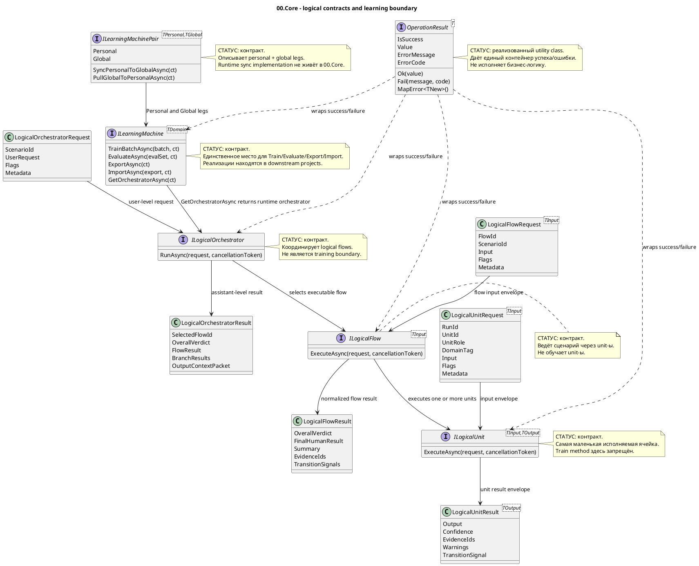

# 00.Core - базовые контракты логических машин

Documentation status: draft/pass-for-D1A-review
Last verified against source: 2026-06-08
Known gaps: runtime implementations live in downstream projects; this document covers 00.Core contracts only.

## 0. Краткая карта для Лубы

`00.Core` - это не место, где модель думает или обучается сама по себе. Это общий словарь контрактов: как любой проект в `llm_mvp_core` должен возвращать успех/ошибку, как одна логическая ячейка получает вход и отдаёт результат, как flow собирает ячейки, как orchestrator выбирает flow, и где начинается настоящий trainable layer. Самое важное правило здесь: `ILogicalUnit`, `ILogicalFlow` и `ILogicalOrchestrator` исполняют логику, но не обучаются; обучение, evaluation, export/import и checkpoint boundary живут только на `ILearningMachine<TDomain>`. В `00.Core` почти всё является interface/DTO contract: реализаций машин здесь нет, поэтому документ не должен выдавать наличие интерфейса за готовую модель.

## 1. Простая UML для draw.io



Легенда:

| Узел | Что делает | Статус | Где живёт |
|---|---|---|---|
| `OperationResult<T>` | Единый результат успеха/ошибки для публичных контрактов | Реализованный utility class | `00.Core/OperationResult.cs` |
| `ILogicalUnit<TInput,TOutput>` | Минимальная исполняемая ячейка: получает typed request, возвращает typed result | Контракт, реализаций в `00.Core` нет | `00.Core/LogicalContracts.cs` |
| `ILogicalFlow<TInput>` | Сценарий, который ведёт данные через один или несколько unit-ов | Контракт, реализаций в `00.Core` нет | `00.Core/LogicalContracts.cs` |
| `ILogicalOrchestrator` | Координатор, который принимает user-level request и выбирает flow | Контракт, реализаций в `00.Core` нет | `00.Core/LogicalContracts.cs` |
| `ILearningMachine<TDomain>` | Внешняя trainable оболочка: train/evaluate/export/import/get orchestrator | Контракт, реализаций в `00.Core` нет | `00.Core/LearningMachineContracts.cs` |
| `ILearningMachinePair<TPersonal,TGlobal>` | Контракт personal/global пары и anonymised sync/pull | Контракт, реализаций в `00.Core` нет | `00.Core/LearningMachineContracts.cs` |

### 1.1 Симуляции по каждой связи UML

| Связь | Пример входа | Симуляция ветки | Ожидаемый результат | Что запрещено принимать за результат |
|---|---|---|---|---|
| `LogicalUnitRequest -> ILogicalUnit` | `RunId="run-42"`, `UnitId="intent"`, `Input="обнови документацию"` | Downstream unit получает envelope с flags и metadata | Unit видит typed input и execution flags | Нельзя передавать raw object без contract envelope |
| `ILogicalUnit -> LogicalUnitResult` | Unit нашёл intent и confidence `0.91` | Unit возвращает `Output`, `Confidence`, `EvidenceIds`, `Warnings` | Следующий слой получает typed result | Нельзя считать это обучением unit-а |
| `LogicalFlowRequest -> ILogicalFlow` | `FlowId="project-doc-flow"`, `ScenarioId="docs"` | Flow получает scenario input и metadata | Flow может выполнить chain unit-ов | Нельзя смешивать это с model training call |
| `ILogicalFlow -> ILogicalUnit` | Flow вызывает intent unit, потом evidence unit | Flow передаёт каждому unit свой `LogicalUnitRequest` | Каждый unit возвращает свой `LogicalUnitResult` | Нельзя прятать train/update внутри unit |
| `ILogicalFlow -> LogicalFlowResult` | Flow собрал answer и metrics | Flow нормализует verdict, final text, evidence ids | Orchestrator получает единый flow result | Нельзя выдавать smoke report за real flow behavior |
| `LogicalOrchestratorRequest -> ILogicalOrchestrator` | `UserRequest="document 00.Core"`, `ScenarioId="project-doc"` | Orchestrator получает user-level request | Orchestrator выбирает flow или возвращает failure | Нельзя принимать JSON-only evidence вместо runtime route |
| `ILogicalOrchestrator -> ILogicalFlow` | Есть binding `project_documentation_pipeline` | Orchestrator выбирает нужный flow по scenario/binding | Flow получает request and metadata | Нельзя делать semantic training decision здесь |
| `ILogicalOrchestrator -> LogicalOrchestratorResult` | Flow вернул `OverallVerdict="ORCHESTRATED"` | Orchestrator добавляет selected flow and context packet | Caller получает assistant-level result | Нельзя считать это checkpoint/export evidence |
| `ILearningMachine -> ILogicalOrchestrator` | Trained domain machine loaded checkpoint | `GetOrchestratorAsync` возвращает runtime orchestrator | Execution path идёт через orchestrator | Нельзя делать вывод, что checkpoint существует, если implementation его не экспортирует |
| `ILearningMachinePair -> ILearningMachine` | Personal leg и Global leg | Pair exposes two `ILearningMachine` instances | Caller может sync/pull через pair contract | Нельзя отправлять raw private prompt в sync |
| `OperationResult -> ILogicalUnit/Flow/Orchestrator/Machine` | Method returns success or fail | Result wraps `Value` or `ErrorMessage/ErrorCode` | Caller checks `IsSuccess` instead of exceptions | Нельзя бросать business exception как нормальный outcome |

## 2. Алгоритмы без кода, по-русски

### 2.1 Возврат успеха или ошибки через `OperationResult<T>`

Аналогия: это как квитанция после действия. На ней либо написано "получилось, вот результат", либо "не получилось, вот причина и код". Caller не должен гадать по exception или null.

Паспорт текущей реализации:

| Поле | Значение |
|---|---|
| Класс | `OperationResult<T>` |
| Метод/функция | `Ok(T value)`, `Fail(string message, string code = "ERROR")`, `MapError<TNew>()` |
| Файл и строка | `00.Core/OperationResult.cs:13`, `00.Core/OperationResult.cs:16`, `00.Core/OperationResult.cs:19` |
| Входные параметры/DTO | `value`, `message`, `code`; пример: `Fail("missing metadata", "MISSING_METADATA")` |
| Выходной DTO/результат | `OperationResult<T>` или `OperationResult<TNew>` with `IsSuccess`, `Value`, `ErrorMessage`, `ErrorCode` |
| Статус | Реализованный utility class |

Шаги текущего алгоритма:

1. Caller выбирает успех или ошибку.
2. `Ok(value)` создаёт result с `IsSuccess=true`, заполненным `Value`, пустыми error fields.
3. `Fail(message, code)` создаёт result с `IsSuccess=false`, `Value=default`, заполненными error fields.
4. `MapError<TNew>()` переносит ту же ошибку на другой generic result type.
5. Caller читает `IsSuccess` и не обязан ловить exception для business outcome.

Ветки и симуляции:

| Ветка | Пример входа | Почему выбирается | Ожидаемый результат | Проверка/QA |
|---|---|---|---|---|
| Success | `Ok("done")` | Действие завершилось успешно | `IsSuccess=true`, `Value="done"` | source sanity + downstream tests |
| Fail | `Fail("bad request", "BAD_REQUEST")` | Контрактное нарушение | `IsSuccess=false`, `ErrorCode="BAD_REQUEST"` | source sanity + downstream tests |
| Map error | `OperationResult<int>.Fail(...).MapError<string>()` | Caller меняет return type, сохраняя ошибку | Новый result с тем же message/code | source sanity + downstream tests |

Что НЕ делает:

- не запускает recovery;
- не логирует;
- не исполняет бизнес-логику;
- не доказывает, что downstream method корректно обработал ошибку.

### 2.2 Исполнение одной logical unit

Аналогия: unit - это один рабочий стол на конвейере. На стол приходит коробка с ярлыками (`RunId`, `UnitId`, flags, metadata) и содержимым (`Input`), а назад уходит коробка с результатом, уверенностью, evidence и warnings.

Паспорт текущей реализации:

| Поле | Значение |
|---|---|
| Класс/интерфейс | `ILogicalUnit<TInput,TOutput>` |
| Метод/функция | `ExecuteAsync(LogicalUnitRequest<TInput> request, CancellationToken cancellationToken = default)` |
| Файл и строка | `00.Core/LogicalContracts.cs:97` |
| Входные параметры/DTO | `LogicalUnitRequest<TInput>` with `RunId`, `UnitId`, `UnitRole`, `DomainTag`, `Input`, `Flags`, `Metadata` |
| Выходной DTO/результат | `OperationResult<LogicalUnitResult<TOutput>>` |
| Статус | Контракт; реализаций в `00.Core` нет |

Шаги текущего алгоритма:

1. Downstream implementation получает `LogicalUnitRequest<TInput>`.
2. Implementation читает typed `Input`, flags and metadata.
3. Implementation выполняет один bounded step.
4. Implementation возвращает `LogicalUnitResult<TOutput>` внутри `OperationResult`.
5. Если нужна advisory transition, result может иметь `TransitionSignal`; null значит "follow-up transition не нужен".

Ветки и симуляции:

| Ветка | Пример входа | Почему выбирается | Ожидаемый результат | Проверка/QA |
|---|---|---|---|---|
| Normal result | `Input="document 00.Core"` | Unit смог выполнить bounded step | `Output=<typed result>`, confidence/evidence заполнены | downstream unit tests |
| Advisory transition | Unit завершил branch и хочет re-enter orchestration | Implementation ставит `TransitionSignal` | Flow/orchestrator может прочитать suggested domain | downstream integration tests |
| Failure | Metadata missing | Implementation возвращает `OperationResult.Fail` | Caller получает error code | downstream negative tests |

Что НЕ делает:

- `ILogicalUnit` не содержит `TrainBatchAsync`;
- `ILogicalUnit` не экспортирует checkpoint;
- наличие interface не доказывает, что конкретная unit implementation существует.

### 2.3 Исполнение logical flow

Аналогия: flow - это маршрут по нескольким рабочим столам. Он знает, какие unit-ы вызвать и как собрать их results в один понятный ответ.

Паспорт текущей реализации:

| Поле | Значение |
|---|---|
| Класс/интерфейс | `ILogicalFlow<TInput>` |
| Метод/функция | `ExecuteAsync(LogicalFlowRequest<TInput> request, CancellationToken cancellationToken = default)` |
| Файл и строка | `00.Core/LogicalContracts.cs:166` |
| Входные параметры/DTO | `LogicalFlowRequest<TInput>` with `RunId`, `FlowId`, `ScenarioId`, `Input`, `Flags`, `Metadata` |
| Выходной DTO/результат | `OperationResult<LogicalFlowResult>` |
| Статус | Контракт; реализаций в `00.Core` нет |

Шаги текущего алгоритма:

1. Downstream flow получает `LogicalFlowRequest<TInput>`.
2. Flow выбирает одну или несколько logical units.
3. Flow передаёт unit-ам typed request envelopes.
4. Flow собирает `LogicalFlowResult`: verdict, final human result, summary, metrics, evidence ids, warnings.
5. Flow может вернуть `TransitionSignals`, если branch просит следующий orchestration turn.

Ветки и симуляции:

| Ветка | Пример входа | Почему выбирается | Ожидаемый результат | Проверка/QA |
|---|---|---|---|---|
| Flow pass | `ScenarioId="project-doc"` | Все unit steps дали enough evidence | `OverallVerdict="ORCHESTRATED"` or domain verdict | downstream flow tests |
| Needs evidence | Unit warnings/evidence gap present | Flow не может честно claim success | `OverallVerdict` говорит о gap | downstream negative/integration tests |
| Transition requested | Unit emitted transition signal | Flow carries signal outward | `TransitionSignals` non-empty | downstream orchestration tests |

Что НЕ делает:

- Flow не обучает unit-ы;
- Flow не является checkpoint owner;
- Flow result не заменяет runner/model metrics.

### 2.4 Координация logical flows через orchestrator

Аналогия: orchestrator - диспетчер. Ему приходит просьба пользователя, он выбирает нужный маршрут, запускает flow и возвращает общий результат.

Паспорт текущей реализации:

| Поле | Значение |
|---|---|
| Класс/интерфейс | `ILogicalOrchestrator` |
| Метод/функция | `RunAsync(LogicalOrchestratorRequest request, CancellationToken cancellationToken = default)` |
| Файл и строка | `00.Core/LogicalContracts.cs:202` |
| Входные параметры/DTO | `LogicalOrchestratorRequest` with `RunId`, `ScenarioId`, `UserRequest`, `Flags`, `Metadata` |
| Выходной DTO/результат | `OperationResult<LogicalOrchestratorResult>` |
| Статус | Контракт; реализаций в `00.Core` нет |

Шаги текущего алгоритма:

1. Downstream orchestrator receives user-level request.
2. It applies or fills `LogicalExecutionFlags`.
3. It selects a bound `ILogicalFlow`.
4. It runs the flow and receives `LogicalFlowResult`.
5. It returns `LogicalOrchestratorResult` with selected flow, final result, branch results and optional output context packet.

Ветки и симуляции:

| Ветка | Пример входа | Почему выбирается | Ожидаемый результат | Проверка/QA |
|---|---|---|---|---|
| Known scenario | `ScenarioId="project-wiki-orchestration-flow"` | Binding exists downstream | `SelectedFlowId` names the flow | downstream orchestrator tests |
| Missing binding | Unknown scenario | No safe route exists | `OperationResult.Fail` expected downstream | downstream negative tests |
| Multi-branch | Several branch results | Orchestrator aggregates context | `BranchResults` and `OutputContextPacket` set | downstream integration tests |

Что НЕ делает:

- Orchestrator не является model trainer;
- Orchestrator не должен скрывать deterministic shortcut as trainable decision;
- `00.Core` не содержит implementation выбора flow.

### 2.5 Trainable boundary через `ILearningMachine<TDomain>`

Аналогия: если unit/flow/orchestrator - это рабочий конвейер, то `ILearningMachine` - мастерская, где конвейер обучают, проверяют, упаковывают checkpoint и потом выдают готовый runtime orchestrator.

Паспорт текущей реализации:

| Поле | Значение |
|---|---|
| Класс/интерфейс | `ILearningMachine<TDomain>` |
| Метод/функция | `TrainBatchAsync`, `EvaluateAsync`, `ExportAsync`, `ImportAsync`, `GetOrchestratorAsync` |
| Файл и строка | `00.Core/LearningMachineContracts.cs:208` |
| Входные параметры/DTO | `LearningBatch<TDomain>`, `LearningEvaluationSet<TDomain>`, `LearningMachineExport`, `CancellationToken` |
| Выходной DTO/результат | `OperationResult<LearningBatchResult>`, `OperationResult<LearningEvaluationResult>`, `OperationResult<LearningMachineExport>`, `OperationResult<bool>`, `OperationResult<ILogicalOrchestrator>` |
| Статус | Контракт; domain implementations live downstream |

Шаги текущего алгоритма:

1. `TrainBatchAsync` accepts DPO training batch and must return before/after metrics.
2. `EvaluateAsync` measures held-out set without modifying weights.
3. `ExportAsync` returns checkpoint/manifest references for portability.
4. `ImportAsync` applies an external checkpoint.
5. `GetOrchestratorAsync` exposes execution-time orchestrator backed by current state.

Ветки и симуляции:

| Ветка | Пример входа | Почему выбирается | Ожидаемый результат | Проверка/QA |
|---|---|---|---|---|
| Train | `LearningBatch` with 20 DPO rows | Caller is updating trained state | `LearningBatchResult` with numeric metrics | downstream training runner tests |
| Evaluate | Held-out 50 rows | Caller needs gate evidence | `LearningEvaluationResult.PassesGate` true/false | downstream evaluation tests |
| Export | Current checkpoint exists | Caller needs portable model asset | `LearningMachineExport` with checkpoint and manifest refs | downstream asset lifecycle tests |
| Import | Export record supplied | Caller restores or upgrades model | `OperationResult<bool>.Ok(true)` if applied | downstream import/fresh-load tests |
| Runtime | Trained state loaded | Caller needs execution path | `OperationResult<ILogicalOrchestrator>` | downstream e2e/orchestrator tests |

Что НЕ делает:

- `00.Core` does not train any model by itself;
- `ILearningMachine` contract does not prove checkpoint exists;
- JSON/report presence cannot replace implementation of train/evaluate/export/import in a domain machine.

### 2.6 Personal/global split through `ILearningMachinePair<TPersonal,TGlobal>`

Аналогия: есть личная записная книжка пользователя и общая библиотека. Личная книжка может учиться на пользовательских данных; в общую библиотеку уходят только anonymised signals.

Паспорт текущей реализации:

| Поле | Значение |
|---|---|
| Класс/интерфейс | `ILearningMachinePair<TPersonal,TGlobal>` |
| Метод/функция | `Personal`, `Global`, `SyncPersonalToGlobalAsync(CancellationToken ct = default)`, `PullGlobalToPersonalAsync(CancellationToken ct = default)` |
| Файл и строка | `00.Core/LearningMachineContracts.cs:245` |
| Входные параметры/DTO | `CancellationToken`; concrete sync DTO is downstream responsibility |
| Выходной DTO/результат | `ILearningMachine<TPersonal>`, `ILearningMachine<TGlobal>`, `OperationResult<bool>` |
| Статус | Контракт; runtime sync/pull implementation не находится в `00.Core` |

Шаги текущего алгоритма:

1. Pair exposes `Personal` machine and `Global` machine.
2. `SyncPersonalToGlobalAsync` is required to send only anonymised training signals.
3. `PullGlobalToPersonalAsync` is required to apply latest global checkpoint to personal machine.
4. Concrete storage, transport, backup/restore and validation are implemented outside `00.Core`.

Ветки и симуляции:

| Ветка | Пример входа | Почему выбирается | Ожидаемый результат | Проверка/QA |
|---|---|---|---|---|
| Personal access | User asks local adaptive behavior | Caller reads `Personal` | Personal machine is used on device | downstream user-adaptive tests |
| Global access | Server/common update | Caller reads `Global` | Global machine is used as shared state | downstream server tests |
| Sync | Local feedback approved for sharing | Anonymised signal can be sent | `OperationResult<bool>` with success/failure | downstream privacy/sync tests |
| Pull | New common checkpoint available | Personal machine can benefit | `OperationResult<bool>` after applying checkpoint | downstream fresh-load tests |

Что НЕ делает:

- не разрешает raw private prompts in sync;
- не доказывает backup/export/restore package exists;
- не заменяет user approval policy or asset lifecycle.

## 3. Где логика сидит в коде

| Логика | Файл | Почему это место важно | Что доказывает | Чего не доказывает |
|---|---|---|---|---|
| Result wrapper | `00.Core/OperationResult.cs:3` | Единственный concrete utility class in 00.Core | Success/fail wrapper exists | Downstream error handling correctness |
| Unit/flow/orchestrator contracts | `00.Core/LogicalContracts.cs:61` | Defines runtime execution envelopes and interfaces | Typed runtime boundaries exist | Concrete implementations |
| Trust scorer contract | `00.Core/LogicalContracts.cs:209` | Shared scoring contract consumed elsewhere | Contract surface exists | Scoring algorithm implementation |
| Learning machine contracts | `00.Core/LearningMachineContracts.cs:16` | Defines training/evaluation/export/import DTOs | Trainable boundary DTOs exist | Any trained model readiness |
| Five-level hierarchy | `00.Core/LearningMachineContracts.cs:193` | Names learning machine above orchestrator/flow/unit | Training boundary is separated | Domain machine implementation quality |
| Personal/global pair | `00.Core/LearningMachineContracts.cs:240` | Names adaptive/common split contract | Sync/pull boundary exists | Runtime sync implementation |
| Project setup | `00.Core/Core.csproj:4` | Targets `.NET 9` and references semantic compiler domain enum | Build target/dependency declared | Runtime behavior |

## 4. Короткие важные цитаты кода

> **WHY:** Это базовый contract для fail-fast без business exceptions. `Ok` and `Fail` set all fields through one private constructor, so callers can inspect one shape.
>
> **HOW:** Success stores value and empty error fields; failure stores default value and error message/code.
>
> **WHAT:** This proves the wrapper exists. It does not prove every downstream method uses it correctly.

```csharp
// 00.Core/OperationResult.cs:13-17
public static OperationResult<T> Ok(T value)
    => new(true, value, "", "");

public static OperationResult<T> Fail(string message, string code = "ERROR")
    => new(false, default, message, code);
```

> **WHY:** This is the exact execution boundary for a single logical unit. It receives a typed request and must return a typed result wrapped in `OperationResult`.
>
> **HOW:** The interface has only `ExecuteAsync`; there is no train/export method here.
>
> **WHAT:** This proves units execute. It does not prove units can train themselves.

```csharp
// 00.Core/LogicalContracts.cs:96-102
public interface ILogicalUnit<TInput, TOutput>
{
    Task<OperationResult<LogicalUnitResult<TOutput>>> ExecuteAsync(
        LogicalUnitRequest<TInput> request,
        CancellationToken cancellationToken = default);
}
```

> **WHY:** This line is the locked separation rule in code comments: training belongs above runtime execution contracts.
>
> **HOW:** The file declares `TrainBatchAsync` only later on `ILearningMachine<TDomain>`.
>
> **WHAT:** This proves the intended boundary in `00.Core`; downstream code still must obey it.

```csharp
// 00.Core/LearningMachineContracts.cs:7-8
// Design rule A-LM-01: ILearningMachine sits above ILogicalOrchestrator.
// Design rule A-LM-02: Train() is ONLY on ILearningMachine — never on ILogicalUnit or ILogicalFlow.
```

> **WHY:** These methods define the full trainable asset lifecycle: train, evaluate, export, import, then expose runtime orchestrator.
>
> **HOW:** The interface returns measured DTOs and model transfer references, not just a boolean "trained".
>
> **WHAT:** This proves the contract requires lifecycle methods. It does not prove any domain implementation has valid checkpoints.

```csharp
// 00.Core/LearningMachineContracts.cs:208-233
public interface ILearningMachine<TDomain>
{
    Task<OperationResult<LearningBatchResult>> TrainBatchAsync(
        LearningBatch<TDomain> batch, CancellationToken ct = default);
    Task<OperationResult<LearningEvaluationResult>> EvaluateAsync(
        LearningEvaluationSet<TDomain> evalSet, CancellationToken ct = default);
    Task<OperationResult<LearningMachineExport>> ExportAsync(
        CancellationToken ct = default);
    Task<OperationResult<bool>> ImportAsync(
        LearningMachineExport export, CancellationToken ct = default);
    Task<OperationResult<ILogicalOrchestrator>> GetOrchestratorAsync(
        CancellationToken ct = default);
}
```

> **WHY:** This is the privacy boundary for personal/global learning. The contract says sync sends only anonymised training signals.
>
> **HOW:** Pair exposes two machine legs and separate sync/pull methods.
>
> **WHAT:** This proves the pair contract exists. It does not prove backup/restore or transport is implemented.

```csharp
// 00.Core/LearningMachineContracts.cs:245-260
public interface ILearningMachinePair<TPersonal, TGlobal>
{
    ILearningMachine<TPersonal> Personal { get; }
    ILearningMachine<TGlobal> Global { get; }
    Task<OperationResult<bool>> SyncPersonalToGlobalAsync(CancellationToken ct = default);
    Task<OperationResult<bool>> PullGlobalToPersonalAsync(CancellationToken ct = default);
}
```

## 5. Test, e2e и QA mapping

| Поведение | Уровень проверки | Текущий evidence | Статус | Следующий work order если gap |
|---|---|---|---|---|
| `OperationResult.Ok/Fail/MapError` shape | unit | Source contract read in D1A; downstream tests should cover usage | gap-for-00-core-direct-tests | Add targeted contract tests if required by later test phase |
| `ILogicalUnit` execution envelope | integration/downstream | Implementations live in downstream projects, not in `00.Core` | covered-by-downstream-required | D1/D4/D5 docs must cite concrete implementations |
| `ILogicalFlow` result and transition signals | integration/downstream | Contract exists; runtime behavior downstream | covered-by-downstream-required | D4/D5 docs must map concrete flows |
| `ILogicalOrchestrator` selected flow result | integration/e2e | Contract exists; runtime behavior downstream | covered-by-downstream-required | D4/D5 docs must map concrete orchestrators |
| Training only on `ILearningMachine` | static/source sanity | Interface list shows Train/Evaluate/Export/Import only on learning machine | covered-by-source | Later code review may grep no `Train` on unit/flow interfaces |
| `ILearningMachinePair` privacy boundary | privacy/integration | Contract comments require anonymised signals | gap-runtime-sync | Downstream personal/global implementation doc must prove sync payload |

No `dotnet` checks were run for this documentation-only work order.

## 6. Anti-false-done checks

| Gate | 00.Core result |
|---|---|
| Human-readable | This document explains 00.Core as contracts and boundaries, not just class names |
| UML | PlantUML diagram provided |
| UML simulations | Every UML connection has a concrete simulation row |
| Algorithms | Each contract algorithm names interface/class, method, parameters, output and current behavior |
| Code refs | Short quotations include exact source line references and WHY/HOW/WHAT explanation |
| Status honesty | Interfaces are labelled as contracts; no implementation is claimed inside 00.Core |
| No JSON-only done | JSON/report/smoke evidence is explicitly not accepted as runtime implementation |
| No hidden deterministic shortcut | `00.Core` has no BM25/KNN/regex routing implementation; downstream docs must label such helpers honestly |
| Trainable claim | `ILearningMachine` is only a contract; trained feature readiness requires downstream checkpoint/manifest/locator/evidence |
| Testability | Contract gaps and downstream verification responsibilities are named |

## 7. Status table

| Компонент | Файл | Статус | Что реально работает сейчас |
|---|---|---|---|
| `OperationResult<T>` | `00.Core/OperationResult.cs` | ✅ Полная | `Ok`, `Fail`, `MapError` construct consistent success/error wrappers |
| `LogicalExecutionFlags` | `00.Core/LogicalContracts.cs` | ✅ Hardcoded contract defaults | Defines optimization/safety/experiment flag names and default boolean values |
| `ILogicalUnit<TInput,TOutput>` | `00.Core/LogicalContracts.cs` | ✅ Полная contract | Declares `ExecuteAsync(LogicalUnitRequest<TInput>, CancellationToken)`; no training methods |
| `ILogicalFlow<TInput>` | `00.Core/LogicalContracts.cs` | ✅ Полная contract | Declares `ExecuteAsync(LogicalFlowRequest<TInput>, CancellationToken)`; returns `LogicalFlowResult` |
| `ILogicalOrchestrator` | `00.Core/LogicalContracts.cs` | ✅ Полная contract | Declares `RunAsync(LogicalOrchestratorRequest, CancellationToken)`; runtime implementation downstream |
| `ITrustScorer` | `00.Core/LogicalContracts.cs` | ✅ Полная contract | Declares `Score(SourceFeatures)` returning `OperationResult<TrustScorerOutput>` |
| `LearningBatch` and training DTOs | `00.Core/LearningMachineContracts.cs` | ✅ Полная contract | Define DPO rows, batch metrics, evaluation metrics and export record shape |
| `ILearningMachine<TDomain>` | `00.Core/LearningMachineContracts.cs` | ✅ Полная contract | Declares train/evaluate/export/import/get-orchestrator boundary; no implementation here |
| `ILearningMachinePair<TPersonal,TGlobal>` | `00.Core/LearningMachineContracts.cs` | ✅ Полная contract | Declares personal/global legs and anonymised sync/pull methods; no runtime transport here |

## 8. Five-level hierarchy

```text
Уровень 5: ILearningMachine<TDomain>
  Принимает: LearningBatch<TDomain>, LearningEvaluationSet<TDomain>, LearningMachineExport
  Возвращает: LearningBatchResult, LearningEvaluationResult, LearningMachineExport, bool, ILogicalOrchestrator
  Роль: единственный train/evaluate/export/import boundary для domain machine.

Уровень 4: ILogicalOrchestrator
  Принимает: LogicalOrchestratorRequest(RunId, ScenarioId, UserRequest, Flags, Metadata)
  Возвращает: LogicalOrchestratorResult(SelectedFlowId, OverallVerdict, FinalHumanResult, FlowResult)
  Роль: выбирает и запускает logical flow.

Уровень 3: ILogicalFlow<TInput>
  Принимает: LogicalFlowRequest<TInput>(RunId, FlowId, ScenarioId, Input, Flags, Metadata)
  Возвращает: LogicalFlowResult(OverallVerdict, FinalHumanResult, Summary, Metrics, EvidenceIds)
  Роль: ведёт один сценарий через unit chain.

Уровень 2: ILogicalUnit<TInput,TOutput>
  Принимает: LogicalUnitRequest<TInput>(RunId, UnitId, UnitRole, DomainTag, Input, Flags, Metadata)
  Возвращает: LogicalUnitResult<TOutput>(Output, Confidence, EvidenceIds, Warnings)
  Роль: выполняет один bounded step.

Уровень 1: ILearningMachinePair<TPersonal,TGlobal>
  Принимает: two ILearningMachine legs plus CancellationToken for sync/pull
  Возвращает: Personal, Global, OperationResult<bool> for sync/pull
  Роль: разделяет user personal/adaptive и common/global state.
```

Training boundary:

```text
LearningBatch<TDomain>
  -> ILearningMachine<TDomain>.TrainBatchAsync(...)
  -> LearningBatchResult(metrics)
  -> ILearningMachine<TDomain>.ExportAsync(...)
  -> LearningMachineExport(checkpointRef, manifestRef)
  -> ILearningMachine<TDomain>.GetOrchestratorAsync(...)
  -> ILogicalOrchestrator.RunAsync(...)
  -> ILogicalFlow.ExecuteAsync(...)
  -> ILogicalUnit.ExecuteAsync(...)
```

Важно: обратного пути "unit trains itself" нет. Если downstream project claims a trained unit, доказательство должно быть в domain machine implementation, model asset lifecycle, runner metrics and load/import evidence, not in `00.Core`.

## 9. Источники и drift check

Прочитанные source files:

- `00.Core/OperationResult.cs`
- `00.Core/LogicalContracts.cs`
- `00.Core/LearningMachineContracts.cs`
- `00.Core/Core.csproj`

Сверено с:

- `docs/plans/PROJECT-DOCUMENTATION-UPDATE-PLAN-v1.md`
- `docs/projects/PROJECT-DOCUMENTATION-TEMPLATE.md`
- `docs/skills/implementation-doc-uml-SKILL.md`
- `docs/skills/implementation-doc-algorithms-SKILL.md`
- `docs/skills/implementation-doc-code-refs-SKILL.md`
- `docs/skills/implementation-doc-status-SKILL.md`
- `docs/skills/implementation-doc-hierarchy-SKILL.md`

