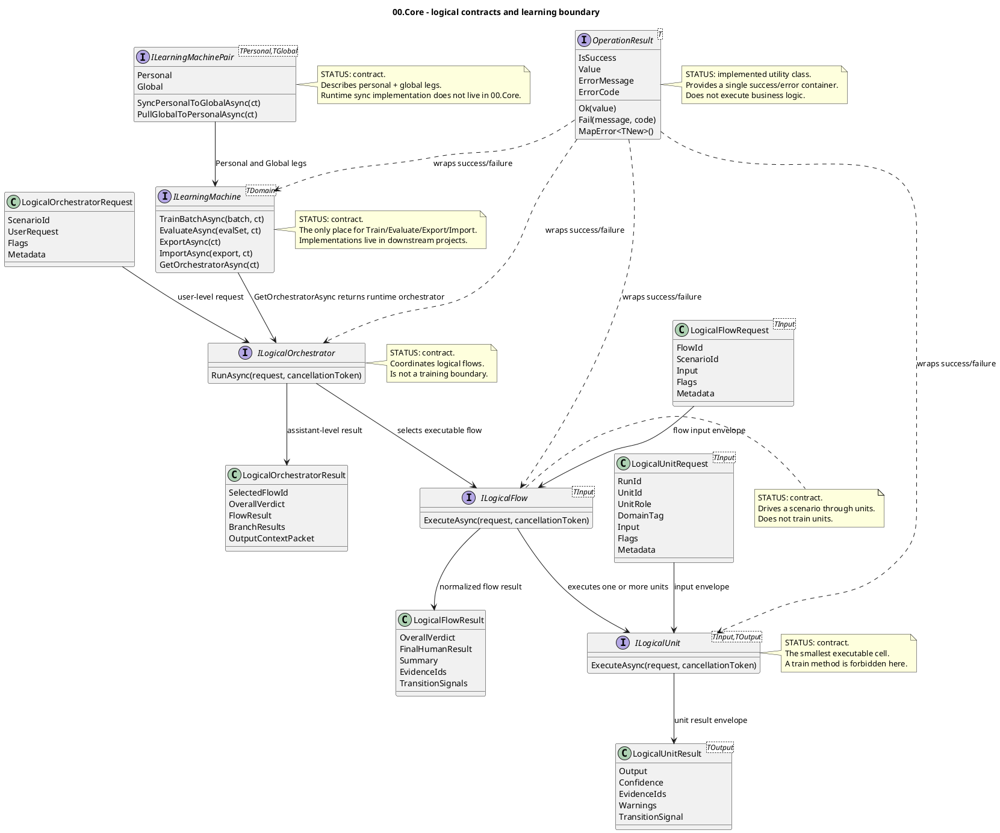

# 00.Core - base contracts for logical machines

Documentation status: draft/pass-for-D1A-review
Last verified against source: 2026-06-08
Known gaps: runtime implementations live in downstream projects; this document covers 00.Core contracts only.

## 0. Quick map for Luba

`00.Core` is not the place where a model thinks or trains on its own. It is a shared vocabulary of contracts: how any project in `llm_mvp_core` must return success/failure, how a single logical cell receives input and returns a result, how a flow assembles cells, how an orchestrator selects a flow, and where the real trainable layer begins. The most important rule here: `ILogicalUnit`, `ILogicalFlow` and `ILogicalOrchestrator` execute logic but do not train; training, evaluation, export/import and the checkpoint boundary live only on `ILearningMachine<TDomain>`. In `00.Core` almost everything is an interface/DTO contract: there are no machine implementations here, so this document must not present the existence of an interface as a finished model.

## 1. Simple UML for draw.io



Legend:

| Node | What it does | Status | Where it lives |
|---|---|---|---|
| `OperationResult<T>` | Single success/error result for public contracts | Implemented utility class | `00.Core/OperationResult.cs` |
| `ILogicalUnit<TInput,TOutput>` | Minimal executable cell: receives a typed request, returns a typed result | Contract, no implementations in `00.Core` | `00.Core/LogicalContracts.cs` |
| `ILogicalFlow<TInput>` | A scenario that drives data through one or more units | Contract, no implementations in `00.Core` | `00.Core/LogicalContracts.cs` |
| `ILogicalOrchestrator` | Coordinator that accepts a user-level request and selects a flow | Contract, no implementations in `00.Core` | `00.Core/LogicalContracts.cs` |
| `ILearningMachine<TDomain>` | External trainable wrapper: train/evaluate/export/import/get orchestrator | Contract, no implementations in `00.Core` | `00.Core/LearningMachineContracts.cs` |
| `ILearningMachinePair<TPersonal,TGlobal>` | Contract for the personal/global pair and anonymised sync/pull | Contract, no implementations in `00.Core` | `00.Core/LearningMachineContracts.cs` |

### 1.1 Simulations for each UML connection

| Connection | Example input | Branch simulation | Expected result | What must not be taken as a result |
|---|---|---|---|---|
| `LogicalUnitRequest -> ILogicalUnit` | `RunId="run-42"`, `UnitId="intent"`, `Input="update the documentation"` | Downstream unit receives an envelope with flags and metadata | Unit sees typed input and execution flags | A raw object must not be passed without a contract envelope |
| `ILogicalUnit -> LogicalUnitResult` | Unit found intent and confidence `0.91` | Unit returns `Output`, `Confidence`, `EvidenceIds`, `Warnings` | The next layer receives a typed result | This must not be treated as training the unit |
| `LogicalFlowRequest -> ILogicalFlow` | `FlowId="project-doc-flow"`, `ScenarioId="docs"` | Flow receives scenario input and metadata | Flow can execute a chain of units | This must not be mixed with a model training call |
| `ILogicalFlow -> ILogicalUnit` | Flow calls the intent unit, then the evidence unit | Flow passes each unit its own `LogicalUnitRequest` | Each unit returns its own `LogicalUnitResult` | Hiding train/update inside a unit is not allowed |
| `ILogicalFlow -> LogicalFlowResult` | Flow assembled the answer and metrics | Flow normalizes verdict, final text, evidence ids | Orchestrator receives a single flow result | A smoke report must not be presented as real flow behavior |
| `LogicalOrchestratorRequest -> ILogicalOrchestrator` | `UserRequest="document 00.Core"`, `ScenarioId="project-doc"` | Orchestrator receives a user-level request | Orchestrator selects a flow or returns failure | JSON-only evidence must not be accepted instead of a runtime route |
| `ILogicalOrchestrator -> ILogicalFlow` | A binding `project_documentation_pipeline` exists | Orchestrator selects the right flow by scenario/binding | Flow receives request and metadata | A semantic training decision must not be made here |
| `ILogicalOrchestrator -> LogicalOrchestratorResult` | Flow returned `OverallVerdict="ORCHESTRATED"` | Orchestrator adds the selected flow and context packet | Caller receives an assistant-level result | This must not be treated as checkpoint/export evidence |
| `ILearningMachine -> ILogicalOrchestrator` | Trained domain machine loaded checkpoint | `GetOrchestratorAsync` returns a runtime orchestrator | Execution path goes through the orchestrator | One must not conclude a checkpoint exists if the implementation does not export it |
| `ILearningMachinePair -> ILearningMachine` | Personal leg and Global leg | Pair exposes two `ILearningMachine` instances | Caller can sync/pull through the pair contract | A raw private prompt must not be sent in sync |
| `OperationResult -> ILogicalUnit/Flow/Orchestrator/Machine` | Method returns success or fail | Result wraps `Value` or `ErrorMessage/ErrorCode` | Caller checks `IsSuccess` instead of exceptions | A business exception must not be thrown as a normal outcome |

## 2. No-code algorithms, in the operator's language

### 2.1 Returning success or failure via `OperationResult<T>`

Analogy: it is like a receipt after an action. It either says "it worked, here is the result" or "it did not work, here is the reason and code". The caller should not have to guess from an exception or null.

Passport of the current implementation:

| Field | Value |
|---|---|
| Class | `OperationResult<T>` |
| Method/function | `Ok(T value)`, `Fail(string message, string code = "ERROR")`, `MapError<TNew>()` |
| File and line | `00.Core/OperationResult.cs:13`, `00.Core/OperationResult.cs:16`, `00.Core/OperationResult.cs:19` |
| Input parameters/DTO | `value`, `message`, `code`; example: `Fail("missing metadata", "MISSING_METADATA")` |
| Output DTO/result | `OperationResult<T>` or `OperationResult<TNew>` with `IsSuccess`, `Value`, `ErrorMessage`, `ErrorCode` |
| Status | Implemented utility class |

Steps of the current algorithm:

1. The caller chooses success or failure.
2. `Ok(value)` creates a result with `IsSuccess=true`, a filled `Value`, and empty error fields.
3. `Fail(message, code)` creates a result with `IsSuccess=false`, `Value=default`, and filled error fields.
4. `MapError<TNew>()` carries the same error onto a different generic result type.
5. The caller reads `IsSuccess` and is not required to catch an exception for a business outcome.

Branches and simulations:

| Branch | Example input | Why it is chosen | Expected result | Check/QA |
|---|---|---|---|---|
| Success | `Ok("done")` | The action completed successfully | `IsSuccess=true`, `Value="done"` | source sanity + downstream tests |
| Fail | `Fail("bad request", "BAD_REQUEST")` | Contract violation | `IsSuccess=false`, `ErrorCode="BAD_REQUEST"` | source sanity + downstream tests |
| Map error | `OperationResult<int>.Fail(...).MapError<string>()` | Caller changes the return type while keeping the error | New result with the same message/code | source sanity + downstream tests |

What it does NOT do:

- does not start recovery;
- does not log;
- does not execute business logic;
- does not prove that a downstream method handled the error correctly.

### 2.2 Executing a single logical unit

Analogy: a unit is a single workbench on a conveyor. A box arrives at the bench with labels (`RunId`, `UnitId`, flags, metadata) and contents (`Input`), and a box goes back with a result, confidence, evidence and warnings.

Passport of the current implementation:

| Field | Value |
|---|---|
| Class/interface | `ILogicalUnit<TInput,TOutput>` |
| Method/function | `ExecuteAsync(LogicalUnitRequest<TInput> request, CancellationToken cancellationToken = default)` |
| File and line | `00.Core/LogicalContracts.cs:97` |
| Input parameters/DTO | `LogicalUnitRequest<TInput>` with `RunId`, `UnitId`, `UnitRole`, `DomainTag`, `Input`, `Flags`, `Metadata` |
| Output DTO/result | `OperationResult<LogicalUnitResult<TOutput>>` |
| Status | Contract; no implementations in `00.Core` |

Steps of the current algorithm:

1. The downstream implementation receives a `LogicalUnitRequest<TInput>`.
2. The implementation reads the typed `Input`, flags and metadata.
3. The implementation performs one bounded step.
4. The implementation returns a `LogicalUnitResult<TOutput>` inside an `OperationResult`.
5. If an advisory transition is needed, the result can carry a `TransitionSignal`; null means "no follow-up transition needed".

Branches and simulations:

| Branch | Example input | Why it is chosen | Expected result | Check/QA |
|---|---|---|---|---|
| Normal result | `Input="document 00.Core"` | Unit was able to perform the bounded step | `Output=<typed result>`, confidence/evidence filled | downstream unit tests |
| Advisory transition | Unit finished a branch and wants to re-enter orchestration | Implementation sets `TransitionSignal` | Flow/orchestrator can read the suggested domain | downstream integration tests |
| Failure | Metadata missing | Implementation returns `OperationResult.Fail` | Caller receives an error code | downstream negative tests |

What it does NOT do:

- `ILogicalUnit` does not contain `TrainBatchAsync`;
- `ILogicalUnit` does not export a checkpoint;
- the existence of the interface does not prove that a concrete unit implementation exists.

### 2.3 Executing a logical flow

Analogy: a flow is a route across several workbenches. It knows which units to call and how to assemble their results into one understandable answer.

Passport of the current implementation:

| Field | Value |
|---|---|
| Class/interface | `ILogicalFlow<TInput>` |
| Method/function | `ExecuteAsync(LogicalFlowRequest<TInput> request, CancellationToken cancellationToken = default)` |
| File and line | `00.Core/LogicalContracts.cs:166` |
| Input parameters/DTO | `LogicalFlowRequest<TInput>` with `RunId`, `FlowId`, `ScenarioId`, `Input`, `Flags`, `Metadata` |
| Output DTO/result | `OperationResult<LogicalFlowResult>` |
| Status | Contract; no implementations in `00.Core` |

Steps of the current algorithm:

1. The downstream flow receives a `LogicalFlowRequest<TInput>`.
2. The flow selects one or more logical units.
3. The flow passes the units typed request envelopes.
4. The flow assembles a `LogicalFlowResult`: verdict, final human result, summary, metrics, evidence ids, warnings.
5. The flow can return `TransitionSignals` if a branch requests the next orchestration turn.

Branches and simulations:

| Branch | Example input | Why it is chosen | Expected result | Check/QA |
|---|---|---|---|---|
| Flow pass | `ScenarioId="project-doc"` | All unit steps gave enough evidence | `OverallVerdict="ORCHESTRATED"` or domain verdict | downstream flow tests |
| Needs evidence | Unit warnings/evidence gap present | Flow cannot honestly claim success | `OverallVerdict` reports a gap | downstream negative/integration tests |
| Transition requested | Unit emitted transition signal | Flow carries signal outward | `TransitionSignals` non-empty | downstream orchestration tests |

What it does NOT do:

- The flow does not train units;
- The flow is not a checkpoint owner;
- The flow result does not replace runner/model metrics.

### 2.4 Coordinating logical flows through the orchestrator

Analogy: the orchestrator is a dispatcher. A user request comes in, it selects the right route, runs the flow and returns an overall result.

Passport of the current implementation:

| Field | Value |
|---|---|
| Class/interface | `ILogicalOrchestrator` |
| Method/function | `RunAsync(LogicalOrchestratorRequest request, CancellationToken cancellationToken = default)` |
| File and line | `00.Core/LogicalContracts.cs:202` |
| Input parameters/DTO | `LogicalOrchestratorRequest` with `RunId`, `ScenarioId`, `UserRequest`, `Flags`, `Metadata` |
| Output DTO/result | `OperationResult<LogicalOrchestratorResult>` |
| Status | Contract; no implementations in `00.Core` |

Steps of the current algorithm:

1. Downstream orchestrator receives user-level request.
2. It applies or fills `LogicalExecutionFlags`.
3. It selects a bound `ILogicalFlow`.
4. It runs the flow and receives `LogicalFlowResult`.
5. It returns `LogicalOrchestratorResult` with selected flow, final result, branch results and optional output context packet.

Branches and simulations:

| Branch | Example input | Why it is chosen | Expected result | Check/QA |
|---|---|---|---|---|
| Known scenario | `ScenarioId="project-wiki-orchestration-flow"` | Binding exists downstream | `SelectedFlowId` names the flow | downstream orchestrator tests |
| Missing binding | Unknown scenario | No safe route exists | `OperationResult.Fail` expected downstream | downstream negative tests |
| Multi-branch | Several branch results | Orchestrator aggregates context | `BranchResults` and `OutputContextPacket` set | downstream integration tests |

What it does NOT do:

- The orchestrator is not a model trainer;
- The orchestrator must not hide a deterministic shortcut as a trainable decision;
- `00.Core` does not contain a flow-selection implementation.

### 2.5 Trainable boundary through `ILearningMachine<TDomain>`

Analogy: if unit/flow/orchestrator is the working conveyor, then `ILearningMachine` is the workshop where the conveyor is trained, evaluated, packed into a checkpoint and then handed out as a ready runtime orchestrator.

Passport of the current implementation:

| Field | Value |
|---|---|
| Class/interface | `ILearningMachine<TDomain>` |
| Method/function | `TrainBatchAsync`, `EvaluateAsync`, `ExportAsync`, `ImportAsync`, `GetOrchestratorAsync` |
| File and line | `00.Core/LearningMachineContracts.cs:208` |
| Input parameters/DTO | `LearningBatch<TDomain>`, `LearningEvaluationSet<TDomain>`, `LearningMachineExport`, `CancellationToken` |
| Output DTO/result | `OperationResult<LearningBatchResult>`, `OperationResult<LearningEvaluationResult>`, `OperationResult<LearningMachineExport>`, `OperationResult<bool>`, `OperationResult<ILogicalOrchestrator>` |
| Status | Contract; domain implementations live downstream |

Steps of the current algorithm:

1. `TrainBatchAsync` accepts DPO training batch and must return before/after metrics.
2. `EvaluateAsync` measures held-out set without modifying weights.
3. `ExportAsync` returns checkpoint/manifest references for portability.
4. `ImportAsync` applies an external checkpoint.
5. `GetOrchestratorAsync` exposes execution-time orchestrator backed by current state.

Branches and simulations:

| Branch | Example input | Why it is chosen | Expected result | Check/QA |
|---|---|---|---|---|
| Train | `LearningBatch` with 20 DPO rows | Caller is updating trained state | `LearningBatchResult` with numeric metrics | downstream training runner tests |
| Evaluate | Held-out 50 rows | Caller needs gate evidence | `LearningEvaluationResult.PassesGate` true/false | downstream evaluation tests |
| Export | Current checkpoint exists | Caller needs portable model asset | `LearningMachineExport` with checkpoint and manifest refs | downstream asset lifecycle tests |
| Import | Export record supplied | Caller restores or upgrades model | `OperationResult<bool>.Ok(true)` if applied | downstream import/fresh-load tests |
| Runtime | Trained state loaded | Caller needs execution path | `OperationResult<ILogicalOrchestrator>` | downstream e2e/orchestrator tests |

What it does NOT do:

- `00.Core` does not train any model by itself;
- `ILearningMachine` contract does not prove checkpoint exists;
- JSON/report presence cannot replace implementation of train/evaluate/export/import in a domain machine.

### 2.6 Personal/global split through `ILearningMachinePair<TPersonal,TGlobal>`

Analogy: there is a user's personal notebook and a shared library. The personal notebook can learn from the user's data; only anonymised signals go to the shared library.

Passport of the current implementation:

| Field | Value |
|---|---|
| Class/interface | `ILearningMachinePair<TPersonal,TGlobal>` |
| Method/function | `Personal`, `Global`, `SyncPersonalToGlobalAsync(CancellationToken ct = default)`, `PullGlobalToPersonalAsync(CancellationToken ct = default)` |
| File and line | `00.Core/LearningMachineContracts.cs:245` |
| Input parameters/DTO | `CancellationToken`; concrete sync DTO is downstream responsibility |
| Output DTO/result | `ILearningMachine<TPersonal>`, `ILearningMachine<TGlobal>`, `OperationResult<bool>` |
| Status | Contract; runtime sync/pull implementation does not live in `00.Core` |

Steps of the current algorithm:

1. Pair exposes `Personal` machine and `Global` machine.
2. `SyncPersonalToGlobalAsync` is required to send only anonymised training signals.
3. `PullGlobalToPersonalAsync` is required to apply latest global checkpoint to personal machine.
4. Concrete storage, transport, backup/restore and validation are implemented outside `00.Core`.

Branches and simulations:

| Branch | Example input | Why it is chosen | Expected result | Check/QA |
|---|---|---|---|---|
| Personal access | User asks local adaptive behavior | Caller reads `Personal` | Personal machine is used on device | downstream user-adaptive tests |
| Global access | Server/common update | Caller reads `Global` | Global machine is used as shared state | downstream server tests |
| Sync | Local feedback approved for sharing | Anonymised signal can be sent | `OperationResult<bool>` with success/failure | downstream privacy/sync tests |
| Pull | New common checkpoint available | Personal machine can benefit | `OperationResult<bool>` after applying checkpoint | downstream fresh-load tests |

What it does NOT do:

- does not allow raw private prompts in sync;
- does not prove backup/export/restore package exists;
- does not replace user approval policy or asset lifecycle.

## 3. Where the logic sits in the code

| Logic | File | Why this location matters | What it proves | What it does not prove |
|---|---|---|---|---|
| Result wrapper | `00.Core/OperationResult.cs:3` | The only concrete utility class in 00.Core | Success/fail wrapper exists | Downstream error handling correctness |
| Unit/flow/orchestrator contracts | `00.Core/LogicalContracts.cs:61` | Defines runtime execution envelopes and interfaces | Typed runtime boundaries exist | Concrete implementations |
| Trust scorer contract | `00.Core/LogicalContracts.cs:209` | Shared scoring contract consumed elsewhere | Contract surface exists | Scoring algorithm implementation |
| Learning machine contracts | `00.Core/LearningMachineContracts.cs:16` | Defines training/evaluation/export/import DTOs | Trainable boundary DTOs exist | Any trained model readiness |
| Five-level hierarchy | `00.Core/LearningMachineContracts.cs:193` | Names learning machine above orchestrator/flow/unit | Training boundary is separated | Domain machine implementation quality |
| Personal/global pair | `00.Core/LearningMachineContracts.cs:240` | Names adaptive/common split contract | Sync/pull boundary exists | Runtime sync implementation |
| Project setup | `00.Core/Core.csproj:4` | Targets `.NET 9` and references semantic compiler domain enum | Build target/dependency declared | Runtime behavior |

## 4. Short important code quotations

> **WHY:** This is the base contract for fail-fast without business exceptions. `Ok` and `Fail` set all fields through one private constructor, so callers can inspect one shape.
>
> **HOW:** Success stores value and empty error fields; failure stores default value and error message/code.
>
> **WHAT:** This proves the wrapper exists. It does not prove every downstream method uses it correctly.

```csharp
// 00.Core/OperationResult.cs:13-17
public static OperationResult<T> Ok(T value)
    => new(true, value, "", "");

public static OperationResult<T> Fail(string message, string code = "ERROR")
    => new(false, default, message, code);
```

> **WHY:** This is the exact execution boundary for a single logical unit. It receives a typed request and must return a typed result wrapped in `OperationResult`.
>
> **HOW:** The interface has only `ExecuteAsync`; there is no train/export method here.
>
> **WHAT:** This proves units execute. It does not prove units can train themselves.

```csharp
// 00.Core/LogicalContracts.cs:96-102
public interface ILogicalUnit<TInput, TOutput>
{
    Task<OperationResult<LogicalUnitResult<TOutput>>> ExecuteAsync(
        LogicalUnitRequest<TInput> request,
        CancellationToken cancellationToken = default);
}
```

> **WHY:** This line is the locked separation rule in code comments: training belongs above runtime execution contracts.
>
> **HOW:** The file declares `TrainBatchAsync` only later on `ILearningMachine<TDomain>`.
>
> **WHAT:** This proves the intended boundary in `00.Core`; downstream code still must obey it.

```csharp
// 00.Core/LearningMachineContracts.cs:7-8
// Design rule A-LM-01: ILearningMachine sits above ILogicalOrchestrator.
// Design rule A-LM-02: Train() is ONLY on ILearningMachine — never on ILogicalUnit or ILogicalFlow.
```

> **WHY:** These methods define the full trainable asset lifecycle: train, evaluate, export, import, then expose runtime orchestrator.
>
> **HOW:** The interface returns measured DTOs and model transfer references, not just a boolean "trained".
>
> **WHAT:** This proves the contract requires lifecycle methods. It does not prove any domain implementation has valid checkpoints.

```csharp
// 00.Core/LearningMachineContracts.cs:208-233
public interface ILearningMachine<TDomain>
{
    Task<OperationResult<LearningBatchResult>> TrainBatchAsync(
        LearningBatch<TDomain> batch, CancellationToken ct = default);
    Task<OperationResult<LearningEvaluationResult>> EvaluateAsync(
        LearningEvaluationSet<TDomain> evalSet, CancellationToken ct = default);
    Task<OperationResult<LearningMachineExport>> ExportAsync(
        CancellationToken ct = default);
    Task<OperationResult<bool>> ImportAsync(
        LearningMachineExport export, CancellationToken ct = default);
    Task<OperationResult<ILogicalOrchestrator>> GetOrchestratorAsync(
        CancellationToken ct = default);
}
```

> **WHY:** This is the privacy boundary for personal/global learning. The contract says sync sends only anonymised training signals.
>
> **HOW:** Pair exposes two machine legs and separate sync/pull methods.
>
> **WHAT:** This proves the pair contract exists. It does not prove backup/restore or transport is implemented.

```csharp
// 00.Core/LearningMachineContracts.cs:245-260
public interface ILearningMachinePair<TPersonal, TGlobal>
{
    ILearningMachine<TPersonal> Personal { get; }
    ILearningMachine<TGlobal> Global { get; }
    Task<OperationResult<bool>> SyncPersonalToGlobalAsync(CancellationToken ct = default);
    Task<OperationResult<bool>> PullGlobalToPersonalAsync(CancellationToken ct = default);
}
```

## 5. Test, e2e and QA mapping

| Behavior | Verification level | Current evidence | Status | Next work order if gap |
|---|---|---|---|---|
| `OperationResult.Ok/Fail/MapError` shape | unit | Source contract read in D1A; downstream tests should cover usage | gap-for-00-core-direct-tests | Add targeted contract tests if required by later test phase |
| `ILogicalUnit` execution envelope | integration/downstream | Implementations live in downstream projects, not in `00.Core` | covered-by-downstream-required | D1/D4/D5 docs must cite concrete implementations |
| `ILogicalFlow` result and transition signals | integration/downstream | Contract exists; runtime behavior downstream | covered-by-downstream-required | D4/D5 docs must map concrete flows |
| `ILogicalOrchestrator` selected flow result | integration/e2e | Contract exists; runtime behavior downstream | covered-by-downstream-required | D4/D5 docs must map concrete orchestrators |
| Training only on `ILearningMachine` | static/source sanity | Interface list shows Train/Evaluate/Export/Import only on learning machine | covered-by-source | Later code review may grep no `Train` on unit/flow interfaces |
| `ILearningMachinePair` privacy boundary | privacy/integration | Contract comments require anonymised signals | gap-runtime-sync | Downstream personal/global implementation doc must prove sync payload |

No `dotnet` checks were run for this documentation-only work order.

## 6. Anti-false-done checks

| Gate | 00.Core result |
|---|---|
| Human-readable | This document explains 00.Core as contracts and boundaries, not just class names |
| UML | PlantUML diagram provided |
| UML simulations | Every UML connection has a concrete simulation row |
| Algorithms | Each contract algorithm names interface/class, method, parameters, output and current behavior |
| Code refs | Short quotations include exact source line references and WHY/HOW/WHAT explanation |
| Status honesty | Interfaces are labelled as contracts; no implementation is claimed inside 00.Core |
| No JSON-only done | JSON/report/smoke evidence is explicitly not accepted as runtime implementation |
| No hidden deterministic shortcut | `00.Core` has no BM25/KNN/regex routing implementation; downstream docs must label such helpers honestly |
| Trainable claim | `ILearningMachine` is only a contract; trained feature readiness requires downstream checkpoint/manifest/locator/evidence |
| Testability | Contract gaps and downstream verification responsibilities are named |

## 7. Status table

| Component | File | Status | What actually works now |
|---|---|---|---|
| `OperationResult<T>` | `00.Core/OperationResult.cs` | ✅ Complete | `Ok`, `Fail`, `MapError` construct consistent success/error wrappers |
| `LogicalExecutionFlags` | `00.Core/LogicalContracts.cs` | ✅ Hardcoded contract defaults | Defines optimization/safety/experiment flag names and default boolean values |
| `ILogicalUnit<TInput,TOutput>` | `00.Core/LogicalContracts.cs` | ✅ Complete contract | Declares `ExecuteAsync(LogicalUnitRequest<TInput>, CancellationToken)`; no training methods |
| `ILogicalFlow<TInput>` | `00.Core/LogicalContracts.cs` | ✅ Complete contract | Declares `ExecuteAsync(LogicalFlowRequest<TInput>, CancellationToken)`; returns `LogicalFlowResult` |
| `ILogicalOrchestrator` | `00.Core/LogicalContracts.cs` | ✅ Complete contract | Declares `RunAsync(LogicalOrchestratorRequest, CancellationToken)`; runtime implementation downstream |
| `ITrustScorer` | `00.Core/LogicalContracts.cs` | ✅ Complete contract | Declares `Score(SourceFeatures)` returning `OperationResult<TrustScorerOutput>` |
| `LearningBatch` and training DTOs | `00.Core/LearningMachineContracts.cs` | ✅ Complete contract | Define DPO rows, batch metrics, evaluation metrics and export record shape |
| `ILearningMachine<TDomain>` | `00.Core/LearningMachineContracts.cs` | ✅ Complete contract | Declares train/evaluate/export/import/get-orchestrator boundary; no implementation here |
| `ILearningMachinePair<TPersonal,TGlobal>` | `00.Core/LearningMachineContracts.cs` | ✅ Complete contract | Declares personal/global legs and anonymised sync/pull methods; no runtime transport here |

## 8. Five-level hierarchy

```text
Level 5: ILearningMachine<TDomain>
  Accepts: LearningBatch<TDomain>, LearningEvaluationSet<TDomain>, LearningMachineExport
  Returns: LearningBatchResult, LearningEvaluationResult, LearningMachineExport, bool, ILogicalOrchestrator
  Role: the only train/evaluate/export/import boundary for a domain machine.

Level 4: ILogicalOrchestrator
  Accepts: LogicalOrchestratorRequest(RunId, ScenarioId, UserRequest, Flags, Metadata)
  Returns: LogicalOrchestratorResult(SelectedFlowId, OverallVerdict, FinalHumanResult, FlowResult)
  Role: selects and runs a logical flow.

Level 3: ILogicalFlow<TInput>
  Accepts: LogicalFlowRequest<TInput>(RunId, FlowId, ScenarioId, Input, Flags, Metadata)
  Returns: LogicalFlowResult(OverallVerdict, FinalHumanResult, Summary, Metrics, EvidenceIds)
  Role: drives one scenario through a unit chain.

Level 2: ILogicalUnit<TInput,TOutput>
  Accepts: LogicalUnitRequest<TInput>(RunId, UnitId, UnitRole, DomainTag, Input, Flags, Metadata)
  Returns: LogicalUnitResult<TOutput>(Output, Confidence, EvidenceIds, Warnings)
  Role: performs one bounded step.

Level 1: ILearningMachinePair<TPersonal,TGlobal>
  Accepts: two ILearningMachine legs plus CancellationToken for sync/pull
  Returns: Personal, Global, OperationResult<bool> for sync/pull
  Role: separates user personal/adaptive and common/global state.
```

Training boundary:

```text
LearningBatch<TDomain>
  -> ILearningMachine<TDomain>.TrainBatchAsync(...)
  -> LearningBatchResult(metrics)
  -> ILearningMachine<TDomain>.ExportAsync(...)
  -> LearningMachineExport(checkpointRef, manifestRef)
  -> ILearningMachine<TDomain>.GetOrchestratorAsync(...)
  -> ILogicalOrchestrator.RunAsync(...)
  -> ILogicalFlow.ExecuteAsync(...)
  -> ILogicalUnit.ExecuteAsync(...)
```

Important: there is no reverse path where "a unit trains itself". If a downstream project claims a trained unit, the proof must be in the domain machine implementation, model asset lifecycle, runner metrics and load/import evidence, not in `00.Core`.

## 9. Sources and drift check

Source files read:

- `00.Core/OperationResult.cs`
- `00.Core/LogicalContracts.cs`
- `00.Core/LearningMachineContracts.cs`
- `00.Core/Core.csproj`

Cross-checked against:

- `docs/plans/PROJECT-DOCUMENTATION-UPDATE-PLAN-v1.md`
- `docs/projects/PROJECT-DOCUMENTATION-TEMPLATE.md`
- `docs/skills/implementation-doc-uml-SKILL.md`
- `docs/skills/implementation-doc-algorithms-SKILL.md`
- `docs/skills/implementation-doc-code-refs-SKILL.md`
- `docs/skills/implementation-doc-status-SKILL.md`
- `docs/skills/implementation-doc-hierarchy-SKILL.md`

