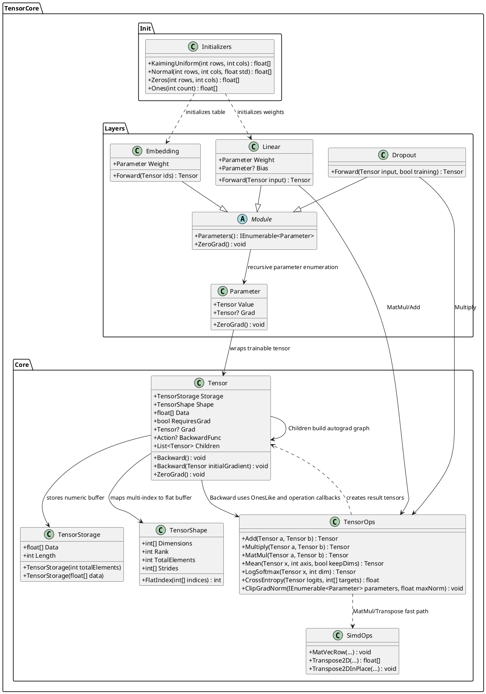

# 00.TensorCore - tensor math, autograd and layer infrastructure

Document status: D1B documented - parent review pending.

This document describes only the actually-read code of `00.TensorCore`.
It does not authorize new implementation, does not replace tests and does not prove that
the design model is trained. It is a human-readable map for Luba: what already exists,
where numeric information flows and where the real algorithms are.

## 1. What this is in simple terms

`00.TensorCore` is the lowest math layer of the project. It stores numbers in
tensors, knows the shape of those numbers, performs operations such as addition,
matrix multiplication, softmax/log-softmax, mean/sum, transpose, masks and gradients,
and also provides the basic neural-network layers: `Linear`, `Embedding`, `Dropout`.

What flows through it is not text or the meaning of a task, but numeric `float[]` arrays.
For example: tokens or features are turned into tensors, the `Embedding` layer takes
rows from the weight table, `Linear` multiplies the input by a weight matrix, `TensorOps`
builds the computation graph, and `Tensor.Backward()` propagates gradients.

Important: this is infrastructure for math, autograd and layers. On its own,
`00.TensorCore` is not a product reasoning module, does not contain a domain
model and is not a trained artifact. It is the specific `Parameter`s inside models higher
up the stack that become trainable, when the training loop feeds data, computes loss,
calls backward and the optimizer updates the weights.

## 2. UML for draw.io

Import: diagrams.net/draw.io -> Arrange -> Insert -> Advanced -> PlantUML.



## 3. UML connections: simulations and expected results

| Connection | Simulation | Expected result |
|---|---|---|
| `Tensor -> TensorStorage` | Create `new Tensor(new float[] {1,2,3}, new TensorShape(3))`. | `Tensor.Data` returns the internal `float[]` from `TensorStorage`; length equals `Shape.TotalElements`. |
| `Tensor -> TensorShape` | For shape `[3,4]` request index `[2,1]`. | `FlatIndex([2,1])` gives `9`, because the row-major stride is `[4,1]`. |
| `TensorOps -> Tensor` | `TensorOps.Add(a,b)` for two tensors `[1,2,3]` and `[4,5,6]`. | A new `Tensor` with data `[5,7,9]`; if the inputs require gradient, the result contains `Children` and `BackwardFunc`. |
| `TensorOps -> SimdOps` | `TensorOps.MatMul([2,3], [3,2])`. | Before multiplication `b` is transposed via `SimdOps.Transpose2D`, then rows are computed via `SimdOps.MatVecRow`; expected example from the test: `[19,22,43,50]`. |
| `Parameter -> Tensor` | Create `new Parameter(tensor)`. | `tensor.RequiresGrad` is forced to `true`; this is a trainable weight, but not a standalone reasoning unit. |
| `Module -> Parameter` | In `Linear(4,8)` register `weight` and `bias`. | `Parameters()` returns the layer's parameters and those of nested modules recursively. |
| `Linear -> TensorOps` | Input `[batch, inFeatures]`, weight `[outFeatures, inFeatures]`. | `Forward` transposes the weight and computes `input @ weightT`, then adds bias; the shape becomes `[batch, outFeatures]`. |
| `Embedding -> Tensor` | `ids` of shape `[batch, seqLen]`, where the values are token ids. | Returns `[batch, seqLen, hiddenDim]`, each position copies a row from the `Weight` table. |
| `Dropout -> TensorOps` | `training=true`, `p=0.1`. | A mask of `0` or `1/(1-p)` is created and the input is multiplied by the mask; when `training=false` the original input is returned. |

## 4. No-code algorithms, but with real contracts

### 4.1 Tensor storage and shape

Contracts:

- `TensorStorage.TensorStorage(int totalElements)` in `00.TensorCore/Core/TensorStorage.cs:10`: input - number of elements; output - storage with a new `float[]`.
- `TensorStorage.TensorStorage(float[] data)` in `00.TensorCore/Core/TensorStorage.cs:16`: input - array; output - storage with a copy of the array.
- `TensorShape.TensorShape(params int[] dimensions)` in `00.TensorCore/Core/TensorShape.cs:20`: input - dimensions; output - a shape object with `Dimensions`, `Rank`, `TotalElements`, `Strides`.
- `TensorShape.FlatIndex(int[] indices)` in `00.TensorCore/Core/TensorShape.cs:39`: input - indices per dimension; output - flat index in the row-major buffer.
- `Tensor.Tensor(float[] data, TensorShape shape, bool requiresGrad = false)` in `00.TensorCore/Core/Tensor.cs:34`: input - data, shape, gradient flag; output - tensor with length validation.

Current algorithm:

1. `TensorShape` rejects an empty shape and non-positive dimensions.
2. `TotalElements` is computed as the product of the dimensions.
3. `Strides` are computed right to left: the last axis has stride `1`, the earlier ones are multiplied by the size of the next axis.
4. `FlatIndex` validates rank, checks the bounds of each index and sums `indices[i] * Strides[i]`.
5. `Tensor` holds `TensorStorage` and `TensorShape`; the indexer reads/writes through `Shape.FlatIndex`.

Status: implemented as a basic storage contract. This is not a lazy tensor and not a GPU backend.

### 4.2 Autograd: computation graph and backward

Contracts:

- `Tensor.Backward()` in `00.TensorCore/Core/Tensor.cs:59`: input - implicit unit initial derivative; output - filled `Grad` on reachable parents.
- `Tensor.Backward(Tensor initialGradient)` in `00.TensorCore/Core/Tensor.cs:89`: input - explicit initial gradient of the same shape; output - filled gradients.
- `TensorOps.Add(Tensor a, Tensor b)` in `00.TensorCore/Core/TensorOps.cs:33`: input - two tensors of the same shape; output - sum and a backward callback.
- `TensorOps.Multiply(Tensor a, Tensor b)` in `00.TensorCore/Core/TensorOps.cs:78`: input - two tensors of the same shape; output - product and a backward callback.
- `TensorOps.Sum(Tensor x)` in `00.TensorCore/Core/TensorOps.cs:375`: input - tensor; output - a scalar tensor `[1]` with a callback that distributes one gradient to all elements.

Current algorithm:

1. Operations create a new `Tensor` with the result.
2. If at least one input has `RequiresGrad=true`, the result also gets `RequiresGrad=true`.
3. The operation adds the inputs to the result's `Children` and records `BackwardFunc`.
4. `Backward()` sets the initial tensor's gradient to `OnesLike(this)`.
5. `TopologicalSort()` walks the graph through `Children`, reverses the order and calls `BackwardFunc` from result to inputs.
6. `AccumulateGrad` in `TensorOps` accumulates the gradient rather than replacing it if the tensor already has a `Grad`.

Status: a small autograd is implemented for operations that explicitly wrote a backward callback. Some utility operations, for example `Cos`, `Sin`, `Sigmoid`, `Silu`, `LogSigmoid`, `ClampMin`, `OuterProduct`, `RepeatInterleave`, `Tril`, create a result without a backward callback in the current code, so this document must not pretend that all of TensorOps is differentiable.

### 4.3 TensorOps math operations

Contracts:

- `TensorOps.MatMul(Tensor a, Tensor b)` in `00.TensorCore/Core/TensorOps.cs:441`: input - tensors of rank >= 2, where the last axis of `a` equals the second-to-last axis of `b`; output - tensor `[..., m, n]`.
- `TensorOps.Mean(Tensor x, int axis, bool keepDims = true)` in `00.TensorCore/Core/TensorOps.cs:400`: input - tensor, axis, axis-keeping mode; output - mean over the axis.
- `TensorOps.LogSoftmax(Tensor x, int dim)` in `00.TensorCore/Core/TensorOps.cs:299`: input - tensor and axis; output - log-softmax over the axis.
- `TensorOps.CrossEntropy(Tensor logits, int[] targets)` in `00.TensorCore/Core/TensorOps.cs:1042`: input - logits `[N,C]` and target class ids; output - `float` loss.
- `TensorOps.ClipGradNorm(IEnumerable<Parameter> parameters, float maxNorm)` in `00.TensorCore/Core/TensorOps.cs:1070`: input - parameters and the max norm; output - mutation of the existing gradients.

Current algorithm:

1. Simple elementwise operations iterate over `float[]` and create a new tensor of the same shape.
2. `MatMul` checks rank and the compatibility `aCols == bRows`.
3. For each batch position `MatMul` transposes `b` and computes dot products via `SimdOps.MatVecRow`.
4. Backward for `MatMul` uses the formulas `gradA = grad @ B^T` and `gradB = A^T @ grad`.
5. `Mean` sums over the axis, divides by the axis size and, in backward, broadcasts the gradient back with a scale of `1/axisSize`.
6. `LogSoftmax` subtracts the max over the axis for numerical stability, computes `log(sum(exp(x-max)))`, then in backward applies `grad_i - softmax_i * sum(grad)`.
7. `CrossEntropy` currently returns a plain `float`, not a `Tensor`; it is a useful loss function for the Trainer, but it does not build an autograd graph by itself.
8. `ClipGradNorm` reads `Parameter.Grad`, computes the total L2 norm and scales the gradients if the norm is greater than `maxNorm`.

Status: the key CPU math primitives are implemented. This is not proof of full compatibility with PyTorch, CUDA or production-grade broadcasting.

### 4.4 SIMD helpers

Contracts:

- `SimdOps.MatVecRow(float[] a, int aOffset, int aRows, int aCols, float[] transposedB, int transposedBOffset, int bCols, float[] result, int resultOffset)` in `00.TensorCore/Core/SimdOps.cs:7`: input - flat matrices and offsets; output - writes the result into the provided `result`.
- `SimdOps.Transpose2D(float[] source, int sourceOffset, int rows, int cols)` in `00.TensorCore/Core/SimdOps.cs:48`: input - flat matrix; output - a new transposed array.
- `SimdOps.Transpose2DInPlace(...)` in `00.TensorCore/Core/SimdOps.cs:57`: input - source/destination arrays; output - writes the transpose into destination.

Current algorithm:

1. `MatVecRow` checks for null arguments.
2. Takes `Vector<float>.Count` from `System.Numerics`.
3. For each row of `a` and each column of the already-transposed `b` it computes the dot product in `Vector<float>` blocks.
4. The tail that did not fit into the SIMD block is finished with an ordinary scalar loop.
5. `Transpose2DInPlace` moves `source[row,col]` into `destination[col,row]`.

Status: a CPU SIMD fast path for matrix multiplication is implemented. This is not a separate trainable unit.

### 4.5 Initializers

Contracts:

- `Initializers.KaimingUniform(int rows, int cols)` in `00.TensorCore/Init/Initializers.cs:12`: input - matrix dimensions; output - a `float[]` of length `rows * cols`.
- `Initializers.Normal(int rows, int cols, float std = 0.02f)` in `00.TensorCore/Init/Initializers.cs:25`: input - dimensions and std; output - a normally distributed `float[]`.
- `Initializers.Zeros(int rows, int cols)` in `00.TensorCore/Init/Initializers.cs:47`: output - a zero array.
- `Initializers.Ones(int count)` in `00.TensorCore/Init/Initializers.cs:50`: output - an array of ones.

Current algorithm:

1. `KaimingUniform` uses a fixed `Random(42)` and the bound `sqrt(6 / cols)`.
2. `Normal` uses Box-Muller and the same fixed RNG.
3. `Zeros` and `Ones` create deterministic arrays.

Status: implemented as weight-initialization infrastructure. A fixed seed is useful for reproducibility, but it is not runtime evidence of model quality.

### 4.6 Parameters, Module and layers

Contracts:

- `Parameter.Parameter(Tensor initialValue)` in `00.TensorCore/Layers/Parameter.cs:13`: input - tensor; output - a wrapper that sets `RequiresGrad=true`.
- `Module.Parameters()` in `00.TensorCore/Layers/Module.cs:22`: input - none; output - a recursive `IEnumerable<Parameter>`.
- `Module.ZeroGrad()` in `00.TensorCore/Layers/Module.cs:33`: input - none; output - zeroing of gradients on all parameters.
- `Linear.Linear(int inFeatures, int outFeatures, bool useBias = true)` in `00.TensorCore/Layers/Linear.cs:19`: input - dimensions and bias flag; output - a layer with weight/bias.
- `Linear.Forward(Tensor input)` in `00.TensorCore/Layers/Linear.cs:37`: input - tensor `[..., inFeatures]`; output - tensor `[..., outFeatures]`.
- `Embedding.Embedding(int vocabSize, int hiddenDim)` in `00.TensorCore/Layers/Embedding.cs:16`: input - vocabulary size and hidden dim; output - a parameter table `[vocabSize, hiddenDim]`.
- `Embedding.Forward(Tensor ids)` in `00.TensorCore/Layers/Embedding.cs:30`: input - ids `[batch, seqLen]`; output - embeddings `[batch, seqLen, hiddenDim]`.
- `Dropout.Dropout(float p = 0.1f, int? seed = null)` in `00.TensorCore/Layers/Dropout.cs:14`: input - dropout probability and seed; output - a layer with an RNG.
- `Dropout.Forward(Tensor input, bool training = true)` in `00.TensorCore/Layers/Dropout.cs:21`: input - tensor and mode; output - the same tensor at inference or a masked tensor at training.

Current algorithm:

1. `Parameter` makes a tensor trainable via `RequiresGrad=true`.
2. `Module` stores local parameters and submodules in dictionaries and returns them recursively.
3. `Linear` initializes `Weight` via Kaiming Uniform, the optional `Bias` with zeros, registers the parameters and in `Forward` computes `input @ weight^T + bias`.
4. `Embedding` initializes the table with a normal distribution and copies rows by token id. In the current `Embedding.Forward` the result is created as a new `Tensor`, without an explicit backward callback to `Weight`.
5. `Dropout` at training creates a mask tensor and multiplies the input by it; at inference it returns the input as is.

Status: `Parameter`, `Module`, `Linear`, `Dropout` are connected to autograd through `TensorOps`; `Embedding` implements lookup as a forward utility, but in the current code it does not record a gradient callback for the embedding weights table.

## 5. Where the logic lives

| Area | Files | Current status |
|---|---|---|
| Storage and shape | `00.TensorCore/Core/TensorStorage.cs`, `TensorShape.cs`, `Tensor.cs` | Implemented CPU float tensor storage and indexing. |
| Autograd graph | `00.TensorCore/Core/Tensor.cs`, `TensorOps.cs` | Implemented for operations with explicit `BackwardFunc`; partial for broader utility ops. |
| Math operations | `00.TensorCore/Core/TensorOps.cs` | Implemented CPU operations used by model/training code. |
| SIMD | `00.TensorCore/Core/SimdOps.cs` | Implemented `System.Numerics.Vector<float>` dot-product helper and transpose helpers. |
| Initializers | `00.TensorCore/Init/Initializers.cs` | Implemented deterministic RNG-based helpers. |
| Layers | `00.TensorCore/Layers/*.cs` | Implemented simple Module/Parameter/Linear/Embedding/Dropout layer contracts. |
| Product reasoning | none in `00.TensorCore` | Not present by design. |
| Trained domain model | none in `00.TensorCore` | Not present by design. |

## 6. Short code quotes with WHY/HOW/WHAT

Quote 1 - shape is row-major and validates dimensions.

Reference: `00.TensorCore/Core/TensorShape.cs:20`, `00.TensorCore/Core/TensorShape.cs:39`

```csharp
public TensorShape(params int[] dimensions)
public int FlatIndex(int[] indices)
```

- WHY: every tensor operation needs one shared rule for mapping multidimensional indexes into `float[]`.
- HOW: constructor computes `TotalElements` and strides; `FlatIndex` validates rank/bounds and sums `indices[i] * Strides[i]`.
- WHAT: storage layout is explicit row-major CPU layout.

Quote 2 - backward starts with ones and walks the graph.

Reference: `00.TensorCore/Core/Tensor.cs:59`

```csharp
Grad = TensorOps.OnesLike(this);
var sorted = TopologicalSort();
foreach (var t in sorted)
    t.BackwardFunc?.Invoke();
```

- WHY: a scalar-like final loss needs initial derivative `1`.
- HOW: the tensor graph is sorted from outputs back to inputs.
- WHAT: gradients are produced only where operation callbacks exist.

Quote 3 - Add registers a gradient callback.

Reference: `00.TensorCore/Core/TensorOps.cs:33`, `00.TensorCore/Core/TensorOps.cs:43`

```csharp
if (a.RequiresGrad || b.RequiresGrad)
{
    result.RequiresGrad = true;
    result.Children.Add(a);
    result.Children.Add(b);
```

- WHY: forward math alone is not enough for training.
- HOW: the result remembers its parents and callback.
- WHAT: `Add` is a differentiable operation in this implementation.

Quote 4 - MatMul delegates the hot loop to SIMD helpers.

Reference: `00.TensorCore/Core/TensorOps.cs:441`, `00.TensorCore/Core/TensorOps.cs:469`

```csharp
var transposedB = SimdOps.Transpose2D(b.Data, bOff, bRows, bCols);
SimdOps.MatVecRow(a.Data, aOff, aRows, aCols, transposedB, 0, bCols, resultData, rOff);
```

- WHY: matrix multiplication is a central cost in transformer-like models.
- HOW: `b` is transposed so dot products read contiguous rows.
- WHAT: this is CPU math acceleration, not a trained decision unit.

Quote 5 - Parameter marks tensor as trainable.

Reference: `00.TensorCore/Layers/Parameter.cs:13`

```csharp
Value = initialValue;
Value.RequiresGrad = true;
```

- WHY: optimizers need to know which tensors should accumulate gradients.
- HOW: wrapping in `Parameter` flips `RequiresGrad`.
- WHAT: training lives at the parameter/model/training-loop boundary, not inside every math primitive.

Quote 6 - Linear forward is tensor algebra, not reasoning.

Reference: `00.TensorCore/Layers/Linear.cs:37`, `00.TensorCore/Layers/Linear.cs:40`

```csharp
var weightT = TensorOps.Transpose(Weight.Value, 0, 1);
var output  = TensorOps.MatMul(input, weightT);
```

- WHY: linear layers are the standard projection primitive.
- HOW: weight `[out,in]` is transposed to `[in,out]` before matmul.
- WHAT: output shape follows the last dimension transformation from `inFeatures` to `outFeatures`.

## 7. Test, e2e and QA mapping

Allowed D1B verification did not run tests or build. This section maps existing
test intent from source files only.

| Behavior | Existing test evidence read | Honest gap |
|---|---|---|
| Shape total elements, strides, flat index, invalid dimensions | `Tests/TensorCoreTests.cs:16`, `Tests/TensorCoreTests.cs:23`, `Tests/TensorCoreTests.cs:31`, `Tests/TensorCoreTests.cs:39` | Not run in this work order. |
| Tensor creation/indexing and mismatched data shape | `Tests/TensorCoreTests.cs:56`, `Tests/TensorCoreTests.cs:63`, `Tests/TensorCoreTests.cs:72`, `Tests/TensorCoreTests.cs:80` | Not run in this work order. |
| Add/Scale and shape mismatch | `Tests/TensorCoreTests.cs:91`, `Tests/TensorCoreTests.cs:104`, `Tests/TensorCoreTests.cs:116` | Not run in this work order. |
| MatMul values and incompatible dimensions | `Tests/TensorCoreTests.cs:129`, `Tests/TensorCoreTests.cs:145` | Not run in this work order. |
| Softmax expected values | `Tests/TensorCoreTests.cs:158`, `Tests/TensorCoreTests.cs:169`, `Tests/TensorCoreTests.cs:182` | Not run in this work order. |
| Autograd Add/Multiply/MatMul/Pow/ZeroGrad | `Tests/TensorCoreTests.cs:231`, `Tests/TensorCoreTests.cs:247`, `Tests/TensorCoreTests.cs:260`, `Tests/TensorCoreTests.cs:276`, `Tests/TensorCoreTests.cs:288` | Not run in this work order. |
| Linear layer shape and grad presence | `Tests/TensorCoreTests.cs:304`, `Tests/TensorCoreTests.cs:315`, `Tests/TensorCoreTests.cs:322` | Bias-gradient path should be reviewed separately because `ExpandBias` creates a plain tensor. |
| Initializers | `Tests/TensorCoreTests.cs:340`, `Tests/TensorCoreTests.cs:350`, `Tests/TensorCoreTests.cs:358` | Not run in this work order. |
| SIMD matmul/transpose fast path | `Tests/SimdMatMulTests.cs:10`, `Tests/SimdMatMulTests.cs:32`, `Tests/SimdMatMulTests.cs:43`, `Tests/SimdMatMulTests.cs:54`, `Tests/SimdMatMulTests.cs:65`, `Tests/SimdMatMulTests.cs:78`, `Tests/SimdMatMulTests.cs:93` | Not run in this work order. |
| Embedding backward to weight | Source shows lookup copies data in `Embedding.Forward`; no callback found in file. | Needs explicit test/implementation review before claiming embedding weights receive gradients through this forward path. |
| Dropout training/inference behavior | Source read in `00.TensorCore/Layers/Dropout.cs`; no direct test found in `Tests/TensorCoreTests.cs` excerpt. | Needs direct tests for mask scaling, inference no-op, and deterministic seed behavior. |

## 8. Anti-false-done checks

- JSON matrix, smoke logs, static grep or this markdown document are not proof that tensor math is correct. They are documentation evidence only.
- A deterministic primitive like `TensorOps.Add`, `TensorOps.MatMul`, `SimdOps.MatVecRow`, `Initializers.Zeros` or `Initializers.Ones` must not be hidden or reported as a trained product unit.
- A `Parameter` is trainable storage, but training is not complete until a model/training loop produces runtime evidence: data, loss, backward, optimizer update, saved/importable artifact if required by the higher-level plan.
- `CrossEntropy` returning `float` is not an autograd loss tensor. Do not claim it supports backward unless code changes or runtime evidence prove that path.
- `Embedding.Forward` currently copies rows into a fresh tensor. Do not claim embedding table gradients are implemented through this method without a real callback or test evidence.
- SIMD correctness cannot be claimed from a report alone; it needs numeric reference checks. Existing tests describe that intent, but D1B did not run them.

## 9. Status honesty

| Item | Status |
|---|---|
| `TensorStorage`, `TensorShape`, `Tensor` | Implemented core storage/shape/autograd shell. |
| `TensorOps` elementwise operations | Implemented for many operations; gradient support is per-operation, not universal. |
| `TensorOps.MatMul` | Implemented with SIMD-backed CPU fast path and backward formulas. |
| `SimdOps` | Implemented utility, not product model. |
| `Initializers` | Implemented deterministic helpers. |
| `Parameter` and `Module` | Implemented simple trainable-parameter and recursive enumeration contracts. |
| `Linear` | Implemented forward and parameter registration; bias gradient path needs careful review before stronger claims. |
| `Embedding` | Implemented lookup forward; gradient-to-weight not established by current source. |
| `Dropout` | Implemented training/inference forward behavior. |
| Product reasoning | Not in this project. |
| Trained domain model | Not in this project. |

## 10. Hierarchy note

The five-level logical hierarchy from `00.Core` (`ILearningMachine`,
`ILogicalOrchestrator`, `ILogicalFlow`, `ILogicalUnit`,
`ILearningMachinePair`) is not implemented in `00.TensorCore`. This project is
below that hierarchy: it provides numeric tensor, autograd and layer building
blocks that higher-level learning machines may use.

Training should be described at the learning machine/model/training-loop
boundary. Do not imply that every `TensorOps` primitive or every `Module`
trains itself.
