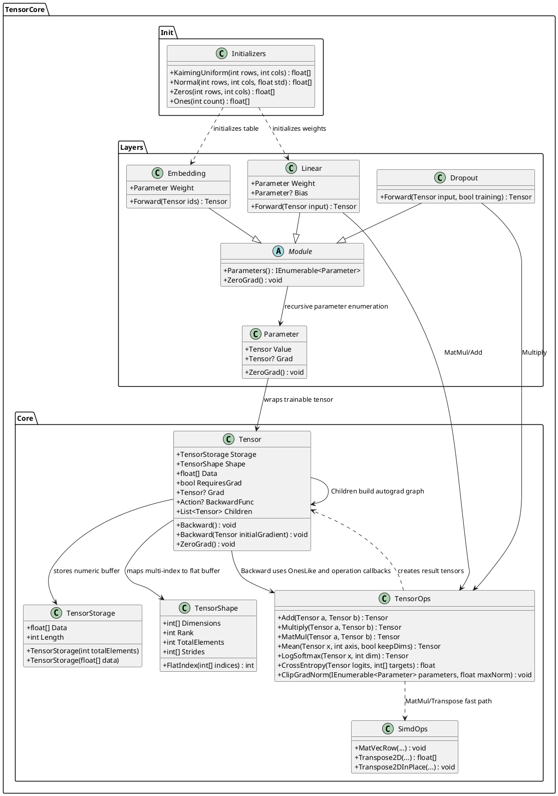

# 00.TensorCore - tensor math, autograd and layer infrastructure

Статус документа: D1B documented - parent review pending.

Этот документ описывает только фактически прочитанный код `00.TensorCore`.
Он не разрешает новую реализацию, не заменяет тесты и не доказывает, что
проектная модель обучена. Это human-readable карта для Лубы: что уже есть,
куда течет числовая информация и где находятся реальные алгоритмы.

## 1. Что это простыми словами

`00.TensorCore` - это нижний математический слой проекта. Он хранит числа в
тензорах, знает форму этих чисел, выполняет операции вроде сложения,
умножения матриц, softmax/log-softmax, mean/sum, transpose, масок и градиентов,
а также дает базовые слои нейросети: `Linear`, `Embedding`, `Dropout`.

Через него течет не текст и не смысл задачи, а числовые массивы `float[]`.
Например: токены или признаки превращаются в тензоры, слой `Embedding` берет
строки из таблицы весов, `Linear` умножает вход на матрицу весов, `TensorOps`
собирает вычислительный граф, а `Tensor.Backward()` распространяет градиенты.

`Embedding.Forward` связывает результат с обучаемой таблицей `Weight`. Обратный проход суммирует вклады всех позиций с одинаковым token ID в соответствующей строке; неиспользованные строки получают нули. ID запоминаются при forward. Для замороженной таблицы связь и градиент не создаются; значения прямого прохода сохраняются.

Если у `Linear` включён bias, `ExpandBias` сохраняет связь с обучаемым вектором смещения. Обратный проход суммирует градиенты всех позиций батча/последовательности в исходный `Bias`, независимо от того, обучается ли `Weight`. Замороженный bias не получает градиента; прямой проход не меняется. У текущей `LlmModel` смещения выключены (`useBias: false`).

Важно: это инфраструктура математики, autograd и слоев. Сам по себе
`00.TensorCore` не является продуктовым reasoning-модулем, не содержит доменную
модель и не является обученным артефактом. Обучаемыми становятся конкретные
`Parameter` внутри моделей выше по стеку, когда training loop подает данные,
считает loss, вызывает backward и оптимизатор обновляет веса.

## 2. UML для draw.io

Импорт: diagrams.net/draw.io -> Arrange -> Insert -> Advanced -> PlantUML.



## 3. UML connections: simulations and expected results

| Connection | Simulation | Expected result |
|---|---|---|
| `Tensor -> TensorStorage` | Создать `new Tensor(new float[] {1,2,3}, new TensorShape(3))`. | `Tensor.Data` возвращает внутренний `float[]` из `TensorStorage`; длина равна `Shape.TotalElements`. |
| `Tensor -> TensorShape` | Для формы `[3,4]` запросить индекс `[2,1]`. | `FlatIndex([2,1])` дает `9`, потому что row-major stride равен `[4,1]`. |
| `TensorOps -> Tensor` | `TensorOps.Add(a,b)` для двух тензоров `[1,2,3]` и `[4,5,6]`. | Новый `Tensor` с данными `[5,7,9]`; если входы требуют градиент, результат содержит `Children` и `BackwardFunc`. |
| `TensorOps -> SimdOps` | `TensorOps.MatMul([2,3], [3,2])`. | Перед умножением `b` транспонируется через `SimdOps.Transpose2D`, затем строки считаются через `SimdOps.MatVecRow`; ожидаемый пример из теста: `[19,22,43,50]`. |
| `Parameter -> Tensor` | Создать `new Parameter(tensor)`. | `tensor.RequiresGrad` принудительно становится `true`; это обучаемый вес, но не самостоятельный reasoning-unit. |
| `Module -> Parameter` | В `Linear(4,8)` зарегистрировать `weight` и `bias`. | `Parameters()` возвращает параметры слоя и вложенных модулей рекурсивно. |
| `Linear -> TensorOps` | Вход `[batch, inFeatures]`, вес `[outFeatures, inFeatures]`. | `Forward` транспонирует вес и считает `input @ weightT`, затем добавляет bias; форма становится `[batch, outFeatures]`. |
| `Embedding -> Tensor` | `ids` формы `[batch, seqLen]`, где значения - token id. | Возвращается `[batch, seqLen, hiddenDim]`, каждая позиция копирует строку из таблицы `Weight`. |
| `Dropout -> TensorOps` | `training=true`, `p=0.1`. | Создается маска из `0` или `1/(1-p)` и вход умножается на маску; при `training=false` возвращается исходный input. |

## 4. Алгоритмы без кода, но с реальными контрактами

### 4.1 Хранение тензора и форма

Контракты:

- `TensorStorage.TensorStorage(int totalElements)` в `00.TensorCore/Core/TensorStorage.cs:10`: вход - число элементов; выход - storage с новым `float[]`.
- `TensorStorage.TensorStorage(float[] data)` в `00.TensorCore/Core/TensorStorage.cs:16`: вход - массив; выход - storage с копией массива.
- `TensorShape.TensorShape(params int[] dimensions)` в `00.TensorCore/Core/TensorShape.cs:20`: вход - размеры; выход - объект формы с `Dimensions`, `Rank`, `TotalElements`, `Strides`.
- `TensorShape.FlatIndex(int[] indices)` в `00.TensorCore/Core/TensorShape.cs:39`: вход - индексы по измерениям; выход - flat index в row-major буфере.
- `Tensor.Tensor(float[] data, TensorShape shape, bool requiresGrad = false)` в `00.TensorCore/Core/Tensor.cs:34`: вход - данные, форма, флаг градиента; выход - tensor с проверкой длины.

Текущий алгоритм:

1. `TensorShape` отвергает пустую форму и неположительные размеры.
2. `TotalElements` считается произведением измерений.
3. `Strides` считаются справа налево: последняя ось имеет stride `1`, предыдущие умножаются на размер следующей оси.
4. `FlatIndex` проверяет rank, проверяет границы каждого индекса и суммирует `indices[i] * Strides[i]`.
5. `Tensor` хранит `TensorStorage` и `TensorShape`; индексатор читает/пишет через `Shape.FlatIndex`.

Статус: реализовано как базовый контракт хранения. Это не lazy tensor и не GPU backend.

### 4.2 Autograd: вычислительный граф и backward

Контракты:

- `Tensor.Backward()` в `00.TensorCore/Core/Tensor.cs:59`: вход - неявная единичная начальная производная; выход - заполненные `Grad` у достижимых родителей.
- `Tensor.Backward(Tensor initialGradient)` в `00.TensorCore/Core/Tensor.cs:89`: вход - явный начальный градиент той же формы; выход - заполненные градиенты.
- `TensorOps.Add(Tensor a, Tensor b)` в `00.TensorCore/Core/TensorOps.cs:33`: вход - два тензора одной формы; выход - сумма и backward callback.
- `TensorOps.Multiply(Tensor a, Tensor b)` в `00.TensorCore/Core/TensorOps.cs:78`: вход - два тензора одной формы; выход - произведение и backward callback.
- `TensorOps.Sum(Tensor x)` в `00.TensorCore/Core/TensorOps.cs:375`: вход - tensor; выход - scalar tensor `[1]` с callback, который раздает один градиент всем элементам.

Текущий алгоритм:

1. Операции создают новый `Tensor` с результатом.
2. Если хотя бы один вход имеет `RequiresGrad=true`, результат тоже получает `RequiresGrad=true`.
3. Операция добавляет входы в `Children` результата и записывает `BackwardFunc`.
4. `Backward()` ставит начальному tensor градиент `OnesLike(this)`.
5. `TopologicalSort()` обходит граф через `Children`, разворачивает порядок и вызывает `BackwardFunc` от результата к входам.
6. `AccumulateGrad` в `TensorOps` накапливает градиент, а не заменяет его, если у tensor уже есть `Grad`.

Статус: реализован небольшой autograd для операций, которые явно прописали backward callback. Некоторые utility-операции, например `Cos`, `Sin`, `Sigmoid`, `Silu`, `LogSigmoid`, `ClampMin`, `OuterProduct`, `RepeatInterleave`, `Tril`, создают результат без backward callback в текущем коде, поэтому документ не должен делать вид, что весь TensorOps дифференцируемый.

### 4.3 Математические операции TensorOps

Контракты:

- `TensorOps.MatMul(Tensor a, Tensor b)` в `00.TensorCore/Core/TensorOps.cs:441`: вход - tensors rank >= 2, где последняя ось `a` равна предпоследней оси `b`; выход - tensor `[..., m, n]`.
- `TensorOps.Mean(Tensor x, int axis, bool keepDims = true)` в `00.TensorCore/Core/TensorOps.cs:400`: вход - tensor, axis, режим сохранения оси; выход - среднее по оси.
- `TensorOps.LogSoftmax(Tensor x, int dim)` в `00.TensorCore/Core/TensorOps.cs:299`: вход - tensor и ось; выход - log-softmax по оси.
- `TensorOps.CrossEntropy(Tensor logits, int[] targets)` в `00.TensorCore/Core/TensorOps.cs:1042`: вход - logits `[N,C]` и target class ids; выход - `float` loss.
- `TensorOps.ClipGradNorm(IEnumerable<Parameter> parameters, float maxNorm)` в `00.TensorCore/Core/TensorOps.cs:1070`: вход - параметры и максимум нормы; выход - мутация существующих gradients.

Текущий алгоритм:

1. Простые elementwise операции проходят по `float[]` и создают новый tensor той же формы.
2. `MatMul` проверяет rank и совместимость `aCols == bRows`.
3. Для каждой batch-позиции `MatMul` транспонирует `b` и считает dot products через `SimdOps.MatVecRow`.
4. Backward для `MatMul` использует формулы `gradA = grad @ B^T` и `gradB = A^T @ grad`.
5. `Mean` суммирует по axis, делит на размер axis и в backward broadcast-ит градиент назад с масштабом `1/axisSize`.
6. `LogSoftmax` вычитает max по оси для численной стабильности, считает `log(sum(exp(x-max)))`, затем в backward применяет `grad_i - softmax_i * sum(grad)`.
7. `CrossEntropy` сейчас возвращает обычный `float`, не `Tensor`; это полезная loss-функция для Trainer, но она не строит autograd graph сама по себе.
8. `ClipGradNorm` читает `Parameter.Grad`, считает общую L2-норму и масштабирует градиенты, если норма больше `maxNorm`.

Статус: реализованы ключевые CPU math primitives. Это не доказательство полной совместимости с PyTorch, CUDA или production-grade broadcasting.

### 4.4 SIMD helpers

Контракты:

- `SimdOps.MatVecRow(float[] a, int aOffset, int aRows, int aCols, float[] transposedB, int transposedBOffset, int bCols, float[] result, int resultOffset)` в `00.TensorCore/Core/SimdOps.cs:7`: вход - плоские матрицы и смещения; выход - запись результата в переданный `result`.
- `SimdOps.Transpose2D(float[] source, int sourceOffset, int rows, int cols)` в `00.TensorCore/Core/SimdOps.cs:48`: вход - плоская матрица; выход - новый транспонированный массив.
- `SimdOps.Transpose2DInPlace(...)` в `00.TensorCore/Core/SimdOps.cs:57`: вход - source/destination массивы; выход - запись transpose в destination.

Текущий алгоритм:

1. `MatVecRow` проверяет null-аргументы.
2. Берет `Vector<float>.Count` из `System.Numerics`.
3. Для каждой строки `a` и каждого столбца уже транспонированной `b` считает dot product блоками `Vector<float>`.
4. Хвост, который не влез в SIMD-блок, досчитывает обычным scalar loop.
5. `Transpose2DInPlace` перекладывает `source[row,col]` в `destination[col,row]`.

Статус: реализован CPU SIMD fast path для матричного умножения. Это не отдельная trainable unit.

### 4.5 Initializers

Контракты:

- `Initializers.KaimingUniform(int rows, int cols)` в `00.TensorCore/Init/Initializers.cs:12`: вход - размеры матрицы; выход - `float[]` длиной `rows * cols`.
- `Initializers.Normal(int rows, int cols, float std = 0.02f)` в `00.TensorCore/Init/Initializers.cs:25`: вход - размеры и std; выход - нормально распределенный `float[]`.
- `Initializers.Zeros(int rows, int cols)` в `00.TensorCore/Init/Initializers.cs:47`: выход - нулевой массив.
- `Initializers.Ones(int count)` в `00.TensorCore/Init/Initializers.cs:50`: выход - массив единиц.

Текущий алгоритм:

1. `KaimingUniform` использует фиксированный `Random(42)` и границу `sqrt(6 / cols)`.
2. `Normal` использует Box-Muller и тот же фиксированный RNG.
3. `Zeros` и `Ones` создают детерминированные массивы.

Статус: реализовано как инфраструктура инициализации весов. Фиксированный seed полезен для воспроизводимости, но это не runtime evidence качества модели.

### 4.6 Parameters, Module and layers

Контракты:

- `Parameter.Parameter(Tensor initialValue)` в `00.TensorCore/Layers/Parameter.cs:13`: вход - tensor; выход - wrapper, который выставляет `RequiresGrad=true`.
- `Module.Parameters()` в `00.TensorCore/Layers/Module.cs:22`: вход - нет; выход - рекурсивный `IEnumerable<Parameter>`.
- `Module.ZeroGrad()` в `00.TensorCore/Layers/Module.cs:33`: вход - нет; выход - обнуление gradients у всех параметров.
- `Linear.Linear(int inFeatures, int outFeatures, bool useBias = true)` в `00.TensorCore/Layers/Linear.cs:19`: вход - размеры и bias flag; выход - слой с weight/bias.
- `Linear.Forward(Tensor input)` в `00.TensorCore/Layers/Linear.cs:37`: вход - tensor `[..., inFeatures]`; выход - tensor `[..., outFeatures]`.
- `Embedding.Embedding(int vocabSize, int hiddenDim)` в `00.TensorCore/Layers/Embedding.cs:16`: вход - размер словаря и hidden dim; выход - таблица параметров `[vocabSize, hiddenDim]`.
- `Embedding.Forward(Tensor ids)` в `00.TensorCore/Layers/Embedding.cs:30`: вход - ids `[batch, seqLen]`; выход - embeddings `[batch, seqLen, hiddenDim]`.
- `Dropout.Dropout(float p = 0.1f, int? seed = null)` в `00.TensorCore/Layers/Dropout.cs:14`: вход - вероятность dropout и seed; выход - слой с RNG.
- `Dropout.Forward(Tensor input, bool training = true)` в `00.TensorCore/Layers/Dropout.cs:21`: вход - tensor и режим; выход - тот же tensor при inference или masked tensor при training.

Текущий алгоритм:

1. `Parameter` делает tensor обучаемым через `RequiresGrad=true`.
2. `Module` хранит локальные параметры и подмодули в словарях и возвращает их рекурсивно.
3. `Linear` инициализирует `Weight` через Kaiming Uniform, optional `Bias` нулями, регистрирует параметры и в `Forward` считает `input @ weight^T + bias`.
4. `Embedding` инициализирует таблицу normal distribution и копирует строки по token id. В текущем `Embedding.Forward` результат создается как новый `Tensor`, без явного backward callback к `Weight`.
5. `Dropout` в training создает mask tensor и умножает вход на нее; при inference возвращает input как есть.

Статус: `Parameter`, `Module`, `Linear`, `Dropout` связаны с autograd через `TensorOps`; `Embedding` реализует lookup как forward utility, но в текущем коде не записывает gradient callback для таблицы embedding weights.

## 5. Где лежит логика

| Area | Files | Current status |
|---|---|---|
| Storage and shape | `00.TensorCore/Core/TensorStorage.cs`, `TensorShape.cs`, `Tensor.cs` | Implemented CPU float tensor storage and indexing. |
| Autograd graph | `00.TensorCore/Core/Tensor.cs`, `TensorOps.cs` | Implemented for operations with explicit `BackwardFunc`; partial for broader utility ops. |
| Math operations | `00.TensorCore/Core/TensorOps.cs` | Implemented CPU operations used by model/training code. |
| SIMD | `00.TensorCore/Core/SimdOps.cs` | Implemented `System.Numerics.Vector<float>` dot-product helper and transpose helpers. |
| Initializers | `00.TensorCore/Init/Initializers.cs` | Implemented deterministic RNG-based helpers. |
| Layers | `00.TensorCore/Layers/*.cs` | Implemented simple Module/Parameter/Linear/Embedding/Dropout layer contracts. |
| Product reasoning | none in `00.TensorCore` | Not present by design. |
| Trained domain model | none in `00.TensorCore` | Not present by design. |

## 6. Short code quotes with WHY/HOW/WHAT

Quote 1 - shape is row-major and validates dimensions.

Reference: `00.TensorCore/Core/TensorShape.cs:20`, `00.TensorCore/Core/TensorShape.cs:39`

```csharp
public TensorShape(params int[] dimensions)
public int FlatIndex(int[] indices)
```

- WHY: every tensor operation needs one shared rule for mapping multidimensional indexes into `float[]`.
- HOW: constructor computes `TotalElements` and strides; `FlatIndex` validates rank/bounds and sums `indices[i] * Strides[i]`.
- WHAT: storage layout is explicit row-major CPU layout.

Quote 2 - backward starts with ones and walks the graph.

Reference: `00.TensorCore/Core/Tensor.cs:59`

```csharp
Grad = TensorOps.OnesLike(this);
var sorted = TopologicalSort();
foreach (var t in sorted)
    t.BackwardFunc?.Invoke();
```

- WHY: a scalar-like final loss needs initial derivative `1`.
- HOW: the tensor graph is sorted from outputs back to inputs.
- WHAT: gradients are produced only where operation callbacks exist.

Quote 3 - Add registers a gradient callback.

Reference: `00.TensorCore/Core/TensorOps.cs:33`, `00.TensorCore/Core/TensorOps.cs:43`

```csharp
if (a.RequiresGrad || b.RequiresGrad)
{
    result.RequiresGrad = true;
    result.Children.Add(a);
    result.Children.Add(b);
```

- WHY: forward math alone is not enough for training.
- HOW: the result remembers its parents and callback.
- WHAT: `Add` is a differentiable operation in this implementation.

Quote 4 - MatMul delegates the hot loop to SIMD helpers.

Reference: `00.TensorCore/Core/TensorOps.cs:441`, `00.TensorCore/Core/TensorOps.cs:469`

```csharp
var transposedB = SimdOps.Transpose2D(b.Data, bOff, bRows, bCols);
SimdOps.MatVecRow(a.Data, aOff, aRows, aCols, transposedB, 0, bCols, resultData, rOff);
```

- WHY: matrix multiplication is a central cost in transformer-like models.
- HOW: `b` is transposed so dot products read contiguous rows.
- WHAT: this is CPU math acceleration, not a trained decision unit.

Quote 5 - Parameter marks tensor as trainable.

Reference: `00.TensorCore/Layers/Parameter.cs:13`

```csharp
Value = initialValue;
Value.RequiresGrad = true;
```

- WHY: optimizers need to know which tensors should accumulate gradients.
- HOW: wrapping in `Parameter` flips `RequiresGrad`.
- WHAT: training lives at the parameter/model/training-loop boundary, not inside every math primitive.

Quote 6 - Linear forward is tensor algebra, not reasoning.

Reference: `00.TensorCore/Layers/Linear.cs:37`, `00.TensorCore/Layers/Linear.cs:40`

```csharp
var weightT = TensorOps.Transpose(Weight.Value, 0, 1);
var output  = TensorOps.MatMul(input, weightT);
```

- WHY: linear layers are the standard projection primitive.
- HOW: weight `[out,in]` is transposed to `[in,out]` before matmul.
- WHAT: output shape follows the last dimension transformation from `inFeatures` to `outFeatures`.

## 7. Test, e2e and QA mapping

Allowed D1B verification did not run tests or build. This section maps existing
test intent from source files only.

| Behavior | Existing test evidence read | Honest gap |
|---|---|---|
| Shape total elements, strides, flat index, invalid dimensions | `Tests/TensorCoreTests.cs:16`, `Tests/TensorCoreTests.cs:23`, `Tests/TensorCoreTests.cs:31`, `Tests/TensorCoreTests.cs:39` | Not run in this work order. |
| Tensor creation/indexing and mismatched data shape | `Tests/TensorCoreTests.cs:56`, `Tests/TensorCoreTests.cs:63`, `Tests/TensorCoreTests.cs:72`, `Tests/TensorCoreTests.cs:80` | Not run in this work order. |
| Add/Scale and shape mismatch | `Tests/TensorCoreTests.cs:91`, `Tests/TensorCoreTests.cs:104`, `Tests/TensorCoreTests.cs:116` | Not run in this work order. |
| MatMul values and incompatible dimensions | `Tests/TensorCoreTests.cs:129`, `Tests/TensorCoreTests.cs:145` | Not run in this work order. |
| Softmax expected values | `Tests/TensorCoreTests.cs:158`, `Tests/TensorCoreTests.cs:169`, `Tests/TensorCoreTests.cs:182` | Not run in this work order. |
| Autograd Add/Multiply/MatMul/Pow/ZeroGrad | `Tests/TensorCoreTests.cs:231`, `Tests/TensorCoreTests.cs:247`, `Tests/TensorCoreTests.cs:260`, `Tests/TensorCoreTests.cs:276`, `Tests/TensorCoreTests.cs:288` | Not run in this work order. |
| Linear layer shape and grad presence | `Tests/TensorCoreTests.cs:304`, `Tests/TensorCoreTests.cs:315`, `Tests/TensorCoreTests.cs:322` | Bias-gradient path should be reviewed separately because `ExpandBias` creates a plain tensor. |
| Initializers | `Tests/TensorCoreTests.cs:340`, `Tests/TensorCoreTests.cs:350`, `Tests/TensorCoreTests.cs:358` | Not run in this work order. |
| SIMD matmul/transpose fast path | `Tests/SimdMatMulTests.cs:10`, `Tests/SimdMatMulTests.cs:32`, `Tests/SimdMatMulTests.cs:43`, `Tests/SimdMatMulTests.cs:54`, `Tests/SimdMatMulTests.cs:65`, `Tests/SimdMatMulTests.cs:78`, `Tests/SimdMatMulTests.cs:93` | Not run in this work order. |
| Embedding backward to weight | Source shows lookup copies data in `Embedding.Forward`; no callback found in file. | Needs explicit test/implementation review before claiming embedding weights receive gradients through this forward path. |
| Dropout training/inference behavior | Source read in `00.TensorCore/Layers/Dropout.cs`; no direct test found in `Tests/TensorCoreTests.cs` excerpt. | Needs direct tests for mask scaling, inference no-op, and deterministic seed behavior. |

## 8. Anti-false-done checks

- JSON matrix, smoke logs, static grep or this markdown document are not proof that tensor math is correct. They are documentation evidence only.
- A deterministic primitive like `TensorOps.Add`, `TensorOps.MatMul`, `SimdOps.MatVecRow`, `Initializers.Zeros` or `Initializers.Ones` must not be hidden or reported as a trained product unit.
- A `Parameter` is trainable storage, but training is not complete until a model/training loop produces runtime evidence: data, loss, backward, optimizer update, saved/importable artifact if required by the higher-level plan.
- `CrossEntropy` returning `float` is not an autograd loss tensor. Do not claim it supports backward unless code changes or runtime evidence prove that path.
- `Embedding.Forward` currently copies rows into a fresh tensor. Do not claim embedding table gradients are implemented through this method without a real callback or test evidence.
- SIMD correctness cannot be claimed from a report alone; it needs numeric reference checks. Existing tests describe that intent, but D1B did not run them.

## 9. Status honesty

| Item | Status |
|---|---|
| `TensorStorage`, `TensorShape`, `Tensor` | Implemented core storage/shape/autograd shell. |
| `TensorOps` elementwise operations | Implemented for many operations; gradient support is per-operation, not universal. |
| `TensorOps.MatMul` | Implemented with SIMD-backed CPU fast path and backward formulas. |
| `SimdOps` | Implemented utility, not product model. |
| `Initializers` | Implemented deterministic helpers. |
| `Parameter` and `Module` | Implemented simple trainable-parameter and recursive enumeration contracts. |
| `Linear` | Implemented forward and parameter registration; bias gradient path needs careful review before stronger claims. |
| `Embedding` | Implemented lookup forward; gradient-to-weight not established by current source. |
| `Dropout` | Implemented training/inference forward behavior. |
| Product reasoning | Not in this project. |
| Trained domain model | Not in this project. |

## 10. Hierarchy note

The five-level logical hierarchy from `00.Core` (`ILearningMachine`,
`ILogicalOrchestrator`, `ILogicalFlow`, `ILogicalUnit`,
`ILearningMachinePair`) is not implemented in `00.TensorCore`. This project is
below that hierarchy: it provides numeric tensor, autograd and layer building
blocks that higher-level learning machines may use.

Training should be described at the learning machine/model/training-loop
boundary. Do not imply that every `TensorOps` primitive or every `Module`
trains itself.
