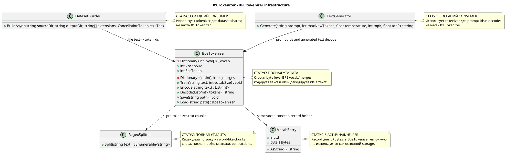

# 01.Tokenizer - deterministic BPE text infrastructure

Статус документа: D1C documented - parent review pending.

Этот документ описывает только текущий код `01.Tokenizer`. Он не меняет
production code, не запускает обучение модели и не доказывает semantic
reasoning. Токенизатор превращает текст в integer token ids и ids обратно в
текст. Это deterministic text infrastructure: он режет строку, применяет
выученные BPE merges и сохраняет/загружает таблицы vocab/merges.

## 1. Что это простыми словами

`01.Tokenizer` - это переводчик между человеческим текстом и числами для
остальных частей LLM (Large Language Model) pipeline. На вход приходит строка
вроде `"hello world"`, `BpeTokenizer.Encode` возвращает список чисел, а
`BpeTokenizer.Decode` собирает из чисел обратно UTF-8 текст.

Он не понимает смысл текста, не выбирает скилы и не принимает semantic
решения. Его "обучение" - это не reasoning training, а deterministic построение
таблицы частых пар байтов: сначала есть 256 byte tokens, потом самые частые
соседние пары объединяются в новые token ids.

## 2. UML для draw.io

Импорт: diagrams.net/draw.io -> Arrange -> Insert -> Advanced -> PlantUML.



Легенда:

| Узел | Что делает | Статус | Где живет |
|---|---|---|---|
| `BpeTokenizer` | Тренирует byte-level BPE vocab/merges, кодирует и декодирует текст | Полная utility реализация | `01.Tokenizer/BpeTokenizer.cs` |
| `RegexSplitter` | Делит текст на chunks до BPE merge loop | Полная utility реализация | `01.Tokenizer/RegexSplitter.cs` |
| `VocabEntry` | Простая запись `Id + Bytes` с UTF-8 представлением | Частичный helper, не основной storage BPE | `01.Tokenizer/VocabEntry.cs` |
| `DatasetBuilder` | Соседний consumer: пишет token ids в dataset shards | Не часть проекта 01 | `02.DatasetPipeline/DatasetBuilder.cs` |
| `TextGenerator` | Соседний consumer: кодирует prompt и декодирует generated ids | Не часть проекта 01 | `09.Inference/TextGenerator.cs` |

### 2.1 Симуляции по каждой связи UML

| Связь | Пример входа | Симуляция ветки | Ожидаемый результат | Что запрещено принимать за результат |
|---|---|---|---|---|
| `BpeTokenizer -> RegexSplitter` | `text="hello, world"` | `Train` и `Encode` вызывают `RegexSplitter.Split(text)` | Chunks включают word-like/space/punctuation pieces, которые потом переводятся в UTF-8 bytes | Нельзя считать regex semantic classifier-ом |
| `BpeTokenizer -> VocabEntry` | `Id=104`, `Bytes=[104]` | `VocabEntry.AsString()` декодирует bytes | `"h"` как human-readable byte token | Нельзя считать `VocabEntry` реальным vocab storage внутри `BpeTokenizer`; там используется `Dictionary<int, byte[]>` |
| `DatasetBuilder -> BpeTokenizer` | Файл содержит `"hello world"` | `DatasetBuilder.BuildAsync` читает файл и вызывает `_tokenizer.Encode(text)` | Token ids добавляются в `ushort` buffer и пишутся в `.npy` shard | JSON/report не заменяет реальный encode path |
| `TextGenerator -> BpeTokenizer` | Prompt `"Hello"` | `TextGenerator.Generate` вызывает `Encode(prompt)`, модель генерирует ids, затем `Decode(new ids)` | Пользователь получает decoded generated suffix | Нельзя считать tokenizer генератором смысла или sampler-ом |

## 3. Алгоритмы без кода, по-русски

### 3.1 Regex pre-tokenization

Аналогия: перед тем как считать частые пары букв, библиотекарь сначала режет
текст на удобные карточки: слова, числа, пробелы и знаки препинания. Он не
читает смысл, только аккуратно отделяет куски.

Паспорт текущей реализации:

| Поле | Значение |
|---|---|
| Класс | `RegexSplitter` |
| Метод/функция | `Split(string text)` |
| Файл и строка | `01.Tokenizer/RegexSplitter.cs:15` |
| Входные параметры/DTO | `text`, пример: `"I'm here 42!"` |
| Выходной DTO/результат | `IEnumerable<string>`, пример chunks вроде `["I", "'m", " here", " 42", "!"]` по regex matches |
| Статус | Полная deterministic utility |

Шаги текущего алгоритма:

1. Приходит строка `text`.
2. Compiled regex pattern ищет contractions, optional-space letters, optional-space numbers, punctuation и whitespace.
3. Метод возвращает `Pattern.Matches(text).Select(m => m.Value)`.
4. Пустая строка дает пустую последовательность matches.

Ветки и симуляции:

| Ветка | Пример входа | Почему выбирается | Ожидаемый результат | Проверка/QA |
|---|---|---|---|---|
| Letters | `"hello"` | ` ?\p{L}+` | chunk `"hello"` | косвенно через round-trip tests |
| Numbers | `" 42"` | ` ?\p{N}+` | chunk `" 42"` | gap: нет прямого unit test для RegexSplitter |
| Punctuation | `"!"` | ` ?[^\s\p{L}\p{N}]+` | chunk `"!"` | gap: нет прямого unit test для RegexSplitter |
| Empty | `""` | no matches | empty sequence | `Tests/TokenizerTests.cs:30` через `Encode("")` |

Что алгоритм НЕ делает:

- не понимает meaning;
- не выбирает skill или route;
- не является trainable semantic authority;
- не заменяет BPE merge loop.

### 3.2 BPE training: vocab and merge table

Аналогия: сначала у нас есть 256 карточек - по одной на каждый byte. Потом мы
много раз смотрим на текст и склеиваем самую частую соседнюю пару карточек в
новую карточку, пока словарь не достигнет нужного размера.

Паспорт текущей реализации:

| Поле | Значение |
|---|---|
| Класс | `BpeTokenizer` |
| Метод/функция | `Train(string text, int vocabSize)` |
| Файл и строка | `01.Tokenizer/BpeTokenizer.cs:22` |
| Входные параметры/DTO | `text`, пример `"hello hello"`; `vocabSize`, пример `270` |
| Выходной DTO/результат | `void`; мутирует `_vocab`, `_merges`, `VocabSize` |
| Статус | Полная deterministic BPE training utility |

Шаги текущего алгоритма:

1. Если `vocabSize < 256`, метод бросает `ArgumentOutOfRangeException`.
2. `_vocab` инициализируется byte tokens `0..255`, где каждый id содержит один byte.
3. `_merges` очищается.
4. `RegexSplitter.Split(text)` делит corpus на chunks.
5. Каждый chunk превращается в UTF-8 bytes, а bytes становятся initial token ids.
6. Пока `_vocab.Count < vocabSize`, `CountPairs(chunks)` считает соседние пары ids.
7. Если пар больше нет, loop останавливается.
8. Самая частая пара получает `nextToken`.
9. Новый vocab entry становится concatenation bytes двух старых tokens.
10. `MergeAll` заменяет все occurrences пары в chunks на новый token id.

Ветки и симуляции:

| Ветка | Пример входа | Почему выбирается | Ожидаемый результат | Проверка/QA |
|---|---|---|---|---|
| Invalid vocab | `vocabSize=100` | меньше 256 | `ArgumentOutOfRangeException` | `Tests/TokenizerEdgeCaseTests.cs:20` |
| Minimal vocab | `vocabSize=256` | loop не входит, vocab уже 256 | только byte-level vocab, no merges | `Tests/TokenizerEdgeCaseTests.cs:11` |
| Merge loop | corpus `"hello hello"`, `vocabSize=270` | есть частые соседние пары | vocab grows above 256 up to target or until pairs end | `Tests/TokenizerTests.cs:7` |
| No pairs left | corpus/chunks слишком короткие | `pairCounts.Count == 0` | loop stops before target | covered by code path, no direct named test |

Что алгоритм НЕ делает:

- не обучает semantic model;
- не использует labels, reward, DPO или skill outcomes;
- не гарантирует optimal tokenizer quality beyond frequency merges;
- не добавляет explicit unknown token.

### 3.3 Encoding: text to ids

Аналогия: когда словарь уже собран, новый текст сначала режется на такие же
карточки, потом каждый chunk превращается в bytes, а знакомые склейки
применяются в том порядке, в котором они были выучены.

Паспорт текущей реализации:

| Поле | Значение |
|---|---|
| Класс | `BpeTokenizer` |
| Метод/функция | `Encode(string text)` |
| Файл и строка | `01.Tokenizer/BpeTokenizer.cs:53` |
| Входные параметры/DTO | `text`, пример `"hello world"` |
| Выходной DTO/результат | `List<int>`, пример token ids within `0..VocabSize-1` |
| Статус | Полная deterministic utility |

Шаги текущего алгоритма:

1. Создается пустой `List<int> result`.
2. Текст режется через `RegexSplitter.Split`.
3. Каждый chunk превращается в UTF-8 bytes.
4. Каждый byte становится token id `0..255`.
5. `ApplyMerges` последовательно применяет learned `_merges`.
6. Итоговые ids добавляются в `result`.
7. Метод возвращает `List<int>`.

Ветки и симуляции:

| Ветка | Пример входа | Почему выбирается | Ожидаемый результат | Проверка/QA |
|---|---|---|---|---|
| Empty text | `""` | `RegexSplitter` не возвращает chunks | empty token list | `Tests/TokenizerTests.cs:30` |
| Byte fallback | `"a"` | любой UTF-8 byte есть в base vocab | one or more ids decode back to `"a"` | `Tests/TokenizerEdgeCaseTests.cs:27` |
| Learned merge | `"hello hello"` after repetitive training | pair exists in `_merges` | token count can be lower than byte count | `Tests/TokenizerEdgeCaseTests.cs:84` |
| Unknown token | any valid UTF-8 text | no explicit unknown token needed for bytes | unseen text still encodes as bytes/known merges | direct unknown-token test gap; behavior inferred from byte base vocab |

Что алгоритм НЕ делает:

- не classifies intent;
- не maps text to skills;
- не uses regex as hidden reasoning;
- не appends EOS automatically.

### 3.4 Decoding: ids to text

Аналогия: декодер берет карточки с номерами, раскрывает каждую в bytes и
склеивает bytes обратно в UTF-8 строку. Если номер неизвестен, текущий код его
молча пропускает.

Паспорт текущей реализации:

| Поле | Значение |
|---|---|
| Класс | `BpeTokenizer` |
| Метод/функция | `Decode(List<int> tokens)` |
| Файл и строка | `01.Tokenizer/BpeTokenizer.cs:67` |
| Входные параметры/DTO | `tokens`, пример `[104, 101, 108, 108, 111]` |
| Выходной DTO/результат | `string`, пример `"hello"` |
| Статус | Полная deterministic utility, with silent unknown-id skip |

Шаги текущего алгоритма:

1. Для каждого token id метод ищет bytes в `_vocab`.
2. Если id найден, bytes добавляются в общий byte stream.
3. Если id не найден, добавляется `Array.Empty<byte>()`, то есть token исчезает из output.
4. Общий byte stream декодируется через `Encoding.UTF8.GetString`.

Ветки и симуляции:

| Ветка | Пример входа | Почему выбирается | Ожидаемый результат | Проверка/QA |
|---|---|---|---|---|
| Known ids | ids from `Encode("hello")` | все ids есть в vocab | `"hello"` | `Tests/TokenizerTests.cs:16` |
| Empty token list | `[]` | no bytes | `""` | `Tests/TokenizerEdgeCaseTests.cs:52` |
| Unknown id | `[999999]` | `_vocab.TryGetValue` false | empty contribution, no exception | honest gap: no direct test found |

Что алгоритм НЕ делает:

- не восстанавливает semantic intent;
- не reports unknown-id error;
- не вставляет replacement token for missing ids.

### 3.5 Save and Load

Аналогия: tokenizer model можно положить в коробку: список merges и vocab bytes
записываются в JSON, bytes хранятся как Base64 strings. Потом коробку можно
открыть и получить tokenizer с теми же merges.

Паспорт текущей реализации:

| Поле | Значение |
|---|---|
| Класс | `BpeTokenizer` |
| Метод/функция | `Save(string path)`, `Load(string path)` |
| Файл и строка | `01.Tokenizer/BpeTokenizer.cs:76`, `01.Tokenizer/BpeTokenizer.cs:91` |
| Входные параметры/DTO | `path`, пример `C:\temp\tokenizer.json` |
| Выходной DTO/результат | `Save` writes JSON; `Load` returns `BpeTokenizer` |
| Статус | Полная deterministic persistence utility |

Шаги текущего алгоритма:

1. `Save` maps `_merges` into `MergeEntry { A, B, Result }`.
2. `Save` maps `_vocab` into dictionary token id -> Base64 bytes.
3. `Save` writes serialized JSON to `path`.
4. `Load` reads file text and deserializes `SavedModel`.
5. If deserialization returns null, `Load` throws `InvalidOperationException`.
6. `Load` rebuilds `_vocab` from Base64 and `_merges` from merge entries.

Ветки и симуляции:

| Ветка | Пример входа | Почему выбирается | Ожидаемый результат | Проверка/QA |
|---|---|---|---|---|
| Save/load normal | train on `"hello world"`, save, load | valid JSON model | loaded tokenizer encodes `"hello"` same as before | `Tests/TokenizerTests.cs:37`, `Tests/TokenizerEdgeCaseTests.cs:99` |
| Bad JSON/null model | malformed file | deserialize fails/null | throws `InvalidOperationException` only for null model; malformed JSON exception not wrapped | gap: no direct negative persistence test |

Что алгоритм НЕ делает:

- не validates model schema deeply;
- не stores semantic model checkpoint;
- не proves downstream model quality.

## 4. Где логика сидит в коде

| Логика | Файл | Почему это место важно | Что доказывает | Чего не доказывает |
|---|---|---|---|---|
| BPE train loop | `01.Tokenizer/BpeTokenizer.cs:22` | Здесь создаются `_vocab` и `_merges` | Реальный byte-pair frequency merge algorithm exists | Не доказывает semantic training |
| Encode | `01.Tokenizer/BpeTokenizer.cs:53` | Главный вход text -> ids | Текст проходит regex split, UTF-8 bytes, learned merges | Не доказывает intent classification |
| Decode | `01.Tokenizer/BpeTokenizer.cs:67` | Главный выход ids -> text | Known ids become bytes then UTF-8 string | Не доказывает unknown-id validation |
| Save/load | `01.Tokenizer/BpeTokenizer.cs:76`, `01.Tokenizer/BpeTokenizer.cs:91` | Делает tokenizer reusable | Vocab/merges persist to JSON | JSON presence alone is not model quality |
| Regex split | `01.Tokenizer/RegexSplitter.cs:11` | Определяет chunk boundaries | Regex pre-tokenization exists | Regex is not semantic reasoning |
| Neighbor consumers | `02.DatasetPipeline/DatasetBuilder.cs:41`, `09.Inference/TextGenerator.cs:28` | Показывает реальные downstream boundaries | Dataset/inference consume token ids | Не делает tokenizer responsible for dataset/model behavior |

## 5. Короткие важные цитаты кода

> **Почему важно:** это hard boundary: vocab меньше 256 невозможен, потому что
> tokenizer опирается на базовый byte vocabulary.  
> **HOW:** если размер меньше byte set, training прекращается exception-ом до
> создания state.  
> **WHAT:** минимальный tokenizer - это 256 byte tokens, не semantic classes.

```csharp
// 01.Tokenizer/BpeTokenizer.cs:24
if (vocabSize < 256)
    throw new ArgumentOutOfRangeException(nameof(vocabSize), "Must be ≥ 256");
```

> **Почему важно:** эти строки доказывают реальный BPE bootstrap: все bytes
> существуют как token ids до любых merges.  
> **HOW:** `Enumerable.Range(0, 256)` создает id для каждого byte.  
> **WHAT:** unseen text can still encode byte-by-byte; explicit unknown token is not used here.

```csharp
// 01.Tokenizer/BpeTokenizer.cs:27
_vocab = Enumerable.Range(0, 256)
    .ToDictionary(i => i, i => new byte[] { (byte)i });
```

> **Почему важно:** это сама BPE merge loop, а не декларация.  
> **HOW:** считает все соседние пары, выбирает самую frequent, добавляет новый
> token и переписывает chunks через `MergeAll`.  
> **WHAT:** словарь растет из corpus statistics, но это deterministic frequency rule.

```csharp
// 01.Tokenizer/BpeTokenizer.cs:40
var pairCounts = CountPairs(chunks);
var best = pairCounts.MaxBy(kv => kv.Value).Key;
_merges[best] = nextToken;
```

> **Почему важно:** encode использует тот же pre-tokenization, что и train.  
> **HOW:** chunk -> UTF-8 bytes -> integer ids -> learned merges.  
> **WHAT:** выход - numeric ids для dataset/model layers.

```csharp
// 01.Tokenizer/BpeTokenizer.cs:56
foreach (var chunk in RegexSplitter.Split(text))
{
    var ids = Encoding.UTF8.GetBytes(chunk).Select(b => (int)b).ToList();
```

> **Почему важно:** неизвестный id при decode не вызывает exception.  
> **HOW:** `TryGetValue` false превращается в empty bytes.  
> **WHAT:** это silent skip behavior, его нельзя выдавать за robust unknown-token handling.

```csharp
// 01.Tokenizer/BpeTokenizer.cs:69
var bytes = tokens.SelectMany(t =>
    _vocab.TryGetValue(t, out var b) ? b : Array.Empty<byte>()).ToArray();
```

> **Почему важно:** regex splitter - deterministic preprocessing, не semantic
> classifier.  
> **HOW:** compiled regex ищет contractions, letters, numbers, punctuation и whitespace.  
> **WHAT:** это задает chunk boundaries перед BPE.

```csharp
// 01.Tokenizer/RegexSplitter.cs:11
private static readonly Regex Pattern = new(
    @"'s|'t|'re|'ve|'m|'ll|'d| ?\p{L}+| ?\p{N}+| ?[^\s\p{L}\p{N}]+|\s+(?!\S)|\s+",
```

## 6. Test, e2e и QA mapping

D1C не запускал tests/build. Это только mapping по прочитанным тестовым файлам.

| Поведение | Уровень проверки | Текущий evidence | Статус | Следующий work order если gap |
|---|---|---|---|---|
| Train builds vocab within requested range | unit | `Tests/TokenizerTests.cs:7` | covered by existing test source, not run in D1C | none for docs |
| Encode/decode round-trip | unit | `Tests/TokenizerTests.cs:16` | covered by existing test source, not run in D1C | none for docs |
| Empty string encodes to empty list | unit | `Tests/TokenizerTests.cs:29` | covered by existing test source, not run in D1C | none for docs |
| Save/load preserves encoding | unit | `Tests/TokenizerTests.cs:37`, `Tests/TokenizerEdgeCaseTests.cs:99` | covered by existing test source, not run in D1C | none for docs |
| Vocab size below 256 throws | negative | `Tests/TokenizerEdgeCaseTests.cs:20` | covered by existing test source, not run in D1C | none for docs |
| Minimal vocab 256 | boundary | `Tests/TokenizerEdgeCaseTests.cs:11` | covered by existing test source, not run in D1C | none for docs |
| Merges reduce token count on repetitive text | unit | `Tests/TokenizerEdgeCaseTests.cs:84` | covered by existing test source, not run in D1C | none for docs |
| Tokenizer -> DatasetPipeline `.npy` boundary | integration | `Tests/IntegrationTests.cs:22`, `Tests/IntegrationTests.cs:46` | covered by existing test source, not run in D1C | none for docs |
| RegexSplitter direct branch tests | unit | no direct `RegexSplitter.Split` test found | gap | future test work order if needed |
| Decode unknown id silently skips | negative | behavior visible in source, no direct test found | gap | future test work order if this behavior should be locked |
| Malformed tokenizer JSON | negative | no direct test found | gap | future test work order if persistence hardening is needed |

## 7. Anti-false-done checks

- Tokenizer determinism must not be hidden as trained reasoning, skill
  selection, route choice, semantic ranking or product intelligence.
- `RegexSplitter` is regex infrastructure. It is not semantic classifier,
  not BM25/KNN (K-Nearest Neighbours), not DPO (Direct Preference Optimization),
  and not a learned authority.
- JSON produced by `Save` is tokenizer persistence evidence only. JSON/report/
  smoke/static validation does not replace actual tokenizer code or tests.
- BPE training here means deterministic frequency merges over bytes, not LLM
  model training and not proof that downstream generated text is good.
- Silent unknown-id skip in `Decode` must be described honestly; do not claim a
  robust unknown token unless code/tests add one.

## 8. Status table

| Компонент | Файл | Статус | Что реально работает сейчас |
|---|---|---|---|
| `BpeTokenizer` | `01.Tokenizer/BpeTokenizer.cs` | Полная utility | `Train`, `Encode`, `Decode`, `Save`, `Load`, `VocabSize`, `EosToken`; deterministic BPE over UTF-8 bytes |
| `RegexSplitter` | `01.Tokenizer/RegexSplitter.cs` | Полная utility | `Split(string text)` returns regex matches for contractions/letters/numbers/punctuation/whitespace |
| `VocabEntry` | `01.Tokenizer/VocabEntry.cs` | Частичный helper | Record stores `Id` and `Bytes`, `AsString()` decodes UTF-8; not used as main `BpeTokenizer` storage |
| `Tokenizer.csproj` | `01.Tokenizer/Tokenizer.csproj` | Полная project config | .NET 9 library with nullable and implicit usings |
| Dataset consumer boundary | `02.DatasetPipeline/DatasetBuilder.cs` | Neighbor usage | `_tokenizer.Encode(text)` feeds dataset shard buffer |
| Inference consumer boundary | `09.Inference/TextGenerator.cs` | Neighbor usage | `Encode(prompt)` and `Decode(generated ids)` bridge text and model ids |

## 9. Hierarchy note

`01.Tokenizer` does not implement `ILearningMachine`, `ILogicalOrchestrator`,
`ILogicalFlow`, `ILogicalUnit` or `ILearningMachinePair`. It sits below those
contracts as deterministic text infrastructure. Training of logical/product
units must be described at the higher-level machine boundary, not inside
`BpeTokenizer`.

Documentation status: draft/pass-for-D1C-review.
Last verified against source: 2026-06-08.
Known gaps: no direct `RegexSplitter` tests found; no direct unknown-id decode
test found; no malformed JSON load test found.

## 10. Запись от 2026-11-02 — обучение словаря сообщает, достигнут ли запрошенный размер

**Что изменилось для продукта.** Обучение словаря кусочков слов больше не
заканчивается молча. Метод обучения возвращает итог: запрошенный размер,
фактически достигнутый, число выученных слияний и **причину выхода** — либо
запрошенный размер достигнут, либо соседние пары исчерпаны. Рядом два
производных признака: достигнут ли запрос и каков недобор.

**Что было неверно.** Цикл обучения выходил по двум разным причинам, и наружу
обе выглядели одинаково, потому что метод возвращал `void`. Вызывающий,
рассчитавший размер матрицы представлений по запрошенному размеру, получал
меньший словарь и узнавал об этом только если сам догадывался прочитать
фактический размер. Девяносто восьмой опыт измерил это прямо: запросы 629 и 2048
на корпусе из 21 различного куска (158 байт) дали **побайтово одно и то же**
обученное состояние — 336 токенов, 80 слияний. Ёмкость словаря ограничена
составом учебного текста, а не запросом: потолок равен 256 плюс разность между
числом байт в различных куcках и числом самих кусков.

**Почему это не теоретический вред, а уже оплаченный.** Круг читателей замерен:
пять боевых вызывающих, и **два из них обходят молчаливую недостижимость
противоположными способами**, причём знание живёт в комментариях, а не в
договоре.

| Вызывающий | Запрошенный размер | Задаёт ли им форму модели | Проверяет ли достигнутый | Что делает |
|---|---|---|---|---|
| `18.CapabilityTraining/DefaultLogicalCapabilityTrainer.cs:4074` | литерал 512 | **да** — настройка рядом задаёт размер словаря литералом 512 (строка 4092) | **нет** | **подмешивает в корпус 512 синтетических слов**, чтобы запрос гарантированно достигался |
| `tools/Rp01StudentControls/Program.cs:89` | из настройки малой модели | **да** | **нет** | **сознательно НЕ подмешивает** и принимает недобор — это прямо сказано в комментарии строки |
| `tools/ContinuousLearningBaseBootstrap/Program.cs:1102` | из настройки оператора | **да** — та же настройка строит модель (1099) и бюджет элементов матрицы представлений (2118) | **да**, на строке 1157 | падает, но **после** построения модели и сохранения контрольной точки, и винит артефакт, а не корпус |
| `21.AgentInfrastructure/Logical/KnnLogicalUnit.cs:252` | литерал 320 | нет — размерность вектора 64 и от словаря не зависит | нет | ничего |
| `34.Experiments/Infrastructure/ExperimentRunner.cs:205` | параметр | нет | нет | ничего |

**Что выбрано и что отклонено, с причинами.**

- **Принято: обучение возвращает запись итога.** Ответ лежит прямо на месте
  вызова. Возвращаемое значение можно отбросить, поэтому ни один из пяти боевых
  вызывающих и ни одна из ста проверок не ломается — это измерено: во всём
  дереве нет ни одного использования обучения как делегата, все вызовы
  операторы.
- **Отклонено: отказ при недостижимом запросе.** Маленький корпус законен, и
  обучение на нём верно — девяносто восьмой опыт говорит это прямо. Отказ
  сломал бы оба вызывающих, которые сегодня недобор принимают, и превратил бы
  свойство данных в ошибку.
- **Отклонено: открытое свойство «запрос достигнут».** Вызывающему всё равно
  надо догадаться его прочитать — та же ловушка с лучшим именем. И главное: у
  **загруженного** словаря такого свойства не было бы правдивого значения, ведь
  он обучен в другом месте и, возможно, с другим запросом. Возвращаемый итог
  существует ровно там, где у вопроса есть ответ.
- **Отклонено: каноническая оболочка результата проекта.** Правило 1 проекта
  требует её для каждого открытого метода, и `void` здесь — пробел в этом
  правиле. Но форма недостижима: проект словаря — **лист без единой ссылки на
  другие проекты**, и оболочки результата в нём нет вовсе. Добавить её значило
  бы изменить граф зависимостей листового проекта, который читает почти всё
  работающее с текстом. Это отдельный и гораздо больший фактор; пробел Правила 1
  записан, но не закрыт здесь.
- **Оставлено как было: проверка аргумента ниже 256 остаётся исключением.**
  Размер меньше байтового порога — ошибка программиста, а не свойство данных.
  Её замена отказом была бы отдельным фактором.

**Сохранённый артефакт словаря не изменён, и это доказано исполнением.** У
экземпляра по-прежнему ровно два поля состояния, и каноническая сериализация
покрывает ровно их; итог не хранится, а возвращается, поэтому ни один
сохранённый словарь не меняется.

Доказательство сильнее обычного: настоящий продуктовый код собран **в памяти
процесса в двух версиях** — прежней из опубликованной вершины и нынешней — и
прогнан на одних корпусах. Выученное состояние совпало **побайтово во всех шести
случаях**, включая оба недостижимых и ровно пороговый. Три исторических
отпечатка, снятых с токенизатора **до прежнего переноса** и закреплённых
существующей проверкой, совпали: `a5e6c4f4…`, `41448a79…`, `3278531f…`.

**Числа, воспроизведённые исполнением.** Корпус из восьми различных слов с
запросом 300 даёт 286 токенов, 30 слияний, причину «соседние пары исчерпаны» и
недобор 14 — и это число 286 было закреплено существующей проверкой **заранее**,
с объяснением «обучение останавливается раньше, когда склеивать больше нечего».
Тот же корпус с запросом 2048 даёт те же 286 и **тот же отпечаток состояния**,
недобор 1762: находка опыта воспроизведена на другом корпусе.

**Чем это НЕ доказано.** Родная приёмка платформы **не исполнялась**:
`NOT_EXECUTED`, а не `PASS` — лане сборки проекта и прогона проверок закрыта
правами сессии; сборка в памяти процесса исполняет настоящий код, но прогоном
площадки проверок не является и его не заменяет. Качество разбора на
**незнакомых** словах не улучшено и не измерено: девяносто восьмой опыт прямо
назвал это главным ограничителем своего вывода и показал, что на действительно
незнакомом слове выигрыш обучения оказался нулевым. Ни один выученный словарь не
изменён, улучшение обучения не заявляется. Заявляется ровно одно: **недостижимость
запрошенного размера словаря больше не молчит.**

## 11. Запись от 2026-11-02 — обычная ветвь генерации больше не выдумывает признак конца ответа

**Что изменилось для продукта.** Обычная ветвь генерации берёт признак конца
ответа **только у вызывающего**, а словарь кусочков слов прямо говорит, что
признака конца **не объявляет**. Прежде обычная ветвь брала его из словаря, где
он вычислялся как последняя запись обученного словаря, то есть как обычный кусок
слова.

**Что было неверно, и точная граница вреда.** На измеренном корпусе последней
записью оказался кусок ` close` с номером 335, поэтому каждый раз, когда модель
выдавала этот кусок, обычная ветвь обрывала ответ. Какой кусок станет признаком,
зависит от корпуса и меняется при каждом переобучении, и ни одна проверка,
закреплённая на старом словаре, этого не поймала бы.

**Поправка к ранее опубликованной формулировке, и она сужает вред.** Было
сказано, что вызывающему «сообщают, что модель закончила». Замер показал иное:
все три обычные перегрузки возвращают **только текст** и причину остановки
**выбрасывают**. Значит обычный вызывающий получал более короткую строку и
**никакой причины вовсе** — это молчаливый обрыв, а не ложное объяснение. Ложное
объяснение было бы хуже, но его на этом пути нет: причину «конец ответа» отдают
только подробные перегрузки, где признак задан вызывающим и проверен, то есть
там она правдива. Вред от этого не исчезает — ответ уверенно неверен и неотличим
от полного, — но класс другой: потеря без признака, а не выдуманный факт.

**Что выбрано и что отклонено.**

- **Принято (В):** обычная ветвь использует признак, заданный вызывающим, либо
  никакой — тем же механизмом, которым продукт уже пользуется в подробной ветви.
- **Принято вместе с ним (Г):** словарь сообщает **отсутствие** признака, пока
  служебного токена нет, вместо того чтобы выдавать номер последней записи.
- **Отклонено (А):** служебный токен следующим непрерывным номером формат не
  ломает, но артефакт по-прежнему не говорил бы, какой номер служебный —
  двусмысленность переносилась бы, а не снималась.
- **Остаётся владельческим (Б):** объявить признак явно в артефакте честнее
  всего, но формат принимает ровно два свойства верхнего уровня и отвергает
  любое неизвестное, признака версии в нём нет, номера обязаны быть
  непрерывными. Третье свойство сломало бы совместимость **3210** сохранённых
  словарей, и такую цену платит владелец.

**Поправка к числу, и она моя.** Число сохранённых словарей измерено по **форме
артефакта**, а не по имени файла. Файлов с именем `tokenizer.json` в дереве
**3383**, но **173** из них вовсе не словарь, а описатель полей обходчика кода на
147 байт (`{"tokenizer_kind": "code-trace-source-fields", …}`). Словарей
канонической формы — **3210**. Прежняя запись исполнителя называла 3383, и это
было завышением. Вывод от поправки не меняется: 3210 больше нуля, поэтому
совместимость по-прежнему ломается и цена остаётся владельческой. Состав цены
уточнён: **3201** словарь лежит в замороженных хозяевах опытов, **8** под
`.kiro`, и **ровно один** в `config` продуктового дерева.

**Подробная ветвь перестала быть вторым дефектом, и это доказано, а не решено.**
Она берёт признак у вызывающего и проверяет его, а продукт передаёт отсутствие,
поэтому раннего завершения там не было никогда. После правки обычная ветвь ведёт
себя **ровно как подробная без признака** — измерено: обе версии на одном потоке
доходят до предела длины и называют причину пределом длины. Две ветви сходятся
на честной, а не расходятся. «Нет признака — нет раннего завершения» это цена, а
не ложь.

**Цена названа заранее.** Пока вызывающий не задаст признак, ответы доходят до
предела длины, то есть расходуют больше процессорного времени. Возможности
раннего завершения правка не отнимает: прежнее завершение срабатывало на
произвольном куске слова и возможностью только выглядело.

**Сохранённые словари не задеты, и это измерено отпечатками.** Признак конца в
сериализацию не входит вовсе — сохраняются только таблица слияний и словарь.
Обученное состояние прежней и нынешней версии совпало побайтово на недостижимом
запросе и на ровно пороговом.

**Приёмка поведенческая, и различение прямое.** Источник токенов подставляется
через внутренний конструктор генератора. На потоке, где номер последней записи
стоит третьим, прежняя версия выдаёт три знака и теряет хвост, нынешняя выдаёт
пять и доходит до конца; начало ответа при этом не меняется. Законный случай
сохранён: заданный вызывающим и проверенный признак по-прежнему останавливает, и
причина правдива.

**Чем это НЕ доказано.** Частота обрыва в работающем обученном продукте не
измерена: девяносто девятый опыт доказал **достижимость**, а не частоту, и прямо
сказал, что модель в его плече генератора не обучена и не воспроизводима между
прогонами. Улучшение качества ответов не заявляется. Родная приёмка платформы не
исполнялась: `NOT_EXECUTED`, а не `PASS`; в памяти процесса исполнен настоящий
продуктовый код шестью сборками, но прогоном площадки проверок это не является.
