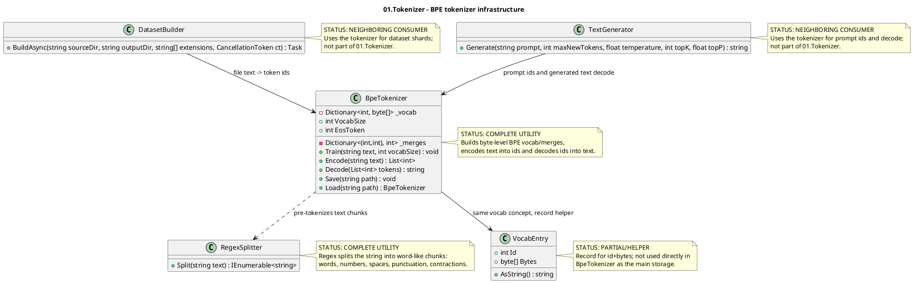

# 01.Tokenizer - deterministic BPE text infrastructure

Document status: D1C documented - parent review pending.

This document describes only the current code of `01.Tokenizer`. It does not change
production code, does not run model training and does not prove semantic
reasoning. The tokenizer turns text into integer token ids and ids back into
text. It is deterministic text infrastructure: it splits the string, applies
learned BPE merges and saves/loads the vocab/merges tables.

## 1. What this is in simple terms

`01.Tokenizer` is a translator between human text and numbers for the
rest of the LLM (Large Language Model) pipeline. A string like
`"hello world"` comes in, `BpeTokenizer.Encode` returns a list of numbers, and
`BpeTokenizer.Decode` reassembles UTF-8 text from the numbers.

It does not understand the meaning of the text, does not choose skills and does not make semantic
decisions. Its "training" is not reasoning training, but the deterministic construction
of a table of frequent byte pairs: first there are 256 byte tokens, then the most frequent
neighboring pairs are merged into new token ids.

## 2. UML for draw.io

Import: diagrams.net/draw.io -> Arrange -> Insert -> Advanced -> PlantUML.



Legend:

| Node | What it does | Status | Where it lives |
|---|---|---|---|
| `BpeTokenizer` | Trains byte-level BPE vocab/merges, encodes and decodes text | Complete utility implementation | `01.Tokenizer/BpeTokenizer.cs` |
| `RegexSplitter` | Splits text into chunks before the BPE merge loop | Complete utility implementation | `01.Tokenizer/RegexSplitter.cs` |
| `VocabEntry` | Simple record `Id + Bytes` with UTF-8 representation | Partial helper, not the main BPE storage | `01.Tokenizer/VocabEntry.cs` |
| `DatasetBuilder` | Neighboring consumer: writes token ids into dataset shards | Not part of project 01 | `02.DatasetPipeline/DatasetBuilder.cs` |
| `TextGenerator` | Neighboring consumer: encodes the prompt and decodes generated ids | Not part of project 01 | `09.Inference/TextGenerator.cs` |

### 2.1 Simulations for each UML connection

| Connection | Example input | Branch simulation | Expected result | What must not be taken as a result |
|---|---|---|---|---|
| `BpeTokenizer -> RegexSplitter` | `text="hello, world"` | `Train` and `Encode` call `RegexSplitter.Split(text)` | Chunks include word-like/space/punctuation pieces that are then converted into UTF-8 bytes | The regex must not be treated as a semantic classifier |
| `BpeTokenizer -> VocabEntry` | `Id=104`, `Bytes=[104]` | `VocabEntry.AsString()` decodes the bytes | `"h"` as a human-readable byte token | `VocabEntry` must not be treated as the real vocab storage inside `BpeTokenizer`; a `Dictionary<int, byte[]>` is used there |
| `DatasetBuilder -> BpeTokenizer` | A file contains `"hello world"` | `DatasetBuilder.BuildAsync` reads the file and calls `_tokenizer.Encode(text)` | Token ids are added to a `ushort` buffer and written to a `.npy` shard | JSON/report does not replace the real encode path |
| `TextGenerator -> BpeTokenizer` | Prompt `"Hello"` | `TextGenerator.Generate` calls `Encode(prompt)`, the model generates ids, then `Decode(new ids)` | The user receives the decoded generated suffix | The tokenizer must not be treated as a meaning generator or a sampler |

## 3. No-code algorithms, in the operator's language

### 3.1 Regex pre-tokenization

Analogy: before counting frequent letter pairs, the librarian first cuts
the text into convenient cards: words, numbers, spaces and punctuation. He does not
read the meaning, he only carefully separates the pieces.

Passport of the current implementation:

| Field | Value |
|---|---|
| Class | `RegexSplitter` |
| Method/function | `Split(string text)` |
| File and line | `01.Tokenizer/RegexSplitter.cs:15` |
| Input parameters/DTO | `text`, example: `"I'm here 42!"` |
| Output DTO/result | `IEnumerable<string>`, example chunks like `["I", "'m", " here", " 42", "!"]` by regex matches |
| Status | Complete deterministic utility |

Steps of the current algorithm:

1. A string `text` arrives.
2. The compiled regex pattern looks for contractions, optional-space letters, optional-space numbers, punctuation and whitespace.
3. The method returns `Pattern.Matches(text).Select(m => m.Value)`.
4. An empty string yields an empty sequence of matches.

Branches and simulations:

| Branch | Example input | Why it is chosen | Expected result | Check/QA |
|---|---|---|---|---|
| Letters | `"hello"` | ` ?\p{L}+` | chunk `"hello"` | indirectly via round-trip tests |
| Numbers | `" 42"` | ` ?\p{N}+` | chunk `" 42"` | gap: no direct unit test for RegexSplitter |
| Punctuation | `"!"` | ` ?[^\s\p{L}\p{N}]+` | chunk `"!"` | gap: no direct unit test for RegexSplitter |
| Empty | `""` | no matches | empty sequence | `Tests/TokenizerTests.cs:30` via `Encode("")` |

What the algorithm does NOT do:

- does not understand meaning;
- does not choose a skill or route;
- is not a trainable semantic authority;
- does not replace the BPE merge loop.

### 3.2 BPE training: vocab and merge table

Analogy: first we have 256 cards - one for each byte. Then we
look at the text many times and glue the most frequent neighboring pair of cards into
a new card, until the vocabulary reaches the desired size.

Passport of the current implementation:

| Field | Value |
|---|---|
| Class | `BpeTokenizer` |
| Method/function | `Train(string text, int vocabSize)` |
| File and line | `01.Tokenizer/BpeTokenizer.cs:22` |
| Input parameters/DTO | `text`, example `"hello hello"`; `vocabSize`, example `270` |
| Output DTO/result | `void`; mutates `_vocab`, `_merges`, `VocabSize` |
| Status | Complete deterministic BPE training utility |

Steps of the current algorithm:

1. If `vocabSize < 256`, the method throws `ArgumentOutOfRangeException`.
2. `_vocab` is initialized with byte tokens `0..255`, where each id contains a single byte.
3. `_merges` is cleared.
4. `RegexSplitter.Split(text)` splits the corpus into chunks.
5. Each chunk is turned into UTF-8 bytes, and the bytes become initial token ids.
6. While `_vocab.Count < vocabSize`, `CountPairs(chunks)` counts neighboring pairs of ids.
7. If there are no more pairs, the loop stops.
8. The most frequent pair receives `nextToken`.
9. The new vocab entry becomes the concatenation of the bytes of the two old tokens.
10. `MergeAll` replaces all occurrences of the pair in the chunks with the new token id.

Branches and simulations:

| Branch | Example input | Why it is chosen | Expected result | Check/QA |
|---|---|---|---|---|
| Invalid vocab | `vocabSize=100` | less than 256 | `ArgumentOutOfRangeException` | `Tests/TokenizerEdgeCaseTests.cs:20` |
| Minimal vocab | `vocabSize=256` | the loop is not entered, vocab is already 256 | only byte-level vocab, no merges | `Tests/TokenizerEdgeCaseTests.cs:11` |
| Merge loop | corpus `"hello hello"`, `vocabSize=270` | frequent neighboring pairs exist | vocab grows above 256 up to target or until pairs end | `Tests/TokenizerTests.cs:7` |
| No pairs left | corpus/chunks too short | `pairCounts.Count == 0` | loop stops before target | covered by code path, no direct named test |

What the algorithm does NOT do:

- does not train a semantic model;
- does not use labels, reward, DPO or skill outcomes;
- does not guarantee optimal tokenizer quality beyond frequency merges;
- does not add an explicit unknown token.

### 3.3 Encoding: text to ids

Analogy: once the vocabulary is built, new text is first cut into the same
cards, then each chunk is turned into bytes, and familiar merges are
applied in the order in which they were learned.

Passport of the current implementation:

| Field | Value |
|---|---|
| Class | `BpeTokenizer` |
| Method/function | `Encode(string text)` |
| File and line | `01.Tokenizer/BpeTokenizer.cs:53` |
| Input parameters/DTO | `text`, example `"hello world"` |
| Output DTO/result | `List<int>`, example token ids within `0..VocabSize-1` |
| Status | Complete deterministic utility |

Steps of the current algorithm:

1. An empty `List<int> result` is created.
2. The text is split via `RegexSplitter.Split`.
3. Each chunk is turned into UTF-8 bytes.
4. Each byte becomes a token id `0..255`.
5. `ApplyMerges` applies the learned `_merges` sequentially.
6. The resulting ids are added to `result`.
7. The method returns a `List<int>`.

Branches and simulations:

| Branch | Example input | Why it is chosen | Expected result | Check/QA |
|---|---|---|---|---|
| Empty text | `""` | `RegexSplitter` returns no chunks | empty token list | `Tests/TokenizerTests.cs:30` |
| Byte fallback | `"a"` | any UTF-8 byte is in the base vocab | one or more ids decode back to `"a"` | `Tests/TokenizerEdgeCaseTests.cs:27` |
| Learned merge | `"hello hello"` after repetitive training | pair exists in `_merges` | token count can be lower than byte count | `Tests/TokenizerEdgeCaseTests.cs:84` |
| Unknown token | any valid UTF-8 text | no explicit unknown token needed for bytes | unseen text still encodes as bytes/known merges | direct unknown-token test gap; behavior inferred from byte base vocab |

What the algorithm does NOT do:

- does not classify intent;
- does not map text to skills;
- does not use regex as hidden reasoning;
- does not append EOS automatically.

### 3.4 Decoding: ids to text

Analogy: the decoder takes cards with numbers, expands each into bytes and
glues the bytes back into a UTF-8 string. If a number is unknown, the current code
silently skips it.

Passport of the current implementation:

| Field | Value |
|---|---|
| Class | `BpeTokenizer` |
| Method/function | `Decode(List<int> tokens)` |
| File and line | `01.Tokenizer/BpeTokenizer.cs:67` |
| Input parameters/DTO | `tokens`, example `[104, 101, 108, 108, 111]` |
| Output DTO/result | `string`, example `"hello"` |
| Status | Complete deterministic utility, with silent unknown-id skip |

Steps of the current algorithm:

1. For each token id the method looks up the bytes in `_vocab`.
2. If the id is found, the bytes are added to the shared byte stream.
3. If the id is not found, `Array.Empty<byte>()` is added, that is, the token disappears from the output.
4. The shared byte stream is decoded via `Encoding.UTF8.GetString`.

Branches and simulations:

| Branch | Example input | Why it is chosen | Expected result | Check/QA |
|---|---|---|---|---|
| Known ids | ids from `Encode("hello")` | all ids are in the vocab | `"hello"` | `Tests/TokenizerTests.cs:16` |
| Empty token list | `[]` | no bytes | `""` | `Tests/TokenizerEdgeCaseTests.cs:52` |
| Unknown id | `[999999]` | `_vocab.TryGetValue` false | empty contribution, no exception | honest gap: no direct test found |

What the algorithm does NOT do:

- does not recover semantic intent;
- does not report an unknown-id error;
- does not insert a replacement token for missing ids.

### 3.5 Save and Load

Analogy: the tokenizer model can be put into a box: the list of merges and vocab bytes
are written to JSON, bytes are stored as Base64 strings. Later the box can be
opened and a tokenizer with the same merges retrieved.

Passport of the current implementation:

| Field | Value |
|---|---|
| Class | `BpeTokenizer` |
| Method/function | `Save(string path)`, `Load(string path)` |
| File and line | `01.Tokenizer/BpeTokenizer.cs:76`, `01.Tokenizer/BpeTokenizer.cs:91` |
| Input parameters/DTO | `path`, example `C:\temp\tokenizer.json` |
| Output DTO/result | `Save` writes JSON; `Load` returns `BpeTokenizer` |
| Status | Complete deterministic persistence utility |

Steps of the current algorithm:

1. `Save` maps `_merges` into `MergeEntry { A, B, Result }`.
2. `Save` maps `_vocab` into dictionary token id -> Base64 bytes.
3. `Save` writes serialized JSON to `path`.
4. `Load` reads file text and deserializes `SavedModel`.
5. If deserialization returns null, `Load` throws `InvalidOperationException`.
6. `Load` rebuilds `_vocab` from Base64 and `_merges` from merge entries.

Branches and simulations:

| Branch | Example input | Why it is chosen | Expected result | Check/QA |
|---|---|---|---|---|
| Save/load normal | train on `"hello world"`, save, load | valid JSON model | loaded tokenizer encodes `"hello"` same as before | `Tests/TokenizerTests.cs:37`, `Tests/TokenizerEdgeCaseTests.cs:99` |
| Bad JSON/null model | malformed file | deserialize fails/null | throws `InvalidOperationException` only for null model; malformed JSON exception not wrapped | gap: no direct negative persistence test |

What the algorithm does NOT do:

- does not validate the model schema deeply;
- does not store a semantic model checkpoint;
- does not prove downstream model quality.

## 4. Where the logic sits in the code

| Logic | File | Why this location matters | What it proves | What it does not prove |
|---|---|---|---|---|
| BPE train loop | `01.Tokenizer/BpeTokenizer.cs:22` | This is where `_vocab` and `_merges` are created | A real byte-pair frequency merge algorithm exists | Does not prove semantic training |
| Encode | `01.Tokenizer/BpeTokenizer.cs:53` | The main entry text -> ids | Text goes through regex split, UTF-8 bytes, learned merges | Does not prove intent classification |
| Decode | `01.Tokenizer/BpeTokenizer.cs:67` | The main output ids -> text | Known ids become bytes then UTF-8 string | Does not prove unknown-id validation |
| Save/load | `01.Tokenizer/BpeTokenizer.cs:76`, `01.Tokenizer/BpeTokenizer.cs:91` | Makes the tokenizer reusable | Vocab/merges persist to JSON | JSON presence alone is not model quality |
| Regex split | `01.Tokenizer/RegexSplitter.cs:11` | Defines chunk boundaries | Regex pre-tokenization exists | Regex is not semantic reasoning |
| Neighbor consumers | `02.DatasetPipeline/DatasetBuilder.cs:41`, `09.Inference/TextGenerator.cs:28` | Shows real downstream boundaries | Dataset/inference consume token ids | Does not make the tokenizer responsible for dataset/model behavior |

## 5. Short important code quotations

> **Why it matters:** this is a hard boundary: a vocab smaller than 256 is impossible, because
> the tokenizer relies on the base byte vocabulary.  
> **HOW:** if the size is smaller than the byte set, training stops with an exception before
> any state is created.  
> **WHAT:** the minimal tokenizer is 256 byte tokens, not semantic classes.

```csharp
// 01.Tokenizer/BpeTokenizer.cs:24
if (vocabSize < 256)
    throw new ArgumentOutOfRangeException(nameof(vocabSize), "Must be ≥ 256");
```

> **Why it matters:** these lines prove a real BPE bootstrap: all bytes
> exist as token ids before any merges.  
> **HOW:** `Enumerable.Range(0, 256)` creates an id for each byte.  
> **WHAT:** unseen text can still encode byte-by-byte; explicit unknown token is not used here.

```csharp
// 01.Tokenizer/BpeTokenizer.cs:27
_vocab = Enumerable.Range(0, 256)
    .ToDictionary(i => i, i => new byte[] { (byte)i });
```

> **Why it matters:** this is the BPE merge loop itself, not a declaration.  
> **HOW:** it counts all neighboring pairs, chooses the most frequent, adds a new
> token and rewrites the chunks via `MergeAll`.  
> **WHAT:** the vocabulary grows from corpus statistics, but this is a deterministic frequency rule.

```csharp
// 01.Tokenizer/BpeTokenizer.cs:40
var pairCounts = CountPairs(chunks);
var best = pairCounts.MaxBy(kv => kv.Value).Key;
_merges[best] = nextToken;
```

> **Why it matters:** encode uses the same pre-tokenization as train.  
> **HOW:** chunk -> UTF-8 bytes -> integer ids -> learned merges.  
> **WHAT:** the output is numeric ids for dataset/model layers.

```csharp
// 01.Tokenizer/BpeTokenizer.cs:56
foreach (var chunk in RegexSplitter.Split(text))
{
    var ids = Encoding.UTF8.GetBytes(chunk).Select(b => (int)b).ToList();
```

> **Why it matters:** an unknown id at decode does not raise an exception.  
> **HOW:** `TryGetValue` false becomes empty bytes.  
> **WHAT:** this is silent skip behavior, it must not be presented as robust unknown-token handling.

```csharp
// 01.Tokenizer/BpeTokenizer.cs:69
var bytes = tokens.SelectMany(t =>
    _vocab.TryGetValue(t, out var b) ? b : Array.Empty<byte>()).ToArray();
```

> **Why it matters:** the regex splitter is deterministic preprocessing, not a semantic
> classifier.  
> **HOW:** the compiled regex looks for contractions, letters, numbers, punctuation and whitespace.  
> **WHAT:** this sets the chunk boundaries before BPE.

```csharp
// 01.Tokenizer/RegexSplitter.cs:11
private static readonly Regex Pattern = new(
    @"'s|'t|'re|'ve|'m|'ll|'d| ?\p{L}+| ?\p{N}+| ?[^\s\p{L}\p{N}]+|\s+(?!\S)|\s+",
```

## 6. Test, e2e and QA mapping

D1C did not run tests/build. This is only a mapping over the test files read.

| Behavior | Verification level | Current evidence | Status | Next work order if gap |
|---|---|---|---|---|
| Train builds vocab within requested range | unit | `Tests/TokenizerTests.cs:7` | covered by existing test source, not run in D1C | none for docs |
| Encode/decode round-trip | unit | `Tests/TokenizerTests.cs:16` | covered by existing test source, not run in D1C | none for docs |
| Empty string encodes to empty list | unit | `Tests/TokenizerTests.cs:29` | covered by existing test source, not run in D1C | none for docs |
| Save/load preserves encoding | unit | `Tests/TokenizerTests.cs:37`, `Tests/TokenizerEdgeCaseTests.cs:99` | covered by existing test source, not run in D1C | none for docs |
| Vocab size below 256 throws | negative | `Tests/TokenizerEdgeCaseTests.cs:20` | covered by existing test source, not run in D1C | none for docs |
| Minimal vocab 256 | boundary | `Tests/TokenizerEdgeCaseTests.cs:11` | covered by existing test source, not run in D1C | none for docs |
| Merges reduce token count on repetitive text | unit | `Tests/TokenizerEdgeCaseTests.cs:84` | covered by existing test source, not run in D1C | none for docs |
| Tokenizer -> DatasetPipeline `.npy` boundary | integration | `Tests/IntegrationTests.cs:22`, `Tests/IntegrationTests.cs:46` | covered by existing test source, not run in D1C | none for docs |
| RegexSplitter direct branch tests | unit | no direct `RegexSplitter.Split` test found | gap | future test work order if needed |
| Decode unknown id silently skips | negative | behavior visible in source, no direct test found | gap | future test work order if this behavior should be locked |
| Malformed tokenizer JSON | negative | no direct test found | gap | future test work order if persistence hardening is needed |

## 7. Anti-false-done checks

- Tokenizer determinism must not be hidden as trained reasoning, skill
  selection, route choice, semantic ranking or product intelligence.
- `RegexSplitter` is regex infrastructure. It is not semantic classifier,
  not BM25/KNN (K-Nearest Neighbours), not DPO (Direct Preference Optimization),
  and not a learned authority.
- JSON produced by `Save` is tokenizer persistence evidence only. JSON/report/
  smoke/static validation does not replace actual tokenizer code or tests.
- BPE training here means deterministic frequency merges over bytes, not LLM
  model training and not proof that downstream generated text is good.
- Silent unknown-id skip in `Decode` must be described honestly; do not claim a
  robust unknown token unless code/tests add one.

## 8. Status table

| Component | File | Status | What actually works now |
|---|---|---|---|
| `BpeTokenizer` | `01.Tokenizer/BpeTokenizer.cs` | Complete utility | `Train`, `Encode`, `Decode`, `Save`, `Load`, `VocabSize`, `EosToken`; deterministic BPE over UTF-8 bytes |
| `RegexSplitter` | `01.Tokenizer/RegexSplitter.cs` | Complete utility | `Split(string text)` returns regex matches for contractions/letters/numbers/punctuation/whitespace |
| `VocabEntry` | `01.Tokenizer/VocabEntry.cs` | Partial helper | Record stores `Id` and `Bytes`, `AsString()` decodes UTF-8; not used as main `BpeTokenizer` storage |
| `Tokenizer.csproj` | `01.Tokenizer/Tokenizer.csproj` | Complete project config | .NET 9 library with nullable and implicit usings |
| Dataset consumer boundary | `02.DatasetPipeline/DatasetBuilder.cs` | Neighbor usage | `_tokenizer.Encode(text)` feeds dataset shard buffer |
| Inference consumer boundary | `09.Inference/TextGenerator.cs` | Neighbor usage | `Encode(prompt)` and `Decode(generated ids)` bridge text and model ids |

## 9. Hierarchy note

`01.Tokenizer` does not implement `ILearningMachine`, `ILogicalOrchestrator`,
`ILogicalFlow`, `ILogicalUnit` or `ILearningMachinePair`. It sits below those
contracts as deterministic text infrastructure. Training of logical/product
units must be described at the higher-level machine boundary, not inside
`BpeTokenizer`.

Documentation status: draft/pass-for-D1C-review.
Last verified against source: 2026-06-08.
Known gaps: no direct `RegexSplitter` tests found; no direct unknown-id decode
test found; no malformed JSON load test found.
