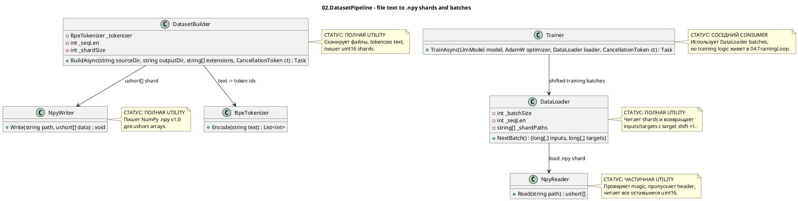

# 02.DatasetPipeline - source files to training batches

Статус документа: D1D documented - parent review pending.

Этот документ описывает только текущий код `02.DatasetPipeline`. Он не меняет
production code, не запускает build/tests и не доказывает, что модель чему-то
научилась. Dataset pipeline превращает исходные текстовые/кодовые файлы в
token arrays и `.npy` shards, а потом читает эти shards как batches для
training consumers. Это data preparation infrastructure, не model training.

## 1. Что это простыми словами

`02.DatasetPipeline` - это конвейер подготовки данных. Он берет папку с
файлами, выбирает нужные расширения, читает текст, прогоняет его через
`BpeTokenizer`, складывает token ids в `ushort` buffer и пишет NumPy `.npy`
shards. Потом `DataLoader` читает `.npy` shards и на каждый запрос возвращает
две таблицы: `inputs` и `targets`, где `targets` - это `inputs`, сдвинутые на
один token вперед.

Важно: подготовленный dataset не является доказательством обучения модели.
Он только дает правильный формат чисел для downstream training loop.

## 2. UML для draw.io

Импорт: diagrams.net/draw.io -> Arrange -> Insert -> Advanced -> PlantUML.



Легенда:

| Узел | Что делает | Статус | Где живет |
|---|---|---|---|
| `DatasetBuilder` | Собирает исходные файлы в token shards | Полная utility | `02.DatasetPipeline/DatasetBuilder.cs` |
| `NpyWriter` | Пишет `ushort[]` в NumPy `.npy` v1.0 | Полная utility | `02.DatasetPipeline/NpyWriter.cs` |
| `NpyReader` | Читает `.npy` файл обратно в `ushort[]` | Частичная utility: header не парсит подробно | `02.DatasetPipeline/NpyReader.cs` |
| `DataLoader` | Стримит batches `(inputs, targets)` из shards | Полная utility | `02.DatasetPipeline/DataLoader.cs` |
| `BpeTokenizer` | Соседняя dependency: text -> ids | См. D01 | `01.Tokenizer/BpeTokenizer.cs` |
| `Trainer` | Соседний consumer batches | См. D04 | `04.TrainingLoop/Trainer.cs` |

### 2.1 Симуляции по каждой связи UML

| Связь | Пример входа | Симуляция ветки | Ожидаемый результат | Что запрещено принимать за результат |
|---|---|---|---|---|
| `DatasetBuilder -> BpeTokenizer` | `file.md` содержит `"hello"` | `BuildAsync` читает файл и вызывает `_tokenizer.Encode(text)` | Получает integer token ids для buffer | Нельзя считать это обучением модели |
| `DatasetBuilder -> NpyWriter` | Buffer достиг `shardSize=4`, tokens `[10,11,12,1]` | Builder берет первые 4 values и вызывает `NpyWriter.Write("shard_0000.npy", shard)` | На диске появляется `.npy` file с uint16 data | JSON/report не заменяет реальную запись file bytes |
| `DataLoader -> NpyReader` | `dataDir` содержит `shard_0000.npy` | Constructor сортирует paths и вызывает `LoadShard(0)` | `_current` получает `ushort[]` из file | Smoke test без чтения файла не доказывает batch behavior |
| `Trainer -> DataLoader` | Training step asks for next batch | `Trainer.TrainAsync` вызывает `loader.NextBatch()` | Получает `long[,] inputIds2d`, `long[,] targetIds2d`; дальше превращает input в Tensor | Dataset pipeline не считает loss и не обновляет weights |

## 3. Алгоритмы без кода, по-русски

### 3.1 Dataset build: source files to `.npy` shards

Аналогия: представь архивариуса. Он обходит папку, берет только разрешенные
типы документов, переводит текст в номера словарных карточек, складывает
номера в коробки фиксированного размера и подписывает коробки `shard_0000.npy`.

Паспорт текущей реализации:

| Поле | Значение |
|---|---|
| Класс | `DatasetBuilder` |
| Метод/функция | `BuildAsync(string sourceDir, string outputDir, string[] extensions = null!, CancellationToken ct = default)` |
| Файл и строка | `02.DatasetPipeline/DatasetBuilder.cs:24` |
| Входные параметры/DTO | `sourceDir="src"`, `outputDir="data"`, `extensions=[".cs",".md"]`, `ct` |
| Выходной DTO/результат | `Task`; side effect: files `shard_0000.npy`, `shard_0001.npy` |
| Статус | Полная data-prep utility |

Шаги текущего алгоритма:

1. Если `extensions == null`, выбирается default set: `.ts`, `.cs`, `.py`, `.js`, `.txt`, `.md`.
2. Создается `outputDir`.
3. `Directory.GetFiles` рекурсивно собирает все файлы и фильтрует по extension.
4. Создается `List<ushort>` buffer размером примерно `_shardSize + 4096`.
5. Для каждого файла проверяется cancellation token.
6. Файл читается как text.
7. `_tokenizer.Encode(text)` превращает text в token ids.
8. Каждый token clamped to `ushort.MaxValue` и добавляется в buffer.
9. После каждого файла добавляется `EndOfFileToken = 1`.
10. Пока buffer достиг `_shardSize`, первые `_shardSize` values пишутся через `NpyWriter.Write`.
11. После обхода файлов остаток buffer, если он не пустой, пишется последним shard.

Ветки и симуляции:

| Ветка | Пример входа | Почему выбирается | Ожидаемый результат | Проверка/QA |
|---|---|---|---|---|
| Default extensions | `extensions=null` | method sets default list | only `.ts/.cs/.py/.js/.txt/.md` files selected | source-verified; no direct test found |
| Cancellation | `ct` canceled during file loop | `ct.ThrowIfCancellationRequested()` | operation throws cancellation before reading next file | gap: no direct test found |
| Shard full | `_shardSize=4`, buffer count 4+ | `while (buffer.Count >= _shardSize)` | writes fixed-size `shard_0000.npy`, removes range | indirect `.npy` tests, builder direct test gap |
| Remainder | final buffer count > 0 | after file loop | writes final shorter shard | builder direct test gap |
| Token too large | token id > 65535 | `Math.Min(t, ushort.MaxValue)` | value becomes `65535` | source-verified; no direct test found |

Что алгоритм НЕ делает:

- не обучает model weights;
- не проверяет semantic quality of text;
- не deduplicates or shuffles files;
- не использует `_seqLen` в current builder logic, хотя field сохраняется.

### 3.2 NumPy shard write

Аналогия: `NpyWriter` - это упаковщик, который кладет массив чисел в коробку
формата NumPy: сначала паспорт коробки, потом сами `ushort` values.

Паспорт текущей реализации:

| Поле | Значение |
|---|---|
| Класс | `NpyWriter` |
| Метод/функция | `Write(string path, ushort[] data)` |
| Файл и строка | `02.DatasetPipeline/NpyWriter.cs:11` |
| Входные параметры/DTO | `path="shard_0000.npy"`, `data=[1,2,3]` |
| Выходной DTO/результат | `.npy` file bytes on disk |
| Статус | Полная utility for uint16 1D arrays |

Шаги текущего алгоритма:

1. Открывает file stream with create/write.
2. Строит header `{'descr': '<u2', 'fortran_order': False, 'shape': (length,), }`.
3. Padding aligns total prefix+header to 64-byte boundary and adds newline.
4. Пишет magic bytes `0x93 NUMPY`.
5. Пишет version `1.0`.
6. Пишет little-endian uint16 header length.
7. Пишет padded ASCII header.
8. Пишет каждый `ushort` value.

Ветки и симуляции:

| Ветка | Пример входа | Почему выбирается | Ожидаемый результат | Проверка/QA |
|---|---|---|---|---|
| Normal write | `[100,200,300]` | valid data | file starts `0x93NUMPY`, data follows header | `Tests/NpyWriterTests.cs:7`, `Tests/NpyWriterTests.cs:26` |
| Empty data | `[]` | no explicit block | header shape `(0,)`, no data bytes | gap: no direct test found |

Что алгоритм НЕ делает:

- не writes multidimensional arrays;
- не writes float tensors;
- не compresses data;
- не atomically replaces existing files.

### 3.3 NumPy shard read

Аналогия: `NpyReader` открывает коробку NumPy, проверяет, что это настоящая
коробка NumPy по печати `NUMPY`, пропускает паспорт и читает все оставшиеся
числа как `ushort`.

Паспорт текущей реализации:

| Поле | Значение |
|---|---|
| Класс | `NpyReader` |
| Метод/функция | `Read(string path)` |
| Файл и строка | `02.DatasetPipeline/NpyReader.cs:7` |
| Входные параметры/DTO | `path="shard_0000.npy"` |
| Выходной DTO/результат | `ushort[]`, пример `[10,11,12,1]` |
| Статус | Частичная utility: validates magic, trusts header/shape |

Шаги текущего алгоритма:

1. Открывает file stream for read.
2. Читает первые 6 bytes magic.
3. Если magic не `0x93NUMPY`, throws `InvalidDataException`.
4. Читает и игнорирует version bytes.
5. Читает `headerLen` как uint16.
6. Пропускает header bytes и не парсит shape.
7. Считает remaining bytes / 2.
8. Читает каждый remaining `ushort` into array.

Ветки и симуляции:

| Ветка | Пример входа | Почему выбирается | Ожидаемый результат | Проверка/QA |
|---|---|---|---|---|
| Valid file | `.npy` written by `NpyWriter` | magic matches | returns all uint16 values after header | indirect via writer tests; no direct `NpyReader` test found |
| Invalid magic | file starts `"BAD"` | magic check fails | `InvalidDataException` | gap: no direct test found |
| Header shape mismatch | header says unexpected shape | code does not parse shape | still reads remaining bytes as 1D `ushort[]` | honest source gap |

Что алгоритм НЕ делает:

- не validates dtype beyond trusting writer/header convention;
- не parses multidimensional shape;
- не checks file length is even after header;
- не proves dataset is suitable for model learning.

### 3.4 Batch streaming: `.npy` shards to shifted inputs/targets

Аналогия: `DataLoader` - это ведущий, который читает длинную ленту tokens и
каждый раз выдает модели две строки: "что видишь сейчас" и "какой следующий
token надо предсказать".

Паспорт текущей реализации:

| Поле | Значение |
|---|---|
| Класс | `DataLoader` |
| Метод/функция | `DataLoader(string dataDir, int batchSize, int seqLen)`, `NextBatch()` |
| Файл и строка | `02.DatasetPipeline/DataLoader.cs:17`, `02.DatasetPipeline/DataLoader.cs:27` |
| Входные параметры/DTO | `dataDir="data"`, `batchSize=2`, `seqLen=4` |
| Выходной DTO/результат | `(long[,] inputs, long[,] targets)`, shapes `[batchSize, seqLen]` |
| Статус | Полная batch utility with cyclic shard loading |

Шаги текущего алгоритма:

1. Constructor remembers `_batchSize` and `_seqLen`.
2. Finds all `*.npy` files in `dataDir`, sorts paths.
3. If no shards exist, throws `InvalidOperationException`.
4. Loads first shard via `NpyReader.Read`.
5. `NextBatch` allocates `long[_batchSize, _seqLen]` for inputs and targets.
6. For each batch row, `EnsureAvailable(_seqLen + 1)` makes sure a shifted target exists.
7. Inputs copy `_current[_pos + t]`.
8. Targets copy `_current[_pos + t + 1]`.
9. `_pos++` after each row, so adjacent rows overlap by one position.
10. If current shard runs out, `EnsureAvailable` advances to next shard modulo shard count and resets `_pos=0`.

Ветки и симуляции:

| Ветка | Пример входа | Почему выбирается | Ожидаемый результат | Проверка/QA |
|---|---|---|---|---|
| No shards | empty data dir | `_shardPaths.Length == 0` | `InvalidOperationException` | gap: no direct test found |
| Normal batch | current `[10,11,12,13,14]`, `batchSize=1`, `seqLen=3` | enough tokens | inputs `[10,11,12]`, targets `[11,12,13]` | gap: no direct DataLoader test found |
| Shard rollover | `_pos + seqLen + 1 > _current.Length` | not enough tokens | loads next shard, resets `_pos` | gap: no direct test found |
| Cyclic shards | last shard exhausted | modulo shard count | loader returns to first shard | gap: no direct test found |

Что алгоритм НЕ делает:

- не shuffles batches;
- не guarantees epoch boundaries;
- не validates token ids against tokenizer vocab;
- не trains the model; it only returns arrays.

## 4. Где логика сидит в коде

| Логика | Файл | Почему это место важно | Что доказывает | Чего не доказывает |
|---|---|---|---|---|
| File scan/tokenize/shard | `02.DatasetPipeline/DatasetBuilder.cs:24` | Основной source text -> `.npy` path | Реальная запись shards существует | Не доказывает model learning |
| NPY write format | `02.DatasetPipeline/NpyWriter.cs:11` | Defines actual bytes on disk | `.npy` v1.0 uint16 writer exists | Не доказывает reader validates all metadata |
| NPY read format | `02.DatasetPipeline/NpyReader.cs:7` | Defines shard loading | Magic check and uint16 read exist | Не доказывает full NumPy parser |
| Batch formation | `02.DatasetPipeline/DataLoader.cs:27` | Training consumers call this | Shifted inputs/targets shapes `[B,T]` exist | Не доказывает shuffle/epoch semantics |
| Training consumer | `04.TrainingLoop/Trainer.cs:44` | Shows downstream usage | Trainer consumes `loader.NextBatch()` | Training behavior belongs to D04, not D02 |

## 5. Короткие важные цитаты кода

> **Почему важно:** default extensions define what source files enter the dataset
> when caller does not specify filters.  
> **HOW:** null extensions are replaced with a fixed list.  
> **WHAT:** data prep is deterministic file filtering, not semantic selection.

```csharp
// 02.DatasetPipeline/DatasetBuilder.cs:27
extensions ??= [".ts", ".cs", ".py", ".js", ".txt", ".md"];
```

> **Почему важно:** this is the actual boundary from text to token ids.  
> **HOW:** `BpeTokenizer.Encode` returns integer ids; builder clamps each id to
> `ushort.MaxValue` before writing.  
> **WHAT:** output is storage-ready token values, not learned model weights.

```csharp
// 02.DatasetPipeline/DatasetBuilder.cs:41
var tokens = _tokenizer.Encode(text);
foreach (var t in tokens)
    buffer.Add((ushort)Math.Min(t, ushort.MaxValue));
```

> **Почему важно:** EOF marker makes file boundaries visible in the token stream.  
> **HOW:** after every file, builder appends constant token `1`.  
> **WHAT:** this is a deterministic separator; it is not evidence that the model
> learned file boundaries.

```csharp
// 02.DatasetPipeline/DatasetBuilder.cs:14
private const int EndOfFileToken = 1;
```

> **Почему важно:** these bytes prove `.npy` writer is real file format code.  
> **HOW:** writer emits NumPy magic and version before header/data.  
> **WHAT:** a downstream reader can recognize the file as `.npy`.

```csharp
// 02.DatasetPipeline/NpyWriter.cs:19
bw.Write((byte)0x93);
bw.Write(Encoding.ASCII.GetBytes("NUMPY"));
```

> **Почему важно:** reader has a real negative gate for non-NumPy files.  
> **HOW:** it checks magic bytes and throws before reading data.  
> **WHAT:** this proves magic validation, not full header/schema validation.

```csharp
// 02.DatasetPipeline/NpyReader.cs:13
var magic = br.ReadBytes(6);
if (magic[0] != 0x93 || Encoding.ASCII.GetString(magic, 1, 5) != "NUMPY")
```

> **Почему важно:** this is the training batch shape behavior.  
> **HOW:** inputs take current positions, targets take positions shifted by one.  
> **WHAT:** `DataLoader` returns next-token prediction pairs for consumers.

```csharp
// 02.DatasetPipeline/DataLoader.cs:35
inputs[b, t] = _current[_pos + t];
targets[b, t] = _current[_pos + t + 1];
```

## 6. Test, e2e и QA mapping

D1D не запускал tests/build. Это только mapping по прочитанным test/source files.

| Поведение | Уровень проверки | Текущий evidence | Статус | Следующий work order если gap |
|---|---|---|---|---|
| `NpyWriter` writes NumPy magic header | unit | `Tests/NpyWriterTests.cs:7` | covered by existing test source, not run in D1D | none for docs |
| `NpyWriter` preserves uint16 data bytes | unit | `Tests/NpyWriterTests.cs:26` | covered by existing test source, not run in D1D | none for docs |
| Tokenizer -> NpyWriter boundary | integration | `Tests/IntegrationTests.cs:22`, `Tests/IntegrationTests.cs:46` | covered by existing test source, not run in D1D | none for docs |
| `DatasetBuilder.BuildAsync` end-to-end file scan/shard creation | integration | no direct test found in read scope | gap | future test work order if D02 implementation QA is required |
| `DataLoader.NextBatch` shifted target behavior | unit | source verified in `DataLoader.cs:27`; no direct test found | gap | future test work order if D02 implementation QA is required |
| `NpyReader.Read` invalid magic branch | negative | source verified in `NpyReader.cs:13`; no direct test found | gap | future test work order if D02 implementation QA is required |
| Trainer consumes batches | integration boundary | `04.TrainingLoop/Trainer.cs:44` | source evidence only, not run in D1D | D04 doc/test phase |

## 7. Anti-false-done checks

- Prepared `.npy` shards are not proof of model learning. They only prove data
  was serialized into a training-consumable format.
- A JSON/report/smoke/static validation cannot replace real file write/read
  behavior for `.npy` shards.
- `DatasetBuilder` is deterministic infrastructure; it must not be described as
  a trainable unit, semantic filter, data quality scorer or skill selector.
- `DataLoader` returns shifted token arrays; it does not compute loss, gradients,
  optimizer steps, checkpoints or evaluation metrics.
- `NpyReader` trusts header shape after checking magic. Do not claim full NumPy
  format validation.

## 8. Status table

| Компонент | Файл | Статус | Что реально работает сейчас |
|---|---|---|---|
| `DatasetBuilder` | `02.DatasetPipeline/DatasetBuilder.cs` | Полная utility | `BuildAsync` scans files, tokenizes via `BpeTokenizer`, appends EOF token `1`, writes `shard_####.npy` |
| `NpyWriter` | `02.DatasetPipeline/NpyWriter.cs` | Полная utility | `Write` emits NumPy v1.0 header and `ushort` data for 1D arrays |
| `NpyReader` | `02.DatasetPipeline/NpyReader.cs` | Частичная utility | `Read` validates magic and reads remaining bytes as `ushort[]`; does not parse full shape/dtype semantics |
| `DataLoader` | `02.DatasetPipeline/DataLoader.cs` | Полная utility | Constructor loads sorted shards; `NextBatch` returns `long[,]` inputs/targets with +1 target shift and cyclic shard rollover |
| `DatasetPipeline.csproj` | `02.DatasetPipeline/DatasetPipeline.csproj` | Полная project config | .NET 9 project references `01.Tokenizer` |

## 9. Hierarchy note

`02.DatasetPipeline` does not implement `ILearningMachine`,
`ILogicalOrchestrator`, `ILogicalFlow`, `ILogicalUnit` or
`ILearningMachinePair`. It sits below those contracts as deterministic data
preparation infrastructure. Training must be described in `04.TrainingLoop` and
domain model docs, not inside this dataset pipeline.

Documentation status: draft/pass-for-D1D-review.
Last verified against source: 2026-06-08.
Known gaps: no direct `DatasetBuilder` test found; no direct `DataLoader`
shift/rollover test found; no direct `NpyReader` invalid-magic test found.
