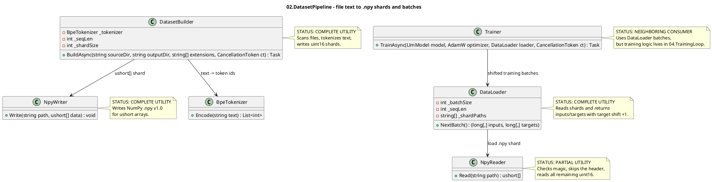

# 02.DatasetPipeline - source files to training batches

Document status: D1D documented - parent review pending.

This document describes only the current code of `02.DatasetPipeline`. It does not change
production code, does not run build/tests and does not prove that the model learned
anything. The dataset pipeline turns source text/code files into
token arrays and `.npy` shards, and then reads those shards as batches for
training consumers. This is data preparation infrastructure, not model training.

## 1. What this is in simple terms

`02.DatasetPipeline` is a data-preparation conveyor. It takes a folder of
files, selects the desired extensions, reads the text, runs it through
`BpeTokenizer`, packs token ids into a `ushort` buffer and writes NumPy `.npy`
shards. Then `DataLoader` reads the `.npy` shards and, on each request, returns
two tables: `inputs` and `targets`, where `targets` is `inputs` shifted by
one token forward.

Important: a prepared dataset is not proof that a model was trained.
It only provides the correct number format for the downstream training loop.

## 2. UML for draw.io

Import: diagrams.net/draw.io -> Arrange -> Insert -> Advanced -> PlantUML.



Legend:

| Node | What it does | Status | Where it lives |
|---|---|---|---|
| `DatasetBuilder` | Assembles source files into token shards | Complete utility | `02.DatasetPipeline/DatasetBuilder.cs` |
| `NpyWriter` | Writes `ushort[]` into NumPy `.npy` v1.0 | Complete utility | `02.DatasetPipeline/NpyWriter.cs` |
| `NpyReader` | Reads a `.npy` file back into `ushort[]` | Partial utility: does not parse the header in detail | `02.DatasetPipeline/NpyReader.cs` |
| `DataLoader` | Streams batches `(inputs, targets)` from shards | Complete utility | `02.DatasetPipeline/DataLoader.cs` |
| `BpeTokenizer` | Neighboring dependency: text -> ids | See D01 | `01.Tokenizer/BpeTokenizer.cs` |
| `Trainer` | Neighboring batch consumer | See D04 | `04.TrainingLoop/Trainer.cs` |

### 2.1 Simulations for each UML connection

| Connection | Example input | Branch simulation | Expected result | What must not be taken as a result |
|---|---|---|---|---|
| `DatasetBuilder -> BpeTokenizer` | `file.md` contains `"hello"` | `BuildAsync` reads the file and calls `_tokenizer.Encode(text)` | Gets integer token ids for the buffer | This must not be treated as model training |
| `DatasetBuilder -> NpyWriter` | Buffer reached `shardSize=4`, tokens `[10,11,12,1]` | Builder takes the first 4 values and calls `NpyWriter.Write("shard_0000.npy", shard)` | A `.npy` file with uint16 data appears on disk | JSON/report does not replace the real writing of file bytes |
| `DataLoader -> NpyReader` | `dataDir` contains `shard_0000.npy` | The constructor sorts the paths and calls `LoadShard(0)` | `_current` receives `ushort[]` from the file | A smoke test without reading the file does not prove batch behavior |
| `Trainer -> DataLoader` | Training step asks for next batch | `Trainer.TrainAsync` calls `loader.NextBatch()` | Gets `long[,] inputIds2d`, `long[,] targetIds2d`; then turns the input into a Tensor | The dataset pipeline does not compute loss and does not update weights |

## 3. No-code algorithms, in the operator's language

### 3.1 Dataset build: source files to `.npy` shards

Analogy: imagine an archivist. He walks through the folder, takes only the allowed
document types, translates the text into vocabulary-card numbers, packs the
numbers into fixed-size boxes and labels the boxes `shard_0000.npy`.

Passport of the current implementation:

| Field | Value |
|---|---|
| Class | `DatasetBuilder` |
| Method/function | `BuildAsync(string sourceDir, string outputDir, string[] extensions = null!, CancellationToken ct = default)` |
| File and line | `02.DatasetPipeline/DatasetBuilder.cs:24` |
| Input parameters/DTO | `sourceDir="src"`, `outputDir="data"`, `extensions=[".cs",".md"]`, `ct` |
| Output DTO/result | `Task`; side effect: files `shard_0000.npy`, `shard_0001.npy` |
| Status | Complete data-prep utility |

Steps of the current algorithm:

1. If `extensions == null`, the default set is chosen: `.ts`, `.cs`, `.py`, `.js`, `.txt`, `.md`.
2. `outputDir` is created.
3. `Directory.GetFiles` recursively collects all files and filters by extension.
4. A `List<ushort>` buffer of about `_shardSize + 4096` is created.
5. For each file the cancellation token is checked.
6. The file is read as text.
7. `_tokenizer.Encode(text)` turns the text into token ids.
8. Each token is clamped to `ushort.MaxValue` and added to the buffer.
9. After each file `EndOfFileToken = 1` is appended.
10. While the buffer has reached `_shardSize`, the first `_shardSize` values are written via `NpyWriter.Write`.
11. After walking the files, the remainder of the buffer, if not empty, is written as the last shard.

Branches and simulations:

| Branch | Example input | Why it is chosen | Expected result | Check/QA |
|---|---|---|---|---|
| Default extensions | `extensions=null` | method sets default list | only `.ts/.cs/.py/.js/.txt/.md` files selected | source-verified; no direct test found |
| Cancellation | `ct` canceled during file loop | `ct.ThrowIfCancellationRequested()` | operation throws cancellation before reading next file | gap: no direct test found |
| Shard full | `_shardSize=4`, buffer count 4+ | `while (buffer.Count >= _shardSize)` | writes fixed-size `shard_0000.npy`, removes range | indirect `.npy` tests, builder direct test gap |
| Remainder | final buffer count > 0 | after file loop | writes final shorter shard | builder direct test gap |
| Token too large | token id > 65535 | `Math.Min(t, ushort.MaxValue)` | value becomes `65535` | source-verified; no direct test found |

What the algorithm does NOT do:

- does not train model weights;
- does not check the semantic quality of the text;
- does not deduplicate or shuffle files;
- does not use `_seqLen` in the current builder logic, although the field is kept.

### 3.2 NumPy shard write

Analogy: `NpyWriter` is a packer that puts an array of numbers into a box
in NumPy format: first the box passport, then the `ushort` values themselves.

Passport of the current implementation:

| Field | Value |
|---|---|
| Class | `NpyWriter` |
| Method/function | `Write(string path, ushort[] data)` |
| File and line | `02.DatasetPipeline/NpyWriter.cs:11` |
| Input parameters/DTO | `path="shard_0000.npy"`, `data=[1,2,3]` |
| Output DTO/result | `.npy` file bytes on disk |
| Status | Complete utility for uint16 1D arrays |

Steps of the current algorithm:

1. Opens a file stream with create/write.
2. Builds header `{'descr': '<u2', 'fortran_order': False, 'shape': (length,), }`.
3. Padding aligns total prefix+header to 64-byte boundary and adds newline.
4. Writes magic bytes `0x93 NUMPY`.
5. Writes version `1.0`.
6. Writes little-endian uint16 header length.
7. Writes padded ASCII header.
8. Writes each `ushort` value.

Branches and simulations:

| Branch | Example input | Why it is chosen | Expected result | Check/QA |
|---|---|---|---|---|
| Normal write | `[100,200,300]` | valid data | file starts `0x93NUMPY`, data follows header | `Tests/NpyWriterTests.cs:7`, `Tests/NpyWriterTests.cs:26` |
| Empty data | `[]` | no explicit block | header shape `(0,)`, no data bytes | gap: no direct test found |

What the algorithm does NOT do:

- does not write multidimensional arrays;
- does not write float tensors;
- does not compress data;
- does not atomically replace existing files.

### 3.3 NumPy shard read

Analogy: `NpyReader` opens a NumPy box, checks that it is a real
NumPy box by the `NUMPY` stamp, skips the passport and reads all remaining
numbers as `ushort`.

Passport of the current implementation:

| Field | Value |
|---|---|
| Class | `NpyReader` |
| Method/function | `Read(string path)` |
| File and line | `02.DatasetPipeline/NpyReader.cs:7` |
| Input parameters/DTO | `path="shard_0000.npy"` |
| Output DTO/result | `ushort[]`, example `[10,11,12,1]` |
| Status | Partial utility: validates magic, trusts header/shape |

Steps of the current algorithm:

1. Opens a file stream for read.
2. Reads the first 6 bytes of magic.
3. If magic is not `0x93NUMPY`, throws `InvalidDataException`.
4. Reads and ignores the version bytes.
5. Reads `headerLen` as uint16.
6. Skips the header bytes and does not parse the shape.
7. Counts remaining bytes / 2.
8. Reads each remaining `ushort` into the array.

Branches and simulations:

| Branch | Example input | Why it is chosen | Expected result | Check/QA |
|---|---|---|---|---|
| Valid file | `.npy` written by `NpyWriter` | magic matches | returns all uint16 values after header | indirect via writer tests; no direct `NpyReader` test found |
| Invalid magic | file starts `"BAD"` | magic check fails | `InvalidDataException` | gap: no direct test found |
| Header shape mismatch | header says unexpected shape | code does not parse shape | still reads remaining bytes as 1D `ushort[]` | honest source gap |

What the algorithm does NOT do:

- does not validate dtype beyond trusting writer/header convention;
- does not parse multidimensional shape;
- does not check that file length is even after the header;
- does not prove the dataset is suitable for model learning.

### 3.4 Batch streaming: `.npy` shards to shifted inputs/targets

Analogy: `DataLoader` is a host that reads a long tape of tokens and
each time hands the model two rows: "what you see now" and "which next
token to predict".

Passport of the current implementation:

| Field | Value |
|---|---|
| Class | `DataLoader` |
| Method/function | `DataLoader(string dataDir, int batchSize, int seqLen)`, `NextBatch()` |
| File and line | `02.DatasetPipeline/DataLoader.cs:17`, `02.DatasetPipeline/DataLoader.cs:27` |
| Input parameters/DTO | `dataDir="data"`, `batchSize=2`, `seqLen=4` |
| Output DTO/result | `(long[,] inputs, long[,] targets)`, shapes `[batchSize, seqLen]` |
| Status | Complete batch utility with cyclic shard loading |

Steps of the current algorithm:

1. Constructor remembers `_batchSize` and `_seqLen`.
2. Finds all `*.npy` files in `dataDir`, sorts paths.
3. If no shards exist, throws `InvalidOperationException`.
4. Loads first shard via `NpyReader.Read`.
5. `NextBatch` allocates `long[_batchSize, _seqLen]` for inputs and targets.
6. For each batch row, `EnsureAvailable(_seqLen + 1)` makes sure a shifted target exists.
7. Inputs copy `_current[_pos + t]`.
8. Targets copy `_current[_pos + t + 1]`.
9. `_pos++` after each row, so adjacent rows overlap by one position.
10. If current shard runs out, `EnsureAvailable` advances to next shard modulo shard count and resets `_pos=0`.

Branches and simulations:

| Branch | Example input | Why it is chosen | Expected result | Check/QA |
|---|---|---|---|---|
| No shards | empty data dir | `_shardPaths.Length == 0` | `InvalidOperationException` | gap: no direct test found |
| Normal batch | current `[10,11,12,13,14]`, `batchSize=1`, `seqLen=3` | enough tokens | inputs `[10,11,12]`, targets `[11,12,13]` | gap: no direct DataLoader test found |
| Shard rollover | `_pos + seqLen + 1 > _current.Length` | not enough tokens | loads next shard, resets `_pos` | gap: no direct test found |
| Cyclic shards | last shard exhausted | modulo shard count | loader returns to first shard | gap: no direct test found |

What the algorithm does NOT do:

- does not shuffle batches;
- does not guarantee epoch boundaries;
- does not validate token ids against the tokenizer vocab;
- does not train the model; it only returns arrays.

## 4. Where the logic sits in the code

| Logic | File | Why this location matters | What it proves | What it does not prove |
|---|---|---|---|---|
| File scan/tokenize/shard | `02.DatasetPipeline/DatasetBuilder.cs:24` | The main source text -> `.npy` path | Real shard writing exists | Does not prove model learning |
| NPY write format | `02.DatasetPipeline/NpyWriter.cs:11` | Defines actual bytes on disk | `.npy` v1.0 uint16 writer exists | Does not prove the reader validates all metadata |
| NPY read format | `02.DatasetPipeline/NpyReader.cs:7` | Defines shard loading | Magic check and uint16 read exist | Does not prove a full NumPy parser |
| Batch formation | `02.DatasetPipeline/DataLoader.cs:27` | Training consumers call this | Shifted inputs/targets shapes `[B,T]` exist | Does not prove shuffle/epoch semantics |
| Training consumer | `04.TrainingLoop/Trainer.cs:44` | Shows downstream usage | Trainer consumes `loader.NextBatch()` | Training behavior belongs to D04, not D02 |

## 5. Short important code quotations

> **Why it matters:** default extensions define what source files enter the dataset
> when the caller does not specify filters.  
> **HOW:** null extensions are replaced with a fixed list.  
> **WHAT:** data prep is deterministic file filtering, not semantic selection.

```csharp
// 02.DatasetPipeline/DatasetBuilder.cs:27
extensions ??= [".ts", ".cs", ".py", ".js", ".txt", ".md"];
```

> **Why it matters:** this is the actual boundary from text to token ids.  
> **HOW:** `BpeTokenizer.Encode` returns integer ids; the builder clamps each id to
> `ushort.MaxValue` before writing.  
> **WHAT:** output is storage-ready token values, not learned model weights.

```csharp
// 02.DatasetPipeline/DatasetBuilder.cs:41
var tokens = _tokenizer.Encode(text);
foreach (var t in tokens)
    buffer.Add((ushort)Math.Min(t, ushort.MaxValue));
```

> **Why it matters:** the EOF marker makes file boundaries visible in the token stream.  
> **HOW:** after every file, the builder appends the constant token `1`.  
> **WHAT:** this is a deterministic separator; it is not evidence that the model
> learned file boundaries.

```csharp
// 02.DatasetPipeline/DatasetBuilder.cs:14
private const int EndOfFileToken = 1;
```

> **Why it matters:** these bytes prove the `.npy` writer is real file-format code.  
> **HOW:** the writer emits NumPy magic and version before header/data.  
> **WHAT:** a downstream reader can recognize the file as `.npy`.

```csharp
// 02.DatasetPipeline/NpyWriter.cs:19
bw.Write((byte)0x93);
bw.Write(Encoding.ASCII.GetBytes("NUMPY"));
```

> **Why it matters:** the reader has a real negative gate for non-NumPy files.  
> **HOW:** it checks magic bytes and throws before reading data.  
> **WHAT:** this proves magic validation, not full header/schema validation.

```csharp
// 02.DatasetPipeline/NpyReader.cs:13
var magic = br.ReadBytes(6);
if (magic[0] != 0x93 || Encoding.ASCII.GetString(magic, 1, 5) != "NUMPY")
```

> **Why it matters:** this is the training batch shape behavior.  
> **HOW:** inputs take current positions, targets take positions shifted by one.  
> **WHAT:** `DataLoader` returns next-token prediction pairs for consumers.

```csharp
// 02.DatasetPipeline/DataLoader.cs:35
inputs[b, t] = _current[_pos + t];
targets[b, t] = _current[_pos + t + 1];
```

## 6. Test, e2e and QA mapping

D1D did not run tests/build. This is only a mapping over the test/source files read.

| Behavior | Verification level | Current evidence | Status | Next work order if gap |
|---|---|---|---|---|
| `NpyWriter` writes NumPy magic header | unit | `Tests/NpyWriterTests.cs:7` | covered by existing test source, not run in D1D | none for docs |
| `NpyWriter` preserves uint16 data bytes | unit | `Tests/NpyWriterTests.cs:26` | covered by existing test source, not run in D1D | none for docs |
| Tokenizer -> NpyWriter boundary | integration | `Tests/IntegrationTests.cs:22`, `Tests/IntegrationTests.cs:46` | covered by existing test source, not run in D1D | none for docs |
| `DatasetBuilder.BuildAsync` end-to-end file scan/shard creation | integration | no direct test found in read scope | gap | future test work order if D02 implementation QA is required |
| `DataLoader.NextBatch` shifted target behavior | unit | source verified in `DataLoader.cs:27`; no direct test found | gap | future test work order if D02 implementation QA is required |
| `NpyReader.Read` invalid magic branch | negative | source verified in `NpyReader.cs:13`; no direct test found | gap | future test work order if D02 implementation QA is required |
| Trainer consumes batches | integration boundary | `04.TrainingLoop/Trainer.cs:44` | source evidence only, not run in D1D | D04 doc/test phase |

## 7. Anti-false-done checks

- Prepared `.npy` shards are not proof of model learning. They only prove data
  was serialized into a training-consumable format.
- A JSON/report/smoke/static validation cannot replace real file write/read
  behavior for `.npy` shards.
- `DatasetBuilder` is deterministic infrastructure; it must not be described as
  a trainable unit, semantic filter, data quality scorer or skill selector.
- `DataLoader` returns shifted token arrays; it does not compute loss, gradients,
  optimizer steps, checkpoints or evaluation metrics.
- `NpyReader` trusts header shape after checking magic. Do not claim full NumPy
  format validation.

## 8. Status table

| Component | File | Status | What actually works now |
|---|---|---|---|
| `DatasetBuilder` | `02.DatasetPipeline/DatasetBuilder.cs` | Complete utility | `BuildAsync` scans files, tokenizes via `BpeTokenizer`, appends EOF token `1`, writes `shard_####.npy` |
| `NpyWriter` | `02.DatasetPipeline/NpyWriter.cs` | Complete utility | `Write` emits NumPy v1.0 header and `ushort` data for 1D arrays |
| `NpyReader` | `02.DatasetPipeline/NpyReader.cs` | Partial utility | `Read` validates magic and reads remaining bytes as `ushort[]`; does not parse full shape/dtype semantics |
| `DataLoader` | `02.DatasetPipeline/DataLoader.cs` | Complete utility | Constructor loads sorted shards; `NextBatch` returns `long[,]` inputs/targets with +1 target shift and cyclic shard rollover |
| `DatasetPipeline.csproj` | `02.DatasetPipeline/DatasetPipeline.csproj` | Complete project config | .NET 9 project references `01.Tokenizer` |

## 9. Hierarchy note

`02.DatasetPipeline` does not implement `ILearningMachine`,
`ILogicalOrchestrator`, `ILogicalFlow`, `ILogicalUnit` or
`ILearningMachinePair`. It sits below those contracts as deterministic data
preparation infrastructure. Training must be described in `04.TrainingLoop` and
domain model docs, not inside this dataset pipeline.

Documentation status: draft/pass-for-D1D-review.
Last verified against source: 2026-06-08.
Known gaps: no direct `DatasetBuilder` test found; no direct `DataLoader`
shift/rollover test found; no direct `NpyReader` invalid-magic test found.
