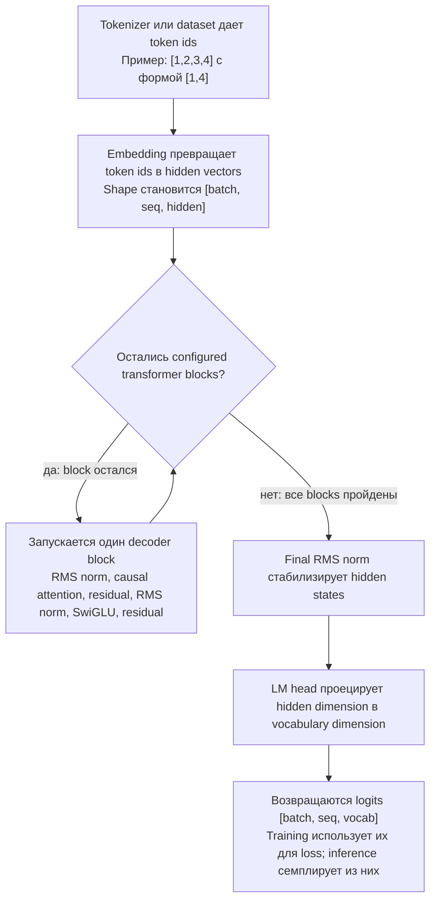

# 03.TransformerModel - инфраструктура transformer-модели

RP01.03A, 15.10.2026: streaming `ValidateFullCheckpointArtifact` имеет отдельный
overload с `FullCheckpointLoraTopology`. Он строит точную дополнительную схему
канонических attention A/B slots по rank, target modules и model config;
k/v используют `NumKvHeads × headDim`, q/o — `HiddenDim`. Прежние count, key,
shape, finite payload, bounds, fingerprint и exact EOF проверки сохраняются.
Overload без topology по-прежнему требует только базовые параметры и отвергает
полный checkpoint с адаптерами. Схема не создаёт модель и не выдаёт разрешение
на обучение; alpha/dropout/seed и sealed bytes связывает server-owned owner14/25.

Новый overload с topology возвращает канонический `OperationResult<bool>` из
`00.Core`: успешный результат содержит только `true`, а отказ сохраняет точный
код codec для count/key/shape/payload. Явная cancellation продолжает передаваться
исключением. Прежние base-only public void signatures и их поведение сохранены.
Зависимость `03 → 00.Core → 29.SemanticCompiler` не вводит ссылок на LoRA/training.

## Человеческое объяснение

`03.TransformerModel` - это часть проекта, которая превращает тензор с id токенов в logits модели. Проще: `01.Tokenizer` и `02.DatasetPipeline` готовят числовые id, этот проект пропускает их через decoder-only transformer stack и возвращает оценку для каждого возможного следующего токена.

Это важная инфраструктура, но не продуктовая логика рассуждения сама по себе. Класс `LlmModel` может содержать обучаемые параметры и при этом не знать ничего полезного, пока `04.TrainingLoop` не обучит эти параметры или `LoadCheckpoint` не загрузит реальный checkpoint. JSON-отчет, smoke-проверка или проверка только формы тензора не доказывают, что модель выучила язык, проектные навыки или доменное рассуждение.

Граница данных:

- Вход из `01.Tokenizer` или `02.DatasetPipeline`: id токенов как `Tensor [batch, seq]`.
- Внутренняя математика из `00.TensorCore`: `Tensor`, `Module`, `Parameter`, `Linear`, `Embedding`, `TensorOps`.
- Выход для `04.TrainingLoop` или `09.Inference`: logits как `Tensor [batch, seq, vocabSize]`.
- Граница обучения: gradients и optimizer steps находятся в `04.TrainingLoop`; этот проект предоставляет параметры и forward-математику.

## 0. UML диаграмма классов

```mermaid
classDiagram
    class ModelConfig {
        +int VocabSize
        +int ContextLen
        +int HiddenDim
        +int NumLayers
        +int NumHeads
        +int NumKvHeads
        +int FfnHiddenDim
        +float RopeTheta
        +float RmsNormEps
        +int HeadDim
        +int KvGroupSize
        +Small
    }

    class LlmModel {
        +ModelConfig Config
        +IReadOnlyList~TransformerBlock~ Blocks
        +Forward(Tensor tokenIds) Tensor
        +ForwardHidden(Tensor tokenIds) Tensor
        +SaveCheckpoint(string path) void
        +LoadCheckpoint(string path) void
    }

    class TransformerBlock {
        +CausalSelfAttention Attention
        +Forward(Tensor x) Tensor
    }

    class CausalSelfAttention {
        +Forward(Tensor x) Tensor
    }

    class RotaryEmbedding {
        +GetFrequencies(int seqLen) (Tensor cos, Tensor sin)
        +Apply(Tensor x, Tensor cos, Tensor sin) Tensor
    }

    class RmsNorm {
        +Forward(Tensor x) Tensor
    }

    class SwiGLUFeedForward {
        +Forward(Tensor x) Tensor
    }

    class TensorCore {
        Tensor
        Module
        Linear
        Embedding
        TensorOps
    }

    class DataLoader {
        +NextBatch() (long[,] inputs, long[,] targets)
    }

    class Trainer {
        +TrainAsync(LlmModel model, AdamW optimizer, DataLoader loader)
    }

    class TextGenerator {
        +Generate(string prompt, int maxNewTokens, float temperature, int topK, float topP) string
    }

    LlmModel --> ModelConfig : читает размеры модели
    LlmModel --> TensorCore : embedding, final norm, lm head
    LlmModel --> TransformerBlock : владеет N блоками
    TransformerBlock --> RmsNorm : нормализует hidden state перед веткой
    TransformerBlock --> CausalSelfAttention : ветка attention
    TransformerBlock --> SwiGLUFeedForward : ветка feed-forward
    CausalSelfAttention --> RotaryEmbedding : поворачивает Q и K
    CausalSelfAttention --> TensorCore : projection, reshape, mask, softmax
    SwiGLUFeedForward --> TensorCore : Linear и TensorOps
    RmsNorm --> TensorCore : Parameter и TensorOps
    DataLoader ..> LlmModel : token ids для обучения
    Trainer ..> LlmModel : обучает через Forward и параметры
    TextGenerator ..> LlmModel : logits для inference

    note for ModelConfig "ПОЛНОСТЬЮ РЕАЛИЗОВАНО\nХранит архитектурные гиперпараметры и вычисляет HeadDim/KvGroupSize.\nНе проверяет качество смыслового поведения."
    note for LlmModel "ПОЛНОСТЬЮ РЕАЛИЗОВАННАЯ ИНФРАСТРУКТУРА\nToken ids -> logits, hidden states, checkpoint save/load.\nСам себя не обучает."
    note for TransformerBlock "ПОЛНОСТЬЮ РЕАЛИЗОВАННАЯ ИНФРАСТРУКТУРА\nPre-norm residual attention + feed-forward.\nСохраняет форму hidden tensor."
    note for CausalSelfAttention "ПОЛНОСТЬЮ РЕАЛИЗОВАННАЯ ИНФРАСТРУКТУРА\nQ/K/V projections, RoPE, GQA expansion, causal mask, softmax attention."
    note for RotaryEmbedding "ПОЛНОСТЬЮ РЕАЛИЗОВАННАЯ УТИЛИТА\nСчитает cos/sin частоты и поворачивает Q/K векторы по позиции токена."
    note for RmsNorm "ПОЛНОСТЬЮ РЕАЛИЗОВАННЫЙ СЛОЙ\nRMS normalization с обучаемым gamma."
    note for SwiGLUFeedForward "ПОЛНОСТЬЮ РЕАЛИЗОВАННЫЙ СЛОЙ\nGate/up/down projections с SiLU gate."
    note for TensorCore "ВНЕШНЯЯ ОСНОВА\nTensor storage, layers, parameters и math ops приходят из 00.TensorCore."
    note for DataLoader "ВНЕШНИЙ ПОСТАВЩИК ВХОДА\nДает shifted token batches из 02.DatasetPipeline."
    note for Trainer "ВНЕШНИЙ ВЛАДЕЛЕЦ ОБУЧЕНИЯ\nLoss, backward, optimizer и checkpoint schedule находятся в 04.TrainingLoop."
    note for TextGenerator "ВНЕШНИЙ INFERENCE-ПОТРЕБИТЕЛЬ\nТокенизирует prompt, семплирует следующие токены из logits."
```



| Класс | Что делает | Статус |
|---|---|---|
| `ModelConfig` | Центрально хранит размеры модели: vocab, context, hidden size, layer count, attention heads, KV heads, FFN size, RoPE theta, RMS epsilon. | Полностью реализованный config record |
| `LlmModel` | Собирает embedding, повторяющиеся transformer blocks, final norm и LM head; прогоняет token ids до logits; сохраняет/загружает raw parameter weights. | Полностью реализованная model infrastructure |
| `TransformerBlock` | Один decoder block: `x + attention(norm1(x))`, затем `x + ffn(norm2(x))`. | Полностью реализованная композиция слоев |
| `CausalSelfAttention` | Causal multi-head self-attention с GQA, RoPE, causal mask и output projection. | Полностью реализованная attention infrastructure |
| `RotaryEmbedding` | Position encoding helper для Q/K vectors. | Полностью реализованная утилита |
| `RmsNorm` | RMS normalization layer с обучаемым gamma. | Полностью реализованный слой |
| `SwiGLUFeedForward` | Feed-forward transformer branch через gate/up/down projections. | Полностью реализованный слой |
| `TensorCore` | Предоставляет tensor, module, parameters, initializers и operations. | Внешняя зависимость из `00.TensorCore` |
| `DataLoader` | Дает batches token ids и targets для обучения. | Внешний поставщик входных данных |
| `Trainer` | Использует model forward pass, loss, backward и optimizer updates. | Внешний владелец обучения |
| `TextGenerator` | Использует tokenizer и model logits для autoregressive generation. | Внешний inference-потребитель |

### Симуляции соединений

| Соединение | Пример входа | Что происходит | Ожидаемый результат | Что нельзя принимать как доказательство |
|---|---|---|---|---|
| `LlmModel -> ModelConfig` | `new ModelConfig { VocabSize=64, HiddenDim=16, NumLayers=1, NumHeads=2, NumKvHeads=1 }` | Конструктор читает размеры и создает embedding, один block, final norm и LM head. | Модули совместимы по shape для `Forward([1,4]) -> [1,4,64]`. | Один config object не доказывает обученное поведение. |
| `LlmModel -> TensorCore` | Token ids tensor `[1, 2, 3, 4]` с формой `[1,4]`. | `Embedding`, `RmsNorm`, `Linear` и `TensorOps` несут числовой tensor flow. | Output logits tensor имеет форму `[1,4,VocabSize]`. | Успешная shape-проверка не доказывает полезные predictions. |
| `LlmModel -> TransformerBlock` | Hidden tensor `[B=1,T=4,H=16]`. | Каждый configured block преобразует hidden states и сохраняет ту же hidden shape. | Final hidden остается `[1,4,16]` перед LM head. | Наличие block не доказывает learning. |
| `TransformerBlock -> RmsNorm` | Hidden vector `[1,2,3,4]` с `eps=1e-5`. | RMS norm масштабирует vector через inverse root mean square и gamma. | Shape не меняется; RMS примерно 1, когда gamma initialized as ones. | Normalization - math infrastructure, не semantic reasoning. |
| `TransformerBlock -> CausalSelfAttention` | Normalized hidden `[1,4,16]`. | Attention создает Q/K/V, применяет RoPE и causal mask, затем возвращает projected hidden. | Shape остается `[1,4,16]`; future tokens masked. | Causal mask сам по себе не доказывает language quality. |
| `TransformerBlock -> SwiGLUFeedForward` | Attention-updated hidden `[1,4,16]`. | Second norm подает tensor в gate/up/down projection path. | Shape возвращается к `[1,4,16]` для residual add. | Deterministic matrix math не является trainable product unit сама по себе. |
| `CausalSelfAttention -> RotaryEmbedding` | Q/K tensors `[1,2,4,8]`, `seq=4`. | RoPE строит cos/sin `[4,4]` и вращает paired vector halves. | Норма каждого vector сохраняется после rotation. | Position rotation не доказывает, что model понимает positions после training. |
| `CausalSelfAttention -> TensorCore` | Q/K/V tensors после projection. | Tensor ops transpose K, matmul scores, scale, mask, softmax, matmul V, reshape. | Attention output `[B,heads,T,headDim]`, затем combined `[B,T,H]`. | Smoke run без проверки mask/shape не заменяет layer tests. |
| `SwiGLUFeedForward -> TensorCore` | Hidden `[1,4,16]`. | `gate_proj` проходит через SiLU, `up_proj` остается linear, оба tensor перемножаются, затем идет `down_proj`. | Output hidden `[1,4,16]`. | Feed-forward activation не является product reasoning. |
| `RmsNorm -> TensorCore` | Tensor `[..., dim]` и parameter `gamma[dim]`. | Используются pow, mean, add epsilon, rsqrt, broadcast multiply. | Normalized tensor с исходной shape. | JSON report не заменяет numeric checks для shape и RMS behavior. |
| `DataLoader -> LlmModel` | `DataLoader.NextBatch()` возвращает `long[,] inputs` и `long[,] targets`. | `Trainer` flatten-ит inputs и переводит их в float token-id tensor `[B,T]`. | Model получает batch/seq shape, которую ожидает `Forward`. | Prepared data не доказывает, что model learned. |
| `Trainer -> LlmModel` | `TrainAsync(model, optimizer, loader)`. | Trainer вызывает `model.Forward`, считает cross entropy, backpropagates, clips gradients, делает optimizer step. | Model parameters могут обновляться через `04.TrainingLoop`. | Существование model file без training evidence не делает модель trained. |
| `TextGenerator -> LlmModel` | Prompt `"hi"`, encoded ids `[104,105]`. | Generator вызывает `Forward([1,T])`, берет last logits, samples next token. | Text generation получает logits от model и decoding от tokenizer. | String от random/untrained weights не доказывает reasoning quality. |

## 1. Человеческая схема потока



Симуляции веток:

| Ветка решения | Пример входа | Ожидаемый результат | Что нельзя принимать |
|---|---|---|---|
| Blocks еще остались | `NumLayers=1`, after embedding `[1,4,16]`. | Один `TransformerBlock.Forward` запускается и возвращает `[1,4,16]`. | Нельзя считать один forward pass training evidence. |
| Blocks больше нет | После последнего configured block. | Final norm и LM head создают `[1,4,VocabSize]`. | Нельзя считать logits shape доказательством useful language behavior. |

## 2. Алгоритмы без кода на русском

### Алгоритм A: `ModelConfig`

Аналогия: это чертеж модели. Он сам не строит дом, но говорит, сколько в нем этажей, комнат и коммуникаций.

Где находится логика: `03.TransformerModel/Config/ModelConfig.cs:7`.

Сигнатура и данные:

```csharp
public record ModelConfig

Пример входного DTO:
ModelConfig {
    VocabSize = 64,
    ContextLen = 8,
    HiddenDim = 16,
    NumLayers = 1,
    NumHeads = 2,
    NumKvHeads = 1,
    FfnHiddenDim = 32,
    RopeTheta = 10000f,
    RmsNormEps = 1e-5f
}

Выходной результат:
HeadDim = HiddenDim / NumHeads = 8
KvGroupSize = NumHeads / NumKvHeads = 2
```

Текущее поведение:

1. Хранит architecture hyperparameters с defaults.
2. Вычисляет `HeadDim` из hidden dimension и query head count.
3. Вычисляет `KvGroupSize` для grouped-query attention.
4. Дает preset `Small` для меньшей модели.

Ветки и ограничения:

- Если caller задает несовместимые dimensions, record не выполняет активную проверку делимости; consumers предполагают совместимые values.
- Он не хранит trained weights, tokenizer vocabulary или dataset pointers.

Статус: полностью реализованный config record.

### Алгоритм B: `LlmModel.LlmModel(ModelConfig cfg)`

Аналогия: это сборочный этап. Он ставит входной стол, повторяющиеся станции обработки, финальный стабилизатор и выходное табло в правильном порядке.

Где находится логика: `03.TransformerModel/LlmModel.cs:23`.

Сигнатура и данные:

```csharp
public LlmModel(ModelConfig cfg)

Пример входного DTO:
cfg = ModelConfig { VocabSize=64, HiddenDim=16, NumLayers=1, NumHeads=2, NumKvHeads=1 }

Выходной результат:
new LlmModel with registered modules:
token_embedding, block_0, final_norm, lm_head
```

Текущее поведение:

1. Сохраняет config в `_cfg`.
2. Создает token embedding из `VocabSize` в `HiddenDim`.
3. Создает `NumLayers` transformer blocks.
4. Создает final `RmsNorm`.
5. Создает `Linear(HiddenDim, VocabSize, useBias:false)` как LM head.
6. Регистрирует все modules, чтобы `Parameters()` находил их для save/load/training.

Ветки и ограничения:

- Больше layers в config означает больше instances `TransformerBlock`.
- Constructor initializes architecture and parameters; он не обучает их и не загружает checkpoint автоматически.

Статус: полностью реализованная model construction infrastructure.

### Алгоритм C: `LlmModel.Forward(Tensor tokenIds)`

Аналогия: предложение входит как номера билетов; модель проводит их через ряд машин и возвращает табло с оценками, какой token может быть следующим в каждой позиции.

Где находится логика: `03.TransformerModel/LlmModel.cs:42`.

Сигнатура и данные:

```csharp
public Tensor Forward(Tensor tokenIds)

Вход:
tokenIds = Tensor(float[] { 1, 2, 3, 4 }, TensorShape(1, 4))

Выход:
Tensor logits with shape [1, 4, VocabSize]
```

Текущее поведение:

1. Превращает token ids в hidden vectors через `_tokenEmbedding.Forward`.
2. Запускает каждый configured `TransformerBlock` по порядку.
3. Применяет `_finalNorm`.
4. Применяет `_lmHead`, чтобы спроецировать hidden dimension в vocabulary size.
5. Возвращает logits.

Ветки и ограничения:

- Если `NumLayers=1`, запускается один block; если `NumLayers=4`, запускаются четыре blocks.
- Method assumes, что `tokenIds` содержит valid token ids; out-of-vocabulary behavior относится к tokenizer/data validation, не к этому method.
- Он не считает loss, не samples text и не обновляет weights.

Статус: полностью реализованный forward primitive для inference/training.

### Алгоритм D: `LlmModel.ForwardHidden(Tensor tokenIds)`

Аналогия: этот путь останавливается перед финальным табло и возвращает внутренние заметки модели после чтения tokens.

Где находится логика: `03.TransformerModel/LlmModel.cs:52`.

Сигнатура и данные:

```csharp
public Tensor ForwardHidden(Tensor tokenIds)

Вход:
tokenIds = Tensor(float[] { 5, 6 }, TensorShape(1, 2))

Выход:
Tensor hidden with shape [1, 2, HiddenDim]
```

Текущее поведение:

1. Запускает token embedding.
2. Запускает все transformer blocks.
3. Применяет final norm.
4. Возвращает hidden states без LM head projection.

Ветки и ограничения:

- Полезно для embedding-like consumers.
- Не возвращает token probabilities и не выполняет pooling само по себе.

Статус: полностью реализованный hidden-state primitive.

### Алгоритм E: `TransformerBlock.Forward(Tensor x)`

Аналогия: один transformer block похож на двухэтапного редактора. Сначала он проверяет, на какие прошлые tokens можно смотреть, затем переписывает внутренние features каждого token.

Где находится логика: `03.TransformerModel/TransformerBlock.cs:35`.

Сигнатура и данные:

```csharp
public Tensor Forward(Tensor x)

Вход:
x = Tensor shape [batch, seq, HiddenDim], example [1,4,16]

Выход:
Tensor shape [batch, seq, HiddenDim], same shape as input
```

Текущее поведение:

1. Применяет `_norm1`.
2. Запускает `_attn.Forward` на normalized hidden states.
3. Добавляет attention output обратно к исходному `x` как residual.
4. Применяет `_norm2`.
5. Запускает `_ffn.Forward`.
6. Добавляет feed-forward output обратно как second residual.

Ветки и ограничения:

- Semantic branch selection здесь нет; это fixed transformer math.
- Он сохраняет shape, но меняет values.
- Он exposes `Attention` for `LoraApplicator`; это не означает, что LoRA applied by default.

Статус: полностью реализованная transformer block infrastructure.

### Алгоритм F: `CausalSelfAttention.Forward(Tensor x)`

Аналогия: каждый token задает вопросы предыдущим tokens, но занавес не дает ему увидеть будущее.

Где находится логика: `03.TransformerModel/Layers/CausalSelfAttention.cs:38`.

Сигнатура и данные:

```csharp
public Tensor Forward(Tensor x)

Вход:
x = Tensor shape [batch, seq, HiddenDim], example [1,4,16]

Выход:
Tensor shape [batch, seq, HiddenDim]
```

Текущее поведение:

1. Читает batch, sequence length, number of query heads, number of KV heads и head dimension.
2. Проецирует `x` в Q, K, V через bias-free linear layers.
3. Reshapes Q в `[B, NumHeads, T, HeadDim]`.
4. Reshapes K/V в `[B, NumKvHeads, T, HeadDim]`.
5. Computes RoPE cos/sin frequencies for sequence length.
6. Applies RoPE to Q and K.
7. Если `NumKvHeads < NumHeads`, repeats K/V heads by `KvGroupSize`.
8. Computes scaled dot-product attention with causal mask.
9. Reshapes attention output back to `[B,T,H]`.
10. Applies output projection.

Ветки и ограничения:

- GQA branch: когда `NumKvHeads < NumHeads`, K/V повторяются; когда equal, repeat не нужен.
- Causal mask branch: future positions получают `NegativeInfinity` before softmax.
- Здесь нет KV cache; generation currently calls full forward for supplied ids.

Статус: полностью реализованная attention layer infrastructure.

### Алгоритм G: `CausalSelfAttention.ScaledDotProduct(Tensor q, Tensor k, Tensor v, int seq)`

Аналогия: это таблица оценок: каждый token получает score, насколько ему слушать каждый разрешенный token.

Где находится логика: `03.TransformerModel/Layers/CausalSelfAttention.cs:75`.

Сигнатура и данные:

```csharp
private static Tensor ScaledDotProduct(Tensor q, Tensor k, Tensor v, int seq)

Вход:
q/k/v = Tensor shape [B, heads, T, HeadDim], seq = T

Выход:
Tensor shape [B, heads, T, HeadDim]
```

Текущее поведение:

1. Считает scale как `sqrt(HeadDim)`.
2. Transposes K on the last two axes.
3. Computes `scores = Q @ K^T / sqrt(HeadDim)`.
4. Создает lower-triangle mask.
5. Replaces future scores with negative infinity.
6. Applies softmax over key positions.
7. Multiplies weights by V.

Ветки и ограничения:

- Все future-token positions blocked before softmax.
- Attention weights наружу не возвращаются.

Статус: полностью реализованная private attention math.

### Алгоритм H: `RotaryEmbedding.GetFrequencies(int seqLen)` и `RotaryEmbedding.Apply(...)`

Аналогия: RoPE как стрелки часов на token vectors: position меняет angle, а не длину vector.

Где находится логика: `03.TransformerModel/Layers/RotaryEmbedding.cs:21` and `03.TransformerModel/Layers/RotaryEmbedding.cs:43`.

Сигнатура и данные:

```csharp
public (Tensor cos, Tensor sin) GetFrequencies(int seqLen)
public static Tensor Apply(Tensor x, Tensor cos, Tensor sin)

Вход:
seqLen = 4, dim = 8
x = Tensor shape [batch, heads, seq, dim]

Выход:
cos/sin shape [seqLen, dim/2]
rotated tensor with the same shape as x
```

Текущее поведение:

1. Строит frequencies `1 / theta^(2i/dim)` для каждой dimension pair.
2. Строит positions `0..seqLen-1`.
3. Computes outer product positions by frequencies.
4. Возвращает cos and sin tables.
5. `Apply` splits each vector into two halves and rotates each pair with `(x1*c - x2*s, x1*s + x2*c)`.

Ветки и ограничения:

- Assumes even head dimension.
- Preserves vector norm, но не learns position embeddings.

Статус: полностью реализованная position utility.

### Алгоритм I: `RmsNorm.Forward(Tensor x)`

Аналогия: RMS norm приводит каждый hidden vector к сопоставимой громкости перед тем, как следующий слой будет его слушать.

Где находится логика: `03.TransformerModel/Layers/RmsNorm.cs:23`.

Сигнатура и данные:

```csharp
public Tensor Forward(Tensor x)

Вход:
x = Tensor shape [..., dim], example [1,1,4] with values [1,2,3,4]

Выход:
Tensor with same shape, scaled by 1/sqrt(mean(x^2)+eps) and gamma
```

Текущее поведение:

1. Squares `x`.
2. Computes mean over the last axis.
3. Adds epsilon.
4. Computes reciprocal square root.
5. Broadcast-multiplies original `x` by RMS scale.
6. Broadcast-multiplies by learnable `gamma`.

Ветки и ограничения:

- Zero input не throws, потому что epsilon prevents division by zero.
- Не subtracts mean, в отличие от classic LayerNorm.

Статус: полностью реализованный normalization layer.

### Алгоритм J: `SwiGLUFeedForward.Forward(Tensor x)`

Аналогия: это контролируемое расширение: одна projection предлагает информацию, другая projection плавно открывает или закрывает gate.

Где находится логика: `03.TransformerModel/Layers/SwiGLUFeedForward.cs:32`.

Сигнатура и данные:

```csharp
public Tensor Forward(Tensor x)

Вход:
x = Tensor shape [batch, seq, HiddenDim], example [1,4,16]

Выход:
Tensor shape [batch, seq, HiddenDim]
```

Текущее поведение:

1. Sends `x` through `_gateProj`.
2. Applies SiLU to the gate path.
3. Sends `x` through `_upProj`.
4. Elementwise-multiplies gate and up tensors.
5. Sends the result through `_downProj` back to hidden dimension.

Ветки и ограничения:

- Fixed feed-forward math; здесь нет routing или skill selection.
- Trainable weights существуют в linear layers, но этот method их не обучает.

Статус: полностью реализованный feed-forward layer.

### Алгоритм K: `LlmModel.SaveCheckpoint(string path)` и `LoadCheckpoint(string path)`

Аналогия: checkpoint save - это снимок всех ручек настройки в машине. Loading ставит эти ручки обратно, но не доказывает, что они были хорошо обучены.

Где находится логика: `03.TransformerModel/LlmModel.cs:61` and `03.TransformerModel/LlmModel.cs:68`.

Сигнатура и данные:

```csharp
public void SaveCheckpoint(string path)
public void LoadCheckpoint(string path)

Вход:
path = "checkpoints/ckpt_000100.bin"

Выход:
SaveCheckpoint writes binary float weights.
LoadCheckpoint mutates current Parameters() from that file.
```

Текущее поведение:

1. Save writes to `path + ".tmp"`.
2. Save serializes parameter count, each parameter rank, dimensions, and float data.
3. Save atomically moves `.tmp` to final path.
4. Load reads parameters in the same order.
5. Load writes read float values into current parameter tensors.

Ветки и ограничения:

- Load reads up to `Math.Min(fileCount, currentParameterCount)`; он не rejects mismatched architectures явно.
- Checkpoint presence - это только persistence evidence, не training quality evidence.

Статус: checkpoint persistence реализован; ограничение по architecture mismatch указано честно.

## 3. Важные ссылки на код

### Сборка модели и регистрация modules

Ссылка: `03.TransformerModel/LlmModel.cs:23-38`.

> Почему важно: `Parameters()` и checkpoint save/load зависят от регистрации modules. Без регистрации training или serialization могли бы молча пропустить weights.
> Вход: `ModelConfig`.
> Выход: graph модели с embedding, N blocks, final norm и LM head.
> Какая ветка доказана: `NumLayers` управляет числом registered blocks.
> Чего это не доказывает: что weights обучены или полезны.

```csharp
_tokenEmbedding = new Embedding(cfg.VocabSize, cfg.HiddenDim);
_blocks = Enumerable.Range(0, cfg.NumLayers)
    .Select(_ => new TransformerBlock(cfg))
    .ToList();
_finalNorm = new RmsNorm(cfg.HiddenDim, cfg.RmsNormEps);
_lmHead    = new Linear(cfg.HiddenDim, cfg.VocabSize, useBias: false);
```

### Путь `Forward` от ids к logits

Ссылка: `03.TransformerModel/LlmModel.cs:41-49`.

> Почему важно: это центральный contract для training и inference. И `Trainer`, и `TextGenerator` могут смотреть на модель как на `tokenIds -> logits`.
> Вход: `Tensor [B,T]`, например `[1,4]`.
> Выход: `Tensor [B,T,VocabSize]`.
> Какая ветка доказана: все configured blocks запускаются последовательно.
> Чего это не доказывает: loss reduction, model quality или domain capability.

```csharp
var x = _tokenEmbedding.Forward(tokenIds);
foreach (var block in _blocks)
    x = block.Forward(x);
x = _finalNorm.Forward(x);
return _lmHead.Forward(x);
```

### Резидуальный блок трансформера

Ссылка: `03.TransformerModel/TransformerBlock.cs:35-40`.

> Почему важно: residual shape-preserving contract позволяет безопасно складывать много blocks.
> Вход: hidden state `[B,T,H]`.
> Выход: hidden state `[B,T,H]`.
> Какая ветка доказана: attention branch запускается перед feed-forward branch.
> Чего это не доказывает: semantic reasoning; это deterministic tensor math, пока trained weights не несут signal.

```csharp
x = TensorOps.Add(x, _attn.Forward(_norm1.Forward(x)));
x = TensorOps.Add(x, _ffn.Forward(_norm2.Forward(x)));
return x;
```

### Каузальное attention с GQA и RoPE

Ссылка: `03.TransformerModel/Layers/CausalSelfAttention.cs:46-70`.

> Почему важно: это основной token-to-token information path. Он доказывает, что Q/K/V projections, RoPE, optional GQA expansion и output projection подключены в текущем коде.
> Вход: hidden state `[B,T,H]`.
> Выход: hidden state `[B,T,H]`.
> Какая ветка доказана: если `NumKvHeads < NumHeads`, K/V heads повторяются.
> Чего это не доказывает: KV caching или high-quality generation; cache path здесь не documented.

```csharp
var q = Reshape4D(_qProj.Forward(x), batch, seq, h,  hd);
var k = Reshape4D(_kProj.Forward(x), batch, seq, kv, hd);
var v = Reshape4D(_vProj.Forward(x), batch, seq, kv, hd);

var (cos, sin) = _rope.GetFrequencies(seq);
q = RotaryEmbedding.Apply(q, cos, sin);
k = RotaryEmbedding.Apply(k, cos, sin);

if (kv < h)
{
    int g = _cfg.KvGroupSize;
    k = TensorOps.RepeatInterleave(k, g, dim: 1);
    v = TensorOps.RepeatInterleave(v, g, dim: 1);
}
```

### Каузальная mask блокирует доступ к future tokens

Ссылка: `03.TransformerModel/Layers/CausalSelfAttention.cs:84-90` and `03.TransformerModel/Layers/CausalSelfAttention.cs:100-112`.

> Почему важно: decoder-only language modeling не должен позволять position `i` видеть token `j > i` во время training/inference. Код ставит future scores в negative infinity перед softmax.
> Вход: scores `[B,heads,T,T]` и lower-triangle mask `[T,T]`.
> Выход: attention weights, где future positions имеют zero probability after softmax.
> Какая ветка доказана: `tril == 0` blocks a future position.
> Чего это не доказывает: runtime e2e no-leakage test across all model consumers.

```csharp
var tril = TensorOps.Tril(seq);
scores = ApplyCausalMask(scores, tril, seq);
var weights = TensorOps.Softmax(scores, dim: -1);
return TensorOps.MatMul(weights, v);
```

### Вращение векторов через RoPE

Ссылка: `03.TransformerModel/Layers/RotaryEmbedding.cs:59-68`.

> Почему важно: position information входит в Q/K через rotation vector halves, а не через отдельную learned position table.
> Вход: одна vector pair `(x1, x2)` с cos/sin для token position.
> Выход: rotated pair с той же tensor shape.
> Какая ветка доказана: каждая position `t` использует `cos[t]` и `sin[t]`.
> Чего это не доказывает: trained positional understanding; это только encoding mechanism.

```csharp
float x1 = x.Data[baseOff + i];
float x2 = x.Data[baseOff + half + i];
float c  = cos.Data[t * half + i];
float s  = sin.Data[t * half + i];
data[baseOff + i]        = x1 * c - x2 * s;
data[baseOff + half + i] = x1 * s + x2 * c;
```

### RMS normalization слой

Ссылка: `03.TransformerModel/Layers/RmsNorm.cs:23-33`.

> Почему важно: normalization стабилизирует hidden states перед attention и feed-forward operations. Epsilon branch предотвращает division by zero.
> Вход: tensor `[..., dim]`.
> Выход: та же shape, scaled by RMS and gamma.
> Какая ветка доказана: gamma применяется после RMS scaling.
> Чего это не доказывает: learned capability; gamma starts as ones и меняется только через training.

```csharp
var sq   = TensorOps.Pow(x, 2f);
var mean = TensorOps.Mean(sq, axis: -1, keepDims: true);
var rms  = TensorOps.RSqrt(TensorOps.AddScalar(mean, _eps));
var normalized = MultiplyBroadcast(x, rms);
return MultiplyGamma(normalized, _gamma.Value);
```

### Граница потребителя обучения

Ссылка: `04.TrainingLoop/Trainer.cs:44-57`.

> Почему важно: это доказывает, что ownership обучения находится вне `03.TransformerModel`. Model предоставляет logits и parameters; `Trainer` владеет batch conversion, loss, backward scaling и optimizer loop.
> Вход: `(long[,] inputs, long[,] targets)` from `DataLoader`.
> Выход: gradients on model parameters after `BackwardLoss`.
> Какая ветка доказана: training uses `model.Forward(inputTensor)`.
> Чего это не доказывает: successful training run was executed for D1E.

```csharp
var (inputIds2d, targetIds2d) = loader.NextBatch();
var inputTensor  = ToTensor(flatInput, _cfg.BatchSize, _cfg.SeqLen);
var logits = model.Forward(inputTensor);
float loss = CrossEntropyLoss(logits, flatTarget) / _cfg.GradAccumSteps;
BackwardLoss(logits, flatTarget, 1f / (_cfg.GradAccumSteps * _cfg.BatchSize * _cfg.SeqLen));
```

### Граница потребителя inference

Ссылка: `09.Inference/TextGenerator.cs:28-55`.

> Почему важно: это доказывает, что text generation - потребитель model logits, а не часть model itself. Tokenization и sampling живут вне `03.TransformerModel`.
> Вход: prompt string.
> Выход: decoded generated string.
> Какая ветка доказана: prefill использует full prompt; decode feeds one sampled token at a time.
> Чего это не доказывает: generated text quality, потому что она зависит от trained weights и sampler behavior.

```csharp
var inputIds  = _tokenizer.Encode(prompt);
var prefillTensor = IdsToTensor(inputIds);
var prefillLogits = _model.Forward(prefillTensor);
int nextToken  = Sampler.Sample(lastLogits, temperature, topK, topP);
```

## 4. Связь с test, e2e и QA

Для этого документа прочитан источник тестов: `Tests/TransformerModelTests.cs`.

| Evidence | Lines | Что проверяет | Честный пробел |
|---|---:|---|---|
| `RmsNorm_OutputShape_Unchanged` | `Tests/TransformerModelTests.cs:28-39` | `RmsNorm` сохраняет shape. | Не доказывает gradient correctness. |
| `RmsNorm_ZeroInput_DoesNotThrow` | `Tests/TransformerModelTests.cs:41-49` | Zero input безопасен из-за epsilon. | Не проверяет точное all-zero output value. |
| `RmsNorm_NormalisesEachVector_ApproximatelyToUnitRms` | `Tests/TransformerModelTests.cs:51-63` | RMS примерно 1, когда gamma is ones. | Не покрывает trained gamma changes. |
| `RotaryEmbedding_GetFrequencies_OutputShape` | `Tests/TransformerModelTests.cs:69-78` | cos/sin shape `[seqLen, dim/2]`. | Не проверяет все frequency values. |
| `RotaryEmbedding_Apply_PreservesNorm` | `Tests/TransformerModelTests.cs:80-97` | RoPE rotation preserves norm. | Не тестирует много dimensions/sequences. |
| `LlmModel_Forward_OutputShape_IsBatchSeqVocab` | `Tests/TransformerModelTests.cs:103-112` | `Forward` returns `[B,T,Vocab]`. | Только shape; не prediction quality. |
| `LlmModel_ForwardHidden_OutputShape_IsBatchSeqHidden` | `Tests/TransformerModelTests.cs:114-123` | Hidden states return `[B,T,H]`. | Только shape. |
| `LlmModel_Forward_NaNFree` | `Tests/TransformerModelTests.cs:125-134` | Forward logits не содержат NaN для tiny input. | Не доказывает numerical stability на large configs. |
| `LlmModel_SaveAndLoad_RoundTrip` | `Tests/TransformerModelTests.cs:136-158` | Checkpoint round-trip restores output values. | Не rejects mismatched architecture checkpoint. |
| `LlmModel_SaveCheckpoint_NoTmpFileLeftBehind` | `Tests/TransformerModelTests.cs:160-170` | Atomic temp file cleanup after save. | Не тестирует crash during move. |
| `TransformerBlock_Forward_OutputShape_Unchanged` | `Tests/TransformerModelTests.cs:177-187` | Block preserves hidden shape. | Не isolating causal mask correctness. |
| `ModelConfig_HeadDim_IsHiddenOverHeads` | `Tests/TransformerModelTests.cs:193-198` | Derived head dimension. | Не validates invalid divisibility. |
| `ModelConfig_KvGroupSize_IsHeadsOverKvHeads` | `Tests/TransformerModelTests.cs:200-205` | GQA group size. | Не validates invalid head ratios. |

Будущие QA work order gaps:

- Добавить direct unit coverage для `CausalSelfAttention` future-token masking behavior, не только shape.
- Добавить direct unit coverage для GQA repeat branch (`NumKvHeads < NumHeads`) и no-repeat branch (`NumKvHeads == NumHeads`).
- Добавить checkpoint compatibility validation для mismatched config/shape.
- Добавить training-run evidence в документах `04.TrainingLoop`; D1E намеренно не запускает training.
- Добавить inference quality/e2e prompt evidence в документах `09.Inference`; D1E документирует только границу model.

## 5. Связь с соседними проектами

| Соседний проект | Связь | Текущая граница |
|---|---|---|
| `00.TensorCore` | `03.TransformerModel` зависит от tensor storage, layers, parameters и operations. | Только math/autograd/layer substrate. |
| `01.Tokenizer` | `TextGenerator` кодирует prompt strings в integer token ids перед вызовом `LlmModel`. | Tokenization - deterministic text infrastructure, не model reasoning. |
| `02.DatasetPipeline` | `DataLoader.NextBatch()` дает `inputs` и `targets`; `Trainer` converts inputs to `Tensor [B,T]`. | Prepared batches не являются evidence of learning. |
| `04.TrainingLoop` | Владеет loss, backward, gradient clipping, optimizer step и checkpoint schedule. | Training живет вне `03.TransformerModel`. |
| `09.Inference` | Вызывает `LlmModel.Forward`, extracts last logits, samples tokens и decodes text. | Generation quality requires trained weights and runtime evidence. |

## 6. Проверки против ложной готовности

Следующее нельзя принимать как evidence завершенности D1E или product completion:

- Существует class `LlmModel`, значит продукт умеет рассуждать. Неверно: class - это architecture infrastructure.
- `Forward` returns `[B,T,Vocab]`, значит model learned. Неверно: shape необходима, но недостаточна.
- JSON report, static grep, smoke test или generated documentation says "passed". Неверно: runtime/training evidence должна соответствовать claim.
- Tokenizer или dataset produced ids. Неверно: prepared data не является model learning.
- Checkpoint file exists. Неверно: checkpoint может содержать random или poor weights, если нет training evidence.
- Deterministic tensor primitives hidden as trainable product units. Неверно: math layers становятся обученными только через parameters and optimizer updates, а product behavior надо проверять на product boundary.
- Generated text appears. Неверно: random/untrained weights тоже могут generate strings; quality requires trained checkpoint plus e2e evaluation.

Что нужно для более сильных claim:

- Training claim: фактический `04.TrainingLoop` run evidence with loss/step/checkpoint and reload probe.
- Inference claim: `09.Inference` runtime prompt evidence with a loaded checkpoint.
- Product reasoning claim: domain task evidence, а не только logits или sampler output.

## 7. Таблица статуса реализации

| Component | File | Status | Что реально работает сейчас |
|---|---|---|---|
| `ModelConfig` | `03.TransformerModel/Config/ModelConfig.cs` | Полностью реализованный config | Defaults, `Small`, `HeadDim`, `KvGroupSize`; нет active validation для incompatible dimensions. |
| `LlmModel` | `03.TransformerModel/LlmModel.cs` | Полностью реализованная model infrastructure | Constructs embedding/blocks/final norm/lm head, `Forward`, `ForwardHidden`, binary checkpoint save/load. Сам себя не обучает. |
| `TransformerBlock` | `03.TransformerModel/TransformerBlock.cs` | Полностью реализованная layer composition | Pre-norm attention residual plus pre-norm SwiGLU residual; exposes `Attention` for LoRA consumers. |
| `CausalSelfAttention` | `03.TransformerModel/Layers/CausalSelfAttention.cs` | Полностью реализованная attention infrastructure | Q/K/V projection, RoPE, GQA repeat branch, causal mask, softmax, output projection; KV cache здесь не documented. |
| `RotaryEmbedding` | `03.TransformerModel/Layers/RotaryEmbedding.cs` | Полностью реализованная utility | Frequency tables и vector rotation для Q/K; assumes even head dimension. |
| `RmsNorm` | `03.TransformerModel/Layers/RmsNorm.cs` | Полностью реализованный layer | RMS normalization с learnable gamma и epsilon. |
| `SwiGLUFeedForward` | `03.TransformerModel/Layers/SwiGLUFeedForward.cs` | Полностью реализованный layer | Gate/up/down projection path с SiLU и elementwise multiply. |
| `Trainer` consumer boundary | `04.TrainingLoop/Trainer.cs` | External consumer documented | Calls `model.Forward`, computes loss/backward/optimizer. Training evidence belongs to D04, not D1E. |
| `TextGenerator` consumer boundary | `09.Inference/TextGenerator.cs` | External consumer documented | Encodes prompt, calls `model.Forward`, samples logits, decodes output. Inference evidence belongs to D09, not D1E. |
