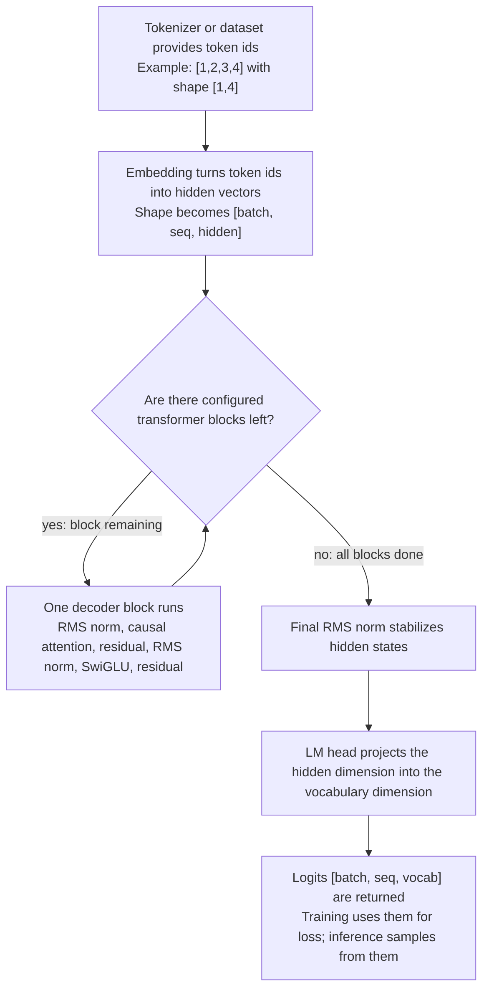

# 03.TransformerModel - transformer model infrastructure

## Human explanation

`03.TransformerModel` is the part of the project that turns a tensor of token ids into model logits. Put simply: `01.Tokenizer` and `02.DatasetPipeline` prepare numeric ids, this project runs them through a decoder-only transformer stack and returns a score for each possible next token.

This is important infrastructure, but not product reasoning logic in itself. The `LlmModel` class can hold trainable parameters and still know nothing useful until `04.TrainingLoop` trains those parameters or `LoadCheckpoint` loads a real checkpoint. A JSON report, a smoke check or a shape-only tensor check do not prove that the model learned language, project skills or domain reasoning.

Data boundary:

- Input from `01.Tokenizer` or `02.DatasetPipeline`: token ids as `Tensor [batch, seq]`.
- Internal math from `00.TensorCore`: `Tensor`, `Module`, `Parameter`, `Linear`, `Embedding`, `TensorOps`.
- Output for `04.TrainingLoop` or `09.Inference`: logits as `Tensor [batch, seq, vocabSize]`.
- Training boundary: gradients and optimizer steps live in `04.TrainingLoop`; this project provides parameters and forward math.

## 0. UML class diagram


| Class | What it does | Status |
|---|---|---|
| `ModelConfig` | Centrally stores model sizes: vocab, context, hidden size, layer count, attention heads, KV heads, FFN size, RoPE theta, RMS epsilon. | Fully implemented config record |
| `LlmModel` | Assembles embedding, repeated transformer blocks, final norm and LM head; runs token ids to logits; saves/loads raw parameter weights. | Fully implemented model infrastructure |
| `TransformerBlock` | One decoder block: `x + attention(norm1(x))`, then `x + ffn(norm2(x))`. | Fully implemented layer composition |
| `CausalSelfAttention` | Causal multi-head self-attention with GQA, RoPE, causal mask and output projection. | Fully implemented attention infrastructure |
| `RotaryEmbedding` | Position encoding helper for Q/K vectors. | Fully implemented utility |
| `RmsNorm` | RMS normalization layer with a trainable gamma. | Fully implemented layer |
| `SwiGLUFeedForward` | Feed-forward transformer branch via gate/up/down projections. | Fully implemented layer |
| `TensorCore` | Provides tensor, module, parameters, initializers and operations. | External dependency from `00.TensorCore` |
| `DataLoader` | Provides batches of token ids and targets for training. | External input supplier |
| `Trainer` | Uses the model forward pass, loss, backward and optimizer updates. | External training owner |
| `TextGenerator` | Uses the tokenizer and model logits for autoregressive generation. | External inference consumer |

### Connection simulations

| Connection | Example input | What happens | Expected result | What must not be taken as proof |
|---|---|---|---|---|
| `LlmModel -> ModelConfig` | `new ModelConfig { VocabSize=64, HiddenDim=16, NumLayers=1, NumHeads=2, NumKvHeads=1 }` | The constructor reads the sizes and creates the embedding, one block, final norm and LM head. | The modules are shape-compatible for `Forward([1,4]) -> [1,4,64]`. | A single config object does not prove trained behavior. |
| `LlmModel -> TensorCore` | Token ids tensor `[1, 2, 3, 4]` with shape `[1,4]`. | `Embedding`, `RmsNorm`, `Linear` and `TensorOps` carry the numeric tensor flow. | The output logits tensor has shape `[1,4,VocabSize]`. | A successful shape check does not prove useful predictions. |
| `LlmModel -> TransformerBlock` | Hidden tensor `[B=1,T=4,H=16]`. | Each configured block transforms the hidden states and preserves the same hidden shape. | Final hidden stays `[1,4,16]` before the LM head. | The presence of a block does not prove learning. |
| `TransformerBlock -> RmsNorm` | Hidden vector `[1,2,3,4]` with `eps=1e-5`. | RMS norm scales the vector by the inverse root mean square and gamma. | Shape does not change; RMS is about 1 when gamma is initialized as ones. | Normalization is math infrastructure, not semantic reasoning. |
| `TransformerBlock -> CausalSelfAttention` | Normalized hidden `[1,4,16]`. | Attention creates Q/K/V, applies RoPE and the causal mask, then returns the projected hidden. | Shape stays `[1,4,16]`; future tokens masked. | A causal mask by itself does not prove language quality. |
| `TransformerBlock -> SwiGLUFeedForward` | Attention-updated hidden `[1,4,16]`. | The second norm feeds the tensor into the gate/up/down projection path. | Shape returns to `[1,4,16]` for the residual add. | Deterministic matrix math is not a trainable product unit by itself. |
| `CausalSelfAttention -> RotaryEmbedding` | Q/K tensors `[1,2,4,8]`, `seq=4`. | RoPE builds cos/sin `[4,4]` and rotates paired vector halves. | The norm of each vector is preserved after rotation. | Position rotation does not prove the model understands positions after training. |
| `CausalSelfAttention -> TensorCore` | Q/K/V tensors after projection. | Tensor ops transpose K, matmul scores, scale, mask, softmax, matmul V, reshape. | Attention output `[B,heads,T,headDim]`, then combined `[B,T,H]`. | A smoke run without checking mask/shape does not replace layer tests. |
| `SwiGLUFeedForward -> TensorCore` | Hidden `[1,4,16]`. | `gate_proj` goes through SiLU, `up_proj` stays linear, the two tensors are multiplied, then `down_proj` runs. | Output hidden `[1,4,16]`. | Feed-forward activation is not product reasoning. |
| `RmsNorm -> TensorCore` | Tensor `[..., dim]` and parameter `gamma[dim]`. | Uses pow, mean, add epsilon, rsqrt, broadcast multiply. | Normalized tensor with the original shape. | A JSON report does not replace numeric checks for shape and RMS behavior. |
| `DataLoader -> LlmModel` | `DataLoader.NextBatch()` returns `long[,] inputs` and `long[,] targets`. | `Trainer` flattens the inputs and turns them into a float token-id tensor `[B,T]`. | The model receives the batch/seq shape that `Forward` expects. | Prepared data does not prove the model learned. |
| `Trainer -> LlmModel` | `TrainAsync(model, optimizer, loader)`. | The Trainer calls `model.Forward`, computes cross entropy, backpropagates, clips gradients, does an optimizer step. | The model parameters can be updated via `04.TrainingLoop`. | The existence of a model file without training evidence does not make the model trained. |
| `TextGenerator -> LlmModel` | Prompt `"hi"`, encoded ids `[104,105]`. | The generator calls `Forward([1,T])`, takes the last logits, samples the next token. | Text generation gets logits from the model and decoding from the tokenizer. | A string from random/untrained weights does not prove reasoning quality. |

## 1. Human flow diagram



Branch simulations:

| Decision branch | Example input | Expected result | What must not be taken |
|---|---|---|---|
| Blocks still remaining | `NumLayers=1`, after embedding `[1,4,16]`. | One `TransformerBlock.Forward` runs and returns `[1,4,16]`. | One forward pass must not be treated as training evidence. |
| No more blocks | After the last configured block. | Final norm and LM head create `[1,4,VocabSize]`. | Logits shape must not be treated as proof of useful language behavior. |

## 2. No-code algorithms, in the operator's language

### Algorithm A: `ModelConfig`

Analogy: this is the model blueprint. It does not build the house itself, but it says how many floors, rooms and utilities it has.

Where the logic lives: `03.TransformerModel/Config/ModelConfig.cs:7`.

Signature and data:

```csharp
public record ModelConfig

Example input DTO:
ModelConfig {
    VocabSize = 64,
    ContextLen = 8,
    HiddenDim = 16,
    NumLayers = 1,
    NumHeads = 2,
    NumKvHeads = 1,
    FfnHiddenDim = 32,
    RopeTheta = 10000f,
    RmsNormEps = 1e-5f
}

Output result:
HeadDim = HiddenDim / NumHeads = 8
KvGroupSize = NumHeads / NumKvHeads = 2
```

Current behavior:

1. Stores architecture hyperparameters with defaults.
2. Computes `HeadDim` from the hidden dimension and query head count.
3. Computes `KvGroupSize` for grouped-query attention.
4. Provides the `Small` preset for a smaller model.

Branches and limitations:

- If the caller sets incompatible dimensions, the record does not perform an active divisibility check; consumers assume compatible values.
- It does not store trained weights, tokenizer vocabulary or dataset pointers.

Status: fully implemented config record.

### Algorithm B: `LlmModel.LlmModel(ModelConfig cfg)`

Analogy: this is the assembly stage. It puts the input desk, the repeated processing stations, the final stabilizer and the output board in the correct order.

Where the logic lives: `03.TransformerModel/LlmModel.cs:23`.

Signature and data:

```csharp
public LlmModel(ModelConfig cfg)

Example input DTO:
cfg = ModelConfig { VocabSize=64, HiddenDim=16, NumLayers=1, NumHeads=2, NumKvHeads=1 }

Output result:
new LlmModel with registered modules:
token_embedding, block_0, final_norm, lm_head
```

Current behavior:

1. Stores the config in `_cfg`.
2. Creates a token embedding from `VocabSize` to `HiddenDim`.
3. Creates `NumLayers` transformer blocks.
4. Creates the final `RmsNorm`.
5. Creates `Linear(HiddenDim, VocabSize, useBias:false)` as the LM head.
6. Registers all modules so that `Parameters()` finds them for save/load/training.

Branches and limitations:

- More layers in the config means more `TransformerBlock` instances.
- The constructor initializes architecture and parameters; it does not train them and does not load a checkpoint automatically.

Status: fully implemented model construction infrastructure.

### Algorithm C: `LlmModel.Forward(Tensor tokenIds)`

Analogy: a sentence enters as ticket numbers; the model runs them through a row of machines and returns a board with scores for which token might be next at each position.

Where the logic lives: `03.TransformerModel/LlmModel.cs:42`.

Signature and data:

```csharp
public Tensor Forward(Tensor tokenIds)

Input:
tokenIds = Tensor(float[] { 1, 2, 3, 4 }, TensorShape(1, 4))

Output:
Tensor logits with shape [1, 4, VocabSize]
```

Current behavior:

1. Turns token ids into hidden vectors via `_tokenEmbedding.Forward`.
2. Runs each configured `TransformerBlock` in order.
3. Applies `_finalNorm`.
4. Applies `_lmHead` to project the hidden dimension into vocabulary size.
5. Returns the logits.

Branches and limitations:

- If `NumLayers=1`, one block runs; if `NumLayers=4`, four blocks run.
- The method assumes `tokenIds` contains valid token ids; out-of-vocabulary behavior belongs to tokenizer/data validation, not to this method.
- It does not compute loss, does not sample text and does not update weights.

Status: fully implemented forward primitive for inference/training.

### Algorithm D: `LlmModel.ForwardHidden(Tensor tokenIds)`

Analogy: this path stops before the final board and returns the model's internal notes after reading the tokens.

Where the logic lives: `03.TransformerModel/LlmModel.cs:52`.

Signature and data:

```csharp
public Tensor ForwardHidden(Tensor tokenIds)

Input:
tokenIds = Tensor(float[] { 5, 6 }, TensorShape(1, 2))

Output:
Tensor hidden with shape [1, 2, HiddenDim]
```

Current behavior:

1. Runs the token embedding.
2. Runs all transformer blocks.
3. Applies the final norm.
4. Returns hidden states without the LM head projection.

Branches and limitations:

- Useful for embedding-like consumers.
- Does not return token probabilities and does not perform pooling by itself.

Status: fully implemented hidden-state primitive.

### Algorithm E: `TransformerBlock.Forward(Tensor x)`

Analogy: one transformer block is like a two-stage editor. First it checks which past tokens it may look at, then it rewrites the internal features of each token.

Where the logic lives: `03.TransformerModel/TransformerBlock.cs:35`.

Signature and data:

```csharp
public Tensor Forward(Tensor x)

Input:
x = Tensor shape [batch, seq, HiddenDim], example [1,4,16]

Output:
Tensor shape [batch, seq, HiddenDim], same shape as input
```

Current behavior:

1. Applies `_norm1`.
2. Runs `_attn.Forward` on the normalized hidden states.
3. Adds the attention output back to the original `x` as a residual.
4. Applies `_norm2`.
5. Runs `_ffn.Forward`.
6. Adds the feed-forward output back as the second residual.

Branches and limitations:

- There is no semantic branch selection here; this is fixed transformer math.
- It preserves the shape but changes the values.
- It exposes `Attention` for `LoraApplicator`; this does not mean LoRA is applied by default.

Status: fully implemented transformer block infrastructure.

### Algorithm F: `CausalSelfAttention.Forward(Tensor x)`

Analogy: each token asks questions of the previous tokens, but a curtain prevents it from seeing the future.

Where the logic lives: `03.TransformerModel/Layers/CausalSelfAttention.cs:38`.

Signature and data:

```csharp
public Tensor Forward(Tensor x)

Input:
x = Tensor shape [batch, seq, HiddenDim], example [1,4,16]

Output:
Tensor shape [batch, seq, HiddenDim]
```

Current behavior:

1. Reads batch, sequence length, number of query heads, number of KV heads and head dimension.
2. Projects `x` into Q, K, V through bias-free linear layers.
3. Reshapes Q to `[B, NumHeads, T, HeadDim]`.
4. Reshapes K/V to `[B, NumKvHeads, T, HeadDim]`.
5. Computes RoPE cos/sin frequencies for sequence length.
6. Applies RoPE to Q and K.
7. If `NumKvHeads < NumHeads`, repeats K/V heads by `KvGroupSize`.
8. Computes scaled dot-product attention with causal mask.
9. Reshapes attention output back to `[B,T,H]`.
10. Applies output projection.

Branches and limitations:

- GQA branch: when `NumKvHeads < NumHeads`, K/V are repeated; when equal, no repeat is needed.
- Causal mask branch: future positions receive `NegativeInfinity` before softmax.
- There is no KV cache here; generation currently calls a full forward for the supplied ids.

Status: fully implemented attention layer infrastructure.

### Algorithm G: `CausalSelfAttention.ScaledDotProduct(Tensor q, Tensor k, Tensor v, int seq)`

Analogy: this is a score table: each token gets a score for how much it should listen to each allowed token.

Where the logic lives: `03.TransformerModel/Layers/CausalSelfAttention.cs:75`.

Signature and data:

```csharp
private static Tensor ScaledDotProduct(Tensor q, Tensor k, Tensor v, int seq)

Input:
q/k/v = Tensor shape [B, heads, T, HeadDim], seq = T

Output:
Tensor shape [B, heads, T, HeadDim]
```

Current behavior:

1. Computes scale as `sqrt(HeadDim)`.
2. Transposes K on the last two axes.
3. Computes `scores = Q @ K^T / sqrt(HeadDim)`.
4. Creates a lower-triangle mask.
5. Replaces future scores with negative infinity.
6. Applies softmax over key positions.
7. Multiplies weights by V.

Branches and limitations:

- All future-token positions blocked before softmax.
- Attention weights are not returned outward.

Status: fully implemented private attention math.

### Algorithm H: `RotaryEmbedding.GetFrequencies(int seqLen)` and `RotaryEmbedding.Apply(...)`

Analogy: RoPE is like clock hands on token vectors: position changes the angle, not the length of the vector.

Where the logic lives: `03.TransformerModel/Layers/RotaryEmbedding.cs:21` and `03.TransformerModel/Layers/RotaryEmbedding.cs:43`.

Signature and data:

```csharp
public (Tensor cos, Tensor sin) GetFrequencies(int seqLen)
public static Tensor Apply(Tensor x, Tensor cos, Tensor sin)

Input:
seqLen = 4, dim = 8
x = Tensor shape [batch, heads, seq, dim]

Output:
cos/sin shape [seqLen, dim/2]
rotated tensor with the same shape as x
```

Current behavior:

1. Builds frequencies `1 / theta^(2i/dim)` for each dimension pair.
2. Builds positions `0..seqLen-1`.
3. Computes outer product positions by frequencies.
4. Returns cos and sin tables.
5. `Apply` splits each vector into two halves and rotates each pair with `(x1*c - x2*s, x1*s + x2*c)`.

Branches and limitations:

- Assumes an even head dimension.
- Preserves the vector norm, but does not learn position embeddings.

Status: fully implemented position utility.

### Algorithm I: `RmsNorm.Forward(Tensor x)`

Analogy: RMS norm brings each hidden vector to a comparable loudness before the next layer listens to it.

Where the logic lives: `03.TransformerModel/Layers/RmsNorm.cs:23`.

Signature and data:

```csharp
public Tensor Forward(Tensor x)

Input:
x = Tensor shape [..., dim], example [1,1,4] with values [1,2,3,4]

Output:
Tensor with same shape, scaled by 1/sqrt(mean(x^2)+eps) and gamma
```

Current behavior:

1. Squares `x`.
2. Computes mean over the last axis.
3. Adds epsilon.
4. Computes reciprocal square root.
5. Broadcast-multiplies original `x` by RMS scale.
6. Broadcast-multiplies by learnable `gamma`.

Branches and limitations:

- Zero input does not throw, because epsilon prevents division by zero.
- Does not subtract the mean, unlike classic LayerNorm.

Status: fully implemented normalization layer.

### Algorithm J: `SwiGLUFeedForward.Forward(Tensor x)`

Analogy: this is a controlled expansion: one projection offers information, another projection smoothly opens or closes a gate.

Where the logic lives: `03.TransformerModel/Layers/SwiGLUFeedForward.cs:32`.

Signature and data:

```csharp
public Tensor Forward(Tensor x)

Input:
x = Tensor shape [batch, seq, HiddenDim], example [1,4,16]

Output:
Tensor shape [batch, seq, HiddenDim]
```

Current behavior:

1. Sends `x` through `_gateProj`.
2. Applies SiLU to the gate path.
3. Sends `x` through `_upProj`.
4. Elementwise-multiplies gate and up tensors.
5. Sends the result through `_downProj` back to hidden dimension.

Branches and limitations:

- Fixed feed-forward math; there is no routing or skill selection here.
- Trainable weights exist in the linear layers, but this method does not train them.

Status: fully implemented feed-forward layer.

### Algorithm K: `LlmModel.SaveCheckpoint(string path)` and `LoadCheckpoint(string path)`

Analogy: a checkpoint save is a snapshot of all the tuning knobs in the machine. Loading puts these knobs back, but does not prove they were trained well.

Where the logic lives: `03.TransformerModel/LlmModel.cs:61` and `03.TransformerModel/LlmModel.cs:68`.

Signature and data:

```csharp
public void SaveCheckpoint(string path)
public void LoadCheckpoint(string path)

Input:
path = "checkpoints/ckpt_000100.bin"

Output:
SaveCheckpoint writes binary float weights.
LoadCheckpoint mutates current Parameters() from that file.
```

Current behavior:

1. Save writes to `path + ".tmp"`.
2. Save serializes parameter count, each parameter rank, dimensions, and float data.
3. Save atomically moves `.tmp` to final path.
4. Load reads parameters in the same order.
5. Load writes read float values into current parameter tensors.

Branches and limitations:

- Load reads up to `Math.Min(fileCount, currentParameterCount)`; it does not reject mismatched architectures explicitly.
- Checkpoint presence is only persistence evidence, not training quality evidence.

Status: checkpoint persistence is implemented; the architecture-mismatch limitation is stated honestly.

## 3. Important code references

### Model assembly and module registration

Reference: `03.TransformerModel/LlmModel.cs:23-38`.

> Why it matters: `Parameters()` and checkpoint save/load depend on module registration. Without registration, training or serialization could silently skip weights.
> Input: `ModelConfig`.
> Output: the model graph with embedding, N blocks, final norm and LM head.
> Which branch is proven: `NumLayers` controls the number of registered blocks.
> What this does not prove: that the weights are trained or useful.

```csharp
_tokenEmbedding = new Embedding(cfg.VocabSize, cfg.HiddenDim);
_blocks = Enumerable.Range(0, cfg.NumLayers)
    .Select(_ => new TransformerBlock(cfg))
    .ToList();
_finalNorm = new RmsNorm(cfg.HiddenDim, cfg.RmsNormEps);
_lmHead    = new Linear(cfg.HiddenDim, cfg.VocabSize, useBias: false);
```

### The `Forward` path from ids to logits

Reference: `03.TransformerModel/LlmModel.cs:41-49`.

> Why it matters: this is the central contract for training and inference. Both `Trainer` and `TextGenerator` can look at the model as `tokenIds -> logits`.
> Input: `Tensor [B,T]`, for example `[1,4]`.
> Output: `Tensor [B,T,VocabSize]`.
> Which branch is proven: all configured blocks run in sequence.
> What this does not prove: loss reduction, model quality or domain capability.

```csharp
var x = _tokenEmbedding.Forward(tokenIds);
foreach (var block in _blocks)
    x = block.Forward(x);
x = _finalNorm.Forward(x);
return _lmHead.Forward(x);
```

### The transformer residual block

Reference: `03.TransformerModel/TransformerBlock.cs:35-40`.

> Why it matters: the residual shape-preserving contract allows many blocks to be stacked safely.
> Input: hidden state `[B,T,H]`.
> Output: hidden state `[B,T,H]`.
> Which branch is proven: the attention branch runs before the feed-forward branch.
> What this does not prove: semantic reasoning; this is deterministic tensor math until trained weights carry signal.

```csharp
x = TensorOps.Add(x, _attn.Forward(_norm1.Forward(x)));
x = TensorOps.Add(x, _ffn.Forward(_norm2.Forward(x)));
return x;
```

### Causal attention with GQA and RoPE

Reference: `03.TransformerModel/Layers/CausalSelfAttention.cs:46-70`.

> Why it matters: this is the main token-to-token information path. It proves that Q/K/V projections, RoPE, optional GQA expansion and output projection are connected in the current code.
> Input: hidden state `[B,T,H]`.
> Output: hidden state `[B,T,H]`.
> Which branch is proven: if `NumKvHeads < NumHeads`, K/V heads are repeated.
> What this does not prove: KV caching or high-quality generation; the cache path is not documented here.

```csharp
var q = Reshape4D(_qProj.Forward(x), batch, seq, h,  hd);
var k = Reshape4D(_kProj.Forward(x), batch, seq, kv, hd);
var v = Reshape4D(_vProj.Forward(x), batch, seq, kv, hd);

var (cos, sin) = _rope.GetFrequencies(seq);
q = RotaryEmbedding.Apply(q, cos, sin);
k = RotaryEmbedding.Apply(k, cos, sin);

if (kv < h)
{
    int g = _cfg.KvGroupSize;
    k = TensorOps.RepeatInterleave(k, g, dim: 1);
    v = TensorOps.RepeatInterleave(v, g, dim: 1);
}
```

### The causal mask blocks access to future tokens

Reference: `03.TransformerModel/Layers/CausalSelfAttention.cs:84-90` and `03.TransformerModel/Layers/CausalSelfAttention.cs:100-112`.

> Why it matters: decoder-only language modeling must not allow position `i` to see token `j > i` during training/inference. The code sets future scores to negative infinity before softmax.
> Input: scores `[B,heads,T,T]` and lower-triangle mask `[T,T]`.
> Output: attention weights, where future positions have zero probability after softmax.
> Which branch is proven: `tril == 0` blocks a future position.
> What this does not prove: a runtime e2e no-leakage test across all model consumers.

```csharp
var tril = TensorOps.Tril(seq);
scores = ApplyCausalMask(scores, tril, seq);
var weights = TensorOps.Softmax(scores, dim: -1);
return TensorOps.MatMul(weights, v);
```

### Vector rotation via RoPE

Reference: `03.TransformerModel/Layers/RotaryEmbedding.cs:59-68`.

> Why it matters: position information enters Q/K through rotating vector halves, not through a separate learned position table.
> Input: one vector pair `(x1, x2)` with cos/sin for the token position.
> Output: a rotated pair with the same tensor shape.
> Which branch is proven: each position `t` uses `cos[t]` and `sin[t]`.
> What this does not prove: trained positional understanding; this is only an encoding mechanism.

```csharp
float x1 = x.Data[baseOff + i];
float x2 = x.Data[baseOff + half + i];
float c  = cos.Data[t * half + i];
float s  = sin.Data[t * half + i];
data[baseOff + i]        = x1 * c - x2 * s;
data[baseOff + half + i] = x1 * s + x2 * c;
```

### The RMS normalization layer

Reference: `03.TransformerModel/Layers/RmsNorm.cs:23-33`.

> Why it matters: normalization stabilizes hidden states before attention and feed-forward operations. The epsilon branch prevents division by zero.
> Input: tensor `[..., dim]`.
> Output: the same shape, scaled by RMS and gamma.
> Which branch is proven: gamma is applied after RMS scaling.
> What this does not prove: learned capability; gamma starts as ones and changes only through training.

```csharp
var sq   = TensorOps.Pow(x, 2f);
var mean = TensorOps.Mean(sq, axis: -1, keepDims: true);
var rms  = TensorOps.RSqrt(TensorOps.AddScalar(mean, _eps));
var normalized = MultiplyBroadcast(x, rms);
return MultiplyGamma(normalized, _gamma.Value);
```

### The training consumer boundary

Reference: `04.TrainingLoop/Trainer.cs:44-57`.

> Why it matters: this proves that training ownership is outside `03.TransformerModel`. The model provides logits and parameters; `Trainer` owns batch conversion, loss, backward scaling and the optimizer loop.
> Input: `(long[,] inputs, long[,] targets)` from `DataLoader`.
> Output: gradients on model parameters after `BackwardLoss`.
> Which branch is proven: training uses `model.Forward(inputTensor)`.
> What this does not prove: that a successful training run was executed for D1E.

```csharp
var (inputIds2d, targetIds2d) = loader.NextBatch();
var inputTensor  = ToTensor(flatInput, _cfg.BatchSize, _cfg.SeqLen);
var logits = model.Forward(inputTensor);
float loss = CrossEntropyLoss(logits, flatTarget) / _cfg.GradAccumSteps;
BackwardLoss(logits, flatTarget, 1f / (_cfg.GradAccumSteps * _cfg.BatchSize * _cfg.SeqLen));
```

### The inference consumer boundary

Reference: `09.Inference/TextGenerator.cs:28-55`.

> Why it matters: this proves that text generation is a consumer of model logits, not part of the model itself. Tokenization and sampling live outside `03.TransformerModel`.
> Input: prompt string.
> Output: decoded generated string.
> Which branch is proven: prefill uses the full prompt; decode feeds one sampled token at a time.
> What this does not prove: generated text quality, because it depends on trained weights and sampler behavior.

```csharp
var inputIds  = _tokenizer.Encode(prompt);
var prefillTensor = IdsToTensor(inputIds);
var prefillLogits = _model.Forward(prefillTensor);
int nextToken  = Sampler.Sample(lastLogits, temperature, topK, topP);
```

## 4. Link to test, e2e and QA

For this document the test source was read: `Tests/TransformerModelTests.cs`.

| Evidence | Lines | What it checks | Honest gap |
|---|---:|---|---|
| `RmsNorm_OutputShape_Unchanged` | `Tests/TransformerModelTests.cs:28-39` | `RmsNorm` preserves the shape. | Does not prove gradient correctness. |
| `RmsNorm_ZeroInput_DoesNotThrow` | `Tests/TransformerModelTests.cs:41-49` | Zero input is safe due to epsilon. | Does not check the exact all-zero output value. |
| `RmsNorm_NormalisesEachVector_ApproximatelyToUnitRms` | `Tests/TransformerModelTests.cs:51-63` | RMS is about 1 when gamma is ones. | Does not cover trained gamma changes. |
| `RotaryEmbedding_GetFrequencies_OutputShape` | `Tests/TransformerModelTests.cs:69-78` | cos/sin shape `[seqLen, dim/2]`. | Does not check all frequency values. |
| `RotaryEmbedding_Apply_PreservesNorm` | `Tests/TransformerModelTests.cs:80-97` | RoPE rotation preserves norm. | Does not test many dimensions/sequences. |
| `LlmModel_Forward_OutputShape_IsBatchSeqVocab` | `Tests/TransformerModelTests.cs:103-112` | `Forward` returns `[B,T,Vocab]`. | Shape only; not prediction quality. |
| `LlmModel_ForwardHidden_OutputShape_IsBatchSeqHidden` | `Tests/TransformerModelTests.cs:114-123` | Hidden states return `[B,T,H]`. | Shape only. |
| `LlmModel_Forward_NaNFree` | `Tests/TransformerModelTests.cs:125-134` | Forward logits contain no NaN for tiny input. | Does not prove numerical stability on large configs. |
| `LlmModel_SaveAndLoad_RoundTrip` | `Tests/TransformerModelTests.cs:136-158` | Checkpoint round-trip restores output values. | Does not reject a mismatched architecture checkpoint. |
| `LlmModel_SaveCheckpoint_NoTmpFileLeftBehind` | `Tests/TransformerModelTests.cs:160-170` | Atomic temp file cleanup after save. | Does not test a crash during move. |
| `TransformerBlock_Forward_OutputShape_Unchanged` | `Tests/TransformerModelTests.cs:177-187` | Block preserves hidden shape. | Does not isolate causal mask correctness. |
| `ModelConfig_HeadDim_IsHiddenOverHeads` | `Tests/TransformerModelTests.cs:193-198` | Derived head dimension. | Does not validate invalid divisibility. |
| `ModelConfig_KvGroupSize_IsHeadsOverKvHeads` | `Tests/TransformerModelTests.cs:200-205` | GQA group size. | Does not validate invalid head ratios. |

Future QA work order gaps:

- Add direct unit coverage for `CausalSelfAttention` future-token masking behavior, not just shape.
- Add direct unit coverage for the GQA repeat branch (`NumKvHeads < NumHeads`) and the no-repeat branch (`NumKvHeads == NumHeads`).
- Add checkpoint compatibility validation for mismatched config/shape.
- Add training-run evidence in the `04.TrainingLoop` docs; D1E deliberately does not run training.
- Add inference quality/e2e prompt evidence in the `09.Inference` docs; D1E documents only the model boundary.

## 5. Link to neighboring projects

| Neighboring project | Link | Current boundary |
|---|---|---|
| `00.TensorCore` | `03.TransformerModel` depends on tensor storage, layers, parameters and operations. | Only the math/autograd/layer substrate. |
| `01.Tokenizer` | `TextGenerator` encodes prompt strings into integer token ids before calling `LlmModel`. | Tokenization is deterministic text infrastructure, not model reasoning. |
| `02.DatasetPipeline` | `DataLoader.NextBatch()` provides `inputs` and `targets`; `Trainer` converts inputs to `Tensor [B,T]`. | Prepared batches are not evidence of learning. |
| `04.TrainingLoop` | Owns loss, backward, gradient clipping, optimizer step and checkpoint schedule. | Training lives outside `03.TransformerModel`. |
| `09.Inference` | Calls `LlmModel.Forward`, extracts last logits, samples tokens and decodes text. | Generation quality requires trained weights and runtime evidence. |

## 6. Anti-false-done checks

The following must not be taken as evidence of D1E completeness or product completion:

- Class `LlmModel` exists, therefore the product can reason. Wrong: the class is architecture infrastructure.
- `Forward` returns `[B,T,Vocab]`, therefore the model learned. Wrong: the shape is necessary but not sufficient.
- A JSON report, static grep, smoke test or generated documentation says "passed". Wrong: runtime/training evidence must match the claim.
- The tokenizer or dataset produced ids. Wrong: prepared data is not model learning.
- A checkpoint file exists. Wrong: a checkpoint may contain random or poor weights if there is no training evidence.
- Deterministic tensor primitives hidden as trainable product units. Wrong: math layers become trained only through parameters and optimizer updates, and product behavior must be checked at the product boundary.
- Generated text appears. Wrong: random/untrained weights can also generate strings; quality requires a trained checkpoint plus e2e evaluation.

What is needed for stronger claims:

- Training claim: actual `04.TrainingLoop` run evidence with loss/step/checkpoint and a reload probe.
- Inference claim: `09.Inference` runtime prompt evidence with a loaded checkpoint.
- Product reasoning claim: domain task evidence, not just logits or sampler output.

## 7. Implementation status table

| Component | File | Status | What actually works now |
|---|---|---|---|
| `ModelConfig` | `03.TransformerModel/Config/ModelConfig.cs` | Fully implemented config | Defaults, `Small`, `HeadDim`, `KvGroupSize`; no active validation for incompatible dimensions. |
| `LlmModel` | `03.TransformerModel/LlmModel.cs` | Fully implemented model infrastructure | Constructs embedding/blocks/final norm/lm head, `Forward`, `ForwardHidden`, binary checkpoint save/load. Does not train itself. |
| `TransformerBlock` | `03.TransformerModel/TransformerBlock.cs` | Fully implemented layer composition | Pre-norm attention residual plus pre-norm SwiGLU residual; exposes `Attention` for LoRA consumers. |
| `CausalSelfAttention` | `03.TransformerModel/Layers/CausalSelfAttention.cs` | Fully implemented attention infrastructure | Q/K/V projection, RoPE, GQA repeat branch, causal mask, softmax, output projection; KV cache not documented here. |
| `RotaryEmbedding` | `03.TransformerModel/Layers/RotaryEmbedding.cs` | Fully implemented utility | Frequency tables and vector rotation for Q/K; assumes even head dimension. |
| `RmsNorm` | `03.TransformerModel/Layers/RmsNorm.cs` | Fully implemented layer | RMS normalization with learnable gamma and epsilon. |
| `SwiGLUFeedForward` | `03.TransformerModel/Layers/SwiGLUFeedForward.cs` | Fully implemented layer | Gate/up/down projection path with SiLU and elementwise multiply. |
| `Trainer` consumer boundary | `04.TrainingLoop/Trainer.cs` | External consumer documented | Calls `model.Forward`, computes loss/backward/optimizer. Training evidence belongs to D04, not D1E. |
| `TextGenerator` consumer boundary | `09.Inference/TextGenerator.cs` | External consumer documented | Encodes prompt, calls `model.Forward`, samples logits, decodes output. Inference evidence belongs to D09, not D1E. |
