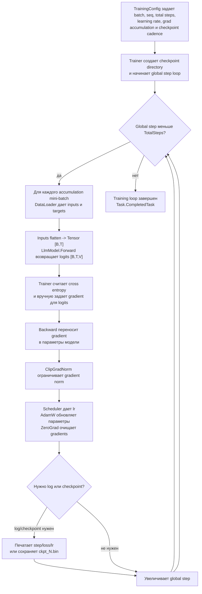

# 04.TrainingLoop - инфраструктура обучения модели

## Человеческое объяснение

`04.TrainingLoop` - это часть проекта, которая берет готовые token batches из `02.DatasetPipeline`, прогоняет их через `03.TransformerModel`, считает loss, вручную задает gradient для logits, запускает backward, ограничивает норму gradients, делает optimizer step и периодически сохраняет checkpoint. Если `03.TransformerModel` - это машина, которая умеет считать logits, то `04.TrainingLoop` - это оператор станка: он подает batches, смотрит ошибку, крутит weights и сохраняет промежуточные состояния.

Важно: этот проект является training-loop infrastructure, а не доказательством, что модель успешно обучилась. Наличие `Trainer`, `AdamW`, printed loss или checkpoint file доказывает только наличие механизма обучения/сохранения. Claim "модель обучена хорошо" требует отдельного runtime/training report evidence: фактический training run, loss/metrics, checkpoint, reload probe и downstream validation.

Граница данных:

- Вход из `02.DatasetPipeline`: `DataLoader.NextBatch()` возвращает `(long[,] inputs, long[,] targets)`.
- Вход из `03.TransformerModel`: `LlmModel` принимает `Tensor [B,T]` и возвращает logits `Tensor [B,T,V]`.
- Внутренняя математика из `00.TensorCore`: `TensorOps.CrossEntropy`, `TensorOps.ClipGradNorm`, `Tensor.Backward`, `Parameter`.
- Выход: измененные model parameters, console log `step/loss/lr`, и checkpoint files через `model.SaveCheckpoint(...)`.
- Не выход: качество модели, held-out metrics, свежая загрузка checkpoint или доказательство product reasoning.

## 0. UML диаграмма классов

```mermaid
classDiagram
    class TrainingConfig {
        +int BatchSize
        +int SeqLen
        +float MaxLr
        +float MinLr
        +int WarmupSteps
        +int TotalSteps
        +int GradAccumSteps
        +float GradClipNorm
        +float WeightDecay
        +int CheckpointEvery
        +string CheckpointDir
        +int LogEvery
    }

    class Trainer {
        +TrainAsync(LlmModel model, AdamW optimizer, DataLoader loader, CancellationToken ct) Task
        -CrossEntropyLoss(Tensor logits, int[] targets) float
        -BackwardLoss(Tensor logits, int[] targets, float scale) void
        -ToTensor(int[] ids, int batch, int seq) Tensor
        -Flatten2D(long[,] arr) int[]
    }

    class CosineWithWarmup {
        +GetLr(int step) float
    }

    class AdamW {
        +Step(IEnumerable~Parameter~ parameters, float lr) void
    }

    class DataLoader {
        +NextBatch() (long[,] inputs, long[,] targets)
    }

    class LlmModel {
        +Forward(Tensor tokenIds) Tensor
        +Parameters() IEnumerable~Parameter~
        +ZeroGrad() void
        +SaveCheckpoint(string path) void
    }

    class TensorOps {
        +CrossEntropy(Tensor logits, int[] targets) float
        +ClipGradNorm(IEnumerable~Parameter~ parameters, float maxNorm) void
        +Reshape(Tensor x, int[] dims) Tensor
        +ZerosLike(Tensor t) Tensor
    }

    class Tensor {
        +Data
        +Grad
        +Backward(Tensor grad) void
    }

    TrainingConfig --> Trainer : задает batch, lr, steps, checkpoint
    Trainer --> CosineWithWarmup : получает lr для шага
    Trainer --> DataLoader : берет input/target batches
    Trainer --> LlmModel : Forward, Parameters, ZeroGrad, SaveCheckpoint
    Trainer --> TensorOps : loss, clipping, reshape
    Trainer --> Tensor : задает Grad и запускает Backward
    Trainer --> AdamW : optimizer step
    AdamW --> Tensor : меняет Parameter.Value.Data
    AdamW --> TensorOps : читает Parameter.Grad
    CosineWithWarmup --> TrainingConfig : использует warmup/total/max/min lr

    note for TrainingConfig "ПОЛНОСТЬЮ РЕАЛИЗОВАНО\nХранит hyperparameters training loop.\nНе доказывает, что выбранные значения оптимальны."
    note for Trainer "ПОЛНОСТЬЮ РЕАЛИЗОВАННАЯ ИНФРАСТРУКТУРА\nБерет batches, считает loss/backward, clips gradients, вызывает optimizer и checkpoint.\nНе измеряет качество модели сам."
    note for CosineWithWarmup "ПОЛНОСТЬЮ РЕАЛИЗОВАНО\nLinear warmup затем cosine decay.\nНе выбирает lr адаптивно по качеству."
    note for AdamW "ПОЛНОСТЬЮ РЕАЛИЗОВАНО\nОбновляет weights по gradients, moments и decoupled weight decay.\nНе сохраняет optimizer state в checkpoint."
    note for DataLoader "ВНЕШНИЙ ПОСТАВЩИК ДАННЫХ\nДает shifted token batches из .npy shards.\nPrepared data не является learning evidence."
    note for LlmModel "ВНЕШНЯЯ МОДЕЛЬ\nДает logits и parameters, сохраняет checkpoint.\nСама не владеет training loop."
    note for TensorOps "ВНЕШНЯЯ MATH ОСНОВА\nCrossEntropy, gradient clipping и reshape.\nНе является product reasoning."
    note for Tensor "ВНЕШНЯЯ AUTOGRAD ОСНОВА\nХранит Data/Grad и запускает Backward.\nНе доказывает качество обучения."
```



| Класс | Что делает | Статус |
|---|---|---|
| `TrainingConfig` | Хранит batch size, sequence length, learning-rate limits, warmup, total steps, grad accumulation, clipping, checkpoint schedule и log cadence. | Полностью реализованный config record |
| `Trainer` | Выполняет основной training loop: batch -> forward -> loss -> backward -> clipping -> optimizer step -> zero grad -> log/checkpoint. | Полностью реализованная training infrastructure |
| `CosineWithWarmup` | Считает learning rate: linear warmup до `MaxLr`, затем cosine decay к `MinLr`. | Полностью реализованный scheduler |
| `AdamW` | Обновляет параметры модели по gradients, first/second moments, bias correction и decoupled weight decay. | Полностью реализованный optimizer |
| `DataLoader` | Поставляет shifted token batches из dataset pipeline. | Внешняя зависимость |
| `LlmModel` | Дает logits, parameters, `ZeroGrad` и `SaveCheckpoint`. | Внешняя model boundary |
| `TensorOps` | Дает tensor math для loss, clipping и reshape. | Внешняя math/autograd инфраструктура |
| `Tensor` | Хранит данные/градиенты и запускает backward. | Внешняя tensor/autograd инфраструктура |

### Симуляции соединений

| Соединение | Пример входа | Что происходит | Ожидаемый результат | Что нельзя принимать как доказательство |
|---|---|---|---|---|
| `TrainingConfig -> Trainer` | `BatchSize=2`, `SeqLen=4`, `TotalSteps=10`, `GradAccumSteps=2`, `CheckpointEvery=5`. | `Trainer` использует config для формы tensors, числа mini-batches, scheduler и checkpoint cadence. | Loop делает до 10 global steps; каждый step накапливает 2 mini-batches. | Config не доказывает, что training run был выполнен или успешен. |
| `Trainer -> CosineWithWarmup` | `_globalStep=0`, `WarmupSteps=100`, `MaxLr=3e-4`. | Scheduler считает lr для текущего шага. | На early warmup lr начинается около 0 и растет к `MaxLr`. | Наличие lr schedule не доказывает convergence. |
| `Trainer -> DataLoader` | `loader.NextBatch()` возвращает `inputs[2,4]`, `targets[2,4]`. | Trainer flatten-ит both arrays и делает input tensor `[B,T]`. | `LlmModel.Forward` получает `Tensor [2,4]`. | Prepared batch не является evidence of learning. |
| `Trainer -> LlmModel` | `inputTensor [B,T]`. | Trainer вызывает `model.Forward(inputTensor)`. | Получает logits `[B,T,V]` для loss. | Forward pass не доказывает, что weights уже обучены. |
| `Trainer -> TensorOps` | logits `[B,T,V]`, targets length `B*T`, `GradClipNorm=1.0`. | Loss path reshapes logits и считает cross entropy; clipping path ограничивает gradients. | Loss scalar для logging; gradients scale down, если norm выше max. | Loss print без сохраненного report и trend не доказывает quality. |
| `Trainer -> Tensor` | logits и manual grad `(softmax - one_hot) * scale`. | Trainer кладет grad в `logits.Grad`, затем вызывает `logits.Backward(logits.Grad)`. | Autograd переносит gradients в параметры модели. | Сам backward call не доказывает, что optimizer сделал полезный шаг. |
| `Trainer -> AdamW` | `model.Parameters()`, `lr=1e-4`. | AdamW читает `Parameter.Grad`, updates moments и weights. | `Parameter.Value.Data` меняется для параметров с gradients. | Изменение weights не равно улучшению качества модели. |
| `Trainer -> LlmModel.SaveCheckpoint` | `_globalStep=500`, `CheckpointEvery=500`. | Trainer вызывает `SaveCheckpoint(".../ckpt_000500.bin")` до increment step. | Появляется checkpoint file для model weights. | Checkpoint file не доказывает reload, metrics или product readiness. |
| `AdamW -> Tensor` | Один parameter value `1.0`, grad `1.0`. | AdamW updates moments, applies weight decay, subtracts gradient step. | Weight decreases for positive gradient. | Unit optimizer behavior не доказывает full training loop. |
| `CosineWithWarmup -> TrainingConfig` | `step=55`, `warmup=10`, `total=100`. | Scheduler uses max/min lr and progress after warmup. | lr ниже peak и не ниже `MinLr` near end. | Bounded lr не доказывает отсутствие divergence. |

## 1. Человеческая схема потока



Симуляции веток:

| Ветка | Пример входа | Ожидаемый результат | Что нельзя принимать |
|---|---|---|---|
| Loop продолжается | `_globalStep=3`, `TotalSteps=10`. | Trainer берет batches, считает loss/backward, делает optimizer step. | Один step не доказывает convergence. |
| Loop завершается | `_globalStep=10`, `TotalSteps=10`. | Method выходит и возвращает completed task. | Завершение loop не доказывает model quality. |
| Checkpoint branch | `_globalStep=500`, `CheckpointEvery=500`. | `SaveCheckpoint("ckpt_000500.bin")` вызывается перед increment. | Checkpoint без reload/eval не является trained-model evidence. |
| No-checkpoint branch | `_globalStep=7`, `CheckpointEvery=500`. | Checkpoint не сохраняется, step только увеличивается. | Отсутствие checkpoint на step 7 не является ошибкой. |
| Cancellation branch | `ct` отменен внутри loop. | `ct.ThrowIfCancellationRequested()` прерывает training. | Cancellation не доказывает failed model; это runtime control path. |

## 2. Алгоритмы без кода на русском

### Алгоритм A: `TrainingConfig`

Аналогия: это лист настроек для тренировки. Он говорит, сколько примеров брать за раз, сколько шагов делать, с какой скоростью менять weights и как часто сохраняться.

Где находится логика: `04.TrainingLoop/TrainingConfig.cs:6`.

Сигнатура и данные:

```csharp
public record TrainingConfig

Пример входного DTO:
TrainingConfig {
    BatchSize = 8,
    SeqLen = 2048,
    MaxLr = 3e-4f,
    MinLr = 3e-5f,
    WarmupSteps = 100,
    TotalSteps = 10_000,
    GradAccumSteps = 4,
    GradClipNorm = 1.0f,
    WeightDecay = 0.1f,
    CheckpointEvery = 500,
    CheckpointDir = "checkpoints",
    LogEvery = 10
}

Выход:
config object, который читает Trainer и scheduler.
```

Текущее поведение:

1. Хранит все hyperparameters в одном record.
2. Дает defaults для batch, sequence length, learning rates, warmup, total steps, gradient accumulation, clipping, weight decay, checkpoint и logging.
3. Не выполняет validation значений.

Ветки и ограничения:

- Если caller задает `TotalSteps=0`, loop фактически не начнется.
- Если caller задает несовместимые batch/seq с `DataLoader`, проблема проявится в runtime, не в config.
- Не хранит training metrics и не доказывает качество модели.

Статус: полностью реализованный config record.

### Алгоритм B: `Trainer.TrainAsync(LlmModel model, AdamW optimizer, DataLoader loader, CancellationToken ct)`

Аналогия: это тренер в спортзале. Он берет упражнение, считает ошибку, говорит модели, в какую сторону двигать weights, ограничивает слишком резкое движение, делает шаг optimizer и иногда сохраняет состояние.

Где находится логика: `04.TrainingLoop/Trainer.cs:31`.

Сигнатура и данные:

```csharp
public async Task TrainAsync(
    LlmModel model,
    AdamW optimizer,
    DataLoader loader,
    CancellationToken ct = default)

Вход:
model = new LlmModel(modelConfig)
optimizer = new AdamW(...)
loader = new DataLoader(dataDir, batchSize, seqLen)

Выход:
Task завершен; side effects:
- parameters модели могут измениться;
- gradients очищаются после optimizer step;
- checkpoint files могут быть записаны;
- console может получить step/loss/lr log.
```

Текущее поведение:

1. Создает `CheckpointDir`.
2. Пока `_globalStep < TotalSteps`, проверяет cancellation token.
3. Обнуляет `totalLoss` для текущего global step.
4. Для каждого accumulation mini-batch вызывает `loader.NextBatch()`.
5. Flatten-ит `long[,] inputs/targets` в `int[]`.
6. Превращает input ids в `Tensor [BatchSize, SeqLen]`.
7. Вызывает `model.Forward(inputTensor)` и получает logits `[B,T,V]`.
8. Считает cross entropy loss и делит его на `GradAccumSteps`.
9. Вручную добавляет gradient к logits через `BackwardLoss`.
10. После accumulation вызывает `ClipGradNorm`.
11. Берет learning rate из scheduler.
12. Вызывает `optimizer.Step(model.Parameters(), lr)`.
13. Очищает gradients через `model.ZeroGrad()`.
14. Печатает log, если step кратен `LogEvery`.
15. Сохраняет checkpoint, если step больше 0 и кратен `CheckpointEvery`.
16. Увеличивает `_globalStep`.

Ветки и ограничения:

- Cancellation branch: `ct.ThrowIfCancellationRequested()` может прервать loop.
- Logging branch: log появляется только на шагах, кратных `LogEvery`.
- Checkpoint branch: checkpoint сохраняется только когда `_globalStep > 0` и кратен `CheckpointEvery`.
- Метод не возвращает metrics object, не пишет structured report и не проверяет held-out quality.
- Метод не сохраняет optimizer state.

Статус: полностью реализованная training-loop infrastructure, но не evidence успешного обучения сама по себе.

### Алгоритм C: `Trainer.CrossEntropyLoss(Tensor logits, int[] targets)`

Аналогия: это экзаменатор. Он берет scores модели и правильные answers, затем считает средний штраф за неправильную уверенность.

Где находится логика: `04.TrainingLoop/Trainer.cs:80`.

Сигнатура и данные:

```csharp
private static float CrossEntropyLoss(Tensor logits, int[] targets)

Вход:
logits = Tensor shape [B,T,V], например [2,4,32000]
targets = int[] длины B*T

Выход:
float loss, средний cross entropy для flattened positions.
```

Текущее поведение:

1. Читает dimensions `b`, `t`, `v` из logits.
2. Reshape-ит logits из `[B,T,V]` в `[B*T,V]`.
3. Вызывает `TensorOps.CrossEntropy(flatLogits, targets)`.
4. Возвращает scalar loss.

Ветки и ограничения:

- Предполагает, что targets имеют длину `B*T`.
- Не выполняет backward сам; backward делает `BackwardLoss`.
- Loss value сам по себе не является quality report без trend/validation.

Статус: реализованный loss helper.

### Алгоритм D: `Trainer.BackwardLoss(Tensor logits, int[] targets, float scale)`

Аналогия: это ручная подсказка модели, где она ошиблась: для правильного token subtracts one-hot, для остальных оставляет softmax probability, затем масштабирует результат.

Где находится логика: `04.TrainingLoop/Trainer.cs:92`.

Сигнатура и данные:

```csharp
private static void BackwardLoss(Tensor logits, int[] targets, float scale)

Вход:
logits = Tensor [B,T,V]
targets = int[] length B*T
scale = 1 / (GradAccumSteps * BatchSize * SeqLen)

Выход:
void; side effect:
logits.Grad заполняется и logits.Backward(logits.Grad) запускает autograd.
```

Текущее поведение:

1. Читает `b`, `t`, `v`.
2. Если `logits.Grad == null`, создает zero-like gradient tensor.
3. Для каждой flattened position находит `maxVal` для stable softmax.
4. Считает `expSum`.
5. Для каждого vocab index считает softmax probability.
6. Сравнивает index с target и формирует `oneHot`.
7. Добавляет `(softmax - oneHot) * scale` в `logits.Grad`.
8. Вызывает `logits.Backward(logits.Grad)`.

Ветки и ограничения:

- Если `logits.Grad` уже есть, gradients accumulate; если нет, создается новый zero tensor.
- Не проверяет target index bounds.
- Не является full metric report: это gradient path, а не validation.

Статус: реализованный manual backward helper.

### Алгоритм E: `Trainer.Flatten2D(long[,] arr)` и `Trainer.ToTensor(int[] ids, int batch, int seq)`

Аналогия: это упаковщик. Он берет таблицу token ids `[batch, seq]`, раскладывает ее в один список, а затем делает tensor нужной формы.

Где находится логика: `04.TrainingLoop/Trainer.cs:128` и `04.TrainingLoop/Trainer.cs:135`.

Сигнатура и данные:

```csharp
private static Tensor ToTensor(int[] ids, int batch, int seq)
private static int[] Flatten2D(long[,] arr)

Вход:
arr = long[2,4] из DataLoader
ids = int[] length 8

Выход:
Flatten2D -> int[] length batch*seq
ToTensor -> Tensor shape [batch, seq]
```

Текущее поведение:

1. `Flatten2D` читает размеры `long[,]`.
2. Копирует элементы row-major в `int[]`.
3. `ToTensor` converts each int id to float.
4. Возвращает `Tensor(data, TensorShape(batch, seq))`.

Ветки и ограничения:

- Не проверяет overflow при cast `long` to `int`.
- Не проверяет, что `ids.Length == batch * seq`.
- Это data-shape bridge, не training evidence.

Статус: реализованный data conversion helper.

### Алгоритм F: `CosineWithWarmup.GetLr(int step)`

Аналогия: learning rate - это скорость поворота ручки weights. В начале ручку крутят осторожно, потом допускают максимум, а ближе к концу снова замедляют.

Где находится логика: `04.TrainingLoop/Schedulers/CosineWithWarmup.cs:23`.

Сигнатура и данные:

```csharp
public float GetLr(int step)

Вход:
step = 50
warmupSteps = 100
totalSteps = 1000
maxLr = 1e-3f
minLr = 1e-4f

Выход:
float learningRate
```

Текущее поведение:

1. Если `step < warmupSteps`, возвращает linear warmup: `maxLr * step / max(1,warmupSteps)`.
2. Иначе считает progress после warmup.
3. Считает cosine factor `0.5 * (1 + cos(pi * progress))`.
4. Возвращает `minLr + cosine * (maxLr - minLr)`.

Ветки и ограничения:

- Warmup branch: step 0 возвращает 0.
- Decay branch: после warmup lr плавно падает к min.
- Scheduler не смотрит на loss и не делает adaptive learning-rate decisions.

Статус: полностью реализованный scheduler.

### Алгоритм G: `AdamW.Step(IEnumerable<Parameter> parameters, float lr)`

Аналогия: optimizer - это мастер, который получает направление ошибки и аккуратно двигает каждую ручку модели, учитывая инерцию прошлых шагов и weight decay.

Где находится логика: `04.TrainingLoop/Optimizers/AdamW.cs:35`.

Сигнатура и данные:

```csharp
public void Step(IEnumerable<Parameter> parameters, float lr)

Вход:
parameters = model.Parameters()
lr = scheduler.GetLr(globalStep)

Выход:
void; side effect:
Parameter.Value.Data changes for parameters with non-null Grad.
```

Текущее поведение:

1. Увеличивает internal `_step`.
2. Считает bias correction factors `bc1` и `bc2`.
3. Для каждого parameter пропускает его, если `param.Grad == null`.
4. Если optimizer state для parameter отсутствует, создает arrays `m` и `v`.
5. Для каждого weight element updates first moment `m`.
6. Updates second moment `v`.
7. Считает corrected `mHat` и `vHat`.
8. Применяет decoupled weight decay: `w *= 1 - lr * weightDecay`.
9. Делает gradient step: `w -= lr * mHat / (sqrt(vHat) + eps)`.

Ветки и ограничения:

- Null-grad branch: parameter silently skipped.
- First-time branch: state arrays создаются при первом встреченном parameter.
- Состояние оптимизатора живёт в памяти и не сохраняется в контрольной точке.
  Для живого процесса есть узкий снимок `AdamWStateSnapshot`: он привязан к тому
  же экземпляру `AdamW`, отдельными копиями хранит `_step` и накопленные оценки
  градиентов `m`/`v`, и нужен для отката сорвавшегося внешнего шага публикации.
  Это не формат импорта с диска и не перенос состояния в другой оптимизатор.
- Weight update не доказывает, что model quality improves.

Статус: полностью реализованный optimizer.

## 3. Важные ссылки на код

### Основной цикл обучения

Ссылка: `04.TrainingLoop/Trainer.cs:31-77`.

> Почему важно: это единственное место D04, где dataset batch, model forward, loss, backward, clipping, optimizer step, logging и checkpoint schedule собираются в один loop.
> Вход: `LlmModel`, `AdamW`, `DataLoader`, `CancellationToken`.
> Выход: side effects на parameters/checkpoints/logs.
> Какая ветка доказана: accumulation, clipping, optimizer, logging и checkpoint вызываются в текущем порядке.
> Чего это не доказывает: что training run реально запускался в D1F или что loss улучшался.

```csharp
var (inputIds2d, targetIds2d) = loader.NextBatch();
var logits = model.Forward(inputTensor);
float loss = CrossEntropyLoss(logits, flatTarget) / _cfg.GradAccumSteps;
BackwardLoss(logits, flatTarget, 1f / (_cfg.GradAccumSteps * _cfg.BatchSize * _cfg.SeqLen));
TensorOps.ClipGradNorm(model.Parameters(), _cfg.GradClipNorm);
optimizer.Step(model.Parameters(), lr);
```

### Расписание checkpoint

Ссылка: `04.TrainingLoop/Trainer.cs:66-73`.

> Почему важно: checkpoint сохраняется не каждый step, а только по расписанию и до increment `_globalStep`. Это влияет на имя файла и на то, какие checkpoints можно ожидать.
> Вход: `_globalStep`, `LogEvery`, `CheckpointEvery`, `CheckpointDir`.
> Выход: console log или `ckpt_000500.bin`.
> Какая ветка доказана: step 0 логируется, но checkpoint не сохраняется из-за `_globalStep > 0`.
> Чего это не доказывает: что checkpoint загружается обратно или содержит качественные weights.

```csharp
if (_globalStep % _cfg.LogEvery == 0)
    Console.WriteLine($"step={_globalStep} loss={totalLoss:F4} lr={lr:E3}");

if (_globalStep > 0 && _globalStep % _cfg.CheckpointEvery == 0)
    model.SaveCheckpoint(Path.Combine(_cfg.CheckpointDir, $"ckpt_{_globalStep:D6}.bin"));
```

### Мост cross entropy

Ссылка: `04.TrainingLoop/Trainer.cs:79-89`.

> Почему важно: model logits приходят как `[B,T,V]`, а `TensorOps.CrossEntropy` ожидает `[N,C]`. Этот helper честно показывает shape bridge.
> Вход: logits `[B,T,V]`, targets `int[]`.
> Выход: scalar loss.
> Какая ветка доказана: flatten идет через `TensorOps.Reshape(logits, b * t, v)`.
> Чего это не доказывает: correctness manual backward; это отдельный helper.

```csharp
int b = logits.Shape.Dimensions[0];
int t = logits.Shape.Dimensions[1];
int v = logits.Shape.Dimensions[2];
var flatLogits = TensorOps.Reshape(logits, b * t, v);
return TensorOps.CrossEntropy(flatLogits, targets);
```

### Ручной backward для logits

Ссылка: `04.TrainingLoop/Trainer.cs:91-125`.

> Почему важно: D04 не полагается на autograd cross-entropy operation; он вручную создает gradient для logits как `softmax - one_hot`, затем вызывает backward.
> Вход: logits `[B,T,V]`, targets, scale.
> Выход: `logits.Grad` и gradient propagation.
> Какая ветка доказана: если `logits.Grad == null`, создается zero-like gradient.
> Чего это не доказывает: target bounds safety или full training quality.

```csharp
if (logits.Grad == null)
    logits.Grad = TensorOps.ZerosLike(logits);

float sm = MathF.Exp(logits.Data[pos * v + j] - maxVal) / expSum;
float oneHot = j == targets[pos] ? 1f : 0f;
logits.Grad.Data[pos * v + j] += (sm - oneHot) * scale;
logits.Backward(logits.Grad);
```

### Расписание learning rate

Ссылка: `04.TrainingLoop/Schedulers/CosineWithWarmup.cs:23-30`.

> Почему важно: scheduler имеет две явные ветки: warmup и cosine decay. Это объясняет, почему step 0 может иметь lr 0.
> Вход: `step`.
> Выход: `float lr`.
> Какая ветка доказана: `step < warmupSteps` идет по linear warmup, иначе по cosine decay.
> Чего это не доказывает: что выбранные lr values оптимальны для конкретного dataset.

```csharp
if (step < _warmupSteps)
    return _maxLr * step / Math.Max(1, _warmupSteps);

float progress = (float)(step - _warmupSteps) / Math.Max(1, _totalSteps - _warmupSteps);
float cosine   = 0.5f * (1f + MathF.Cos(MathF.PI * progress));
return _minLr + cosine * (_maxLr - _minLr);
```

### Обновление весов в AdamW

Ссылка: `04.TrainingLoop/Optimizers/AdamW.cs:35-74`.

> Почему важно: это реальный weight update path. Он показывает null-grad skip, lazy optimizer state, bias correction, decoupled weight decay и gradient step.
> Вход: parameters with `Grad`, lr.
> Выход: mutated `Parameter.Value.Data`.
> Какая ветка доказана: parameters without grad are skipped.
> Чего это не доказывает: optimizer state persistence; state хранится только в памяти.

```csharp
if (param.Grad == null) continue;
if (!_state.TryGetValue(param, out var state))
{
    state = (new float[n], new float[n]);
    _state[param] = state;
}
w[i] *= 1f - lr * _weightDecay;
w[i] -= lr * mHat / (MathF.Sqrt(vHat) + _eps);
```

### Граница loss и clipping в TensorCore

Ссылка: `00.TensorCore/Core/TensorOps.cs:1040-1067` и `00.TensorCore/Core/TensorOps.cs:1069-1088`.

> Почему важно: D04 delegates core math to `00.TensorCore`; здесь видно, что cross entropy усредняется по N, а clipping scale применяется только если total norm выше max.
> Вход: logits/targets для loss; parameters/maxNorm для clipping.
> Выход: scalar loss; scaled gradients.
> Какая ветка доказана: if total norm <= maxNorm, clipping returns without scaling.
> Чего это не доказывает: что model converged.

```csharp
float logP = logits.Data[i * c + targets[i]] - maxVal - logSumExp;
totalLoss -= logP;
return totalLoss / n;

float totalNorm = MathF.Sqrt(totalNormSq);
if (totalNorm <= maxNorm) return;
float scale = maxNorm / (totalNorm + 1e-6f);
```

## 4. Связь с тестами, e2e и QA

Для D1F тесты не запускались. Ниже только source evidence, найденный чтением тестовых файлов.

| Evidence | Lines | Что проверяет | Честный пробел |
|---|---:|---|---|
| `AdamWTests.Step_ZeroGradient_WeightsUnchanged` | `Tests/AdamWTests.cs:19-30` | Zero grad + no decay leaves weight unchanged. | Не покрывает full Trainer loop. |
| `AdamWTests.Step_NonZeroGradient_WeightDecreases` | `Tests/AdamWTests.cs:32-44` | Positive grad moves weight down. | Не доказывает model convergence. |
| `AdamWTests.Step_WeightDecay_ReducesWeightMagnitude` | `Tests/AdamWTests.cs:46-57` | Weight decay shrinks weight. | Не доказывает correct scheduling. |
| `AdamWTests.Step_MultipleSteps_WeightConvergesForQuadraticLoss` | `Tests/AdamWTests.cs:59-77` | AdamW can converge on simple quadratic. | Synthetic scalar, not LLM training. |
| `AdamWTests.Step_NullGrad_SkipsParameter` | `Tests/AdamWTests.cs:79-90` | Null-grad branch skips parameter. | Does not test frozen modules in LlmModel. |
| `AdamWTests.Step_TwoParams_EachUpdatedIndependently` | `Tests/AdamWTests.cs:92-107` | Parameters update independently by grad sign. | Does not test shared optimizer state persistence. |
| `SchedulerTests.Warmup_StartsNearZeroAndRisesToMaxLr` | `Tests/SchedulerTests.cs:7-19` | Warmup branch rises to max lr. | Does not test invalid config values. |
| `SchedulerTests.Decay_DropsBelowMaxLrAfterWarmup` | `Tests/SchedulerTests.cs:21-33` | Decay branch drops below peak and stays near min. | Does not prove training stability. |
| `IntegrationTests.Chain_Scheduler_LrIsPositiveAndBounded` | `Tests/IntegrationTests.cs:164-180` | Scheduler lr is bounded after warmup. | Still no full training run. |
| `IntegrationTests2.Chain_ForwardBackwardStep_UpdatesLinearWeights` | `Tests/IntegrationTests2.cs:207-229` | TensorCore backward plus AdamW changes Linear weights. | Uses a single Linear layer, not `Trainer.TrainAsync`. |

Honest QA gaps / future work orders:

- Add a focused `Trainer` integration test with tiny `LlmModel`, tiny `.npy` shard, `TotalSteps=1`, and assertion that at least one model weight changes.
- Add checkpoint schedule test for `Trainer`: step 0 no checkpoint, checkpoint at configured interval, file can be loaded by `LlmModel.LoadCheckpoint`.
- Add cancellation test for `Trainer.TrainAsync`.
- Add target bounds/shape mismatch negative tests for `BackwardLoss` or public trainer path.
- Add real training-run report artifact with loss trend, checkpoint path, reload probe and validation sample before claiming "trained model".

## 5. Связь с соседними проектами

| Соседний проект | Связь | Текущая граница |
|---|---|---|
| `02.DatasetPipeline` | `DataLoader.NextBatch()` supplies `inputs` and `targets`; D04 converts them to `Tensor [B,T]`. | Dataset preparation is not model learning evidence. |
| `03.TransformerModel` | `LlmModel.Forward` produces logits; `Parameters`, `ZeroGrad`, `SaveCheckpoint` are used by D04. | Model architecture exists separately from training loop evidence. |
| `00.TensorCore` | Provides tensor/autograd/math primitives: reshape, cross entropy, backward, clipping, parameters. | Math primitives are infrastructure, not product reasoning. |
| `10.LoRA` | Future LoRA docs should explain adapter-specific training paths separately. | D04 AdamW loop does not imply LoRA adapter lifecycle. |
| `11.DPO` | Future DPO docs should explain chosen/rejected preference loss separately. | D04 cross entropy training is not DPO evidence. |

## 6. Проверки против ложной готовности

Следующее нельзя принимать как proof of successful trained model:

- `Trainer.TrainAsync` существует. Это доказывает loop infrastructure, не качество модели.
- Console log `step=... loss=... lr=...` появился. Без persisted metrics/trend это monitoring output, не validation.
- Checkpoint file exists. Без reload probe и evaluation это только saved weights.
- `AdamWTests` passed в прошлом. Optimizer unit behavior не доказывает end-to-end training success.
- Scheduler bounded lr. Это не доказывает convergence.
- JSON, smoke report или static grep says "passed". Для training claims нужны actual training-run metrics/checkpoint/reload evidence.
- Weight changed after optimizer step. Это не означает, что model learned useful behavior.

Required evidence for stronger claims:

- Training-run claim: persisted report with total steps, loss trend, checkpoint path, CPU/RAM/time if required by the phase, and no `validation_only` substitution.
- Checkpoint claim: saved checkpoint plus `LoadCheckpoint` fresh-load probe.
- Quality claim: held-out validation or downstream prompt/task evidence.
- Product readiness claim: registry/manifest/locator/import-export evidence when the model is meant to become a project asset.

## 7. Таблица статуса реализации

| Component | File | Status | Что реально работает сейчас |
|---|---|---|---|
| `TrainingConfig` | `04.TrainingLoop/TrainingConfig.cs` | Полностью реализованный config | Stores `BatchSize`, `SeqLen`, lr bounds, warmup/total steps, grad accumulation, clipping, weight decay, checkpoint and logging cadence. |
| `Trainer` | `04.TrainingLoop/Trainer.cs` | Полностью реализованная infrastructure | `TrainAsync` runs batch/forward/loss/backward/clip/optimizer/zero-grad/log/checkpoint loop; does not emit structured training report or validate model quality. |
| `Trainer.CrossEntropyLoss` | `04.TrainingLoop/Trainer.cs` | Полностью реализованный helper | Reshapes `[B,T,V]` logits into `[B*T,V]` and calls `TensorOps.CrossEntropy`. |
| `Trainer.BackwardLoss` | `04.TrainingLoop/Trainer.cs` | Полностью реализованный helper | Builds manual `(softmax - one_hot) * scale` gradient and calls `logits.Backward`. |
| `Trainer.Flatten2D` / `Trainer.ToTensor` | `04.TrainingLoop/Trainer.cs` | Полностью реализованные helpers | Convert `long[,]` token batches into flat `int[]` and `Tensor [B,T]`; no overflow/shape validation. |
| `CosineWithWarmup` | `04.TrainingLoop/Schedulers/CosineWithWarmup.cs` | Полностью реализованный scheduler | Linear warmup branch and cosine decay branch using config values. |
| `AdamW` | `04.TrainingLoop/Optimizers/AdamW.cs` | Полностью реализованный optimizer | Updates parameters with grad using moments, bias correction and decoupled weight decay; skips null grad; optimizer state is not checkpointed. |
| `DataLoader` boundary | `02.DatasetPipeline/DataLoader.cs` | External dependency documented | Supplies shifted input/target batches. |
| `LlmModel` boundary | `03.TransformerModel/LlmModel.cs` | External dependency documented | Provides `Forward`, `Parameters`, `ZeroGrad`, `SaveCheckpoint`; model quality requires separate training evidence. |

Documentation status: draft/sub-agent D1F pass pending parent review
Last verified against source: 2026-06-08
Known gaps: no direct `Trainer.TrainAsync` integration test found; no D1F runtime training report was run or claimed.
