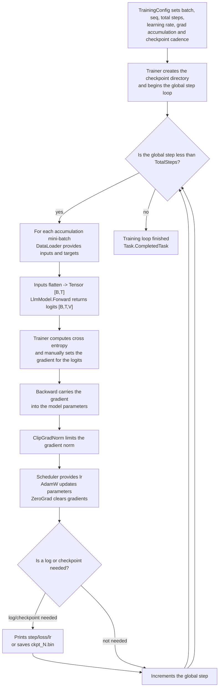

# 04.TrainingLoop - model training infrastructure

## Human explanation

`04.TrainingLoop` is the part of the project that takes prepared token batches from `02.DatasetPipeline`, runs them through `03.TransformerModel`, computes loss, manually sets the gradient for the logits, runs backward, limits the gradient norm, does an optimizer step and periodically saves a checkpoint. If `03.TransformerModel` is the machine that can compute logits, then `04.TrainingLoop` is the machine operator: it feeds batches, watches the error, turns the weights and saves intermediate states.

Important: this project is training-loop infrastructure, not proof that the model was successfully trained. The presence of `Trainer`, `AdamW`, a printed loss or a checkpoint file only proves the existence of a training/saving mechanism. The claim "the model is well trained" requires separate runtime/training report evidence: an actual training run, loss/metrics, a checkpoint, a reload probe and downstream validation.

Data boundary:

- Input from `02.DatasetPipeline`: `DataLoader.NextBatch()` returns `(long[,] inputs, long[,] targets)`.
- Input from `03.TransformerModel`: `LlmModel` accepts `Tensor [B,T]` and returns logits `Tensor [B,T,V]`.
- Internal math from `00.TensorCore`: `TensorOps.CrossEntropy`, `TensorOps.ClipGradNorm`, `Tensor.Backward`, `Parameter`.
- Output: modified model parameters, console log `step/loss/lr`, and checkpoint files via `model.SaveCheckpoint(...)`.
- Not an output: model quality, held-out metrics, a fresh checkpoint load or proof of product reasoning.

## 0. UML class diagram

```mermaid
classDiagram
    class TrainingConfig {
        +int BatchSize
        +int SeqLen
        +float MaxLr
        +float MinLr
        +int WarmupSteps
        +int TotalSteps
        +int GradAccumSteps
        +float GradClipNorm
        +float WeightDecay
        +int CheckpointEvery
        +string CheckpointDir
        +int LogEvery
    }

    class Trainer {
        +TrainAsync(LlmModel model, AdamW optimizer, DataLoader loader, CancellationToken ct) Task
        -CrossEntropyLoss(Tensor logits, int[] targets) float
        -BackwardLoss(Tensor logits, int[] targets, float scale) void
        -ToTensor(int[] ids, int batch, int seq) Tensor
        -Flatten2D(long[,] arr) int[]
    }

    class CosineWithWarmup {
        +GetLr(int step) float
    }

    class AdamW {
        +Step(IEnumerable~Parameter~ parameters, float lr) void
    }

    class DataLoader {
        +NextBatch() (long[,] inputs, long[,] targets)
    }

    class LlmModel {
        +Forward(Tensor tokenIds) Tensor
        +Parameters() IEnumerable~Parameter~
        +ZeroGrad() void
        +SaveCheckpoint(string path) void
    }

    class TensorOps {
        +CrossEntropy(Tensor logits, int[] targets) float
        +ClipGradNorm(IEnumerable~Parameter~ parameters, float maxNorm) void
        +Reshape(Tensor x, int[] dims) Tensor
        +ZerosLike(Tensor t) Tensor
    }

    class Tensor {
        +Data
        +Grad
        +Backward(Tensor grad) void
    }

    TrainingConfig --> Trainer : sets batch, lr, steps, checkpoint
    Trainer --> CosineWithWarmup : gets lr for the step
    Trainer --> DataLoader : takes input/target batches
    Trainer --> LlmModel : Forward, Parameters, ZeroGrad, SaveCheckpoint
    Trainer --> TensorOps : loss, clipping, reshape
    Trainer --> Tensor : sets Grad and runs Backward
    Trainer --> AdamW : optimizer step
    AdamW --> Tensor : changes Parameter.Value.Data
    AdamW --> TensorOps : reads Parameter.Grad
    CosineWithWarmup --> TrainingConfig : uses warmup/total/max/min lr

    note for TrainingConfig "FULLY IMPLEMENTED\nStores the training loop hyperparameters.\nDoes not prove that the chosen values are optimal."
    note for Trainer "FULLY IMPLEMENTED INFRASTRUCTURE\nTakes batches, computes loss/backward, clips gradients, calls optimizer and checkpoint.\nDoes not measure model quality itself."
    note for CosineWithWarmup "FULLY IMPLEMENTED\nLinear warmup then cosine decay.\nDoes not choose lr adaptively by quality."
    note for AdamW "FULLY IMPLEMENTED\nUpdates weights by gradients, moments and decoupled weight decay.\nDoes not save optimizer state in the checkpoint."
    note for DataLoader "EXTERNAL DATA SUPPLIER\nProvides shifted token batches from .npy shards.\nPrepared data is not learning evidence."
    note for LlmModel "EXTERNAL MODEL\nProvides logits and parameters, saves the checkpoint.\nDoes not own the training loop itself."
    note for TensorOps "EXTERNAL MATH FOUNDATION\nCrossEntropy, gradient clipping and reshape.\nIs not product reasoning."
    note for Tensor "EXTERNAL AUTOGRAD FOUNDATION\nStores Data/Grad and runs Backward.\nDoes not prove training quality."
```



| Class | What it does | Status |
|---|---|---|
| `TrainingConfig` | Stores batch size, sequence length, learning-rate limits, warmup, total steps, grad accumulation, clipping, checkpoint schedule and log cadence. | Fully implemented config record |
| `Trainer` | Runs the main training loop: batch -> forward -> loss -> backward -> clipping -> optimizer step -> zero grad -> log/checkpoint. | Fully implemented training infrastructure |
| `CosineWithWarmup` | Computes the learning rate: linear warmup to `MaxLr`, then cosine decay to `MinLr`. | Fully implemented scheduler |
| `AdamW` | Updates model parameters by gradients, first/second moments, bias correction and decoupled weight decay. | Fully implemented optimizer |
| `DataLoader` | Supplies shifted token batches from the dataset pipeline. | External dependency |
| `LlmModel` | Provides logits, parameters, `ZeroGrad` and `SaveCheckpoint`. | External model boundary |
| `TensorOps` | Provides tensor math for loss, clipping and reshape. | External math/autograd infrastructure |
| `Tensor` | Stores data/gradients and runs backward. | External tensor/autograd infrastructure |

### Connection simulations

| Connection | Example input | What happens | Expected result | What must not be taken as proof |
|---|---|---|---|---|
| `TrainingConfig -> Trainer` | `BatchSize=2`, `SeqLen=4`, `TotalSteps=10`, `GradAccumSteps=2`, `CheckpointEvery=5`. | `Trainer` uses the config for tensor shapes, the number of mini-batches, the scheduler and checkpoint cadence. | The loop does up to 10 global steps; each step accumulates 2 mini-batches. | The config does not prove that a training run was executed or successful. |
| `Trainer -> CosineWithWarmup` | `_globalStep=0`, `WarmupSteps=100`, `MaxLr=3e-4`. | The scheduler computes lr for the current step. | On early warmup lr starts near 0 and rises toward `MaxLr`. | The presence of an lr schedule does not prove convergence. |
| `Trainer -> DataLoader` | `loader.NextBatch()` returns `inputs[2,4]`, `targets[2,4]`. | The Trainer flattens both arrays and makes an input tensor `[B,T]`. | `LlmModel.Forward` receives `Tensor [2,4]`. | A prepared batch is not evidence of learning. |
| `Trainer -> LlmModel` | `inputTensor [B,T]`. | The Trainer calls `model.Forward(inputTensor)`. | Gets logits `[B,T,V]` for loss. | A forward pass does not prove the weights are already trained. |
| `Trainer -> TensorOps` | logits `[B,T,V]`, targets length `B*T`, `GradClipNorm=1.0`. | The loss path reshapes logits and computes cross entropy; the clipping path limits gradients. | Loss scalar for logging; gradients scale down if the norm is above max. | A loss print without a saved report and trend does not prove quality. |
| `Trainer -> Tensor` | logits and manual grad `(softmax - one_hot) * scale`. | The Trainer puts grad into `logits.Grad`, then calls `logits.Backward(logits.Grad)`. | Autograd carries gradients into the model parameters. | The backward call itself does not prove the optimizer made a useful step. |
| `Trainer -> AdamW` | `model.Parameters()`, `lr=1e-4`. | AdamW reads `Parameter.Grad`, updates moments and weights. | `Parameter.Value.Data` changes for parameters with gradients. | Changing weights is not the same as improving model quality. |
| `Trainer -> LlmModel.SaveCheckpoint` | `_globalStep=500`, `CheckpointEvery=500`. | The Trainer calls `SaveCheckpoint(".../ckpt_000500.bin")` before the increment step. | A checkpoint file for the model weights appears. | A checkpoint file does not prove reload, metrics or product readiness. |
| `AdamW -> Tensor` | One parameter value `1.0`, grad `1.0`. | AdamW updates moments, applies weight decay, subtracts the gradient step. | Weight decreases for a positive gradient. | Unit optimizer behavior does not prove the full training loop. |
| `CosineWithWarmup -> TrainingConfig` | `step=55`, `warmup=10`, `total=100`. | The scheduler uses max/min lr and progress after warmup. | lr below peak and not below `MinLr` near the end. | A bounded lr does not prove the absence of divergence. |

## 1. Human flow diagram



Branch simulations:

| Branch | Example input | Expected result | What must not be taken |
|---|---|---|---|
| Loop continues | `_globalStep=3`, `TotalSteps=10`. | The Trainer takes batches, computes loss/backward, does an optimizer step. | One step does not prove convergence. |
| Loop finishes | `_globalStep=10`, `TotalSteps=10`. | The method exits and returns a completed task. | Finishing the loop does not prove model quality. |
| Checkpoint branch | `_globalStep=500`, `CheckpointEvery=500`. | `SaveCheckpoint("ckpt_000500.bin")` is called before the increment. | A checkpoint without reload/eval is not trained-model evidence. |
| No-checkpoint branch | `_globalStep=7`, `CheckpointEvery=500`. | The checkpoint is not saved, the step only increments. | The absence of a checkpoint at step 7 is not an error. |
| Cancellation branch | `ct` canceled inside the loop. | `ct.ThrowIfCancellationRequested()` interrupts training. | Cancellation does not prove a failed model; it is a runtime control path. |

## 2. No-code algorithms, in the operator's language

### Algorithm A: `TrainingConfig`

Analogy: this is a settings sheet for training. It says how many examples to take at a time, how many steps to do, at what rate to change the weights and how often to save.

Where the logic lives: `04.TrainingLoop/TrainingConfig.cs:6`.

Signature and data:

```csharp
public record TrainingConfig

Example input DTO:
TrainingConfig {
    BatchSize = 8,
    SeqLen = 2048,
    MaxLr = 3e-4f,
    MinLr = 3e-5f,
    WarmupSteps = 100,
    TotalSteps = 10_000,
    GradAccumSteps = 4,
    GradClipNorm = 1.0f,
    WeightDecay = 0.1f,
    CheckpointEvery = 500,
    CheckpointDir = "checkpoints",
    LogEvery = 10
}

Output:
a config object that the Trainer and scheduler read.
```

Current behavior:

1. Stores all hyperparameters in one record.
2. Provides defaults for batch, sequence length, learning rates, warmup, total steps, gradient accumulation, clipping, weight decay, checkpoint and logging.
3. Does not perform value validation.

Branches and limitations:

- If the caller sets `TotalSteps=0`, the loop effectively does not start.
- If the caller sets batch/seq incompatible with `DataLoader`, the problem appears at runtime, not in the config.
- Does not store training metrics and does not prove model quality.

Status: fully implemented config record.

### Algorithm B: `Trainer.TrainAsync(LlmModel model, AdamW optimizer, DataLoader loader, CancellationToken ct)`

Analogy: this is a coach in the gym. It takes an exercise, computes the error, tells the model which way to move the weights, limits too abrupt a movement, does an optimizer step and sometimes saves the state.

Where the logic lives: `04.TrainingLoop/Trainer.cs:31`.

Signature and data:

```csharp
public async Task TrainAsync(
    LlmModel model,
    AdamW optimizer,
    DataLoader loader,
    CancellationToken ct = default)

Input:
model = new LlmModel(modelConfig)
optimizer = new AdamW(...)
loader = new DataLoader(dataDir, batchSize, seqLen)

Output:
Task completed; side effects:
- the model parameters may change;
- gradients are cleared after the optimizer step;
- checkpoint files may be written;
- the console may receive a step/loss/lr log.
```

Current behavior:

1. Creates `CheckpointDir`.
2. While `_globalStep < TotalSteps`, checks the cancellation token.
3. Resets `totalLoss` for the current global step.
4. For each accumulation mini-batch calls `loader.NextBatch()`.
5. Flattens `long[,] inputs/targets` into `int[]`.
6. Turns the input ids into `Tensor [BatchSize, SeqLen]`.
7. Calls `model.Forward(inputTensor)` and gets logits `[B,T,V]`.
8. Computes the cross entropy loss and divides it by `GradAccumSteps`.
9. Manually adds a gradient to the logits via `BackwardLoss`.
10. After accumulation calls `ClipGradNorm`.
11. Takes the learning rate from the scheduler.
12. Calls `optimizer.Step(model.Parameters(), lr)`.
13. Clears gradients via `model.ZeroGrad()`.
14. Prints a log if the step is a multiple of `LogEvery`.
15. Saves a checkpoint if the step is greater than 0 and a multiple of `CheckpointEvery`.
16. Increments `_globalStep`.

Branches and limitations:

- Cancellation branch: `ct.ThrowIfCancellationRequested()` can interrupt the loop.
- Logging branch: a log appears only on steps that are multiples of `LogEvery`.
- Checkpoint branch: a checkpoint is saved only when `_globalStep > 0` and a multiple of `CheckpointEvery`.
- The method does not return a metrics object, does not write a structured report and does not check held-out quality.
- The method does not save optimizer state.

Status: fully implemented training-loop infrastructure, but not evidence of successful training by itself.

### Algorithm C: `Trainer.CrossEntropyLoss(Tensor logits, int[] targets)`

Analogy: this is an examiner. It takes the model's scores and the correct answers, then computes the average penalty for wrong confidence.

Where the logic lives: `04.TrainingLoop/Trainer.cs:80`.

Signature and data:

```csharp
private static float CrossEntropyLoss(Tensor logits, int[] targets)

Input:
logits = Tensor shape [B,T,V], for example [2,4,32000]
targets = int[] of length B*T

Output:
float loss, the average cross entropy for the flattened positions.
```

Current behavior:

1. Reads dimensions `b`, `t`, `v` from the logits.
2. Reshapes logits from `[B,T,V]` into `[B*T,V]`.
3. Calls `TensorOps.CrossEntropy(flatLogits, targets)`.
4. Returns the scalar loss.

Branches and limitations:

- Assumes that targets have length `B*T`.
- Does not perform backward itself; backward is done by `BackwardLoss`.
- The loss value by itself is not a quality report without trend/validation.

Status: implemented loss helper.

### Algorithm D: `Trainer.BackwardLoss(Tensor logits, int[] targets, float scale)`

Analogy: this is a manual hint to the model about where it made a mistake: for the correct token it subtracts one-hot, for the rest it keeps the softmax probability, then scales the result.

Where the logic lives: `04.TrainingLoop/Trainer.cs:92`.

Signature and data:

```csharp
private static void BackwardLoss(Tensor logits, int[] targets, float scale)

Input:
logits = Tensor [B,T,V]
targets = int[] length B*T
scale = 1 / (GradAccumSteps * BatchSize * SeqLen)

Output:
void; side effect:
logits.Grad is filled and logits.Backward(logits.Grad) runs autograd.
```

Current behavior:

1. Reads `b`, `t`, `v`.
2. If `logits.Grad == null`, creates a zero-like gradient tensor.
3. For each flattened position finds `maxVal` for a stable softmax.
4. Computes `expSum`.
5. For each vocab index computes the softmax probability.
6. Compares the index with the target and forms `oneHot`.
7. Adds `(softmax - oneHot) * scale` into `logits.Grad`.
8. Calls `logits.Backward(logits.Grad)`.

Branches and limitations:

- If `logits.Grad` already exists, gradients accumulate; if not, a new zero tensor is created.
- Does not check target index bounds.
- Is not a full metric report: this is a gradient path, not validation.

Status: implemented manual backward helper.

### Algorithm E: `Trainer.Flatten2D(long[,] arr)` and `Trainer.ToTensor(int[] ids, int batch, int seq)`

Analogy: this is a packer. It takes a table of token ids `[batch, seq]`, lays it out into a single list, and then makes a tensor of the required shape.

Where the logic lives: `04.TrainingLoop/Trainer.cs:128` and `04.TrainingLoop/Trainer.cs:135`.

Signature and data:

```csharp
private static Tensor ToTensor(int[] ids, int batch, int seq)
private static int[] Flatten2D(long[,] arr)

Input:
arr = long[2,4] from DataLoader
ids = int[] length 8

Output:
Flatten2D -> int[] length batch*seq
ToTensor -> Tensor shape [batch, seq]
```

Current behavior:

1. `Flatten2D` reads the dimensions of the `long[,]`.
2. Copies the elements row-major into an `int[]`.
3. `ToTensor` converts each int id to float.
4. Returns `Tensor(data, TensorShape(batch, seq))`.

Branches and limitations:

- Does not check for overflow on the `long` to `int` cast.
- Does not check that `ids.Length == batch * seq`.
- This is a data-shape bridge, not training evidence.

Status: implemented data conversion helper.

### Algorithm F: `CosineWithWarmup.GetLr(int step)`

Analogy: the learning rate is the speed of turning the weights knob. At the start the knob is turned carefully, then the maximum is allowed, and closer to the end it slows down again.

Where the logic lives: `04.TrainingLoop/Schedulers/CosineWithWarmup.cs:23`.

Signature and data:

```csharp
public float GetLr(int step)

Input:
step = 50
warmupSteps = 100
totalSteps = 1000
maxLr = 1e-3f
minLr = 1e-4f

Output:
float learningRate
```

Current behavior:

1. If `step < warmupSteps`, returns linear warmup: `maxLr * step / max(1,warmupSteps)`.
2. Otherwise computes progress after warmup.
3. Computes cosine factor `0.5 * (1 + cos(pi * progress))`.
4. Returns `minLr + cosine * (maxLr - minLr)`.

Branches and limitations:

- Warmup branch: step 0 returns 0.
- Decay branch: after warmup lr smoothly falls toward min.
- The scheduler does not look at loss and does not make adaptive learning-rate decisions.

Status: fully implemented scheduler.

### Algorithm G: `AdamW.Step(IEnumerable<Parameter> parameters, float lr)`

Analogy: the optimizer is a craftsman who receives the direction of the error and carefully moves each knob of the model, accounting for the inertia of past steps and weight decay.

Where the logic lives: `04.TrainingLoop/Optimizers/AdamW.cs:35`.

Signature and data:

```csharp
public void Step(IEnumerable<Parameter> parameters, float lr)

Input:
parameters = model.Parameters()
lr = scheduler.GetLr(globalStep)

Output:
void; side effect:
Parameter.Value.Data changes for parameters with non-null Grad.
```

Current behavior:

1. Increments the internal `_step`.
2. Computes bias correction factors `bc1` and `bc2`.
3. For each parameter skips it if `param.Grad == null`.
4. If optimizer state for the parameter is missing, creates arrays `m` and `v`.
5. For each weight element updates first moment `m`.
6. Updates second moment `v`.
7. Computes corrected `mHat` and `vHat`.
8. Applies decoupled weight decay: `w *= 1 - lr * weightDecay`.
9. Does the gradient step: `w -= lr * mHat / (sqrt(vHat) + eps)`.

Branches and limitations:

- Null-grad branch: parameter silently skipped.
- First-time branch: state arrays are created for the first parameter encountered.
- Optimizer state lives in memory and is not saved to the checkpoint.
- A weight update does not prove that model quality improves.

Status: fully implemented optimizer.

## 3. Important code references

### The main training loop

Reference: `04.TrainingLoop/Trainer.cs:31-77`.

> Why it matters: this is the only place in D04 where dataset batch, model forward, loss, backward, clipping, optimizer step, logging and checkpoint schedule come together in one loop.
> Input: `LlmModel`, `AdamW`, `DataLoader`, `CancellationToken`.
> Output: side effects on parameters/checkpoints/logs.
> Which branch is proven: accumulation, clipping, optimizer, logging and checkpoint are called in the current order.
> What this does not prove: that a training run was actually executed in D1F or that the loss improved.

```csharp
var (inputIds2d, targetIds2d) = loader.NextBatch();
var logits = model.Forward(inputTensor);
float loss = CrossEntropyLoss(logits, flatTarget) / _cfg.GradAccumSteps;
BackwardLoss(logits, flatTarget, 1f / (_cfg.GradAccumSteps * _cfg.BatchSize * _cfg.SeqLen));
TensorOps.ClipGradNorm(model.Parameters(), _cfg.GradClipNorm);
optimizer.Step(model.Parameters(), lr);
```

### The checkpoint schedule

Reference: `04.TrainingLoop/Trainer.cs:66-73`.

> Why it matters: a checkpoint is saved not every step, but only on schedule and before incrementing `_globalStep`. This affects the file name and which checkpoints can be expected.
> Input: `_globalStep`, `LogEvery`, `CheckpointEvery`, `CheckpointDir`.
> Output: console log or `ckpt_000500.bin`.
> Which branch is proven: step 0 is logged, but the checkpoint is not saved due to `_globalStep > 0`.
> What this does not prove: that the checkpoint loads back or contains high-quality weights.

```csharp
if (_globalStep % _cfg.LogEvery == 0)
    Console.WriteLine($"step={_globalStep} loss={totalLoss:F4} lr={lr:E3}");

if (_globalStep > 0 && _globalStep % _cfg.CheckpointEvery == 0)
    model.SaveCheckpoint(Path.Combine(_cfg.CheckpointDir, $"ckpt_{_globalStep:D6}.bin"));
```

### The cross entropy bridge

Reference: `04.TrainingLoop/Trainer.cs:79-89`.

> Why it matters: model logits arrive as `[B,T,V]`, while `TensorOps.CrossEntropy` expects `[N,C]`. This helper honestly shows the shape bridge.
> Input: logits `[B,T,V]`, targets `int[]`.
> Output: scalar loss.
> Which branch is proven: flatten goes through `TensorOps.Reshape(logits, b * t, v)`.
> What this does not prove: the correctness of the manual backward; that is a separate helper.

```csharp
int b = logits.Shape.Dimensions[0];
int t = logits.Shape.Dimensions[1];
int v = logits.Shape.Dimensions[2];
var flatLogits = TensorOps.Reshape(logits, b * t, v);
return TensorOps.CrossEntropy(flatLogits, targets);
```

### The manual backward for logits

Reference: `04.TrainingLoop/Trainer.cs:91-125`.

> Why it matters: D04 does not rely on an autograd cross-entropy operation; it manually creates the gradient for logits as `softmax - one_hot`, then calls backward.
> Input: logits `[B,T,V]`, targets, scale.
> Output: `logits.Grad` and gradient propagation.
> Which branch is proven: if `logits.Grad == null`, a zero-like gradient is created.
> What this does not prove: target bounds safety or full training quality.

```csharp
if (logits.Grad == null)
    logits.Grad = TensorOps.ZerosLike(logits);

float sm = MathF.Exp(logits.Data[pos * v + j] - maxVal) / expSum;
float oneHot = j == targets[pos] ? 1f : 0f;
logits.Grad.Data[pos * v + j] += (sm - oneHot) * scale;
logits.Backward(logits.Grad);
```

### The learning rate schedule

Reference: `04.TrainingLoop/Schedulers/CosineWithWarmup.cs:23-30`.

> Why it matters: the scheduler has two explicit branches: warmup and cosine decay. This explains why step 0 can have lr 0.
> Input: `step`.
> Output: `float lr`.
> Which branch is proven: `step < warmupSteps` goes through linear warmup, otherwise through cosine decay.
> What this does not prove: that the chosen lr values are optimal for a specific dataset.

```csharp
if (step < _warmupSteps)
    return _maxLr * step / Math.Max(1, _warmupSteps);

float progress = (float)(step - _warmupSteps) / Math.Max(1, _totalSteps - _warmupSteps);
float cosine   = 0.5f * (1f + MathF.Cos(MathF.PI * progress));
return _minLr + cosine * (_maxLr - _minLr);
```

### Weight update in AdamW

Reference: `04.TrainingLoop/Optimizers/AdamW.cs:35-74`.

> Why it matters: this is the real weight update path. It shows the null-grad skip, lazy optimizer state, bias correction, decoupled weight decay and the gradient step.
> Input: parameters with `Grad`, lr.
> Output: mutated `Parameter.Value.Data`.
> Which branch is proven: parameters without grad are skipped.
> What this does not prove: optimizer state persistence; the state is kept only in memory.

```csharp
if (param.Grad == null) continue;
if (!_state.TryGetValue(param, out var state))
{
    state = (new float[n], new float[n]);
    _state[param] = state;
}
w[i] *= 1f - lr * _weightDecay;
w[i] -= lr * mHat / (MathF.Sqrt(vHat) + _eps);
```

### The loss and clipping boundary in TensorCore

Reference: `00.TensorCore/Core/TensorOps.cs:1040-1067` and `00.TensorCore/Core/TensorOps.cs:1069-1088`.

> Why it matters: D04 delegates core math to `00.TensorCore`; here you can see that cross entropy is averaged over N, and the clipping scale is applied only if the total norm is above max.
> Input: logits/targets for loss; parameters/maxNorm for clipping.
> Output: scalar loss; scaled gradients.
> Which branch is proven: if total norm <= maxNorm, clipping returns without scaling.
> What this does not prove: that the model converged.

```csharp
float logP = logits.Data[i * c + targets[i]] - maxVal - logSumExp;
totalLoss -= logP;
return totalLoss / n;

float totalNorm = MathF.Sqrt(totalNormSq);
if (totalNorm <= maxNorm) return;
float scale = maxNorm / (totalNorm + 1e-6f);
```

## 4. Link to tests, e2e and QA

Tests were not run for D1F. Below is only source evidence found by reading the test files.

| Evidence | Lines | What it checks | Honest gap |
|---|---:|---|---|
| `AdamWTests.Step_ZeroGradient_WeightsUnchanged` | `Tests/AdamWTests.cs:19-30` | Zero grad + no decay leaves weight unchanged. | Does not cover the full Trainer loop. |
| `AdamWTests.Step_NonZeroGradient_WeightDecreases` | `Tests/AdamWTests.cs:32-44` | Positive grad moves weight down. | Does not prove model convergence. |
| `AdamWTests.Step_WeightDecay_ReducesWeightMagnitude` | `Tests/AdamWTests.cs:46-57` | Weight decay shrinks weight. | Does not prove correct scheduling. |
| `AdamWTests.Step_MultipleSteps_WeightConvergesForQuadraticLoss` | `Tests/AdamWTests.cs:59-77` | AdamW can converge on simple quadratic. | Synthetic scalar, not LLM training. |
| `AdamWTests.Step_NullGrad_SkipsParameter` | `Tests/AdamWTests.cs:79-90` | Null-grad branch skips parameter. | Does not test frozen modules in LlmModel. |
| `AdamWTests.Step_TwoParams_EachUpdatedIndependently` | `Tests/AdamWTests.cs:92-107` | Parameters update independently by grad sign. | Does not test shared optimizer state persistence. |
| `SchedulerTests.Warmup_StartsNearZeroAndRisesToMaxLr` | `Tests/SchedulerTests.cs:7-19` | Warmup branch rises to max lr. | Does not test invalid config values. |
| `SchedulerTests.Decay_DropsBelowMaxLrAfterWarmup` | `Tests/SchedulerTests.cs:21-33` | Decay branch drops below peak and stays near min. | Does not prove training stability. |
| `IntegrationTests.Chain_Scheduler_LrIsPositiveAndBounded` | `Tests/IntegrationTests.cs:164-180` | Scheduler lr is bounded after warmup. | Still no full training run. |
| `IntegrationTests2.Chain_ForwardBackwardStep_UpdatesLinearWeights` | `Tests/IntegrationTests2.cs:207-229` | TensorCore backward plus AdamW changes Linear weights. | Uses a single Linear layer, not `Trainer.TrainAsync`. |

Honest QA gaps / future work orders:

- Add a focused `Trainer` integration test with tiny `LlmModel`, tiny `.npy` shard, `TotalSteps=1`, and assertion that at least one model weight changes.
- Add checkpoint schedule test for `Trainer`: step 0 no checkpoint, checkpoint at configured interval, file can be loaded by `LlmModel.LoadCheckpoint`.
- Add cancellation test for `Trainer.TrainAsync`.
- Add target bounds/shape mismatch negative tests for `BackwardLoss` or public trainer path.
- Add real training-run report artifact with loss trend, checkpoint path, reload probe and validation sample before claiming "trained model".

## 5. Link to neighboring projects

| Neighboring project | Link | Current boundary |
|---|---|---|
| `02.DatasetPipeline` | `DataLoader.NextBatch()` supplies `inputs` and `targets`; D04 converts them to `Tensor [B,T]`. | Dataset preparation is not model learning evidence. |
| `03.TransformerModel` | `LlmModel.Forward` produces logits; `Parameters`, `ZeroGrad`, `SaveCheckpoint` are used by D04. | Model architecture exists separately from training loop evidence. |
| `00.TensorCore` | Provides tensor/autograd/math primitives: reshape, cross entropy, backward, clipping, parameters. | Math primitives are infrastructure, not product reasoning. |
| `10.LoRA` | Future LoRA docs should explain adapter-specific training paths separately. | D04 AdamW loop does not imply LoRA adapter lifecycle. |
| `11.DPO` | Future DPO docs should explain chosen/rejected preference loss separately. | D04 cross entropy training is not DPO evidence. |

## 6. Anti-false-done checks

The following must not be taken as proof of a successful trained model:

- `Trainer.TrainAsync` exists. This proves loop infrastructure, not model quality.
- The console log `step=... loss=... lr=...` appeared. Without persisted metrics/trend this is monitoring output, not validation.
- A checkpoint file exists. Without a reload probe and evaluation this is only saved weights.
- `AdamWTests` passed in the past. Optimizer unit behavior does not prove end-to-end training success.
- Scheduler bounded lr. This does not prove convergence.
- JSON, smoke report or static grep says "passed". Training claims require actual training-run metrics/checkpoint/reload evidence.
- Weight changed after the optimizer step. This does not mean the model learned useful behavior.

Required evidence for stronger claims:

- Training-run claim: persisted report with total steps, loss trend, checkpoint path, CPU/RAM/time if required by the phase, and no `validation_only` substitution.
- Checkpoint claim: saved checkpoint plus `LoadCheckpoint` fresh-load probe.
- Quality claim: held-out validation or downstream prompt/task evidence.
- Product readiness claim: registry/manifest/locator/import-export evidence when the model is meant to become a project asset.

## 7. Implementation status table

| Component | File | Status | What actually works now |
|---|---|---|---|
| `TrainingConfig` | `04.TrainingLoop/TrainingConfig.cs` | Fully implemented config | Stores `BatchSize`, `SeqLen`, lr bounds, warmup/total steps, grad accumulation, clipping, weight decay, checkpoint and logging cadence. |
| `Trainer` | `04.TrainingLoop/Trainer.cs` | Fully implemented infrastructure | `TrainAsync` runs batch/forward/loss/backward/clip/optimizer/zero-grad/log/checkpoint loop; does not emit structured training report or validate model quality. |
| `Trainer.CrossEntropyLoss` | `04.TrainingLoop/Trainer.cs` | Fully implemented helper | Reshapes `[B,T,V]` logits into `[B*T,V]` and calls `TensorOps.CrossEntropy`. |
| `Trainer.BackwardLoss` | `04.TrainingLoop/Trainer.cs` | Fully implemented helper | Builds manual `(softmax - one_hot) * scale` gradient and calls `logits.Backward`. |
| `Trainer.Flatten2D` / `Trainer.ToTensor` | `04.TrainingLoop/Trainer.cs` | Fully implemented helpers | Convert `long[,]` token batches into flat `int[]` and `Tensor [B,T]`; no overflow/shape validation. |
| `CosineWithWarmup` | `04.TrainingLoop/Schedulers/CosineWithWarmup.cs` | Fully implemented scheduler | Linear warmup branch and cosine decay branch using config values. |
| `AdamW` | `04.TrainingLoop/Optimizers/AdamW.cs` | Fully implemented optimizer | Updates parameters with grad using moments, bias correction and decoupled weight decay; skips null grad; optimizer state is not checkpointed. |
| `DataLoader` boundary | `02.DatasetPipeline/DataLoader.cs` | External dependency documented | Supplies shifted input/target batches. |
| `LlmModel` boundary | `03.TransformerModel/LlmModel.cs` | External dependency documented | Provides `Forward`, `Parameters`, `ZeroGrad`, `SaveCheckpoint`; model quality requires separate training evidence. |

Documentation status: draft/sub-agent D1F pass pending parent review
Last verified against source: 2026-06-08
Known gaps: no direct `Trainer.TrainAsync` integration test found; no D1F runtime training report was run or claimed.
