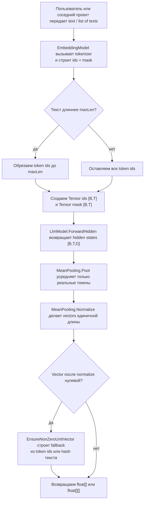

# 05.Embeddings - векторы текста поверх Transformer

## Человеческое объяснение

`05.Embeddings` превращает строку текста или список строк в числовые векторы фиксированной длины. Сначала текст проходит через `BpeTokenizer`, затем токены подаются в `LlmModel.ForwardHidden`, после этого `MeanPooling` усредняет скрытые состояния настоящих токенов и нормализует результат до единичной длины. Такой вектор удобно отдавать в `06.VectorSearch` или другой слой поиска, где cosine similarity можно считать как dot product.

Важно: этот проект является инфраструктурой embeddings, а не доказательством обученного semantic reasoning. Вектор существует потому, что код умеет токенизировать, получить hidden states и усреднить их; это не доказывает, что encoder обучен хорошо, что смысл текста понят правильно, или что retrieval даст качественный ответ на реальном корпусе.

Граница данных:

- Вход: `string text` или `IList<string> texts`.
- Внутри: `Tensor ids [B,T]`, `Tensor mask [B,T]`, hidden states `Tensor [B,T,D]`.
- Выход: `float[] [D]` для одного текста или `float[][] [B][D]` для batch.
- Не выход: метрика качества модели, обученный доменный смысл, checkpoint evidence, ranking authority.

## 0. UML диаграмма классов

```mermaid
classDiagram
    class EmbeddingModel {
        +int Dimensions
        +EmbeddingModel(LlmModel encoder, BpeTokenizer tokenizer, int maxLen)
        +Embed(string text) float[]
        +EmbedBatch(IList~string~ texts) float[][]
        -Tokenize(IList~string~ texts) (Tensor ids, Tensor mask)
        -EnsureNonZeroUnitVector(float[] vector, string text) void
    }

    class BpeTokenizer {
        +Encode(string text) List~int~
    }

    class LlmModel {
        +ForwardHidden(Tensor ids) Tensor
        +Config.HiddenDim int
    }

    class MeanPooling {
        +Pool(Tensor tokenVectors, Tensor attentionMask) Tensor
        +Normalize(Tensor vectors) Tensor
    }

    class Tensor {
        +Data float[]
        +Shape TensorShape
    }

    class TensorOps {
        +L2Normalize(Tensor vectors, float eps) Tensor
    }

    class VectorSearch {
        +Search(float[] query, int topK) results
    }

    EmbeddingModel --> BpeTokenizer : text -> token ids
    EmbeddingModel --> Tensor : ids/mask tensors
    EmbeddingModel --> LlmModel : ids tensor -> hidden states
    EmbeddingModel --> MeanPooling : hidden states + mask
    MeanPooling --> TensorOps : L2 normalization
    EmbeddingModel ..> VectorSearch : normalized float[] can be indexed

    note for EmbeddingModel "ПОЛНОСТЬЮ РЕАЛИЗОВАНА\nСтроит embeddings из tokenizer + transformer hidden states + pooling.\nНе доказывает качество обученного encoder."
    note for BpeTokenizer "ВНЕШНЯЯ ЗАВИСИМОСТЬ\nПреобразует текст в token ids.\nТокенизация не является semantic reasoning."
    note for LlmModel "ВНЕШНЯЯ ЗАВИСИМОСТЬ\nВозвращает hidden states [B,T,D].\nКачество hidden states зависит от модели/обучения."
    note for MeanPooling "ПОЛНОСТЬЮ РЕАЛИЗОВАНА\nУсредняет token vectors по mask и нормализует строки.\nНе обучается и не выбирает смысл."
    note for Tensor "ВНЕШНЯЯ MATH СТРУКТУРА\nНесет Data и Shape между слоями."
    note for TensorOps "ВНЕШНЯЯ MATH ОСНОВА\nДелает L2 normalization с eps."
    note for VectorSearch "СОСЕДНИЙ ПОТРЕБИТЕЛЬ\nМожет хранить и искать vectors.\nTop-K не доказывает качество embeddings без QA."
```



| Класс | Что делает | Статус |
|---|---|---|
| `EmbeddingModel` | Собирает pipeline text -> token ids -> hidden states -> pooled normalized vector. | Полностью реализованная embedding infrastructure |
| `BpeTokenizer` | Дает token ids для текста. | Внешняя зависимость из `01.Tokenizer` |
| `LlmModel` | Дает hidden states размера `[B,T,D]`. | Внешняя зависимость из `03.TransformerModel` |
| `MeanPooling` | Усредняет token vectors с учетом mask и нормализует строки. | Полностью реализованная math utility |
| `Tensor` | Передает ids, mask, hidden states и pooled vectors. | Внешняя инфраструктура из `00.TensorCore` |
| `TensorOps` | Выполняет L2-нормализацию. | Внешняя math utility |
| `VectorSearch` | Может использовать `float[]` embeddings для similarity search. | Соседний потребитель, не часть D05 |

### Симуляции соединений

| Соединение | Пример входа | Что происходит | Ожидаемый результат | Что нельзя принимать как доказательство |
|---|---|---|---|---|
| `EmbeddingModel -> BpeTokenizer` | text=`"hello"`, `maxLen=8`. | `Tokenize` вызывает `Encode`, затем обрезает список токенов до `maxLen`. | Получается список ids, например `[12, 34]`, не длиннее 8. | Нельзя считать токенизацию пониманием смысла текста. |
| `EmbeddingModel -> Tensor` | batch из `["abc","def"]`, token lengths `2` и `1`. | Создаются `ids [2,2]` и `mask [2,2]`; padding получает id `0`, mask `0`. | `ids` и `mask` имеют одинаковую форму `[B,T]`. | Нельзя считать наличие tensors доказательством model quality. |
| `EmbeddingModel -> LlmModel` | `ids Tensor [2,2]`. | Encoder получает ids и возвращает hidden states. | `hidden Tensor [2,2,D]`, где `D = Config.HiddenDim`. | ForwardHidden не доказывает, что encoder обучен семантически. |
| `EmbeddingModel -> MeanPooling` | hidden `[2,2,D]`, mask `[2,2]`. | `Pool` игнорирует padding по mask, `Normalize` делает длину строки близкой к 1. | `Tensor [2,D]`, затем `float[][]` с двумя vectors. | Unit norm не доказывает правильную семантику. |
| `MeanPooling -> TensorOps` | pooled vector `[3,4]`. | `Normalize` вызывает `TensorOps.L2Normalize` с `eps: 1e-9f`. | vector становится примерно `[0.6,0.8]`. | L2 normalization не является training evidence. |
| `EmbeddingModel ..> VectorSearch` | vector для `"alpha"`. | Соседний индекс может сохранить vector и искать nearest neighbour. | Exact same vector может вернуть same id top-1. | Exact self-match не доказывает качество поиска на новых запросах. |

## 1. Человеческая схема потока



Симуляции веток:

| Ветка | Пример входа | Ожидаемый результат | Что нельзя принимать |
|---|---|---|---|
| Обрезка по `maxLen` | tokenizer дал 20 ids, `maxLen=8`. | В tensor попадут первые 8 ids. | Обрезка не доказывает, что смысл длинного текста сохранен. |
| Без обрезки | tokenizer дал 3 ids, `maxLen=8`. | Все 3 ids сохраняются, остальное в batch может быть padding. | Short input не доказывает semantic coverage. |
| Padding ignored | token vectors `[4]` и `[99]`, mask `[1,0]`. | Pooling возвращает `4`, padding `99` игнорируется. | Игнорирование padding не доказывает качество encoder. |
| Нулевой vector fallback | normalized vector all zero, text=`""`. | Используется hash или `vector[0]=1f`, чтобы вернуть ненулевой vector. | Fallback является safety path, не trained semantic unit. |

## 2. Алгоритмы без кода на русском

### Алгоритм A: построить embedding для одного текста

Аналогия: это как попросить библиотекаря выдать короткую карточку с числовым отпечатком фразы. Карточка всегда одной длины, чтобы ее можно было сравнивать с другими карточками, но сама карточка не гарантирует, что библиотекарь понял смысл идеально.

Паспорт реализации:

| Поле | Значение |
|---|---|
| Класс | `EmbeddingModel` |
| Метод | `Embed(string text)` |
| Файл и строка | `05.Embeddings/EmbeddingModel.cs:24` |
| Вход | `text`, например `"hello"` |
| Выход | `float[]`, длина `Dimensions = _encoder.Config.HiddenDim` |
| Статус | Полная инфраструктурная реализация |

Текущие шаги:

1. Метод получает один `string`.
2. Он вызывает `EmbedBatch([text])`, то есть оборачивает один текст в batch из одного элемента.
3. Берет первый vector из результата batch.
4. Возвращает `float[]`.

Ветки и ограничения:

- Если batch path вернул ненулевой normalized vector, он возвращается как есть.
- Если hidden/pooling дали нулевой vector, fallback находится внутри `EnsureNonZeroUnitVector`.
- Метод не тренирует encoder, не сохраняет checkpoint и не измеряет качество смысла.

### Алгоритм B: построить embeddings для batch

Аналогия: вместо одной карточки библиотекарь получает стопку фраз и делает по карточке для каждой, сохраняя одинаковую длину всех карточек.

Паспорт реализации:

| Поле | Значение |
|---|---|
| Класс | `EmbeddingModel` |
| Метод | `EmbedBatch(IList<string> texts)` |
| Файл и строка | `05.Embeddings/EmbeddingModel.cs:26` |
| Вход | `texts`, например `["abc","def","ghi"]` |
| Выход | `float[][]`, например 3 vectors по `HiddenDim` чисел |
| Статус | Полная инфраструктурная реализация |

Текущие шаги:

1. Вызывает `Tokenize(texts)` и получает `Tensor ids [B,T]` и `Tensor mask [B,T]`.
2. Передает `ids` в `_encoder.ForwardHidden(ids)`.
3. Получает hidden states формы `[B,T,D]`.
4. Вызывает `MeanPooling.Pool(hidden, mask)` и получает `[B,D]`.
5. Вызывает `MeanPooling.Normalize(pooled)` и получает normalized `[B,D]`.
6. Для каждого текста копирует строку `[D]` из tensor data в отдельный `float[]`.
7. Для каждого `float[]` вызывает `EnsureNonZeroUnitVector`.
8. Возвращает массив vectors.

Ветки и ограничения:

- Batch size равен `texts.Count`.
- Dimension берется из `_encoder.Config.HiddenDim`.
- Метод не валидирует пустой список: при `texts.Count == 0` current `Tokenize` дойдет до `encoded.Max(...)`, что является gap для negative tests.
- Метод не доказывает, что vector семантически хороший.

### Алгоритм C: токенизация, padding и mask

Аналогия: перед тем как положить фразы в одну таблицу, короткие строки дополняются пустыми клетками, а отдельная mask говорит, какие клетки настоящие.

Паспорт реализации:

| Поле | Значение |
|---|---|
| Класс | `EmbeddingModel` |
| Метод | `Tokenize(IList<string> texts)` |
| Файл и строка | `05.Embeddings/EmbeddingModel.cs:72` |
| Вход | `texts`, например `["alpha","beta gamma"]` |
| Выход | `(Tensor ids, Tensor mask)`, оба формы `[B,T]` |
| Статус | Private helper, полная инфраструктурная реализация с gap для empty batch |

Текущие шаги:

1. Для каждого текста вызывает `_tokenizer.Encode(t)`.
2. Если token count больше `_maxLen`, берет только первые `_maxLen` ids.
3. Находит `T` как максимальную длину encoded sequence в batch.
4. Создает `idData` и `maskData` длиной `texts.Count * T`.
5. Для каждого batch index `b` и position `t` проверяет `real = t < encoded[b].Count`.
6. Если позиция реальная, пишет token id и mask `1`.
7. Если позиция padding, пишет id `0` и mask `0`.
8. Возвращает два tensors с shape `[texts.Count, T]`.

Ветки и ограничения:

- Long-text branch: sequence обрезается до `_maxLen`.
- Padding branch: padding всегда id `0`, mask `0`.
- Empty-list branch не обработан явно.
- Padding id `0` не должен влиять на pooling, потому что mask `0`.

### Алгоритм D: безопасный fallback для нулевого vector

Аналогия: если карточка получилась совсем пустой, система ставит безопасную метку, чтобы downstream поиск не получил полностью нулевой vector.

Паспорт реализации:

| Поле | Значение |
|---|---|
| Класс | `EmbeddingModel` |
| Метод | `EnsureNonZeroUnitVector(float[] vector, string text)` |
| Файл и строка | `05.Embeddings/EmbeddingModel.cs:44` |
| Вход | `vector`, `text`, например all-zero vector и `""` |
| Выход | `void`, side effect: vector mutates in-place |
| Статус | Полная safety реализация, deterministic fallback |

Текущие шаги:

1. Считает L2 norm входного vector.
2. Если norm больше `1e-6f`, ничего не меняет.
3. Если norm маленький, tokenizes `text ?? string.Empty`.
4. Для каждого token id увеличивает bucket `Math.Abs(tokenId) % vector.Length`.
5. Если token list пустой, берет ordinal hash от текста и ставит `1f` в hash bucket.
6. Считает norm снова.
7. Если norm все еще слишком маленький, ставит `vector[0] = 1f`.
8. Иначе делит все элементы vector на norm.

Ветки и ограничения:

- Ненулевой vector не изменяется.
- Нулевой vector с tokens получает hashed-by-token fallback.
- Нулевой vector без tokens получает hash fallback или `vector[0]`.
- Это deterministic safety shortcut, не trained semantic behavior.

### Алгоритм E: усреднение token vectors по mask

Аналогия: если фраза занимает несколько настоящих слов и несколько пустых клеток padding, среднее считается только по настоящим словам.

Паспорт реализации:

| Поле | Значение |
|---|---|
| Класс | `MeanPooling` |
| Метод | `Pool(Tensor tokenVectors, Tensor attentionMask)` |
| Файл и строка | `05.Embeddings/MeanPooling.cs:14` |
| Вход | `tokenVectors [batch, seq, hidden]`, `attentionMask [batch, seq]` |
| Выход | `Tensor [batch, hidden]` |
| Статус | Полная math utility |

Текущие шаги:

1. Читает `batch`, `seq`, `hidden` из shape token vectors.
2. Создает result array `[batch * hidden]`.
3. Для каждого batch row считает `maskSum`.
4. Для каждого token position читает mask value.
5. Если mask равна `0`, token пропускается.
6. Если mask не `0`, token vector добавляется в result с весом mask.
7. Делит сумму по каждой dimension на `Math.Max(maskSum, 1e-9f)`.
8. Возвращает tensor `[batch, hidden]`.

Ветки и ограничения:

- Padding branch: mask `0` пропускает token.
- All-zero mask branch: denominator clamp не дает division by zero, но result остается zero.
- Метод не проверяет shape mismatch явно.

### Алгоритм F: L2-нормализация

Аналогия: все карточки приводятся к одинаковой длине, чтобы их можно было сравнивать углом, а не абсолютным размером.

Паспорт реализации:

| Поле | Значение |
|---|---|
| Класс | `MeanPooling` |
| Метод | `Normalize(Tensor vectors)` |
| Файл и строка | `05.Embeddings/MeanPooling.cs:48` |
| Вход | `Tensor [batch, hidden]` |
| Выход | `Tensor [batch, hidden]`, L2-normalized по строкам |
| Статус | Полная delegation utility |

Текущие шаги:

1. Получает tensor vectors.
2. Вызывает `TensorOps.L2Normalize(vectors, eps: 1e-9f)`.
3. Возвращает tensor той же формы.

Ветки и ограничения:

- Нормальный ненулевой vector получает unit norm.
- Zero vector не должен throw по имеющемуся тесту.
- Semantic quality не проверяется.

## 3. Важные ссылки на код

### Основной batch-цикл построения embeddings

Ссылка: `05.Embeddings/EmbeddingModel.cs:26-41`.

> Почему важно: это центральная цепочка D05. Она показывает, что embedding строится через tokenizer, transformer hidden states, mask-aware pooling и normalization.
> Вход: `IList<string> texts`.
> Выход: `float[][]`, где каждая строка имеет длину `HiddenDim`.
> Что доказывает: текущий data flow реализован.
> Чего не доказывает: что encoder обучен или embeddings качественные.

```csharp
var (ids, mask) = Tokenize(texts);
var hidden = _encoder.ForwardHidden(ids);
var pooled = MeanPooling.Pool(hidden, mask);
var normed = MeanPooling.Normalize(pooled);
```

### Безопасный fallback для нулевого vector

Ссылка: `05.Embeddings/EmbeddingModel.cs:44-68`.

> Почему важно: без этого downstream vector search мог бы получить нулевой vector, особенно если hidden states/pooling дали нули.
> Вход: `float[] vector`, `string text`.
> Выход: измененный vector in-place.
> Что доказывает: есть deterministic safety path.
> Чего не доказывает: semantic understanding; fallback прямо не является trainable unit.

```csharp
var norm = MathF.Sqrt(vector.Sum(value => value * value));
if (norm > 1e-6f)
    return;

var encoded = _tokenizer.Encode(text ?? string.Empty);
foreach (var tokenId in encoded)
    vector[Math.Abs(tokenId) % vector.Length] += 1f;
```

### Tokenize: ids и mask

Ссылка: `05.Embeddings/EmbeddingModel.cs:72-95`.

> Почему важно: эта логика определяет shape `[B,T]`, padding id и mask, от которой зависит правильность pooling.
> Вход: batch texts.
> Выход: `Tensor ids`, `Tensor mask`.
> Что доказывает: padding помечается mask `0`.
> Чего не доказывает: negative behavior для empty batch.

```csharp
bool real = t < encoded[b].Count;
idData  [b * T + t] = real ? encoded[b][t] : 0f;
maskData[b * T + t] = real ? 1f : 0f;
```

### Усреднение token vectors по mask

Ссылка: `05.Embeddings/MeanPooling.cs:14-43`.

> Почему важно: padding token vectors не должны портить sentence embedding.
> Вход: `tokenVectors [batch, seq, hidden]`, `attentionMask [batch, seq]`.
> Выход: `Tensor [batch, hidden]`.
> Что доказывает: mask `0` пропускает token; denominator защищен от zero division.
> Чего не доказывает: что mean pooling лучше другого pooling для продукта.

```csharp
float m = attentionMask.Data[b * seq + t];
if (m == 0f) continue;

maskSum += m;
result[b * hidden + d] += tokenVectors.Data[(b * seq + t) * hidden + d] * m;
```

### Граница L2-нормализации

Ссылка: `05.Embeddings/MeanPooling.cs:48-50`.

> Почему важно: normalized vector делает cosine similarity совместимой с dot product в vector search.
> Вход: `Tensor [batch, hidden]`.
> Выход: tensor той же формы после L2 normalization.
> Что доказывает: D05 делегирует normalization в `00.TensorCore`.
> Чего не доказывает: runtime search quality или semantic ranking.

```csharp
return TensorOps.L2Normalize(vectors, eps: 1e-9f);
```

### Граница project references

Ссылка: `05.Embeddings/Embeddings.csproj:9-16`.

> Почему важно: файл проекта показывает реальные соседние зависимости D05.
> Вход: build/project graph metadata.
> Выход: references to `00.TensorCore`, `01.Tokenizer`, `03.TransformerModel`.
> Что доказывает: D05 является glue/infrastructure между tokenizer, tensor math и transformer model.
> Чего не доказывает: что любые модели обучены.

```xml
<ProjectReference Include="..\00.TensorCore\TensorCore.csproj" />
<ProjectReference Include="..\01.Tokenizer\Tokenizer.csproj" />
<ProjectReference Include="..\03.TransformerModel\TransformerModel.csproj" />
```

## 4. Связь с тестами, e2e и QA

D1G не запускал tests. Ниже только source evidence, найденный чтением тестов.

| Поведение | Evidence | Что проверяет | Честный gap |
|---|---|---|---|
| `MeanPooling.Pool` single token | `Tests/MeanPoolingTests.cs:10-26` | Shape `[1,4]` и values `1f`. | Не проверяет transformer encoder path. |
| Mean of two tokens | `Tests/MeanPoolingTests.cs:29-38` | `[2]` и `[4]` дают mean `3`. | Не проверяет multi-dim weighted masks. |
| Padding ignored | `Tests/MeanPoolingTests.cs:41-51` | mask `[1,0]` игнорирует padding value `99`. | Не проверяет all-zero mask semantic consequences. |
| L2 norm | `Tests/MeanPoolingTests.cs:54-65` | `[3,4]` получает norm `1`. | Не доказывает embedding quality. |
| Shape preserved by normalize | `Tests/MeanPoolingTests.cs:68-76` | `[4,8]` остается `[4,8]`. | Не проверяет values except shape. |
| Zero vector normalize no throw | `Tests/MeanPoolingTests.cs:79-84` | Normalize does not throw on zero vector. | Не проверяет `EmbeddingModel.EnsureNonZeroUnitVector` напрямую. |
| Pool batch shape | `Tests/MeanPoolingTests.cs:87-101` | `[3,5,16]` -> `[3,16]`. | Не проверяет wrong shape errors. |
| Embed dimension | `Tests/IntegrationTests2.cs:45-55` | `EmbeddingModel.Embed("hello")` returns `HiddenDim`. | Не доказывает semantic quality. |
| Embed unit norm | `Tests/IntegrationTests2.cs:58-69` | Output norm is `1`. | Не доказывает trained model readiness. |
| EmbedBatch dimensions | `Tests/IntegrationTests2.cs:72-84` | Three texts return three vectors of hidden dimension. | No direct assertion of token truncation branch. |
| VectorSearch consumer | `Tests/IntegrationTests2.cs:91-109` | Stored exact vector can be found top-1. | Exact self-match is not general retrieval quality. |
| Top-K consumer | `Tests/IntegrationTests2.cs:112-126` | Vector search returns requested count. | Tests neighboring D06 behavior, not D05 semantics. |

Honest QA gaps / future work:

- Add direct tests for `EmbeddingModel` empty list input and decide intended behavior.
- Add test for `maxLen` truncation branch.
- Add test that `EnsureNonZeroUnitVector` fallback returns a non-zero unit vector when encoder hidden states are all zero.
- Add shape mismatch negative tests for `MeanPooling.Pool`.
- Add real retrieval-quality evaluation before claiming semantic search quality.

## 5. Связь с соседними проектами

| Соседний проект | Связь | Текущая граница |
|---|---|---|
| `00.TensorCore` | `Tensor`, `TensorShape`, `TensorOps.L2Normalize`. | Math infrastructure only. |
| `01.Tokenizer` | `BpeTokenizer.Encode` creates token ids. | Deterministic text infrastructure, not reasoning. |
| `03.TransformerModel` | `LlmModel.ForwardHidden` creates hidden states. | Model quality depends on training evidence outside D05. |
| `06.VectorSearch` | Can consume normalized `float[]` vectors. | Search correctness/quality is separate D06 scope. |

## 6. Проверки против ложной готовности

Нельзя принимать как proof of trained semantic embeddings:

- `EmbeddingModel.Embed` returns `float[]`. Это доказывает shape path, не semantic quality.
- Vector norm equals `1`. Это доказывает normalization, не обучение.
- Exact same stored vector returns itself in vector search. Это deterministic self-match, не general retrieval.
- `EnsureNonZeroUnitVector` produced non-zero vector. Это safety fallback, not trained meaning.
- JSON/report/static grep says "passed". Для model-quality claims нужны runtime metrics, corpus evaluation, checkpoint/load evidence where relevant.
- Наличие transformer encoder class не доказывает, что encoder обучен для embeddings.

Проверка на скрытый deterministic shortcut:

- `EnsureNonZeroUnitVector` is explicitly documented as deterministic safety fallback.
- It must not be presented as trainable semantic logic.
- If future docs claim trained embeddings, they must include training data, checkpoint/manifest, fresh-load probe and retrieval-quality evaluation.

## 7. Таблица статуса реализации

| Component | File | Status | Что реально работает сейчас |
|---|---|---|---|
| `EmbeddingModel` | `05.Embeddings/EmbeddingModel.cs` | Полная инфраструктурная реализация | `Embed`, `EmbedBatch`, `Tokenize`, `EnsureNonZeroUnitVector`; returns normalized `float[]`/`float[][]`; no quality metrics or training. |
| `MeanPooling` | `05.Embeddings/MeanPooling.cs` | Полная math utility | `Pool` averages `[B,T,D]` by mask into `[B,D]`; `Normalize` delegates to `TensorOps.L2Normalize`. |
| `Embeddings.csproj` | `05.Embeddings/Embeddings.csproj` | Project wiring | References `00.TensorCore`, `01.Tokenizer`, `03.TransformerModel`. |
| `BpeTokenizer` boundary | `01.Tokenizer` | External dependency documented | Provides token ids; deterministic text infrastructure. |
| `LlmModel` boundary | `03.TransformerModel` | External dependency documented | Provides hidden states; training/quality evidence lives outside D05. |
| `VectorSearch` boundary | `06.VectorSearch` | Neighbor consumer documented | Can store/search vectors; retrieval quality is separate evidence. |

## 8. Статус иерархии ILearningMachine

`05.Embeddings` does not implement `ILearningMachine`, `ILogicalOrchestrator`, `ILogicalFlow`, `ILogicalUnit` or `ILearningMachinePair` in the files read for D1G. Training does not live in this project boundary. D05 only supplies vector construction infrastructure; any future trainable embedding model must document its `ILearningMachine` boundary, checkpoint/manifest, import/export, fresh-load, continue-training and evaluation evidence separately.

Documentation status: draft/sub-agent D1G pass pending parent review
Last verified against source: 2026-06-08
Known gaps: no D1G test run by instruction; empty batch, maxLen truncation and fallback branches need direct tests; no semantic retrieval-quality evidence claimed.
