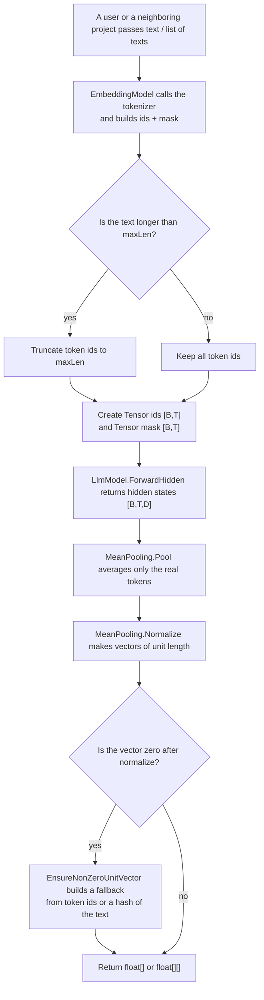

# 05.Embeddings - text vectors on top of the Transformer

## Human explanation

`05.Embeddings` turns a string of text or a list of strings into numeric vectors of fixed length. First the text goes through `BpeTokenizer`, then the tokens are fed into `LlmModel.ForwardHidden`, after which `MeanPooling` averages the hidden states of the real tokens and normalizes the result to unit length. Such a vector is convenient to hand to `06.VectorSearch` or another search layer, where cosine similarity can be computed as a dot product.

Important: this project is embeddings infrastructure, not proof of trained semantic reasoning. The vector exists because the code can tokenize, obtain hidden states and average them; this does not prove that the encoder is well trained, that the meaning of the text was understood correctly, or that retrieval will give a quality answer on a real corpus.

Data boundary:

- Input: `string text` or `IList<string> texts`.
- Inside: `Tensor ids [B,T]`, `Tensor mask [B,T]`, hidden states `Tensor [B,T,D]`.
- Output: `float[] [D]` for one text or `float[][] [B][D]` for a batch.
- Not an output: a model quality metric, trained domain meaning, checkpoint evidence, ranking authority.

## 0. UML class diagram

```mermaid
classDiagram
    class EmbeddingModel {
        +int Dimensions
        +EmbeddingModel(LlmModel encoder, BpeTokenizer tokenizer, int maxLen)
        +Embed(string text) float[]
        +EmbedBatch(IList~string~ texts) float[][]
        -Tokenize(IList~string~ texts) (Tensor ids, Tensor mask)
        -EnsureNonZeroUnitVector(float[] vector, string text) void
    }

    class BpeTokenizer {
        +Encode(string text) List~int~
    }

    class LlmModel {
        +ForwardHidden(Tensor ids) Tensor
        +Config.HiddenDim int
    }

    class MeanPooling {
        +Pool(Tensor tokenVectors, Tensor attentionMask) Tensor
        +Normalize(Tensor vectors) Tensor
    }

    class Tensor {
        +Data float[]
        +Shape TensorShape
    }

    class TensorOps {
        +L2Normalize(Tensor vectors, float eps) Tensor
    }

    class VectorSearch {
        +Search(float[] query, int topK) results
    }

    EmbeddingModel --> BpeTokenizer : text -> token ids
    EmbeddingModel --> Tensor : ids/mask tensors
    EmbeddingModel --> LlmModel : ids tensor -> hidden states
    EmbeddingModel --> MeanPooling : hidden states + mask
    MeanPooling --> TensorOps : L2 normalization
    EmbeddingModel ..> VectorSearch : normalized float[] can be indexed

    note for EmbeddingModel "FULLY IMPLEMENTED\nBuilds embeddings from tokenizer + transformer hidden states + pooling.\nDoes not prove the quality of the trained encoder."
    note for BpeTokenizer "EXTERNAL DEPENDENCY\nConverts text into token ids.\nTokenization is not semantic reasoning."
    note for LlmModel "EXTERNAL DEPENDENCY\nReturns hidden states [B,T,D].\nThe quality of the hidden states depends on the model/training."
    note for MeanPooling "FULLY IMPLEMENTED\nAverages token vectors by mask and normalizes the rows.\nDoes not train and does not choose meaning."
    note for Tensor "EXTERNAL MATH STRUCTURE\nCarries Data and Shape between layers."
    note for TensorOps "EXTERNAL MATH FOUNDATION\nDoes L2 normalization with eps."
    note for VectorSearch "NEIGHBORING CONSUMER\nCan store and search vectors.\nTop-K does not prove embedding quality without QA."
```



| Class | What it does | Status |
|---|---|---|
| `EmbeddingModel` | Assembles the pipeline text -> token ids -> hidden states -> pooled normalized vector. | Fully implemented embedding infrastructure |
| `BpeTokenizer` | Provides token ids for text. | External dependency from `01.Tokenizer` |
| `LlmModel` | Provides hidden states of size `[B,T,D]`. | External dependency from `03.TransformerModel` |
| `MeanPooling` | Averages token vectors accounting for the mask and normalizes the rows. | Fully implemented math utility |
| `Tensor` | Passes ids, mask, hidden states and pooled vectors. | External infrastructure from `00.TensorCore` |
| `TensorOps` | Performs L2 normalization. | External math utility |
| `VectorSearch` | Can use `float[]` embeddings for similarity search. | Neighboring consumer, not part of D05 |

### Connection simulations

| Connection | Example input | What happens | Expected result | What must not be taken as proof |
|---|---|---|---|---|
| `EmbeddingModel -> BpeTokenizer` | text=`"hello"`, `maxLen=8`. | `Tokenize` calls `Encode`, then truncates the token list to `maxLen`. | A list of ids results, for example `[12, 34]`, no longer than 8. | Tokenization must not be treated as understanding the meaning of the text. |
| `EmbeddingModel -> Tensor` | batch of `["abc","def"]`, token lengths `2` and `1`. | `ids [2,2]` and `mask [2,2]` are created; padding gets id `0`, mask `0`. | `ids` and `mask` have the same shape `[B,T]`. | The presence of tensors must not be treated as proof of model quality. |
| `EmbeddingModel -> LlmModel` | `ids Tensor [2,2]`. | The encoder receives ids and returns hidden states. | `hidden Tensor [2,2,D]`, where `D = Config.HiddenDim`. | ForwardHidden does not prove the encoder is trained semantically. |
| `EmbeddingModel -> MeanPooling` | hidden `[2,2,D]`, mask `[2,2]`. | `Pool` ignores padding by mask, `Normalize` makes the row length close to 1. | `Tensor [2,D]`, then `float[][]` with two vectors. | Unit norm does not prove correct semantics. |
| `MeanPooling -> TensorOps` | pooled vector `[3,4]`. | `Normalize` calls `TensorOps.L2Normalize` with `eps: 1e-9f`. | the vector becomes about `[0.6,0.8]`. | L2 normalization is not training evidence. |
| `EmbeddingModel ..> VectorSearch` | vector for `"alpha"`. | A neighboring index can store the vector and search for the nearest neighbour. | The exact same vector can return the same id as top-1. | An exact self-match does not prove search quality on new queries. |

## 1. Human flow diagram



Branch simulations:

| Branch | Example input | Expected result | What must not be taken |
|---|---|---|---|
| Truncation by `maxLen` | the tokenizer gave 20 ids, `maxLen=8`. | The first 8 ids go into the tensor. | Truncation does not prove that the meaning of a long text is preserved. |
| No truncation | the tokenizer gave 3 ids, `maxLen=8`. | All 3 ids are kept, the rest in the batch may be padding. | A short input does not prove semantic coverage. |
| Padding ignored | token vectors `[4]` and `[99]`, mask `[1,0]`. | Pooling returns `4`, padding `99` is ignored. | Ignoring padding does not prove encoder quality. |
| Zero vector fallback | normalized vector all zero, text=`""`. | A hash or `vector[0]=1f` is used to return a non-zero vector. | The fallback is a safety path, not a trained semantic unit. |

## 2. No-code algorithms, in the operator's language

### Algorithm A: build an embedding for a single text

Analogy: this is like asking a librarian for a short card with the numeric fingerprint of a phrase. The card is always of one length so it can be compared with other cards, but the card itself does not guarantee that the librarian understood the meaning perfectly.

Implementation passport:

| Field | Value |
|---|---|
| Class | `EmbeddingModel` |
| Method | `Embed(string text)` |
| File and line | `05.Embeddings/EmbeddingModel.cs:24` |
| Input | `text`, for example `"hello"` |
| Output | `float[]`, length `Dimensions = _encoder.Config.HiddenDim` |
| Status | Complete infrastructural implementation |

Current steps:

1. The method receives one `string`.
2. It calls `EmbedBatch([text])`, that is, it wraps a single text into a batch of one element.
3. Takes the first vector from the batch result.
4. Returns a `float[]`.

Branches and limitations:

- If the batch path returned a non-zero normalized vector, it is returned as is.
- If hidden/pooling produced a zero vector, the fallback is inside `EnsureNonZeroUnitVector`.
- The method does not train the encoder, does not save a checkpoint and does not measure the quality of meaning.

### Algorithm B: build embeddings for a batch

Analogy: instead of one card, the librarian receives a stack of phrases and makes a card for each, keeping all cards the same length.

Implementation passport:

| Field | Value |
|---|---|
| Class | `EmbeddingModel` |
| Method | `EmbedBatch(IList<string> texts)` |
| File and line | `05.Embeddings/EmbeddingModel.cs:26` |
| Input | `texts`, for example `["abc","def","ghi"]` |
| Output | `float[][]`, for example 3 vectors of `HiddenDim` numbers each |
| Status | Complete infrastructural implementation |

Current steps:

1. Calls `Tokenize(texts)` and gets `Tensor ids [B,T]` and `Tensor mask [B,T]`.
2. Passes `ids` to `_encoder.ForwardHidden(ids)`.
3. Gets hidden states of shape `[B,T,D]`.
4. Calls `MeanPooling.Pool(hidden, mask)` and gets `[B,D]`.
5. Calls `MeanPooling.Normalize(pooled)` and gets a normalized `[B,D]`.
6. For each text copies the row `[D]` from the tensor data into a separate `float[]`.
7. For each `float[]` calls `EnsureNonZeroUnitVector`.
8. Returns the array of vectors.

Branches and limitations:

- Batch size equals `texts.Count`.
- Dimension is taken from `_encoder.Config.HiddenDim`.
- The method does not validate an empty list: when `texts.Count == 0` the current `Tokenize` reaches `encoded.Max(...)`, which is a gap for negative tests.
- The method does not prove that the vector is semantically good.

### Algorithm C: tokenization, padding and mask

Analogy: before putting phrases into a single table, short strings are padded with empty cells, and a separate mask says which cells are real.

Implementation passport:

| Field | Value |
|---|---|
| Class | `EmbeddingModel` |
| Method | `Tokenize(IList<string> texts)` |
| File and line | `05.Embeddings/EmbeddingModel.cs:72` |
| Input | `texts`, for example `["alpha","beta gamma"]` |
| Output | `(Tensor ids, Tensor mask)`, both of shape `[B,T]` |
| Status | Private helper, complete infrastructural implementation with a gap for the empty batch |

Current steps:

1. For each text calls `_tokenizer.Encode(t)`.
2. If the token count is greater than `_maxLen`, takes only the first `_maxLen` ids.
3. Finds `T` as the maximum length of an encoded sequence in the batch.
4. Creates `idData` and `maskData` of length `texts.Count * T`.
5. For each batch index `b` and position `t` checks `real = t < encoded[b].Count`.
6. If the position is real, writes the token id and mask `1`.
7. If the position is padding, writes id `0` and mask `0`.
8. Returns two tensors with shape `[texts.Count, T]`.

Branches and limitations:

- Long-text branch: the sequence is truncated to `_maxLen`.
- Padding branch: padding is always id `0`, mask `0`.
- The empty-list branch is not handled explicitly.
- Padding id `0` should not affect pooling, because mask `0`.

### Algorithm D: safe fallback for a zero vector

Analogy: if the card turns out completely empty, the system puts a safe mark so that downstream search does not receive a fully zero vector.

Implementation passport:

| Field | Value |
|---|---|
| Class | `EmbeddingModel` |
| Method | `EnsureNonZeroUnitVector(float[] vector, string text)` |
| File and line | `05.Embeddings/EmbeddingModel.cs:44` |
| Input | `vector`, `text`, for example an all-zero vector and `""` |
| Output | `void`, side effect: the vector mutates in-place |
| Status | Complete safety implementation, deterministic fallback |

Current steps:

1. Computes the L2 norm of the input vector.
2. If the norm is greater than `1e-6f`, changes nothing.
3. If the norm is small, tokenizes `text ?? string.Empty`.
4. For each token id increments the bucket `Math.Abs(tokenId) % vector.Length`.
5. If the token list is empty, takes an ordinal hash of the text and sets `1f` in the hash bucket.
6. Computes the norm again.
7. If the norm is still too small, sets `vector[0] = 1f`.
8. Otherwise divides all elements of the vector by the norm.

Branches and limitations:

- A non-zero vector is not changed.
- A zero vector with tokens gets a hashed-by-token fallback.
- A zero vector without tokens gets a hash fallback or `vector[0]`.
- This is a deterministic safety shortcut, not trained semantic behavior.

### Algorithm E: averaging token vectors by mask

Analogy: if a phrase occupies several real words and several empty padding cells, the average is computed only over the real words.

Implementation passport:

| Field | Value |
|---|---|
| Class | `MeanPooling` |
| Method | `Pool(Tensor tokenVectors, Tensor attentionMask)` |
| File and line | `05.Embeddings/MeanPooling.cs:14` |
| Input | `tokenVectors [batch, seq, hidden]`, `attentionMask [batch, seq]` |
| Output | `Tensor [batch, hidden]` |
| Status | Complete math utility |

Current steps:

1. Reads `batch`, `seq`, `hidden` from the shape of the token vectors.
2. Creates a result array `[batch * hidden]`.
3. For each batch row computes `maskSum`.
4. For each token position reads the mask value.
5. If the mask is `0`, the token is skipped.
6. If the mask is not `0`, the token vector is added to the result weighted by the mask.
7. Divides the sum over each dimension by `Math.Max(maskSum, 1e-9f)`.
8. Returns a tensor `[batch, hidden]`.

Branches and limitations:

- Padding branch: mask `0` skips the token.
- All-zero mask branch: the denominator clamp prevents division by zero, but the result stays zero.
- The method does not check for a shape mismatch explicitly.

### Algorithm F: L2 normalization

Analogy: all cards are brought to the same length so they can be compared by angle, not by absolute size.

Implementation passport:

| Field | Value |
|---|---|
| Class | `MeanPooling` |
| Method | `Normalize(Tensor vectors)` |
| File and line | `05.Embeddings/MeanPooling.cs:48` |
| Input | `Tensor [batch, hidden]` |
| Output | `Tensor [batch, hidden]`, L2-normalized by rows |
| Status | Complete delegation utility |

Current steps:

1. Receives the tensor of vectors.
2. Calls `TensorOps.L2Normalize(vectors, eps: 1e-9f)`.
3. Returns a tensor of the same shape.

Branches and limitations:

- A normal non-zero vector gets unit norm.
- A zero vector should not throw per the existing test.
- Semantic quality is not checked.

## 3. Important code references

### The main batch loop for building embeddings

Reference: `05.Embeddings/EmbeddingModel.cs:26-41`.

> Why it matters: this is the central chain of D05. It shows that an embedding is built via the tokenizer, transformer hidden states, mask-aware pooling and normalization.
> Input: `IList<string> texts`.
> Output: `float[][]`, where each row has length `HiddenDim`.
> What it proves: the current data flow is implemented.
> What it does not prove: that the encoder is trained or the embeddings are of quality.

```csharp
var (ids, mask) = Tokenize(texts);
var hidden = _encoder.ForwardHidden(ids);
var pooled = MeanPooling.Pool(hidden, mask);
var normed = MeanPooling.Normalize(pooled);
```

### The safe fallback for a zero vector

Reference: `05.Embeddings/EmbeddingModel.cs:44-68`.

> Why it matters: without this, downstream vector search could get a zero vector, especially if hidden states/pooling produced zeros.
> Input: `float[] vector`, `string text`.
> Output: the vector changed in-place.
> What it proves: there is a deterministic safety path.
> What it does not prove: semantic understanding; the fallback is explicitly not a trainable unit.

```csharp
var norm = MathF.Sqrt(vector.Sum(value => value * value));
if (norm > 1e-6f)
    return;

var encoded = _tokenizer.Encode(text ?? string.Empty);
foreach (var tokenId in encoded)
    vector[Math.Abs(tokenId) % vector.Length] += 1f;
```

### Tokenize: ids and mask

Reference: `05.Embeddings/EmbeddingModel.cs:72-95`.

> Why it matters: this logic defines the shape `[B,T]`, the padding id and the mask, on which the correctness of pooling depends.
> Input: batch texts.
> Output: `Tensor ids`, `Tensor mask`.
> What it proves: padding is marked with mask `0`.
> What it does not prove: negative behavior for an empty batch.

```csharp
bool real = t < encoded[b].Count;
idData  [b * T + t] = real ? encoded[b][t] : 0f;
maskData[b * T + t] = real ? 1f : 0f;
```

### Averaging token vectors by mask

Reference: `05.Embeddings/MeanPooling.cs:14-43`.

> Why it matters: padding token vectors must not spoil the sentence embedding.
> Input: `tokenVectors [batch, seq, hidden]`, `attentionMask [batch, seq]`.
> Output: `Tensor [batch, hidden]`.
> What it proves: mask `0` skips the token; the denominator is protected from zero division.
> What it does not prove: that mean pooling is better than another pooling for the product.

```csharp
float m = attentionMask.Data[b * seq + t];
if (m == 0f) continue;

maskSum += m;
result[b * hidden + d] += tokenVectors.Data[(b * seq + t) * hidden + d] * m;
```

### The L2 normalization boundary

Reference: `05.Embeddings/MeanPooling.cs:48-50`.

> Why it matters: a normalized vector makes cosine similarity compatible with the dot product in vector search.
> Input: `Tensor [batch, hidden]`.
> Output: a tensor of the same shape after L2 normalization.
> What it proves: D05 delegates normalization to `00.TensorCore`.
> What it does not prove: runtime search quality or semantic ranking.

```csharp
return TensorOps.L2Normalize(vectors, eps: 1e-9f);
```

### The project references boundary

Reference: `05.Embeddings/Embeddings.csproj:9-16`.

> Why it matters: the project file shows the real neighboring dependencies of D05.
> Input: build/project graph metadata.
> Output: references to `00.TensorCore`, `01.Tokenizer`, `03.TransformerModel`.
> What it proves: D05 is glue/infrastructure between the tokenizer, tensor math and the transformer model.
> What it does not prove: that any models are trained.

```xml
<ProjectReference Include="..\00.TensorCore\TensorCore.csproj" />
<ProjectReference Include="..\01.Tokenizer\Tokenizer.csproj" />
<ProjectReference Include="..\03.TransformerModel\TransformerModel.csproj" />
```

## 4. Link to tests, e2e and QA

D1G did not run tests. Below is only source evidence found by reading the tests.

| Behavior | Evidence | What it checks | Honest gap |
|---|---|---|---|
| `MeanPooling.Pool` single token | `Tests/MeanPoolingTests.cs:10-26` | Shape `[1,4]` and values `1f`. | Does not check the transformer encoder path. |
| Mean of two tokens | `Tests/MeanPoolingTests.cs:29-38` | `[2]` and `[4]` give mean `3`. | Does not check multi-dim weighted masks. |
| Padding ignored | `Tests/MeanPoolingTests.cs:41-51` | mask `[1,0]` ignores padding value `99`. | Does not check all-zero mask semantic consequences. |
| L2 norm | `Tests/MeanPoolingTests.cs:54-65` | `[3,4]` gets norm `1`. | Does not prove embedding quality. |
| Shape preserved by normalize | `Tests/MeanPoolingTests.cs:68-76` | `[4,8]` stays `[4,8]`. | Does not check values except shape. |
| Zero vector normalize no throw | `Tests/MeanPoolingTests.cs:79-84` | Normalize does not throw on zero vector. | Does not check `EmbeddingModel.EnsureNonZeroUnitVector` directly. |
| Pool batch shape | `Tests/MeanPoolingTests.cs:87-101` | `[3,5,16]` -> `[3,16]`. | Does not check wrong shape errors. |
| Embed dimension | `Tests/IntegrationTests2.cs:45-55` | `EmbeddingModel.Embed("hello")` returns `HiddenDim`. | Does not prove semantic quality. |
| Embed unit norm | `Tests/IntegrationTests2.cs:58-69` | Output norm is `1`. | Does not prove trained model readiness. |
| EmbedBatch dimensions | `Tests/IntegrationTests2.cs:72-84` | Three texts return three vectors of hidden dimension. | No direct assertion of token truncation branch. |
| VectorSearch consumer | `Tests/IntegrationTests2.cs:91-109` | Stored exact vector can be found top-1. | Exact self-match is not general retrieval quality. |
| Top-K consumer | `Tests/IntegrationTests2.cs:112-126` | Vector search returns requested count. | Tests neighboring D06 behavior, not D05 semantics. |

Honest QA gaps / future work:

- Add direct tests for `EmbeddingModel` empty list input and decide intended behavior.
- Add test for `maxLen` truncation branch.
- Add test that `EnsureNonZeroUnitVector` fallback returns a non-zero unit vector when encoder hidden states are all zero.
- Add shape mismatch negative tests for `MeanPooling.Pool`.
- Add real retrieval-quality evaluation before claiming semantic search quality.

## 5. Link to neighboring projects

| Neighboring project | Link | Current boundary |
|---|---|---|
| `00.TensorCore` | `Tensor`, `TensorShape`, `TensorOps.L2Normalize`. | Math infrastructure only. |
| `01.Tokenizer` | `BpeTokenizer.Encode` creates token ids. | Deterministic text infrastructure, not reasoning. |
| `03.TransformerModel` | `LlmModel.ForwardHidden` creates hidden states. | Model quality depends on training evidence outside D05. |
| `06.VectorSearch` | Can consume normalized `float[]` vectors. | Search correctness/quality is separate D06 scope. |

## 6. Anti-false-done checks

The following must not be taken as proof of trained semantic embeddings:

- `EmbeddingModel.Embed` returns `float[]`. This proves the shape path, not semantic quality.
- Vector norm equals `1`. This proves normalization, not training.
- The exact same stored vector returns itself in vector search. This is a deterministic self-match, not general retrieval.
- `EnsureNonZeroUnitVector` produced a non-zero vector. This is a safety fallback, not trained meaning.
- JSON/report/static grep says "passed". Model-quality claims require runtime metrics, corpus evaluation, checkpoint/load evidence where relevant.
- The presence of a transformer encoder class does not prove that the encoder is trained for embeddings.

Check for a hidden deterministic shortcut:

- `EnsureNonZeroUnitVector` is explicitly documented as a deterministic safety fallback.
- It must not be presented as trainable semantic logic.
- If future docs claim trained embeddings, they must include training data, checkpoint/manifest, fresh-load probe and retrieval-quality evaluation.

## 7. Implementation status table

| Component | File | Status | What actually works now |
|---|---|---|---|
| `EmbeddingModel` | `05.Embeddings/EmbeddingModel.cs` | Complete infrastructural implementation | `Embed`, `EmbedBatch`, `Tokenize`, `EnsureNonZeroUnitVector`; returns normalized `float[]`/`float[][]`; no quality metrics or training. |
| `MeanPooling` | `05.Embeddings/MeanPooling.cs` | Complete math utility | `Pool` averages `[B,T,D]` by mask into `[B,D]`; `Normalize` delegates to `TensorOps.L2Normalize`. |
| `Embeddings.csproj` | `05.Embeddings/Embeddings.csproj` | Project wiring | References `00.TensorCore`, `01.Tokenizer`, `03.TransformerModel`. |
| `BpeTokenizer` boundary | `01.Tokenizer` | External dependency documented | Provides token ids; deterministic text infrastructure. |
| `LlmModel` boundary | `03.TransformerModel` | External dependency documented | Provides hidden states; training/quality evidence lives outside D05. |
| `VectorSearch` boundary | `06.VectorSearch` | Neighbor consumer documented | Can store/search vectors; retrieval quality is separate evidence. |

## 8. ILearningMachine hierarchy status

`05.Embeddings` does not implement `ILearningMachine`, `ILogicalOrchestrator`, `ILogicalFlow`, `ILogicalUnit` or `ILearningMachinePair` in the files read for D1G. Training does not live in this project boundary. D05 only supplies vector construction infrastructure; any future trainable embedding model must document its `ILearningMachine` boundary, checkpoint/manifest, import/export, fresh-load, continue-training and evaluation evidence separately.

Documentation status: draft/sub-agent D1G pass pending parent review
Last verified against source: 2026-06-08
Known gaps: no D1G test run by instruction; empty batch, maxLen truncation and fallback branches need direct tests; no semantic retrieval-quality evidence claimed.
