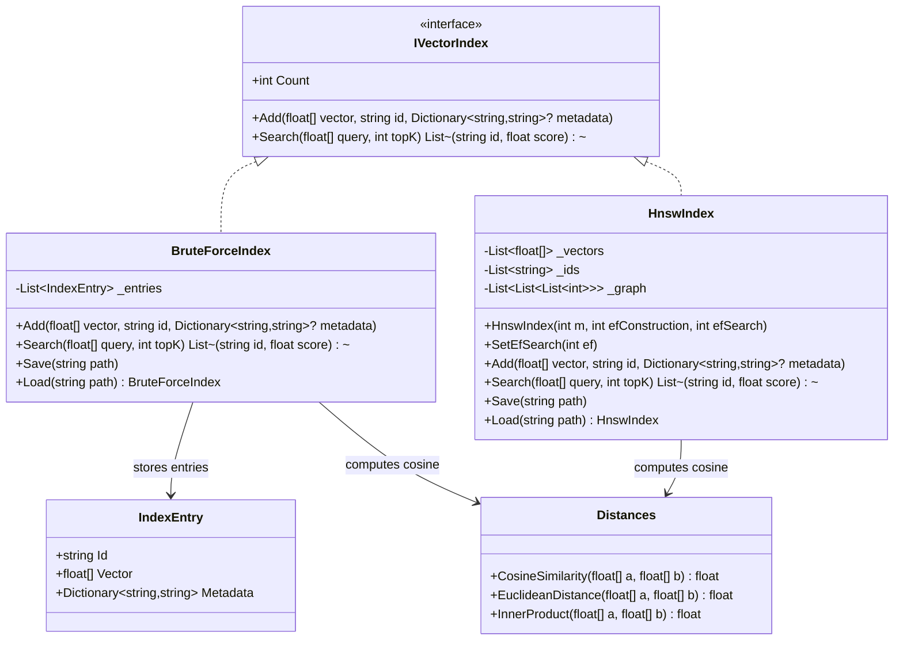

# 06.VectorSearch - implementation documentation

`06.VectorSearch` is nearest-vector search infrastructure. It accepts ready-made `float[]` vectors, stores them together with an `id` and optional metadata, and then returns the nearest `id`s by a numeric similarity measure. This matters for RAG, memory, embedding search and future trainable modules, but the project itself is not a trainable semantic authority: `BruteForceIndex`, `HnswIndex` and `Distances` do not learn, do not understand text and do not prove model quality.

## 1. Simple UML diagram



## 2. Connection simulations and expected results

| Connection | Example input | What happens | Expected result | What must not be taken as proof |
|---|---|---|---|---|
| `05.Embeddings` -> `BruteForceIndex.Add` | `Embed("alpha")` gives a `float[]`, then `Add(vector, "alpha")` | the index stores the vector and id as an `IndexEntry` | a subsequent search with the same vector can return `"alpha"` as top-1 | you cannot claim that the search understood the word "alpha"; it compared numbers |
| `BruteForceIndex.Search` -> `Distances.CosineSimilarity` | query `[1, 0.1, 0]`, entries `[1,0,0]`, `[0,1,0]` | the index scans all entries, computes cosine, sorts by score descending | first will be the id with the maximum cosine | the mere fact of a top-1 must not be taken as proof of embedding quality on a real corpus |
| `HnswIndex.Add` -> graph | several vectors with `m: 8`, `efConstruction: 40` | each node is assigned a random level, then bidirectional links to neighbours are built | `Count` grows, search gets candidates through the graph | you cannot claim exact-KNN accuracy: HNSW here is approximate |
| `HnswIndex.Save` -> `HnswIndex.Load` | path `*.hnsw` | the index serializes vectors/ids/meta/graph into a temporary file and renames it | after loading, a search with the same query returns the expected id in the test | the index JSON file is not enough to claim product-quality retrieval |
| `Distances` -> both indexes | a zero or orthogonal vector | cosine computes dot/norm, and with a near-zero denominator returns `0f` | no division by zero in this helper | this is not training and not semantic reasoning |

## 3. No-code algorithms, in the operator's language

### Algorithm A: the `IVectorIndex` contract

- Where it lives: `06.VectorSearch/IVectorIndex.cs:4`.
- Signatures: `int Count { get; }`, `void Add(float[] vector, string id, Dictionary<string,string>? metadata = null)`, `List<(string id, float score)> Search(float[] query, int topK)`.
- Input: a dense vector `float[]`, a string `id`, optional metadata, a query vector `float[]`, a limit `topK`.
- Output: the number of stored elements and a list of `(id, score)` pairs.
- Current behavior: the interface defines a minimal contract for an index; it does not define training, deletion, update, dimension validation or saving to disk.
- Branches and limitations: implementations can be exact or approximate; the calling code must itself understand the origin of the vectors and the meaning of the score.

### Algorithm B: the `IndexEntry` record

- Where it lives: `06.VectorSearch/IndexEntry.cs:3`.
- Signature: `record IndexEntry(string Id, float[] Vector, Dictionary<string,string> Metadata)`.
- Input: `Id`, an array of numbers and a metadata dictionary.
- Output: an immutable record with these three fields.
- Current behavior: used by `BruteForceIndex` as a simple storage row. Metadata is kept in the record, but `Search` returns only `id` and `score`.
- What it does not do: does not normalize the vector, does not validate the metadata schema, does not save data to disk.

### Algorithm C: `Distances.CosineSimilarity`, `EuclideanDistance`, `InnerProduct`

- Where it lives: `06.VectorSearch/Distances.cs:3`.
- Signatures: `CosineSimilarity(float[] a, float[] b)`, `EuclideanDistance(float[] a, float[] b)`, `InnerProduct(float[] a, float[] b)`.
- Input: two `float[]` arrays; equal length is effectively expected, there is no separate dimension check.
- Output: a single `float` number.
- Current behavior: cosine iterates over all coordinates, computes the dot product and norms, returns `0f` if the denominator is less than `1e-9f`; euclidean returns the square root of the sum of squared differences; inner product returns the dot product.
- Branches and limitations: with arrays of different lengths an indexing error is possible; this is a math helper, not a quality metric of a retrieval system.

### Algorithm D: `BruteForceIndex.Add` and `BruteForceIndex.Search`

- Where it lives: `06.VectorSearch/BruteForceIndex.cs:9`.
- Signatures: `Add(float[] vector, string id, Dictionary<string,string>? metadata = null)` and `Search(float[] query, int topK)`.
- Input: a new vector with an id; a query vector and `topK`.
- Output: `Add` returns nothing; `Search` returns `List<(string id, float score)>`.
- Current behavior:
  1. `Add` adds `IndexEntry(id, vector, metadata ?? [])` to an internal list.
  2. `Search` iterates over all `_entries`.
  3. For each entry it computes `Distances.CosineSimilarity(query, e.Vector)`.
  4. Sorts the results by score descending.
  5. Returns the first `topK`.
- Branches and limitations: an empty index gives an empty list via LINQ; a `topK` larger than the index size returns the available entries. `Save` and `Load` on `BruteForceIndex` exist in the class, but throw `NotImplementedException`, so this index is currently in-memory only.

### Algorithm E: `HnswIndex.Add`, `Search`, `Save`, `Load`

- Where it lives: `06.VectorSearch/HnswIndex.cs:18`.
- Constructor: `HnswIndex(int m = 16, int efConstruction = 200, int efSearch = 50)`.
- Main signatures: `Add(float[] vector, string id, Dictionary<string,string>? metadata = null)`, `Search(float[] query, int topK)`, `Save(string path)`, `static Load(string path)`.
- Input: dense vectors and ids for building the graph, a query and `topK` for search, a file path for persistence.
- Output: `Search` returns `List<(string id, float score)>`; `Save` writes a file; `Load` returns a restored `HnswIndex`.
- Current behavior:
  1. `Add` stores vector/id/metadata in internal lists.
  2. The new node is assigned a random level via `RandomLevel`.
  3. If this is the first node, it becomes `_entryPoint`.
  4. For subsequent nodes the index greedily descends from the upper levels and, at each required level, searches for candidates via `SearchLayer`.
  5. The selected neighbours are linked bidirectionally; if a neighbour has too many edges, the list is trimmed via `SelectNeighbours`.
  6. If the new level is higher than the old `_maxLevel`, the new node becomes the entry point.
  7. `Search` on an empty index returns an empty list; otherwise it greedily descends to level 0, runs a beam search of width `Math.Max(_efSearch, topK)` and returns the first `topK` candidates.
  8. `Save` writes JSON to a temporary file `path + ".tmp"` and atomically moves it to the target path; `Load` restores vectors/ids/meta/graph and the parameters.
- Branches and limitations: this is approximate search that depends on random levels and the parameters `m`, `efConstruction`, `efSearch`; metadata is stored but not returned outward through `Search`; there is no explicit check for equal vector dimensionality.

## 4. Short code quotes with explanation

The index contract:

```csharp
public interface IVectorIndex
{
    int Count { get; }
    void Add(float[] vector, string id, Dictionary<string, string>? metadata = null);
    List<(string id, float score)> Search(float[] query, int topK);
}
```

Source: `06.VectorSearch/IVectorIndex.cs:4`. This matters because the whole project reduces to two operations - add a vector and find the nearest. Inputs: `float[]`, `id`, metadata, `query`, `topK`. Output: `id/score` pairs. This quote does not prove the presence of training or the quality of search.

The record shape:

```csharp
public record IndexEntry(string Id, float[] Vector, Dictionary<string, string> Metadata);
```

Source: `06.VectorSearch/IndexEntry.cs:3`. This shows that the record stores an id, a numeric vector and metadata. Important: `BruteForceIndex.Search` returns not the whole `IndexEntry`, but only `id` and `score`.

Cosine with protection against a zero norm:

```csharp
float denom = MathF.Sqrt(na) * MathF.Sqrt(nb);
return denom < 1e-9f ? 0f : dot / denom;
```

Source: `06.VectorSearch/Distances.cs:14`. This explains the branch where a near-zero denominator does not lead to division by zero, but gives `0f`. This does not check that the arrays are of equal length.

The exact scan in `BruteForceIndex`:

```csharp
return _entries
    .Select(e => (e.Id, Distances.CosineSimilarity(query, e.Vector)))
    .OrderByDescending(t => t.Item2)
    .Take(topK)
    .ToList();
```

Source: `06.VectorSearch/BruteForceIndex.cs:20`. This proves that `BruteForceIndex` does a full scan and sorts by cosine score. Such a search is exact relative to its metric, but slow on large collections and not trainable.

An empty HNSW and top-level search:

```csharp
if (_entryPoint == -1) return [];

int currEntry = _entryPoint;
for (int l = _maxLevel; l > 0; l--)
    currEntry = GreedySearch(query, currEntry, l);
```

Source: `06.VectorSearch/HnswIndex.cs:94`. This proves the empty-index branch and the start of the greedy descent. This does not prove exact-KNN: an approximate search layer is used below.

HNSW persistence via a temporary file:

```csharp
var tmp = path + ".tmp";
File.WriteAllText(tmp, JsonSerializer.Serialize(data));
File.Move(tmp, path, overwrite: true);
```

Source: `06.VectorSearch/HnswIndex.cs:124`. This matters for saving the graph. But the presence of an index JSON file is not proof of retrieval quality on real data.

## 5. Link to neighboring projects

- `05.Embeddings` can produce `float[]` that are then put into `BruteForceIndex` or `HnswIndex`. The check `Tests/IntegrationTests2.cs:91` shows the chain `EmbeddingModel` -> `BruteForceIndex` -> nearest neighbour.
- `07.GraphEngine` and `08.GraphRag` can use ids and scores as retrieval candidates, but must separately decide what the found id means in the graph or RAG context.
- Future trainable units can rely on retrieval as infrastructure, but `06.VectorSearch` itself does not implement `ILearningMachine` and must not masquerade as a trainable unit.

## 6. QA, tests and honest gaps

| Check | Source | What it confirms | Limitation |
|---|---|---|---|
| `BruteForce_ReturnsExactNearestNeighbour` | `Tests/VectorSearchTests.cs:10` | top-1 for a simple set returns the expected id | a small synthetic case, not a real collection |
| `Hnsw_ReturnsReasonableNearestNeighbour` | `Tests/VectorSearchTests.cs:36` | HNSW on a simple set finds the expected top-1 | does not prove recall on large data |
| `Hnsw_SaveLoad_PreservesResults` | `Tests/VectorSearchTests.cs:50` | save/load preserve the search result | does not check corrupted files or backward compatibility |
| Edge cases: empty/count/topK/order/metadata | `Tests/VectorSearchEdgeCaseTests.cs:15` | empty indexes, counters, topK, sorting and metadata have concrete assertions | metadata is not returned from `Search`, it only affects the stored entry |
| `CosineSimilarity` boundary values | `Tests/VectorSearchEdgeCaseTests.cs:128` | opposite and scaled vectors give the expected cosine values | there is no test for arrays of different lengths |
| BruteForce/HNSW integration agreement | `Tests/IntegrationTests.cs:121` | for one synthetic set HNSW and brute force agree on top-1 | this is not a statistical recall benchmark |
| Embedding -> store -> search | `Tests/IntegrationTests2.cs:91` | an embedding vector can be stored and found via `BruteForceIndex` | does not prove embedding quality or semantic understanding |

Honest gap: within this work order the tests were not run, by direct prohibition. The document relies on the current sources and existing test assertions, not on a fresh runtime report.

## 7. Anti-false-done checks

- You cannot take the `HnswIndex.Save` JSON file as proof of retrieval quality: it proves only serialization of the current graph.
- You cannot take smoke/report/static grep as a replacement for a real search over a representative set if product-quality retrieval is claimed.
- `06.VectorSearch` is not an `ILearningMachine`; `BruteForceIndex` and `HnswIndex` are deterministic/approximate search helpers on top of ready-made vectors.
- A matching id in synthetic tests does not prove trained semantics. Such a claim requires data, metrics, runtime runs and quality bounds.
- You must not hide the deterministic KNN/HNSW path as a trainable unit: training must live in the projects that actually change model parameters or trainable state.

## 8. Implementation status table

| Component | Status | Basis | Honest limitation |
|---|---|---|---|
| `IVectorIndex` | implemented contract | `06.VectorSearch/IVectorIndex.cs:4` | the contract is minimal, without persistence/update/delete |
| `IndexEntry` | implemented data shape | `06.VectorSearch/IndexEntry.cs:3` | metadata is stored but not returned in `Search` |
| `Distances` | implemented math helpers | `06.VectorSearch/Distances.cs:3` | no check of array dimensions |
| `BruteForceIndex` | implemented in-memory exact scan | `06.VectorSearch/BruteForceIndex.cs:9` | `Save`/`Load` throw `NotImplementedException` |
| `HnswIndex` | implemented approximate index with save/load | `06.VectorSearch/HnswIndex.cs:18` | approximate, randomized levels, without a proven recall benchmark |
| Product reasoning | absent in this project | no `ILearningMachine` and no training API | retrieval can support the product, but does not replace a trainable model |
