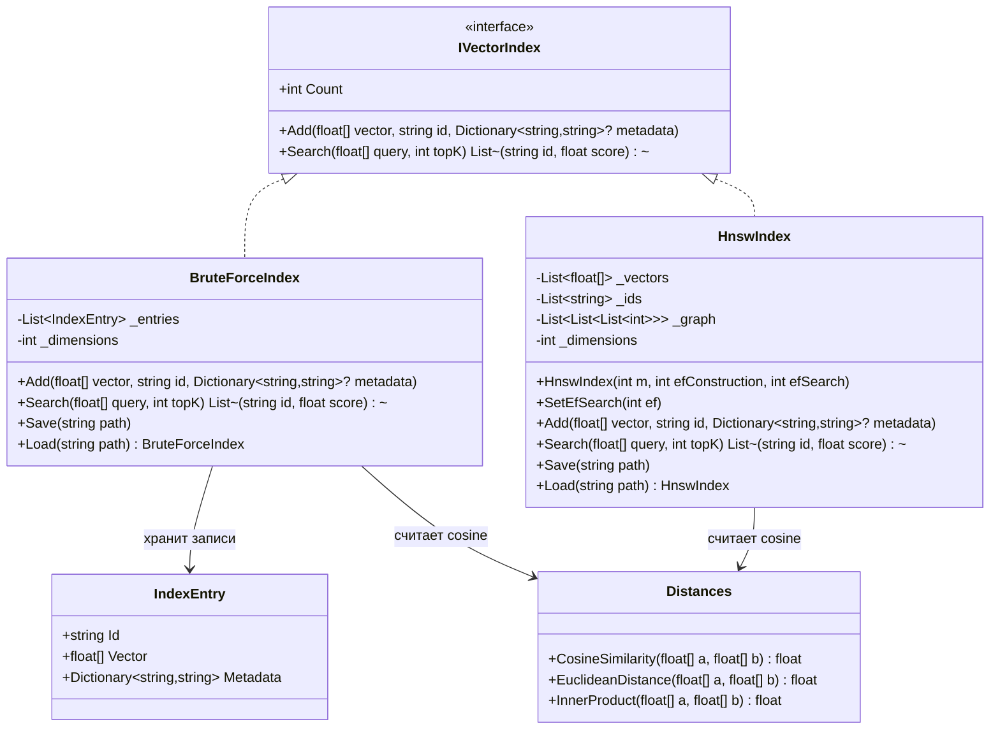

# 06.VectorSearch - документация реализации

`06.VectorSearch` - это инфраструктура поиска ближайших векторов. Она принимает уже готовые `float[]` векторы, хранит их вместе с `id` и необязательной metadata, а затем возвращает ближайшие `id` по численной мере похожести. Это важно для RAG, памяти, поиска по embeddings и будущих обучаемых модулей, но сам проект не является обучаемой семантической властью: `BruteForceIndex`, `HnswIndex` и `Distances` не учатся, не понимают текст и не доказывают качество модели.

## 1. Простая UML-схема



## 2. Симуляции соединений и ожидаемые результаты

| Соединение | Пример входа | Что происходит | Ожидаемый результат | Что нельзя считать доказательством |
|---|---|---|---|---|
| `05.Embeddings` -> `BruteForceIndex.Add` | `Embed("alpha")` дает `float[]`, затем `Add(vector, "alpha")` | индекс сохраняет вектор и id как `IndexEntry` | следующий поиск тем же вектором может вернуть `"alpha"` как top-1 | нельзя утверждать, что поиск понял слово "alpha"; он сравнил числа |
| `BruteForceIndex.Search` -> `Distances.CosineSimilarity` | query `[1, 0.1, 0]`, записи `[1,0,0]`, `[0,1,0]` | индекс сканирует все записи, считает cosine, сортирует по score вниз | первым будет id с максимальным cosine | нельзя принимать сам факт top-1 как доказательство качества embeddings на реальном корпусе |
| `HnswIndex.Add` -> graph | несколько векторов с `m: 8`, `efConstruction: 40` | каждому узлу назначается случайный уровень, затем строятся двунаправленные связи с соседями | `Count` растет, поиск получает кандидатов через граф | нельзя заявлять точность exact-KNN: HNSW здесь приближенный |
| `HnswIndex.Save` -> `HnswIndex.Load` | путь `*.hnsw` | индекс сериализует vectors/ids/meta/graph во временный файл и переименовывает его | после загрузки поиск по тому же запросу возвращает ожидаемый id в тесте | JSON файла индекса недостаточно для заявления о product-quality retrieval |
| `Distances` -> оба индекса | нулевой или ортогональный вектор | cosine считает dot/norm, при почти нулевом знаменателе возвращает `0f` | отсутствие деления на ноль в этом helper | это не обучение и не semantic reasoning |
| ветка отказа `BruteForceIndex.Add` (с 30.10.2026) | в индексе две строки длины 2, приходит `Add([1,0,0], "лишняя")` | проверка формы срабатывает до единственной изменяющей строки | `ArgumentException` с текстом `VECTOR_DIMENSION_MISMATCH: expected 2, actual 3`; `Count` остаётся 2; ответ на прежний запрос совпадает побитно | отказ до изменения состояния — не то же самое, что откат на середине добавления; откат не доказан |
| ветка отказа `BruteForceIndex.Search` (с 30.10.2026) | тот же индекс, запрос `[1]` или `[1,0,0]` | проверка длины запроса срабатывает до первого сравнения | `ArgumentException` с текстом `QUERY_DIMENSION_MISMATCH: expected 2, actual 1` (или `actual 3`) | раньше короткий запрос отвечал тихо и неверно, а длинный падал внутри сравнения; это измерено контролями подмены, а не выведено рассуждением |
| ветка владения `BruteForceIndex.Add` (с 30.10.2026) | `Add(callerVector, "совпадает")`, затем вызывающая сторона меняет `callerVector` | в записи лежит копия, чужие ячейки на неё не влияют | ответ на прежний запрос не изменился: `совпадает:1;в-стороне:0.6` до и после | это не доказывает неизменяемость самой записи `IndexEntry`; доказано лишь, что наружу её не отдаёт ни один открытый член |
| ветка отказа `HnswIndex.Load`, видимая порча навигации (с 01.11.2026) | сохранённый файл восьми узлов, где точка входа названа 99, либо узел 0 ссылается на соседа 99 или -1 | проверка навигации срабатывает до создания экземпляра | `InvalidOperationException` с кодом `INDEX_ENTRY_POINT_OUT_OF_RANGE` или `INDEX_NEIGHBOUR_OUT_OF_RANGE`; пригодный экземпляр наружу не выдаётся | прежде такой файл грузился, а исключение по индексу приходило при обходе; на полном графе восьми узлов это каждый запрос, на большом разреженном — лишь часть запросов, поэтому «всегда сразу» утверждать нельзя |
| ветка отказа `HnswIndex.Load`, тихая порча навигации (с 01.11.2026) | тот же файл, где точка входа -1 при восьми векторах, либо у узла 0 пустой список уровней, либо верхний уровень 7 при одноуровневой точке входа | та же проверка навигации срабатывает до создания экземпляра | `InvalidOperationException` с кодом `INDEX_ENTRY_POINT_OUT_OF_RANGE`, `INDEX_GRAPH_NODE_EMPTY` или `INDEX_MAX_LEVEL_MISMATCH` | это самая опасная группа: прежде первый случай отвечал пустым списком при непустом счётчике, а два других на двенадцати замороженных запросах не давали ни исключения, ни иного ответа — порча была, а признака не было; отказ при загрузке не доказывает полную целостность указателя |

| ветка отказа `HnswIndex.Load`, межузловая порча уровней (с 01.11.2026, третья запись) | тот же файл восьми узлов, где верхний уровень точки входа 5 начинает ссылаться на узел 0 (у того есть только нулевой уровень), либо узел 0 получает два пустых уровня и становится глубже объявленного верха | две новые межузловые проверки срабатывают до создания экземпляра | `InvalidOperationException` с кодом `INDEX_NEIGHBOUR_LEVEL_MISSING` («node 5 level 1 points at node 0, which has only 1 levels») или `INDEX_MAX_LEVEL_NOT_GLOBAL` («top level 1 disagrees with the deepest stored node 0, whose top level is 2») | **это самый опасный класс: панель точности к нему слепа, и это измерено, а не предположено.** В опубликованной улике аудита границ исполнения (`experiments-v2/_audits/2026-11-01-post89-execution-boundary-audit/components/hnsw-run-04/results.json`, читается из опубликованного коммита) **обе** испорченные копии прежняя загрузка **принимала**, и на обеих все **12 из 12** проверочных запросов возвращали ожидаемые опознаватели. Причина измерена: нулевой уровень этого состояния полный — каждый из восьми узлов связан со всеми остальными, — поэтому перебор нижнего уровня находит верный ответ независимо от повреждений наверху. Отказ при загрузке не доказывает ни полной целостности указателя, ни того, что на большом разреженном графе последствие было бы таким же |

## 3. Алгоритмы без кода на русском

### Алгоритм A: контракт `IVectorIndex`

- Где находится: `06.VectorSearch/IVectorIndex.cs:4`.
- Сигнатуры: `int Count { get; }`, `void Add(float[] vector, string id, Dictionary<string,string>? metadata = null)`, `List<(string id, float score)> Search(float[] query, int topK)`.
- Вход: dense-вектор `float[]`, строковый `id`, optional metadata, query-вектор `float[]`, лимит `topK`.
- Выход: количество сохраненных элементов и список пар `(id, score)`.
- Текущее поведение: интерфейс задает минимальный контракт для индекса; он не задает обучение, удаление, обновление, валидацию размерности или сохранение на диск.
- Уточнение 30.10.2026: сам интерфейс размерность по-прежнему не требует, но **обе** его реализации теперь проверяют её одинаково и обе хранят собственные копии переданного массива и словаря. Раньше обещание зависело от того, какая именно реализация оказалась у вызывающей стороны: `HnswIndex` получил обе защиты 29–30 октября, а `BruteForceIndex` — только 30 октября, родственным обходом. До этого у одного договора было два разных поведения.
- Ветки и ограничения: реализации могут быть точными или приближенными; вызывающий код должен сам понимать происхождение векторов и смысл score.

### Алгоритм B: запись `IndexEntry`

- Где находится: `06.VectorSearch/IndexEntry.cs:3`.
- Сигнатура: `record IndexEntry(string Id, float[] Vector, Dictionary<string,string> Metadata)`.
- Вход: `Id`, массив чисел и словарь metadata.
- Выход: immutable record с этими тремя полями.
- Текущее поведение: используется `BruteForceIndex` как простая строка хранения. Metadata сохраняется в записи, но `Search` возвращает только `id` и `score`.
- Уточнение 30.10.2026: в запись кладутся **копии** — собственный массив индекса и собственный словарь с сохранённым сравнивателем ключей вызывающей стороны. Сама запись остаётся изменяемой по содержимому (record не делает массив неизменяемым), но наружу её не отдаёт ни один открытый член, поэтому изменить хранимое извне больше нельзя.
- Чего не делает: не нормализует вектор, не проверяет schema metadata, не сохраняет данные на диск.

### Алгоритм C: `Distances.CosineSimilarity`, `EuclideanDistance`, `InnerProduct`

- Где находится: `06.VectorSearch/Distances.cs:3`.
- Сигнатуры: `CosineSimilarity(float[] a, float[] b)`, `EuclideanDistance(float[] a, float[] b)`, `InnerProduct(float[] a, float[] b)`.
- Вход: два массива `float[]`; фактически ожидается одинаковая длина, отдельной проверки размерности нет.
- Выход: одно число `float`.
- Текущее поведение: cosine проходит по всем координатам, считает dot product и нормы, возвращает `0f`, если знаменатель меньше `1e-9f`; euclidean возвращает корень суммы квадратов разностей; inner product возвращает dot product.
- Ветки и ограничения: при разной длине массивов возможна ошибка индексации; это math helper, не метрика качества retrieval-системы.
- Уточнение 30.10.2026: сам helper проверки по-прежнему не имеет, и это осознанно — её ставят вызывающие. Важна асимметрия: цикл идёт по длине **первого** аргумента. Поэтому первый аргумент короче второго даёт тихий неверный ответ по началу векторов без всякой ошибки, а первый длиннее — падение `IndexOutOfRangeException`. Оба индекса теперь отвергают запрос другой длины до вызова этого helper, поэтому через них обе ветки недостижимы.

### Алгоритм D: `BruteForceIndex.Add` и `BruteForceIndex.Search`

- Где находится: `06.VectorSearch/BruteForceIndex.cs:9`.
- Сигнатуры: `Add(float[] vector, string id, Dictionary<string,string>? metadata = null)` и `Search(float[] query, int topK)`.
- Вход: новый вектор с id; query-вектор и `topK`.
- Выход: `Add` ничего не возвращает; `Search` возвращает `List<(string id, float score)>`.
- Текущее поведение (с 30.10.2026):
  1. `Add` сначала проверяет форму вектора: отсутствующий массив, пустой массив и длина, не совпадающая с уже принятой размерностью, отвергаются нарушением договора вызова (`VECTOR_REQUIRED`, `VECTOR_EMPTY`, `VECTOR_DIMENSION_MISMATCH`) **до единственной изменяющей строки**, поэтому счётчик при отказе не растёт и отвергнутая запись внутрь не попадает.
  2. Первый принятый вектор задаёт принятую размерность индекса; поле выводится из принятых векторов и нигде не хранится.
  3. `Add` добавляет `IndexEntry(id, собственная копия массива, собственная копия словаря)` во внутренний список.
  4. `Search` на индексе, который ещё ничего не принял, возвращает пустой список на запрос любой длины.
  5. Иначе `Search` отвергает отсутствующий запрос и запрос другой длины (`QUERY_REQUIRED`, `QUERY_DIMENSION_MISMATCH`) до первого сравнения.
  6. Дальше как прежде: проход по всем `_entries`, `Distances.CosineSimilarity(query, e.Vector)` на каждую запись, сортировка по score вниз, первые `topK`.
- Ветки и ограничения: пустой индекс дает пустой список; `topK` больше размера индекса возвращает доступные записи. `Save` и `Load` у `BruteForceIndex` существуют в классе, но бросают `NotImplementedException`, поэтому этот индекс сейчас только in-memory — и именно поэтому проверки сохранённого состояния, которые есть у `HnswIndex.Load`, здесь отсутствуют осознанно, а не по недосмотру. Не-числа, бесконечности, работа из нескольких потоков и откат на середине добавления остаются отдельными договорами и здесь не закрыты.

### Алгоритм E: `HnswIndex.Add`, `Search`, `Save`, `Load`

- Где находится: `06.VectorSearch/HnswIndex.cs:18`.
- Конструктор: `HnswIndex(int m = 16, int efConstruction = 200, int efSearch = 50)`.
- Основные сигнатуры: `Add(float[] vector, string id, Dictionary<string,string>? metadata = null)`, `Search(float[] query, int topK)`, `Save(string path)`, `static Load(string path)`.
- Вход: dense-векторы и ids для построения графа, query и `topK` для поиска, путь файла для persistence.
- Выход: `Search` возвращает `List<(string id, float score)>`; `Save` пишет файл; `Load` возвращает восстановленный `HnswIndex`.
- Текущее поведение:
  1. `Add` сначала проверяет форму вектора (`VECTOR_REQUIRED`, `VECTOR_EMPTY`, `VECTOR_DIMENSION_MISMATCH`) до трёх внутренних списков и до выборки генератора уровня, а затем сохраняет **копии** vector/metadata и id во внутренних списках; размещение узла идёт по собственной копии, а не по чужой памяти.
  2. Новому узлу назначается случайный уровень через `RandomLevel`.
  3. Если это первый узел, он становится `_entryPoint`.
  4. Для следующих узлов индекс greedily спускается с верхних уровней и на каждом нужном уровне ищет кандидатов через `SearchLayer`.
  5. Выбранные соседи связываются двунаправленно; если у соседа слишком много ребер, список урезается через `SelectNeighbours`.
  6. Если новый уровень выше старого `_maxLevel`, новый узел становится entry point.
  7. `Search` на пустом индексе возвращает пустой список; иначе greedily спускается до level 0, запускает beam search шириной `Math.Max(_efSearch, topK)` и возвращает первые `topK` кандидатов.
  8. `Save` пишет JSON во временный файл `path + ".tmp"` и атомарно переносит его в целевой путь; `Load` сначала проверяет форму сохранённых векторов, затем навигацию (точку входа, уровни и соседей), затем параметр продолжения — ширину построения — и только после этого восстанавливает vectors/ids/meta/graph и параметры.
- Ветки и ограничения: это приближенный поиск, зависящий от случайных уровней и параметров `m`, `efConstruction`, `efSearch`; metadata хранится, но наружу через `Search` не возвращается. Строка «нет явной проверки одинаковой размерности векторов» устарела 29.10.2026 и заменена: проверка есть и в приёме, и в запросе, и при загрузке сохранённого указателя (`INDEX_COLLECTION_MISSING`, `INDEX_COUNT_MISMATCH`, `INDEX_VECTOR_EMPTY`, `INDEX_VECTOR_DIMENSION_MISMATCH`). Схема файла при этом не менялась: принятая размерность выводится из первого сохранённого вектора, поэтому старые файлы читаются по-прежнему. При загрузке словари намеренно не копируются — их только что создал разборщик, и держать их некому.
- Уточнение 01.11.2026, девятая работа ремонта: отдельная фраза о том, что согласованность точки входа и графа при загрузке не проверяется, устарела и заменена. Загрузка теперь отвергает повреждённую навигацию до создания экземпляра шестью названными кодами: `INDEX_EMPTY_STATE_INCONSISTENT` (векторов нет, а навигация называет узел), `INDEX_ENTRY_POINT_OUT_OF_RANGE` (точка входа не один из сохранённых узлов, включая -1 при непустом наборе), `INDEX_GRAPH_NODE_MISSING` (у узла нет списка уровней), `INDEX_GRAPH_NODE_EMPTY` (у узла нет нулевого уровня), `INDEX_GRAPH_LEVEL_MISSING` (у уровня нет списка соседей) и `INDEX_NEIGHBOUR_OUT_OF_RANGE` (сосед не один из сохранённых узлов). Верхний уровень держится равным глубине точки входа (`INDEX_MAX_LEVEL_MISMATCH`): добавление поддерживает это равенство точно, потому что точка входа и верхний уровень меняются только вместе (`06.VectorSearch/HnswIndex.cs:105`, `:140`). Схема файла снова не менялась, настоящие сохранённые состояния читаются по-прежнему. Основание допуска — устранение дефекта, названного аудитом (`docs/plans/replanning-possible-diffs/51-vector-index-admission-and-partial-state.md`, абзац про `Save`/`Load`); **измеренного опыта по этой правке нет**, предсказание отказа взято из источника, а не из прогона. Пути приёма вектора и ответа на запрос не затронуты: вне метода загрузки файл не изменился ни на байт.
- Уточнение 01.11.2026, вторая запись: девятая работа ремонта была закрыта **частично**, и это исправление прежней формулировки. Она закрыла СОСТОЯНИЕ навигации и не закрыла её ПАРАМЕТРЫ — на что указал аудит после восемьдесят восьмого опыта (план 116 и разбор RF02/RF09 той же даты, пробел RFD-01). Теперь ширина построения проверяется и при загрузке (`INDEX_CONSTRUCTION_BEAM_INVALID`, последней из проверок, после всех прежних и до создания экземпляра), и в конструкторе (нарушение договора вызова с тем же кодом). Почему это важно именно тихо: поле хранится обычным целым, поэтому **отсутствующее поле даёт ноль**; при нуле луч поиска по слою в добавлении возвращает пустой список кандидатов, отбор соседей тоже пуст, и цикл двусторонних связей не выполняется ни разу — новый узел остаётся без соседей на всех своих уровнях, а старые узлы не получают ссылки на него, при этом указатель считается годным и отвечает. Это измерено числом на дословном переносе логики (`Tests/ExperimentFixes/oracle-hnsw-construction-beam.ps1`, панель 1): при нулевой ширине соседей у нового узла **0** и ссылающихся старых узлов **0**, при ширине 20 и 64 — **3 и 3**, при ширине 1 — **1 и 1**. Ширина ПОИСКА нулём дефекта не даёт и сознательно не проверяется: публичный поиск берёт `Math.Max(_efSearch, topK)`, что тоже измерено в той же программе. Числу соседей `m` нужна своя политика допустимых значений, и в этот ремонт оно не входит.
- Что НЕ проверяется при загрузке и после этой работы: узел глубже верхнего уровня, ссылка узла на себя, повторяющиеся соседи, взаимность рёбер, достижимость всех узлов обходом, положительность `m` и `efSearch` (по `efConstruction` проверка появилась 01.11.2026, см. запись выше), не-числа и бесконечности в сохранённых координатах, повторяющиеся опознаватели, соответствие метаданных опознавателям. Полной проверкой целостности сохранённого указателя эту работу называть нельзя.
- Уточнение 01.11.2026, третья запись: из перечня строкой выше **два пункта закрыты**, остальные остаются как были. Добавлены две межузловые проверки — сосед обязан доживать до уровня ссылки (`INDEX_NEIGHBOUR_LEVEL_MISSING`) и объявленный верх обязан **равняться** глубине самого глубокого узла, а не только глубине точки входа (`INDEX_MAX_LEVEL_NOT_GLOBAL`). Обе стоят после всех прежних проверок состояния и до создания экземпляра; порядок и коды прежних отказов не изменены. Источник требования — уточнённый договор ремонта `114-post88-addressed-repair-plan-2026-11-01` (раздел согласованного графа) и опубликованный аудит границ исполнения `116-post89-execution-boundary-audit-2026-11-01`; читались версии **опубликованной вершины**, потому что копия договора на диске с ней расходится.
  - Третьей проверки договора — что точка входа принадлежит глобальному верхнему уровню — отдельной строкой **нет намеренно**: из прежнего равенства «глубина точки входа = объявленный верх» и нового равенства «глобальный максимум = объявленный верх» третье следует, и отдельный код отказа был бы недостижим.
  - Почему оба дефекта тихие: обе ветви навигации перед обходом соседей спрашивают наличие уровня у текущего узла (`06.VectorSearch/HnswIndex.cs`, жадный спуск и луч поиска по слою), поэтому ребро на отсутствующий уровень не падает ошибкой, а **укорачивает** спуск, а узел глубже объявленного верха вообще не посещается — спуск начинается с объявленного уровня.
  - Измерено числом на дословном переносе логики (`Tests/ExperimentFixes/oracle-hnsw-inter-node-levels.ps1`, **33 сверки из 33, код выхода ноль**): исправное замороженное состояние принимается, глубины узлов `0,0,0,0,0,1,0,0`, глобальный максимум 1 равен объявленному верху, нарушающих рёбер **0**; обе испорченные копии отвергаются своими кодами; **одиннадцать** прежних различных кодов отказа загрузки сработали в точности как раньше; положительные контроли пустого и одноузлового указателей приняты.
  - Граница отличимости, названная прямо: у проверки уровня соседа несущим является именно **нестрогое** сравнение (сосед с ровно `l` уровнями не имеет уровня `l`, потому что уровни считаются с нуля) — сдвиг порога на единицу пропускает весь дефект целиком и при этом не даёт ни одного ложного отказа. У глобальной проверки сегодня достижима ровно **одна** половина равенства — «ни один узел не глубже объявленного верха»; вторая половина, завышенный верх, перехватывается **прежней** проверкой совпадения с глубиной точки входа и до новой проверки не доходит. Значит равенство записано ради устойчивости к будущему ослаблению прежней проверки, а его несущая часть сегодня — только половина про глубокий узел.
  - Взаимность направленных рёбер **не** требуется: родная обрезка соседей её не обещает, и такое требование отвергало бы законные графы. Ссылка узла на себя остаётся законной и закреплена положительным контролем.
  - Измеренного опыта по этой правке нет: ни одного обучения, ни одного добавления, ни одного прогона площадки. Родная приёмка платформы помечена `NOT_EXECUTED`, а не `PASS`.

## 4. Короткие цитаты кода с объяснением

Контракт индекса:

```csharp
public interface IVectorIndex
{
    int Count { get; }
    void Add(float[] vector, string id, Dictionary<string, string>? metadata = null);
    List<(string id, float score)> Search(float[] query, int topK);
}
```

Источник: `06.VectorSearch/IVectorIndex.cs:4`. Это важно, потому что весь проект сведен к двум операциям - добавить вектор и найти ближайшие. Входы: `float[]`, `id`, metadata, `query`, `topK`. Выход: пары `id/score`. Эта цитата не доказывает наличие обучения или качество поиска.

Форма записи:

```csharp
public record IndexEntry(string Id, float[] Vector, Dictionary<string, string> Metadata);
```

Источник: `06.VectorSearch/IndexEntry.cs:3`. Это показывает, что запись хранит id, числовой вектор и metadata. Важно: `BruteForceIndex.Search` возвращает не весь `IndexEntry`, а только `id` и `score`.

Cosine с защитой от нулевой нормы:

```csharp
float denom = MathF.Sqrt(na) * MathF.Sqrt(nb);
return denom < 1e-9f ? 0f : dot / denom;
```

Источник: `06.VectorSearch/Distances.cs:14`. Это объясняет ветку, где почти нулевой знаменатель не приводит к делению на ноль, а дает `0f`. Это не проверяет одинаковую длину массивов.

Точный scan в `BruteForceIndex`:

```csharp
return _entries
    .Select(e => (e.Id, Distances.CosineSimilarity(query, e.Vector)))
    .OrderByDescending(t => t.Item2)
    .Take(topK)
    .ToList();
```

Источник: `06.VectorSearch/BruteForceIndex.cs:20`. Это доказывает, что `BruteForceIndex` делает полный перебор и сортирует по cosine score. Такой поиск точен относительно своей метрики, но медленный на больших коллекциях и не обучаемый.

Защиты простого индекса, добавленные 30.10.2026 (номера строк — по текущему файлу):

```csharp
if (_dimensions >= 0 && vector.Length != _dimensions)
    throw new ArgumentException(
        $"VECTOR_DIMENSION_MISMATCH: expected {_dimensions}, actual {vector.Length}", nameof(vector));
```

Источник: `06.VectorSearch/BruteForceIndex.cs:45`. Почему это важно: блок стоит **выше** единственной строки, которая меняет состояние, поэтому при отказе счётчик не растёт и отвергнутая запись в память не попадает.

```csharp
_entries.Add(new IndexEntry(
    id,
    [.. vector],
    metadata is null ? [] : new Dictionary<string, string>(metadata, metadata.Comparer)));
```

Источник: `06.VectorSearch/BruteForceIndex.cs:62`. Почему это важно: в запись ложатся собственный массив и собственный словарь индекса. Раньше здесь был чужой массив и чужой словарь, и вызывающая сторона могла изменить свои ячейки после приёма — ответ на прежний запрос менялся без добавления и без перезагрузки. `metadata.Comparer` переносит выбранный вызывающей стороной сравниватель ключей, чтобы смысл поиска по ключу не поменялся вместе с копией.

Пустой HNSW и top-level поиск:

```csharp
if (_entryPoint == -1) return [];

int currEntry = _entryPoint;
for (int l = _maxLevel; l > 0; l--)
    currEntry = GreedySearch(query, currEntry, l);
```

Источник: `06.VectorSearch/HnswIndex.cs:94`. Это доказывает ветку пустого индекса и начало greedy descent. Это не доказывает exact-KNN: ниже используется приближенный слой поиска.

Persistence HNSW через временный файл:

```csharp
var tmp = path + ".tmp";
File.WriteAllText(tmp, JsonSerializer.Serialize(data));
File.Move(tmp, path, overwrite: true);
```

Источник: `06.VectorSearch/HnswIndex.cs:124`. Это важно для сохранения графа. Но наличие JSON-файла индекса не является доказательством качества retrieval на реальных данных.

## 5. Связь с соседними проектами

- `05.Embeddings` может производить `float[]`, которые затем кладутся в `BruteForceIndex` или `HnswIndex`. Проверка `Tests/IntegrationTests2.cs:91` показывает цепочку `EmbeddingModel` -> `BruteForceIndex` -> nearest neighbour.
- `07.GraphEngine` и `08.GraphRag` могут использовать ids и scores как retrieval-кандидатов, но должны отдельно решать, что найденный id означает в графе или RAG-контексте.
- Будущие trainable units могут опираться на retrieval как на инфраструктуру, но `06.VectorSearch` сам не реализует `ILearningMachine` и не должен маскироваться под обучаемую единицу.

## 6. QA, тесты и честные пробелы

| Проверка | Источник | Что подтверждает | Ограничение |
|---|---|---|---|
| `BruteForce_ReturnsExactNearestNeighbour` | `Tests/VectorSearchTests.cs:10` | top-1 для простого набора возвращает ожидаемый id | маленький synthetic case, не реальная коллекция |
| `Hnsw_ReturnsReasonableNearestNeighbour` | `Tests/VectorSearchTests.cs:36` | HNSW на простом наборе находит ожидаемый top-1 | не доказывает recall на больших данных |
| `Hnsw_SaveLoad_PreservesResults` | `Tests/VectorSearchTests.cs:50` | сохранение/загрузка сохраняют результат поиска | не проверяет поврежденные файлы или backward compatibility |
| Edge cases: empty/count/topK/order/metadata | `Tests/VectorSearchEdgeCaseTests.cs:15` | пустые индексы, счетчики, topK, сортировка и metadata имеют конкретные assertions | metadata не возвращается из `Search`, только влияет на stored entry |
| `CosineSimilarity` boundary values | `Tests/VectorSearchEdgeCaseTests.cs:128` | opposite и scaled vectors дают ожидаемые cosine значения | нет теста на разные длины массивов |
| BruteForce/HNSW integration agreement | `Tests/IntegrationTests.cs:121` | для одного synthetic набора HNSW и brute force согласуются по top-1 | не является статистическим benchmark recall |
| Embedding -> store -> search | `Tests/IntegrationTests2.cs:91` | embedding-вектор можно сохранить и найти через `BruteForceIndex` | не доказывает качество embeddings или семантическое понимание |
| Форма вектора и владение памятью у `HnswIndex` | `Tests/ExperimentFixes/NativeHnswShapePreflightTests.cs`, `Tests/ExperimentFixes/NativeHnswStoredMemoryOwnershipTests.cs` | 16 + 3 проверки: вектор и запрос чужой длины отвергаются, сохранённый указатель с разными длинами не выдаётся, изменение массива и словаря снаружи ответ не меняет, и с 01.11.2026 ещё восемь случаев отказа повреждённой навигации при загрузке плюс приёмка настоящего сохранённого состояния с двумя уровнями | не покрывает не-числа, бесконечности, многопоточность и откат на середине добавления; прогон xUnit в сессии переноса был закрыт настройками, поэтому алгоритм доказан выполнимым оракулом `Tests/ExperimentFixes/oracle-hnsw-load-integrity-51-r9.py`, а слова «проверки прошли» не произносились |
| Параметр продолжения и сохранность замороженной навигации у `HnswIndex` (с 01.11.2026, вторая запись) | те же `Tests/ExperimentFixes/NativeHnswShapePreflightTests.cs` плюс оракул `Tests/ExperimentFixes/oracle-hnsw-construction-beam.ps1` и его показания `-output.txt` | три новые проверки: `LoadRejectsMissingOrNonPositiveConstructionBeam` (три копии проверенного начального состояния — поле убрано, ноль, минус один — каждая отвергается до выдачи экземпляра, плюс отказ прямого создания экземпляра и контроль ложного отказа на явной ширине 64); `LoadPreservesFrozenNavigationAndAnswers` (проверенные байты грузятся напрямую, **без перестроения**, структурно сравниваются точка входа 5, верхний уровень 1, настройки 8/64/32, опознаватели, координаты и весь граф, затем двенадцать собственных ближайших ответов второго замороженного набора); `SaveLoadPreservesFurtherNativeAdd` (пустые ответы, два добавления, сохранение, загрузка, продолженное добавление и три само-попадания) | родная квота приёмки плана — три добавления, три сохранения, шесть загрузок, двадцать два поиска и чтение **свежим процессом** с квитанцией — **НЕ выполнена**: сборка и прогон площадки закрыты правами сессии, поэтому эта часть помечена невыполненной, а не пройденной; чтение свежим процессом в постоянной проверке не делается вовсе. Прежний случай приёмки оставлен как был: он перестраивает образец восемью случайными добавлениями и потому сохранность исходной топологии не проверяет — это и был найденный пробел его оракула |
| Межузловые согласования уровней у `HnswIndex.Load` (с 01.11.2026, третья запись) | те же `Tests/ExperimentFixes/NativeHnswShapePreflightTests.cs` плюс проверяемая программа `Tests/ExperimentFixes/oracle-hnsw-inter-node-levels.ps1` и её показания `-output.txt` | три новые проверки: `LoadRejectsUpperEdgeToNodeWithoutThatLevel` (верхний уровень точки входа начинает ссылаться на узел без этого уровня — отказ `INDEX_NEIGHBOUR_LEVEL_MISSING` до выдачи экземпляра, плюс контроль ложного отказа на неизменённом состоянии); `LoadRejectsNodeDeeperThanTheDeclaredTopLevel` (не точка входа получает два пустых уровня — отказ `INDEX_MAX_LEVEL_NOT_GLOBAL`, прежняя проверка этого не видела, потому что сверяет верх только с глубиной точки входа); `LoadAcceptsEmptyAndSingleNodeIndexes` (положительные контроли договора: пустой указатель с политикой «минус один / минус один», одноузловой с одним и с двумя уровнями, законная ссылка узла на себя наверху) | **прогон xUnit НЕ выполнялся**: лане сборки и тестов закрыта правами сессии, поэтому эта часть помечена `NOT_EXECUTED`, а не пройденной. Доказано дословным переносом цепочки проверок: **33 сверки из 33**, код выхода ноль, включая сохранность **одиннадцати** прежних различных кодов отказа и названную границу отличимости по каждой новой проверке. Синтаксис обоих изменённых файлов проверен разбором Roslyn (ошибок ноль); это разбор синтаксиса, а **не** сборка и не проверка типов. Слепота панели точности сверена по опубликованной улике аудита, а не измерена заново: навигация и поиск в перенос не входили |
| Форма вектора и владение памятью у `BruteForceIndex` | `Tests/ExperimentFixes/NativeBruteForceShapeAndOwnershipTests.cs` | 7 проверок: отказ по размерности до роста счётчика, отказ пустому и отсутствующему вектору, отказ запросу другой длины, нападения на массив и на словарь ответ не меняют, перечень открытых членов закреплён, `Save`/`Load` отказывают по замыслу | пометки читаются через отражение, потому что продуктовой двери к ним у этого класса нет; не покрывает не-числа, бесконечности, многопоточность и откат на середине добавления |

Честный пробел: в рамках исходного work order тесты не запускались по прямому запрету. Строки о `BruteForceIndex` и `HnswIndex`, уточнённые 29–30.10.2026, опираются на прогоны, сохранённые в `experiments-v2/_runners/R29-AUDIT-R11-attempt-0001/`, `experiments-v2/_runners/R29-FOLLOWUP-HNSW-OWNERSHIP-attempt-0001/` и `experiments-v2/_runners/R29-FOLLOWUP-BRUTEFORCE-PARITY-attempt-0001/`. Остальные строки таблицы — по-прежнему чтение исходников, а не свежий runtime-report.

## 7. Проверки против ложной готовности

- Нельзя принимать JSON-файл `HnswIndex.Save` как доказательство качества retrieval: он доказывает только сериализацию текущего графа.
- Нельзя принимать smoke/report/static grep как замену реальному поиску на репрезентативном наборе, если заявляется product-quality retrieval.
- `06.VectorSearch` не является `ILearningMachine`; `BruteForceIndex` и `HnswIndex` - это детерминированные/приближенные search helpers поверх уже готовых векторов.
- Совпадение id в synthetic tests не доказывает обученную семантику. Для такого заявления нужны данные, метрики, runtime-прогоны и границы качества.
- Нельзя скрывать deterministic KNN/HNSW path как trainable unit: обучение должно жить в проектах, которые реально меняют параметры модели или trainable state.

## 8. Таблица статуса реализации

| Компонент | Статус | Основание | Честное ограничение |
|---|---|---|---|
| `IVectorIndex` | реализованный контракт | `06.VectorSearch/IVectorIndex.cs:4` | контракт минимальный, без persistence/update/delete |
| `IndexEntry` | реализованная data shape | `06.VectorSearch/IndexEntry.cs:3` | metadata хранится, но не возвращается в `Search` |
| `Distances` | реализованные math helpers | `06.VectorSearch/Distances.cs:3` | нет проверки размерности массивов; её ставят вызывающие индексы, не helper |
| `BruteForceIndex` | реализованный in-memory exact scan с проверкой формы и собственной памятью (30.10.2026) | `06.VectorSearch/BruteForceIndex.cs:9` | `Save`/`Load` бросают `NotImplementedException`, поэтому проверок сохранённого состояния нет осознанно; не-числа, бесконечности, многопоточность и откат на середине добавления не закрыты |
| `HnswIndex` | реализованный приближенный индекс с save/load, проверкой формы, проверкой навигации, её параметра продолжения и межузловых согласований уровней при загрузке и собственной памятью (29–30.10.2026, навигация 01.11.2026, ширина построения 01.11.2026 второй записью, межузловые уровни 01.11.2026 третьей записью) | `06.VectorSearch/HnswIndex.cs:18` | приближенный, randomized levels, без доказанного benchmark recall; не-числа, бесконечности, многопоточность и откат на середине добавления не закрыты; из навигации **закрыты третьей записью** узел глубже верхнего уровня (`INDEX_MAX_LEVEL_NOT_GLOBAL`) и уровень соседа (`INDEX_NEIGHBOUR_LEVEL_MISSING`); по-прежнему **не** закрыты повторяющиеся соседи, взаимность рёбер (намеренно: родная обрезка её не обещает), достижимость обходом и положительность `m`/`efSearch` (`efConstruction` закрыт). Ссылка узла на себя признана законной и закреплена положительным контролем, а не оставлена пробелом. Родная приёмка платформы по третьей записи — `NOT_EXECUTED` |
| Product reasoning | отсутствует в этом проекте | нет `ILearningMachine` и training API | retrieval может поддерживать продукт, но не заменяет обучаемую модель |
