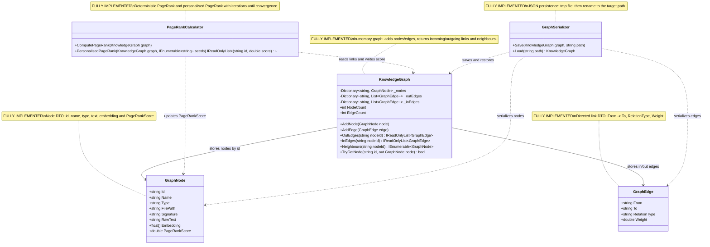

# 07.GraphEngine - implementation documentation

`07.GraphEngine` is knowledge-graph infrastructure: it stores nodes of code or documents, directed weighted links between them, can find neighbours, compute PageRank and save/load the graph as JSON. Structural data passes through the project: `GraphNode`, `GraphEdge`, `KnowledgeGraph`, not trained model weights. These are deterministic graph algorithms and persistence, not semantic reasoning, not `ILearningMachine` and not proof of product quality.

Important for Luba: the graph helps show "who is connected to whom" and which nodes may be more important by their links. But if the graph is saved to JSON or PageRank has been computed, that still does not mean the system understands the meaning of the project or that a model is trained. This is only a careful map of connections.

## 1. Simple UML diagram



Legend:

| Class | What it does | Status | Where it lives |
|---|---|---|---|
| `GraphNode` | Describes one graph node: class, method, file, interface or other object | Complete data shape | `07.GraphEngine/Models/GraphNode.cs` |
| `GraphEdge` | Describes a directed link between two nodes and its weight | Complete data shape | `07.GraphEngine/Models/GraphEdge.cs` |
| `KnowledgeGraph` | Holds node dictionaries and lists of incoming/outgoing edges | Complete in-memory implementation | `07.GraphEngine/KnowledgeGraph.cs` |
| `PageRankCalculator` | Computes node importance by incoming links and weights | Complete deterministic implementation | `07.GraphEngine/PageRankCalculator.cs` |
| `GraphSerializer` | Saves and loads the graph as JSON | Complete persistence implementation | `07.GraphEngine/GraphSerializer.cs` |

## 2. Connection simulations and expected results

| Connection | Example input | What happens | Expected result | What it does NOT prove |
|---|---|---|---|---|
| `KnowledgeGraph -> GraphNode` | `AddNode(new GraphNode { Id="a", Name="A", Type="Class" })` | `_nodes["a"]` gets a new node, empty lists `_outEdges["a"]` and `_inEdges["a"]` are created for it | `TryGetNode("a")` returns `true`, `NodeCount == 1` | does not prove that the node was found semantically correctly |
| `KnowledgeGraph -> GraphEdge` | nodes `a` and `b` exist, then `AddEdge(new GraphEdge { From="a", To="b", RelationType="Calls", Weight=1 })` | the edge is added to `_outEdges["a"]` and `_inEdges["b"]` | `OutEdges("a")[0].To == "b"`, `InEdges("b")[0].From == "a"` | does not prove path finding or reasoning |
| `KnowledgeGraph -> GraphEdge`, error branch | only node `a` exists, then an edge `a -> z` | `AddEdge` checks both endpoints and throws `InvalidOperationException` | the graph does not accept an edge to a missing node | this is not business validation with `OperationResult` |
| `KnowledgeGraph -> GraphNode`, neighbours | `a -> b`, `a -> c` | `Neighbours("a")` takes `OutEdges("a")`, extracts `To`, filters ids, returns nodes | the list contains `b` and `c` | this is one step along the outgoing edges, not a general shortest path |
| `PageRankCalculator -> KnowledgeGraph` | a triangle `a -> b -> c -> a` | `ComputePageRank` iterates the ranks, accounts for incoming edges, dangling nodes and the damping factor | the sum of `PageRankScore` is about `1.0` | PageRank does not prove semantic importance without graph quality |
| `PageRankCalculator -> GraphNode` | after `ComputePageRank(g)` | the calculator writes `rank[id]` into `graph.Nodes[id].PageRankScore` | the nodes get numeric scores | the score is not a trained confidence of a model |
| `GraphSerializer -> KnowledgeGraph` | a graph of 3 nodes and 3 edges, path `*.graph.json` | `Save` collects nodes/edges, writes tmp, moves the file; `Load` re-adds the nodes and edges | after load: `NodeCount == 3`, `EdgeCount == 3` | JSON persistence is not a model asset lifecycle |

## 3. No-code algorithms, in the operator's language

### Algorithm A: the `GraphNode` shape

Imagine a card in a catalogue: it lists the object's name, where it lies, its signature, text and a numeric embedding. `GraphNode` is such a card for the graph.

| Field | Value |
|---|---|
| Class | `GraphNode` |
| Method/function | record properties: `Id`, `Name`, `Type`, `FilePath`, `Signature`, `RawText`, `Embedding`, `PageRankScore` |
| File and line | `07.GraphEngine/Models/GraphNode.cs:3` |
| Input parameters/DTO | object initializer, for example `{ Id="m1", Name="Run", Type="Method" }` |
| Output DTO/result | a `GraphNode` object with init-only fields and a mutable `PageRankScore` |
| Status | Complete data shape |

Current behavior: the record defines the fields but computes nothing itself. `PageRankScore` is changed later by `PageRankCalculator`. The `Embedding` field stores a `float[]`, but `07.GraphEngine` does not build embeddings itself.

What the algorithm does not do: does not validate that `Type` is valid, does not read files, does not train a model and does not prove that `RawText` was chosen correctly.

### Algorithm B: the `GraphEdge` shape

This is an arrow on a map: from which node we go, to which node we arrive, what the link means and how significant it is.

| Field | Value |
|---|---|
| Class | `GraphEdge` |
| Method/function | record properties: `From`, `To`, `RelationType`, `Weight` |
| File and line | `07.GraphEngine/Models/GraphEdge.cs:3` |
| Input parameters/DTO | object initializer, for example `{ From="a", To="b", RelationType="Calls", Weight=2.0 }` |
| Output DTO/result | a `GraphEdge` object |
| Status | Complete data shape |

Current behavior: the record stores the link and its weight. The meaning of `RelationType` is left as a string, for example `Calls`, `Defines`, `Inherits`, `Implements`.

What the algorithm does not do: does not check whether the endpoints exist; that is done by `KnowledgeGraph.AddEdge`.

### Algorithm C: adding and finding nodes in `KnowledgeGraph`

This is like a card file: if a card with the same `Id` arrives, the new card replaces the old one.

| Field | Value |
|---|---|
| Class | `KnowledgeGraph` |
| Method/function | `AddNode(GraphNode node)`, `TryGetNode(string id, out GraphNode node)` |
| File and line | `07.GraphEngine/KnowledgeGraph.cs:17` |
| Input parameters/DTO | `GraphNode node`, for example `Id="x", Name="X"`; for lookup `id="x"` |
| Output DTO/result | `AddNode` returns nothing; `TryGetNode` returns a `bool` and an `out GraphNode` |
| Status | Complete in-memory implementation |

Steps:
1. `AddNode` puts `node` into `_nodes` under the key `node.Id`.
2. If the outgoing/incoming lists for this id do not yet exist, it creates empty lists.
3. If the id already existed, the node is overwritten, but the edge lists for this id are kept.
4. `TryGetNode` looks up the id in `_nodes` and returns `true/false`.

Branches: an empty graph has `NodeCount == 0`; a repeated `AddNode` with the same id leaves one node, but with new fields.

What the algorithm does not do: does not remove old edges when a node is overwritten, does not validate `Type`, does not return an `OperationResult`.

### Algorithm D: adding edges and getting neighbours in `KnowledgeGraph`

This is like adding a road between two already-existing cities. If one city is missing, we do not build the road.

| Field | Value |
|---|---|
| Class | `KnowledgeGraph` |
| Method/function | `AddEdge(GraphEdge edge)`, `OutEdges(string nodeId)`, `InEdges(string nodeId)`, `Neighbours(string nodeId)` |
| File and line | `07.GraphEngine/KnowledgeGraph.cs:24` |
| Input parameters/DTO | `GraphEdge edge`, for example `From="a", To="b", Weight=1`; `nodeId="a"` |
| Output DTO/result | lists of `GraphEdge` or `IEnumerable<GraphNode>` |
| Status | Complete in-memory implementation |

Steps:
1. `AddEdge` checks that `_nodes` contains `edge.From` and `edge.To`.
2. If an endpoint is missing, it throws `InvalidOperationException`.
3. If both endpoints exist, it adds the edge to `_outEdges[From]` and `_inEdges[To]`.
4. `OutEdges` and `InEdges` return a list if the id is found, otherwise an empty list.
5. `Neighbours` takes the outgoing edges, reads `To`, keeps only the ids present in `_nodes`, and returns the corresponding nodes.

Branches: an unknown `nodeId` in `OutEdges`/`InEdges` gives an empty list; an unknown endpoint in `AddEdge` gives an exception; an isolated node in `Neighbours` gives an empty list.

What the algorithm does not do: there is no separate general path-finding or shortest-path method in the current `KnowledgeGraph`. It documents only the implemented one-hop neighbors behavior.

### Algorithm E: ordinary PageRank

This is like computing the importance of pages by their links: if a node is linked from important nodes, its score grows.

| Field | Value |
|---|---|
| Class | `PageRankCalculator` |
| Method/function | `ComputePageRank(KnowledgeGraph graph)` |
| File and line | `07.GraphEngine/PageRankCalculator.cs:15` |
| Input parameters/DTO | `KnowledgeGraph graph` with nodes and weighted directed edges |
| Output DTO/result | the method returns nothing; it writes `PageRankScore` into `GraphNode` |
| Status | Complete deterministic implementation |

Steps:
1. Takes the list of ids from `graph.Nodes.Keys`.
2. If the graph is empty, returns immediately.
3. Initializes each node's rank to `1.0 / n`.
4. Up to `MaxIter = 100` times computes the dangling mass from nodes without outgoing edges.
5. For each node sums the contribution of incoming edges, normalized by the total weight of the source's outgoing edges.
6. Computes the new rank with `DampingFactor = 0.85`.
7. Sums `delta`; if `delta < 1e-6`, it stops.
8. Writes the final rank into `PageRankScore`.

Branches: an empty graph does not crash; disconnected nodes get a positive score via the teleport/dangling share; a heavier edge gives a larger contribution to the target node.

What the algorithm does not do: does not train, does not know the meaning of the relation type, does not build the graph and does not prove data quality.

### Algorithm F: personalised PageRank

This is PageRank with a "point of interest": the teleport mass is distributed over the seed nodes.

| Field | Value |
|---|---|
| Class | `PageRankCalculator` |
| Method/function | `PersonalisedPageRank(KnowledgeGraph graph, IEnumerable<string> seeds)` |
| File and line | `07.GraphEngine/PageRankCalculator.cs:61` |
| Input parameters/DTO | `graph`; `seeds`, for example `["a"]` or `["n0","n4"]` |
| Output DTO/result | `IReadOnlyList<(string id, double score)>`, sorted by score descending |
| Status | Complete deterministic implementation |

Steps:
1. Takes the ids; if the graph is empty, returns an empty list.
2. Turns the seeds into a `HashSet`.
3. If there are seeds, teleport goes only to the seed nodes; if not, the dangling mass is distributed as in the ordinary variant.
4. On each iteration computes the incoming weighted contribution.
5. Updates the rank until convergence or up to 100 iterations.
6. Returns `(id, score)` pairs, sorted by score descending.

Branches: an empty graph returns `[]`; a seed node gets a teleport preference; several seeds share the seedWeight.

What the algorithm does not do: does not check that the seed ids exist in the graph, does not return an explanation path, is not a trainable ranking model.

### Algorithm G: JSON save/load in `GraphSerializer`

This is like putting the whole card file and all the arrows into a box, writing the box to a temporary file, and then replacing the target file.

| Field | Value |
|---|---|
| Class | `GraphSerializer` |
| Method/function | `Save(KnowledgeGraph graph, string path)`, `Load(string path)` |
| File and line | `07.GraphEngine/GraphSerializer.cs:14` |
| Input parameters/DTO | `KnowledgeGraph graph`; `string path`, for example `tmp.graph.json` |
| Output DTO/result | `Save` writes a file; `Load` returns a new `KnowledgeGraph` |
| Status | Complete persistence implementation |

Steps:
1. `Save` collects `Nodes` from `graph.Nodes.Values`.
2. Collects all `Edges` via `graph.Nodes.Keys.SelectMany(id => graph.OutEdges(id))`.
3. Writes serialized JSON to `path + ".tmp"`.
4. Moves tmp to `path` with overwrite.
5. `Load` reads the JSON, deserializes `SerializedGraph`.
6. Creates a new `KnowledgeGraph`, first adds all nodes, then all edges.

Branches: an empty graph round-trip gives `0` nodes and `0` edges; if the JSON does not deserialize, the code throws `InvalidOperationException`.

What the algorithm does not do: graph persistence is not a model asset lifecycle, checkpoint, manifest, locator or trained state.

## 4. Where the logic sits in the code

| Logic | File | Why this location matters | What it proves | What it does not prove |
|---|---|---|---|---|
| Node DTO | `07.GraphEngine/Models/GraphNode.cs:3` | fixes the node's fields | the graph data shape | type validity or embedding quality |
| Edge DTO | `07.GraphEngine/Models/GraphEdge.cs:3` | fixes the directed link and weight | the link shape | the existence of endpoints |
| Graph mutation/search | `07.GraphEngine/KnowledgeGraph.cs:17` | central in-memory state | add/get/edge/neighbors/count behavior | general path finding |
| PageRank | `07.GraphEngine/PageRankCalculator.cs:15` | deterministic ranking by graph structure | iterative PageRank and personalised PageRank | semantic reasoning |
| Persistence | `07.GraphEngine/GraphSerializer.cs:14` | JSON save/load boundary | round-trip graph state | model asset lifecycle |

## 5. Short important code quotations

> **Why it matters:** `GraphNode` shows what data is actually stored in a node. `Embedding` here is only a field, not an embedding computation. `PageRankScore` is mutable, because `PageRankCalculator` writes the result there.

```csharp
public string RawText       { get; init; } = "";
public float[] Embedding    { get; init; } = [];
public double PageRankScore { get; set; }
```

Source: `07.GraphEngine/Models/GraphNode.cs:10`.

> **Why it matters:** `AddNode` overwrites the node by id and guarantees the presence of incoming/outgoing edge lists. Input: `GraphNode { Id="x" }`. Output: the graph state changes, but the method returns nothing.

```csharp
_nodes[node.Id] = node;
_outEdges.TryAdd(node.Id, []);
_inEdges.TryAdd(node.Id, []);
```

Source: `07.GraphEngine/KnowledgeGraph.cs:19`.

> **Why it matters:** this is the only hard validation branch when adding an edge. If `To="z"` is missing, the code throws an exception and does not add the link.

```csharp
if (!_nodes.ContainsKey(edge.From) || !_nodes.ContainsKey(edge.To))
    throw new InvalidOperationException($"Both endpoints must exist: {edge.From} → {edge.To}");
```

Source: `07.GraphEngine/KnowledgeGraph.cs:26`.

> **Why it matters:** `Neighbours` implements only a one-hop step along the outgoing edges. Inside, the method takes `OutEdges`, then turns `To` ids into `GraphNode`.

```csharp
OutEdges(nodeId)
    .Select(e => e.To)
    .Where(_nodes.ContainsKey)
    .Select(id => _nodes[id]);
```

Source: `07.GraphEngine/KnowledgeGraph.cs:39`.

> **Why it matters:** PageRank uses fixed parameters `0.85`, `1e-6`, `100`. This is a deterministic numerical algorithm, not a trainable model.

```csharp
private const double DampingFactor = 0.85;
private const double Convergence  = 1e-6;
private const int    MaxIter      = 100;
```

Source: `07.GraphEngine/PageRankCalculator.cs:11`.

> **Why it matters:** the formula shows the actual current behavior: a node's rank is the sum of the base teleport and the contribution of incoming weighted edges plus the dangling share.

```csharp
double newRank = (1 - DampingFactor) / n
               + DampingFactor * (sum + dangling / n);
```

Source: `07.GraphEngine/PageRankCalculator.cs:43`.

> **Why it matters:** the personalised branch differs in teleport: if a node is in seeds, it gets seedWeight, otherwise teleport is zero. This is a bias toward seed nodes, not semantic training.

```csharp
double teleport = seedSet.Contains(id) ? seedWeight : 0;
double danglingShare = seedSet.Count > 0
    ? (seedSet.Contains(id) ? dangling * seedWeight : 0)
    : dangling / n;
```

Source: `07.GraphEngine/PageRankCalculator.cs:84`.

> **Why it matters:** persistence writes a tmp file and then renames it. This confirms an atomic-write style, but does not prove a model lifecycle.

```csharp
var tmp = path + ".tmp";
File.WriteAllText(tmp, JsonSerializer.Serialize(data, JsonOpts));
File.Move(tmp, path, overwrite: true);
```

Source: `07.GraphEngine/GraphSerializer.cs:24`.

## 6. Test/e2e/QA mapping and honest gaps

| Behavior | Evidence | What it confirms | Limitation |
|---|---|---|---|
| A node is added and found | `Tests/GraphEngineTests.cs:20` | `AddNode` + `TryGetNode` return the expected `Name` | does not check all `GraphNode` fields |
| You cannot add an edge to an unknown endpoint | `Tests/GraphEngineTests.cs:29` | `AddEdge` throws `InvalidOperationException` | exception-based API, not `OperationResult` |
| In/out edges work | `Tests/GraphEngineTests.cs:38` | `OutEdges("a")` and `InEdges("a")` give the correct endpoints | synthetic triangle only |
| PageRank sum is about 1 | `Tests/GraphEngineTests.cs:48` | ranks are normalized on the triangle | not a graph quality benchmark |
| Personalised seed is higher | `Tests/GraphEngineTests.cs:59` | seed `"a"` becomes the top score in the triangle | does not explain semantic relevance |
| Save/load roundtrip | `Tests/GraphEngineTests.cs:69` | 3 nodes and 3 edges are restored | not a model asset lifecycle |
| Empty graph/counts | `Tests/GraphEngineEdgeCaseTests.cs:14` | empty graph and PageRank empty branches do not crash | does not check malformed JSON |
| Node overwrite | `Tests/GraphEngineEdgeCaseTests.cs:42` | a repeated id overwrites the node | does not check the consequences for old edges |
| Neighbours | `Tests/GraphEngineEdgeCaseTests.cs:56` | one-hop outgoing neighbors are returned | shortest path is absent |
| Disconnected PageRank | `Tests/GraphEngineEdgeCaseTests.cs:86` | disconnected nodes get a positive score and the sum is about 1 | does not prove semantic importance |
| Weight sensitivity | `Tests/GraphEngineEdgeCaseTests.cs:137` | a heavy edge raises the target's score | only a small synthetic graph |
| Empty save/load | `Tests/GraphEngineEdgeCaseTests.cs:155` | an empty graph round-trip | does not check schema migration |

In this bounded work order the tests were not run, by direct prohibition. The QA mapping relies on the test files read and line refs, not on a fresh runtime report.

Honest gaps:

- In the current `KnowledgeGraph` there is no separate method for path search, shortest path or full traversal. There is only `Neighbours(string nodeId)` for one-hop outgoing neighbors.
- There is no deletion of nodes/edges.
- There is no schema validation for `GraphNode.Type` and `GraphEdge.RelationType`.
- `GraphSerializer.Load` does not contain versioned schema migration.

## 7. Anti-false-done checks

- `07.GraphEngine` is not an `ILearningMachine`; there is no `TrainBatch`, checkpoint, manifest, locator or learned state here.
- PageRank and personalised PageRank are deterministic graph algorithms. They must not be presented as a trainable semantic authority.
- The JSON file after `GraphSerializer.Save` is persistence evidence, not a model asset lifecycle and not proof of product reasoning quality.
- The presence of an `Embedding` field in `GraphNode` does not mean GraphEngine trains embeddings or checks their quality.
- Static grep, JSON/report/smoke evidence do not replace real graph behavior tests if runtime graph behavior is claimed.

## 8. Implementation status table

| Component | File | Status | What actually works now |
|---|---|---|---|
| `GraphNode` | `07.GraphEngine/Models/GraphNode.cs` | Complete | DTO fields: `Id`, `Name`, `Type`, `FilePath`, `Signature`, `RawText`, `Embedding`, mutable `PageRankScore` |
| `GraphEdge` | `07.GraphEngine/Models/GraphEdge.cs` | Complete | DTO fields: `From`, `To`, `RelationType`, `Weight` |
| `KnowledgeGraph` | `07.GraphEngine/KnowledgeGraph.cs` | Complete | `AddNode`, `AddEdge`, `OutEdges`, `InEdges`, `Neighbours`, `TryGetNode`, `NodeCount`, `EdgeCount` |
| `PageRankCalculator` | `07.GraphEngine/PageRankCalculator.cs` | Complete | `ComputePageRank` mutates `PageRankScore`; `PersonalisedPageRank` returns sorted scores |
| `GraphSerializer` | `07.GraphEngine/GraphSerializer.cs` | Complete | `Save` writes JSON through `.tmp`; `Load` reconstructs graph |
| Path search | no separate method | Not implemented | Documented as a gap: there is only one-hop `Neighbours`, not full path finding |
| Product semantic reasoning | not in this project | Not implemented | Graph infrastructure can support RAG, but is not trained reasoning |

Documentation status: draft/pass for D2B sub-agent evidence. Last verified against source: 2026-06-08. Known gaps: no fresh test run by work-order rule; no implemented full path search; no delete/update APIs; no schema migration.
