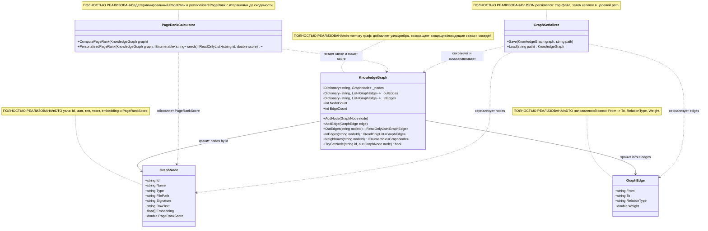

# 07.GraphEngine - документация реализации

`07.GraphEngine` - это инфраструктура графа знаний: она хранит узлы кода или документов, направленные взвешенные связи между ними, умеет находить соседей, считать PageRank и сохранять/загружать граф в JSON. Через проект проходят структурные данные: `GraphNode`, `GraphEdge`, `KnowledgeGraph`, а не обученные веса модели. Это детерминированные graph algorithms и persistence, не semantic reasoning, не `ILearningMachine` и не доказательство качества продукта.

Важно для Лубы: граф помогает показать "кто с кем связан" и какие узлы могут быть важнее по ссылкам. Но если граф сохранен в JSON или PageRank посчитался, это еще не значит, что система понимает смысл проекта или что модель обучена. Это только аккуратная карта связей.

## 1. Простая UML-схема



Легенда:

| Класс | Что делает | Статус | Где живет |
|---|---|---|---|
| `GraphNode` | Описывает один узел графа: класс, метод, файл, интерфейс или другой объект | Полная data shape | `07.GraphEngine/Models/GraphNode.cs` |
| `GraphEdge` | Описывает направленную связь между двумя узлами и ее вес | Полная data shape | `07.GraphEngine/Models/GraphEdge.cs` |
| `KnowledgeGraph` | Держит словари узлов и списки входящих/исходящих ребер | Полная in-memory реализация | `07.GraphEngine/KnowledgeGraph.cs` |
| `PageRankCalculator` | Считает важность узлов по входящим ссылкам и весам | Полная deterministic реализация | `07.GraphEngine/PageRankCalculator.cs` |
| `GraphSerializer` | Сохраняет и загружает граф в JSON | Полная persistence реализация | `07.GraphEngine/GraphSerializer.cs` |

## 2. Симуляции соединений и ожидаемые результаты

| Соединение | Пример входа | Что происходит | Ожидаемый результат | Что НЕ доказывает |
|---|---|---|---|---|
| `KnowledgeGraph -> GraphNode` | `AddNode(new GraphNode { Id="a", Name="A", Type="Class" })` | `_nodes["a"]` получает новый узел, для него создаются пустые списки `_outEdges["a"]` и `_inEdges["a"]` | `TryGetNode("a")` возвращает `true`, `NodeCount == 1` | не доказывает, что узел найден семантически правильно |
| `KnowledgeGraph -> GraphEdge` | есть узлы `a` и `b`, затем `AddEdge(new GraphEdge { From="a", To="b", RelationType="Calls", Weight=1 })` | ребро добавляется в `_outEdges["a"]` и `_inEdges["b"]` | `OutEdges("a")[0].To == "b"`, `InEdges("b")[0].From == "a"` | не доказывает path finding или reasoning |
| `KnowledgeGraph -> GraphEdge`, ветка ошибки | есть только узел `a`, затем ребро `a -> z` | `AddEdge` проверяет оба endpoint и бросает `InvalidOperationException` | граф не принимает ребро на отсутствующий узел | не является business validation с `OperationResult` |
| `KnowledgeGraph -> GraphNode`, соседи | `a -> b`, `a -> c` | `Neighbours("a")` берет `OutEdges("a")`, извлекает `To`, фильтрует ids, возвращает nodes | список содержит `b` и `c` | это один шаг по исходящим ребрам, не общий shortest path |
| `PageRankCalculator -> KnowledgeGraph` | треугольник `a -> b -> c -> a` | `ComputePageRank` итерирует ранги, учитывает входящие ребра, dangling nodes и damping factor | сумма `PageRankScore` примерно `1.0` | PageRank не доказывает смысловую важность без качества графа |
| `PageRankCalculator -> GraphNode` | после `ComputePageRank(g)` | калькулятор записывает `rank[id]` в `graph.Nodes[id].PageRankScore` | узлы получают числовые score | score не является обученным confidence модели |
| `GraphSerializer -> KnowledgeGraph` | граф из 3 nodes и 3 edges, путь `*.graph.json` | `Save` собирает nodes/edges, пишет tmp, переносит файл; `Load` заново добавляет nodes и edges | после load: `NodeCount == 3`, `EdgeCount == 3` | JSON persistence не является model asset lifecycle |

## 3. Алгоритмы без кода на русском

### Алгоритм A: форма узла `GraphNode`

Представь карточку в каталоге: на ней написано имя объекта, где он лежит, его сигнатура, текст и числовой embedding. `GraphNode` - такая карточка для графа.

| Поле | Значение |
|---|---|
| Класс | `GraphNode` |
| Метод/функция | record properties: `Id`, `Name`, `Type`, `FilePath`, `Signature`, `RawText`, `Embedding`, `PageRankScore` |
| Файл и строка | `07.GraphEngine/Models/GraphNode.cs:3` |
| Входные параметры/DTO | object initializer, например `{ Id="m1", Name="Run", Type="Method" }` |
| Выходной DTO/результат | объект `GraphNode` с init-only полями и изменяемым `PageRankScore` |
| Статус | Полная data shape |

Текущее поведение: record задает поля, но сам ничего не вычисляет. `PageRankScore` меняется позже через `PageRankCalculator`. Поле `Embedding` хранит `float[]`, но `07.GraphEngine` сам не строит embeddings.

Чего алгоритм не делает: не проверяет допустимость `Type`, не читает файлы, не обучает модель и не доказывает, что `RawText` выбран правильно.

### Алгоритм B: форма связи `GraphEdge`

Это стрелка на карте: от какого узла идем, в какой узел приходим, что значит связь и насколько она весомая.

| Поле | Значение |
|---|---|
| Класс | `GraphEdge` |
| Метод/функция | record properties: `From`, `To`, `RelationType`, `Weight` |
| Файл и строка | `07.GraphEngine/Models/GraphEdge.cs:3` |
| Входные параметры/DTO | object initializer, например `{ From="a", To="b", RelationType="Calls", Weight=2.0 }` |
| Выходной DTO/результат | объект `GraphEdge` |
| Статус | Полная data shape |

Текущее поведение: record хранит связь и вес. Смысл `RelationType` оставлен строкой, например `Calls`, `Defines`, `Inherits`, `Implements`.

Чего алгоритм не делает: не проверяет, существуют ли endpoints; это делает `KnowledgeGraph.AddEdge`.

### Алгоритм C: добавление и поиск узлов в `KnowledgeGraph`

Это как картотека: если пришла карточка с тем же `Id`, новая карточка заменяет старую.

| Поле | Значение |
|---|---|
| Класс | `KnowledgeGraph` |
| Метод/функция | `AddNode(GraphNode node)`, `TryGetNode(string id, out GraphNode node)` |
| Файл и строка | `07.GraphEngine/KnowledgeGraph.cs:17` |
| Входные параметры/DTO | `GraphNode node`, например `Id="x", Name="X"`; для поиска `id="x"` |
| Выходной DTO/результат | `AddNode` ничего не возвращает; `TryGetNode` возвращает `bool` и `out GraphNode` |
| Статус | Полная in-memory реализация |

Шаги:
1. `AddNode` кладет `node` в `_nodes` по ключу `node.Id`.
2. Если списков outgoing/incoming для этого id еще нет, создает пустые списки.
3. Если id уже был, узел перезаписывается, но списки ребер для этого id сохраняются.
4. `TryGetNode` ищет id в `_nodes` и возвращает `true/false`.

Ветки: пустой граф имеет `NodeCount == 0`; повторный `AddNode` с тем же id оставляет один узел, но с новыми полями.

Чего алгоритм не делает: не удаляет старые ребра при перезаписи узла, не валидирует `Type`, не возвращает `OperationResult`.

### Алгоритм D: добавление ребер и получение соседей в `KnowledgeGraph`

Это как добавить дорогу между двумя уже существующими городами. Если одного города нет, дорогу не строим.

| Поле | Значение |
|---|---|
| Класс | `KnowledgeGraph` |
| Метод/функция | `AddEdge(GraphEdge edge)`, `OutEdges(string nodeId)`, `InEdges(string nodeId)`, `Neighbours(string nodeId)` |
| Файл и строка | `07.GraphEngine/KnowledgeGraph.cs:24` |
| Входные параметры/DTO | `GraphEdge edge`, например `From="a", To="b", Weight=1`; `nodeId="a"` |
| Выходной DTO/результат | списки `GraphEdge` или `IEnumerable<GraphNode>` |
| Статус | Полная in-memory реализация |

Шаги:
1. `AddEdge` проверяет, что `_nodes` содержит `edge.From` и `edge.To`.
2. Если endpoint отсутствует, бросает `InvalidOperationException`.
3. Если оба endpoint существуют, добавляет ребро в `_outEdges[From]` и `_inEdges[To]`.
4. `OutEdges` и `InEdges` возвращают список, если id найден, иначе пустой список.
5. `Neighbours` берет исходящие ребра, читает `To`, оставляет только ids, которые есть в `_nodes`, и возвращает соответствующие nodes.

Ветки: неизвестный `nodeId` в `OutEdges`/`InEdges` дает пустой список; неизвестный endpoint в `AddEdge` дает exception; isolated node в `Neighbours` дает пустой список.

Чего алгоритм не делает: отдельного общего метода path finding или shortest path в текущем `KnowledgeGraph` нет. Документирует только реализованный one-hop neighbors behavior.

### Алгоритм E: обычный PageRank

Это как считать важность страниц по ссылкам: если на узел ссылаются важные узлы, его score растет.

| Поле | Значение |
|---|---|
| Класс | `PageRankCalculator` |
| Метод/функция | `ComputePageRank(KnowledgeGraph graph)` |
| Файл и строка | `07.GraphEngine/PageRankCalculator.cs:15` |
| Входные параметры/DTO | `KnowledgeGraph graph` с nodes и weighted directed edges |
| Выходной DTO/результат | метод ничего не возвращает; записывает `PageRankScore` в `GraphNode` |
| Статус | Полная deterministic реализация |

Шаги:
1. Берет список ids из `graph.Nodes.Keys`.
2. Если граф пустой, сразу возвращается.
3. Инициализирует каждому узлу rank `1.0 / n`.
4. До `MaxIter = 100` раз считает dangling mass от узлов без исходящих ребер.
5. Для каждого узла суммирует вклад входящих ребер, нормированный на общий вес исходящих ребер источника.
6. Считает новый rank через `DampingFactor = 0.85`.
7. Суммирует `delta`; если `delta < 1e-6`, останавливается.
8. Записывает итоговый rank в `PageRankScore`.

Ветки: пустой граф не падает; disconnected nodes получают положительный score через teleport/dangling share; более тяжелое ребро дает больший вклад target node.

Чего алгоритм не делает: не обучается, не знает смысла relation type, не строит граф и не доказывает качество данных.

### Алгоритм F: personalised PageRank

Это PageRank с "точкой интереса": teleport mass распределяется по seed nodes.

| Поле | Значение |
|---|---|
| Класс | `PageRankCalculator` |
| Метод/функция | `PersonalisedPageRank(KnowledgeGraph graph, IEnumerable<string> seeds)` |
| Файл и строка | `07.GraphEngine/PageRankCalculator.cs:61` |
| Входные параметры/DTO | `graph`; `seeds`, например `["a"]` или `["n0","n4"]` |
| Выходной DTO/результат | `IReadOnlyList<(string id, double score)>`, отсортированный по score вниз |
| Статус | Полная deterministic реализация |

Шаги:
1. Берет ids; если граф пустой, возвращает пустой список.
2. Превращает seeds в `HashSet`.
3. Если seeds есть, teleport получает только seed nodes; если нет, dangling mass распределяется как в обычном варианте.
4. На каждой итерации считает incoming weighted contribution.
5. Обновляет rank до сходимости или до 100 итераций.
6. Возвращает пары `(id, score)`, отсортированные по score вниз.

Ветки: пустой граф возвращает `[]`; seed node получает teleport preference; несколько seeds делят seedWeight.

Чего алгоритм не делает: не проверяет, что seed ids существуют в graph, не возвращает explanation path, не является обучаемым ranking model.

### Алгоритм G: JSON save/load в `GraphSerializer`

Это как положить всю картотеку и все стрелки в коробку, записать коробку во временный файл, а потом заменить целевой файл.

| Поле | Значение |
|---|---|
| Класс | `GraphSerializer` |
| Метод/функция | `Save(KnowledgeGraph graph, string path)`, `Load(string path)` |
| Файл и строка | `07.GraphEngine/GraphSerializer.cs:14` |
| Входные параметры/DTO | `KnowledgeGraph graph`; `string path`, например `tmp.graph.json` |
| Выходной DTO/результат | `Save` пишет файл; `Load` возвращает новый `KnowledgeGraph` |
| Статус | Полная persistence реализация |

Шаги:
1. `Save` собирает `Nodes` из `graph.Nodes.Values`.
2. Собирает все `Edges` через `graph.Nodes.Keys.SelectMany(id => graph.OutEdges(id))`.
3. Пишет serialized JSON в `path + ".tmp"`.
4. Перемещает tmp в `path` с overwrite.
5. `Load` читает JSON, десериализует `SerializedGraph`.
6. Создает новый `KnowledgeGraph`, сначала добавляет все nodes, потом все edges.

Ветки: пустой граф round-trip дает `0` nodes и `0` edges; если JSON не десериализуется, код бросает `InvalidOperationException`.

Чего алгоритм не делает: graph persistence не является model asset lifecycle, checkpoint, manifest, locator или trained state.

## 4. Где логика сидит в коде

| Логика | Файл | Почему это место важно | Что доказывает | Чего не доказывает |
|---|---|---|---|---|
| Node DTO | `07.GraphEngine/Models/GraphNode.cs:3` | фиксирует поля узла | shape данных графа | валидность типа или качество embedding |
| Edge DTO | `07.GraphEngine/Models/GraphEdge.cs:3` | фиксирует направленную связь и weight | shape связи | существование endpoints |
| Graph mutation/search | `07.GraphEngine/KnowledgeGraph.cs:17` | центральное in-memory состояние | add/get/edge/neighbors/count behavior | общий path finding |
| PageRank | `07.GraphEngine/PageRankCalculator.cs:15` | deterministic ranking по структуре графа | iterative PageRank и personalised PageRank | semantic reasoning |
| Persistence | `07.GraphEngine/GraphSerializer.cs:14` | JSON save/load boundary | round-trip graph state | model asset lifecycle |

## 5. Короткие важные цитаты кода

> **Почему важно:** `GraphNode` показывает, какие данные реально хранятся в узле. `Embedding` здесь только поле, а не вычисление embedding. `PageRankScore` изменяемый, потому что `PageRankCalculator` записывает туда результат.

```csharp
public string RawText       { get; init; } = "";
public float[] Embedding    { get; init; } = [];
public double PageRankScore { get; set; }
```

Источник: `07.GraphEngine/Models/GraphNode.cs:10`.

> **Почему важно:** `AddNode` перезаписывает узел по id и гарантирует наличие списков входящих/исходящих ребер. Вход: `GraphNode { Id="x" }`. Выход: состояние графа меняется, но метод ничего не возвращает.

```csharp
_nodes[node.Id] = node;
_outEdges.TryAdd(node.Id, []);
_inEdges.TryAdd(node.Id, []);
```

Источник: `07.GraphEngine/KnowledgeGraph.cs:19`.

> **Почему важно:** это единственная жесткая validation ветка при добавлении ребра. Если `To="z"` отсутствует, код бросает exception и не добавляет связь.

```csharp
if (!_nodes.ContainsKey(edge.From) || !_nodes.ContainsKey(edge.To))
    throw new InvalidOperationException($"Both endpoints must exist: {edge.From} → {edge.To}");
```

Источник: `07.GraphEngine/KnowledgeGraph.cs:26`.

> **Почему важно:** `Neighbours` реализует только one-hop переход по исходящим ребрам. Внутри метод берет `OutEdges`, затем превращает `To` ids в `GraphNode`.

```csharp
OutEdges(nodeId)
    .Select(e => e.To)
    .Where(_nodes.ContainsKey)
    .Select(id => _nodes[id]);
```

Источник: `07.GraphEngine/KnowledgeGraph.cs:39`.

> **Почему важно:** PageRank использует фиксированные параметры `0.85`, `1e-6`, `100`. Это deterministic numerical algorithm, а не обучаемая модель.

```csharp
private const double DampingFactor = 0.85;
private const double Convergence  = 1e-6;
private const int    MaxIter      = 100;
```

Источник: `07.GraphEngine/PageRankCalculator.cs:11`.

> **Почему важно:** формула показывает actual current behavior: rank узла складывается из base teleport и вклада входящих weighted edges плюс dangling share.

```csharp
double newRank = (1 - DampingFactor) / n
               + DampingFactor * (sum + dangling / n);
```

Источник: `07.GraphEngine/PageRankCalculator.cs:43`.

> **Почему важно:** personalised branch отличается teleport: если узел в seeds, он получает seedWeight, иначе teleport равен нулю. Это bias к seed nodes, не semantic training.

```csharp
double teleport = seedSet.Contains(id) ? seedWeight : 0;
double danglingShare = seedSet.Count > 0
    ? (seedSet.Contains(id) ? dangling * seedWeight : 0)
    : dangling / n;
```

Источник: `07.GraphEngine/PageRankCalculator.cs:84`.

> **Почему важно:** persistence пишет tmp-файл и затем переименовывает его. Это подтверждает atomic-write style, но не доказывает модельный lifecycle.

```csharp
var tmp = path + ".tmp";
File.WriteAllText(tmp, JsonSerializer.Serialize(data, JsonOpts));
File.Move(tmp, path, overwrite: true);
```

Источник: `07.GraphEngine/GraphSerializer.cs:24`.

## 6. Test/e2e/QA mapping и честные gaps

| Поведение | Evidence | Что подтверждает | Ограничение |
|---|---|---|---|
| Узел добавляется и находится | `Tests/GraphEngineTests.cs:20` | `AddNode` + `TryGetNode` возвращают ожидаемый `Name` | не проверяет все поля `GraphNode` |
| Нельзя добавить edge на неизвестный endpoint | `Tests/GraphEngineTests.cs:29` | `AddEdge` бросает `InvalidOperationException` | exception-based API, не `OperationResult` |
| In/out edges работают | `Tests/GraphEngineTests.cs:38` | `OutEdges("a")` и `InEdges("a")` дают правильные endpoints | synthetic triangle only |
| PageRank сумма примерно 1 | `Tests/GraphEngineTests.cs:48` | ranks нормализуются на треугольнике | не benchmark качества графа |
| Personalised seed выше | `Tests/GraphEngineTests.cs:59` | seed `"a"` становится top score в треугольнике | не объясняет semantic relevance |
| Save/load roundtrip | `Tests/GraphEngineTests.cs:69` | 3 nodes и 3 edges восстанавливаются | не model asset lifecycle |
| Empty graph/counts | `Tests/GraphEngineEdgeCaseTests.cs:14` | пустой граф и PageRank empty ветки не падают | не проверяет malformed JSON |
| Node overwrite | `Tests/GraphEngineEdgeCaseTests.cs:42` | повторный id перезаписывает node | не проверяет последствия для старых ребер |
| Neighbours | `Tests/GraphEngineEdgeCaseTests.cs:56` | one-hop outgoing neighbors возвращаются | shortest path отсутствует |
| Disconnected PageRank | `Tests/GraphEngineEdgeCaseTests.cs:86` | disconnected nodes получают положительный score и сумма около 1 | не доказывает смысловую важность |
| Weight sensitivity | `Tests/GraphEngineEdgeCaseTests.cs:137` | тяжелое ребро повышает score target | только маленький synthetic graph |
| Empty save/load | `Tests/GraphEngineEdgeCaseTests.cs:155` | пустой граф round-trip | не проверяет schema migration |

В этом bounded work order тесты не запускались по прямому запрету. QA mapping опирается на прочитанные тестовые файлы и line refs, а не на свежий runtime report.

Честные gaps:

- В текущем `KnowledgeGraph` нет отдельного метода поиска пути, shortest path или full traversal. Есть только `Neighbours(string nodeId)` для one-hop outgoing neighbors.
- Нет удаления узлов/ребер.
- Нет schema validation для `GraphNode.Type` и `GraphEdge.RelationType`.
- `GraphSerializer.Load` не содержит versioned schema migration.

## 7. Проверки против ложной готовности

- `07.GraphEngine` не является `ILearningMachine`; здесь нет `TrainBatch`, checkpoint, manifest, locator или learned state.
- PageRank и personalised PageRank - deterministic graph algorithms. Их нельзя выдавать за обучаемую semantic authority.
- JSON-файл после `GraphSerializer.Save` - это persistence evidence, а не model asset lifecycle и не proof of product reasoning quality.
- Наличие `Embedding` поля в `GraphNode` не означает, что GraphEngine обучает embeddings или проверяет их качество.
- Static grep, JSON/report/smoke evidence не заменяют реальные graph behavior tests, если заявляется runtime graph behavior.

## 8. Таблица статуса реализации

| Компонент | Файл | Статус | Что реально работает сейчас |
|---|---|---|---|
| `GraphNode` | `07.GraphEngine/Models/GraphNode.cs` | Полная | DTO fields: `Id`, `Name`, `Type`, `FilePath`, `Signature`, `RawText`, `Embedding`, mutable `PageRankScore` |
| `GraphEdge` | `07.GraphEngine/Models/GraphEdge.cs` | Полная | DTO fields: `From`, `To`, `RelationType`, `Weight` |
| `KnowledgeGraph` | `07.GraphEngine/KnowledgeGraph.cs` | Полная | `AddNode`, `AddEdge`, `OutEdges`, `InEdges`, `Neighbours`, `TryGetNode`, `NodeCount`, `EdgeCount` |
| `PageRankCalculator` | `07.GraphEngine/PageRankCalculator.cs` | Полная | `ComputePageRank` mutates `PageRankScore`; `PersonalisedPageRank` returns sorted scores |
| `GraphSerializer` | `07.GraphEngine/GraphSerializer.cs` | Полная | `Save` writes JSON through `.tmp`; `Load` reconstructs graph |
| Path search | нет отдельного метода | Не реализовано | Документирован как gap: есть только one-hop `Neighbours`, не full path finding |
| Product semantic reasoning | нет в этом проекте | Не реализовано | Графовая инфраструктура может поддерживать RAG, но не является trained reasoning |

Documentation status: draft/pass for D2B sub-agent evidence. Last verified against source: 2026-06-08. Known gaps: no fresh test run by work-order rule; no implemented full path search; no delete/update APIs; no schema migration.
