# 08.GraphRag - документация реализации

`08.GraphRag` - это инфраструктура Graph Retrieval-Augmented Generation (Graph RAG): она берет граф знаний из `07.GraphEngine`, embeddings из `05.Embeddings`, vector index из `06.VectorSearch`, а затем собирает текстовый контекст для следующего слоя. Проект не генерирует ответ сам, не обучает модель и не является `ILearningMachine`. Его текущая логика deterministic/heuristic: embed query, найти похожие узлы, расширить через personalised PageRank, объединить результаты и собрать `ContextText`.

Простыми словами: это как помощник-библиотекарь, который сначала находит похожие карточки по тексту, потом смотрит, какие карточки важны в графе связей, и кладет лучшие фрагменты в одну папку контекста. Но наличие такой папки не доказывает качество финального ответа модели и не является evidence обучения.

## 1. Простая UML-схема

```mermaid
classDiagram
    class Indexer {
        -EmbeddingModel _embedder
        -IVectorIndex _vectorIndex
        +Indexer(EmbeddingModel embedder, IVectorIndex vectorIndex)
        +IndexGraphAsync(KnowledgeGraph graph, CancellationToken ct) Task
    }
    class LocalSearch {
        -EmbeddingModel _embedder
        -IVectorIndex _vectorIndex
        -KnowledgeGraph _graph
        +Search(string query, int topK) List~SearchResult~
    }
    class GlobalSearch {
        -EmbeddingModel _embedder
        -IVectorIndex _vectorIndex
        -KnowledgeGraph _graph
        -PageRankCalculator _pageRank
        +Search(string query, int seedK, int topK) List~SearchResult~
    }
    class HybridRetriever {
        -LocalSearch _local
        -GlobalSearch _global
        +Retrieve(string query, int topK) RetrievalContext
    }
    class RetrievalContext {
        +string Query
        +List~SearchResult~ Results
        +string ContextText
        +int TokenCount
    }
    class SearchResult {
        +string NodeId
        +string Name
        +string Type
        +string RawText
        +float VectorScore
        +double GraphScore
        +double CombinedScore
        +string Source
    }
    class EmbeddingModel
    class IVectorIndex
    class KnowledgeGraph
    class PageRankCalculator

    Indexer ..> EmbeddingModel : строит embedding
    Indexer ..> IVectorIndex : пишет node vector
    Indexer ..> KnowledgeGraph : читает nodes
    LocalSearch ..> EmbeddingModel : query -> vector
    LocalSearch ..> IVectorIndex : vector nearest search
    LocalSearch ..> KnowledgeGraph : id -> GraphNode
    LocalSearch --> SearchResult : local rows
    GlobalSearch ..> EmbeddingModel : query -> vector
    GlobalSearch ..> IVectorIndex : seed ids
    GlobalSearch ..> PageRankCalculator : personalised PageRank
    GlobalSearch ..> KnowledgeGraph : id -> GraphNode
    GlobalSearch --> SearchResult : global rows
    HybridRetriever ..> LocalSearch : local candidates
    HybridRetriever ..> GlobalSearch : graph candidates
    HybridRetriever --> RetrievalContext : merged context
    RetrievalContext --> SearchResult : contains results

    note for Indexer "ПОЛНОСТЬЮ РЕАЛИЗОВАН\nПроходит по nodes графа, выбирает текст узла, строит embedding и кладет его в vector index."
    note for LocalSearch "ПОЛНОСТЬЮ РЕАЛИЗОВАН\nЛокальный retrieval: query embedding -> ближайшие vector hits -> SearchResult по nodes графа."
    note for GlobalSearch "ПОЛНОСТЬЮ РЕАЛИЗОВАН\nГлобальный retrieval: vector seeds -> personalised PageRank -> SearchResult по структурной близости."
    note for HybridRetriever "ПОЛНОСТЬЮ РЕАЛИЗОВАН\nОбъединяет local/global, взвешивает, deduplicate по NodeId и строит ContextText."
    note for RetrievalContext "ПОЛНОСТЬЮ РЕАЛИЗОВАН\nDTO ответа retrieval: query, results, context text, rough token count."
    note for SearchResult "ПОЛНОСТЬЮ РЕАЛИЗОВАН\nDTO одной найденной записи: node fields, vector score, graph score, combined score, source."
```



Легенда:

| Класс | Что делает | Статус | Где живет |
|---|---|---|---|
| `Indexer` | Индексирует узлы `KnowledgeGraph` в `IVectorIndex` через `EmbeddingModel` | Полная реализация | `08.GraphRag/Indexer.cs` |
| `LocalSearch` | Ищет похожие узлы по vector similarity и возвращает `SearchResult` | Полная реализация | `08.GraphRag/LocalSearch.cs` |
| `GlobalSearch` | Находит seed nodes через vector index и расширяет их через personalised PageRank | Полная реализация | `08.GraphRag/GlobalSearch.cs` |
| `HybridRetriever` | Сливает local/global результаты и строит итоговый контекст | Полная реализация | `08.GraphRag/HybridRetriever.cs` |
| `RetrievalContext` | DTO итогового retrieval контекста | Полная data shape | `08.GraphRag/Models/RetrievalContext.cs` |
| `SearchResult` | DTO одной найденной записи | Полная data shape | `08.GraphRag/Models/SearchResult.cs` |

## 2. Симуляции соединений и ожидаемые результаты

| Соединение | Пример входа | Что происходит | Ожидаемый результат | Что НЕ доказывает |
|---|---|---|---|---|
| `Indexer -> KnowledgeGraph` | граф с node `Id="n1", RawText="OAuth flow"` | `IndexGraphAsync` проходит по `graph.Nodes.Values` | каждый node рассматривается один раз | не доказывает полноту построения графа |
| `Indexer -> EmbeddingModel` | node с `RawText=""`, `Signature="void Run()"`, `Name="Run"` | выбирается `Signature`, затем `_embedder.Embed(text)` | создается `float[] embedding` | не доказывает качество embedding |
| `Indexer -> IVectorIndex` | embedding для `n1` и metadata `{name,type,filePath}` | `_vectorIndex.Add(embedding, node.Id, meta)` | vector index получает запись с id узла | не доказывает retrieval quality |
| `LocalSearch -> EmbeddingModel` | query `"OAuth"` | query превращается в vector через `_embedder.Embed(query)` | есть `queryVec` для vector search | не является semantic reasoning |
| `LocalSearch -> IVectorIndex` | `queryVec`, `topK=10` | `_vectorIndex.Search(queryVec, topK)` возвращает hits `(id, score)` | список candidate ids | не доказывает, что ids релевантны продуктово |
| `LocalSearch -> KnowledgeGraph` | hit id `"n1"` | `TryGetNode` фильтрует hits, которых нет в graph | только существующие nodes попадают в result | missing graph nodes silently dropped |
| `GlobalSearch -> IVectorIndex` | query `"auth"`, `seedK=5` | vector search выбирает seed ids | seeds передаются в personalised PageRank | seed ids не являются обученной ground truth |
| `GlobalSearch -> PageRankCalculator` | seeds `["n1"]` | `PersonalisedPageRank(_graph, seeds)` ранжирует все узлы по структуре | sorted graph scores | PageRank score не модельный confidence |
| `HybridRetriever -> LocalSearch/GlobalSearch` | `Retrieve("auth", topK:15)` | запускает оба поиска, затем merge | local/global candidates объединены | не доказывает качество ответа LLM |
| `HybridRetriever -> RetrievalContext` | merged results с raw text | `BuildContext` добавляет snippets до лимита `MaxTokens * 4` | `ContextText`, `TokenCount=contextText.Length/4` | rough token estimate не является tokenizer evidence |

## 3. Алгоритмы без кода на русском

### Алгоритм A: DTO `SearchResult`

Это карточка одного найденного узла: кто найден, какой текст можно дать модели, какие score пришли из vector и graph веток.

| Поле | Значение |
|---|---|
| Класс | `SearchResult` |
| Метод/функция | record properties: `NodeId`, `Name`, `Type`, `RawText`, `VectorScore`, `GraphScore`, `CombinedScore`, `Source` |
| Файл и строка | `08.GraphRag/Models/SearchResult.cs:3` |
| Входные параметры/DTO | object initializer, например `NodeId="n1", Source="local"` |
| Выходной DTO/результат | `SearchResult` row |
| Статус | Полная data shape |

Текущее поведение: record хранит значения. `Source` может быть `"local"`, `"global"` или `"hybrid"` по текущим retriever веткам.

Чего не делает: не валидирует source, не объясняет, почему узел релевантен, не доказывает качество RAG.

### Алгоритм B: DTO `RetrievalContext`

Это папка, которую retrieval готовит для следующего слоя: исходный query, список найденных карточек, склеенный текст и грубая оценка токенов.

| Поле | Значение |
|---|---|
| Класс | `RetrievalContext` |
| Метод/функция | record properties: `Query`, `Results`, `ContextText`, `TokenCount` |
| Файл и строка | `08.GraphRag/Models/RetrievalContext.cs:3` |
| Входные параметры/DTO | object initializer из `HybridRetriever.Retrieve` |
| Выходной DTO/результат | `RetrievalContext` |
| Статус | Полная data shape |

Текущее поведение: DTO не считает ничего сам; значения заполняет `HybridRetriever`.

Чего не делает: не вызывает LLM, не проверяет фактическую точность ответа, не хранит training evidence.

### Алгоритм C: индексирование графа в vector index

Это как пройти по всем карточкам графа, выбрать лучший текст карточки и положить его числовой отпечаток в быстрый поиск.

| Поле | Значение |
|---|---|
| Класс | `Indexer` |
| Метод/функция | `IndexGraphAsync(KnowledgeGraph graph, CancellationToken ct = default)` |
| Файл и строка | `08.GraphRag/Indexer.cs:23` |
| Входные параметры/DTO | `KnowledgeGraph graph`; optional `CancellationToken` |
| Выходной DTO/результат | `Task`; side effect: записи в `IVectorIndex` |
| Статус | Полная реализация |

Шаги:
1. Берет каждый `GraphNode` из `graph.Nodes.Values`.
2. Проверяет cancellation через `ct.ThrowIfCancellationRequested()`.
3. Выбирает текст через `BuildNodeText`: сначала `RawText`, потом `Signature`, потом `Name`.
4. Строит embedding через `_embedder.Embed(text)` внутри `Task.Run`.
5. Собирает metadata: `name`, `type`, `filePath`.
6. Добавляет embedding в `_vectorIndex` с `node.Id`.

Ветки: `RawText` имеет приоритет над `Signature`, `Signature` над `Name`; cancellation прерывает процесс; пустой граф ничего не добавляет.

Чего не делает: не строит сам `KnowledgeGraph`, не обучает embeddings, не проверяет, что `IVectorIndex` persistence включен.

### Алгоритм D: локальный поиск

Это ближайшие похожие карточки по числам: вопрос превращается в embedding, vector index возвращает ids, граф дает текст и PageRank.

| Поле | Значение |
|---|---|
| Класс | `LocalSearch` |
| Метод/функция | `Search(string query, int topK = 10)` |
| Файл и строка | `08.GraphRag/LocalSearch.cs:24` |
| Входные параметры/DTO | `query`, например `"OAuth flow"`; `topK` |
| Выходной DTO/результат | `List<SearchResult>` |
| Статус | Полная реализация |

Шаги:
1. `_embedder.Embed(query)` строит query vector.
2. `_vectorIndex.Search(queryVec, topK)` возвращает hits `(id, score)`.
3. Hits фильтруются через `_graph.TryGetNode(h.id, out _)`.
4. Для каждого существующего id берется `GraphNode`.
5. Создается `SearchResult`: `VectorScore=h.score`, `GraphScore=node.PageRankScore`, `CombinedScore=h.score + node.PageRankScore`, `Source="local"`.
6. Результаты сортируются по `CombinedScore` вниз.

Ветки: если vector hit id отсутствует в graph, он отбрасывается; если graph PageRank не посчитан, `GraphScore` будет текущим значением node, обычно default `0`.

Чего не делает: не расширяет по графу, не вызывает PageRank, не генерирует answer.

### Алгоритм E: глобальный поиск через personalised PageRank

Это поиск "рядом с важными связанными узлами": сначала выбираются seed nodes по vector similarity, затем graph structure поднимает связанные узлы.

| Поле | Значение |
|---|---|
| Класс | `GlobalSearch` |
| Метод/функция | `Search(string query, int seedK = 5, int topK = 20)` |
| Файл и строка | `08.GraphRag/GlobalSearch.cs:32` |
| Входные параметры/DTO | `query`, `seedK`, `topK` |
| Выходной DTO/результат | `List<SearchResult>` |
| Статус | Полная реализация |

Шаги:
1. Query превращается в vector через `_embedder.Embed(query)`.
2. Vector index ищет `seedK` ближайших ids.
3. Эти ids передаются в `_pageRank.PersonalisedPageRank(_graph, seeds)`.
4. Берутся первые `topK` scores.
5. Scores фильтруются через `_graph.TryGetNode`.
6. Создается `SearchResult` с `GraphScore=t.score`, `CombinedScore=t.score`, `Source="global"`.

Ветки: если graph пустой, PageRank вернет пустой список; если seed отсутствует в graph, поведение зависит от `PageRankCalculator` и graph ids, но результат все равно фильтруется `TryGetNode`.

Чего не делает: не использует vector score в итоговом global result, не объясняет path, не обучает ranking.

### Алгоритм F: гибридное объединение и сбор контекста

Это финальная папка: локальные результаты получают вес `0.6`, глобальные `0.4`, одинаковые `NodeId` объединяются.

| Поле | Значение |
|---|---|
| Класс | `HybridRetriever` |
| Метод/функция | `Retrieve(string query, int topK = 15)` |
| Файл и строка | `08.GraphRag/HybridRetriever.cs:24` |
| Входные параметры/DTO | `query`, `topK` |
| Выходной DTO/результат | `RetrievalContext` |
| Статус | Полная реализация |

Шаги:
1. Запускает `_local.Search(query, topK)`.
2. Запускает `_global.Search(query, topK: topK)`.
3. `MergeAndRank` кладет local results в dictionary по `NodeId`, умножая `CombinedScore` на `LocalWeight = 0.6`.
4. Для global result с тем же `NodeId` добавляет `GraphScore * GlobalWeight = 0.4` и ставит `Source="hybrid"`.
5. Для нового global result кладет `CombinedScore = GraphScore * 0.4`, `Source="global"`.
6. Сортирует merged values по `CombinedScore`, берет `topK`.
7. `BuildContext` делает snippets: если `RawText` пустой, использует `"[Type] Name"`, иначе добавляет raw text.
8. Останавливает сборку, если `used + snippet.Length > MaxTokens * 4`, где `MaxTokens = 3000`.
9. Возвращает `RetrievalContext` с `TokenCount = contextText.Length / 4`.

Ветки: одинаковый `NodeId` становится `hybrid`; результат только в local остается `local`; результат только в global остается `global`; пустой `RawText` дает короткий fallback snippet.

Чего не делает: `TokenCount` - rough estimate, не BPE tokenization; `Retrieve` не проверяет hallucination risk и не вызывает генератор.

## 4. Где логика сидит в коде

| Логика | Файл | Почему это место важно | Что доказывает | Чего не доказывает |
|---|---|---|---|---|
| DTO результата | `08.GraphRag/Models/SearchResult.cs:3` | единая строка retrieval output | shape score/source fields | релевантность результата |
| DTO контекста | `08.GraphRag/Models/RetrievalContext.cs:3` | итоговый объект для следующего слоя | query/results/context/token estimate | качество ответа модели |
| Graph indexing | `08.GraphRag/Indexer.cs:23` | связывает graph nodes с vector index | embedding + vector add pipeline | обучение embeddings |
| Local search | `08.GraphRag/LocalSearch.cs:24` | прямой vector retrieval по query | local candidates | global graph reasoning |
| Global search | `08.GraphRag/GlobalSearch.cs:32` | vector seeds + personalised PageRank | graph-expanded candidates | trained ranker |
| Hybrid merge | `08.GraphRag/HybridRetriever.cs:24` | слияние retrieval веток в context | weighted merge/context build | RAG product quality |

## 5. Короткие важные цитаты кода

> **Почему важно:** `Indexer` явно зависит от `EmbeddingModel` и `IVectorIndex`: GraphRag не строит embedding модель сам и не является vector index.

```csharp
private readonly EmbeddingModel _embedder;
private readonly IVectorIndex   _vectorIndex;
```

Источник: `08.GraphRag/Indexer.cs:14`.

> **Почему важно:** выбор текста узла имеет реальные ветки. Если есть `RawText`, он побеждает; иначе берется `Signature`; иначе `Name`.

```csharp
if (!string.IsNullOrEmpty(node.RawText)) return node.RawText;
if (!string.IsNullOrEmpty(node.Signature)) return node.Signature;
return node.Name;
```

Источник: `08.GraphRag/Indexer.cs:44`.

> **Почему важно:** local search доказывает путь query -> vector hits -> graph nodes. Missing ids отбрасываются через `TryGetNode`.

```csharp
float[] queryVec = _embedder.Embed(query);
var hits = _vectorIndex.Search(queryVec, topK);
```

Источник: `08.GraphRag/LocalSearch.cs:26`.

> **Почему важно:** local `CombinedScore` - простая сумма vector score и уже записанного PageRank. Это heuristic score, не обученный confidence.

```csharp
VectorScore  = h.score,
GraphScore   = node.PageRankScore,
CombinedScore = h.score + node.PageRankScore,
```

Источник: `08.GraphRag/LocalSearch.cs:40`.

> **Почему важно:** global search берет seed ids из vector index, а затем вызывает personalised PageRank. Это структурное расширение, не генерация ответа.

```csharp
var seeds = _vectorIndex.Search(queryVec, seedK).Select(h => h.id);
var pprScores = _pageRank.PersonalisedPageRank(_graph, seeds);
```

Источник: `08.GraphRag/GlobalSearch.cs:35`.

> **Почему важно:** веса hybrid merge зафиксированы как constants `0.6` и `0.4`; они не обучаются в текущем коде.

```csharp
private const double LocalWeight  = 0.6;
private const double GlobalWeight = 0.4;
private const int    MaxTokens    = 3_000;
```

Источник: `08.GraphRag/HybridRetriever.cs:11`.

> **Почему важно:** если один node найден и local, и global, source становится `"hybrid"`, а score складывается из local-weighted existing score и global graph score.

```csharp
CombinedScore = existing.CombinedScore + r.GraphScore * GlobalWeight,
Source        = "hybrid"
```

Источник: `08.GraphRag/HybridRetriever.cs:63`.

> **Почему важно:** context builder ограничивает текст по приблизительной формуле `MaxTokens * 4`; это не настоящий tokenizer.

```csharp
if (used + snippet.Length > MaxTokens * 4) break;
sb.AppendLine(snippet);
```

Источник: `08.GraphRag/HybridRetriever.cs:94`.

## 6. Test/e2e/QA mapping и честные gaps

Focused `rg` по `Tests` и `08.GraphRag` не нашел прямых тестов `GraphRag`, `RetrievalContext`, `HybridRetriever`, `LocalSearch`, `GlobalSearch` или `Indexer`. Найдены только project reference в `Tests/LlmFromScratch.Tests.csproj` и тесты соседних компонентов.

| Поведение | Текущий evidence | Статус | Ограничение / следующий work order |
|---|---|---|---|
| `Indexer.IndexGraphAsync` строит embeddings и пишет в `IVectorIndex` | source evidence `08.GraphRag/Indexer.cs:23` | QA gap | нужен targeted unit/integration test с fake embedder или маленьким реальным graph/index |
| `LocalSearch.Search` фильтрует missing graph ids и считает scores | source evidence `08.GraphRag/LocalSearch.cs:24` | QA gap | нужен тест с controlled `IVectorIndex` hits и `KnowledgeGraph` |
| `GlobalSearch.Search` использует vector seeds + personalised PageRank | source evidence `08.GraphRag/GlobalSearch.cs:32` | QA gap | нужен тест, где seed влияет на top results |
| `HybridRetriever.Retrieve` merge/deduplicate/source labels/context limit | source evidence `08.GraphRag/HybridRetriever.cs:24` | QA gap | нужен тест на local/global duplicate `NodeId`, source `"hybrid"` и лимит context |
| `SearchResult` и `RetrievalContext` shapes | source evidence model files | QA gap | DTO shape покрыт компиляцией, но нет behavioral tests |
| Соседние dependencies | `Tests/VectorSearchTests.cs`, `Tests/GraphEngineTests.cs`, `Tests/IntegrationTests2.cs` | related only | подтверждают соседние проекты, но не GraphRag pipeline |

В этом bounded work order тесты не запускались по прямому запрету. Поэтому документ не делает runtime claim о прохождении GraphRag tests.

## 7. Проверки против ложной готовности

- `08.GraphRag` не является `ILearningMachine`; здесь нет `TrainBatch`, checkpoint, manifest, locator или learned state.
- Retrieval outputs (`SearchResult`, `RetrievalContext`) не являются evidence обучения модели и не доказывают product RAG quality.
- Vector score, PageRank score и hybrid score - deterministic/heuristic infrastructure, а не обученный semantic confidence.
- JSON/report/static check не может заменить реальные GraphRag unit/integration tests, если заявляется runtime retrieval behavior.
- Сборка `ContextText` не доказывает, что downstream LLM ответит правильно или без hallucination.

## 8. Таблица статуса реализации

| Компонент | Файл | Статус | Что реально работает сейчас |
|---|---|---|---|
| `SearchResult` | `08.GraphRag/Models/SearchResult.cs` | Полная | DTO fields: `NodeId`, `Name`, `Type`, `RawText`, `VectorScore`, `GraphScore`, `CombinedScore`, `Source` |
| `RetrievalContext` | `08.GraphRag/Models/RetrievalContext.cs` | Полная | DTO fields: `Query`, `Results`, `ContextText`, `TokenCount` |
| `Indexer` | `08.GraphRag/Indexer.cs` | Полная source реализация, QA gap | `IndexGraphAsync` indexes graph nodes into `IVectorIndex`; direct tests not found |
| `LocalSearch` | `08.GraphRag/LocalSearch.cs` | Полная source реализация, QA gap | `Search` embeds query, calls vector index, maps hits to graph nodes |
| `GlobalSearch` | `08.GraphRag/GlobalSearch.cs` | Полная source реализация, QA gap | `Search` uses vector seeds and personalised PageRank |
| `HybridRetriever` | `08.GraphRag/HybridRetriever.cs` | Полная source реализация, QA gap | `Retrieve` merges local/global results and builds bounded context text |
| Product RAG quality | нет в этом проекте | Не доказано | нужны runtime retrieval tests and downstream answer-quality gates |
| Trained semantic reasoning | нет в этом проекте | Не реализовано | deterministic retrieval infrastructure, not trained reasoning |

Documentation status: draft/pass for D2C sub-agent evidence. Last verified against source: 2026-06-08. Known gaps: no direct GraphRag tests found; no fresh test run by work-order rule; no trained model evidence; token count is rough estimate.
