# 08.GraphRag - implementation documentation

`08.GraphRag` is Graph Retrieval-Augmented Generation (Graph RAG) infrastructure: it takes a knowledge graph from `07.GraphEngine`, embeddings from `05.Embeddings`, a vector index from `06.VectorSearch`, and then assembles textual context for the next layer. The project does not generate an answer itself, does not train a model and is not an `ILearningMachine`. Its current logic is deterministic/heuristic: embed the query, find similar nodes, expand via personalised PageRank, merge the results and build `ContextText`.

Put simply: it is like a librarian assistant who first finds similar cards by text, then looks at which cards are important in the link graph, and puts the best fragments into one context folder. But the presence of such a folder does not prove the quality of the model's final answer and is not training evidence.

## 1. Simple UML diagram

```mermaid
classDiagram
    class Indexer {
        -EmbeddingModel _embedder
        -IVectorIndex _vectorIndex
        +Indexer(EmbeddingModel embedder, IVectorIndex vectorIndex)
        +IndexGraphAsync(KnowledgeGraph graph, CancellationToken ct) Task
    }
    class LocalSearch {
        -EmbeddingModel _embedder
        -IVectorIndex _vectorIndex
        -KnowledgeGraph _graph
        +Search(string query, int topK) List~SearchResult~
    }
    class GlobalSearch {
        -EmbeddingModel _embedder
        -IVectorIndex _vectorIndex
        -KnowledgeGraph _graph
        -PageRankCalculator _pageRank
        +Search(string query, int seedK, int topK) List~SearchResult~
    }
    class HybridRetriever {
        -LocalSearch _local
        -GlobalSearch _global
        +Retrieve(string query, int topK) RetrievalContext
    }
    class RetrievalContext {
        +string Query
        +List~SearchResult~ Results
        +string ContextText
        +int TokenCount
    }
    class SearchResult {
        +string NodeId
        +string Name
        +string Type
        +string RawText
        +float VectorScore
        +double GraphScore
        +double CombinedScore
        +string Source
    }
    class EmbeddingModel
    class IVectorIndex
    class KnowledgeGraph
    class PageRankCalculator

    Indexer ..> EmbeddingModel : builds embedding
    Indexer ..> IVectorIndex : writes node vector
    Indexer ..> KnowledgeGraph : reads nodes
    LocalSearch ..> EmbeddingModel : query -> vector
    LocalSearch ..> IVectorIndex : vector nearest search
    LocalSearch ..> KnowledgeGraph : id -> GraphNode
    LocalSearch --> SearchResult : local rows
    GlobalSearch ..> EmbeddingModel : query -> vector
    GlobalSearch ..> IVectorIndex : seed ids
    GlobalSearch ..> PageRankCalculator : personalised PageRank
    GlobalSearch ..> KnowledgeGraph : id -> GraphNode
    GlobalSearch --> SearchResult : global rows
    HybridRetriever ..> LocalSearch : local candidates
    HybridRetriever ..> GlobalSearch : graph candidates
    HybridRetriever --> RetrievalContext : merged context
    RetrievalContext --> SearchResult : contains results

    note for Indexer "FULLY IMPLEMENTED\nWalks the graph nodes, selects the node text, builds an embedding and puts it into the vector index."
    note for LocalSearch "FULLY IMPLEMENTED\nLocal retrieval: query embedding -> nearest vector hits -> SearchResult by graph nodes."
    note for GlobalSearch "FULLY IMPLEMENTED\nGlobal retrieval: vector seeds -> personalised PageRank -> SearchResult by structural proximity."
    note for HybridRetriever "FULLY IMPLEMENTED\nMerges local/global, weights, deduplicates by NodeId and builds ContextText."
    note for RetrievalContext "FULLY IMPLEMENTED\nRetrieval response DTO: query, results, context text, rough token count."
    note for SearchResult "FULLY IMPLEMENTED\nDTO of one found entry: node fields, vector score, graph score, combined score, source."
```



Legend:

| Class | What it does | Status | Where it lives |
|---|---|---|---|
| `Indexer` | Indexes `KnowledgeGraph` nodes into `IVectorIndex` via `EmbeddingModel` | Complete implementation | `08.GraphRag/Indexer.cs` |
| `LocalSearch` | Finds similar nodes by vector similarity and returns `SearchResult` | Complete implementation | `08.GraphRag/LocalSearch.cs` |
| `GlobalSearch` | Finds seed nodes via the vector index and expands them via personalised PageRank | Complete implementation | `08.GraphRag/GlobalSearch.cs` |
| `HybridRetriever` | Merges local/global results and builds the final context | Complete implementation | `08.GraphRag/HybridRetriever.cs` |
| `RetrievalContext` | DTO of the final retrieval context | Complete data shape | `08.GraphRag/Models/RetrievalContext.cs` |
| `SearchResult` | DTO of one found entry | Complete data shape | `08.GraphRag/Models/SearchResult.cs` |

## 2. Connection simulations and expected results

| Connection | Example input | What happens | Expected result | What it does NOT prove |
|---|---|---|---|---|
| `Indexer -> KnowledgeGraph` | a graph with node `Id="n1", RawText="OAuth flow"` | `IndexGraphAsync` walks `graph.Nodes.Values` | each node is considered once | does not prove the completeness of the graph construction |
| `Indexer -> EmbeddingModel` | node with `RawText=""`, `Signature="void Run()"`, `Name="Run"` | `Signature` is chosen, then `_embedder.Embed(text)` | a `float[] embedding` is created | does not prove embedding quality |
| `Indexer -> IVectorIndex` | embedding for `n1` and metadata `{name,type,filePath}` | `_vectorIndex.Add(embedding, node.Id, meta)` | the vector index gets an entry with the node's id | does not prove retrieval quality |
| `LocalSearch -> EmbeddingModel` | query `"OAuth"` | the query is turned into a vector via `_embedder.Embed(query)` | there is a `queryVec` for vector search | is not semantic reasoning |
| `LocalSearch -> IVectorIndex` | `queryVec`, `topK=10` | `_vectorIndex.Search(queryVec, topK)` returns hits `(id, score)` | a list of candidate ids | does not prove that the ids are relevant for the product |
| `LocalSearch -> KnowledgeGraph` | hit id `"n1"` | `TryGetNode` filters out hits not present in the graph | only existing nodes enter the result | missing graph nodes silently dropped |
| `GlobalSearch -> IVectorIndex` | query `"auth"`, `seedK=5` | vector search chooses seed ids | seeds are passed to personalised PageRank | seed ids are not trained ground truth |
| `GlobalSearch -> PageRankCalculator` | seeds `["n1"]` | `PersonalisedPageRank(_graph, seeds)` ranks all nodes by structure | sorted graph scores | the PageRank score is not a model confidence |
| `HybridRetriever -> LocalSearch/GlobalSearch` | `Retrieve("auth", topK:15)` | runs both searches, then merges | local/global candidates merged | does not prove the quality of the LLM answer |
| `HybridRetriever -> RetrievalContext` | merged results with raw text | `BuildContext` adds snippets up to the limit `MaxTokens * 4` | `ContextText`, `TokenCount=contextText.Length/4` | a rough token estimate is not tokenizer evidence |

## 3. No-code algorithms, in the operator's language

### Algorithm A: the `SearchResult` DTO

This is a card for one found node: who was found, what text can be given to the model, which scores came from the vector and graph branches.

| Field | Value |
|---|---|
| Class | `SearchResult` |
| Method/function | record properties: `NodeId`, `Name`, `Type`, `RawText`, `VectorScore`, `GraphScore`, `CombinedScore`, `Source` |
| File and line | `08.GraphRag/Models/SearchResult.cs:3` |
| Input parameters/DTO | object initializer, for example `NodeId="n1", Source="local"` |
| Output DTO/result | a `SearchResult` row |
| Status | Complete data shape |

Current behavior: the record stores the values. `Source` can be `"local"`, `"global"` or `"hybrid"` per the current retriever branches.

What it does not do: does not validate the source, does not explain why the node is relevant, does not prove RAG quality.

### Algorithm B: the `RetrievalContext` DTO

This is the folder that retrieval prepares for the next layer: the original query, the list of found cards, the glued text and a rough token estimate.

| Field | Value |
|---|---|
| Class | `RetrievalContext` |
| Method/function | record properties: `Query`, `Results`, `ContextText`, `TokenCount` |
| File and line | `08.GraphRag/Models/RetrievalContext.cs:3` |
| Input parameters/DTO | object initializer from `HybridRetriever.Retrieve` |
| Output DTO/result | `RetrievalContext` |
| Status | Complete data shape |

Current behavior: the DTO computes nothing itself; the values are filled by `HybridRetriever`.

What it does not do: does not call an LLM, does not check the factual accuracy of the answer, does not store training evidence.

### Algorithm C: indexing the graph into the vector index

This is like walking through all the graph cards, choosing the best card text and putting its numeric fingerprint into a fast search.

| Field | Value |
|---|---|
| Class | `Indexer` |
| Method/function | `IndexGraphAsync(KnowledgeGraph graph, CancellationToken ct = default)` |
| File and line | `08.GraphRag/Indexer.cs:23` |
| Input parameters/DTO | `KnowledgeGraph graph`; optional `CancellationToken` |
| Output DTO/result | `Task`; side effect: entries in `IVectorIndex` |
| Status | Complete implementation |

Steps:
1. Takes each `GraphNode` from `graph.Nodes.Values`.
2. Checks cancellation via `ct.ThrowIfCancellationRequested()`.
3. Selects text via `BuildNodeText`: first `RawText`, then `Signature`, then `Name`.
4. Builds an embedding via `_embedder.Embed(text)` inside a `Task.Run`.
5. Collects metadata: `name`, `type`, `filePath`.
6. Adds the embedding to `_vectorIndex` with `node.Id`.

Branches: `RawText` has priority over `Signature`, `Signature` over `Name`; cancellation interrupts the process; an empty graph adds nothing.

What it does not do: does not build the `KnowledgeGraph` itself, does not train embeddings, does not check that `IVectorIndex` persistence is enabled.

### Algorithm D: local search

These are the nearest similar cards by numbers: the question is turned into an embedding, the vector index returns ids, the graph provides text and PageRank.

| Field | Value |
|---|---|
| Class | `LocalSearch` |
| Method/function | `Search(string query, int topK = 10)` |
| File and line | `08.GraphRag/LocalSearch.cs:24` |
| Input parameters/DTO | `query`, for example `"OAuth flow"`; `topK` |
| Output DTO/result | `List<SearchResult>` |
| Status | Complete implementation |

Steps:
1. `_embedder.Embed(query)` builds the query vector.
2. `_vectorIndex.Search(queryVec, topK)` returns hits `(id, score)`.
3. Hits are filtered via `_graph.TryGetNode(h.id, out _)`.
4. For each existing id the `GraphNode` is taken.
5. A `SearchResult` is created: `VectorScore=h.score`, `GraphScore=node.PageRankScore`, `CombinedScore=h.score + node.PageRankScore`, `Source="local"`.
6. The results are sorted by `CombinedScore` descending.

Branches: if a vector hit id is missing from the graph, it is dropped; if the graph PageRank has not been computed, `GraphScore` will be the node's current value, usually the default `0`.

What it does not do: does not expand through the graph, does not call PageRank, does not generate an answer.

### Algorithm E: global search via personalised PageRank

This is a search "near important connected nodes": first seed nodes are chosen by vector similarity, then the graph structure raises connected nodes.

| Field | Value |
|---|---|
| Class | `GlobalSearch` |
| Method/function | `Search(string query, int seedK = 5, int topK = 20)` |
| File and line | `08.GraphRag/GlobalSearch.cs:32` |
| Input parameters/DTO | `query`, `seedK`, `topK` |
| Output DTO/result | `List<SearchResult>` |
| Status | Complete implementation |

Steps:
1. The query is turned into a vector via `_embedder.Embed(query)`.
2. The vector index searches for the `seedK` nearest ids.
3. These ids are passed to `_pageRank.PersonalisedPageRank(_graph, seeds)`.
4. The first `topK` scores are taken.
5. The scores are filtered via `_graph.TryGetNode`.
6. A `SearchResult` is created with `GraphScore=t.score`, `CombinedScore=t.score`, `Source="global"`.

Branches: if the graph is empty, PageRank returns an empty list; if a seed is missing from the graph, the behavior depends on `PageRankCalculator` and the graph ids, but the result is still filtered by `TryGetNode`.

What it does not do: does not use the vector score in the final global result, does not explain a path, does not train ranking.

### Algorithm F: hybrid merge and context assembly

This is the final folder: local results get a weight of `0.6`, global ones `0.4`, identical `NodeId`s are merged.

| Field | Value |
|---|---|
| Class | `HybridRetriever` |
| Method/function | `Retrieve(string query, int topK = 15)` |
| File and line | `08.GraphRag/HybridRetriever.cs:24` |
| Input parameters/DTO | `query`, `topK` |
| Output DTO/result | `RetrievalContext` |
| Status | Complete implementation |

Steps:
1. Runs `_local.Search(query, topK)`.
2. Runs `_global.Search(query, topK: topK)`.
3. `MergeAndRank` puts local results into a dictionary by `NodeId`, multiplying `CombinedScore` by `LocalWeight = 0.6`.
4. For a global result with the same `NodeId` it adds `GraphScore * GlobalWeight = 0.4` and sets `Source="hybrid"`.
5. For a new global result it puts `CombinedScore = GraphScore * 0.4`, `Source="global"`.
6. Sorts the merged values by `CombinedScore`, takes `topK`.
7. `BuildContext` makes snippets: if `RawText` is empty, it uses `"[Type] Name"`, otherwise it adds the raw text.
8. Stops the assembly if `used + snippet.Length > MaxTokens * 4`, where `MaxTokens = 3000`.
9. Returns a `RetrievalContext` with `TokenCount = contextText.Length / 4`.

Branches: an identical `NodeId` becomes `hybrid`; a result only in local stays `local`; a result only in global stays `global`; an empty `RawText` gives a short fallback snippet.

What it does not do: `TokenCount` is a rough estimate, not BPE tokenization; `Retrieve` does not check hallucination risk and does not call a generator.

## 4. Where the logic sits in the code

| Logic | File | Why this location matters | What it proves | What it does not prove |
|---|---|---|---|---|
| Result DTO | `08.GraphRag/Models/SearchResult.cs:3` | a single row of retrieval output | the shape of score/source fields | the relevance of the result |
| Context DTO | `08.GraphRag/Models/RetrievalContext.cs:3` | the final object for the next layer | query/results/context/token estimate | the quality of the model's answer |
| Graph indexing | `08.GraphRag/Indexer.cs:23` | links graph nodes to the vector index | the embedding + vector add pipeline | training embeddings |
| Local search | `08.GraphRag/LocalSearch.cs:24` | direct vector retrieval by query | local candidates | global graph reasoning |
| Global search | `08.GraphRag/GlobalSearch.cs:32` | vector seeds + personalised PageRank | graph-expanded candidates | a trained ranker |
| Hybrid merge | `08.GraphRag/HybridRetriever.cs:24` | merging retrieval branches into context | weighted merge/context build | RAG product quality |

## 5. Short important code quotations

> **Why it matters:** `Indexer` explicitly depends on `EmbeddingModel` and `IVectorIndex`: GraphRag does not build the embedding model itself and is not a vector index.

```csharp
private readonly EmbeddingModel _embedder;
private readonly IVectorIndex   _vectorIndex;
```

Source: `08.GraphRag/Indexer.cs:14`.

> **Why it matters:** the choice of node text has real branches. If there is `RawText`, it wins; otherwise `Signature` is taken; otherwise `Name`.

```csharp
if (!string.IsNullOrEmpty(node.RawText)) return node.RawText;
if (!string.IsNullOrEmpty(node.Signature)) return node.Signature;
return node.Name;
```

Source: `08.GraphRag/Indexer.cs:44`.

> **Why it matters:** local search proves the path query -> vector hits -> graph nodes. Missing ids are dropped via `TryGetNode`.

```csharp
float[] queryVec = _embedder.Embed(query);
var hits = _vectorIndex.Search(queryVec, topK);
```

Source: `08.GraphRag/LocalSearch.cs:26`.

> **Why it matters:** the local `CombinedScore` is a simple sum of the vector score and the already-written PageRank. This is a heuristic score, not a trained confidence.

```csharp
VectorScore  = h.score,
GraphScore   = node.PageRankScore,
CombinedScore = h.score + node.PageRankScore,
```

Source: `08.GraphRag/LocalSearch.cs:40`.

> **Why it matters:** global search takes seed ids from the vector index, and then calls personalised PageRank. This is a structural expansion, not answer generation.

```csharp
var seeds = _vectorIndex.Search(queryVec, seedK).Select(h => h.id);
var pprScores = _pageRank.PersonalisedPageRank(_graph, seeds);
```

Source: `08.GraphRag/GlobalSearch.cs:35`.

> **Why it matters:** the hybrid merge weights are fixed as constants `0.6` and `0.4`; they are not trained in the current code.

```csharp
private const double LocalWeight  = 0.6;
private const double GlobalWeight = 0.4;
private const int    MaxTokens    = 3_000;
```

Source: `08.GraphRag/HybridRetriever.cs:11`.

> **Why it matters:** if one node is found both local and global, the source becomes `"hybrid"`, and the score is the sum of the local-weighted existing score and the global graph score.

```csharp
CombinedScore = existing.CombinedScore + r.GraphScore * GlobalWeight,
Source        = "hybrid"
```

Source: `08.GraphRag/HybridRetriever.cs:63`.

> **Why it matters:** the context builder limits the text by the approximate formula `MaxTokens * 4`; this is not a real tokenizer.

```csharp
if (used + snippet.Length > MaxTokens * 4) break;
sb.AppendLine(snippet);
```

Source: `08.GraphRag/HybridRetriever.cs:94`.

## 6. Test/e2e/QA mapping and honest gaps

A focused `rg` over `Tests` and `08.GraphRag` found no direct tests for `GraphRag`, `RetrievalContext`, `HybridRetriever`, `LocalSearch`, `GlobalSearch` or `Indexer`. Only a project reference in `Tests/LlmFromScratch.Tests.csproj` and tests of neighboring components were found.

| Behavior | Current evidence | Status | Limitation / next work order |
|---|---|---|---|
| `Indexer.IndexGraphAsync` builds embeddings and writes to `IVectorIndex` | source evidence `08.GraphRag/Indexer.cs:23` | QA gap | needs a targeted unit/integration test with a fake embedder or a small real graph/index |
| `LocalSearch.Search` filters missing graph ids and computes scores | source evidence `08.GraphRag/LocalSearch.cs:24` | QA gap | needs a test with a controlled `IVectorIndex` hits and `KnowledgeGraph` |
| `GlobalSearch.Search` uses vector seeds + personalised PageRank | source evidence `08.GraphRag/GlobalSearch.cs:32` | QA gap | needs a test where the seed affects the top results |
| `HybridRetriever.Retrieve` merge/deduplicate/source labels/context limit | source evidence `08.GraphRag/HybridRetriever.cs:24` | QA gap | needs a test for local/global duplicate `NodeId`, source `"hybrid"` and the context limit |
| `SearchResult` and `RetrievalContext` shapes | source evidence in model files | QA gap | DTO shape is covered by compilation, but there are no behavioral tests |
| Neighboring dependencies | `Tests/VectorSearchTests.cs`, `Tests/GraphEngineTests.cs`, `Tests/IntegrationTests2.cs` | related only | they confirm neighboring projects, but not the GraphRag pipeline |

In this bounded work order the tests were not run, by direct prohibition. Therefore the document makes no runtime claim about GraphRag tests passing.

## 7. Anti-false-done checks

- `08.GraphRag` is not an `ILearningMachine`; there is no `TrainBatch`, checkpoint, manifest, locator or learned state here.
- Retrieval outputs (`SearchResult`, `RetrievalContext`) are not evidence of model training and do not prove product RAG quality.
- Vector score, PageRank score and hybrid score are deterministic/heuristic infrastructure, not a trained semantic confidence.
- A JSON/report/static check cannot replace real GraphRag unit/integration tests if runtime retrieval behavior is claimed.
- The assembly of `ContextText` does not prove that the downstream LLM will answer correctly or without hallucination.

## 8. Implementation status table

| Component | File | Status | What actually works now |
|---|---|---|---|
| `SearchResult` | `08.GraphRag/Models/SearchResult.cs` | Complete | DTO fields: `NodeId`, `Name`, `Type`, `RawText`, `VectorScore`, `GraphScore`, `CombinedScore`, `Source` |
| `RetrievalContext` | `08.GraphRag/Models/RetrievalContext.cs` | Complete | DTO fields: `Query`, `Results`, `ContextText`, `TokenCount` |
| `Indexer` | `08.GraphRag/Indexer.cs` | Complete source implementation, QA gap | `IndexGraphAsync` indexes graph nodes into `IVectorIndex`; direct tests not found |
| `LocalSearch` | `08.GraphRag/LocalSearch.cs` | Complete source implementation, QA gap | `Search` embeds query, calls vector index, maps hits to graph nodes |
| `GlobalSearch` | `08.GraphRag/GlobalSearch.cs` | Complete source implementation, QA gap | `Search` uses vector seeds and personalised PageRank |
| `HybridRetriever` | `08.GraphRag/HybridRetriever.cs` | Complete source implementation, QA gap | `Retrieve` merges local/global results and builds bounded context text |
| Product RAG quality | not in this project | Not proven | needs runtime retrieval tests and downstream answer-quality gates |
| Trained semantic reasoning | not in this project | Not implemented | deterministic retrieval infrastructure, not trained reasoning |

Documentation status: draft/pass for D2C sub-agent evidence. Last verified against source: 2026-06-08. Known gaps: no direct GraphRag tests found; no fresh test run by work-order rule; no trained model evidence; token count is rough estimate.
