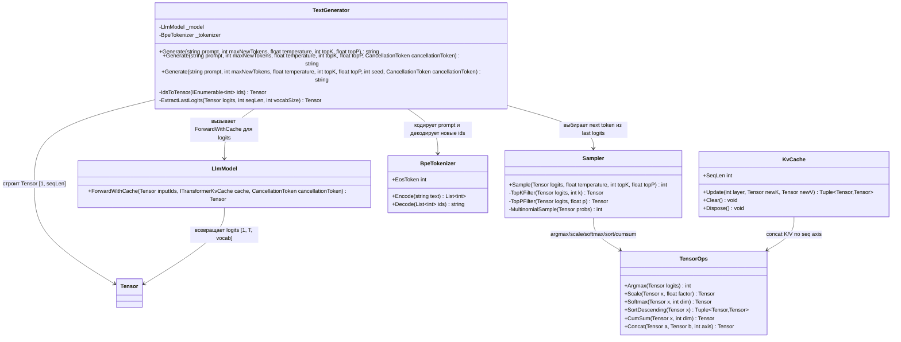

# 09.Inference - документация реализации

RP01.01C добавляет `TextGenerator.GenerateDetailed` поверх того же `GenerateCore`, prefill/decode, sampler и disposable request-local KV cache. Receipt содержит фактические counts из IDs, stop и измеренное kernel time; counts не восстанавливаются из декодированного текста. Detailed path до encode/forward/decode получает request-local tokenizer через существующий `BpeTokenizer.ValidateAndLoadCanonicalArtifact`: canonical contiguous vocabulary и merge history проверяются с фиксированными byte/vocabulary budgets и cancellation. Затем prompt/generated IDs проверяются по model/tokenizer vocabulary до decode. Nullable verified EOS отключён для текущего CodeDocumentation manifest, поэтому остановка — `LENGTH_LIMIT`. Старые `Generate` signatures и их heuristic EOS сохранены. Это инженерная проводка, научное качество `NOT_MEASURED`.

Статус: D1H documented - sub-agent pass pending parent review; по-человечески: документ D1H написан и ожидает родительскую проверку.

`09.Inference` - это runtime-инфраструктура генерации текста. Она берет prompt, превращает его в token ids через `BpeTokenizer`, прогоняет ids через `LlmModel`, выбирает следующий token через `Sampler` и декодирует новые ids обратно в строку. Это не доказательство качества модели, не обученный доменный навык и не semantic reasoning само по себе: качество ответа зависит от весов `LlmModel`, tokenizer vocab и реального runtime/training evidence.

Важно не пропустить границу: `TextGenerator.Generate` создает один request-local `KvCache` после preflight и передает его в `LlmModel.ForwardWithCache` для prefill и каждого decode step. Это runtime wiring cache, а не само по себе доказательство benchmark-качества или product readiness.

## 1. Простая UML-схема



Связи проекта подтверждаются `09.Inference/Inference.csproj:9-16`: проект зависит от `00.TensorCore`, `01.Tokenizer` и `03.TransformerModel`. Значит `09.Inference` находится на runtime-границе поверх математической инфраструктуры, tokenizer и transformer model.

## 2. Симуляции соединений и ожидаемые результаты

| Соединение | Пример входа | Что происходит сейчас | Ожидаемый результат | Что нельзя принимать как доказательство |
|---|---|---|---|---|
| `TextGenerator` -> `BpeTokenizer.Encode` | `prompt = "hello"` | `Generate` вызывает `_tokenizer.Encode(prompt)` для prefill; `generated` содержит только sampled output ids. | Prompt ids становятся входом prefill. | Нельзя утверждать, что tokenizer понял смысл prompt; это deterministic text-to-id инфраструктура. |
| `TextGenerator` -> `LlmModel.ForwardWithCache` на prefill | `inputIds = [10, 20, 30]` | `IdsToTensor` строит `Tensor [1, 3]`, request-local cache и модель возвращают logits `[1, 3, vocab]`. | Последняя позиция logits становится входом sampler. | Сам факт `ForwardWithCache` не доказывает качество модели или обученность. |
| `TextGenerator` -> sampler | `lastLogits = Tensor [vocab]`, `temperature = 0` | Sampler берет greedy branch и возвращает `Argmax` без потребления RNG. | Возвращается token id в диапазоне vocab. | Greedy token не является semantic reasoning и не является trainable product evidence. |
| `TextGenerator` decode loop | `maxNewTokens = 3`, первый token не EOS | Каждый следующий шаг прогоняет только последний token через `_model.ForwardWithCache` с тем же request-local `KvCache`. | В список добавляется до 3 новых ids, либо меньше при EOS. | Cache wiring не доказывает benchmark-производительность или качество генерации. |
| `Sampler` -> `TensorOps` top-k | `topK = 1`, logits с максимумом на id 2 | `TopKFilter` оставляет только лучший token и softmax. | `MultinomialSample` практически/детерминированно возвращает id 2. | Нельзя выдавать top-k фильтр за обучаемую единицу или модельное качество. |
| `Sampler` -> `TensorOps` top-p | `topP = 0.01`, один logit намного выше остальных | `TopPFilter` сортирует logits, считает cumulative probability и оставляет nucleus. | Остается самый вероятный token; результат в тесте id 4. | Нельзя считать это evidence понимания текста; это фильтр вероятностей. |
| `KvCache.Update` -> `TensorOps.Concat` | два K/V с shape `[1, 2, 1, 8]` | Первый срез копируется, второй конкатенируется по axis 2. | cached keys shape получает seq dimension 2, `SeqLen = 2` для layer 0. | Это не доказывает benchmark-производительность TextGenerator или отсутствие production memory leak. |
| `KvCache.Clear` / `Dispose` | cache после нескольких update | Все layer slots очищаются, `SeqLen` становится 0. | Новый generation run может начинаться без старого cache state. | Очистка cache не доказывает отсутствие memory leak в production runtime. |

## 3. Алгоритмы без кода на русском

### Алгоритм A: `TextGenerator.Generate`

Где находится: public overloads `TextGenerator.Generate` и private `GenerateCore` в `09.Inference/TextGenerator.cs`.

Сигнатуры публичного API:

- `public string Generate(string prompt, int maxNewTokens = 200, float temperature = 0.8f, int topK = 50, float topP = 0.95f)`.
- `public string Generate(string prompt, int maxNewTokens, float temperature, int topK, float topP, CancellationToken cancellationToken)`.
- `public string Generate(string prompt, int maxNewTokens, float temperature, int topK, float topP, int seed, CancellationToken cancellationToken)` — stochastic-sampling replay for this one request when the .NET/runtime implementation, model/checkpoint, tokenizer, prompt and sampling parameters are unchanged.

Replay scope: this is not durable replay across .NET major versions, and it does not persist provenance or model state.

Входы:
- `prompt`: исходный текст пользователя.
- `maxNewTokens`: верхний предел новых tokens; `maxNewTokens = 0` возвращает пустую строку до создания cache и model forward.
- `temperature`: `<= 0` включает greedy branch в `Sampler`.
- `topK`: если `> 0`, имеет приоритет над `topP`.
- `topP`: применяется только когда `topK <= 0` и `topP < 1.0f`.

Выход: `string` - декодированная строка только из новых tokens, prompt не включается в return.

Текущее поведение:
1. Проверяет cancellation, prompt, `maxNewTokens`, prompt context length и context budget до создания cache; при `maxNewTokens = 0` возвращает пустую строку.
2. Кодирует `prompt` через `_tokenizer.Encode(prompt)` и создает один request-local `KvCache`.
3. Строит prefill tensor `[1, inputIds.Count]` и вызывает `_model.ForwardWithCache`.
4. Создает один `new Random(seed)` только для seeded overload; existing overloads используют `Random.Shared`.
5. Вырезает logits последней позиции через `ExtractLastLogits` и выбирает следующий token через sampler.
6. Добавляет token в `generated`, который содержит только новые ids, и останавливается на EOS или `maxNewTokens`.
7. Для каждого нового шага строит tensor только из последнего token `[1, 1]`, вызывает `_model.ForwardWithCache` с тем же cache и тем же random stream.
8. Декодирует `generated` и возвращает строку.

Ветви и ограничения:
- EOS проверяется сразу после добавления каждого sampled token; EOS token декодируется, но не передается в следующий model forward.
- `KvCache` и seeded `Random` не создаются при preflight failure или при `maxNewTokens = 0`.
- Пустой `inputIds` отклоняется с `TEXT_GENERATOR_PROMPT_EMPTY` до cache creation.
- Возвращенная строка может быть пустой, например если tokens декодируются в EOS/служебные символы.

### Алгоритм B: `TextGenerator.IdsToTensor`

Где находится: private `TextGenerator.IdsToTensor` в `09.Inference/TextGenerator.cs`.

Сигнатура: `private static Tensor IdsToTensor(IEnumerable<int> ids)`.

Вход: ids tokens как `IEnumerable<int>`.

Выход: `Tensor` формы `[1, arr.Length]`, где token ids сохранены как `float`.

Текущее поведение: материализует ids в массив `float[]` и создает `new Tensor(arr, new TensorShape(1, arr.Length))`. Это bridge между tokenizer integer ids и `LlmModel.Forward`, который ожидает `Tensor`.

### Алгоритм C: `TextGenerator.ExtractLastLogits`

Где находится: private `TextGenerator.ExtractLastLogits` в `09.Inference/TextGenerator.cs`.

Сигнатура: `private static Tensor ExtractLastLogits(Tensor logits, int seqLen, int vocabSize)`.

Входы:
- `logits`: flattened tensor, ожидаемая логическая форма `[1, T, vocab]`.
- `seqLen`: длина sequence `T`.
- `vocabSize`: размер словаря.

Выход: `Tensor [vocabSize]` с logits последней позиции.

Текущее поведение: считает `offset = (seqLen - 1) * vocabSize`, копирует `vocabSize` элементов из `logits.Data` в новый массив и возвращает one-dimensional tensor. Метод не проверяет границы сам; корректность зависит от формы logits и положительного `seqLen`.

### Алгоритм D: `Sampler.Sample`

Где находится: `Sampler.Sample` в `09.Inference/Sampler.cs`.

Сигнатура: `public static int Sample(Tensor logits, float temperature = 1.0f, int topK = 0, float topP = 1.0f)`.

Входы:
- `logits`: `Tensor [vocabSize]`.
- `temperature`: температура sampling; `<= 0` означает greedy.
- `topK`: число лучших tokens для top-k branch.
- `topP`: nucleus threshold для top-p branch.

Выход: `int` token id.

Текущее поведение:
1. Если `temperature <= 0f`, сразу возвращает `TensorOps.Argmax(logits)`.
2. Иначе масштабирует logits через `TensorOps.Scale(logits, 1f / temperature)`.
3. Если `topK > 0`, вызывает `TopKFilter`.
4. Иначе если `topP < 1.0f`, вызывает `TopPFilter`.
5. Иначе делает обычный `TensorOps.Softmax`.
6. Выбирает token через `MultinomialSample`.

Важная ветка: `topK` имеет приоритет над `topP`. Если переданы `topK = 50` и `topP = 0.95`, будет использован top-k branch, а top-p branch не выполнится.

### Алгоритм E: `Sampler.TopKFilter`

Где находится: `Sampler.TopKFilter` в `09.Inference/Sampler.cs`.

Сигнатура: `private static Tensor TopKFilter(Tensor logits, int k)`.

Входы: `Tensor [vocabSize]`, `k`.

Выход: probability tensor той же формы после softmax, где tokens ниже threshold получают `-Infinity` до softmax.

Текущее поведение: ограничивает `k` размером vocab, находит k лучших значений через descending sort/take, берет последний из top-k как threshold, оставляет все logits `>= threshold`, остальные заменяет на `float.NegativeInfinity`, затем возвращает softmax. При равных logits может остаться больше чем `k` tokens из-за условия `>= threshold`.

### Алгоритм F: `Sampler.TopPFilter`

Где находится: `Sampler.TopPFilter` в `09.Inference/Sampler.cs`.

Сигнатура: `private static Tensor TopPFilter(Tensor logits, float p)`.

Входы: `Tensor [vocabSize]`, `p`.

Выход: probability tensor после nucleus filtering и softmax.

Текущее поведение:
1. Сортирует logits по убыванию через `TensorOps.SortDescending`.
2. Делает softmax по отсортированным значениям.
3. Считает cumulative probabilities.
4. Для каждого sorted token смотрит cumulative probability предыдущего token.
5. Если previous cumulative `< p`, token остается; иначе получает `-Infinity`.
6. Дополнительно гарантирует, что самый вероятный token остается даже при очень маленьком `p`.
7. Возвращает softmax по filtered logits в исходном порядке ids.

### Алгоритм G: `Sampler.MultinomialSample`

Где находится: `Sampler.MultinomialSample` в `09.Inference/Sampler.cs`.

Сигнатура: `private static int MultinomialSample(Tensor probs, Random random)`.

Вход: `Tensor [vocabSize]` с вероятностями.

Выход: `int` token id.

Текущее поведение: берет `random.NextDouble()`, идет по cumulative sum вероятностей и возвращает первый индекс, где random value попал в накопленную массу. Если из-за округления не попал ни в один индекс, возвращает последний token. Public `Sampler.Sample` передает `Random.Shared`; seeded `TextGenerator.Generate` передает один request-local `new Random(seed)` для всего decode request. Такой replay ограничен одинаковыми .NET/runtime implementation, model/checkpoint, tokenizer, prompt и sampling parameters, а не является durable cross-major-version guarantee.

### Алгоритм H: `KvCache.Update`

Где находится: `09.Inference/KvCache.cs:24-42`.

Сигнатура: `public (Tensor keys, Tensor values) Update(int layer, Tensor newK, Tensor newV)`.

Входы:
- `layer`: индекс transformer layer.
- `newK`: key slice, ожидаемая форма `[batch, heads, 1, headDim]`.
- `newV`: value slice, ожидаемая форма `[batch, heads, 1, headDim]`.

Выход: tuple `(Tensor keys, Tensor values)` с накопленными K/V для этого layer, форма `[batch, heads, seqLen, headDim]`.

Текущее поведение:
1. Если layer еще пустой, копирует `newK` и `newV` в новые tensors.
2. Если layer уже содержит cache, конкатенирует старый tensor и новый slice по axis 2.
3. Если `layer == 0`, обновляет `SeqLen` из dimension 2 cached keys первого слоя.
4. Возвращает cached tensors для указанного layer.

Ограничения: метод не проверяет range `layer`, совместимость shapes и disposed-state. `SeqLen` отслеживается только по layer 0.

### Алгоритм I: `KvCache.Clear` и `KvCache.Dispose`

Где находится: `09.Inference/KvCache.cs:46-61`.

Сигнатуры: `public void Clear()`, `public void Dispose()`.

Входы: нет.

Выход: нет; меняется состояние объекта.

Текущее поведение: `Clear` проходит по всем slots `_keys/_values`, ставит `null` и сбрасывает `SeqLen = 0`. `Dispose` идемпотентен: если уже disposed, выходит; иначе вызывает `Clear` и ставит `_disposed = true`.

## 4. Короткие цитаты кода и зачем они важны

`TextGenerator.GenerateCore` показывает реальную границу prompt -> ids -> model logits -> sampler:

```csharp
var inputIds  = _tokenizer.Encode(prompt);
using var cache = _cacheFactory(_model.Config.NumLayers);
var generated = new List<int>(maxNewTokens);
...
var prefillLogits = _model.ForwardWithCache(prefillTensor, cache);  // [1, T, vocab]
...
int nextToken  = _sampler(lastLogits, random, temperature, topK, topP);
```

Почему важно: это доказывает actual runtime chain через tokenizer, model и sampler. Что не доказывает: качество generated text, обученность модели или semantic reasoning.

`TextGenerator.GenerateCore` показывает decode loop с тем же request-local KV-cache:

```csharp
while (generated.Count < maxNewTokens)
{
    var lastLogits = ExtractLastLogits(logits);
    int nextToken = _sampler(lastLogits, random, temperature, topK, topP);
    generated.Add(nextToken);
    if (nextToken == eosToken || generated.Count == maxNewTokens) break;
    logits = _model.ForwardWithCache(IdsToTensor([nextToken]), cache, cancellationToken);
```

Почему важно: каждый decode шаг вызывает model forward только на последнем token и передает тот же cache. Что не доказывает: benchmark-производительность, качество generated text или product readiness.

`Sampler.Sample` в `09.Inference/Sampler.cs` фиксирует реальные branches sampling:

```csharp
if (temperature <= 0f)
    return TensorOps.Argmax(logits);
...
if (topK > 0)
    probs = TopKFilter(scaled, topK);
else if (topP < 1.0f)
    probs = TopPFilter(scaled, topP);
```

Почему важно: видно, что greedy branch ранний, а `topK` имеет приоритет над `topP`. Что не доказывает: что выбранный token является правильным с точки зрения смысла.

`Sampler.TopKFilter` в `09.Inference/Sampler.cs` показывает top-k threshold:

```csharp
for (int i = 0; i < n; i++)
    filtered[i] = logits.Data[i] >= threshold ? logits.Data[i] : float.NegativeInfinity;
return TensorOps.Softmax(new Tensor(filtered, logits.Shape), dim: -1);
```

Почему важно: top-k реализован как filtering logits перед softmax. Что не доказывает: что остается ровно `k` tokens при равных threshold values.

`Sampler.TopPFilter` в `09.Inference/Sampler.cs` показывает nucleus filtering:

```csharp
float cumPrev = i == 0 ? 0f : cumProbs.Data[i - 1];
int   origIdx = (int)sortedIdx.Data[i];
filtered[origIdx] = cumPrev < p ? logits.Data[origIdx] : float.NegativeInfinity;
...
return TensorOps.Softmax(new Tensor(filtered, logits.Shape), dim: -1);
```

Почему важно: threshold применяется по cumulative probability sorted tokens. Что не доказывает: deterministic quality; stochastic output зависит от probabilities и RNG.

`09.Inference/KvCache.cs:26-42` показывает copy-first и concat-next behavior:

```csharp
if (_keys[layer] is null)
{
    _keys[layer]   = new Tensor(newK.Data.ToArray(), newK.Shape);
...
    _keys[layer]   = TensorOps.Concat(_keys[layer]!,   newK, axis: 2);
...
if (layer == 0) SeqLen = _keys[0]!.Shape.Dimensions[2];
```

Почему важно: `SeqLen` растет по sequence axis 2 layer 0. Что не доказывает: benchmark-производительность или качество current generation.

`09.Inference/Inference.csproj:9-16` показывает boundary dependencies:

```xml
<ProjectReference Include="..\00.TensorCore\TensorCore.csproj" />
<ProjectReference Include="..\01.Tokenizer\Tokenizer.csproj" />
<ProjectReference Include="..\03.TransformerModel\TransformerModel.csproj" />
```

Почему важно: inference depends on tensor math, tokenizer and transformer. Что не доказывает: integration с training loop, model checkpoint lifecycle или product serving API.

## 5. Связи с соседними проектами

| Соседний проект | Как используется | Честная граница |
|---|---|---|
| `00.TensorCore` | `Tensor`, `TensorShape`, `TensorOps.Argmax`, `Scale`, `Softmax`, `SortDescending`, `CumSum`, `Concat`. | Это math/autograd infrastructure. Sampling/cache operations не являются обученным доменным поведением. |
| `01.Tokenizer` | `BpeTokenizer.Encode`, `Decode`, `EosToken`. | Token ids детерминированны по tokenizer state; tokenizer не выбирает смысл ответа. |
| `03.TransformerModel` | `LlmModel.ForwardWithCache` возвращает logits и обновляет request-local cache. | Это model infrastructure; без checkpoint/training evidence нельзя заявлять качество generated text. |
| `04.TrainingLoop` | Непрямой upstream: training может создавать веса, которые потом использует model. | `09.Inference` сам не обучает и не валидирует checkpoint. |
| Будущие `10.LoRA` / `11.DPO` | Могут менять поведение model до inference, если адаптеры/weights подключены. | В текущем `09.Inference` нет отдельного LoRA/DPO path. |

## 6. QA, тесты и честные пробелы

| Доказательство из кода/тестов | Что покрывает | Что остается пробелом |
|---|---|---|
| `Tests/SamplerTests.cs` | Проверяет greedy branch, supplied-RNG multi-draw sequence и isolation от interleaved unseeded sampling. | Не является statistical proof distribution quality. |
| `Tests/TextGeneratorSeededSamplingTests.cs` | Проверяет seeded replay при одинаковых runtime/model/checkpoint/tokenizer/prompt/sampling inputs, один Random instance на decode request, legacy overloads, parallel isolation и preflight/cancellation. | Не доказывает durable replay across .NET major versions, качество checkpoint или generated text. |
| `Tests/SamplerTests.cs:31-40` | `topK: 1` оставляет argmax. | Не проверяет tie behavior при одинаковых threshold values. |
| `Tests/SamplerTests.cs:42-52` | High temperature sampling остается в range. | Не проверяет распределение вероятностей статистически. |
| `Tests/SamplerTests.cs:54-73` | `topP: 1.0f` range и очень маленький `topP` возвращает самый вероятный token. | Не проверяет все nucleus edge cases и p вне нормального диапазона. |
| `Tests/KvCacheTests.cs:20-46` | Первый и второй update увеличивают `SeqLen` до 1/2. | Не проверяет invalid layer index и shape mismatch. |
| `Tests/KvCacheTests.cs:48-66` | Returned keys получают seq dimension 2 после двух updates. | Не проверяет values content так же подробно, как keys shape. |
| `Tests/KvCacheTests.cs:68-79` | `Clear` сбрасывает `SeqLen`. | Не проверяет internal null slots напрямую. |
| `Tests/KvCacheTests.cs:81-96` | Несколько layers могут обновляться, `SeqLen` отслеживает layer 0. | Не доказывает synchronized cache для всех transformer layers в real model. |
| `Tests/IntegrationTests2.cs:133-149` | `LlmModel.Forward` -> last logits -> `Sampler.Sample` produces valid token id. | Это single-step contract, не генерация качества текста. |
| `Tests/IntegrationTests2.cs:152-164` | `KvCache.Update` grows over three decode-like steps. | Cache проверяется отдельно, не в `TextGenerator.Generate`. |
| `Tests/TextGeneratorKvCacheIntegrationTests.cs` | Проверяет request-local cache, context preflight, `maxNewTokens = 0` и cancellation в `TextGenerator.Generate`. | Не является benchmark-измерением production inference. |
| `Tests/IntegrationTests2.cs:235-247` | `TextGenerator.Generate("hello", maxNewTokens: 3, temperature: 0f)` возвращает не-null строку. | Это только smoke-доказательство: не проверяет смысловое качество, EOS branch, empty prompt, `maxNewTokens = 0`, cache usage, checkpoint quality. |

Тесты не запускались в D1H по явному ограничению work order. Это documentation-only slice; runtime confidence остается на уровне найденных source/test references, а не свежего test run.

## 7. Проверки против ложной готовности

- Нельзя считать `TextGenerator.Generate` доказательством обученного reasoning: метод только соединяет tokenizer, model forward, sampler и decode.
- Нельзя принимать JSON/report/static grep/smoke как доказательство product-quality inference. Для такого claims нужны runtime prompts, выбранный checkpoint, metrics/qualitative review и replayable evidence.
- Нельзя считать `Sampler.Sample` trainable unit. Greedy/top-k/top-p/multinomial - deterministic/stochastic math branches поверх logits.
- Нельзя скрывать deterministic greedy output как обученный semantic choice.
- Нельзя принимать KV-cache wiring за доказательство benchmark-производительности, правильности generated text или product readiness.
- Нельзя считать `Inference.csproj` dependencies доказательством end-to-end serving product. Это только compile-time project boundary.
- Нельзя считать returned non-null string доказательством правильного ответа, безопасности, фактической точности или качества модели.

## 8. Таблица статуса реализации

| Компонент | Статус | Почему так |
|---|---|---|
| `TextGenerator.Generate` | Реализован runtime-путь generation с request-local KV-cache и optional seeded replay. | Есть prompt -> ids -> `ForwardWithCache` -> sampler -> decode flow, preflight guards и seeded overload; replay требует одинаковых runtime/model/checkpoint/tokenizer/prompt/sampling inputs и не durable across .NET major versions. |
| `Sampler.Sample` | Реализован как utility-компонент. | Есть greedy, temperature, top-k, top-p и multinomial branches; public path использует `Random.Shared`, internal path принимает request-local RNG. |
| `KvCache.Update/Clear/Dispose` | Реализован как utility-компонент, используемый TextGenerator. | Есть per-layer K/V arrays, concat by seq axis, clear/dispose и request-local generation wiring. |
| Граница проекта `09.Inference` | Реализована compile-time граница зависимостей. | `.csproj` ссылается на TensorCore, Tokenizer, TransformerModel. Нет отдельного server/API lifecycle. |
| Runtime/product качество inference | Пробел: не доказано одним этим проектом. | Нужны checkpoint, prompt suite, metrics, replay report и human/product review. |

## 9. Итог для Luba

`09.Inference` сейчас можно описывать как рабочий каркас runtime generation: он умеет взять текст, получить logits от модели через request-local KV-cache, выбрать следующий token и вернуть decoded string. Seeded overload воспроизводит stochastic sampling для одного request только при одинаковых .NET/runtime implementation, model/checkpoint, tokenizer, prompt и sampling parameters; это не durable cross-major-version replay, не provenance persistence, не само обучение, не гарантия умного ответа и не proof of product readiness.

## 10. Запись от 2026-11-02 — признак конца ответа берётся только у вызывающего

**Что изменилось.** Строка, выбиравшая признак конца ответа, больше не берёт его
из словаря на обычной ветви: признак приходит **только от вызывающего**, и это
то же правило, по которому подробная ветвь работала всегда.

**Что было неверно.** Прежде обычная ветвь брала признак из словаря кусочков
слов, где он вычислялся как **последняя запись обученного словаря** — то есть
как обычный кусок слова. На измеренном корпусе последней записью оказался кусок
` close` с номером 335, поэтому каждый раз, когда модель выдавала этот кусок,
генерация обрывалась. Какой кусок станет признаком, зависит от корпуса и
меняется при каждом переобучении.

**Точная граница вреда, уточнённая замером против первой формулировки.** Все три
обычные перегрузки возвращают **только текст** и причину остановки
**выбрасывают**. Значит обычный вызывающий получал более короткую строку и
никакой причины вовсе — это молчаливый обрыв, а не ложное объяснение. Причину
«конец ответа» отдают только подробные перегрузки, где признак задан вызывающим
и проверен, то есть там она правдива.

**Две ветви теперь сходятся, а не расходятся.** До правки обычная ветвь
выдумывала признак, а подробная при отсутствии заданного признака не завершала
ответ рано **никогда**. Измерено: после правки обычная ветвь ведёт себя ровно как
подробная без признака — обе доходят до предела длины и называют причину пределом
длины. Поэтому «подробная неверна в другую сторону» перестаёт быть вторым
дефектом: отсутствие признака — это цена, а не ложь.

**Цена названа заранее.** Пока вызывающий не задаст признак, ответы доходят до
предела длины и расходуют больше процессорного времени. Возможности раннего
завершения правка не отнимает: прежнее завершение срабатывало на произвольном
куске слова и возможностью только выглядело. Законный случай сохранён и измерен:
заданный вызывающим и проверенный признак по-прежнему останавливает генерацию, и
причина остановки правдива.

**Чем это доказано.** Настоящий продуктовый код собран в памяти процесса
**шестью сборками в порядке зависимостей** — замеренное замыкание генератора это
61 файл и около 12 647 строк, и цепочка замыкается, — в двух версиях: прежняя
взята из опубликованной вершины, нынешняя с диска. На потоке номеров, где номер
последней записи словаря стоит третьим, прежняя версия выдаёт три знака и теряет
хвост, нынешняя выдаёт пять и доходит до конца; начало ответа не меняется.
Внесённая порча возвращает прежнее поведение и сверкой ловится. На потоке без
этого номера обе версии совпадают — значит различие вызвано именно номером
признака, а не разницей сборок.

**Чем это НЕ доказано.** Частота обрыва в работающем обученном продукте не
измерена: доказана достижимость, а не частота. Модель в проверяемой программе не
обучена — источник номеров токенов подставлен точно, потому что измеряется
решение об остановке, а не качество модели. Улучшение качества ответов не
заявляется. Родная приёмка платформы не исполнялась: `NOT_EXECUTED`, а не `PASS`.
