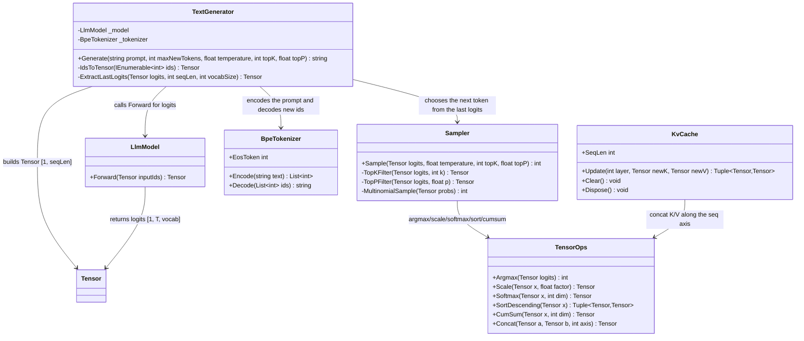

# 09.Inference - implementation documentation

Status: D1H documented - sub-agent pass pending parent review; in plain terms: the D1H document is written and awaits parent review.

`09.Inference` is the runtime text-generation infrastructure. It takes a prompt, turns it into token ids via `BpeTokenizer`, runs the ids through `LlmModel`, chooses the next token via `Sampler` and decodes the new ids back into a string. This is not proof of model quality, not a trained domain skill and not semantic reasoning by itself: the quality of the answer depends on the weights of `LlmModel`, the tokenizer vocab and real runtime/training evidence.

Do not miss the boundary: `KvCache` exists in the project and is covered by tests, but the current `TextGenerator.Generate` does not use `KvCache`; generation repeatedly calls `LlmModel.Forward` without wiring `KvCache` into the generation path.

## 1. Simple UML diagram



The project's links are confirmed by `09.Inference/Inference.csproj:9-16`: the project depends on `00.TensorCore`, `01.Tokenizer` and `03.TransformerModel`. So `09.Inference` sits at the runtime boundary on top of the math infrastructure, the tokenizer and the transformer model.

## 2. Connection simulations and expected results

| Connection | Example input | What happens now | Expected result | What must not be taken as proof |
|---|---|---|---|---|
| `TextGenerator` -> `BpeTokenizer.Encode` | `prompt = "hello"` | `Generate` calls `_tokenizer.Encode(prompt)` and puts the ids into `generated`. | The internal list of ids starts with the prompt ids. | You cannot claim the tokenizer understood the meaning of the prompt; this is deterministic text-to-id infrastructure. |
| `TextGenerator` -> `LlmModel.Forward` on prefill | `inputIds = [10, 20, 30]` | `IdsToTensor` builds `Tensor [1, 3]`, the model returns logits `[1, 3, vocab]`. | The last position of the logits becomes the input to the sampler. | The mere fact of `Forward` does not prove model quality or training. |
| `TextGenerator` -> `Sampler.Sample` | `lastLogits = Tensor [vocab]`, `temperature = 0` | The sampler takes the greedy branch and returns `Argmax`. | A token id in the vocab range is returned. | A greedy token is not semantic reasoning and is not trainable product evidence. |
| `TextGenerator` decode loop | `maxNewTokens = 3`, the first token is not EOS | Each subsequent step runs only the last token through `_model.Forward`; `KvCache` is not used. | Up to 3 new ids are added to the list, or fewer on EOS. | You cannot claim that generation is optimized with a KV cache, because the current `TextGenerator` does not wire the cache. |
| `Sampler` -> `TensorOps` top-k | `topK = 1`, logits with a maximum at id 2 | `TopKFilter` keeps only the best token and softmax. | `MultinomialSample` practically/deterministically returns id 2. | You cannot present the top-k filter as a trainable unit or model quality. |
| `Sampler` -> `TensorOps` top-p | `topP = 0.01`, one logit much higher than the rest | `TopPFilter` sorts the logits, computes cumulative probability and keeps the nucleus. | The most probable token remains; the result in the test is id 4. | You cannot take this as evidence of text understanding; this is a probability filter. |
| `KvCache.Update` -> `TensorOps.Concat` | two K/V with shape `[1, 2, 1, 8]` | The first slice is copied, the second is concatenated along axis 2. | the cached keys shape gets seq dimension 2, `SeqLen = 2` for layer 0. | You cannot claim that `TextGenerator` uses the cache; the tests check the cache separately. |
| `KvCache.Clear` / `Dispose` | cache after several updates | All layer slots are cleared, `SeqLen` becomes 0. | A new generation run can start without the old cache state. | Clearing the cache does not prove the absence of a memory leak in the production runtime. |

## 3. No-code algorithms, in the operator's language

### Algorithm A: `TextGenerator.Generate`

Where it lives: `09.Inference/TextGenerator.cs:21-56`.

Signature: `public string Generate(string prompt, int maxNewTokens = 200, float temperature = 0.8f, int topK = 50, float topP = 0.95f)`.

Inputs:
- `prompt`: the user's original text.
- `maxNewTokens`: the upper limit of new tokens, but the current implementation always does a prefill sample before the loop, so `maxNewTokens = 0` does not block the first sampled token.
- `temperature`: `<= 0` enables the greedy branch in `Sampler`.
- `topK`: if `> 0`, it has priority over `topP`.
- `topP`: applied only when `topK <= 0` and `topP < 1.0f`.

Output: `string` - the decoded string of only the new tokens, the prompt is not included in the return.

Current behavior:
1. Encodes `prompt` via `_tokenizer.Encode(prompt)`.
2. Copies the prompt ids into `generated`.
3. Takes the tokenizer's `EosToken`.
4. Builds a prefill tensor `[1, inputIds.Count]`.
5. Calls `_model.Forward(prefillTensor)` and expects logits `[1, T, vocab]`.
6. Cuts out the logits of the last position via `ExtractLastLogits`.
7. Calls `Sampler.Sample(lastLogits, temperature, topK, topP)`.
8. Adds the token to `generated`.
9. In the decode loop up to `maxNewTokens - 1` it stops if the previous token equals EOS.
10. For each new step it builds a tensor from only the last token `[1, 1]`, calls `_model.Forward`, again samples the next token and adds it.
11. Decodes only the tail `generated.Skip(inputIds.Count)` and returns the string.

Branches and limitations:
- EOS is checked only inside the decode loop after the first sampled token.
- `KvCache` is not used in this class.
- There is no explicit protection for an empty `inputIds`; if the tokenizer returns an empty list, `ExtractLastLogits` gets `seqLen = 0`.
- The returned string can be empty, for example if the tokens decode to EOS/service characters.

### Algorithm B: `TextGenerator.IdsToTensor`

Where it lives: `09.Inference/TextGenerator.cs:59-63`.

Signature: `private static Tensor IdsToTensor(IEnumerable<int> ids)`.

Input: token ids as `IEnumerable<int>`.

Output: `Tensor` of shape `[1, arr.Length]`, where token ids are stored as `float`.

Current behavior: materializes the ids into a `float[]` array and creates `new Tensor(arr, new TensorShape(1, arr.Length))`. This is the bridge between the tokenizer's integer ids and `LlmModel.Forward`, which expects a `Tensor`.

### Algorithm C: `TextGenerator.ExtractLastLogits`

Where it lives: `09.Inference/TextGenerator.cs:66-72`.

Signature: `private static Tensor ExtractLastLogits(Tensor logits, int seqLen, int vocabSize)`.

Inputs:
- `logits`: a flattened tensor, expected logical shape `[1, T, vocab]`.
- `seqLen`: sequence length `T`.
- `vocabSize`: the vocabulary size.

Output: `Tensor [vocabSize]` with the logits of the last position.

Current behavior: computes `offset = (seqLen - 1) * vocabSize`, copies `vocabSize` elements from `logits.Data` into a new array and returns a one-dimensional tensor. The method does not check bounds itself; correctness depends on the shape of the logits and a positive `seqLen`.

### Algorithm D: `Sampler.Sample`

Where it lives: `09.Inference/Sampler.cs:12-30`.

Signature: `public static int Sample(Tensor logits, float temperature = 1.0f, int topK = 0, float topP = 1.0f)`.

Inputs:
- `logits`: `Tensor [vocabSize]`.
- `temperature`: the sampling temperature; `<= 0` means greedy.
- `topK`: the number of best tokens for the top-k branch.
- `topP`: the nucleus threshold for the top-p branch.

Output: `int` token id.

Current behavior:
1. If `temperature <= 0f`, immediately returns `TensorOps.Argmax(logits)`.
2. Otherwise scales the logits via `TensorOps.Scale(logits, 1f / temperature)`.
3. If `topK > 0`, calls `TopKFilter`.
4. Otherwise if `topP < 1.0f`, calls `TopPFilter`.
5. Otherwise does an ordinary `TensorOps.Softmax`.
6. Chooses a token via `MultinomialSample`.

Important branch: `topK` has priority over `topP`. If `topK = 50` and `topP = 0.95` are passed, the top-k branch will be used and the top-p branch will not run.

### Algorithm E: `Sampler.TopKFilter`

Where it lives: `09.Inference/Sampler.cs:33-47`.

Signature: `private static Tensor TopKFilter(Tensor logits, int k)`.

Inputs: `Tensor [vocabSize]`, `k`.

Output: a probability tensor of the same shape after softmax, where tokens below the threshold get `-Infinity` before softmax.

Current behavior: limits `k` to the vocab size, finds the k best values via descending sort/take, takes the last of the top-k as the threshold, keeps all logits `>= threshold`, replaces the rest with `float.NegativeInfinity`, then returns softmax. With equal logits, more than `k` tokens may remain due to the `>= threshold` condition.

### Algorithm F: `Sampler.TopPFilter`

Where it lives: `09.Inference/Sampler.cs:50-77`.

Signature: `private static Tensor TopPFilter(Tensor logits, float p)`.

Inputs: `Tensor [vocabSize]`, `p`.

Output: a probability tensor after nucleus filtering and softmax.

Current behavior:
1. Sorts the logits descending via `TensorOps.SortDescending`.
2. Does softmax over the sorted values.
3. Computes cumulative probabilities.
4. For each sorted token looks at the cumulative probability of the previous token.
5. If the previous cumulative is `< p`, the token remains; otherwise it gets `-Infinity`.
6. Additionally guarantees that the most probable token remains even with a very small `p`.
7. Returns softmax over the filtered logits in the original order of ids.

### Algorithm G: `Sampler.MultinomialSample`

Where it lives: `09.Inference/Sampler.cs:80-90`.

Signature: `private static int MultinomialSample(Tensor probs)`.

Input: `Tensor [vocabSize]` with probabilities.

Output: `int` token id.

Current behavior: takes `Random.NextDouble()`, walks the cumulative sum of probabilities and returns the first index where the random value fell into the accumulated mass. If, due to rounding, it did not fall into any index, it returns the last token. A seed is not injected from the outside, so the stochastic branch is not a reproducible API.

### Algorithm H: `KvCache.Update`

Where it lives: `09.Inference/KvCache.cs:24-42`.

Signature: `public (Tensor keys, Tensor values) Update(int layer, Tensor newK, Tensor newV)`.

Inputs:
- `layer`: the transformer layer index.
- `newK`: the key slice, expected shape `[batch, heads, 1, headDim]`.
- `newV`: the value slice, expected shape `[batch, heads, 1, headDim]`.

Output: a tuple `(Tensor keys, Tensor values)` with the accumulated K/V for this layer, shape `[batch, heads, seqLen, headDim]`.

Current behavior:
1. If the layer is still empty, copies `newK` and `newV` into new tensors.
2. If the layer already contains a cache, concatenates the old tensor and the new slice along axis 2.
3. If `layer == 0`, updates `SeqLen` from dimension 2 of the cached keys of the first layer.
4. Returns the cached tensors for the specified layer.

Limitations: the method does not check the range of `layer`, shape compatibility or disposed state. `SeqLen` is tracked only by layer 0.

### Algorithm I: `KvCache.Clear` and `KvCache.Dispose`

Where it lives: `09.Inference/KvCache.cs:46-61`.

Signatures: `public void Clear()`, `public void Dispose()`.

Inputs: none.

Output: none; the object's state changes.

Current behavior: `Clear` walks all slots of `_keys/_values`, sets `null` and resets `SeqLen = 0`. `Dispose` is idempotent: if already disposed, it exits; otherwise it calls `Clear` and sets `_disposed = true`.

## 4. Short code quotes and why they matter

`09.Inference/TextGenerator.cs:28-40` shows the real boundary prompt -> ids -> model logits -> sampler:

```csharp
var inputIds  = _tokenizer.Encode(prompt);
var generated = new List<int>(inputIds);
...
var prefillLogits = _model.Forward(prefillTensor);  // [1, T, vocab]
...
int nextToken  = Sampler.Sample(lastLogits, temperature, topK, topP);
```

Why it matters: this proves the actual runtime chain through the tokenizer, model and sampler. What it does not prove: the quality of the generated text, the training of the model or semantic reasoning.

`09.Inference/TextGenerator.cs:44-55` shows the decode loop and the absence of KV-cache wiring:

```csharp
for (int step = 0; step < maxNewTokens - 1; step++)
{
    if (nextToken == eosToken) break;
    var inputTensor = IdsToTensor(new[] { nextToken });
    var logits      = _model.Forward(inputTensor);  // [1, 1, vocab]
```

Why it matters: each decode step calls the model forward on only the last token. What it does not prove: optimized autoregressive inference with a cache, because `KvCache` is not passed here.

`09.Inference/Sampler.cs:14-29` fixes the real sampling branches:

```csharp
if (temperature <= 0f)
    return TensorOps.Argmax(logits);
...
if (topK > 0)
    probs = TopKFilter(scaled, topK);
else if (topP < 1.0f)
    probs = TopPFilter(scaled, topP);
```

Why it matters: you can see that the greedy branch is early, and `topK` has priority over `topP`. What it does not prove: that the chosen token is correct in terms of meaning.

`09.Inference/Sampler.cs:42-46` shows the top-k threshold:

```csharp
for (int i = 0; i < n; i++)
    filtered[i] = logits.Data[i] >= threshold ? logits.Data[i] : float.NegativeInfinity;
return TensorOps.Softmax(new Tensor(filtered, logits.Shape), dim: -1);
```

Why it matters: top-k is implemented as filtering logits before softmax. What it does not prove: that exactly `k` tokens remain with equal threshold values.

`09.Inference/Sampler.cs:63-76` shows nucleus filtering:

```csharp
float cumPrev = i == 0 ? 0f : cumProbs.Data[i - 1];
int   origIdx = (int)sortedIdx.Data[i];
filtered[origIdx] = cumPrev < p ? logits.Data[origIdx] : float.NegativeInfinity;
...
return TensorOps.Softmax(new Tensor(filtered, logits.Shape), dim: -1);
```

Why it matters: the threshold is applied by the cumulative probability of the sorted tokens. What it does not prove: deterministic quality; the stochastic output depends on the probabilities and the RNG.

`09.Inference/KvCache.cs:26-42` shows the copy-first and concat-next behavior:

```csharp
if (_keys[layer] is null)
{
    _keys[layer]   = new Tensor(newK.Data.ToArray(), newK.Shape);
...
    _keys[layer]   = TensorOps.Concat(_keys[layer]!,   newK, axis: 2);
...
if (layer == 0) SeqLen = _keys[0]!.Shape.Dimensions[2];
```

Why it matters: `SeqLen` grows along sequence axis 2 of layer 0. What it does not prove: that the cache is connected to `LlmModel` or `TextGenerator` in the current generation.

`09.Inference/Inference.csproj:9-16` shows the boundary dependencies:

```xml
<ProjectReference Include="..\00.TensorCore\TensorCore.csproj" />
<ProjectReference Include="..\01.Tokenizer\Tokenizer.csproj" />
<ProjectReference Include="..\03.TransformerModel\TransformerModel.csproj" />
```

Why it matters: inference depends on tensor math, the tokenizer and the transformer. What it does not prove: integration with the training loop, model checkpoint lifecycle or a product serving API.

## 5. Links to neighboring projects

| Neighboring project | How it is used | Honest boundary |
|---|---|---|
| `00.TensorCore` | `Tensor`, `TensorShape`, `TensorOps.Argmax`, `Scale`, `Softmax`, `SortDescending`, `CumSum`, `Concat`. | This is math/autograd infrastructure. Sampling/cache operations are not trained domain behavior. |
| `01.Tokenizer` | `BpeTokenizer.Encode`, `Decode`, `EosToken`. | Token ids are deterministic by the tokenizer state; the tokenizer does not choose the meaning of the answer. |
| `03.TransformerModel` | `LlmModel.Forward` returns logits. | `Forward` is model infrastructure; without checkpoint/training evidence you cannot claim the quality of the generated text. |
| `04.TrainingLoop` | Indirect upstream: training can create the weights that the model later uses. | `09.Inference` itself does not train and does not validate the checkpoint. |
| Future `10.LoRA` / `11.DPO` | Can change the model's behavior before inference if adapters/weights are connected. | In the current `09.Inference` there is no separate LoRA/DPO path. |

## 6. QA, tests and honest gaps

| Evidence from code/tests | What it covers | What remains a gap |
|---|---|---|
| `Tests/SamplerTests.cs:10-19` | `temperature: 0f` returns argmax id 2. | Does not check seeded reproducibility of stochastic sampling. |
| `Tests/SamplerTests.cs:31-40` | `topK: 1` keeps the argmax. | Does not check tie behavior with equal threshold values. |
| `Tests/SamplerTests.cs:42-52` | High temperature sampling stays in range. | Does not check the probability distribution statistically. |
| `Tests/SamplerTests.cs:54-73` | `topP: 1.0f` range and a very small `topP` returns the most probable token. | Does not check all nucleus edge cases and p outside the normal range. |
| `Tests/KvCacheTests.cs:20-46` | The first and second update increase `SeqLen` to 1/2. | Does not check an invalid layer index and a shape mismatch. |
| `Tests/KvCacheTests.cs:48-66` | Returned keys get seq dimension 2 after two updates. | Does not check the values content as thoroughly as the keys shape. |
| `Tests/KvCacheTests.cs:68-79` | `Clear` resets `SeqLen`. | Does not check the internal null slots directly. |
| `Tests/KvCacheTests.cs:81-96` | Several layers can be updated, `SeqLen` tracks layer 0. | Does not prove a synchronized cache for all transformer layers in a real model. |
| `Tests/IntegrationTests2.cs:133-149` | `LlmModel.Forward` -> last logits -> `Sampler.Sample` produces a valid token id. | This is a single-step contract, not generation of text quality. |
| `Tests/IntegrationTests2.cs:152-164` | `KvCache.Update` grows over three decode-like steps. | The cache is checked separately, not in `TextGenerator.Generate`. |
| `Tests/IntegrationTests2.cs:235-247` | `TextGenerator.Generate("hello", maxNewTokens: 3, temperature: 0f)` returns a non-null string. | This is only smoke evidence: it does not check semantic quality, the EOS branch, an empty prompt, `maxNewTokens = 0`, cache usage, checkpoint quality. |

The tests were not run in D1H by an explicit work order restriction. This is a documentation-only slice; runtime confidence stays at the level of the source/test references found, not a fresh test run.

## 7. Anti-false-done checks

- You cannot take `TextGenerator.Generate` as proof of trained reasoning: the method only connects the tokenizer, model forward, sampler and decode.
- You cannot take JSON/report/static grep/smoke as proof of product-quality inference. Such claims require runtime prompts, a chosen checkpoint, metrics/qualitative review and replayable evidence.
- You cannot treat `Sampler.Sample` as a trainable unit. Greedy/top-k/top-p/multinomial are deterministic/stochastic math branches on top of logits.
- You must not hide the deterministic greedy output as a trained semantic choice.
- You cannot claim KV-cache optimized generation: `KvCache` is implemented and tested separately, but `TextGenerator` does not use it currently.
- You cannot take the `Inference.csproj` dependencies as proof of an end-to-end serving product. This is only a compile-time project boundary.
- You cannot take a returned non-null string as proof of a correct answer, safety, factual accuracy or model quality.

## 8. Implementation status table

| Component | Status | Why so |
|---|---|---|
| `TextGenerator.Generate` | A simple runtime generation path is implemented; by production-inference standards the status is partial. | There is a prompt -> ids -> model -> sampler -> decode flow, but no KV-cache integration, checkpoint validation, empty prompt guard, quality metrics. |
| `Sampler.Sample` | Implemented as a utility component. | There are greedy, temperature, top-k, top-p and multinomial branches. The RNG is not passed from the outside, statistical QA is limited. |
| `KvCache.Update/Clear/Dispose` | Implemented as a separate utility component. | There are per-layer K/V arrays, concat by seq axis, clear/dispose. Not connected to `TextGenerator`. |
| The `09.Inference` project boundary | A compile-time dependency boundary is implemented. | The `.csproj` references TensorCore, Tokenizer, TransformerModel. There is no separate server/API lifecycle. |
| Runtime/product inference quality | Gap: not proven by this project alone. | Requires a checkpoint, prompt suite, metrics, replay report and human/product review. |

## 9. Summary for Luba

`09.Inference` can currently be described as a working skeleton of runtime generation: it can take text, get logits from the model, choose the next token and return a decoded string. An honest framing matters: this is not training itself, not a guarantee of a smart answer and not proof of product readiness. The main practical gap is that `KvCache` exists separately, but `TextGenerator.Generate` does not yet use it in the real decode path.
