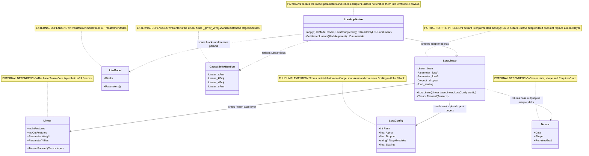

# 10.LoRA - implementation documentation

`10.LoRA` adds thin trainable adapters to an already-existing transformer module. In plain terms this is like a transparent overlay on top of an old map: the map itself is not redrawn, but small corrections appear on it that can be trained more cheaply than the whole model at once.

Important: this project is not a standalone semantic model, an `ILearningMachine` or proof of training quality. It provides the mechanism to freeze the base weights, create LoRA parameters and check their forward pass. The current `LoraApplicator.Apply` returns adapters, but does not replace the fields of `LlmModel` and does not embed these adapters into the ordinary `LlmModel.Forward`; therefore the presence of adapters must not be presented as a full fine-tuning pipeline.

## 1. UML and data flow



| Class | What it does | Status |
|---|---|---|
| `LoraConfig` | Stores rank, scaling, dropout and target module settings. | Complete configuration utility |
| `LoraLinear` | Wraps one `Linear`, freezes its weights and adds trainable `lora_a`/`lora_b`. | Working adapter, but not embedded into the model automatically |
| `LoraApplicator` | Walks the model blocks, finds matching `Linear`s inside attention and returns a list of adapters. | Partial integration: creates adapters, does not replace the model fields |
| `LlmModel` | Supplies transformer blocks and the parameters that are frozen. | External project |
| `CausalSelfAttention` | Contains the `q`/`v` projections that LoRA targets by default. | External project |
| `Linear` | The base linear layer around which `LoraLinear` is built. | External project |
| `Tensor` | Carries data, shape and the gradient flag. | External project |

### UML connection simulations

| Connection | Example input | What happens | Expected result | What must not be claimed |
|---|---|---|---|---|
| `LoraApplicator -> LlmModel` | `LlmModel` with 1 block, `LoraConfig{Rank=2, Alpha=4}` | `Apply` walks `model.Parameters()` and sets `RequiresGrad=false`. | The base parameters of the model are frozen. | You cannot claim that the model is already trained or that quality has increased. |
| `LoraApplicator -> CausalSelfAttention` | Attention contains fields `_qProj`, `_vProj`; `TargetModules=["q_proj","v_proj"]` | The names are normalized: `_` is removed, comparison is case-insensitive. | `_qProj` and `_vProj` are considered targets. | You cannot claim that all `Linear`s in the model are automatically replaced. |
| `LoraApplicator -> LoraLinear` | A `Linear` with `InFeatures=16`, `OutFeatures=16` is found | `new LoraLinear(subModule, config)` is created and added to the list. | The method returns an adapter object. | You cannot claim that this object is already connected to `LlmModel.Forward`. |
| `LoraLinear -> Linear` | `Tensor x` of shape `[3,8]`, base `Linear(8,4)` | First `_base.Forward(x)` is computed. | The base output has shape `[3,4]`. | You cannot consider the base weights trainable after wrapping. |
| `LoraLinear -> LoraConfig` | `Rank=2`, `Alpha=4`, `Dropout=0` | The scaling is taken as `Alpha / Rank = 2`. | The LoRA delta is multiplied by `2`. | You cannot hide the scaling as a trainable parameter. |
| `LoraLinear -> Tensor` | `lora_b` is zero after initialization | The low-rank path gives a zero correction. | `LoraLinear.Forward(x)` equals the base output. | You cannot present a zero correction as a trained adaptation. |

## 2. No-code algorithms, in the operator's language

### Algorithm A: `LoraConfig` defines the scaling and the adaptation targets

Imagine a tuning knob: `Rank` says how narrow the adapter will be, `Alpha` strengthens or weakens its contribution, and `TargetModules` selects which parts of attention to look at.

**Signatures and data types:**

```csharp
public record LoraConfig
// Input fields: Rank:int, Alpha:float, Dropout:float, TargetModules:string[]
// Output computed field: Scaling:float
```

Current algorithm:
1. If the user passed nothing, the default values are taken: `Rank=8`, `Alpha=16f`, `Dropout=0.05f`, `TargetModules=["q_proj","v_proj"]`.
2. When reading `Scaling`, `Alpha / Rank` is returned.
3. `TargetModules` is used later in `LoraApplicator.Apply` as a list of substrings, not as a strict layer registry.

Branches and limitations:
- If `Rank=8`, `Alpha=16`, then `Scaling=2`.
- If a target module is written as `q_proj`, while the field in the model is called `_qProj`, the applicator normalizes the name and considers them matching.
- There is no separate check for `Rank <= 0` in the code; the documentation must not claim such validation exists.

What it does NOT do:
- Does not train weights.
- Does not check adapter quality.
- Does not prove that the chosen target modules suit a specific task.

Status: a complete small configuration utility, without runtime validation.

### Algorithm B: `LoraLinear(Linear baseLinear, LoraConfig config)` wraps the base layer

This is like placing a small block of corrections on top of a frozen linear layer. The old layer continues to compute its result, and the new matrices `A` and `B` can learn later.

**Signatures and data types:**

```csharp
public LoraLinear(Linear baseLinear, LoraConfig config)
// Input: baseLinear.InFeatures, baseLinear.OutFeatures, config.Rank, config.Dropout, config.Scaling
// State on output: _base, _loraA, _loraB, _dropout, _scaling
```

Current algorithm:
1. Stores a reference to `baseLinear` in `_base`.
2. Stores `config.Scaling` and creates `Dropout(config.Dropout)`.
3. Takes `inDim = baseLinear.InFeatures`, `outDim = baseLinear.OutFeatures`.
4. Creates `lora_a` of shape `[Rank, inDim]` via Kaiming initialization.
5. Creates `lora_b` of shape `[outDim, Rank]` with zeros, so the initial LoRA correction is zero.
6. Sets `RequiresGrad=false` on `baseLinear.Weight` and, if present, on `baseLinear.Bias`.
7. Registers base, dropout and the two LoRA parameters.

Branches and limitations:
- If the base layer has no bias, only the weight is frozen.
- If there is a bias, it is also frozen.
- The LoRA parameters stay trainable through `RegisterParameter`.

What it does NOT do:
- Does not save an adapter checkpoint.
- Does not connect the adapter to its call site in the transformer block.
- Does not prove that a downstream optimizer actually performed successful training.

Status: a working adapter module for a direct call; integration into the model's full forward is partial.

### Algorithm C: `LoraLinear.Forward(Tensor x)` computes the base output plus the low-rank delta

During a request the layer first asks the old frozen layer: "what would you answer yourself?" Then separately it computes a small correction via `A` and `B`, scales it and adds it to the old answer.

**Signatures and data types:**

```csharp
public Tensor Forward(Tensor x)
// Input: Tensor x, for example shape [batch, inFeatures]
// Output: Tensor, shape [batch, outFeatures]
```

Current algorithm:
1. `baseOut = _base.Forward(x)`.
2. `xDrop = _dropout.Forward(x, training: true)`.
3. `aT = Transpose(_loraA.Value, 0, 1)`, shape `[inFeatures, rank]`.
4. `bT = Transpose(_loraB.Value, 0, 1)`, shape `[rank, outFeatures]`.
5. Computes `xDrop @ aT @ bT`.
6. Multiplies the result by `_scaling`.
7. Returns `baseOut + lora`.

Branches and limitations:
- Dropout is always called with `training: true`; there is no separate inference branch here.
- With a zero `lora_b`, the initial output equals the base output.
- If `lora_b` becomes non-zero manually or through training, the output can differ from the base output.

What it does NOT do:
- Does not choose tokens, does not generate text and does not make semantic decisions.
- Does not contain loss/backward/optimizer step.
- Does not prove that adapter quality improved.

Status: an implemented direct forward pass of the adapter, but not end-to-end LoRA inference for the whole model.

### Algorithm D: the parameter training boundary

The idea is simple: the expensive base model is closed to changes, while the small LoRA matrices remain open to training.

**Signatures and data types:**

```csharp
// In the LoraLinear constructor:
baseLinear.Weight.Value.RequiresGrad = false
baseLinear.Bias?.Value.RequiresGrad = false
// Output: base params frozen, adapter params trainable through Parameters()
```

Current algorithm:
1. `LoraLinear` freezes the weight and bias of only the passed `Linear`.
2. `LoraApplicator.Apply` additionally walks all `model.Parameters()` and freezes the base parameters of the whole model.
3. The adapters `lora_a` and `lora_b` are registered as parameters of the `LoraLinear` itself and stay trainable.

Branches and limitations:
- The tests check that each adapter has 2 trainable parameters.
- But the optimizer/training loop for LoRA is not documented here as a completed pipeline.

What it does NOT do:
- Does not export adapter weights.
- Does not guarantee that the training loop selected only the adapter parameters.
- Does not turn `10.LoRA` into an `ILearningMachine`.

Status: the trainable/frozen boundary is implemented at the parameter level, but the asset lifecycle is not part of this project.

### Algorithm E: `LoraApplicator.Apply(LlmModel model, LoraConfig config)` finds the target attention layers

This is not a "magical reflashing of the model", but a preparatory pass: the model is frozen, then adapter objects are created alongside for the matched Linear fields.

**Signatures and data types:**

```csharp
public static IReadOnlyList<LoraLinear> Apply(LlmModel model, LoraConfig config)
// Input: LlmModel model, LoraConfig config
// Output: IReadOnlyList<LoraLinear> adapters
```

Current algorithm:
1. For each parameter of `model.Parameters()` sets `RequiresGrad=false`.
2. Creates an empty list `adapters`.
3. For each `block` in `model.Blocks` takes `block.Attention`.
4. Via reflection gets all fields of type `Linear` inside attention.
5. Normalizes the field name: removes `_`, converts to lowercase.
6. Normalizes each target module the same way.
7. If the field name contains the target string, creates `new LoraLinear(subModule, config)` and adds it to the list.
8. Returns the list of adapters.

Branches and limitations:
- With `TargetModules=["q_proj","v_proj"]` and 4 layers the test expects 8 adapters.
- If the target does not match, the layer is skipped.
- The method does not call `field.SetValue(...)`; it does not replace `_qProj`/`_vProj` inside attention.

What it does NOT do:
- Does not change the ordinary `LlmModel.Forward` path.
- Does not store the list of adapters inside the model.
- Does not prove that fine-tuning was performed or is reproducible.

Status: partial LoRA preparation: freeze + adapter discovery/creation, without automatic wiring into the model forward.

## 3. Short code references with explanation

### `LoraConfig`: scaling and target modules

`10.LoRA/LoraConfig.cs:5-12`

```csharp
public int    Rank        { get; init; } = 8;
public float  Alpha       { get; init; } = 16f;   // scaling = alpha / rank
public float  Dropout     { get; init; } = 0.05f;

// Which module name substrings to apply LoRA to
    public string[] TargetModules { get; init; } = ["q_proj", "v_proj"];
    public float Scaling => Alpha / Rank;
```

> Why it matters: this is exactly where the LoRA saving is set - a small rank instead of full retraining of the layer. `Scaling` is not trained, but computed from the config; `TargetModules` by default directs the adaptation at the query/value projections.

### `LoraLinear`: freezing the base layer and registering the adapter

`10.LoRA/LoraLinear.cs:36-43`

```csharp
baseLinear.Weight.Value.RequiresGrad = false;
if (baseLinear.Bias != null)
    baseLinear.Bias.Value.RequiresGrad = false;

RegisterModule("base",    _base);
RegisterModule("dropout", _dropout);
RegisterParameter("lora_a", _loraA);
RegisterParameter("lora_b", _loraB);
```

> Why it matters: this fragment proves the training boundary. The base weights are closed to the gradient, and the LoRA matrices are registered separately. This does not prove successful training; it only proves which parameters can be trainable in the adapter object.

### `LoraLinear.Forward`: the real adapter formula

`10.LoRA/LoraLinear.cs:47-58`

```csharp
var baseOut = _base.Forward(x);
var xDrop = _dropout.Forward(x, training: true);
var aT    = TensorOps.Transpose(_loraA.Value, 0, 1); // [in, rank]
var bT    = TensorOps.Transpose(_loraB.Value, 0, 1); // [rank, out]
var lora  = TensorOps.MatMul(TensorOps.MatMul(xDrop, aT), bT);
lora      = TensorOps.Scale(lora, _scaling);
return TensorOps.Add(baseOut, lora);
```

> How this works: first the ordinary answer of the frozen layer is taken, then the low-rank correction is computed via `A` and `B`, then it is scaled and added. Important limitation: the dropout branch here is always `training: true`, there is no separate inference mode in the method.

### `LoraApplicator.Apply`: freezing the model and creating adapters

`10.LoRA/LoraApplicator.cs:12-16`, `10.LoRA/LoraApplicator.cs:26-35`, `10.LoRA/LoraApplicator.cs:39`

```csharp
public static IReadOnlyList<LoraLinear> Apply(LlmModel model, LoraConfig config)
foreach (var p in model.Parameters())
    p.Value.RequiresGrad = false;
adapters.Add(new LoraLinear(subModule, config));
return adapters;
```

> Why it matters: the method really freezes the model and returns the adapter list. But it does not do `field.SetValue` and does not change the `LlmModel.Forward` path, so the documentation must not claim automatic layer replacement.

### Project boundaries: dependencies on TensorCore, TransformerModel and TrainingLoop

`10.LoRA/LoRA.csproj:9-16`

```xml
<ProjectReference Include="..\00.TensorCore\TensorCore.csproj" />
<ProjectReference Include="..\03.TransformerModel\TransformerModel.csproj" />
<ProjectReference Include="..\04.TrainingLoop\TrainingLoop.csproj" />
```

> What this proves: LoRA lives on top of the tensor/layer infrastructure and the transformer model. The reference to `04.TrainingLoop` is not proof that a LoRA training run has already been performed and saved as an asset.

## 4. QA, tests and honest gaps

The tests were not run in this documentation subphase.

| Test file | What it covers | What it proves | What it does not prove |
|---|---|---|---|
| `Tests/LoraTests.cs:17-30` | `LoraConfig` scaling and default targets. | `Alpha / Rank` works, default targets contain `q_proj` and `v_proj`. | Does not prove that the targets suit all models. |
| `Tests/LoraTests.cs:36-112` | `LoraLinear.Forward`, frozen base, trainable LoRA params, zero and non-zero `lora_b`. | Adapter output shape is correct; base weights are frozen; with `lora_b=0` the output equals base; with a non-zero `lora_b` the output changes. | Does not prove end-to-end model generation or fine-tuning quality. |
| `Tests/LoraTests.cs:119-148` | `LoraApplicator.Apply` freeze and returning adapters. | Model parameters are frozen, adapters are created. | Does not prove automatic wiring of adapters inside `LlmModel.Forward`. |
| `Tests/IntegrationTests2.cs:172-200` | The chain `LlmModel -> LoraApplicator -> adapter.Forward`. | The adapters have trainable params, a direct adapter forward does not produce NaN. | Does not prove that the full transformer forward uses the adapters. |
| `Tests/CapabilityResultTranslatorAndDeeperModelTests.cs:126-135` | A 4-layer model creates 8 adapters for `q_proj`/`v_proj`. | The number of adapters matches 4 layers * 2 targets, the adapter params data is not NaN. | Does not prove that LoRA is trained or saved. |

Honest gaps:
- There is no fresh test run in D3A.
- There is no proof that `LoraApplicator.Apply` replaces the model fields; the current code returns adapters separately.
- There is no separate LoRA checkpoint/export/import lifecycle.
- There is no runtime report with fine-tuning metrics.

## 5. Links to neighboring projects

| Neighboring project | Link | Honest boundary |
|---|---|---|
| `00.TensorCore` | Provides `Tensor`, `Parameter`, `Linear`, `Dropout`, `TensorOps`, initializers. | This is math/autograd infrastructure, not product logic. |
| `03.TransformerModel` | Provides `LlmModel`, `Blocks`, `CausalSelfAttention` and projection layers. | The current LoRA applicator does not change `LlmModel.Forward`. |
| `04.TrainingLoop` | Can be a future consumer of trainable adapter parameters. | The presence of a reference is not training evidence. |
| `11.DPO` | Can use the adapter/fine-tuning infrastructure in future documents. | This document does not claim DPO+LoRA end-to-end readiness. |

## 6. Anti-false-done checks

- `LoraLinear` and `LoraApplicator` are training infrastructure, not a standalone trainable product unit.
- A frozen base plus trainable adapter params do not prove that training was successfully performed.
- JSON, a smoke report, static inspection or the presence of a `.csproj` dependency do not replace runtime training metrics, checkpoint reload and quality checks.
- A deterministic direct forward of the adapter must not be presented as semantic reasoning.
- You must not hide the wiring limitation: the current `LoraApplicator.Apply` creates adapters and returns them, but does not connect them to the ordinary `LlmModel.Forward`.

## 7. Implementation status table

| Component | File | Status | What actually works now |
|---|---|---|---|
| `LoraConfig` | `10.LoRA/LoraConfig.cs` | Complete | Stores `Rank`, `Alpha`, `Dropout`, `TargetModules`; computes `Scaling => Alpha / Rank`. |
| `LoraLinear` constructor | `10.LoRA/LoraLinear.cs` | Partial for the pipeline | Creates `lora_a`/`lora_b`, freezes the base `Linear`, registers the adapter parameters. |
| `LoraLinear.Forward` | `10.LoRA/LoraLinear.cs` | Complete for a direct adapter call | Returns `baseOut + scaled low-rank delta`; dropout is called with `training: true`. |
| `LoraApplicator.Apply` | `10.LoRA/LoraApplicator.cs` | Partial | Freezes `model.Parameters()`, finds matching attention linears, returns `IReadOnlyList<LoraLinear>`; does not replace the model fields. |
| `GetNamedLinears` | `10.LoRA/LoraApplicator.cs` | Complete reflection utility | Returns `(field.Name, Linear)` pairs from public/non-public instance fields of the parent module. |
| `LoRA.csproj` | `10.LoRA/LoRA.csproj` | Complete project wiring | Connects `00.TensorCore`, `03.TransformerModel`, `04.TrainingLoop`; this is dependency wiring, not training evidence. |

## 8. Summary for Luba

`10.LoRA` is currently useful as an infrastructure layer for adapter-based fine-tuning: there is a config, an adapter module, a freeze boundary, a direct forward of the adapter and an applicator that finds the target projection layers. But this is not yet a documentarily proven end-to-end LoRA training product: the adapters are returned separately, are not stitched into the ordinary forward of the model, there is no fresh training-run evidence, and there is no saved LoRA asset lifecycle.
