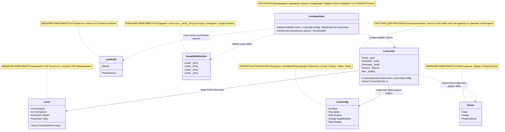

# 10.LoRA - документация реализации

`10.LoRA` добавляет к уже существующему transformer-модулю тонкие обучаемые адаптеры. По-человечески это похоже на прозрачную накладку поверх старой карты: сама карта не перерисовывается, но на ней появляются небольшие поправки, которые можно обучать дешевле, чем всю модель целиком.

Важно: этот проект не является самостоятельной смысловой моделью, `ILearningMachine` или доказательством качества обучения. Он дает механизм заморозить базовые веса, создать LoRA-параметры и проверить их прямой проход. Текущий `LoraApplicator.Apply` возвращает адаптеры, но не подменяет поля `LlmModel` и не встраивает эти адаптеры в обычный `LlmModel.Forward`; поэтому наличие адаптеров нельзя выдавать за полноценный fine-tuning pipeline.

## 1. UML и поток данных



| Класс | Что делает | Статус |
|---|---|---|
| `LoraConfig` | Хранит настройки ранга, масштаба, dropout и целевых модулей. | Полная утилита конфигурации |
| `LoraLinear` | Оборачивает один `Linear`, замораживает его веса и добавляет обучаемые `lora_a`/`lora_b`. | Рабочий адаптер, но не встроен в модель автоматически |
| `LoraApplicator` | Проходит по блокам модели, ищет подходящие `Linear` внутри attention и возвращает список адаптеров. | Частичная интеграция: создает адаптеры, не заменяет поля модели |
| `LlmModel` | Поставляет transformer-блоки и параметры, которые замораживаются. | Внешний проект |
| `CausalSelfAttention` | Содержит `q`/`v` проекции, на которые по умолчанию нацелена LoRA. | Внешний проект |
| `Linear` | Базовый линейный слой, вокруг которого строится `LoraLinear`. | Внешний проект |
| `Tensor` | Передает данные, форму и флаг градиента. | Внешний проект |

### Симуляции соединений UML

| Соединение | Пример входа | Что происходит | Ожидаемый результат | Что нельзя заявлять |
|---|---|---|---|---|
| `LoraApplicator -> LlmModel` | `LlmModel` с 1 блоком, `LoraConfig{Rank=2, Alpha=4}` | `Apply` проходит по `model.Parameters()` и ставит `RequiresGrad=false`. | Базовые параметры модели заморожены. | Нельзя заявлять, что модель уже обучена или что качество выросло. |
| `LoraApplicator -> CausalSelfAttention` | Attention содержит поля `_qProj`, `_vProj`; `TargetModules=["q_proj","v_proj"]` | Имена нормализуются: убираются `_`, сравнение идет без регистра. | `_qProj` и `_vProj` считаются целевыми. | Нельзя заявлять, что все `Linear` в модели автоматически заменены. |
| `LoraApplicator -> LoraLinear` | Найден `Linear` с `InFeatures=16`, `OutFeatures=16` | Создается `new LoraLinear(subModule, config)` и добавляется в список. | Метод возвращает adapter object. | Нельзя заявлять, что этот object уже подключен к `LlmModel.Forward`. |
| `LoraLinear -> Linear` | `Tensor x` формы `[3,8]`, base `Linear(8,4)` | Сначала считается `_base.Forward(x)`. | Базовый выход имеет форму `[3,4]`. | Нельзя считать базовые веса обучаемыми после wrapping. |
| `LoraLinear -> LoraConfig` | `Rank=2`, `Alpha=4`, `Dropout=0` | Масштаб берется как `Alpha / Rank = 2`. | LoRA delta умножается на `2`. | Нельзя скрывать масштаб как обучаемый параметр. |
| `LoraLinear -> Tensor` | `lora_b` нулевая после инициализации | Low-rank путь дает нулевую поправку. | `LoraLinear.Forward(x)` совпадает с base output. | Нельзя выдавать нулевую поправку за обученную адаптацию. |

## 2. Алгоритмы без кода на русском

### Алгоритм A: `LoraConfig` задает масштаб и цели адаптации

Представь ручку настройки: `Rank` говорит, насколько узким будет адаптер, `Alpha` усиливает или ослабляет его вклад, а `TargetModules` выбирает, на какие части внимания смотреть.

**Сигнатуры и типы данных:**

```csharp
public record LoraConfig
// Входные поля: Rank:int, Alpha:float, Dropout:float, TargetModules:string[]
// Выходное вычисляемое поле: Scaling:float
```

Текущий алгоритм:
1. Если пользователь ничего не передал, берутся значения по умолчанию: `Rank=8`, `Alpha=16f`, `Dropout=0.05f`, `TargetModules=["q_proj","v_proj"]`.
2. При чтении `Scaling` возвращается `Alpha / Rank`.
3. `TargetModules` используется позднее в `LoraApplicator.Apply` как список подстрок, а не как строгий registry слоев.

Ветки и ограничения:
- Если `Rank=8`, `Alpha=16`, то `Scaling=2`.
- Если target module записан как `q_proj`, а поле в модели называется `_qProj`, applicator нормализует имя и считает их совпадающими.
- В коде нет отдельной проверки `Rank <= 0`; документация не должна утверждать, что такая валидация есть.

Что НЕ делает:
- Не обучает веса.
- Не проверяет качество адаптера.
- Не доказывает, что выбранные target modules подходят для конкретной задачи.

Статус: полная маленькая конфигурационная утилита, без runtime validation.

### Алгоритм B: `LoraLinear(Linear baseLinear, LoraConfig config)` оборачивает базовый слой

Это как поставить поверх замороженного линейного слоя маленький блок поправок. Старый слой продолжает считать свой результат, а новые матрицы `A` и `B` могут позже учиться.

**Сигнатуры и типы данных:**

```csharp
public LoraLinear(Linear baseLinear, LoraConfig config)
// Вход: baseLinear.InFeatures, baseLinear.OutFeatures, config.Rank, config.Dropout, config.Scaling
// Состояние на выходе: _base, _loraA, _loraB, _dropout, _scaling
```

Текущий алгоритм:
1. Сохраняет ссылку на `baseLinear` в `_base`.
2. Сохраняет `config.Scaling` и создает `Dropout(config.Dropout)`.
3. Берет `inDim = baseLinear.InFeatures`, `outDim = baseLinear.OutFeatures`.
4. Создает `lora_a` формы `[Rank, inDim]` через Kaiming initialization.
5. Создает `lora_b` формы `[outDim, Rank]` нулями, поэтому начальная LoRA-поправка равна нулю.
6. Ставит `RequiresGrad=false` на `baseLinear.Weight` и, если есть, на `baseLinear.Bias`.
7. Регистрирует base, dropout и два LoRA-параметра.

Ветки и ограничения:
- Если у base layer нет bias, замораживается только weight.
- Если bias есть, он тоже замораживается.
- LoRA-параметры остаются trainable через `RegisterParameter`.

Что НЕ делает:
- Не сохраняет checkpoint адаптеров.
- Не подключает адаптер к месту вызова в transformer-блоке.
- Не доказывает, что downstream optimizer реально сделал успешное обучение.

Статус: рабочий adapter module для прямого вызова; интеграция в полный forward модели частичная.

### Алгоритм C: `LoraLinear.Forward(Tensor x)` считает base output плюс low-rank delta

Во время запроса слой сначала спрашивает старый замороженный слой: "что бы ты ответил сам?" Затем отдельно считает маленькую поправку через `A` и `B`, масштабирует ее и прибавляет к старому ответу.

**Сигнатуры и типы данных:**

```csharp
public Tensor Forward(Tensor x)
// Вход: Tensor x, например shape [batch, inFeatures]
// Выход: Tensor, shape [batch, outFeatures]
```

Текущий алгоритм:
1. `baseOut = _base.Forward(x)`.
2. `xDrop = _dropout.Forward(x, training: true)`.
3. `aT = Transpose(_loraA.Value, 0, 1)`, форма `[inFeatures, rank]`.
4. `bT = Transpose(_loraB.Value, 0, 1)`, форма `[rank, outFeatures]`.
5. Считает `xDrop @ aT @ bT`.
6. Умножает результат на `_scaling`.
7. Возвращает `baseOut + lora`.

Ветки и ограничения:
- Dropout всегда вызывается с `training: true`; отдельной inference-ветки здесь нет.
- При нулевой `lora_b` начальный выход совпадает с base output.
- Если `lora_b` вручную или через обучение становится ненулевой, выход может отличаться от base output.

Что НЕ делает:
- Не выбирает токены, не генерирует текст и не принимает смысловых решений.
- Не содержит loss/backward/optimizer step.
- Не доказывает, что adapter quality улучшилась.

Статус: реализованный прямой проход адаптера, но не end-to-end LoRA inference для всей модели.

### Алгоритм D: граница обучения параметров

Идея простая: дорогая базовая модель закрыта от изменений, а маленькие LoRA-матрицы остаются открытыми для обучения.

**Сигнатуры и типы данных:**

```csharp
// В LoraLinear constructor:
baseLinear.Weight.Value.RequiresGrad = false
baseLinear.Bias?.Value.RequiresGrad = false
// Выход: base params frozen, adapter params trainable through Parameters()
```

Текущий алгоритм:
1. `LoraLinear` замораживает weight и bias только переданного `Linear`.
2. `LoraApplicator.Apply` дополнительно проходит по всем `model.Parameters()` и замораживает базовые параметры всей модели.
3. Адаптеры `lora_a` и `lora_b` регистрируются как параметры самого `LoraLinear` и остаются обучаемыми.

Ветки и ограничения:
- Тесты проверяют, что у каждого adapter есть 2 trainable parameters.
- Но optimizer/training loop для LoRA не документирован здесь как завершенный pipeline.

Что НЕ делает:
- Не экспортирует adapter weights.
- Не гарантирует, что training loop выбрал только adapter parameters.
- Не превращает `10.LoRA` в `ILearningMachine`.

Статус: граница trainable/frozen реализована на уровне параметров, но asset lifecycle не является частью этого проекта.

### Алгоритм E: `LoraApplicator.Apply(LlmModel model, LoraConfig config)` ищет целевые attention-слои

Это не "магическая перепрошивка модели", а подготовительный проход: модель замораживается, затем рядом создаются adapter objects для совпавших Linear-полей.

**Сигнатуры и типы данных:**

```csharp
public static IReadOnlyList<LoraLinear> Apply(LlmModel model, LoraConfig config)
// Вход: LlmModel model, LoraConfig config
// Выход: IReadOnlyList<LoraLinear> adapters
```

Текущий алгоритм:
1. Для каждого параметра `model.Parameters()` ставит `RequiresGrad=false`.
2. Создает пустой список `adapters`.
3. Для каждого `block` в `model.Blocks` берет `block.Attention`.
4. Через reflection получает все поля типа `Linear` внутри attention.
5. Нормализует имя поля: удаляет `_`, переводит в lowercase.
6. Нормализует каждый target module тем же способом.
7. Если имя поля содержит target string, создает `new LoraLinear(subModule, config)` и добавляет в список.
8. Возвращает список adapters.

Ветки и ограничения:
- При `TargetModules=["q_proj","v_proj"]` и 4 слоях тест ожидает 8 adapters.
- Если target не совпадает, слой пропускается.
- Метод не вызывает `field.SetValue(...)`; он не заменяет `_qProj`/`_vProj` внутри attention.

Что НЕ делает:
- Не меняет обычный путь `LlmModel.Forward`.
- Не сохраняет список adapters внутри model.
- Не доказывает, что fine-tuning был выполнен или воспроизводим.

Статус: частичная подготовка LoRA: freeze + adapter discovery/creation, без автоматического wiring в модельный forward.

## 3. Короткие ссылки на код с объяснением

### `LoraConfig`: масштаб и target modules

`10.LoRA/LoraConfig.cs:5-12`

```csharp
public int    Rank        { get; init; } = 8;
public float  Alpha       { get; init; } = 16f;   // scaling = alpha / rank
public float  Dropout     { get; init; } = 0.05f;

// Which module name substrings to apply LoRA to
    public string[] TargetModules { get; init; } = ["q_proj", "v_proj"];
    public float Scaling => Alpha / Rank;
```

> Почему важно: именно здесь задается экономия LoRA - маленький rank вместо полного переобучения слоя. `Scaling` не обучается, а вычисляется из config; `TargetModules` по умолчанию направляет адаптацию на query/value projections.

### `LoraLinear`: заморозка base layer и регистрация адаптера

`10.LoRA/LoraLinear.cs:36-43`

```csharp
baseLinear.Weight.Value.RequiresGrad = false;
if (baseLinear.Bias != null)
    baseLinear.Bias.Value.RequiresGrad = false;

RegisterModule("base",    _base);
RegisterModule("dropout", _dropout);
RegisterParameter("lora_a", _loraA);
RegisterParameter("lora_b", _loraB);
```

> Почему важно: этот фрагмент доказывает training boundary. Base weights закрыты от градиента, а LoRA-матрицы зарегистрированы отдельно. Это не доказывает successful training; это только доказывает, какие параметры могут быть trainable в adapter object.

### `LoraLinear.Forward`: реальная формула адаптера

`10.LoRA/LoraLinear.cs:47-58`

```csharp
var baseOut = _base.Forward(x);
var xDrop = _dropout.Forward(x, training: true);
var aT    = TensorOps.Transpose(_loraA.Value, 0, 1); // [in, rank]
var bT    = TensorOps.Transpose(_loraB.Value, 0, 1); // [rank, out]
var lora  = TensorOps.MatMul(TensorOps.MatMul(xDrop, aT), bT);
lora      = TensorOps.Scale(lora, _scaling);
return TensorOps.Add(baseOut, lora);
```

> Как это работает: сначала берется обычный ответ frozen layer, потом считается low-rank поправка через `A` и `B`, затем она масштабируется и прибавляется. Важное ограничение: dropout-ветка здесь всегда `training: true`, отдельного inference режима в методе нет.

### `LoraApplicator.Apply`: freeze модели и создание adapters

`10.LoRA/LoraApplicator.cs:12-16`, `10.LoRA/LoraApplicator.cs:26-35`, `10.LoRA/LoraApplicator.cs:39`

```csharp
public static IReadOnlyList<LoraLinear> Apply(LlmModel model, LoraConfig config)
foreach (var p in model.Parameters())
    p.Value.RequiresGrad = false;
adapters.Add(new LoraLinear(subModule, config));
return adapters;
```

> Почему важно: метод действительно замораживает модель и возвращает adapter list. Но он не делает `field.SetValue` и не меняет путь `LlmModel.Forward`, поэтому документация не должна утверждать автоматическую замену слоев.

### Project boundaries: зависимости от TensorCore, TransformerModel и TrainingLoop

`10.LoRA/LoRA.csproj:9-16`

```xml
<ProjectReference Include="..\00.TensorCore\TensorCore.csproj" />
<ProjectReference Include="..\03.TransformerModel\TransformerModel.csproj" />
<ProjectReference Include="..\04.TrainingLoop\TrainingLoop.csproj" />
```

> Что это доказывает: LoRA живет поверх tensor/layer infrastructure и transformer model. Ссылка на `04.TrainingLoop` не является доказательством, что LoRA training-run уже выполнен и сохранен как asset.

## 4. QA, тесты и честные пробелы

Тесты не запускались в этой документационной подфазе.

| Файл теста | Что покрывает | Что это доказывает | Чего не доказывает |
|---|---|---|---|
| `Tests/LoraTests.cs:17-30` | `LoraConfig` scaling и default targets. | `Alpha / Rank` работает, default targets содержат `q_proj` и `v_proj`. | Не доказывает, что targets подходят для всех моделей. |
| `Tests/LoraTests.cs:36-112` | `LoraLinear.Forward`, frozen base, trainable LoRA params, нулевая и ненулевая `lora_b`. | Adapter output shape корректна; base weights frozen; при `lora_b=0` output равен base; при ненулевой `lora_b` output меняется. | Не доказывает end-to-end model generation или качество fine-tuning. |
| `Tests/LoraTests.cs:119-148` | `LoraApplicator.Apply` freeze и возвращение adapters. | Model parameters frozen, adapters создаются. | Не доказывает автоматическое wiring adapters внутрь `LlmModel.Forward`. |
| `Tests/IntegrationTests2.cs:172-200` | Цепочка `LlmModel -> LoraApplicator -> adapter.Forward`. | У adapters есть trainable params, direct adapter forward не дает NaN. | Не доказывает, что полный transformer forward использует adapters. |
| `Tests/CapabilityResultTranslatorAndDeeperModelTests.cs:126-135` | 4-layer model создает 8 adapters для `q_proj`/`v_proj`. | Количество adapters соответствует 4 слоям * 2 targets, данные adapter params не NaN. | Не доказывает, что LoRA обучена или сохранена. |

Честные gaps:
- Нет свежего запуска тестов в D3A.
- Нет доказательства, что `LoraApplicator.Apply` заменяет поля модели; текущий код возвращает adapters отдельно.
- Нет отдельного LoRA checkpoint/export/import lifecycle.
- Нет runtime report с метриками fine-tuning.

## 5. Связи с соседними проектами

| Соседний проект | Связь | Честная граница |
|---|---|---|
| `00.TensorCore` | Дает `Tensor`, `Parameter`, `Linear`, `Dropout`, `TensorOps`, initializers. | Это math/autograd infrastructure, а не продуктовая логика. |
| `03.TransformerModel` | Дает `LlmModel`, `Blocks`, `CausalSelfAttention` и projection layers. | Текущий LoRA applicator не меняет `LlmModel.Forward`. |
| `04.TrainingLoop` | Может быть будущим потребителем trainable adapter parameters. | Наличие reference не является training evidence. |
| `11.DPO` | Может использовать adapter/fine-tuning infrastructure в будущих документах. | Этот документ не утверждает DPO+LoRA end-to-end готовность. |

## 6. Проверки против ложной готовности

- `LoraLinear` и `LoraApplicator` - это training infrastructure, а не самостоятельная trainable product unit.
- Замороженная база плюс обучаемые adapter params не доказывают, что обучение успешно выполнено.
- JSON, smoke report, static inspection или наличие `.csproj` dependency не заменяют runtime training metrics, checkpoint reload и проверку качества.
- Детерминированный direct forward адаптера нельзя выдавать за semantic reasoning.
- Нельзя скрывать ограничение wiring: текущий `LoraApplicator.Apply` создает adapters и возвращает их, но не подключает их к обычному `LlmModel.Forward`.

## 7. Таблица статуса реализации

| Компонент | Файл | Статус | Что реально работает сейчас |
|---|---|---|---|
| `LoraConfig` | `10.LoRA/LoraConfig.cs` | Полная | Хранит `Rank`, `Alpha`, `Dropout`, `TargetModules`; считает `Scaling => Alpha / Rank`. |
| `LoraLinear` constructor | `10.LoRA/LoraLinear.cs` | Частичная для pipeline | Создает `lora_a`/`lora_b`, замораживает base `Linear`, регистрирует adapter parameters. |
| `LoraLinear.Forward` | `10.LoRA/LoraLinear.cs` | Полная для direct adapter call | Возвращает `baseOut + scaled low-rank delta`; dropout вызывается с `training: true`. |
| `LoraApplicator.Apply` | `10.LoRA/LoraApplicator.cs` | Частичная | Замораживает `model.Parameters()`, ищет matching attention linears, возвращает `IReadOnlyList<LoraLinear>`; не заменяет поля модели. |
| `GetNamedLinears` | `10.LoRA/LoraApplicator.cs` | Полная утилита reflection | Возвращает пары `(field.Name, Linear)` из public/non-public instance fields parent module. |
| `LoRA.csproj` | `10.LoRA/LoRA.csproj` | Полная project wiring | Подключает `00.TensorCore`, `03.TransformerModel`, `04.TrainingLoop`; это dependency wiring, не evidence обучения. |

## 8. Итог для Luba

`10.LoRA` сейчас полезен как слой инфраструктуры для adapter-based fine-tuning: есть config, adapter module, freeze boundary, прямой forward адаптера и applicator, который находит целевые projection layers. Но это еще не документально доказанный end-to-end LoRA training product: адаптеры возвращаются отдельно, не вшиваются в обычный forward модели, нет свежего training-run evidence, нет сохраненного LoRA asset lifecycle.
