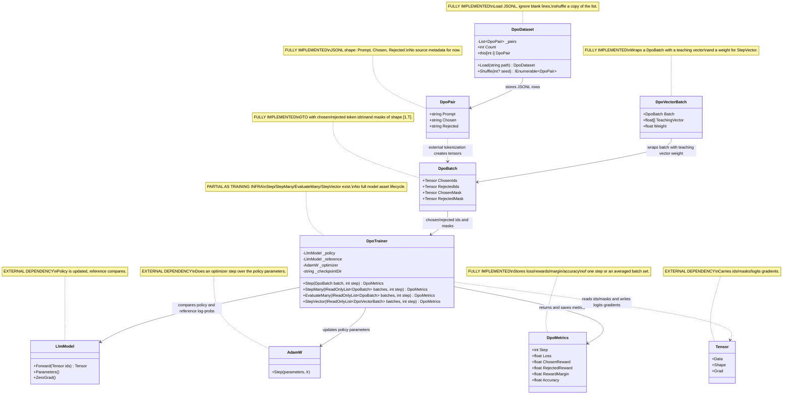

# 11.DPO - implementation documentation

`11.DPO` is Direct Preference Optimization infrastructure: it teaches a policy model to prefer a good `chosen` answer over a bad `rejected` answer relative to a frozen/reference model. In plain terms this is like training an editor on pairs: "this answer is better, this one is worse", but the mere fact of one pair or one JSONL file does not yet prove that the editor started working well for real users.

The project's input data is preference pairs, token tensors and masks. The output data is `DpoMetrics` and a step metrics JSON file of the form `dpo_step_000001.json`. Important: `11.DPO` is not a finished product model, a DPO-authoring oracle or an `ILearningMachine`; it is trainable infrastructure that must be connected with real chosen/rejected data, policy/reference models, a checkpoint lifecycle and separate evaluation.

## 1. UML and data flow



| Class | What it does | Status |
|---|---|---|
| `DpoPair` | Describes one preference pair: prompt, chosen, rejected. | Complete DTO, without metadata |
| `DpoDataset` | Loads JSONL and returns pairs/a shuffled copy. | Complete loading utility |
| `DpoBatch` | Stores token ids and masks for chosen/rejected sequences. | Complete DTO |
| `DpoTrainer` | Computes DPO loss, rewards, gradients, optimizer step and a metrics file. | Working training infrastructure, not a full product lifecycle |
| `DpoMetrics` | Carries loss, reward margin and accuracy. | Complete metrics DTO |
| `DpoVectorBatch` | Adds a teaching vector and weight to a `DpoBatch` for the weighted path. | Complete helper DTO |
| `LlmModel` | Policy/reference model from `03.TransformerModel`. | External project |
| `AdamW` | Optimizer from `04.TrainingLoop`. | External project |
| `Tensor` | TensorCore ids, masks, logits gradients. | External project |

### UML connection simulations

| Connection | Example input | What happens | Expected result | What must not be claimed |
|---|---|---|---|---|
| `DpoDataset -> DpoPair` | JSONL: `{"prompt":"p1","chosen":"c1","rejected":"r1"}` | `Load(path)` reads the non-empty line and deserializes a `DpoPair`. | `Count=1`, `ds[0].Prompt="p1"`. | You cannot claim that the JSONL has already trained the model. |
| `DpoPair -> DpoBatch` | `Prompt="p"`, `Chosen="4"`, `Rejected="5"` | In the current project tokenization/batching is done by external code; `DpoDataset` does not build tensors itself. | A `DpoBatch` with `ChosenIds`, `RejectedIds`, masks results. | You cannot attribute batching to `DpoDataset` that it does not have. |
| `DpoBatch -> DpoTrainer` | `ChosenIds=[1,2,3]`, `RejectedIds=[4,5,6]`, masks all 1 | `Step` computes policy/reference log-probs for both sequences. | Returns `DpoMetrics`. | You cannot take one batch as proof of user quality. |
| `DpoTrainer -> LlmModel` | Policy and reference `LlmModel` | The reference gives frozen baseline log-probs; the policy receives backward/update. | The policy parameters go through an optimizer step. | You cannot claim model export/import or registry readiness. |
| `DpoTrainer -> AdamW` | Gradients after `BackwardLogProbs` | `_optimizer.Step(_policy.Parameters(), lr)` updates the policy. | Then `_policy.ZeroGrad()`. | You cannot claim that the reference is also updated. |
| `DpoTrainer -> DpoMetrics` | `margin=0.3` | The loss is computed as `-log(sigmoid(margin))`, accuracy = `1`. | The metrics are returned and saved to JSON. | A metrics JSON is not checkpoint weights and does not prove real-world improvement. |
| `DpoVectorBatch -> DpoBatch` | `Weight=2`, teaching vector with active slots | `StepVector` normalizes the weight and amplifies the gradient via `VectorSignal`. | Weighted metrics and an optimizer step. | You cannot claim that the teaching vector is a semantic oracle. |
| `DpoTrainer -> Tensor` | ids/mask shape `[1,T]` | `LogProbs` reads logits, the mask skips padding; `BackwardLogProbs` writes the logits grad. | Only unmasked positions are accounted for. | You cannot ignore the masks when describing the loss. |

## 2. No-code algorithms, in the operator's language

### Algorithm A: the JSONL shape via `DpoPair`

Imagine a card for training: on one side a question, on the other two answers - a good one and a bad one. `DpoPair` stores only these three strings.

**Signatures and data types:**

```csharp
public record DpoPair
// Fields: Prompt:string, Chosen:string, Rejected:string
// Example: Prompt="What is 2+2?", Chosen="4", Rejected="5"
```

Current algorithm:
1. The DTO accepts `Prompt`, `Chosen`, `Rejected`.
2. The default value for each field is an empty string.
3. The DTO has no `source`, `metadata`, `near_miss_reason`, `domain`, `quality_label` or other provenance field.

Branches and limitations:
- If the JSONL contains only three fields, all three are kept.
- If the project needs source metadata, it must be added by a separate future work order; the current code does not store it.

What it does NOT do:
- Does not check the quality of the pair.
- Does not prove that rejected is a real near-miss negative.
- Does not contain tokenizer output.

Status: a complete DTO of the current minimal JSONL shape.

### Algorithm B: `DpoDataset.Load(string path)` and `Shuffle(int? seed)`

`DpoDataset` is like a folder of preference cards: it reads the cards from a file, keeps the order and can provide a shuffled copy for training.

**Signatures and data types:**

```csharp
public static DpoDataset Load(string path)
public IEnumerable<DpoPair> Shuffle(int? seed = null)
public DpoPair this[int i] => _pairs[i]
// Input to Load: path to a JSONL
// Output of Load: DpoDataset with Count and an indexer
```

Current `Load` algorithm:
1. Reads all file lines via `File.ReadAllLines(path)`.
2. Discards blank/whitespace lines.
3. Deserializes each remaining line into a `DpoPair`.
4. If deserialization returned `null`, throws `InvalidOperationException`.
5. Stores the list in private `_pairs` and returns a new `DpoDataset`.

Current `Shuffle` algorithm:
1. Creates `Random(seed)` if a seed is given, or a plain `Random()`.
2. Copies `_pairs` into a new list.
3. Does a Fisher-Yates shuffle from the end of the list to the beginning.
4. Returns the copy without mutating the original `_pairs`.

Branches and limitations:
- An empty file gives `Count=0`.
- Blank lines are ignored.
- A seed makes the shuffle reproducible.
- An out-of-range indexer is not caught manually; the standard list exception applies.
- Batching/tokenization are not implemented in `DpoDataset`.

What it does NOT do:
- Does not turn strings into tensors.
- Does not validate the semantic quality of chosen/rejected.
- Does not create a train/eval split.

Status: a complete loading and shuffle utility, but not a batching pipeline.

### Algorithm C: `DpoBatch` defines the role of tensors and masks

`DpoBatch` is no longer text cards, but a prepared package of numbers: separately the tokens of the good answer and the bad answer, plus masks so that padding does not affect the loss.

**Signatures and data types:**

```csharp
public record DpoBatch
// Input fields:
// ChosenIds: Tensor [1,T], RejectedIds: Tensor [1,T]
// ChosenMask: Tensor [1,T], RejectedMask: Tensor [1,T]
// Output: DTO for DpoTrainer.Step/StepMany/EvaluateMany
```

Current algorithm:
1. `ChosenIds` contains the token IDs of the preferred answer as a `Tensor`.
2. `RejectedIds` contains the token IDs of the rejected answer as a `Tensor`.
3. `ChosenMask` and `RejectedMask` set `1` for real tokens and `0` for padding.
4. `DpoTrainer.LogProbs` uses the mask shifted by 1: position `i+1` determines whether to account for the target token.

Branches and limitations:
- If a mask position is `0`, the token is not added to the log-prob average.
- If all mask positions after the shift are `0`, `LogProbs` returns `0`.
- The code does not store the raw prompt text inside `DpoBatch`.

What it does NOT do:
- Does not tokenize itself.
- Does not guarantee equal length of chosen/rejected; that is the responsibility of the creating code.
- Is not a checkpoint or a training report.

Status: a complete DTO for the tensor path.

### Algorithm D: `DpoTrainer.Step(DpoBatch batch, int step)`

This is the heart of DPO: the trainer compares how much the policy prefers chosen over rejected, but does it relative to the reference, so as not to count any change as automatically good.

**Signatures and data types:**

```csharp
public DpoMetrics Step(DpoBatch batch, int step)
// Input: DpoBatch batch, int step
// Output: DpoMetrics { Step, Loss, ChosenReward, RejectedReward, RewardMargin, Accuracy }
```

Current algorithm:
1. Computes `refChosenLogP` and `refRejectedLogP` via the frozen/reference model.
2. Computes `polChosenLogP` and `polRejectedLogP` via the trainable policy model.
3. Computes `chosenReward = Beta * (polChosenLogP - refChosenLogP)`.
4. Computes `rejectedReward = Beta * (polRejectedLogP - refRejectedLogP)`.
5. Computes `margin = chosenReward - rejectedReward`.
6. Computes `loss = -log(sigmoid(margin) + 1e-8)`.
7. Computes the gradient margin as `Sigmoid(margin) - 1`.
8. Does backward for chosen with a positive scale and rejected with a negative scale.
9. Does `_optimizer.Step(_policy.Parameters(), lr)` and `_policy.ZeroGrad()`.
10. Creates `DpoMetrics`.
11. Saves the metrics JSON before returning.

Branches and limitations:
- `Accuracy=1` if `margin > 0`; otherwise `0`.
- `Beta` is fixed as `0.1f`.
- The reference is not updated by the optimizer step.
- The JSON metrics are saved, but the model weights are not saved here as a full checkpoint asset.

What it does NOT do:
- Does not create DPO pairs.
- Does not export the policy model.
- Does not prove user-facing improvement without separate evaluation.

Status: a working single training step, but without the full lifecycle of a trained product model.

### Algorithm E: `StepMany`, `EvaluateMany` and `StepVector`

These methods extend a single step: `StepMany` averages several batches, `EvaluateMany` computes metrics without an update, `StepVector` adds a weight and teaching vector signal.

**Signatures and data types:**

```csharp
public DpoMetrics StepMany(IReadOnlyList<DpoBatch> batches, int step)
public DpoMetrics EvaluateMany(IReadOnlyList<DpoBatch> batches, int step)
public DpoMetrics StepVector(IReadOnlyList<DpoVectorBatch> batches, int step)
public sealed record DpoVectorBatch(DpoBatch Batch, float[] TeachingVector, float Weight = 1f)
```

Current `StepMany` algorithm:
1. If the list is empty, throws `ArgumentException`.
2. If there is a single batch, calls `Step`.
3. For several batches computes rewards/loss/margin for each.
4. Scales the gradient by `1 / batches.Count`.
5. Does one optimizer step and returns the average metrics.

Current `EvaluateMany` algorithm:
1. An empty list is forbidden.
2. Computes the same rewards/loss/margin.
3. Returns the average metrics.
4. Does not call backward, optimizer step and `SaveMetrics`.

Current `StepVector` algorithm:
1. An empty vector batch list is forbidden.
2. Normalizes the weights by the sum of `Math.Max(0.01f, Weight)`.
3. Computes `VectorSignal`: an empty vector gives `1`, active slots amplify the signal up to a clamp `[1,2]`.
4. Multiplies the gradient by the weighted vector signal.
5. Does an optimizer step and saves the metrics.

Branches and limitations:
- Empty lists are an error.
- `EvaluateMany` does not save a JSON metrics file.
- `StepVector` does not prove that the teaching vector is semantically correct; it only changes the weighting.

What it does NOT do:
- Does not conduct a full training run orchestration.
- Does not select a held-out validation set.
- Does not perform a fresh-load/continue-training probe.

Status: working helper training/evaluation paths with honest lifecycle gaps.

### Algorithm F: `DpoMetrics` - what the fields do and do not prove

The metrics are a thermometer of one step, not a health certificate of the whole system. They show loss/reward/margin in a specific run.

**Signatures and data types:**

```csharp
public record DpoMetrics
// Step:int, Loss:float, ChosenReward:float, RejectedReward:float,
// RewardMargin:float, Accuracy:float
```

Current algorithm:
1. `Step` carries the step number that the caller passed.
2. `Loss` shows the DPO loss for a pair or an averaged set.
3. `RewardMargin` equals `ChosenReward - RejectedReward`.
4. `Accuracy` equals `1`/`0` for a single step or an average fraction for the many/vector paths.
5. `SaveMetrics` serializes the DTO to JSON.

Branches and limitations:
- In `Step` the accuracy is binary.
- In `StepMany`/`StepVector` the accuracy can be an average fraction.
- The metrics do not contain CPU/RAM, dataset hash, checkpoint path or model manifest.

What it does NOT do:
- Does not prove that a user scenario got better.
- Is not a model checkpoint.
- Does not replace an evaluation report.

Status: a complete metrics DTO of the current trainer path.

## 3. Short code references with explanation

### `DpoPair`: the minimal JSONL shape without metadata

`11.DPO/Models/DpoPair.cs:3-8`

```csharp
public record DpoPair
{
    public string Prompt   { get; init; } = "";
    public string Chosen   { get; init; } = "";
    public string Rejected { get; init; } = "";
}
```

> Why it matters: this is the current DPO row contract. It confirms the presence of prompt/chosen/rejected, but also proves the absence of source metadata in the current DTO.

### `DpoDataset.Load`: JSONL loading and blank-line filter

`11.DPO/DpoDataset.cs:20-24`

```csharp
var pairs = File.ReadAllLines(path)
    .Where(l => !string.IsNullOrWhiteSpace(l))
    .Select(l => JsonSerializer.Deserialize<DpoPair>(l)
                 ?? throw new InvalidOperationException($"Failed to parse: {l}"))
    .ToList();
```

> How this works: each non-empty line must be JSON of one `DpoPair`. Blank lines do not enter the dataset. This is not batching: tensors appear later, outside `DpoDataset`.

### `DpoDataset.Shuffle`: reproducible shuffling

`11.DPO/DpoDataset.cs:30-36`

```csharp
var rng  = seed.HasValue ? new Random(seed.Value) : new Random();
var copy = _pairs.ToList();
for (int i = copy.Count - 1; i > 0; i--)
{
    int j = rng.Next(i + 1);
    (copy[i], copy[j]) = (copy[j], copy[i]);
}
```

> Why it matters: the shuffle works on a copy, so the original dataset is not mutated. A seed gives a repeatable order for tests, but is not proof of data quality.

### `DpoTrainer.Step`: policy/reference comparison and reward margin

`11.DPO/DpoTrainer.cs:34-47`

```csharp
float refChosenLogP   = LogProbs(_reference, batch.ChosenIds,   batch.ChosenMask);
float refRejectedLogP = LogProbs(_reference, batch.RejectedIds, batch.RejectedMask);

// Policy log-probs: the trainable model, backward is needed
float polChosenLogP   = LogProbs(_policy, batch.ChosenIds,   batch.ChosenMask);
float polRejectedLogP = LogProbs(_policy, batch.RejectedIds, batch.RejectedMask);

// DPO margin: how much the policy prefers chosen over rejected relative to the reference
float chosenReward   = Beta * (polChosenLogP   - refChosenLogP);
float rejectedReward = Beta * (polRejectedLogP - refRejectedLogP);
float margin         = chosenReward - rejectedReward;

// DPO loss: -log σ(margin)
float loss = -MathF.Log(Sigmoid(margin) + 1e-8f);
```

> Why it matters: DPO does not look only at the raw policy score. It compares the policy with the reference and then chosen with rejected. This proves the current step formula, but does not prove full training quality.

### `DpoTrainer.Step`: backward, optimizer and metrics save

`11.DPO/DpoTrainer.cs:50-54`

```csharp
float gradMargin = Sigmoid(margin) - 1f;
BackwardLogProbs(_policy, batch.ChosenIds, batch.ChosenMask,  gradMargin * Beta);
BackwardLogProbs(_policy, batch.RejectedIds, batch.RejectedMask, -gradMargin * Beta);
_optimizer.Step(_policy.Parameters(), lr: _learningRate);
```

> How this works: gradients go only into the policy path, then the optimizer updates the policy parameters. The metrics save is shown as a separate exact quote below, so the line reference does not mix non-adjacent sections.

`11.DPO/DpoTrainer.cs:68`

```csharp
SaveMetrics(metrics);
```

> What this proves: `Step` actually calls the metrics write before returning. What it does not prove: this is not a model checkpoint and not export/import evidence.

### `LogProbs`: masks and the shift to the next token

`11.DPO/DpoTrainer.cs:237-258`

```csharp
for (int i = 0; i < t - 1; i++)
{
    float maskVal = mask.Data[i + 1];
    if (maskVal == 0f) continue;

    int targetId = (int)ids.Data[i + 1];

    // LogSoftmax of row i
    float maxVal = float.NegativeInfinity;
    for (int j = 0; j < v; j++)
        if (logits.Data[i * v + j] > maxVal)
            maxVal = logits.Data[i * v + j];

    float logSumExp = 0f;
    for (int j = 0; j < v; j++)
        logSumExp += MathF.Exp(logits.Data[i * v + j] - maxVal);
    logSumExp = MathF.Log(logSumExp);

    float logP = logits.Data[i * v + targetId] - maxVal - logSumExp;
    sum += logP * maskVal;
    cnt += maskVal;
}
```

> Why it matters: the loss is computed over the next token and skips padding via the mask. If you forget this branch, the document would falsely describe DPO as a comparison of the whole sequence without masking.

### `SaveMetrics`: atomic-ish JSON evidence of a step

`11.DPO/DpoTrainer.cs:324-327`

```csharp
string path = Path.Combine(_checkpointDir, $"dpo_step_{m.Step:D6}.json");
string tmp  = path + ".tmp";
File.WriteAllText(tmp, System.Text.Json.JsonSerializer.Serialize(m));
File.Move(tmp, path, overwrite: true);
```

> What it proves: the metrics are written through a temporary file and rename. What it does not prove: the presence of model weights checkpoint, manifest, locator, fresh-load or continue-training evidence.

## 4. QA, tests and honest gaps

The tests were not run in this documentation subphase.

| Test file | What it covers | What it proves | What it does not prove |
|---|---|---|---|
| `Tests/DpoDatasetTests.cs:20-47` | `Load` count and field preservation. | JSONL lines turn into `DpoPair`, the fields are not lost. | Does not prove the quality of the preference data. |
| `Tests/DpoDatasetTests.cs:49-75` | Empty file and blank lines. | `Count=0` for an empty file, blank lines ignored. | Does not prove batching/tokenization. |
| `Tests/DpoDatasetTests.cs:77-117` | Seeded shuffle and indexer out-of-range. | The shuffle is repeatable with a seed and contains all items; the indexer throws a standard exception. | Does not prove a train/eval split. |
| `Tests/DpoTrainerTests.cs:57-129` | Step metrics contracts. | `Step`, positive/non-NaN loss, binary accuracy, margin consistency. | Does not prove product behavior improvement. |
| `Tests/DpoTrainerTests.cs:135-166` | The metrics JSON file. | The metrics file exists, the `.tmp` does not remain, the JSON deserializes and matches the returned metrics. | A metrics JSON is not a model checkpoint. |
| `Tests/DpoTrainerTests.cs:172-224` | Multiple steps and reward margin improvement under repeated preference. | Several steps do not crash, each writes a file, the reward margin can improve in a synthetic setup. | Does not prove held-out quality, fresh-load or registry/locator lifecycle. |
| `Tests/CapabilityResultTranslatorAndDeeperModelTests.cs:91-117` | An integration one-step DPO smoke via tokenizer/model/batch. | One DPO step returns sane metrics and writes a metrics JSON. | Does not prove an end-to-end trained feature. |

Honest gaps:
- There is no fresh test run in D3B.
- `DpoDataset` does not do tokenization/batching.
- `DpoPair` does not store source metadata.
- `DpoTrainer` writes a metrics JSON, but does not save a full policy model checkpoint/manifest/locator.
- There is no proof of user-facing improvement without downstream evaluation.

## 5. Links to neighboring projects

| Neighboring project | Link | Honest boundary |
|---|---|---|
| `00.TensorCore` | Provides `Tensor`, gradients and tensor operations. | Tensor math is not DPO quality evidence. |
| `03.TransformerModel` | Provides the `LlmModel` policy/reference and logits. | The presence of a model does not prove a trained product capability. |
| `04.TrainingLoop` | Provides the `AdamW` optimizer. | An optimizer step does not replace an evaluation report. |
| `10.LoRA` | Connected as a project dependency. | `DpoTrainer` itself in the current code works with `LlmModel`; LoRA wiring is not a mandatory part of `Step`. |
| Future `18.CapabilityTraining`/`25.ModelServer` | Can provide data generation, manifests, locator, model server lifecycle. | This document does not claim that such a lifecycle is already closed in `11.DPO`. |

## 6. Anti-false-done checks

- JSONL presence is only the presence of preference rows, not training evidence.
- `dpo_step_000001.json` is a step metrics artifact, not a model checkpoint.
- One successful `Step` does not prove that user behavior improved.
- The DPO utility becomes trainable infrastructure only when there is real chosen/rejected data, policy/reference models, a checkpoint/export/import path, manifest/locator and evaluation.
- You must not present a deterministic or synthetic test setup as a product DPO-authoring authority.
- `11.DPO` is not an `ILearningMachine`; the training boundary here is on `DpoTrainer`, not on a logical hierarchy.

## 7. Implementation status table

| Component | File | Status | What actually works now |
|---|---|---|---|
| `DpoPair` | `11.DPO/Models/DpoPair.cs` | Complete DTO | Stores `Prompt`, `Chosen`, `Rejected`; metadata/source fields are absent. |
| `DpoDataset.Load` | `11.DPO/DpoDataset.cs` | Complete utility | Reads JSONL, ignores blank lines, deserializes `DpoPair`, returns a `DpoDataset`. |
| `DpoDataset.Shuffle` | `11.DPO/DpoDataset.cs` | Complete utility | Does a Fisher-Yates shuffle of a copy; a seed gives a repeatable order. |
| `DpoBatch` | `11.DPO/Models/DpoBatch.cs` | Complete DTO | Stores `ChosenIds`, `RejectedIds`, `ChosenMask`, `RejectedMask` as `Tensor`. |
| `DpoTrainer.Step` | `11.DPO/DpoTrainer.cs` | Complete for a single step | Computes policy/reference log-probs, DPO margin/loss, backward, optimizer step, metrics JSON. |
| `DpoTrainer.StepMany` | `11.DPO/DpoTrainer.cs` | Complete for a batch-list step | Averages several batches, scales gradients, does one optimizer step and writes metrics. |
| `DpoTrainer.EvaluateMany` | `11.DPO/DpoTrainer.cs` | Complete evaluation utility | Computes average metrics without backward/update/save. |
| `DpoTrainer.StepVector` | `11.DPO/DpoTrainer.cs` | Partial weighted training utility | Adds vector-based weighting, but does not prove the semantic correctness of the teaching vectors. |
| `DpoMetrics` | `11.DPO/Models/DpoMetrics.cs` | Complete DTO | Stores `Step`, `Loss`, `ChosenReward`, `RejectedReward`, `RewardMargin`, `Accuracy`. |
| `DpoVectorBatch` | `11.DPO/DpoTrainer.cs` | Complete DTO | Stores `DpoBatch`, `TeachingVector`, `Weight` for `StepVector`. |

## 8. Summary for Luba

`11.DPO` already contains a real training-step mechanism: a preference pair DTO, a JSONL loader, a tensor batch DTO, policy/reference comparison, reward margin, loss, backward, optimizer step and metrics file writing. But the honest status is this: it is preference-training infrastructure, not a finished trained product model. For the claim "behavior really improved" you need not only JSONL and a metrics JSON, but downstream evaluation, a model checkpoint/export/import, manifest/locator, fresh-load and continue-training evidence.
